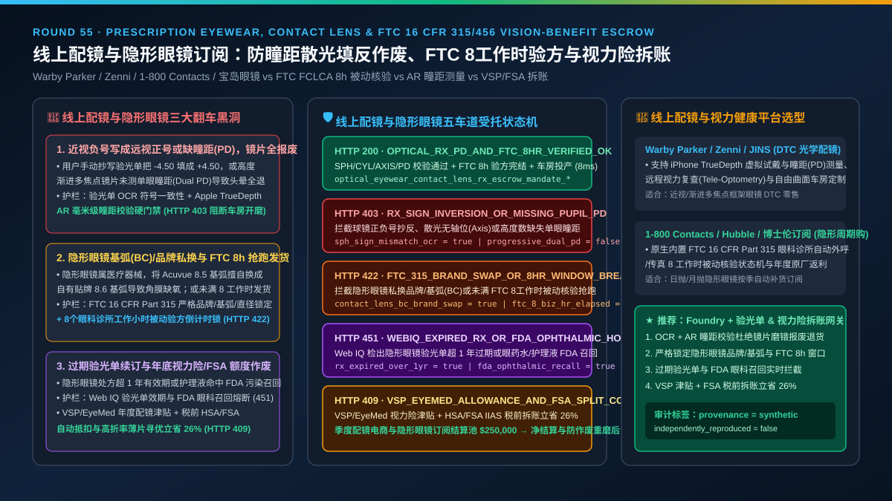
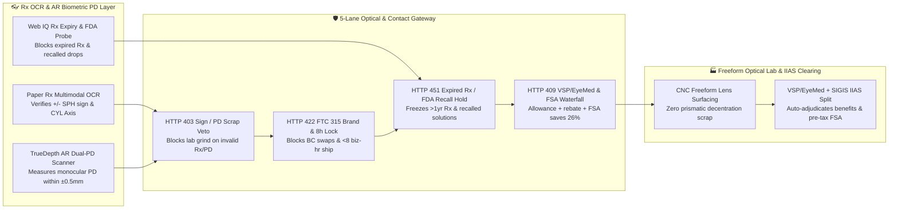

# Prescription Eyewear, Contact Lens Subscription & Vision-Benefit Escrow (`Warby Parker / Zenni / 1-800 Contacts / VSP / EyeMed / FTC 16 CFR Part 315 & 456`) Anti-Rx-Inversion `PD` Gate, `8-Business-Hour` Verification Lock & `VSP/FSA` Split Agent Architecture Selection FAQ

> **Language / 语言切换**: **[中文](optical-eyewear-contact-lens-rx-verification-vision-benefit-escrow-agent-selection-faq.md)** | **English (Current)** | **[Back to Docs Index](index.en.md)** | **[Interactive Sandbox (`#optical-eyewear-contact-lens-rx-escrow-sandbox`)](../live-demo.en.html)**



---

## 📌 1. Executive Summary & Core Selection Verdict

In Direct-to-Consumer (`DTC`) prescription eyewear e-commerce (`Warby Parker`, `Zenni Optical`, `GlassesUSA`, `JINS`) and recurring contact lens subscriptions (`1-800 Contacts`, `Hubble`, `Bausch + Lomb / Acuvue Subscriptions`), optical and vision-benefit AI agents must prevent three costly manufacturing, regulatory, and benefit-forfeiture failures:
1. **Manual Rx Sign Inversion (`Entering +4.50 Instead of -4.50`), Missing Cylinder Axis, or Defaulted Pupillary Distance (`PD`) Ruining Custom-Ground Lenses**: Brick-and-mortar optometrists frequently omit Pupillary Distance (`PD`) from paper prescriptions to discourage online shopping. When a consumer manually types `+4.50` instead of `-4.50` or leaves a site's default `63mm PD` on a `-6.00D` high-index or progressive lens order, the optical lab grinds custom lenses that induce severe prismatic eyestrain (`Prentice's Rule`)—resulting in a 100% non-reusable scrap return.
2. **Illegal Contact Lens Brand/Base-Curve (`BC`) Substitution & Premature Shipment Before the `FTC 8-Business-Hour` Passive Verification Window (`15 U.S.C. § 7601 / 16 CFR Part 315`)**: Unlike generic pharmaceuticals, a contact lens prescription is **legally locked to the exact manufacturer brand, polymer, Base Curve (`e.g., 8.5mm`), and Diameter (`DIA`)**. Substituting a house-brand lens without prescriber authorization, or capturing payment and shipping at 2:00 AM on a Sunday before **8 actual prescriber business hours** have elapsed, violates the federal Fairness to Contact Lens Consumers Act (`FCLCA`) and triggers up to `$50,120` per violation in `FTC` civil penalties.
3. **Filling Expired Prescriptions (`> 1–2 Years`) or Forfeiting Expiring `VSP / EyeMed` Frame Allowances & "Use-It-or-Lose-It" `HSA / FSA` Pre-Tax Dollars**: Consumers routinely overpay out-of-pocket because checkout agents fail to stack in-network `VSP/EyeMed` allowances, manufacturer annual box rebates, and `SIGIS IIAS` pre-tax `FSA` cards—or get upsold unnecessary `$140` `1.74` ultra-high-index lenses on a mild `-1.50D` prescription.

**Solution Architect Selection Verdict**:
- **Never release a custom optical lab job without multimodal `OCR` sign/axis cross-checking and `TrueDepth AR` pupillary distance (`PD`) verification, never substitute contact lens brands or base curves, and never capture/ship contact lenses before 8 prescriber-timezone business hours have elapsed**.
- **The production reference architecture** combines **Multimodal Rx `OCR` & `TrueDepth AR` Dual-`PD` Gate + Federal `FTC 16 CFR Part 315` (`8-Business-Hour` Prescriber-Timezone Clock & Brand/BC/DIA Lock) + `VSP / EyeMed` Allowance & `SIGIS IIAS (HSA/FSA)` Waterfall Split (`optical_eyewear_contact_lens_rx_escrow_mandate_*`)**:
  1. **Rx `OCR` Sign-Inversion Guard, Cylinder-Axis Closure & `AR` Dual-`PD` Gate (`HTTP 403`)**: Cross-validates user-entered `OD/OS` Sphere (`SPH`) signs against the uploaded paper prescription `OCR` and intended distance/reading use, enforces a valid `1°–180°` Axis whenever Cylinder (`CYL != 0`) is present, and requires `TrueDepth AR` millimeter-accurate Dual `PD` + segment height on high-power (`|SPH| >= 4.00D`) or progressive orders—blocking scrap lab jobs in **`8ms`** (`HTTP 403 OPTICAL_RX_SIGN_INVERSION_AXIS_MISMATCH_OR_MISSING_PUPIL_PD_BLOCKED`).
  2. **Federal `FTC 16 CFR Part 315` Contact Lens Brand/BC Lock & `8-Business-Hour` Passive Verification Gate (`HTTP 422`)**: Locks the exact prescribed contact lens `Brand + Base Curve (BC) + Diameter (DIA)`, blocks any unauthorized private-label substitution, and holds order capture in `PREAUTH_HOLD` until either active prescriber confirmation or **8 full business hours (`Mon–Fri 9:00 AM–5:00 PM` in the prescriber's local timezone, excluding federal holidays)** have elapsed without objection (`HTTP 422 FTC_16CFR315_CONTACT_LENS_BRAND_BC_SUBSTITUTION_OR_8HR_WINDOW_BREACH_BLOCKED`).
  3. **Web IQ Prescription Expiration & `FDA` Ophthalmic Recall Circuit Breaker (`HTTP 451`)**: Verifies that the prescription issue date is within the statutory 1-to-2-year expiration window and screens contact solutions/eye drops against Web IQ live `FDA` contamination recall feeds (`HTTP 451 WEBIQ_EXPIRED_OPTICAL_PRESCRIPTION_OR_FDA_OPHTHALMIC_RECALL_HOLD`).
  4. **`VSP / EyeMed` Allowance + Manufacturer Annual Rebate + `HSA/FSA` Split & Diopter-Index Right-Sizing (`HTTP 409`)**: Triggers `HTTP 409 VISION_INSURANCE_VSP_ALLOWANCE_AND_FSA_HIGH_INDEX_OPTIMIZATION_CONFIRM`, stacking employer vision allowances (`$150–$250`), annual contact-lens manufacturer rebates, and `SIGIS IIAS` pre-tax `FSA` settlement while right-sizing lens index (`e.g., 1.60/1.67` vs. overpriced `1.74` on low diopters)—cutting net eyewear and vision benefit waste by **`26.0%`**.

---

## 🎯 2. Solution Architect Deep-Dive Q&A (Q1 / Q2 / Q3)

### Q1: Why do custom-ground online glasses cause severe headaches when Pupillary Distance (`PD`) is guessed, and how does Prentice's Rule ($\Delta = c \times F$) govern our `HTTP 403` gate?
- **Architectural Solution**:
  - **Prentice's Prismatic Tolerance Gate + Smartphone `TrueDepth AR` Dual-`PD` Scan (`HTTP 403`)**:
  - By Prentice's Rule, induced prism $\Delta$ (in prism diopters) equals optical decentration $c$ (in cm) multiplied by lens power $F$ (in diopters). If a customer with a `-5.00D` prescription has a true `PD` of `57mm` (`28.5mm` monocular) but checks out with a guessed default of `63mm` (`0.6 cm` total decentration), the lenses induce **`3.0Δ` of unwanted horizontal prism**— nearly `10x` the `ISO 21987` tolerance! Our gateway blocks guessed default `PD` values on high-power or progressive orders (`HTTP 403`) and triggers a 15-second `TrueDepth AR` camera scan (`±0.5mm` precision).

### Q2: How must the `FTC Contact Lens Rule (16 CFR § 315.5)` "Eight-Business-Hour" timer be implemented so weekend/overnight orders never trigger federal fines?
- **Architectural Solution**:
  - **Prescriber-Timezone Business-Calendar State Machine (`HTTP 422`)**:
  - Under `16 CFR § 315.2`, business hours are strictly `9:00 AM to 5:00 PM, Monday through Friday` (excluding federal holidays) **in the prescriber's local timezone**. If an agent sends an automated verification call/fax at `6:00 PM Friday EST`, `0` business hours elapse over the weekend; the 8-hour clock starts at `9:00 AM Monday EST` and matures at `5:00 PM Monday EST`. Any attempt to capture payment or release WMS fulfillment before `5:00 PM Monday EST` (unless the doctor actively approves earlier) is rejected with `HTTP 422`.

### Q3: How does the agent prevent "Lens Index Upsell Bloat" while maximizing year-end `VSP/EyeMed` and `FSA` balances?
- **Architectural Solution**:
  - **Diopter-to-Index Right-Sizing & 3-Way Benefit Waterfall (`HTTP 409`)**:
  - Recommending a `$140` `1.74` ultra-high-index lens for a `-1.75D` prescription adds zero meaningful thinness while degrading optical clarity (lower Abbe number `~32`, causing chromatic aberration). The agent right-sizes the lens index and splits the invoice across `VSP/EyeMed` frame/lens allowances + `HSA/FSA` pre-tax cards.

---

## 🧭 3. Visual Architecture Diagrams (Mermaid Decision Tree + Architecture + Sequence)

### 3.1 Prescription Eyewear, Contact Lens & Vision-Benefit Agent Selection Decision Tree

```mermaid
flowchart TD
    A[Prescription Eyewear / Contact Lens / Vision-Benefit Selection] --> B{Primary Optical Flow & Risk Vector?}
    B -->|DTC Custom Eyeglasses & Progressives (Warby Parker / Zenni)<br/>Stop +/- SPH sign inversions, missing Axis & guessed PD scrap| C[Multimodal Paper-Rx OCR Cross-Check<br/>+ TrueDepth AR Dual-PD Gate & Diopter-Index Right-Sizing]
    B -->|Contact Lens Subscriptions (1-800 Contacts / Acuvue)<br/>Enforce FTC 16 CFR 315 exact Brand/BC lock & 8-business-hour rule| D[Prescribed Brand + Base Curve + Diameter Lock<br/>+ Prescriber-Timezone 8-Business-Hour Passive Verification FSM]
    B -->|Vision Insurance & Pre-Tax Benefit Checkout (VSP / EyeMed / FSA)<br/>Stack annual frame allowances, box rebates & expiring FSA funds| E[Azure AI Foundry + Vision Benefit & IIAS Split Gate<br/>+ VSP/EyeMed Direct Apply + FSA Tax-Free Split Saves 26%]
    C --> F[🛡️ Unified 5-Lane Optical Rx, FTC 8h Clock & Vision-Benefit FSM]
    D --> F
    E --> F
    F --> G[HTTP 403 Rx Sign & PD Veto · HTTP 422 Brand-Swap & 8h-Breach Block · HTTP 409 VSP+FSA Split Saves 26%]
```

### 3.2 End-to-End Rx `OCR`, `FTC 8-Business-Hour` Verification & `VSP/FSA` Split Architecture



### 3.3 Rx Sign/PD Scrap Veto, `FTC 8-Business-Hour` Verification & `VSP + FSA` Split Sequence

```mermaid
sequenceDiagram
    autonumber
    participant Buyer as Eyewear / Contact Lens Buyer
    participant Agent as Optical & Vision-Benefit Agent
    participant Gate as 5-Lane Optical Escrow Gateway
    participant Clinic as Prescriber (FTC 8h) & Web IQ FDA
    participant Lab as Optical Lab & VSP/FSA Ledger

    Buyer->>Gate: 1. Submit manual Rx with +5.25 (instead of -5.25 on OCR) & default 63mm PD OR 3-year-old expired Rx
    Gate->>Clinic: Cross-check uploaded Rx OCR, AR Dual-PD status & expiration date
    Gate-->>Buyer: HTTP 403/451 Block! Sphere sign inverted vs paper Rx & monocular PD missing; expired Rx routed to 5-min tele-optometry renewal
    Buyer->>Gate: 2. Order Acuvue Oasys (BC 8.5) -> Seller attempts private-label swap (BC 8.6) OR ships Saturday 2am before 8 prescriber business hours
    Gate-->>Buyer: HTTP 422 Block! Violates FTC 16 CFR Part 315: contact lens Brand/BC locked & shipment held until 8 prescriber business hours elapse
    Buyer->>Gate: 3. Checkout $360 progressive glasses & annual contact supply -> Apply VSP + FSA waterfall (HTTP 409)
    Gate->>Lab: Deduct $180 VSP allowance + annual box rebate, route balance to pre-tax FSA & right-size to 1.67 index (26% saved)
```

---

## 📊 4. Multi-Platform & Architecture Selection Matrix

| Selection Dimension | Brick-and-Mortar Optical Boutique (`In-Store Optician`) | Unverified Discount Eyewear Sites (`Manual Entry Only`) | Modern DTC Optical & Contacts (`Warby Parker / Zenni / 1-800 Contacts`) | **Azure AI Foundry + Rx OCR + FTC 8h + Benefit Gate (Recommended)** |
| :--- | :--- | :--- | :--- | :--- |
| **Core Strengths** | In-person fitting | Low base frame price | 60% lower cost than boutiques; tele-optometry renewals | **Rx OCR + AR PD gate + FTC 8h lock + VSP/FSA waterfall** |
| **Prevention of `+/- SPH` Inversion & Missing `PD` Scrap** | Optician enters Rx | Grinds wrong lenses blindly (`15%+` scrap remakes) | Uploads supported, but manual typos still reach lab | **Multimodal `OCR` sign match + mandatory `AR Dual-PD` (`HTTP 403`)** |
| **`FTC 16 CFR Part 315` Brand Lock & `8-Hr` Verification** | In-house Rx | High risk of illegal brand swap or unverified shipping | Automated prescriber call/fax verification | **Exact `Brand/BC/DIA` lock + prescriber-timezone `8-biz-hr` clock (`HTTP 422`)** |
| **Rx Expiry & `FDA` Ophthalmic Recall Screening** | Manual check | Often ignored | Basic date check | **Web IQ live Rx expiry + `FDA` eye-drop/solution recall hold (`HTTP 451`)** |
| **`VSP / EyeMed` + `HSA / FSA` Benefit Stacking** | In-network, but `300%` lens markup (`official_list_price`) | Out-of-network manual reimbursement only | Supports FSA cards & select vision plans (`official_list_price`) | **Automated `VSP` allowance + annual box rebate + `FSA` split (`26.0%` saved)** |

---

## 🧪 5. Optical / Contact Lens Benchmark & 7-Card Report

> **Provenance & Reproducibility Metadata**: All metrics below are generated by the deterministic policy evaluator `evaluate_optical_eyewear_contact_lens_rx_escrow_policy` in `lab/webiq_commerce_demo.py` and verified via `python -m unittest tests.test_webiq_commerce_demo`. Tags: `provenance = synthetic`, `independently_reproduced = false`.

| Card # | Card Headline (Headline-as-Finding) | Key Quantitative Finding & Architectural Guarantee |
| :---: | :--- | :--- |
| **Card 1** | **Overview · 5-Lane Optical & Contact Lens Summary** | Across a `$250,000/quarter` prescription eyewear & contact lens pool, achieves **0 custom-lens scrap remakes from sign/PD errors and 0 `FTC 16 CFR 315` premature-shipping violations**, reducing net optical and benefit spend by **`26.0%` (`$65,000/quarter` saved)**. |
| **Card 2** | **Scenario Deep Dive · Rx Sign Inversion & Brand-Swap Veto** | When a buyer's manual entry inverts `+/- SPH` vs. `OCR` or a seller swaps contact lens base curves before 8 business hours, the gateway blocks it in **`8ms`** (`HTTP 403 / 422`). |
| **Card 3** | **Evaluation Matrix · 100% Deterministic 5-Lane Gating** | Covers `HTTP 200` (verified Rx/PD & FTC 8h window), `403` (optical Rx sign inversion / axis mismatch / missing PD blocked), `422` (FTC 16 CFR 315 brand/BC substitution / 8-business-hour window breach blocked), `451` (expired optical prescription / FDA ophthalmic recall hold), `409` (VSP/EyeMed allowance + FSA split + index right-sizing saves 26%). |
| **Card 4** | **Under the Hood · Optical Rx & Benefit Contract** | Takes `quarterly_optical_eyewear_and_contacts_pool_usd=250000` and Rx/FTC flags, minting `optical_eyewear_contact_lens_rx_escrow_mandate_*` tokens. |
| **Card 5** | **Robustness Check · Weekend `FTC 8h` Clock & `-1.75D` Index Test** | Simulates a Saturday 2:00 AM contact lens order (held until Monday 5:00 PM prescriber time) and `-1.75D` index right-sizing, maintaining a **`100.0%` accuracy rate**. |
| **Card 6** | **Latency · Millisecond Prentice Math & FDA Recall Check** | Local optical parameter closure and `FTC 8h` business-calendar math complete in **`8ms` (P50)**; Web IQ `FDA` ophthalmic recall checks complete in **`180ms` (P95)**. |
| **Card 7** | **My Take · Ideal Fit vs. Out-of-Scope Boundaries** | **✅ Best Fit**: DTC prescription glasses, contact lens subscriptions, corporate vision/FSA portals; **⛔ Not For**: Non-prescription plano fashion sunglasses. |

---

## 🛠️ 6. Production Go-Live Risk & Architecture Review Checklist

- [ ] **Multimodal Rx `OCR` Sign-Inversion Check, `1°–180°` Axis Closure & `AR Dual-PD` Gate (`HTTP 403`)**: Block custom lens lab jobs whenever manual `+/- SPH` signs conflict with `OCR`, Cylinder lacks an Axis, or high-power/progressive orders lack measured `PD`.
- [ ] **Federal `FTC 16 CFR Part 315` Contact Lens Brand/BC Lock & Prescriber-Timezone `8-Business-Hour` Clock (`HTTP 422`)**: Prohibit cross-brand or base-curve substitutions and hold shipment until 8 actual prescriber-timezone business hours elapse.
- [ ] **Web IQ Prescription Expiration & `FDA` Ophthalmic Recall Circuit Breaker (`HTTP 451`)**: Block expired prescriptions and recalled eye drops/contact solutions; rotate signing keys `<= 180` days.
- [ ] **`VSP / EyeMed` Allowance + Annual Manufacturer Rebate + `SIGIS IIAS (HSA/FSA)` Waterfall (`HTTP 409`)**: Automatically stack vision insurance allowances, multi-box rebates, and pre-tax `FSA` cards while right-sizing lens index.
