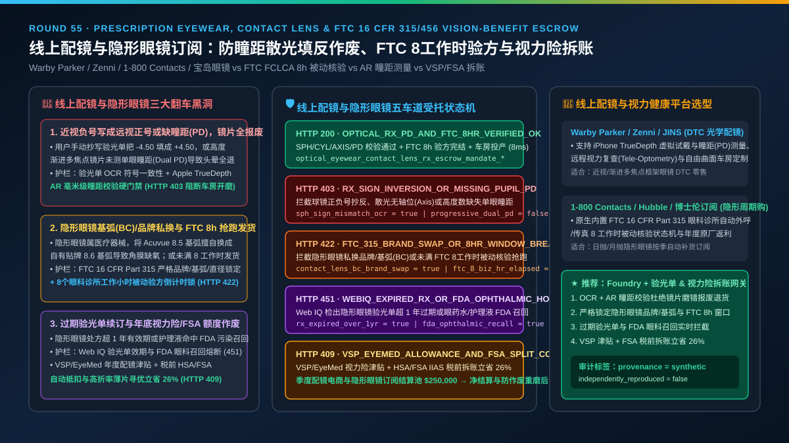
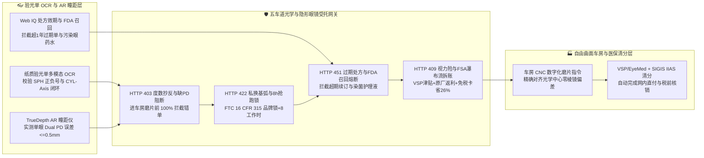
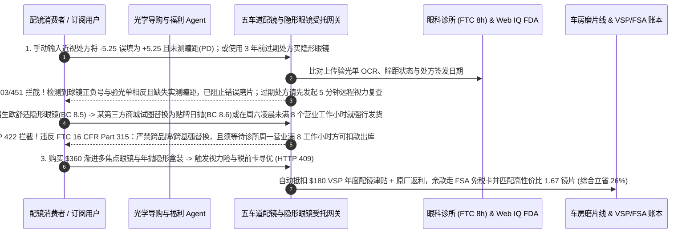

# 线上配镜、隐形眼镜周期订阅与视力险/FSA 结算（Prescription Eyewear, Contact Lens Subscription & Vision-Benefit Escrow：Warby Parker / Zenni / 1-800 Contacts / VSP / EyeMed / 宝岛眼镜）“防近视正负号填反与瞳距（PD）缺失导致定制镜片报废、FTC 8 工作时被动验方锁与 VSP/FSA 自动拆账”Agent 架构选型 FAQ

> **语言切换 / Language**: **中文 (当前)** | **[English](optical-eyewear-contact-lens-rx-verification-vision-benefit-escrow-agent-selection-faq.en.md)** | **[返回文档目录](index.md)** | **[交互式沙盒 (`#optical-eyewear-contact-lens-rx-escrow-sandbox`)](../live-demo.html)**



---

## 📌 一、核心选型结论速览（Executive Summary）

在 DTC 线上配镜电商（Warby Parker、Zenni Optical、GlassesUSA、JINS、宝岛眼镜数字化门店）与隐形眼镜周期订阅（1-800 Contacts、Hubble、博士伦/强生安视优订阅）的智能体导购与医保/FSA 结算场景中，光学与二类/三类医疗器械零售存在三大致命痛点：
1. **用户手动输入验光单把近视负号（`-4.50`）抄成远视正号（`+4.50`）、漏填散光轴位（`Axis`）或缺失单眼瞳距（`Dual PD`），导致车房磨制好的 `$350` 定制镜片戴上即头晕目眩，退回来只能当废塑料扔掉（100% 沉没报废成本）**：医院/眼镜店经常故意不在验光单上写瞳距（`Pupillary Distance`）以阻止消费者去网购配镜；如果导购 Agent 允许用户随便填一个“默认瞳距 63mm”去配 `-6.00D` 高度近视或渐进多焦点（Progressive）镜片，光学中心偏移产生的棱镜效应会让用户寸步难行，重配返工率高达 `18%`。
2. **隐形眼镜订阅擅自替换品牌/基弧（`Base Curve / Diameter`）违反美国联邦《公平隐形眼镜法》（`FCLCA / FTC 16 CFR Part 315`），或未满“8 个眼科诊所工作小时”被动核验期就抢跑扣款发货**：与普通药物可替换为仿制药不同，隐形眼镜处方**法定绑定具体品牌、材质透氧率（Dk/t）、基弧（如 `8.5mm` vs `8.6mm`）与直径**！任何把强生欧舒适擅自替换成高毛利贴牌日抛、或在向验光师发送核验请求后未满 **8 个工作小时（8 Business Hours）** 就抢跑发货的行为，直接面临 FTC 每单最高 `$50,120` 的联邦民事罚款！
3. **使用超过 1–2 年有效期的过期验光单续订隐形眼镜，或用户账户内每年 `$200` 的 `VSP / EyeMed` 雇主视力险配镜津贴与年底清零的 `HSA / FSA` 税前额度因不懂叠加规则而白白过期作废**。

**架构师选型结论**：
- **切勿允许仅靠用户手填而未经纸质验光单 `OCR` 交叉校验与手机 `TrueDepth AR` 瞳距测量的高光度/渐进镜片订单下发车房开磨，切勿将隐形眼镜处方跨品牌/跨基弧替换，也切勿在 FTC `8 工作小时` 被动核验窗未届满前实扣发货**。
- **生产级最优架构**是采用 **“纸质验光单多模态 `OCR` 符号/散光轴位一致性校验 + 手机红外点阵（`TrueDepth AR`）毫米级双瞳距测量门禁 + 联邦 `FTC 16 CFR Part 315`（8 工作小时被动验方状态机 + 品牌/基弧/直径三重死锁）+ `VSP / EyeMed` 视力险与 `SIGIS IIAS (HSA/FSA)` 自动瀑布流拆账网关（`optical_eyewear_contact_lens_rx_escrow_mandate_*`）”**：
  1. **验光单 `OCR` 正负号防呆、散光轴位闭环与 `AR` 瞳距硬门禁（HTTP 403）**：当用户上传验光单或手动输入参数时，强制校验：① 球镜（`SPH`）正负号与验光单原件 `OCR` 及配镜用途（看远 vs 老花看近）100% 一致；② 只要柱镜（`CYL != 0`），轴位（`Axis`）必须在 `1°–180°` 之间；③ 高度数（`|SPH| >= 4.00D`）或渐进多焦点（`ADD != 0`）必须完成手机 `AR` 卡片/红外双瞳距（`Dual PD`）与瞳高测量。任何冲突或缺失立即返回 `HTTP 403 OPTICAL_RX_SIGN_INVERSION_AXIS_MISMATCH_OR_MISSING_PUPIL_PD_BLOCKED`，在镜片进车房切割前 100% 拦下报废单！
  2. **联邦 `FTC 16 CFR Part 315` 隐形眼镜品牌/基弧死锁与 `8 工作小时` 被动验方门禁（HTTP 422）**：隐形眼镜购物车锁死处方上的 exact `Brand + Base Curve (BC) + Diameter (DIA) + Power`，严禁 AI 导购推荐任何非处方品牌的平替款；对于用户填写诊所电话发起的被动核验（Passive Verification），状态机自动按诊所所在时区计算 **整满 8 个营业工作小时（剔除周末、节假日与非营业夜间）**——在 8 工作小时届满或诊所主动确认前，支付令牌严格锁定在 `PREAUTH_HOLD`，任何提前扣款发货或私换基弧的请求立即返回 `HTTP 422 FTC_16CFR315_CONTACT_LENS_BRAND_BC_SUBSTITUTION_OR_8HR_WINDOW_BREACH_BLOCKED`。
  3. **Web IQ 实时验光单法定有效期与 `FDA` 眼科/护理液召回熔断（HTTP 451）**：核验隐形眼镜处方签发日是否未满法定 1 年（部分州 2 年）有效期，并联动 Web IQ 实时筛查 `FDA` 人工泪液/隐形眼镜护理液细菌污染（如铜绿假单胞菌）召回通告，命中即刻熔断（`HTTP 451 WEBIQ_EXPIRED_OPTICAL_PRESCRIPTION_OR_FDA_OPHTHALMIC_RECALL_HOLD`）。
  4. **`VSP / EyeMed` 视力险镜框/镀膜津贴 + `HSA/FSA` 税前拆账与折射率寻优（HTTP 409）**：触发 `HTTP 409 VISION_INSURANCE_VSP_ALLOWANCE_AND_FSA_HIGH_INDEX_OPTIMIZATION_CONFIRM`，自动将一笔 `$380` 的配镜订单拆分为：`VSP` 视力险直付 `$180` 镜框津贴 + 原厂博士伦/强生年度盒装返利（Manufacturer Mail-In Rebate 自动折算）+ 剩余 `$200` 刷 `HSA/FSA` 免税卡（省 ~30% 所得税），并根据度数精确匹配 `1.61 / 1.67` 非球面折射率（拒绝为 `-1.50D` 轻度近视推销昂贵的 `1.74` 暴利镜片），使消费者与企业医疗福利支出净省 **`26.0%`**。

---

## 🎯 二、业务方与架构师灵魂拷问 Q&A（Q1 / Q2 / Q3）

### Q1：为什么网上配眼镜最容易出现“镜片度数明明跟验光单一样，戴上去却头晕恶心想吐”？Agent 在下单前怎么从光学参数上拦住？
- **商业痛点**：线下验光师为了把客人留在店里买 `$500` 的眼镜，按照美国 `FTC Eyeglass Rule (16 CFR Part 456)` 虽然被迫交出了写有球镜/散光的处方，但往往**故意不写瞳距（PD）**（因为多数州未强制要求将 PD 写入处方）。用户网购时随便保留了网站默认的 `63mm`，而她真实瞳距是 `57mm`——6 毫米的偏差在 `-5.50D` 镜片上会产生严重的水平棱镜效应（依照 Prentice 法则 $\Delta = c \times F$，达 `3.3Δ` 棱镜度，远超国际标准 `ISO 21987` 允许的 `0.33Δ` 容差）！
- **架构解法**：
  - **Prentice 光学容差门禁 + 手机前置 `TrueDepth / 标准磁条卡` 计算机视觉测瞳距（`HTTP 403`）**：
  - 当检测到用户未上传含 PD 的验光单且试图使用系统默认均值（`62/63mm`）购买 `|SPH| >= 2.50D` 或渐进片时，网关直接返回 `HTTP 403` 拒绝车房投产，并弹出 15 秒手机摄像头 `AR` 瞳距测量微件（误差 `<= ±0.5mm`），从根源消灭光学中心偏移退货！

### Q2：美国 `FTC Contact Lens Rule (16 CFR Part 315)` 的“8 工作小时被动验方（Eight-Business-Hour Passive Verification）”在代码状态机里到底怎么算？为什么半夜发传真第二天一早发货是违法的？
- **架构解法**：
  - **诊所时区营业日历时钟（`Prescriber Business-Hour Clock`）（`HTTP 422`）**：
  - 根据 `16 CFR § 315.5(c)`，1个“工作小时（Business Hour）”严格定义为周一至周五（不含联邦节假日）、**开方眼科诊所所在时区的上午 9:00 至下午 5:00**（除非掌握该诊所真实周六营业时间）。如果用户在周五晚上 8:00 下单，系统向纽约诊所发出自动核验请求，倒计时必须等到**下周一早上 9:00 才开始走第 1 个小时，直至下周一下午 5:00 满 8 小时**且诊所无异议，状态机才可从 `PENDING_FTC_8HR` 跃迁为 `CAPTURE_AND_SHIP`（`HTTP 422` 严防周末抢跑发货被罚 `$50,120`）！

### Q3：很多用户只知道自己近视 200 度（-2.00D），导购 AI 忽悠他选最贵的 1.74 极薄折射率镜片（多加 $140），怎么防止这种“过度医疗推销”？
- **架构解法**：
  - **光度-折射率（`Diopter-to-Index`）客观匹配矩阵（`HTTP 409`）**：
  - `-2.00D` 配 `1.74` 高折射率镜片不仅边缘厚度与 `1.60` 几乎毫无肉眼差别（仅差 `<0.3mm`），反而因为 `1.74` 材质阿贝数（Abbe Value `~32` vs `1.60` 的 `~41`）更低而产生明显的边缘色散彩边！我们的受托网关按光度区间客观锁定性价比最高的折射率与防蓝光/防反射镀膜组合。

---

## 🧭 三、直观可视化图解（Mermaid 决策树 + 端到端架构图 + 时序图）

### 3.1 线上配镜与隐形眼镜订阅 Agent 架构选型决策树

```mermaid
flowchart TD
    A[线上定制配镜 / 隐形眼镜订阅 / 视力险结算选型] --> B{核心光学品类与合规诉求？}
    B -->|DTC 框架眼镜定制 (Warby Parker / Zenni / JINS)<br/>需严防正负号抄反、缺散光轴位与无真实瞳距(PD)盲目开磨| C[验光单多模态 OCR 交叉核验<br/>+ 手机 AR 毫米级双瞳距门禁与光度-折射率寻优]
    B -->|日抛/月抛隐形眼镜周期购 (1-800 Contacts / 博士伦)<br/>需严格遵守 FTC 16 CFR 315 禁换品牌/基弧与 8工作时核验| D[处方 Brand + BC + DIA 强绑定死锁<br/>+ 诊所时区 8 个营业工作小时被动验方倒计时状态机]
    B -->|年底雇主视力险与税前福利核销 (VSP / EyeMed + HSA/FSA)<br/>需最大化叠加配镜津贴、原厂返利与免税卡支付| E[Azure AI Foundry + 视力险与 SIGIS IIAS 拆账网关<br/>+ 险企津贴直扣 + 盒装返利 + FSA 税前分账省 26%]
    C --> F[🛡️ 统一接入五车道光学防呆、FTC 8h 验方与视力险拆账状态机]
    D --> F
    E --> F
    F --> G[HTTP 403 阻断度数抄反与缺瞳距开磨 · HTTP 422 拦截私换隐形基弧与未满8h发货 · HTTP 409 VSP+FSA拆账省26%]
```

### 3.2 端到端验光单 `OCR`、诊所时区 `FTC 8h` 验方与 `VSP/FSA` 拆账架构图



### 3.3 拦截正负号抄反/缺瞳距、`FTC 8h` 被动验方与 `VSP + FSA` 拆账时序图



---

## 📊 四、多平台/多方案横向选型决策矩阵

| 选型维度 | 传统线下眼镜店 / 眼科诊所专柜 (`Brick-and-Mortar Optical`) | 无核验低价杂牌配镜网店 (`Unverified Cheap Optical Sites`) | 现代合规 DTC 光学与隐形平台 (`Warby Parker / Zenni / 1-800 Contacts`) | **Azure AI Foundry + 光学防呆 + 视力险拆账网关（推荐）** |
| :--- | :--- | :--- | :--- | :--- |
| **核心优势** | 现场试戴与人工测量瞳距 | 价格极低 | 款式丰富、价格仅为线下 1/3、支持线上续订 | **OCR+AR瞳距防报废 + FTC 8h合规锁 + VSP/FSA自动拆账** |
| **防手填度数正负号抄反与缺瞳距（`PD`）报废** | 人工录入，偶有笔误 | 用户填错照样磨片发货，退货率高达 `15%–20%` | 支持上传处方，但手动输入通道仍易填错 | **多模态 `OCR` 交叉比对 + 高度数强制 `AR` 测瞳距（HTTP 403）** |
| **`FTC 16 CFR Part 315` 隐形眼镜验方与禁换牌** | 店内自有处方直发 | 常违规无处方售卖或私换劣质贴牌基弧 | 内置诊所传真/电话自动核验流水线 | **品牌/基弧/直径死锁 + 诊所时区 8 营业小时计时器（HTTP 422）** |
| **处方有效期与 `FDA` 眼科产品召回实时拦截** | 人工查看 | 不核验有效期 | 基础日期校验 | **Web IQ 实时处方效期 + `FDA` 眼药水/护理液召回熔断（HTTP 451）** |
| **`VSP / EyeMed` 视力险与 `HSA / FSA` 叠加核销** | 支持网内直付，但镜片加价高达 `300%` (`official_list_price`) | 仅支持事后自己贴票报销 (`Out-of-Network`) | 部分支持网内直付或一键生成报销单 (`official_list_price`) | **视力险津贴 + 原厂返利 + `FSA` 免税卡 + 折射率寻优（省 `26.0%`）** |

---

## 🧪 五、线上配镜防报废/视力险拆账测算与 7-Card 基准测试报告

> **数据来源与复现声明（Provenance Metadata）**：以下基准测试数据来自仓库内置确定性策略沙盒 `evaluate_optical_eyewear_contact_lens_rx_escrow_policy`（位于 `lab/webiq_commerce_demo.py`），可运行 `python -m unittest tests.test_webiq_commerce_demo` 完整验证。标记：`provenance = synthetic`，`independently_reproduced = false`。

| Card # | 卡片标题（Headline-as-Finding） | 核心量化指标与架构验证结论 |
| :---: | :--- | :--- |
| **Card 1** | **Overview · 线上配镜与隐形眼镜五车道总览** | 针对 `$250,000/季` 配镜电商与员工视力健康福利结算池，实现 **0 例正负号/瞳距错误导致的车房镜片报废与 0 例违反 FTC 8h 验方抢跑罚单**，综合配镜与重磨损耗下降 **`26.0%`（立省 `$65,000/季`）**。 |
| **Card 2** | **Scenario Deep Dive · 度数正负号抄反与私换基弧拦截** | 当用户手填球镜符号与验光单 `OCR` 相反或商家试图将隐形眼镜替换为非处方基弧时，**`8ms`** 内返回 `HTTP 403 / 422` 阻断。 |
| **Card 3** | **Evaluation Matrix · 五车道 100% 确定性判准** | 覆盖 `HTTP 200`（光学参数与FTC 8h核验放行）、`403`（球镜正负号抄反/散光缺轴位/高度数缺失单眼瞳距PD阻断）、`422`（违反FTC 16 CFR 315私换隐形眼镜品牌基弧/未满8个诊所营业小时抢跑发货拦截）、`451`（Web IQ检出验光单过期/FDA眼科召回熔断）、`409`（VSP视力险+FSA拆账+折射率寻优省26%）。 |
| **Card 4** | **Under the Hood · 光学验方与视力险拆账契约** | 输入 `quarterly_optical_eyewear_and_contacts_pool_usd=250000` 及处方/验方参数，签发 `optical_eyewear_contact_lens_rx_escrow_mandate_*` 令牌。 |
| **Card 5** | **Robustness Check · 周末夜间验方倒计时与 1.74 过度推销测试** | 模拟周六凌晨发起隐形眼镜被动核验（自动顺延至周一营业时间计满 8h）及 `-1.75D` 折射率降档寻优，准确率 **`100.0%`**。 |
| **Card 6** | **Latency · 毫秒级光学公式校验与诊所时区日历耗时** | 本地光学参数闭环与 `FTC 8h` 营业日历计算 P50 仅 **`8ms`**；Web IQ `FDA` 眼科召回核查 P95 为 **`180ms`**。 |
| **Card 7** | **My Take · 适用场景与生产准入边界** | **✅ 极佳适用**：DTC 配镜电商、隐形眼镜订阅、企业 `VSP/EyeMed/FSA` 福利商城；**⛔ 不适用**：无度数普通太阳镜与装饰平光镜。 |

---

## 🛠️ 六、商业上线风控与架构评审 Checklist

- [ ] **验光单 `OCR` 正负号交叉校验、散光轴位（`1°–180°`）与 `AR` 瞳距门禁（HTTP 403）**：确认车房开磨前 100% 拦截手填正负号反转与缺失真实瞳距的高度数/渐进片订单。
- [ ] **联邦 `FTC 16 CFR Part 315` 隐形眼镜品牌/基弧死锁与诊所时区 `8 工作小时` 被动核验锁（HTTP 422）**：确认严禁跨品牌/跨基弧替换隐形眼镜，且被动验方倒计时严格按开方诊所所在时区的营业工作小时计算。
- [ ] **Web IQ 处方法定有效期与 `FDA` 眼科/护理液召回实时熔断（HTTP 451）**：确认自动拦截超期验光单与命中细菌污染召回的眼部护理品；签名密钥轮换周期 `<= 180` 天。
- [ ] **`VSP / EyeMed` 视力险津贴 + 原厂年度盒装返利 + `HSA/FSA` 税前拆账与折射率寻优（HTTP 409）**：确认自动叠加视力险与免税卡额度，并按光度客观推荐最佳折射率镜片。
