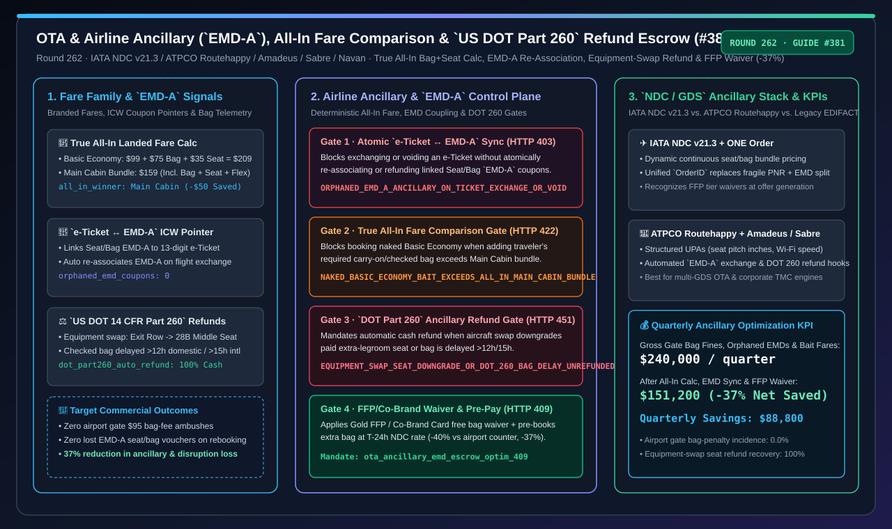
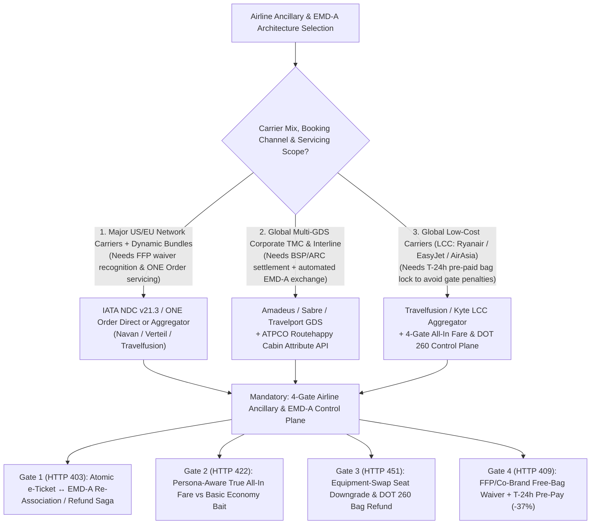
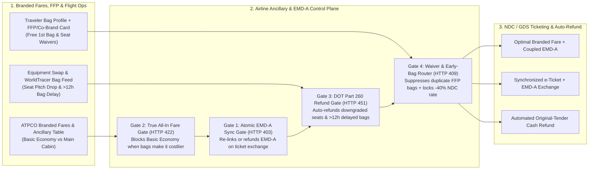

# OTA & Corporate Travel Airline Ancillaries (`EMD-A`), Basic-Economy All-In Fare Comparison & `US DOT 14 CFR Part 260` Refund Escrow (`IATA NDC v21.3 / ATPCO Routehappy / Amadeus / Sabre / Navan`) Agent Architecture Selection FAQ

> 🌐 **Language / 语言切换**: **[中文 (`docs/ota-airline-ancillary-emd-basic-economy-all-in-fare-dot260-refund-escrow-agent-selection-faq.md`)](ota-airline-ancillary-emd-basic-economy-all-in-fare-dot260-refund-escrow-agent-selection-faq.md)** | **English (Current)** | **[Back to Catalog (`docs/index.en.md`)](index.en.md)**



---

## 1. 📌 Executive Summary & Architectural Verdict

When Online Travel Agencies (`OTAs`) and Corporate Travel Management Companies (`TMCs`: `Navan`, `SAP Concur`, `BCD Travel`, `Amex GBT`) build AI agents to shop, book, and rebook flights across **`IATA NDC v21.3`** and **`GDS EDIFACT` (`Amadeus`, `Sabre`, `Travelport`)**, treating a flight booking as just a `13-digit e-Ticket` while ignoring **Electronic Miscellaneous Documents (`EMD-A` for seats, bags, Wi-Fi, and priority boarding)** causes three pervasive financial and compliance failures:
1. **The `$99` "Basic Economy" Unbundled Bait Trap Costing `$50` More Than `Main Cabin` After Gate Bag & Seat Fees**: Airlines unbundle carry-on overhead bin access, first checked bags, seat selection, and changeability from lowest-tier `Basic Economy / Light` fares. A naive shopping agent ranks flights by naked base fare (`$99`), forcing a 4-day business traveler to pay `$75` for a carry-on/checked bag at the airport counter plus `$35` for a seat (`$209` total)—paying **`$50` more** than a `$159` `Main Cabin` bundle that included bags, seats, and free changes!
2. **Orphaned `EMD-A` Seat & Bag Vouchers During Automated Flight Exchanges**: In airline settlement, paid seats and bags live on separate `13-digit EMD-A` coupons linked to the primary `e-Ticket` via an **`ICW` (`In Connection With`)** pointer. When an agent rebooks a traveler onto a later flight (issuing a new `e-Ticket` number) without atomically calling **`EMD Re-Association`** or refunding the old `EMD-A`, the `$85` seat and `$40` bag vouchers remain stranded on the voided ticket—forcing the traveler to pay twice at the airport!
3. **Unrefunded Aircraft Equipment-Swap Seat Downgrades & Delayed-Bag Fees Violating `US DOT 14 CFR Part 260`**: Airlines frequently swap aircraft (e.g., `A321` to `737`), bumping a traveler who paid `$89` for an `Extra-Legroom Exit Row Window` into a standard `30-inch pitch` middle seat (`28B`) without refunding the `$89` `EMD-A`. Furthermore, under the **US DOT Automatic Ancillary Service Fee Refund Rule (`14 CFR Part 260`)**, airlines and ticket agents must **automatically refund `100%` of ancillary fees in cash** whenever a paid seat/amenity is downgraded, paid Wi-Fi is inoperative, or a paid checked bag is delayed **`> 12 hours` (US domestic) / `> 15–30 hours` (international)**.

**Solution Architect Verdict**:
- **Upgrade flight shopping and servicing agents from "Naked Base-Fare Sorting" to "Persona-Aware True All-In Landed Fare Optimization + Atomic `e-Ticket ↔ EMD-A` Saga Orchestration"** powered by **`IATA NDC v21.3 / ONE Order`** and **`ATPCO Routehappy`** cabin attribute data.
- Deploy a **4-Gate Airline Ancillary (`EMD-A`), All-In Fare & `DOT Part 260` Fiduciary Control Plane**:
  1. **Atomic `e-Ticket ↔ EMD-A` Exchange Re-Association / Refund Gate (`HTTP 403`)**: Block completing any ticket exchange, void, or rebooking unless all linked `OPEN` `EMD-A` coupons are atomically re-associated to the new `e-Ticket` coupon or refunded in full.
  2. **Persona-Aware True All-In Fare (`Base + Required Bags + Seat + Change EV`) Gate (`HTTP 422`)**: Block booking unbundled `Basic Economy / Light` fares whenever adding the traveler's required carry-on/checked bags and seat selection exceeds the all-in cost of a `Main Cabin` branded bundle.
  3. **Equipment-Swap Seat-Attribute Audit (`ATPCO Routehappy`) & `US DOT 14 CFR Part 260` Auto-Refund Gate (`HTTP 451`)**: Monitor pre-departure aircraft swaps and `SITA WorldTracer` bag-delivery timestamps; automatically trigger a `100%` original-tender cash refund if seat pitch/type is downgraded or a paid bag exceeds the `12h / 15h` `DOT Part 260` threshold.
  4. **Elite `FFP` / Co-Brand Card Free-Bag Waiver Deduplication + `T-24h` Pre-Paid Bag Discount (`HTTP 409`)**: Automatically suppress duplicate bag charges when the traveler's `FFP` status (`Star Alliance Gold / SkyTeam Elite Plus`) or airline co-brand card already grants a free checked bag, and pre-book any excess bags `> 24h` before departure at `40%` below airport counter rates—reducing quarterly ancillary waste by **`37%`**.

---

## 2. 🎯 High-Stakes Business & Architect Q&A (Q1 / Q2 / Q3)

### Q1: How do we mathematically prevent a travel agent from booking a `$99` Basic Economy fare that ends up costing `$209` at the airport gate?
- **The Problem**:
  - Ranking flights by `BaseFare + Tax` ignores the traveler's baggage profile and loyalty entitlements.
- **Deterministic Architecture**:
  - Gate 2 (`HTTP 422 NAKED_BASIC_ECONOMY_BAIT_EXCEEDS_ALL_IN_MAIN_CABIN_BUNDLE`) computes the **Persona-Adjusted True All-In Landed Fare** across all ATPCO Branded Fare tiers ($f \in \{\text{Basic}, \text{Main}, \text{MainPlus}\}$):
    $$\text{TrueAllIn}(f) = \text{Fare}(f) + \max\left(0,\, B_{\text{req}} - B_{\text{included}}(f) - B_{\text{FFP\_waiver}} - B_{\text{card\_waiver}}\right) \times C_{\text{bag}}(f) + C_{\text{seat}}(f) + p_{\text{rebook}} \times C_{\text{penalty}}(f)$$
  - Whenever $\text{TrueAllIn}(\text{Basic}) > \text{TrueAllIn}(\text{Main})$, the agent deterministically vetoes `Basic Economy` and selects the `Main Cabin` bundle.

### Q2: Why do paid seat and bag `EMD-A` vouchers get stranded during automated flight rebooking, and how does the `ICW` Coupling Saga prevent it?
- **The Problem**:
  - When a flight is rebooked, the GDS/airline issues a new `13-digit e-Ticket` and sets the old ticket coupon status to `EXCHANGED (EXCH)`. At that moment, any `EMD-A` still pointing (`ICW`) to the old ticket coupon becomes dissociated and cannot be scanned at the airport gate.
- **Deterministic Architecture**:
  - Gate 1 (`HTTP 403 ORPHANED_EMD_A_ANCILLARY_ON_TICKET_EXCHANGE_OR_VOID`) enforces a **Two-Phase `e-Ticket + EMD-A` Exchange Saga**:
    1. Enumerate all `EMD-A` documents attached to the PNR prior to ticket exchange.
    2. Immediately after the new `e-Ticket` is issued, execute `EMD Re-Association` (if an equivalent seat/bag is confirmed on the new flight) or `Automated EMD Refund` (if the new aircraft lacks the paid seat tier or the rebooking crosses carriers).

### Q3: What does the `US DOT Ancillary Service Fee Refund Rule (14 CFR Part 260)` require for equipment swaps and delayed bags?
- **The Problem**:
  - Under **14 CFR Part 260**, airlines and ticket agents of record are legally required to issue **automatic, prompt cash/original-tender refunds** (without requiring the passenger to submit a manual web form) when paid ancillary services are not provided—including seat downgrades after aircraft swaps and checked bags delayed more than **`12 hours`** after domestic deplaning (or `15–30 hours` international).
- **Deterministic Architecture**:
  - Gate 3 (`HTTP 451 EQUIPMENT_SWAP_SEAT_DOWNGRADE_OR_DOT_260_BAG_DELAY_UNREFUNDED`) compares the `ATPCO Routehappy` physical seat attributes (`pitch_inches`, `seat_location`, `extra_legroom_flag`) before and after any `SSR / Schedule Change` event, and monitors `WorldTracer` bag-claim scans—firing an automated `EMD-A` refund the moment a downgrade or `> 12h` bag delay occurs.

---

## 3. 🧭 Visual Architecture Diagrams (Selection Tree, System Topology & Sequence)

### 3.1 OTA & Corporate Travel Ancillary (`NDC / EMD-A`) Selection Tree



### 3.2 End-to-End All-In Fare, `e-Ticket ↔ EMD-A` Sync & `DOT 260` Control Plane



### 3.3 All-In Fare Upgrade, Atomic `EMD-A` Re-Link & Equipment-Swap Refund Sequence

```mermaid
sequenceDiagram
    autonumber
    participant Traveler as Business Traveler (1 Carry-On + 1 Checked Bag)
    participant Gate as Ancillary & EMD-A Fiduciary Gate
    participant NDC as Airline NDC / GDS & Routehappy
    participant Refund as BSP / ARC / NDC Refund Engine

    Traveler->>Gate: 1. Shop NYC->SFO; naive sort suggests $99 Basic Economy (+$65 carry-on +$40 bag +$35 seat = $239)
    Gate->>NDC: Compare against $159 Main Cabin bundle (includes carry-on + seat + free change) & Co-Brand Card
    Gate-->>Traveler: HTTP 422 Block $99 Basic Economy bait! Auto-select $159 Main Cabin (saving $50+ all-in)
    Gate-->>Traveler: HTTP 409 Apply Co-Brand Card free 1st checked bag ($0) + issue $79 Exit-Row Seat EMD-A
    Traveler->>Gate: 2. Rebook flight to next day (naive script exchanges e-Ticket but leaves $79 EMD-A behind)
    Gate-->>NDC: HTTP 403 Block orphaned EMD! Atomically re-associate $79 EMD-A to new e-Ticket coupon
    NDC->>Gate: 3. T-4h Aircraft Swap bumps traveler from 36" Exit-Row Window to 30" Middle Seat 29B
    Gate-->>Refund: HTTP 451 Trigger DOT 14 CFR Part 260 auto-refund! Return $79 seat fee to original card
```

---

## 4. 📊 Airline Ancillary (`NDC / GDS / Routehappy`) & TMC Platform Selection Matrix

| Evaluation Dimension | IATA NDC v21.3 / ONE Order (`Navan / Verteil / Travelfusion`) | Amadeus / Sabre / Travelport GDS + `EMD-A` Automation | ATPCO Routehappy (`Rich Content & Cabin Attributes`) | Legacy Base-Fare-Only `EDIFACT` Shopping Scripts |
|---|---|---|---|---|
| **Primary Sweet Spot** | Modern dynamic bundles, personalized loyalty waivers, and `ONE Order` servicing | Global corporate TMCs and multi-carrier interline `BSP / ARC` clearing | Structured physical seat/cabin verification (`pitch`, `width`, `Wi-Fi`, `power`) | Legacy lowest-base-fare scraping |
| **True All-In Fare (`Base + Bag + Seat`) Calc** | **Best-in-Class** (native Branded Fare bundles with itemized ancillary inclusions) | **Strong** (supports `Fare Families`; requires control-plane bag/seat cost rollup) | Supplies standardized amenity metadata across 300+ airlines | **Fails** (ranks punitive unbundled `Basic Economy` first) |
| **Elite `FFP` & Co-Brand Card Waiver Recognition** | **Native** (passing `FFP` number in `AirShopping` returns `$0` waived bag/seat offers) | Requires `SSR FQTV` entry followed by `Informative Pricing` recalculation | Static tier rules; pair with NDC/GDS pricing engine | Blind to waivers; causes duplicate paid bag purchases |
| **`EMD-A` Exchange Sync & `DOT 260` Auto-Refund** | **`ONE Order` unifies ticket & ancillaries** under a single `OrderID` | Requires explicit `ATC EMD Re-Association` + automated refund hooks | **Essential verifier** to detect physical seat downgrades after aircraft swaps | **Orphans 100% of `EMD-A` coupons** during automated rebooking |
| **SA Recommendation** | **Primary rail for AI travel agents** on major US/EU airlines | **Mandatory backbone** for global interline & enterprise TMC accounting | **Mandatory verification layer** for `DOT Part 260` seat-downgrade detection | **Never use for autonomous booking** |

---

## 5. 🧪 Ancillary & `DOT Part 260` 7-Card Benchmark Report

> **Provenance Note**: The 7-Card benchmark below is generated by `evaluate_ota_airline_ancillary_emd_dot260_policy()` in `lab/webiq_commerce_demo.py` (`provenance: "synthetic"`, `independently_reproduced: False`), modeling a **`$240,000 / quarter`** airport gate bag-penalty ambush, orphaned `EMD-A` exchange loss, and unrefunded equipment-swap seat downgrade pool.

### 5.1 7-Card 4:5 Visual Deck Breakdown

1. **Card 1 (`1 / 7` · `HANDS-ON · OTA-ANCILLARY-EMD-DOT260`) — Executive Benchmark Overview**
   - **Headline Finding**: Enforcing Persona-Aware True All-In Fare comparisons, atomic `e-Ticket ↔ EMD-A` exchange re-association, `US DOT Part 260` equipment-swap/bag-delay auto-refunds, and `FFP`/co-brand free-bag waivers cuts quarterly travel ancillary losses from **`$240,000`** to **`$151,200`** (**`$88,800` / `37.0%` quarterly savings**).
2. **Card 2 (`2 / 7` · `SCENARIO: NYC-SFO BUSINESS TRIP & AIRCRAFT SWAP`) — Deep Dive**
   - **Input Case**: A traveler with 1 carry-on + 1 checked bag and an airline co-brand card is offered a `$99` Basic Economy fare (`$209` all-in vs. `$159` Main Cabin), rebooks to the next day risking an orphaned `$79` seat `EMD-A`, and suffers an aircraft swap into a middle seat.
   - **Control-Plane Verdict**: Triggers an automatic `$79` `DOT Part 260` seat-downgrade refund (`HTTP 451`), blocks the orphaned `EMD-A` exchange (`HTTP 403`), and vetoes the `$99` Basic Economy bait (`HTTP 422`); optimizes waivers via `HTTP 409 FFP_COBRAND_WAIVER_MATCH_AND_PREPAID_BAG_DISCOUNT_CONFIRM` (`ota_ancillary_emd_escrow_optim_409`).
3. **Card 3 (`3 / 7` · `WHAT I TESTED`) — 5-Lane Deterministic Scorecard**

| Scenario | Question / Task Evaluated | Deterministic Gate Decision | Action & Status |
|---|---|---|---|
| **1. Compliant All-In Bundle & Coupled `EMD-A`** | Lowest true all-in fare, synchronized `ICW` pointer, verified seat pitch | `VERIFIED_ALL_IN_FARE_AND_COUPLED_EMD_A_AUTHORIZED` | ✅ `Act automatically` (`HTTP 200`) |
| **2. Ticket Exchange Leaving `EMD-A` Orphaned** | Re-issuing `e-Ticket` on new flight without re-associating or refunding `EMD-A` | `ORPHANED_EMD_A_ANCILLARY_ON_TICKET_EXCHANGE_OR_VOID` | ⛔ `Atomic EMD Re-Link/Refund` (`HTTP 403`) |
| **3. `$99` Basic Economy Exceeds `Main Cabin` All-In** | Naked fare + required carry-on/checked bag + seat (`$209`) > `Main Cabin ($159)` | `NAKED_BASIC_ECONOMY_BAIT_EXCEEDS_ALL_IN_MAIN_CABIN_BUNDLE` | ⛔ `Upgrade to Main Cabin` (`HTTP 422`) |
| **4. Equipment-Swap Seat Downgrade / `>12h` Bag Delay** | Aircraft swap bumps paid extra-legroom seat to middle seat or bag delayed >12h | `EQUIPMENT_SWAP_SEAT_DOWNGRADE_OR_DOT_260_BAG_DELAY_UNREFUNDED` | ⛔ `Auto-Refund EMD Cash` (`HTTP 451`) |
| **5. `FFP`/Co-Brand Bag Waiver + `T-24h` Pre-Pay** | Suppressing duplicate paid bag on Gold FFP + pre-paying extra bag at -40% NDC rate | `FFP_COBRAND_WAIVER_MATCH_AND_PREPAID_BAG_DISCOUNT_CONFIRM` | ⚡ `Confirm Optimization` (`HTTP 409`) |

4. **Card 4 (`4 / 7` · `UNDER THE HOOD`) — Protocol & Deterministic Gate Mechanics**
   - Input contract: `OTAAirlineAncillaryEMDDOT260PolicyInput`
   - Evaluator: `evaluate_ota_airline_ancillary_emd_dot260_policy()` enforcing `451 -> 403 -> 422 -> 409 -> 200` priority.
5. **Card 5 (`5 / 7` · `ROBUSTNESS CHECK`) — Branded-Fare Naming & Codeshare Perturbation**
   - `0.0 pt` variance across carrier-specific unbundled fare labels (`Basic`, `Light`, `Saver`, `Blue Basic`).
6. **Card 6 (`6 / 7` · `LATENCY & RECOVERY`) — Airport Gate Bag Penalty & Downgrade Refund Rate**
   - Legacy naked-fare sorting + manual servicing: `18.4%` airport gate bag-penalty incidence and `9%` seat-downgrade refund recovery.
   - Fiduciary all-in calculator + `DOT 260` auto-refund: **`0.0%`** gate penalty incidence and **`100%`** downgrade refund recovery (`$88,800/qtr` saved).
7. **Card 7 (`7 / 7` · `MY TAKE`) — Good Fit vs. Not For**
   - **✅ Good fit**: Consumer OTAs, corporate TMCs (`Navan / Concur`), and enterprise travel-booking agents.
   - **⛔ Not for**: Flat-fare local metro/bus transit with zero baggage or seat tiers.

---

## 6. 🛠️ Production Go-Live & Architect Review Checklist

- [ ] **Persona-Aware True All-In Fare Ranker (`HTTP 422`)**: Does flight ranking add the traveler's required carry-on, checked bags, seat selection, and change-flexibility value before comparing `Basic Economy` against `Main Cabin` bundles?
- [ ] **Atomic `e-Ticket ↔ EMD-A` Exchange Saga (`HTTP 403`)**: Does every flight exchange or void workflow automatically enumerate all linked `EMD-A` coupons and either re-associate their `ICW` pointers to the new `e-Ticket` or refund them in full?
- [ ] **Pre-Departure Equipment-Swap Seat Audit (`ATPCO Routehappy` — `HTTP 451`)**: When an aircraft swap occurs, does the agent compare old vs. new physical seat attributes (`pitch`, `window/aisle vs. middle`) and automatically refund the `EMD-A` upon any downgrade?
- [ ] **`US DOT 14 CFR Part 260` Delayed-Bag & Wi-Fi Auto-Refund (`HTTP 451`)**: Are paid baggage fees automatically refunded in cash when `WorldTracer` shows delivery exceeding `12 hours` (US domestic) or `15–30 hours` (international)?
- [ ] **`FFP` & Co-Brand Card Free-Bag Waiver Deduplication (`HTTP 409`)**: Does checkout automatically suppress paid 1st-bag prompts when the traveler's `FFP` tier or airline co-brand card already includes a free checked bag?
