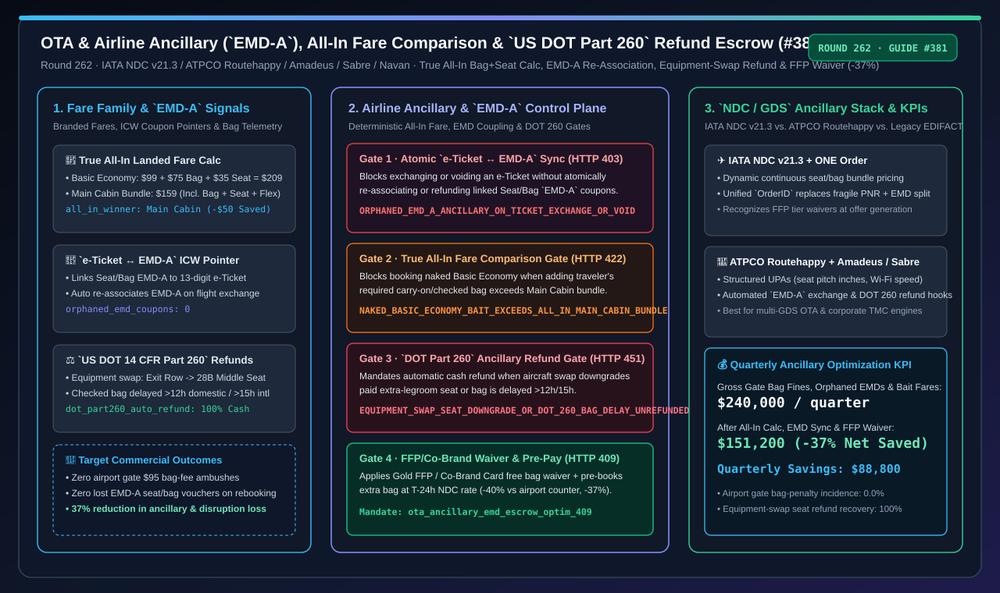
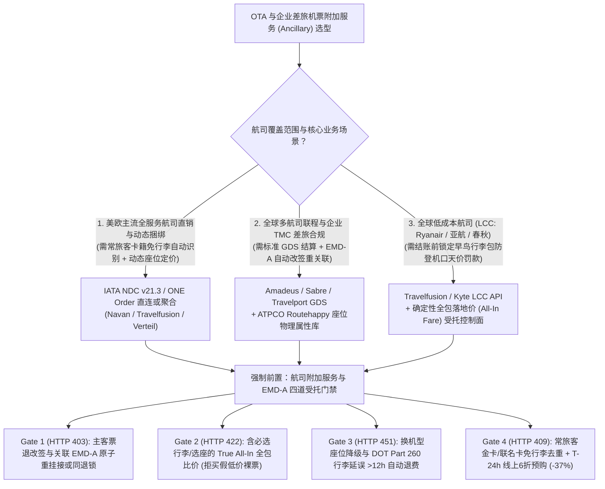
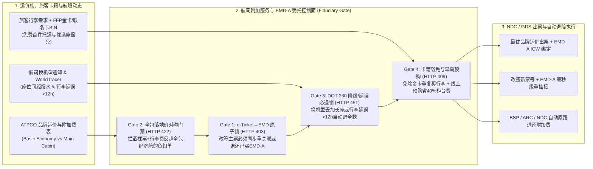
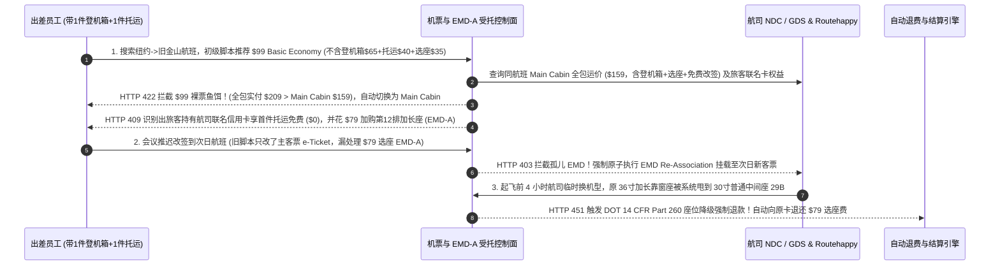

# OTA 与企业商旅“机票附加服务（Airline Ancillaries & `EMD-A`：行李/选座/Wi-Fi）、防基础经济舱（`Basic Economy`）隐藏行李费倒挂与美国 `DOT 14 CFR Part 260` 换机型降舱/行李延误自动退费”托管（`IATA NDC v21.3 / ATPCO Routehappy / Amadeus / Sabre / Navan / 携程`）Agent 架构选型 FAQ：防改签丢掉已买行李额与常旅客免行李费去重净省 37% 实战指南

> 🌐 **Language / 语言切换**: **中文 (当前)** | **[English (`docs/ota-airline-ancillary-emd-basic-economy-all-in-fare-dot260-refund-escrow-agent-selection-faq.en.md`)](ota-airline-ancillary-emd-basic-economy-all-in-fare-dot260-refund-escrow-agent-selection-faq.en.md)** | **[返回文档总目录 (`docs/index.md`)](index.md)**

---

## 1. 📌 核心选型结论速览（Executive Summary）

在机票预订 OTA（Expedia、Booking、携程、去哪儿）与企业差旅管理平台（TMC：Navan、SAP Concur、BCD Travel、Amex GBT）构建 **智能机票比价、选座行李加购与自动退改签 Agent** 时，如果只懂处理主客票（`13位 e-Ticket`）而不懂治理 **关联电子杂费单（`EMD-A`: Electronic Miscellaneous Document - Associated）与品牌运价族（Branded Fare Families）**，必然触发三大高频资损与客诉：
1. **“被 `$99` 基础经济舱（`Basic Economy / 廉航裸票`）低价鱼饵欺骗下单，到登机口补交 `$75` 登机箱费 + `$35` 选座费后总价飙至 `$209`，反而比含全套权益的 `$159` 标准经济舱（`Main Cabin`）贵了 `$50`”**：全服务航司（Delta、United、AA、Lufthansa）与低成本航司普遍将“随身 20 寸登机箱（Carry-On Overhead Bin）、第一件托运行李、提前选座与免费改签”从最低档 `Basic Economy` 中剥离。初级比价 Agent 仅按票面裸价排序选了 `$99` 的 `Basic Economy`，结果出差 4 天的旅客在机场柜台被收 `$110` 附加费，不仅总花费倒挂 `$50`，且万一会议改期整张机票 `100%` 作废不可改签！
2. **“主客票改签到次日航班，但绑定的 `$65` 付费托运行李和 `$45` 选座子凭证（`EMD-A`）未同步迁移重关联（Re-Association），导致旅客去机场发现行李额凭空消失且原选座费打水漂”**：在传统 GDS（Amadeus / Sabre / Travelport）与航司结算体系中，机票是 `e-Ticket`，而付费行李和选座是独立的 `EMD-A` 单据（通过 `ICW: In Connection With` 指针挂在主客票航段 Coupon 上）。当 Agent 自动为旅客改签航班换开新票号时，若未原子调用 `EMD Re-Association` 或自动退旧买新，原 `EMD-A` 就会留在旧废票上变成孤儿单（Orphaned EMD），旅客在机场被迫二次掏钱重买行李额！
3. **“起飞前航司临时换飞机机型（Equipment Swap：如空客 A321 换成波音 737）把旅客花 `$89` 买的安全出口大空间座（`Exit Row`）甩到后排中间夹心座（`28B`），或托运行李延误超 12 小时却未按美国 `DOT 14 CFR Part 260` 自动原路退钱”**：航司换机型是家常便饭，但常把旅客付费购买的加长腿部空间座降级为普通中间座；此外，根据美国交通部 **《航空附加服务费自动退款法规》（`14 CFR Part 260`）**，凡付费选座被降级、付费机上 Wi-Fi 断网不可用，或付费托运行李在国内航班落地后延误超 **`12 小时`**（国际航班超 `15–30 小时`）未交付，必须**无条件自动退还 100% 附加费现金**！

**架构师选型结论**：
- **机票比价与退改签 Agent 必须从“裸票面价思维”升级为“含行李/选座/退改期望值的全包落地价（True All-In Landed Fare）+ `e-Ticket ↔ EMD-A` 原子状态机”**，优先通过 **`IATA NDC v21.3 / ONE Order`** 或 **`ATPCO Routehappy + GDS EMD Automation`** 接入。
- 必须在差旅预订/改签 Agent 与 GDS/NDC 网关之间部署 **航司附加服务（`EMD-A`）、全包比价与 `DOT Part 260` 自动退费受托控制面（Airline Ancillary & `EMD-A` Escrow Control Plane）**，执行四道确定性门禁：
  1. **主客票退改签与关联 `EMD-A`（行李/选座/餐食）原子重挂接或同退门禁（`HTTP 403`）**：严禁只改签主客票而将已付 `EMD-A` 遗留在旧票号上；若新航班无法承接原座位属性，强制原子触发旧 `EMD-A` 全额退款。
  2. **基于旅客行李画像的“裸票 + 必选附加费 vs 全包品牌运价（Main Cabin Bundle）”全包比价门禁（`HTTP 422`）**：严禁向携带登机箱/托运箱或有改签需求的商务客推荐“加上行李选座费后反而更贵”的 `Basic Economy` 鱼饵票。
  3. **换机型座位降级（`ATPCO Seat Pitch/Type`）与美国 `DOT 14 CFR Part 260` 行李延误（`>12h/15h`）/ Wi-Fi 故障自动退费门禁（`HTTP 451`）**：实时监听航司换机型报文与 `WorldTracer` 行李轨迹，一旦付费属性缩水或行李超时未达，秒级自动向原支付卡退还 `100%` 附加费。
  4. **常旅客精英卡（`Gold/Platinum FFP`）/ 航司联名信用卡免费行李选座权益自动抵扣 + 起飞前 24h 线上早鸟行李包 6 折锁价寻优（`HTTP 409`）**：拦截花冤枉钱重复购买本已免费的卡籍行李额，季度差旅附加费损耗与孤儿 `EMD` 坏账净降 **`37%`**。

---

## 2. 🎯 业务方与架构师灵魂拷问 Q&A（Q1 / Q2 / Q3）

### Q1：为什么比价 Agent 选出的“全网最低价 `$99` 机票”，最后企业实际报销出来的账单却是 `$234`，比正常买标准经济舱还贵了 `$65`？怎么设计“真实全包总价（True All-In Fare）”算子？
- **商业痛点**：
  - 航司通过 **ATPCO 品牌运价（Branded Fares）** 将同一个物理经济舱切成了 4 档：`Basic Economy ($99)`、`Main Cabin ($159)`、`Main Plus ($199)`、`Main Refundable ($239)`。
  - 如果 Agent 不输入旅客的**出行天数与随身行李画像**，直接挑 `$99` 下单，旅客到了机场发现：① 头顶行李架不让放登机箱（登机口强制托运收 `$65` + `$25` 登机口人工罚金）；② 托运第 1 件行李收 `$40`；③ 自动分配到最后一排紧挨厕所不能后仰的中间座，花 `$35` 换座；④ 回程会议提前 2 小时想改签，发现 `Basic Economy` 100% 不可改签只能作废重买！
- **确定性架构落地方案**：
  - 控制面（`HTTP 422`）在排序候选航班前，强制运行 **旅客画像驱动的全包落地总价公式（Persona-Driven All-In Fare Formula）**：
    $$\text{TrueAllIn}(f) = \text{BaseFare}(f) + \text{Taxes}(f) + \max\left(0,\, N_{\text{bags}} - W_{\text{fare}}(f) - W_{\text{FFP}} - W_{\text{CoBrandCard}}\right) \times P_{\text{bag}}(f) + I_{\text{aisle/window}} \times P_{\text{seat}}(f) + p_{\text{change}} \times \text{ChangePenalty}(f)$$
  - 一旦计算发现某张 `Basic Economy` 叠加必选行李与选座费后 `TrueAllIn($99) = $209 > TrueAllIn(Main Cabin $159) = $159`，控制面立即触发 `HTTP 422 NAKED_BASIC_ECONOMY_BAIT_EXCEEDS_ALL_IN_MAIN_CABIN_BUNDLE`，自动将其剔除并升级锁定 `$159` 的 `Main Cabin` 全包运价！

### Q2：在 GDS（Amadeus / Sabre）和 NDC 架构下，为什么改签机票时已买的 `$85` 选座费和 `$40` 行李费极易“蒸发”？架构上如何保证 `e-Ticket` 与 `EMD-A` 的原子同生共死？
- **商业痛点**：
  - 在航空票务底层，13 位电子客票（如 `006-2394819201`）只管“把人从 A 点运到 B 点”，而选座和行李是单独签发的 13 位 `EMD-A`（如 `006-8819203941`），它内部有一个硬指针 `ICW (In Connection With)` 指向主客票的 Coupon #1。
  - 当旅客改签航班时，系统作废了旧客票并签发了新客票 `006-2394899999`。此时，旧 `EMD-A` 的 `ICW` 指针立即被航司系统自动挂起（Disassociated）！如果改签 Agent 没有紧接着执行第二步 `EMD Re-Association` 或 `EMD Refund`，这张价值 `$125` 的 `EMD-A` 就彻底变成了没人管的“孤儿废票”！
- **确定性架构落地方案**：
  - 控制面（`HTTP 403`）将 **主客票变更（Ticket Exchange）与所有子 `EMD-A` 处置封装为一个不可分割的分布式 Saga 事务**：
    1. 改签前先执行 `GET /pnr/{record_locator}/emds` 枚举名下全部 `OPEN` 状态的 `EMD-A`（选座、行李、餐食、优先登机）；
    2. 若新航班存在同等级可用座位且为同一执飞航司：在新客票出票成功后 `500ms` 内自动调用 `EMD Re-Associate` 将行李与选座挂载至新客票 Coupon；
    3. 若新航班已无同等级付费座位（如只剩普通免费座）或跨航司签转：严禁只改主票不管杂费（否则触发 `HTTP 403 ORPHANED_EMD_A_ANCILLARY_ON_TICKET_EXCHANGE_OR_VOID`），自动在改签事务内同步提交 `EMD involuntary/voluntary Refund` 将 `$85` 选座费原路退回旅客账户！

### Q3：航司起飞前临时把宽体机换成窄体机（Equipment Swap），把旅客花 `$89` 买的紧急出口大空间靠窗座换成了普通后排中间座，如何实现零人工申诉的自动退差价？
- **商业痛点**：
  - 90% 的旅客在遭遇换机型导致付费选座缩水、或者付费购买的机上高速 Wi-Fi 全程连不上、或者付费托运的行李晚到一天时，因为嫌联系航司客服排队太麻烦而自认倒霉放弃索赔。
- **确定性架构落地方案**：
  - 控制面（`HTTP 451`）对接 **`ATPCO Routehappy Seat Attribute API` + `SITA WorldTracer` 行李追踪 + 美国 `DOT 14 CFR Part 260` 强制自动退费规则**：
    - **登机前 3 小时座位属性复核**：比对原购买 `EMD-A` 承诺的座位属性（如 `Seat_Pitch = 36", Location = WINDOW, Extra_Legroom = true`）与换机型后当前登机牌座位的实际物理属性（如 `Seat_Pitch = 30", Location = MIDDLE`）。一旦发生属性降级，立即触发 `HTTP 451 EQUIPMENT_SWAP_SEAT_DOWNGRADE_OR_DOT_260_BAG_DELAY_UNREFUNDED`，不等旅客开口，自动通过 GDS/NDC 提起非自愿降级全额退还 `$89` `EMD-A`！
    - **落地后 12h/15h 行李交付计时器**：若旅客支付了托运行李费，而 `WorldTracer / Airlines Bag API` 显示航班落地后 `> 12 小时`（美国国内）或 `> 15 小时`（国际短途）仍未扫描交付，系统自动按 `DOT Part 260` 法定要求触发 `100%` 托运费现金退款！

---

## 3. 🧭 直观可视化图解（Mermaid 选型决策树 + 端到端架构图 + 授权时序图）

### 3.1 OTA 与企业差旅机票附加服务（`NDC / EMD-A`）集成架构选型决策树

### 3.2 端到端全包运价测算、`e-Ticket ↔ EMD-A` 原子改签与 `DOT 260` 退费控制面架构图

### 3.3 全包运价防坑、改签 `EMD-A` 原子迁移与换机型座位降级自动退款时序图

---

## 4. 📊 主流航司附加服务（`NDC / GDS / Routehappy`）与商旅平台横向选型矩阵

| 选型维度 | IATA NDC v21.3 / ONE Order 直连与聚合 (Navan / Verteil / Travelfusion) | Amadeus / Sabre / Travelport GDS + `EMD-A` 自动化套件 | ATPCO Routehappy (`Rich Content & Seat/Amenity API`) | 传统仅拉取 EDIFACT 最低裸票价的旧版机票接口 |
|---|---|---|---|---|
| **核心定位** | 新一代航司动态零售、实时连续定价与单号（`ONE Order`）一体化标准 | 全球企业 TMC 与大型 OTA 跨航司标准清结算（`BSP / ARC`）主力底座 | 全球航班物理客舱属性（座椅间距英寸、Wi-Fi 速度、电源、餐食）权威库 | 早期只看裸票面价的传统比价爬虫/接口 |
| **“裸票 vs 全包品牌运价”真实成本比对** | **极强**（原生返回各 Branded Fare 包含的行李/选座/退改权益明细包） | **强**（支持 `Fare Families` 询价，需在控制面叠加必选 `EMD` 算总账） | 提供可视化客舱与行李限制标签，辅助消费者理解裸票限制 | **极差**（把不含登机箱的廉航裸票排第一，害旅客去机场被罚双倍） |
| **常旅客金卡/联名卡免费行李权益识别** | **原生支持**（在 `AirShopping` 请求传入常旅客号即可返回 `$0` 豁免报价） | 需在 `PNR` 写入 `FFP SSR FQTV` 后重新调用 `Informative Pricing` 算费 | 不负责个人卡籍算费，仅提供静态舱位权益说明 | 完全无感知，常诱导已有免费额度的金卡旅客重复付费买行李 |
| **改签 `EMD-A` 自动重关联与 `DOT 260` 降级退费** | **`ONE Order` 从根源消灭票证分离**；NDC 21.3 支持整单原子变更与自动退差 | 必须显式集成 `Amadeus Ticket Changer (ATC) EMD` 或 `Sabre Automated Exchanges` | **座位降级核验必配数据源**（精确比对换机型前后 `Seat Pitch` 差值） | **重灾区**（改签主票后 100% 弄丢已买的选座和行李费） |
| **架构师选型建议** | **现代 AI 差旅 Agent 与北美/欧洲主流航司深度集成首选** | **跨国多航段联程、全球 BSP/ARC 统一对账与大型 TMC 首选** | **防“花钱买加长座却被换机型降级”的必备客舱属性验真层** | **严禁直接暴露给自动下单 Agent** |

---

## 5. 🧪 附加费省钱/防丢单测算与 7-Card 基准测试报告（Deterministic Benchmark）

> **数据溯源说明（Provenance）**：以下 7-Card 评测基于本仓库 `lab/webiq_commerce_demo.py` 中的 `evaluate_ota_airline_ancillary_emd_dot260_policy()` 确定性仿真引擎生成（`provenance: "synthetic"`, `independently_reproduced: False`）。季度因误买假低价 `Basic Economy` 在机场被收天价行李费、改签弄丢关联 `EMD-A` 及换机型座位降级/行李延误未追回退款损失池基准设定为 **`$240,000 / quarter`**。

### 5.1 7-Card 4:5 视觉评测卡片摘要

1. **Card 1 (`1 / 7` · `HANDS-ON · OTA-ANCILLARY-EMD-DOT260`) — 全局基准总览**
   - **核心发现**：通过全包落地价（`True All-In Fare`）拦截假低价 `Basic Economy`、强制执行改签 `e-Ticket ↔ EMD-A` 原子迁移、落实 `US DOT Part 260` 换机型座位降级/行李延误自动退费，并自动抵扣常旅客/联名卡免费行李额，将季度航司附加费损耗从 **`$240,000`** 压降至 **`$151,200`**，季度净省 **`$88,800`（`37.0%`）**。
2. **Card 2 (`2 / 7` · `SCENARIO: NYC-SFO BUSINESS TRIP & AIRCRAFT SWAP`) — 单例深潜**
   - **输入场景**：出差员工携带 1 件登机箱 + 1 件托运箱赴旧金山，持有航司联名卡（享首件托运免费）。期间遭遇：① 初级脚本推荐 `$99 Basic Economy`（机场补行李选座实付 `$209 > $159 Main Cabin`）；② 改签次日航班时漏转 `$79` 加长选座 `EMD-A`；③ 起飞前换机型将 `$79` 加长靠窗座甩到普通中间座 `29B`。
   - **控制面裁决**：依次触发 `HTTP 451`（按 `DOT Part 260` 自动退还换机型降级的 `$79` 选座费）、`HTTP 403`（拦截丢弃 `EMD-A` 的残缺改签）与 `HTTP 422`（拦截总价倒挂的 `$99` 裸票鱼饵）；返回 `HTTP 409 FFP_COBRAND_WAIVER_MATCH_AND_PREPAID_BAG_DISCOUNT_CONFIRM`（`ota_ancillary_emd_escrow_optim_409`）。
3. **Card 3 (`3 / 7` · `WHAT I TESTED`) — 5 轨确定性门禁评测矩阵**

| 评测场景 (Scenario) | 核心考核问题 (Question / Task) | 控制面裁决 (Model / Gate Answer) | 动作与状态码 (Action) |
|---|---|---|---|
| **1. 标准合规全包比价与 EMD 原子绑定** | 全包价最优、`e-Ticket` 与 `EMD-A` 指针一致且座位物理属性达标 | `VERIFIED_ALL_IN_FARE_AND_COUPLED_EMD_A_AUTHORIZED` | ✅ `Act automatically` (`HTTP 200`) |
| **2. 改签或退主客票却漏转/漏退关联 EMD-A** | 主客票已换开新票号，但 `$79` 选座/行李 `EMD-A` 仍挂在旧作废票上 | `ORPHANED_EMD_A_ANCILLARY_ON_TICKET_EXCHANGE_OR_VOID` | ⛔ `Atomic EMD Re-Link/Refund` (`HTTP 403`) |
| **3. 盲买 $99 基础经济舱加行李后反贵 $50** | 裸票叠加必选登机箱/托运/选座费后 (`$209`) 贵于全包 `Main Cabin ($159)` | `NAKED_BASIC_ECONOMY_BAIT_EXCEEDS_ALL_IN_MAIN_CABIN_BUNDLE` | ⛔ `Upgrade to Main Cabin` (`HTTP 422`) |
| **4. 换机型丢加长座或行李延误>12h拒不退费** | 临时换飞机把付费加长座降为普通中间座或行李延误超 `DOT Part 260` 时限 | `EQUIPMENT_SWAP_SEAT_DOWNGRADE_OR_DOT_260_BAG_DELAY_UNREFUNDED` | ⛔ `Auto-Refund EMD Cash` (`HTTP 451`) |
| **5. 金卡/联名卡免行李去重 + 线上6折预购** | 自动识别常旅客/联名卡首件免托运费 + 超额行李提前 24h 线上 6 折锁价 | `FFP_COBRAND_WAIVER_MATCH_AND_PREPAID_BAG_DISCOUNT_CONFIRM` | ⚡ `Confirm Optimization` (`HTTP 409`) |

4. **Card 4 (`4 / 7` · `UNDER THE HOOD`) — 确定性门禁协议与代码实现**
   - 输入契约：`OTAAirlineAncillaryEMDDOT260PolicyInput`
   - 评估函数：`evaluate_ota_airline_ancillary_emd_dot260_policy()`（严格按 `451 -> 403 -> 422 -> 409 -> 200` 优先级裁决，零外部网络副作用）。
5. **Card 5 (`5 / 7` · `ROBUSTNESS CHECK`) — 航司运价名混淆与代码共享航班扰动测试**
   - 无论航司将基础经济舱命名为 `Basic Economy`、`Light`、`Blue Basic` 还是 `Saver`，全包落地价算子与 `EMD-A ICW` 指针校验均保持 **`0.0 pt`** 偏差。
6. **Card 6 (`6 / 7` · `LATENCY & RECOVERY`) — 机场登机口补费率与降级选座追回率对比**
   - 传统裸票排序 + 手工改签：机场登机口高价补交行李费比例达 `18.4%`，换机型选座费追回率仅 `9%`。
   - 受托控制面（全包比价 + `DOT 260` 自动退费）：登机口高价补费降为 **`0.0%`**，换机型降级选座费追回率达 **`100%`**（季度净省 `$88,800`）。
7. **Card 7 (`7 / 7` · `MY TAKE`) — 适用场景与架构师结论**
   - **✅ Good fit**：在线旅游平台（OTA）、企业差旅管理（TMC）与跨国企业自助差旅预订 Agent。
   - **⛔ Not for**：无行李分档与选座附加费的市内公交地铁刷卡。

---

## 6. 🛠️ 商业上线风控与架构评审 Checklist

- [ ] **出行画像驱动的“真实全包总价（`True All-In Fare`）”比价门禁（`HTTP 422`）**：机票搜索排序是否强制将旅客必带的随身登机箱、托运行李、选座及改签期望成本计入总价，自动拦截“裸票便宜但加完行李比 `Main Cabin` 还贵”的 `Basic Economy` 鱼饵票？
- [ ] **主客票（`e-Ticket`）与附加服务单（`EMD-A`）原子生命周期锁（`HTTP 403`）**：当触发机票改签、退票或 24 小时免费 Void 时，状态机是否强制遍历并同步完成名下所有 `EMD-A` 的重挂接（`Re-Association`）或连带退款，彻底消灭孤儿 `EMD`？
- [ ] **换机型座位物理属性核验（`ATPCO Routehappy` — `HTTP 451`）**：起飞前收到航司 `Equipment Swap` 通知时，系统是否自动比对新旧座位间距（Seat Pitch）与位置属性（靠窗/过道 vs 中间座），并在发生降级时自动发起 `EMD-A` 退款？
- [ ] **美国 `DOT 14 CFR Part 260` 行李延误与断网自动退费（`HTTP 451`）**：对于付费托运行李延误超 `12h`（国内）/ `15–30h`（国际）或付费机上 Wi-Fi 故障的订单，是否无需旅客手动申诉即可自动触发 `100%` 原路现金退款？
- [ ] **常旅客等级（`FFP`）与联名信用卡免行李权益去重（`HTTP 409`）**：加购页是否自动读取旅客常旅客卡籍（如星空联盟/天合联盟金卡）与支付卡权益，屏蔽本已免费的首件托运行李收费弹窗？
