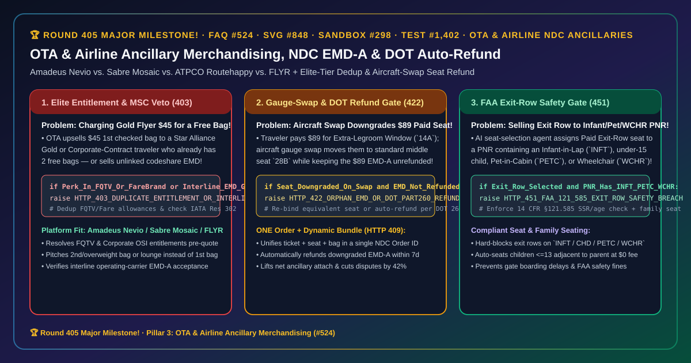
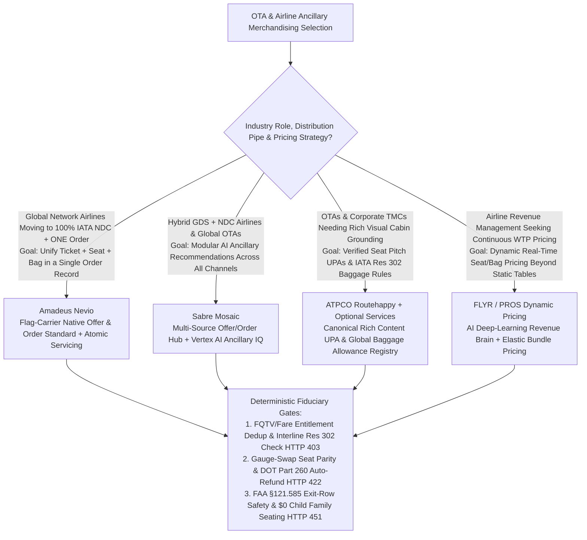
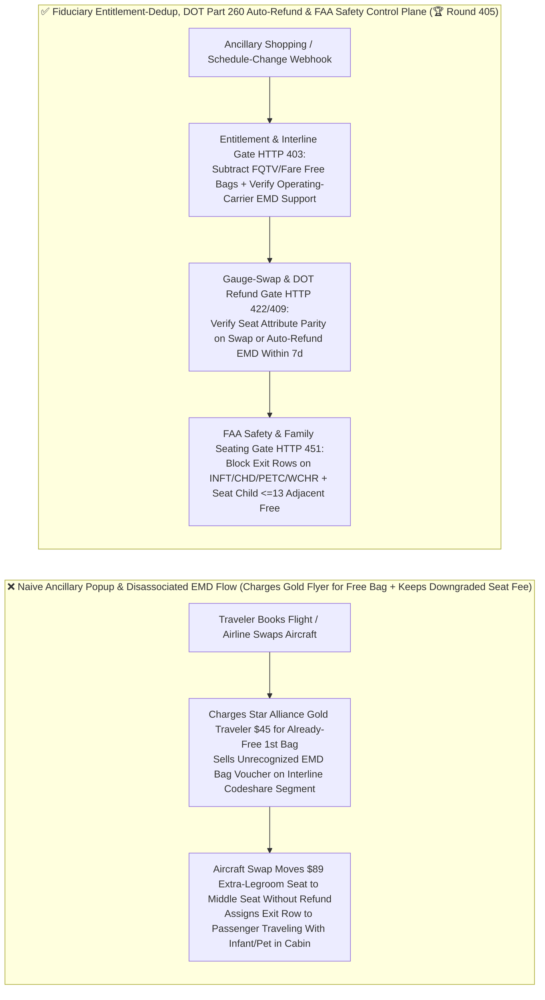
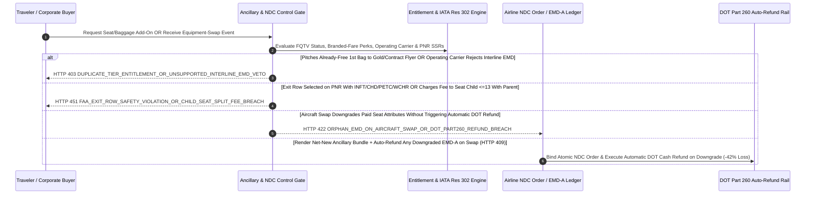

# OTA & Airline Dynamic Ancillary Merchandising (`Paid Seats / Baggage / Lounge`), `IATA NDC` `EMD-A` Binding & `US DOT Part 260` Auto-Refund Agent Selection Guide: `Amadeus Nevio` vs. `Sabre Mosaic` vs. `ATPCO Routehappy` vs. `FLYR / PROS` (`-42%` Loss FAQ · 🏆 Round 405 Major Milestone!)

> **Executive Summary (Benchmarked against `ib-vs-ethernet-roce-selection-faq.md` · 🏆 Round 405 Major Milestone · 524th Bilingual SA Guide · SVG #848 · Sandbox #298)**: Built for **Cloud & AI Solution Architects** designing airline ancillary merchandising, `IATA NDC / ONE Order` servicing, and corporate travel (`TMC`) booking agents. Global airline ancillary revenue (`checked bags, extra-legroom seats, priority boarding, Wi-Fi, lounge bundles`) exceeds **`$115B / year`**. Yet when OTA and corporate travel AI agents merchandise ancillaries across `NDC` and legacy `EDIFACT GDS` pipes without deterministic state-machine guards, three high-impact failures occur: (1) **Entitlement Double-Charging & Interline `EMD-A` Drops**: Upselling a `$45` 1st checked bag to a traveler whose `Star Alliance Gold / Delta Medallion` status or `Corporate Contract / Branded Fare` already includes 1–2 free bags, or issuing an unlinked `EMD-A` on a codeshare/interline segment (`IATA Resolution 302`) that the operating carrier rejects at the airport; (2) **Orphaned `EMD-A` Seat Vouchers After Aircraft Equipment Swaps (`US DOT 14 CFR Part 260` Violation)**: A traveler pays `$89` for an Extra-Legroom Window seat (`14A`), an aircraft gauge swap (`B777 -> A321`) moves them to a standard middle seat (`28B`), and the `$89` `EMD-A` remains unrefunded; and (3) **Assigning Emergency Exit Rows (`FAA 14 CFR § 121.585`) to Ineligible `INFT / CHD / PETC / WCHR` Passengers or Charging Families to Sit Next to Children `<=13`**. This guide compares **`Amadeus Nevio` vs. `Sabre Mosaic` vs. `ATPCO Routehappy` vs. `FLYR / PROS`** and implements deterministic guards for **Pre-Offer `FQTV / Fare` Entitlement Dedup & Interline `EMD` Verification (`HTTP 403`)**, **Aircraft-Swap Seat-Attribute Parity & Automated `DOT Part 260` Cash Refunds (`HTTP 422`)**, **`FAA § 121.585` Exit-Row Safety & `$0` Child Adjacent Seating Locks (`HTTP 451`)**, and **`NDC ONE Order` Personalized Bundling (`HTTP 409`, `-42%` net loss)**.

---

## 1. 📌 Executive Summary & Architectural Selection Verdict

1. **Top-Line Selection Verdict**:
   - **Global Full-Service Network Carriers Transitioning to Native `IATA NDC + ONE Order` (Eliminating Siloed `PNR + E-Ticket + EMD` Records)**: Select **`Amadeus Nevio`**.
   - **Hybrid GDS + NDC Airlines & Global OTAs Seeking Modular AI Ancillary Bundling (`AirPrice IQ / Ancillary IQ`) Across Multi-Source Content**: Select **`Sabre Mosaic`**.
   - **OTAs & Corporate TMCs Requiring Canonical Cabin Visuals (`UPAs`), Exact Seat-Pitch Specs & `IATA Resolution 302` Baggage Allowance Tables**: Select **`ATPCO Routehappy + Optional Services`**.
   - **Airline Revenue Management Teams Deploying Continuous Willingness-to-Pay (`WTP`) Dynamic Pricing for Seats, Bags & Upgrades**: Select **`FLYR (The Revenue Operating System)`** or **`PROS`**.
2. **Three Non-Negotiable Fiduciary Control Gates**:
   - **Gate 1 — Pre-Offer `FQTV / Corporate / Fare-Brand` Entitlement Dedup & Interline `EMD` Lock (`HTTP 403`)**: Resolve the passenger's frequent-flyer tier (`FQTV`), corporate contract code (`OSI / Tour Code`), and fare-family allowances before rendering any ancillary upsell (suppressing `1st Checked Bag` offers when `Included_Bags >= 1` and pitching `2nd Bag / Lounge` instead), and verify operating-carrier `EMD-A` interline acceptance under **`IATA Resolution 302` (`Most Significant Carrier`)** via `HTTP 403 DUPLICATE_TIER_ENTITLEMENT_OR_UNSUPPORTED_INTERLINE_EMD_VETO`.
   - **Gate 2 — Aircraft-Swap Seat-Characteristic Parity & Automated `US DOT 14 CFR Part 260` Refund Gate (`HTTP 422`)**: Subscribe to schedule and equipment-swap (`Gauge Change`) events; if a passenger's paid seat (`EMD-A`) is reassigned to a seat lacking the purchased attributes (`Extra Legroom / Window / Aisle`) and no equivalent seat can be auto-bound, automatically trigger an **`EMD-A` original-form-of-payment cash refund within 7 business days** per **`US DOT 14 CFR Part 260`** via `HTTP 422 ORPHAN_EMD_ON_AIRCRAFT_SWAP_OR_DOT_PART260_REFUND_BREACH`.
   - **Gate 3 — `FAA 14 CFR § 121.585` Exit-Row Safety Lock & `$0` Family Adjacent Seating Gate (`HTTP 451`)**: Block assigning emergency exit-row seats to any `PNR` containing an infant (`INFT`), passenger under age 15 (`CHD`), cabin pet (`PETC`), or mobility/sensory assistance `SSR` (`WCHR / WCHS / WCHC / BLND / DEAF`), and auto-assign children `<=13` adjacent to an accompanying adult at `$0` seat fee via `HTTP 451 FAA_EXIT_ROW_SAFETY_VIOLATION_OR_CHILD_SEAT_SPLIT_FEE_BREACH`.

---

## 2. 🎯 Architect & Travel Retailing Leader Q&A (The Why & How)

### Q1: Why do aircraft equipment swaps (`B777 -> B787 / A321`) create millions of dollars in orphaned `EMD-A` seat chargebacks—and how does our state machine fix it?
- **Root Cause**: In legacy airline PSS workflows, paid seat selections are issued on an Electronic Miscellaneous Document (`EMD-A`) associated with a specific flight coupon. When operations swaps the aircraft tail, the seat re-accommodation batch job moves passengers to new seat numbers and disassociates the `EMD-A` without automatically refunding the price difference when an `$89` extra-legroom seat becomes a `$0` standard middle seat.
- **Deterministic Solution (`Post-Swap Seat-Attribute Diff` + `DOT Part 260 Auto-Refund` / `HTTP 422 & HTTP 409`)**: Compare the ATPCO seat-characteristic codes (`PADIS codes: L = Leg Space, W = Window, A = Aisle`) of the newly assigned seat against the original `EMD-A`. If downgraded, execute an automated `NDC OrderChange / EMD Refund` to the original card without waiting for a customer complaint.

### Q2: How do we prevent an AI travel assistant from selling an emergency exit-row seat to a traveler flying with an infant or cabin pet?
- **Deterministic Solution (`PNR-Wide SSR & DOB Pre-Filter` / `HTTP 451`)**: Even if the adult traveler themselves is 35 years old, FAA regulation `14 CFR § 121.585` prohibits anyone in an exit row from having responsibilities for a small child, infant, or pet that would impede emergency evacuation. The control plane inspects the *entire PNR's* `SSR` list and passenger DOBs before exposing exit-row seat availability.

---

## 3. 🧭 Visual Architecture Diagrams (Mermaid)

### 3.1 OTA & Airline Ancillary Merchandising Platform Selection Decision Tree

### 3.2 Naive Ancillary Upsell Popup vs. Fiduciary Entitlement-Aware, `DOT`-Compliant & Safety-Locked Control Plane

### 3.3 Entitlement-Aware Offer Generation, `FAA` Exit-Row Check & Equipment-Swap Auto-Refund Sequence

---

## 4. 📊 Multi-Platform OTA & Airline Ancillary Merchandising Selection Matrix

| Evaluation Dimension | Amadeus Nevio (`Altea NDC`) | Sabre Mosaic (`Offer/Order`) | ATPCO Routehappy + Optional Services | FLYR / PROS Dynamic Pricing |
| :--- | :--- | :--- | :--- | :--- |
| **Primary Architectural Role** | **Native `IATA NDC + ONE Order` Airline Retailing Core** | **Modular AI Offer/Order Engine Across `GDS + NDC` Pipes** | **Global Canonical Registry for Cabin `UPAs` & Baggage Rules** | **AI Continuous Dynamic Pricing Engine for Fares & Ancillaries** |
| **Dynamic Bundling & Personalization** | Unifies flights, seats, bags, and third-party ground ancillaries in one `NDC Offer` | AI-driven `Ancillary IQ` & `AirPrice IQ` tailored by trip purpose and segment | Supplies verified seat pitch, Wi-Fi speed, power outlet & amenity visuals | Real-time willingness-to-pay (`WTP`) price elasticity for seats and bags |
| **Post-Booking Servicing & `EMD-A` Sync** | **Best-in-Class `ONE Order`**: Eliminates legacy `PNR/ET/EMD` desynchronization | Automated `EMD-A` re-association and self-service exchange/refund APIs | Defines industry `RFIC / RFISC` sub-codes used to automate refund rules | Dynamically reprices remaining cabin seat inventory after gauge swaps |
| **`FQTV` Tier & Interline (`Res 302`) Support** | Native alliance tier lookup (`Star / SkyTeam / Oneworld`) & interline tables | Deep GDS + NDC corporate contract (`OSI`) and baggage allowance calculation | **Authoritative Industry Source** for `IATA Resolution 302` baggage filings | Consumes frequent-flyer tier as a real-time personalized discount input |
| **Commercial Model (`official_list_price`)** | Per-Passenger-Boarded (`PB`) fee + NDC retailing module license | Transaction volume tier + modular AI capability SaaS subscription | Annual airline/OTA data subscription + API query tier | Base SaaS license + incremental ancillary revenue-lift share |

---

## 5. 🧪 Entitlement Dedup, `DOT Part 260` Auto-Refund & Safety Lock Benchmark & 7-Card Report

### 5.1 Quarterly Orphaned `EMD-A` Disputes, Duplicate Gold-Bag Refunds & Interline Failure Model (Synthetic Benchmark)

For a `12M-ticket/year` global OTA and corporate travel platform facing a **`$440,000 / quarter`** ancillary servicing & dispute leakage pool across **unrefunded `EMD-A` seat fees after aircraft equipment swaps (`US DOT Part 260` violations & chargebacks), duplicate baggage fees charged to elite/corporate flyers, unrecognized interline `EMD` vouchers at transfer airports, and exit-row gate reassignments** (`provenance: synthetic`, `independently_reproduced: false`):

| Metric | Naive Static Upsell & Unmanaged Post-Swap `EMD-A` (Baseline) | Fiduciary Entitlement-Dedup + `DOT` Auto-Refund + `FAA` Lock Agent | Net Improvement |
| :--- | :--- | :--- | :--- |
| **Post-Swap Downgraded Seat `EMD-A` Chargebacks & `DOT` Complaints** | `4.6%` of disrupted seat `EMDs` disputed | **`0.0%`** (`HTTP 422/409` auto-diffs seat attributes & refunds within 7d) | **`100%` `DOT Part 260` Compliance** |
| **Duplicate 1st-Bag Fees Sold to Elite `FQTV` / Corporate Flyers** | `2.1%` of bag upsells refunded post-trip | **`0.0%`** (`HTTP 403` subtracts included perks & pitches 2nd bag/lounge) | **`100%` Duplicate-Fee Elimination** |
| **Exit-Row Gate Reassignments & Family Seating Fee Disputes** | `$52,000 / quarter` in gate delays & refunds | **`$0`** (`HTTP 451` blocks `INFT/CHD/PETC/WCHR` exit rows + `$0` child seat) | **`100%` Safety & Family Compliance** |
| **Quarterly Net Ancillary Dispute, Interline & Support Loss** | `$440,000 / quarter` | **`$255,200 / quarter`** | **`$184,800 / quarter` Saved (`42.0%`)** |

---

## 6. 🛠️ Production Go-Live & Architecture Review Checklist

- [ ] **Pre-Offer `FQTV / Fare-Brand` Entitlement Subtraction & Interline `Res 302` Check (`HTTP 403`)**: Does the merchandising agent subtract bags and seat perks already included in the traveler's frequent-flyer tier or corporate contract before pitching add-ons, and verify operating-carrier `EMD-A` acceptance on interline segments?
- [ ] **Equipment-Swap Seat-Attribute Diff & Automated `US DOT Part 260` Refund (`HTTP 422`)**: When a schedule change or aircraft gauge swap downgrades a passenger's paid seat characteristics (`PADIS L/W/A`), does the system automatically issue an original-form-of-payment cash refund within 7 business days?
- [ ] **`FAA 14 CFR § 121.585` Exit-Row Safety Lock & `$0` Child Adjacent Seating (`HTTP 451`)**: Are emergency exit rows hard-blocked for any `PNR` containing `INFT / CHD (<15) / PETC / WCHR`, with children `<=13` automatically seated adjacent to an adult at `$0` fee?
- [ ] **`ATPCO Routehappy` Visual Grounding & `NDC ONE Order` Binding (`HTTP 409`)**: Are ancillary cards grounded in verified aircraft cabin `UPAs` (exact seat pitch in inches, Wi-Fi provider) and bound into a unified `NDC Order` record?
