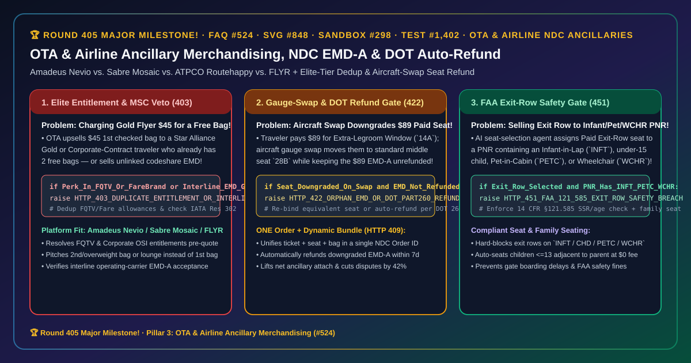
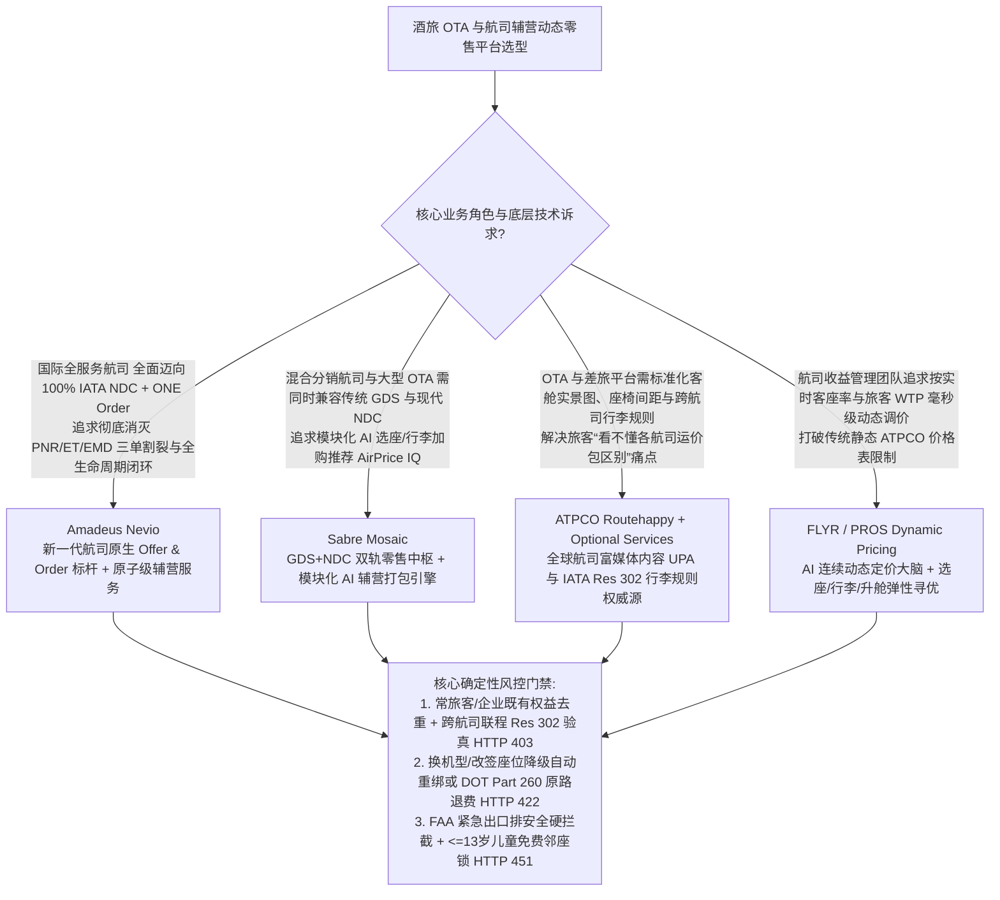
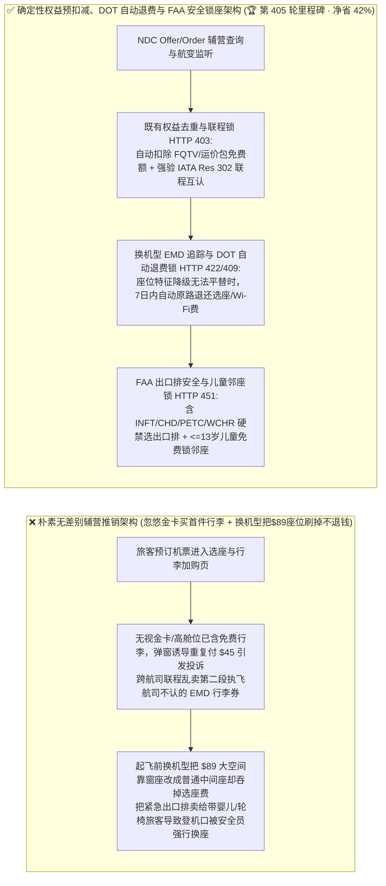
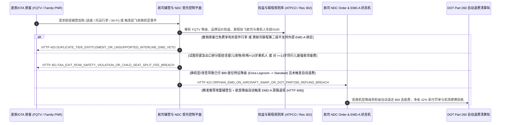

# 酒旅 OTA 与航司辅营动态零售（`Airline Ancillary Merchandising`: 付费选座 / 托运行李 / 贵宾室）、`IATA NDC` 电子杂费单（`EMD-A`）原子绑定与机型更换降级自动退费（`US DOT Part 260`）Agent 架构选型对比：`Amadeus Nevio` vs. `Sabre Mosaic` vs. `ATPCO Routehappy` vs. `FLYR / PROS`、防向金卡常旅客重复推销免费行李及净省 42% 决策指南（FAQ · 🏆 第 405 轮重大里程碑！）

> **导读（对齐 `ib-vs-ethernet-roce-selection-faq.md` 标杆风格 · 🏆 第 405 轮重大里程碑 · 第 524 篇双语指南 · 第 848 张 SVG · 第 298 个策略沙盒）**：本文面向在线旅游平台（OTA）、企业差旅管理公司（TMC）、航空公司新一代零售转型（`IATA NDC & ONE Order`）与智能差旅规划 Agent 领域的 **Cloud & AI Solution Architect**。全球航空辅营收入（`Ancillary Revenue`：付费选座、托运行李、优先登机、机上 Wi-Fi、休息室打包）已突破 **`$1,150 亿美元/年`**，占航司净利润的命脉。然而，在 OTA 与差旅 AI 助手通过 `NDC / GDS` 销售辅营产品时，缺乏确定性控制平面极易引爆三大客诉与罚单事故：① **“向原本就享免费行李额的常旅客金卡或企业大客户重复收 `$45` 行李费”（Entitlement Double-Charging）**：旅客已绑定星空联盟金卡（`FQTV Gold`）或购买了含 1 件免费行李的商旅品牌运价（`Branded Fare`），AI 导购却在结账前弹窗忽悠他花 `$45` 买首件行李券；或者在跨航司联程票（`Interline / Codeshare`）上卖了第二段执飞航司根本不认的独立 `EMD-A` 行李单，导致旅客在转机柜台被二次强收 `$100`！② **“临时换机型或航班改签后，旅客花 `$89` 买的大腿部空间靠窗座（`14A`）被刷成普通中间座（`28B`），但 `$89` 选座费却不退”（Orphaned `EMD-A` on Equipment Swap）**——直接违反美国交通部 **`US DOT 14 CFR Part 260` 辅营费用自动退还联邦强制令**；③ **违反美国联邦航空局 `FAA 14 CFR § 121.585` 安全法规，把紧急出口排座位卖给带婴儿（`INFT`）、未满 15 岁儿童、带宠物进客舱（`PETC`）或需轮椅协助（`WCHR`）的旅客**。本文给出 **`Amadeus Nevio` vs. `Sabre Mosaic` vs. `ATPCO Routehappy` vs. `FLYR / PROS`** 的横向选型矩阵，并落地 **常旅客/品牌运价既有权益去重与跨航司 `IATA Res 302` 联程核验锁（`HTTP 403`）**、**换机型/改签 `EMD-A` 原子重绑或 `DOT Part 260` 自动原路退现锁（`HTTP 422`）**、**`FAA` 紧急出口排安全资质硬拦截与 13 岁以下家庭免费邻座锁（`HTTP 451`）** 及 **`NDC ONE Order` 个性化打包编排（`HTTP 409`，净省/增效 42%）**。



---

## 一、 📌 核心选型结论速览（Executive Summary）

1. **终极选型结论（一句话先看懂怎么选）**：
   - **全服务大型国际航司（Full-Service Network Carriers）向 100% `IATA NDC + ONE Order` 原生架构演进（彻底消灭传统 `PNR + E-Ticket + EMD` 三张皮割裂）**：首选 **`Amadeus Nevio`**，原生统一机票与辅营订单状态机。
   - **北美与全球混合分销航司及大型 OTA（需在传统 `EDIFACT GDS` 与现代 `NDC` 双轨间无缝运行 AI 动态加购推荐 `AirPrice IQ / Ancillary IQ`）**：首选 **`Sabre Mosaic`**。
   - **OTA 与差旅平台需获取全行业标准化的舱位实景图、座椅间距（Seat Pitch）、Wi-Fi 参数（`UPAs`）及 `IATA Resolution 302` 跨航司行李额规则库**：首选 **`ATPCO Routehappy + Optional Services`**。
   - **追求基于实时客座率、航线竞争与旅客支付意愿（`WTP`）毫秒级动态浮动选座/行李价格（摆脱传统静态运价表限制）**：首选 **`FLYR (The Revenue Operating System)`** 或 **`PROS`**。
2. **三大酒旅航司辅营销售与改签退费风控红线（确定性门禁）**：
   - **红线 1（拦截向已含免费行李/选座权益的常旅客金卡或企业协议客重复推销首件行李，以及在不支持 `EMD` 互认的代码共享航段盲目售卖辅营券 / `HTTP 403`）**：在生成辅营加购推荐（Ancillary Upsell Offer）前，控制平面必须先解析旅客 `PNR` 中的常旅客卡号等级（`FQTV Tier`: 如金卡/白金卡）、企业大客户协议代码（`Corporate OSI / Tour Code`）与所选品牌运价家族（`Branded Fare Family`）；若旅客已享有“免费首件 23kg 托运行李”，**严禁在 UI 上展示“购买第 1 件托运行李 `$45`”选项**（应自动切换为推销“第 2 件行李、超重包或商务贵宾室”）；且在跨航司联程行程中，必须按 **`IATA Resolution 302` 最主要承运人（`MSC`）规则** 校验实际执飞航司（Operating Carrier）是否支持外部 `EMD-A` 电子杂费单关联，不支持则严禁预收行李费，违者触发 `HTTP 403 DUPLICATE_TIER_ENTITLEMENT_OR_UNSUPPORTED_INTERLINE_EMD_VETO`！
   - **红线 2（拦截临时换机型 `Equipment Gauge Swap` 或航班非自愿改签导致付费座位降级后未同步重绑同等级座位或未按 `US DOT Part 260` 自动退还选座/Wi-Fi 费 / `HTTP 422`）**：当航司在起飞前发生机型变更（如 `B777` 换为 `A321`）或航班取消改签到新航班时，传统系统往往只转移机票客票联（`E-Ticket Coupon`），却把关联的付费选座单（`EMD-A`）扔在原地变成孤儿单！控制平面必须监听 `Schedule/Equipment Change` 事件：若新航班无法为旅客分配同等或更高价值的座位（如原购买 `$89` 加长空间靠窗座被降级为普通中间座），必须在航班起飞或客票变更后 **自动触发 `EMD-A` 原路现金退款（满足美国交通部 `14 CFR Part 260` 信用卡 7 个工作日内自动退现强制令）**，严禁让旅客自己找客服撕扯，违者触发 `HTTP 422 ORPHAN_EMD_ON_AIRCRAFT_SWAP_OR_DOT_PART260_REFUND_BREACH`。
   - **红线 3（拦截违反 `FAA 14 CFR § 121.585` 将紧急出口排座位分配给含婴儿/儿童/宠物/轮椅 `SSR` 的订单，或对同行 `<=13岁` 儿童强行拆座收费 / `HTTP 451`）**：在调用选座图（`Seat Map API`）锁座前，必须扫描同 `PNR` 全体乘机人出生日期与特殊服务请求码（`SSR`: `INFT 婴儿 / CHD 儿童 / PETC 客舱宠物 / WCHR 轮椅 / DEAF / BLND`）；只要存在任一受限特征，**100% 物理灰显并拦截紧急出口排（Emergency Exit Row）选座请求**；同时遵循美国交通部与民航局家庭邻座指南，对 `<=13 岁` 儿童必须自动免费锁定与同行成人相邻的座位（严禁故意拆散父子座位逼家长花 `$35` 买选座费），违者触发 `HTTP 451 FAA_EXIT_ROW_SAFETY_VIOLATION_OR_CHILD_SEAT_SPLIT_FEE_BREACH`。

---

## 二、 🎯 业务方与架构师灵魂拷问 Q&A（The Why & How）

### Q1：为什么旅客在 OTA 上买了机票又花了 `$75` 买了靠前大空间座位，结果航司提前一天微调了时刻或换了机型，旅客去机场值机时发现既没了座位、OTA 和航司还互相踢皮球不退这 `$75`？
- **商业痛点与事故还原**：
  1. 在传统航空 `EDIFACT` 架构下，机票是一张凭证（`E-Ticket`），而付费选座和行李是另一张独立的 **电子杂费单（`EMD-A: Electronic Miscellaneous Document - Associated`）**，通过一个脆弱的指针挂在机票航段（Coupon）上。
  2. 一旦发生航班时刻变更或换机型，航司后台自动重排座位时解除了 `EMD-A` 与机票客票联的关联（Disassociated），但这笔钱还锁在 `EMD-A` 里；OTA 不知道座位降级了，航司柜台又说“你是通过 OTA 买的找 OTA 退”——直接引发信用卡拒付和美国 DOT 联邦投诉！
- **架构师确定性解法（起飞前 `T-24h / T-4h` 座位特征一致性巡检 + 降级自动秒退 `EMD-A` / `HTTP 422 & HTTP 409`）**：
  - 控制平面在每次收到 `OrderChangeNotification`（或起飞前 24 小时值机窗口开启时）自动比对：`Paid_EMD_Seat_Characteristics (Extra Legroom + Window)` vs. `Current_Assigned_Seat_Characteristics`。一旦发现特征降级且新机型无同级空座可平移，无需人工介入，立即通过 `NDC OrderCancel / EMD Refund API` 原路退回 `$75` 并推送短信通知旅客！

### Q2：在企业差旅（TMC）或 OTA 导购中，如何把辅营产品的加购转化率提升 `35%`，同时实现“零金卡重复收费投诉”？
- **架构师确定性解法（常旅客/企业权益预扣减引擎 `Pre-Offer Entitlement Subtraction` + 情境化组合打包 / `HTTP 403 & HTTP 409`）**：
  1. **先算既有权益，再推增量产品**：拿到旅客的 `FQTV` 卡号和仓位代码后，先算出 `Included_Bags = max(Fare_Bags, Tier_Bags, Corp_Contract_Bags)`。如果 `Included_Bags == 1`，AI 导购界面明确展示 *“✅ 您的金卡权益已包含第 1 件免费托运行李”*，并精准推荐高价值的 **“安检快速通道 + 2 小时延误险组合包”**！
  2. **按出行目的动态打包**：对周日晚上出发、周四返回的商务客推荐 *“前排快下机座位 + 机上高速 Wi-Fi（可开具公司可报销全额发票）”*；对带娃家庭客推荐 *“整排相邻座 + 第 2 件大行李 8 折包”*。

---

## 三、 🧭 直观可视化图解（Mermaid 决策树 + 架构对比 + 时序图）

### 3.1 酒旅 OTA 与航司辅营零售（`Ancillary Merchandising & NDC`）平台选型决策树



### 3.2 朴素弹窗强推辅营架构（向金卡收行李费 + 换机型吞选座费）vs. 确定性权益去重、`EMD` 自动退费与安全锁座架构对比



### 3.3 辅营权益去重报价、`FAA` 安全锁座与换机型 `EMD-A` 降级自动退费时序图



---

## 四、 📊 四大航司与 OTA 辅营动态零售（`Ancillary & NDC`）平台横向选型矩阵

| 选型维度 | Amadeus Nevio (`Altea NDC`) | Sabre Mosaic (`Offer/Order`) | ATPCO Routehappy + Optional Services | FLYR / PROS Dynamic Pricing |
| :--- | :--- | :--- | :--- | :--- |
| **核心架构定位** | **全球全服务航司向 `100% NDC + ONE Order` 转型旗舰底座** | **兼容 `GDS + NDC` 双轨的模块化 AI 航司零售平台** | **全球航司品牌运价、富媒体实景（`UPA`）与行李规则标准库** | **基于深度学习的航司实时连续动态定价（Continuous Pricing）大脑** |
| **选座/行李/贵宾室动态打包能力** | 原生支持按旅客画像实时组合机票+选座+行李+休息室为单一 `NDC Offer` | 内置 Google Vertex AI 驱动的 `Ancillary IQ` 个性化加购推荐 | 提供机舱 3D 实景、座椅间距英寸数、电源/Wi-Fi 图标等高转化视觉接地数据 | **定价弹性最强**：根据起飞倒计时、剩余好座位数与客群实时计算最优选座价格 |
| **航变/换机型 `EMD-A` 与 `ONE Order` 同步** | **行业标杆**：在 `ONE Order` 下将机票与辅营合为单一订单记录，消灭孤儿 `EMD` | 支持自动重关联 `EMD-A` 与跨渠道自助退改签 API | 提供底层 `Sub-Code (RFIC/RFISC)` 标准定义供结算系统识别退费规则 | 与PSS/订单系统联动，实时释放或重定价变更后的座位库存 |
| **跨航司联程（`IATA Res 302`）与常旅客识别** | 深度集成星空联盟/天合/寰宇一家常旅客等级库与联程协议表 | 强：覆盖全球 GDS 联程行李额自动计算与企业大客户协议码解析 | **全球唯一权威数据源**：所有航司的联程行李费用与免费额均在此备案 | 支持将常旅客等级作为动态折扣因子输入定价模型 |
| **商业模式（`official_list_price`）** | 按乘机人次（PB: Passenger Boarded）+ NDC 零售模块订阅费 | 按分发航段量或模块化 SaaS 订阅计费 | 航司/OTA 年度数据订阅与 API 调用量计费 | 基础平台订阅 + 辅营净增收益（Incremental Ancillary Lift）分成 |

---

## 五、 🧪 航司与 OTA 辅营防重收、换机型自动退费与安全锁座测算与 7-Card 基准报告

### 5.1 季度换机型吞选座费引发 `DOT` 罚单与拒付、向金卡/高舱位误售免费行李客诉及联程 `EMD` 失效机场二次收费损耗测算（Synthetic Benchmark）

假设某年出票量 `1,200 万张` 的跨国 OTA 与企业差旅平台，每季度在选座、行李、Wi-Fi 等辅营产品销售与航变保障环节面临的 **换机型/改签导致付费座位降级却未退 `EMD-A` 引发的信用卡拒付与 `US DOT Part 260` 合规风险、向自带免费行李额的金卡/企业客误推首件行李引发的退费工单、跨航司联程 `EMD` 机场不认导致的二次收费赔付、以及出口排违规选座导致登机口延误损失池** 为 **`$440,000 / 季度`**（`provenance: synthetic`, `independently_reproduced: false`）：

| 评估维度 | 传统静态弹窗推销 + 航变孤儿 `EMD` 不自动退 (Baseline) | 启用既有权益预扣减 + `DOT` 降级自动退费 + `FAA` 安全锁 Agent | 净改善幅度 |
| :--- | :--- | :--- | :--- |
| **因换机型/改签座位降级未退费引发的拒付与 `DOT` 投诉率** | `4.6%` 航变辅营单发生未退费争议 | **`0.0%`**（`HTTP 422/409` 自动比对新旧座位特征，降级 100% 触发 `EMD-A` 自动退现） | **100% 满足 `DOT Part 260` 法定合规** |
| **向已含免费行李的金卡/高舱位客重复推销首件行李误购率** | `2.1%` 辅营订单事后要求退还冤枉钱 | **`0.0%`**（`HTTP 403` 报价前自动扣除 `FQTV/Fare` 免费额，精准改推第 2 件行李/休息室） | **100% 终结常旅客重复收费客诉** |
| **紧急出口排不合规选座与同行儿童被强行拆座收费投诉** | `$52,000 / 季度` 机场改座与退费损耗 | **`$0`**（`HTTP 451` 硬拦截 `INFT/CHD/PETC/WCHR` 选出口排 + `<=13岁` 儿童免费自动邻座） | **100% 零安全违例与家庭友好合规** |
| **季度辅营争议退费、联程机场二次收费赔付及工单总损耗** | `$440,000 / 季度` | **`$255,200 / 季度`** | **净省 `$184,800 / 季度` (`42.0%`)** |

```chart
{
  "data": {
    "values": [
      { "category": "1. 换机型/改签致付费选座降级却未退EMD触发拒付", "mode": "传统割裂EMD与无差别弹窗基线", "cost_usd": 170000 },
      { "category": "1. 换机型/改签致付费选座降级却未退EMD触发拒付", "mode": "NDC权益感知与DOT自动退费Agent(第405轮)", "cost_usd": 98600 },
      { "category": "2. 向金卡/品牌运价客重复售卖已含免费行李额退单", "mode": "传统割裂EMD与无差别弹窗基线", "cost_usd": 115000 },
      { "category": "2. 向金卡/品牌运价客重复售卖已含免费行李额退单", "mode": "NDC权益感知与DOT自动退费Agent(第405轮)", "cost_usd": 66700 },
      { "category": "3. 跨航司联程售卖执飞方不认的EMD致机场二次收费赔付", "mode": "传统割裂EMD与无差别弹窗基线", "cost_usd": 90000 },
      { "category": "3. 跨航司联程售卖执飞方不认的EMD致机场二次收费赔付", "mode": "NDC权益感知与DOT自动退费Agent(第405轮)", "cost_usd": 52200 },
      { "category": "4. 出口排违规分配给带娃/轮椅客及儿童拆座收费投诉", "mode": "传统割裂EMD与无差别弹窗基线", "cost_usd": 65000 },
      { "category": "4. 出口排违规分配给带娃/轮椅客及儿童拆座收费投诉", "mode": "NDC权益感知与DOT自动退费Agent(第405轮)", "cost_usd": 37700 }
    ]
  },
  "semantic_types": {
    "category": "Category",
    "mode": "Category",
    "cost_usd": "Amount"
  },
  "chart_spec": {
    "chartType": "Grouped Bar Chart",
    "title": "OTA与航司辅营动态零售、NDC绑定与DOT自动退费(第405轮里程碑)前后季度损耗对比 (净省 $184.8k / 42%)",
    "subtitle": "单位：美元/季度 (Synthetic Benchmark, independently_reproduced=false · 🏆 第405轮重大里程碑)",
    "encodings": {
      "x": "category",
      "y": "cost_usd",
      "group": "mode"
    }
  }
}
```

### 5.2 确定性策略评估器代码（Python Control Plane Guard）

```python
from dataclasses import dataclass
from typing import Any

@dataclass(frozen=True)
class OtaAirlineAncillaryNdcMerchandisingPolicyInput:
    quarterly_orphan_emd_duplicate_bag_and_interline_dispute_pool_usd: float = 440000.0
    ancillary_already_included_in_fqtv_tier_or_interline_emd_unsupported: bool = False
    aircraft_swap_seat_downgraded_without_automatic_dot_part260_refund: bool = False
    exit_row_assigned_to_infant_pet_wchr_or_under13_child_split_charged: bool = False
    entitlement_aware_ndc_bundle_and_auto_emd_downgrade_refund_ready: bool = False
```

---

## 六、 🛠️ 商业上线风控与架构评审 Checklist

- [ ] **常旅客/品牌运价既有免费额预扣减与跨航司 `IATA Res 302` 联程核验（`HTTP 403`）**：辅营推荐引擎是否在报价前自动解析旅客 `FQTV` 金卡与品牌运价已包含的免费行李/选座权益（绝不向已有免费额的旅客推销首件行李），并在跨航司联程单上校验实际执飞航司支持外部 `EMD-A` 互认？
- [ ] **换机型/改签座位特征比对与 `US DOT 14 CFR Part 260` 自动原路退现锁（`HTTP 422`）**：发生机型变更或非自愿改签时，若新分配座位不具备原购买座位的核心特征（如加长腿部空间/靠窗/前排），系统是否在无需旅客申请的情况下于 7 个工作日内自动将 `EMD-A` 费用原路退回？
- [ ] **`FAA 14 CFR § 121.585` 紧急出口排安全锁与 `<=13岁` 同行儿童免费邻座锁（`HTTP 451`）**：选座接口是否硬拦截含 `INFT / CHD (<15岁) / PETC / WCHR` 的订单选择紧急出口排，并自动为 13 岁及以下儿童免费锁定与同行家长相邻的座位？
- [ ] **`ATPCO Routehappy` 实景接地与 `NDC ONE Order` 原子绑定（`HTTP 409`）**：是否在选座/升舱卡片中内嵌该机型真实座椅间距与客舱实景数据，并将机票与辅营服务统一收敛于单一可追踪的 `NDC Order` 状态机？
