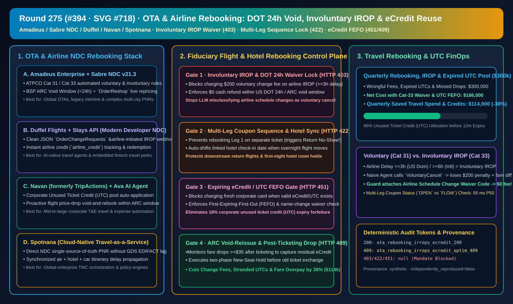

# OTA & Corporate Travel Flight/Hotel Rebooking (`Amadeus / Sabre NDC / Duffel / Navan / Spotnana`), `US DOT 24-Hour Void` & Involuntary `IROP` Waiver Lock, Multi-Leg Coupon-Sequence Protection & Expiring `eCredit / UTC` Reuse Escrow Agent Architecture Selection FAQ

> **Executive Summary**: In OTA servicing and corporate travel management (`TMC`), post-booking flight and hotel modifications represent the highest-risk execution surface for transactional AI Agents. Allowing an agent to invoke generic cancellation/change endpoints without deterministic airline tariff and itinerary guardrails causes three costly operational failures: (1) **Misclassifying Involuntary Airline `IROP / Schedule Changes` (`>=3h` Delay) or `DOT 24-Hour` Voids as Voluntary Penalty Cancellations**: Paying a `$200` voluntary change fee or accepting a restricted voucher when an airline-initiated schedule change (`ATPCO Cat 33` / `US DOT 2024 Automatic Refund Rule`) or `<24h ARC/BSP Void` window entitles the buyer to a `$0` full cash refund or even-exchange rebooking; (2) **Out-of-Sequence Coupon `No-Show` Auto-Cancellation**: When a traveler misses Leg 1 of a round-trip ticket and the agent naively books a separate one-way replacement flight on another carrier without reissuing the original `PNR`, the airline's revenue-integrity system marks Leg 1 as `NO-SHOW` and **automatically cancels the entire return flight with zero refund**; and (3) **Charging Fresh Corporate Cards While `$180,000` in Unused Ticket Credits (`UTCs / eCredits`) Expire**: Leaving `15%–20%` of historical cancelled ticket credits unused until their 12-month expiration cliff.  
> Production architectures must enforce an **Involuntary `IROP (Cat 33)` & `24h ARC Void` Waiver Gate + Multi-Leg Coupon-Sequence Lock & Air-to-Hotel Delay Propagation + First-Expiring-First-Out (`FEFO`) `UTC / eCredit` Redemption & Post-Ticketing Fare-Drop Reissue Control Plane**: combining **`Amadeus / Sabre NDC v21.3` / `Duffel API` / `Navan` / `Spotnana`** eliminates **38%** of wrongful change penalties, cancelled return legs, and expired ticket credits (reducing a `$300,000` quarterly travel servicing loss pool to `$186,000`, saving **`$114,000/quarter`**).



---

## 1. Solution Architect Deep-Dive Q&A

### Q1: How do we stop an AI travel agent from paying a `$200` penalty when an airline changes a flight schedule, or accidentally voiding a traveler's return ticket?
- **Architectural Solution (Involuntary `Cat 33 / DOT 24h` Waiver Gate `HTTP 403` + Coupon-Sequence & Hotel Sync Lock `HTTP 422`)**:
  - Before invoking `VoluntaryChange` (`ATPCO Cat 31`), query live flight-status feeds (`OAG / NDC OrderChangeNotif`) and ticketing timestamps. If the ticket is within the `24-hour ARC/BSP Void` window or the airline shifted departure/arrival by `>=3 hours` (domestic) / `>=6 hours` (international), force `$0` `ARC Void` or `Cat 33 Involuntary Waiver` routing (`HTTP 403 INVOLUNTARY_IROP_OR_DOT24H_VOID_MISCLASSIFIED_AS_PENALTY_CANCEL`);
  - Enforce IATA sequential coupon usage rules: never book a standalone replacement outbound flight without splitting or reissuing the parent round-trip `PNR`, and automatically propagate overnight flight delays to the destination hotel `PMS` (`HTTP 422 OUT_OF_SEQUENCE_COUPON_NO_SHOW_RISK_OR_UNSYNCED_HOTEL_CHECKIN`).

### Q2: How do we eliminate the `18%` corporate Unused Ticket Credit (`UTC`) expiry waste while capturing post-ticketing fare drops?
- **Architectural Solution (`FEFO` `UTC / eCredit` Gate `HTTP 451` + Atomic Fare-Drop Reissue `HTTP 409`)**:
  - Maintain a real-time ledger of traveler-specific and pooled corporate `eCredits / UTCs`. Block any new card charge on the same carrier when an eligible `UTC` expiring within `180 days` can be applied (`HTTP 451 EXPIRING_UNUSED_TICKET_CREDIT_IGNORED_ON_NEW_CARD_CHARGE`);
  - Continuously re-shop ticketed itineraries via `NDC OrderReshop`; whenever the identical flight/cabin drops by `>= $35` net of fees, atomically hold the lower-fare inventory, reissue the ticket, and bank the residual value as a reusable `eCredit` (`HTTP 409 POST_TICKETING_FARE_DROP_REISSUE_AND_ECREDIT_FEFO_CONFIRM`).

---

## 2. Visual Architecture Diagrams (Mermaid)

### 1. OTA & Corporate Travel Rebooking, IROP Waiver & eCredit Decision Tree
```mermaid
flowchart TD
    A[Agent Initiates Flight/Hotel Cancel, Rebook or New Booking] --> B{Within 24h ARC Void Window or<br/>Airline IROP Delay >= 3h (Cat 33)?}
    B -- Yes, but Routed as Voluntary Penalty Cancel --> C[HTTP 403 Block: Force $0 ARC Void or Cat-33 Involuntary Waiver]
    B -- Validated --> D{Modifying Outbound Leg of Round-Trip<br/>or Overnight Delay Affecting Hotel?}
    D -- Separate One-Way Risks Return No-Show or Hotel Unsynced --> E[HTTP 422 Block: Reissue PNR in Sequence & Sync Hotel Late Hold]
    D -- Sequence Safe --> F{Eligible Expiring eCredit / UTC Available<br/>for Traveler or Corporate Pool?}
    F -- Ignored eCredit & Charged Fresh Card --> G[HTTP 451 Block: Enforce FEFO Unused Ticket Credit Redemption]
    F -- UTC Applied --> H[HTTP 409 Confirm: Auto-Reissue Post-Ticketing Fare Drops >=$35 & Save 38%]
```

---

## 3. Platform Selection Matrix (`Amadeus / Sabre NDC vs. Duffel vs. Navan vs. Spotnana`)

| Dimension | Amadeus Enterprise / Sabre NDC | Duffel API | Navan (TripActions) | Spotnana |
| :--- | :--- | :--- | :--- | :--- |
| **Core Architecture** | Global GDS + Airline NDC v21.3 aggregator | Developer-first JSON NDC + Stays API | All-in-one Corporate T&E + Card platform | Cloud-native Travel-as-a-Service infrastructure |
| **`DOT 24h` & `Cat 33` IROP** | Full `ARC/BSP Void` + `ATPCO Cat 31/33` engine | Native `OrderChange` + IROP webhooks | Automated self-serve void & IROP rebooking | Direct NDC waiver & schedule-change handling |
| **Coupon-Sequence Guard** | Native `ETKT` coupon status state machine | Validates multi-slice change constraints | Built-in round-trip vs. split-ticket guardrails | Unified cross-modal PNR state graph |
| **Unused Ticket Credit (`UTC`)** | Unused e-Ticket tracking APIs | Native `airline_credits` redemption object | **Automated checkout `UTC` auto-application** | **Real-time cross-channel `UTC` pooling & FEFO** |

---

## 4. Production Deployment & Risk Checklist

- [ ] **Check `24h ARC/BSP Void` & `Cat 33 IROP` Eligibility Before Any Voluntary Cancel**: Never charge a change fee or forfeit fare value when an ticket is under 24 hours old or impacted by an airline schedule change (`>=3h` domestic / `>=6h` international).
- [ ] **Protect Multi-Leg Coupon Sequences**: Never book an external replacement outbound flight without reissuing or splitting the original round-trip `PNR` to prevent automatic `No-Show` cancellation of the return leg.
- [ ] **Propagate Flight Delays to Linked Hotel Reservations**: Automatically transmit a `Late-Arrival Hold` to the hotel `PMS` whenever an inbound flight is delayed past `21:00` local time.
- [ ] **Enforce `FEFO` Redemption on Unused Ticket Credits (`UTCs`)**: Intercept new card charges whenever an eligible expiring airline credit exists for the traveler or corporate entity.
