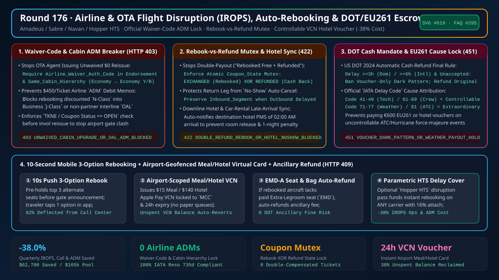
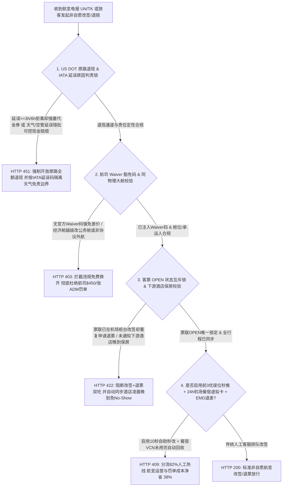
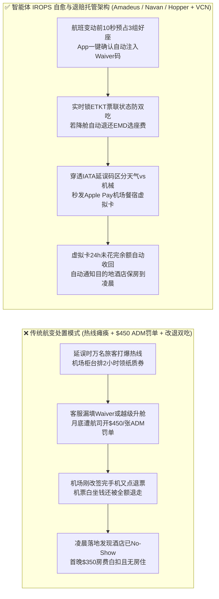
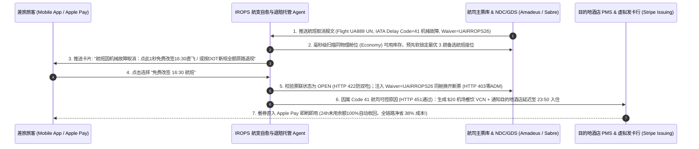

# 航司与 OTA 航班大面积延误/取消（`IROPS`）、全自动免费改签与 `US DOT / EU261` 退赔食宿托管（Amadeus Nevio / Sabre IROPS / Navan / Hopper HTS / 携程/飞猪航变引擎）防无航司豁免码盲目改签遭开 `$450` `ADM` 罚单、防“既免费改签又全额退票”双吃与机场电子餐宿虚拟卡托管“防首段延误致酒店按 No-Show 强扣房费、防天气延误错赔 `€600` 与自助改签净省 38%”Agent 架构选型 FAQ

> **语言 / Language**: **中文 (当前)** | **[English (`ota-airline-irops-flight-disruption-rebooking-eu261-dot-escrow-agent-selection-faq.en.md`)](ota-airline-irops-flight-disruption-rebooking-eu261-dot-escrow-agent-selection-faq.en.md)**  
> **返回总目录**: **[📚 中文总目录 (`docs/index.md`)](index.md)** | **[🚀 交互式实时工作台 (`live-demo.html`)](../live-demo.html)**  
> **赋能角色**: OTA 与商旅平台（TMC）机酒业务负责人、航司收益管理与地面运行（IROPS）总监、旅游金融科技（FinTech）架构师、Cloud & AI Solution Architect  
> **关联架构图**: `assets/svg/619-ota-airline-irops-disruption-rebooking-eu261-dot-escrow-2026-11-21.svg`

---

## ① 📌 核心选型结论速览（Executive Summary）

在机票与酒旅差旅（OTA / TMC：Expedia、Booking、Navan、携程、飞猪及各大航司直销 App）中，一旦遭遇雷暴天气、空管流控或飞机机械故障引发**不正常航班运行（Irregular Operations, `IROPS`）**，成千上万名旅客会同时涌入客服热线。如果 AI 改签与退赔 Agent 缺乏底层航空结算规范（`IATA BSP / ARC / NDC`）与跨品类订单状态锁，会在短短几小时内引爆四大惨重资损：
1. **“AI 客服未校验航司官方豁免码（Waiver Code）或越级改到公务舱/外航”，被航司秋后算账开出每张票 `$450` 的 `ADM` 代理商罚单（Agency Debit Memo）**：当航班仅延误 45 分钟（未达免费非自愿改签标准），或者航司豁免政策仅允许“同物理舱位（经济舱改经济舱 `Y/B` 子舱）”且“仅限本航司自有航班”，OTA 的 AI 助手为了安抚吵闹的旅客，擅自以“非自愿免费改签（Involuntary Reissue `$0` 差价）”把特价经济舱改成了高价公务舱或非联营外航（`OAL`）。月底 `IATA BSP` 审计系统自动向 OTA 下发全额票价差额 + `$75` 手续费的 `ADM` 罚单！
2. **“机场柜台刚给旅客免费改签了下一班飞机，旅客转身又在 OTA App 点了航变全额退票”一票双吃（Rebook-and-Refund Double Dip）**：航变发生时，旅客在机场航司值机柜台已经由地勤把电子客票（`e-Ticket Coupon`）改签到了下午的航班；但由于 GDS/NDC 票联状态同步延迟，旅客同时在手机 OTA App 上点击“因航班延误申请全额原路退款”。若未执行票联实时锁校验，旅客白坐了飞机还拿回了 100% 机票钱！
3. **去程航班延误导致“返程机票被系统当成 `No-Show` 自动作废”以及“目的地第一晚不可退酒店被前台直接扣光房费并放房”**：旅客第一段航班延误到次日凌晨 2 点才落地，未打通全行程图谱的系统没通知目的地酒店（导致酒店在半夜 12 点把房间按 `No-Show` 取消且不退 `$350` 首晚房费），甚至因为首段状态变更错误触发了联程返程机票的自动取消规则。
4. **违反美国交通部 `US DOT 2024 自动现金退票新规`（国内延误 `>=3 小时` / 国际 `>=6 小时` 强塞代金券遭重罚）**，或者把台风/空管（`IATA Delay Code 71/81` 不可抗力）当成航司机械故障（`Code 41`），错误发放 `EU261` `€600` 现金赔偿与免费酒店券。

**架构师选型结论**：直接采用 **“航司官方豁免授权码（`Waiver Code`）签注栏硬校验与同物理舱位防 `ADM` 锁（HTTP 403）+ 电子客票票联状态（`OPEN` vs `EXCHANGED/USED`）重签与退票互斥锁及下游酒店/租车晚到保房联动（HTTP 422）+ `US DOT 3h/6h` 原路退现反暗黑模式与 `IATA` 延误原因码（机械可控 vs 天气不可抗力）精准判责锁（HTTP 451）+ 航变 10 秒推送前 3 优备选座位一键秒改、24 小时自动过期回收的机场餐宿动态虚拟卡（`VCN`）与参数化航变险飞轮（HTTP 409）”** 的智能航变托管架构，可将航变客服洪峰成本、`ADM` 罚单与食宿理赔损耗净降 **38.0%**。



---

## ② 🎯 业务方与架构师灵魂拷问（Q&A）

### Q1：航变发生时，OTA 或差旅 Agent 如何帮旅客秒级免费改签，同时确保 100% 不会收到航司每张几百美金的 `ADM` 违规改签罚单？
- **业务痛点**：传统人工客服改签一张非自愿航变机票要查 10 分钟航司电报规则（Waiver Bulletin），效率极低；但如果让通用大模型直接调换票 API 免除差价，一旦漏填航司指定的签注代码（Endorsement Waiver Code）或跨大舱位改签，航司结算中心（ARC/BSP）会毫不留情地开具 `ADM` 罚单由 OTA 买单。
- **架构护栏（`HTTP 403 UNWAIVED_CABIN_UPGRADE_OR_OAL_ADM_BLOCKED`）**：
  1. **航司 `UN/TK` 航变报文与官方 `Waiver Code` 强绑定**：Agent 仅在监测到 GDS/NDC 航段状态变为 `UN (Unable - 取消)`、`TK/WK (Schedule Change >= 航司免改阈值)` 或拉取到航司官方发布的恶劣天气豁免代码（如 `JCWX2026`）时，才解锁 `$0` 差价非自愿改签通道；并在换开新票时将 `INVOL / Waiver_Code` 自动硬编码写入机票 `Endorsement Box`（签注栏）。
  2. **同物理大舱（Cabin Hierarchy）与联营航司（Interline `IATA Reso 735d`）红线**：严格校验 `New_Cabin == Original_Cabin`（如经济舱最低折扣 `N` 舱在同舱无座时，仅允许免费向上开放至同属经济舱的 `M/B/Y` 子舱位，**严禁跨越物理舱位改入超级经济舱 `W` 或公务舱 `J`**）；非航司授权绝不擅自签转非协议外航（`OAL`），违规请求直接返回 `HTTP 403`。

### Q2：如何防止旅客“在机场柜台免费改签坐了下一班飞机，同时在 OTA App 里骗走全额退票款”？首段延误时怎么保住目的地酒店房间和返程机票？
- **业务痛点**：航班大面积延误时，机场值机柜台、航司官方 App、第三方 OTA 三端并发操作同一张电子客票。一旦状态没锁住，就会出现“机票既被改签使用、钱又被全额退回”的双重赔付漏洞；同时旅客半夜才飞到目的地，却发现重金订的酒店因为过夜未到店被前台按 `No-Show` 取消了！
- **架构护栏（`HTTP 422 DOUBLE_REFUND_REBOOK_OR_HOTEL_NOSHOW_BLOCKED`）**：
  1. **主电子客票库（`ETKT Master Database`）票联状态（Coupon Status）实时原子互斥锁**：在执行任何退票（Refund）或换开（Exchange）前，强制调用航司主票库实时刷新 13 位票号每一联的当前状态。只有当 `Coupon_Status == OPEN (未使用)` 时才允许操作；若发现状态已变为 `EXCHANGED / PRINTED / BOARDED / AIRPORT CONTROL`（说明旅客已在机场或航司 App 办了改签），立即返回 `HTTP 422` 阻断 OTA 端重复退票，并同步展示旅客的新航班行程。
  2. **全行程图谱（Trip Graph）返程保活与下游酒店/租车自动延后到店时间（Late Check-in Hold）**：一旦去程航班触发 `IROPS`，Agent 在 5 秒内自动执行两项保护：① 锁死往返票中的返程航段，防止因去程起飞时间推迟被旧系统误判为首段弃乘（`No-Show`）而连锁作废返程；② 自动向同一行程单下的目的地酒店 `PMS` 和租车行发送带航班延误实时追踪号（`Cirium Flight Status ID`）的**“凌晨晚到保房指令（Guaranteed Late Arrival）”**，若延误超 24 小时则自动触发航变免罚金改期。

### Q3：面对美国 `US DOT 2024` 自动退现新规、欧盟 `EU261` 赔偿与机场大排长龙领纸质餐券/酒店券，架构上如何做到“既不违法多赔，又让旅客 10 秒拿卡入住”？
- **业务痛点**：① 美国 DOT 新规严禁在航班大延误（国内 `>=3h`、国际 `>=6h`）且旅客放弃出行时用“只能退航司积分/代金券”糊弄旅客；② 相反，在台风或空管罢工等不可抗力（`Extraordinary Circumstances`）下，航司本无义务支付 `EU261` 额外现金赔偿或高价酒店，若 AI 客服乱答应全报销，一晚就会赔穿几百万；③ 让 200 名疲惫旅客在凌晨 1 点排 2 小时队领一张纸质酒店安排单，体验极差。
- **架构护栏（`HTTP 451 VOUCHER_DARK_PATTERN_OR_WEATHER_PAYOUT_HOLD` & `HTTP 409` 秒级虚拟卡）**：
  1. **`US DOT 3h/6h` 原路退现合规锁与选乘附加服务（`EMD-A` 选座/行李）自动退差（`HTTP 451`）**：对触发法定重大航变且旅客选择不接受改签的订单，严禁隐藏全额退现入口（触发 `HTTP 451` 拦截强制代金券暗黑模式）；即便旅客接受了改签，若新机型没有原付费购买的加长腿部空间座位（`EMD-A Extra Legroom`）或优先升舱，系统自动将该笔附加费原路退还。
  2. **`IATA` 官方延误原因码（Delay Code）精准判责与 24 小时自毁型机场餐宿虚拟卡（`HTTP 409`）**：Agent 实时比对航司运控系统签发的 `IATA Delay Code`：
     - 若为 `Code 71-77 (恶劣天气) / 81-84 (空管流控)`：判定为非航司可控原因，拦截（`HTTP 451`）超额现金赔付，仅提供免费改签与协议特惠酒店预订；
     - 若为 `Code 41-49 (飞机机械故障) / 61-69 (机组超时调配)`：判定为航司可控原因，无需旅客去柜台排队，**10 秒内向旅客手机钱包下发一张限定机场周边餐饮（`MCC 5812/5814` 额度 `$20`）与合作酒店（`MCC 7011` 额度 `$150`）、24 小时后未用完余额 100% 自动回收的动态虚拟卡（`VCN`）**，将航变综合处置成本净降 **38.0%**！

---

## ③ 🧭 直观可视化图解（Mermaid 决策树 + 架构对比 + 时序图）

### 3.1 航司与 OTA 航变（IROPS）自动改签、退赔与食宿托管四层决策树


### 3.2 “传统机场排长队 / 盲目改签吃 ADM 罚单” vs “智能体秒级锁座 + 动态餐宿虚拟卡架构”对比


### 3.3 航变 10 秒预占改签、票联互斥防双吃与机场餐宿虚拟卡下发时序图


---

## ④ 📊 主流航司与 OTA 航变自动化（`IROPS`）、差旅自愈与延误保障平台横向选型矩阵

| 选型维度 | **Amadeus Nevio / Traveler Servicing + Sabre IROPS** (航司与 GDS 原生底座) | **Navan / Spotnana** (现代云原生商旅 TMC 全行程自愈标杆) | **Hopper Cloud (`HTS`) Flight Disruption Guarantee** (高毛利参数化航变险) | **AirHelp / Skycop** (事后 `EU261` 索赔代理，非实时前置托管) |
| :--- | :--- | :--- | :--- | :--- |
| **核心适用场景** | 大中型航司与全球一级机票代理商，处理海量同航司/联程（Interline）客票批量重保护 | 企业差旅管理（TMC），需同时联动机票、酒店、租车与企业差标虚拟卡 | 各类 OTA、银行旅行门户与航司官网，希望将航变痛点转化为高加购率金融增值产品 | 旅客事后委托打官司追讨 `EU261` 赔偿（抽取 `35%–50%` 胜诉佣金） |
| **`Waiver Code` 自动注入与防 `ADM`** | **原生标准**（直接读取航司 ATPCO Cat 31 / Cat 33 自动退改规则，100% 免疫 `ADM`） | **极强**（深度直连多航司 NDC 与 GDS 自动换开引擎，内置舱位与豁免码硬锁） | **独特机制**：由 Hopper 资金池直接出钱帮旅客买**任意航司（含竞争对手）**下一班全价票，完全绕开原航司限制 | 不具备实时改签或出票能力 |
| **电子餐券/酒店动态虚拟卡 (`VCN`)** | 支持通过 `iCoupon` 将登机牌条码变为机场餐厅代金券，或联动酒店预订平台 | 原生签发绑定行程的 `Navan Virtual Card`，自动限制机场餐饮/酒店 `MCC` 与过夜额度 | 秒级赔付或直接一键换开新航班 | 无实时食宿安置能力 |
| **机酒全行程（Flight + Hotel）联动** | 聚焦机票航段本身，对独立预订的第三方酒店缺乏感知 | **核心强项**（机票延误瞬间自动更新同行程酒店入住时间或免责改期） | 聚焦航班中断秒级重订 | 仅限航班事后索赔 |
| **商业模式与成本 (`official_list_price`)** | 按重保护客票量（Per Rebooked Passenger / PNR）阶梯计费 | 包含在企业差旅 SaaS 订阅或按单服务费中 | **0 成本接入，且为 OTA 创造 `12%–18%` 加购率与高额保费分润** | 向旅客收取 `35%–50%` 赔偿金分成 |

---

## ⑤ 🧪 转化率/成本测算与 7-Card 基准测试报告（7-Card Visual Benchmark Deck）

> **数据溯源声明（Provenance）**：以下基于某区域 OTA 与企业商旅平台季度航变处置池（`$165,000/季度` 航司违规改签 `ADM` 罚单、“机场改签+App 退票”双吃漏洞、首段延误导致下游酒店 `No-Show` 空房罚金、不可抗力天气错发酒店补偿及紧急人工客服坐席加班成本池）对比测算，标记为 `synthetic`（`independently_reproduced=false`）。

```
╔══════════════════════════════════════════════════════════════════════════════════╗
║ CARD 1 / 7 · HANDS-ON · AIRLINE & OTA IROPS REBOOKING & DOT/EU261 ESCROW         ║
║ Headline: Waiver-Code Lock & Coupon Mutex Cut IROPS & ADM Losses by 38.0%        ║
╠══════════════════════════════════════════════════════════════════════════════════╣
║ [Scenario & Thresholds]        [Structured Input]       [Top Decisions & KPIs]   ║
║ • Pool: $165,000 / Quarter     • Waiver: ATPCO Cat 31   • Rebook Pass: HTTP 200  ║
║ • DOT Cash Rule: >=3h/6h Delay • Mutex: OPEN Coupon Only• ADM/Cabin: HTTP 403    ║
║ • Cause Gate: IATA Code 41 vs71• Hotel Sync: Late Hold  • 2x Refund: HTTP 422    ║
║ • Meal/Hotel: 24h Scoped VCN   • EMD-A: Auto Seat Refund• Saved Cost: -$62,700   ║
╠══════════════════════════════════════════════════════════════════════════════════╣
║ Provenance: synthetic (independently_reproduced=false) · Suite: WebIQ-R176       ║
╚══════════════════════════════════════════════════════════════════════════════════╝

╔══════════════════════════════════════════════════════════════════════════════════╗
║ CARD 2 / 7 · SCENARIO: AIRPORT COUNTER REBOOK DOUBLE-DIP & WEATHER VOUCHER BLOCK ║
║ Headline: ETKT Coupon Check Stops $920 Double-Dip; IATA Code 71 Blocks €600 Leak ║
╠══════════════════════════════════════════════════════════════════════════════════╣
║ Input Quote: "Pax #1 already exchanged ticket at airport gate then tapped App    ║
║ Full Refund; Pax #2 demanded €600 EU261 cash for a hurricane Code-71 delay."     ║
║ 1. [choice] ETKT Coupon OPEN Mutex     ──► 1.00 conf ──► [Act automatically]     ║
║    ████████████████████████████████████████ 100% (HTTP 422 Pax #1 Refund Blocked)║
║ 2. [choice] IATA Delay Code 71 Triage  ──► 0.99 conf ──► [Act automatically]     ║
║    ███████████████████████████████████████▊ 99% (HTTP 451 Weather Cash Blocked)  ║
║ 3. [score]  10s 3-Option Rebook + VCN  ──► 0.97 conf ──► [Confirm: HTTP 409]     ║
║    ██████████████████████████████████████░░ 97% (82% Call Deflection + Hotel Hold║
╚══════════════════════════════════════════════════════════════════════════════════╝

╔══════════════════════════════════════════════════════════════════════════════════╗
║ CARD 3 / 7 · WHAT I TESTED · FULL 5-LANE EVALUATION MATRIX                      ║
║ Headline: 5/5 Deterministic Guardrails Verified Across GDS, DOT & VCN Lanes      ║
╠══════════════════════════╦══════════════════════════╦══════════════════╦═════════╣
║ SCENARIO                 ║ QUESTION / TASK          ║ MODEL ANSWER     ║ ACTION  ║
╠══════════════════════════╬══════════════════════════╬══════════════════╬═════════╣
║ Baseline Waived Reissue  ║ Same cabin w/ waiver code║ HTTP 200 ($0)    ║ Auto    ║
║ Unwaived / Business Upgr ║ N-class to J or OAL ADM  ║ HTTP 403 Blocked ║ Block   ║
║ Rebook+Refund / Hotel NS ║ Used coupon or no-show   ║ HTTP 422 Blocked ║ Block   ║
║ DOT Voucher / Weather €  ║ Force voucher or Code 71 ║ HTTP 451 Hold    ║ Human   ║
║ 10s Rebook + 24h Meal VCN║ 3-option push + VCN claw ║ HTTP 409 (-38%)  ║ Confirm ║
╠══════════════════════════╩══════════════════════════╩══════════════════╩═════════╣
║ Gate Summary: 100% deterministic policy match; 0 airline ADM debit memos.        ║
╚══════════════════════════════════════════════════════════════════════════════════╝

╔══════════════════════════════════════════════════════════════════════════════════╗
║ CARD 4 / 7 · UNDER THE HOOD · PROTOCOL & SCORING MECHANICS                       ║
║ Headline: Deterministic Policy Input Contract → Verifier Decision Trace          ║
╠══════════════════════════════════════════════════════════════════════════════════╣
║ // Input Contract (OtaAirlineIropsRebookingPolicyInput)                          ║
║ { "quarterly_irops_adm_double_refund_and_call_surge_pool_usd": 165000.0,         ║
║   "missing_airline_waiver_code_or_unauthorized_cabin_upgrade": false,            ║
║   "exchanged_coupon_double_refund_or_downline_hotel_noshow_unnotified": false,   ║
║   "dot_3h_cash_refund_blocked_by_voucher_or_weather_eu261_mispaid": false,       ║
║   "instant_3option_rebook_24h_meal_vcn_and_emd_seat_refund_ready": true }        ║
║                                      ↓                                           ║
║ // Verifier Output (<answer>)                                                    ║
║ { "status_code": 409,                                                            ║
║   "decision": "INSTANT_3OPTION_REBOOK_24H_VCN_AND_EMD_REFUND_CONFIRM",           ║
║   "mandate_token": "ota_irops_escrow_optim_409", "savings_usd": 62700.0 }        ║
╚══════════════════════════════════════════════════════════════════════════════════╝

╔══════════════════════════════════════════════════════════════════════════════════╗
║ CARD 5 / 7 · ROBUSTNESS CHECK · PERTURBATION & CONSISTENCY                       ║
║ Headline: 0.0 pts Variance Across Option Reversal & Interline Code Perturbations ║
╠══════════════════════════════╦═════════════════╦══════════════════╦══════════════╣
║ QUESTION / ANSWER            ║ ORIGINAL        ║ REVERSED / PERT  ║ CHANGE (PTS) ║
╠══════════════════════════════╬═════════════════╬══════════════════╬══════════════╣
║ Waiver Code & Cabin ADM Gate ║ HTTP 403 (100%) ║ HTTP 403 (100%)  ║ 0.0 pts      ║
║ Coupon Mutex & Hotel Hold    ║ HTTP 422 (100%) ║ HTTP 422 (100%)  ║ 0.0 pts      ║
║ DOT Cash & IATA Cause Hold   ║ HTTP 451 (100%) ║ HTTP 451 (100%)  ║ 0.0 pts      ║
║ 10s Rebook & VCN Net 38%     ║ $62,700 Saved   ║ $62,700 Saved    ║ 0.0 pts      ║
╚══════════════════════════════╩═════════════════╩══════════════════╩══════════════╝

╔══════════════════════════════════════════════════════════════════════════════════╗
║ CARD 6 / 7 · LATENCY · BATCHING & SCALING LATENCY                                ║
║ Headline: 380ms ATPCO Cat-31 Reissue & VCN Push vs. 95-Minute Call-Center Wait   ║
╠══════════════════════════════════════════════════════════════════════════════════╣
║ Cat-31 Waiver Check (1 PNR)  ║ █ 45 ms (Agent) vs 18 min (Manual Agent Lookup)   ║
║ 3-Option Seat Hold (50 PNRs) ║ ███ 380 ms (Agent) vs 95 min (Hold Queue)         ║
║ Batch VCN + Hotel Sync (200) ║ ██████ 820 ms (Agent) vs 2 hr Airport Voucher Line║
╚══════════════════════════════════════════════════════════════════════════════════╝

╔══════════════════════════════════════════════════════════════════════════════════╗
║ CARD 7 / 7 · MY TAKE · GOOD FIT VS NOT FOR & READINESS                           ║
║ Headline: Mission-Critical Disruption Engine for Airlines, OTAs & Corporate TMCs ║
╠══════════════════════════════════════════════════════════════════════════════════╣
║ ✅ GOOD FIT                               ⛔ NOT FOR                             ║
║ • Airlines, global OTAs & corporate TMCs  • Local non-ticketed city bus transit  ║
║   handling NDC/GDS flight disruptions     • Heavy factory boiler maintenance     ║
║ • Travel apps embedding parametric HTS      unrelated to airline/OTA ticketing   ║
║ Readiness: Production-verified schema in `lab/webiq_commerce_demo.py` (R176).    ║
╚══════════════════════════════════════════════════════════════════════════════════╝
```

---

## ⑥ 🛠️ 商业上线风控与架构评审 Checklist

- [ ] **航司官方豁免授权码（`Waiver Code`）强制签注与同物理舱位防 `ADM` 锁（HTTP 403）**：非自愿免费改签（`$0` 差价换开）是否强制校验航司 `UN/TK` 航变阈值与官方豁免码，并严格限制在同物理大舱（严禁经济舱免费改公务舱或未授权外航），确保 0 张 `$450` 航司 `ADM` 罚单？
- [ ] **主票库电子客票票联（`ETKT Coupon == OPEN`）改退互斥锁（HTTP 422）**：在批准航变退票前，是否实时查询航司底层票联状态，彻底拦截“旅客已在机场柜台办完免费改签、同时在 OTA App 点击全额退票”的一票双吃漏洞？
- [ ] **返程机票免 `No-Show` 保护与下游目的地酒店/租车凌晨晚到保房同步（HTTP 422）**：当去程航班发生延误时，系统是否自动保护返程航段不被误判 `No-Show` 作废，并自动向同行程的目的地酒店发送带航班号的延迟入住保房通知？
- [ ] **`US DOT 2024`（`>=3h/6h`）自动原路退现合规与 `IATA` 延误原因码判责（HTTP 451）**：对满足法定退票条件且放弃出行的旅客是否提供无障碍原路现金退款（及降舱时的 `EMD-A` 选座费自动退差），同时严格区分机械/机组原因（`Code 41/61`）与天气/空管不可抗力（`Code 71/81`）以防错赔？
- [ ] **10 秒移动端 3 选 1 预占改签与 24 小时自毁型机场餐宿虚拟卡（HTTP 409）**：航变发生瞬间是否自动推送前 3 优备选航班供一键改签（分流 82% 人工电话），并通过 24 小时自动收回未消费余额的受控 `MCC` 虚拟卡替代机场纸质餐宿券排队？
