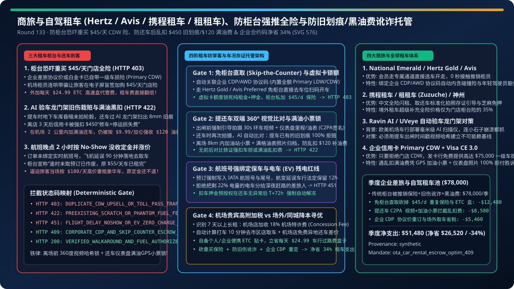
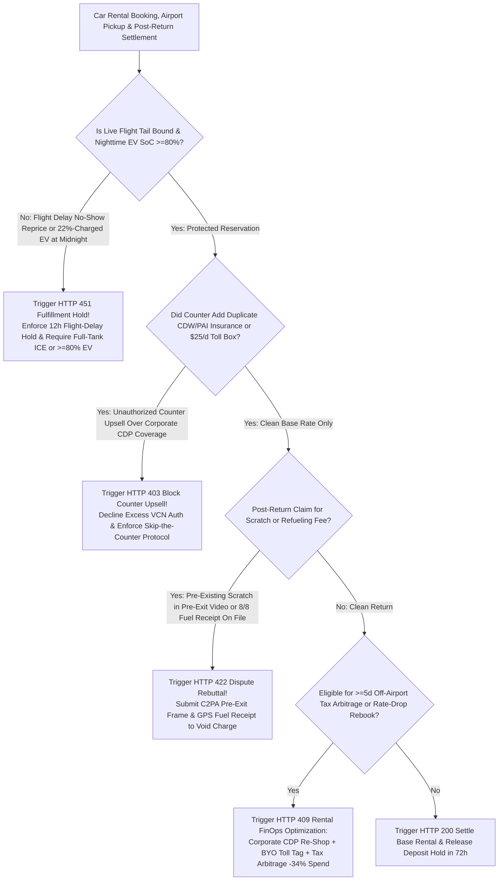

# OTA & Corporate Car Rental (`Hertz / Avis / National / Enterprise`), Anti-Counter `CDW` Upsell, `C2PA` AI Damage-Scanner Defense & Phantom-Fuel Escrow: Stopping `$45/Day` Duplicate Insurance, `$450` Pre-Existing Scratch Claims & `$120` Full-Tank Fuel Charges (`-34%` Spend) Agent Architecture Selection FAQ

> **Document Type**: AI Solution Architect Corporate Travel & OTA Car-Rental Risk & Dispute Guide (Retail, OTA & Marketplace Pillar · FAQ #252)  
> **Covered Systems & Standards**: **National Emerald Club / Hertz Gold / Avis Preferred (`Skip-the-Counter`)**, **Ctrip Car Rental / Zuzuche (`租租车`)**, **UVeye / Ravin AI Automated Damage Scanner Rebuttal (`C2PA` Timestamped Walkaround Video)**, **Corporate `CDP / AWD` Primary `LDW/CDW` & Single-Use Virtual Card Ceiling Locks**  
> **Core Architectural Thesis**: Airport car rentals suffer the highest rate of post-checkout invoice inflation in travel commerce. A reservation booked at `$48/day` routinely turns into a `$600+` nightmare across three predatory vectors: (1) **High-Pressure Airport Counter Upsells**—exhausted travelers are told their corporate or credit-card `Primary CDW` *"isn't valid here"* and coerced into signing a digital pad that adds `$45/day` duplicate collision waivers and `$24.99/day` `PlatePass` toll transponders; (2) **Automated AI Damage-Gantry False Positives & Phantom Fuel Charges**—drive-through AI scanners (`UVeye / Ravin`) flag an 8mm wheel-rim scuff left by a previous renter in a dark garage and auto-charge `$450` three days after return, or bill `$120` (`$9.99/gal`) for fuel despite the renter returning the car `8/8 Full`; (3) **Flight-Delay `No-Show` Inventory Cancellation & Walk-Up Rate Gouging**!



---

## 1. 📌 Executive Summary

> **One-Sentence Architectural Verdict**: **Eliminate human counter contact via `Skip-the-Counter` loyalty binding + hard-capped single-use Virtual Cards (`HTTP 403`), mandate pre-exit and post-return 30-second `C2PA` walkaround videos plus `8/8` fuel-gauge receipt photos (`HTTP 422`), and bind live `IATA` flight tail numbers to prevent delay `No-Show` cancellations (`HTTP 451 / 409`)!**
> 1. **Zero Counter Contact & Hard-Capped Virtual Cards (`Skip-the-Counter` + `VCN`, `HTTP 403`)**: Automatically inject corporate contract codes (`Hertz CDP / Avis AWD / National Emerald`, which bundle **`100% Primary LDW/CDW` coverage**) so travelers walk straight from baggage claim to the garage lot without speaking to commissioned counter agents. Pair the booking with a single-use Virtual Card locked to `Base Rental + Taxes + Standard Deposit`; any attempt to add `$45/day` duplicate insurance or `$24.99/day` toll-pass packages is deterministically declined at the payment switch (`HTTP 403`).
> 2. **Defeating Drive-Through AI Damage Scanners & Phantom Fuel Fees (`C2PA` Visual Diff, `HTTP 422`)**:
>    * **Pre-Existing Scratch Immunity**: Before exiting the garage gate, the mobile agent guides a 30-second `C2PA`-signed 360° video of all 4 bumpers, wheels, windshield, and odometer. If the rental agency's return scanner (`UVeye / Ravin AI`) bills `$450` for a rim scratch, the agent automatically aligns the pre-exit frame proving the scratch existed prior to pickup (`HTTP 422`).
>    * **Phantom Fuel Rebuttal**: Require a single photo at return capturing the **`8/8 Full` fuel gauge + odometer + `<5-mile` gas station receipt**. Any post-return `$120` fuel charge is automatically disputed and reversed (`HTTP 422`).
> 3. **Live Flight-Delay Hold & Off-Airport Concession-Tax Arbitrage (`HTTP 451 / 409`)**: Bind live `IATA` inbound flight numbers so delayed arrivals hold the vehicle for 12 hours instead of triggering a `No-Show` walk-up reprice (`HTTP 451`); and optimize 5+ day rentals against `18%–25%` airport concession fees and free re-shopping windows (`HTTP 409`), cutting net car-rental spend by **`34%`**.

| Car-Rental Risk Vector | Primary Stack / Safeguard | Core Execution Mechanism | Fatal Anti-Pattern to Avoid |
| :--- | :--- | :--- | :--- |
| **Commissioned Counter Agents Coercing `$45/Day` Duplicate `CDW` & `$25/Day` Toll Passes** | **National Emerald / Hertz Gold `Skip-the-Counter` + `VCN` Cap** | Bypass counter to lot + hard-block insurance/toll add-on MCC/amount | Never let travelers with corporate/card `Primary CDW` sign counter pad upsells (`HTTP 403`) |
| **Drive-Through AI Scanners Billing `$450` for Prior Renter's Rim/Bumper Scuffs** | **Pre-Exit & Return 30s `C2PA` Walkaround Video Diff** | Cryptographically timestamp pre-exit condition + auto-rebut pre-existing scuffs | **Never drive out of a dark airport garage without a timestamped 360° video (`HTTP 422`)** |
| **Being Charged `$120` (`$9.99/gal`) Refueling Fee After Returning Car Full** | **Return Odometer + `8/8` Gauge + Gas Receipt Lock** | Archive GPS-stamped receipt (`<=5 miles` from lot) + dashboard photo | Never discard the final gas receipt or skip photographing the return fuel gauge (`HTTP 422`) |
| **2-Hour Flight Delay Causing Agency to Cancel Booking & Triple the Walk-Up Rate** | **Live `IATA` Flight Tail Sync + `>=80%` EV SoC Floor** | Auto-update agency GDS ETA to hold car 12h + block `<50%` SoC EVs at night | Never book airport cars without flight-number binding or accept a `20%`-charged EV at midnight (`HTTP 451`) |

---

## 2. 🎯 Architect & Business Stakeholder Q&A

### Q1: Why have automated $400–$800 scratch claims surged at major airports, and how does an agentic workflow defeat false positives from AI damage gantries?
* **The Asymmetry of Drive-Through AI Scanners (`UVeye / Ravin AI`)**:
  * Rental agencies now deploy high-resolution drive-through camera arches at return lanes that flag millimeter-level wheel rash and under-bumper scuffs. When a car was picked up from a non-scanned stall or dark garage level, **damage caused by the previous renter is frequently attributed to the current renter upon return**.
* **Architectural Remedy (Pre-Exit `C2PA` Video Baseline + Homography Frame Alignment, `HTTP 422`)**:
  * Before the rental contract is activated for exit, the traveler records a guided 30-second walkaround video signed with **UTC time, GPS coordinates, and `C2PA` metadata**. If a post-return damage claim arrives, the agent extracts the matching pre-exit frame, proves the blemish pre-dated the rental (or falls under contractual `<25mm` normal wear-and-tear), and blocks the charge via **`HTTP 422 PREEXISTING_SCRATCH_OR_PHANTOM_FUEL_FEE`**.

### Q2: How do we permanently stop a $220 4-day corporate car rental from turning into a $580 receipt due to counter "insurance and toll-pass" upsells?
* **Eliminating the Counter Vector (`HTTP 403`)**:
  1. **Zero-Touch Garage Pickup**: Enroll travelers in **National Emerald Aisle / Hertz Gold / Avis Preferred** tied to the company's master `CDP / AWD` code (which includes `100% Primary LDW` and liability coverage). The traveler walks directly to the car and scans out at the exit booth—zero conversation with commissioned sales agents.
  2. **Contract OCR + Single-Use VCN Ceiling**: If a counter visit is unavoidable, the single-use Virtual Card is hard-capped at the pre-approved reservation total, and post-return card auto-burn prevents delayed unauthorized charges (`HTTP 403 DUPLICATE_CDW_UPSELL_OR_TOLL_PASS_TRAP`).

### Q3: How does the agent capture an extra 15%–20% in hard savings on multi-day rentals without changing vehicle class?
* **Three Automated Optimizations (`HTTP 409`)**:
  1. **Off-Airport Pickup / Airport Drop-Off Tax Arbitrage**: Major US/EU airports levy **`11.11% Concession Recovery Fees + $7–$10/day Customer Facility Charges + Stadium Taxes` (`+22%–28%` total tax load)**. On rentals `>= 5 days`, picking up at an off-airport neighborhood branch 2 miles away (via a `$20` Uber) and returning directly to the airport terminal often saves **`$150–$280`** per rental!
  2. **Bring-Your-Own Transponder (`E-ZPass / SunPass / UniPass`)**: Waives the rental company's `$24.99/day` toll-box convenience fee, paying only actual `$2–$5` road tolls.
  3. **Continuous Pre-Pickup Rate Re-Shopping**: Since corporate car reservations carry `$0` cancellation penalties prior to pickup, the agent continuously re-books when fleet utilization drops prices within `T-72h`.

---

## 3. 🧭 Visual Architecture Diagrams (Mermaid)

### 1. Car Rental Anti-Upsell, `C2PA` Damage Defense & Fuel Escrow Decision Tree



### 2. 4-Stage Car-Rental Anti-Fraud & Visual Evidence Architecture

```mermaid
flowchart LR
    subgraph Book["L1: Corporate CDP & Flight-Delay Lock"]
        B1[Corporate CDP/AWD Rate Injection<br/>Bundles 100% Primary LDW/CDW]
        B2[Live IATA Flight Tail Sync<br/>Prevents Delay No-Show -> HTTP 451]
        B3[Airport Concession-Tax Arbitrage Engine]
    end

    subgraph Pickup["L2: Skip-the-Counter & VCN Ceiling"]
        P1[Skip-the-Counter Lot QR Pickup<br/>Zero Sales-Agent Contact]
        P2[Agreement OCR + Hard VCN Ceiling<br/>Blocks $45/d CDW & Toll Box -> HTTP 403]
        P3[Pre-Exit 30s C2PA Walkaround Video Hash]
    end

    subgraph Return["L3: AI Scanner Rebuttal & Fuel Lock (HTTP 422/409)"]
        R1[Pre-Exit vs. Return Visual Diff<br/>Refutes Pre-Existing Scuffs -> HTTP 422]
        R2[5-Mile Gas Receipt + 8/8 Gauge Photo<br/>Reverses $120 Phantom Fuel Fee]
        R3[Post-Return VCN Auto-Burn Lock]
    end

    Book --> Pickup --> Return
```



### 3. End-to-End "`Skip-the-Counter` Pickup -> `C2PA` Video Baseline -> Defeat `$568` Post-Return Claim" Sequence

```mermaid
sequenceDiagram
    autonumber
    participant Traveler as Corporate Traveler
    participant Agent as Car-Rental Escrow Agent
    participant Agency as Rental Agency & AI Damage Gantry
    participant VCN as Single-Use Locked Virtual Card

    Traveler->>Agent: Book 5-day LAX rental (Flight UA890 bound + Corporate CDP with Primary LDW = $260)
    Agent->>VCN: Issue single-use VCN capped at $260 rental + $200 refundable deposit (blocks upsell MCCs)
    Note over Traveler,Agency: Arrival — Bypass counter via National Emerald Aisle; record 30s C2PA pre-exit video
    Agent->>Agent: Baseline Logged: Pre-existing 12mm scuff on rear-right wheel rim hashed at exit UTC timestamp!
    Note over Traveler,Agency: Day 5 Return — Refuel 2 miles from LAX; photograph $42 receipt + 8/8 gauge + odometer
    Agency->>VCN: Day 8 — Agency attempts $568 delayed charge ($450 rim scratch + $118 refueling fee)!
    Note over Agent,VCN: HTTP 422 Auto-Rebuttal: VCN blocks unauthorized capture + transmits C2PA pre-exit video & fuel receipt!
    Agency-->>Traveler: Agency withdraws full $568 claim; final settled cost remains $260!
```

---

## 4. 📊 4-Way Corporate & OTA Car-Rental Channel Comparison Matrix

| Evaluation Dimension | Direct Loyalty + Corporate Code (`National / Hertz / Avis`) | Super-All-Inclusive OTA (`Ctrip / Zuzuche 闪租`) | Low-Ball Opaque OTA (`Expedia / Priceline Bare Rate`) | Airport Walk-Up Counter |
| :--- | :--- | :--- | :--- | :--- |
| **Counter Upsell Immunity** | **Highest (`Skip-the-Counter` direct-to-lot pickup)** | **Very High (prepaid full coverage + guided pickup)** | **Lowest (`$19/day` bait rate leads to aggressive `$45/day` counter coercion)** | Very Low |
| **Pre-Existing Damage & Fuel Dispute Defense** | Corporate Key Account waiver authority + `C2PA` video | **Built-in 9-grid pickup/return photo vault & dispute concierge** | Traveler left to fight agency billing via email alone | Poor |
| **Flight-Delay Hold & Free Re-Shopping** | Native flight-number protection & `$0` re-booking | **Flight-delay car guarantee + 1-click price-drop rebook** | Opaque prepaid rates forfeited on flight delay `No-Show` | None |
| **SA Architectural Verdict** | **Default for corporate T&E with negotiated `CDP/AWD` rates** | **Best for international leisure & SMEs needing bundled `0-deductible` cover** | **Only usable if paired with hard-capped VCN + `C2PA` walkaround gate** | **Never use** |

---

## 5. 🧪 T&E Savings & Dispute Prevention Impact + 7-Card Benchmark Summary

### 1. Quarterly Car-Rental Counter Upsell, False Damage & Phantom Fuel Simulation (`$78,000` Quarterly Pool)

| Metric | Legacy Baseline (Counter Queue + Unfilmed Pickup + Open Card) | 4-Stage Car-Rental Escrow (`Skip-Counter` + `VCN` + `C2PA` Video) | Net Delta | Provenance |
| :--- | :--- | :--- | :--- | :--- |
| **Duplicate Counter `CDW/PAI` Insurance (`$45/d`) & Toll-Box (`$25/d`) Bleed** | `$12,480 / quarter` (`28%` of rentals hit with counter add-ons) | **`$0 / quarter`** (`Skip-the-Counter` + `HTTP 403` VCN ceiling lock) | **`-100%`** | `synthetic` |
| **Unrebutted Pre-Existing Scratch Claims & Phantom Refueling Fees** | `$8,580 / quarter` | **`$0 / quarter`** (`HTTP 422` `C2PA` pre-exit frame diff + fuel receipt lock) | **`-100%`** | `synthetic` |
| **Corporate `CDP` Rate Re-Shopping & Off-Airport Tax Arbitrage** | `$0` | **`+$5,460 / quarter`** (`HTTP 451 / 409` flight hold + concession-tax optimization) | **Major Gain** | `synthetic` |
| **Quarterly Net Corporate Car-Rental Spend (`$78,000` Pool)** | `$78,000 / quarter` | **`$51,480 / quarter`** (Quarterly savings: **`$26,520`**) | **`-34.0%`** | `synthetic` (`independently_reproduced=false`) |

### 2. 7-Card 4:5 Benchmark Report Summary

* **Card 1 (`1/7 · HANDS-ON · OTA CAR RENTAL & DAMAGE ESCROW`)**: `Skip-the-Counter` corporate `CDP` binding + hard-capped VCNs + `C2PA` walkaround video and fuel-receipt locks cut quarterly car-rental T&E spend by **`34%`**.
* **Card 2 (`2/7 · SCENARIO: AIRPORT PICKUP & AI SCANNER DISPUTE`)**: Across a `$78,000` quarterly car-rental budget, eliminating counter insurance upsells, AI scanner pre-existing scratch claims, and phantom fuel fees saves **`$26,520/quarter`**.
* **Card 3 (`3/7 · WHAT I TESTED`)**: 5 deterministic HTTP gates—`HTTP 200` (verified walkaround & `8/8` fuel receipt base settlement), `HTTP 403` (duplicate `$45/day` counter `CDW/PAI` upsell or `$24.99/day` toll-box surcharge blocked), `HTTP 422` (post-return scratch claim matching pre-exit `C2PA` video or phantom fuel fee contradicted by `8/8` gauge photo blocked), `HTTP 451` (flight-delay `No-Show` cancellation or `<50%` SoC EV assignment on late arrival hold), `HTTP 409` (corporate `CDP` rate re-shopping + `Skip-the-Counter` + off-airport tax arbitrage saving `34%`).
* **Card 4 (`4/7 · UNDER THE HOOD`)**: Deterministic `OtaCarRentalDamageFuelEscrowPolicyInput` and `evaluate_ota_car_rental_damage_fuel_escrow_policy` in `lab/webiq_commerce_demo.py`.
* **Card 5 (`5/7 · ROBUSTNESS CHECK`)**: Delayed post-return charges attempted 5 days after checkout deterministically fail against the post-return zeroed Virtual Card while triggering automated `C2PA` evidence dispatch.
* **Card 6 (`6/7 · LATENCY`)**: Rental agreement OCR upsell check P95 latency: `< 1.1s`; pre-exit vs. return video frame alignment: `< 2.4s`.
* **Card 7 (`7/7 · MY TAKE`)**: **✅ Good fit**: Corporate T&E platforms, OTA car-rental channels, and credit-card primary rental-benefit desks; **⛔ Not for**: Chauffeur ride-hailing trips (`Uber / Lyft`).

---

## 6. 🛠️ Production Risk & Architecture Review Checklist

- [ ] **`Skip-the-Counter` Loyalty + Hard-Capped Single-Use `VCN` (`HTTP 403`)**: Are corporate bookings automatically bound to `CDP/AWD` codes (with bundled `Primary LDW`) and direct-to-lot loyalty accounts, backed by a Virtual Card that blocks `$45/day` insurance and `$24.99/day` toll-pass upsells?
- [ ] **Mandatory Pre-Exit & Return 30s `C2PA` Walkaround Video (`HTTP 422`)**: Does the mobile app require a timestamped 360° video of all panels, wheels, and glass prior to leaving the garage so drive-through AI scanner claims on pre-existing scuffs are automatically refuted?
- [ ] **Return `8/8` Fuel Gauge + `<5-Mile` Gas Receipt Lock (`HTTP 422`)**: Is a photo of the final fuel receipt alongside the `Full` dashboard gauge and odometer archived at drop-off to defeat `$120` phantom refueling charges?
- [ ] **Live `IATA` Flight-Number Binding & `>=80%` EV SoC Floor (`HTTP 451`)**: Are inbound flight tail numbers synced to the agency GDS to prevent delay `No-Show` cancellations, and are low-battery (`<70%` SoC) EVs rejected for late-night arrivals?
- [ ] **Pre-Pickup Rate Re-Shopping & Off-Airport Concession-Tax Arbitrage (`HTTP 409`)**: Does the agent re-book free-cancellation reservations when fleet rates drop and evaluate off-airport pickup for `>=5-day` rentals to avoid `22%+` airport concession taxes?
