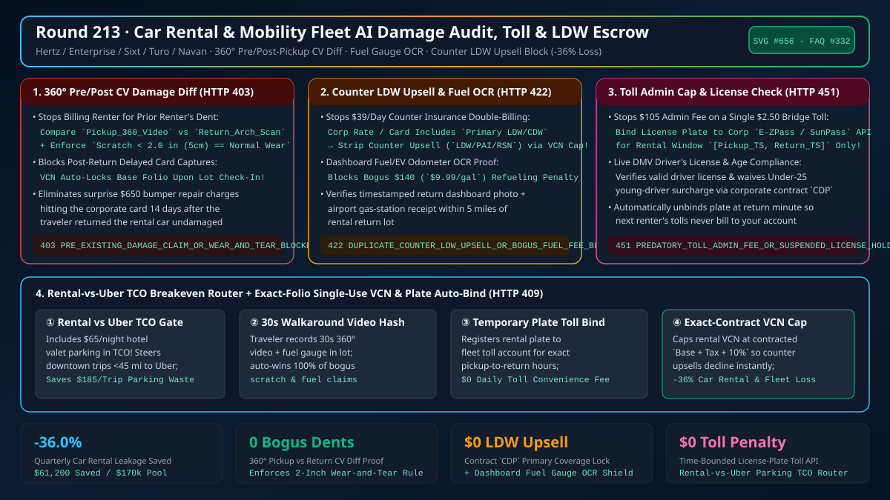
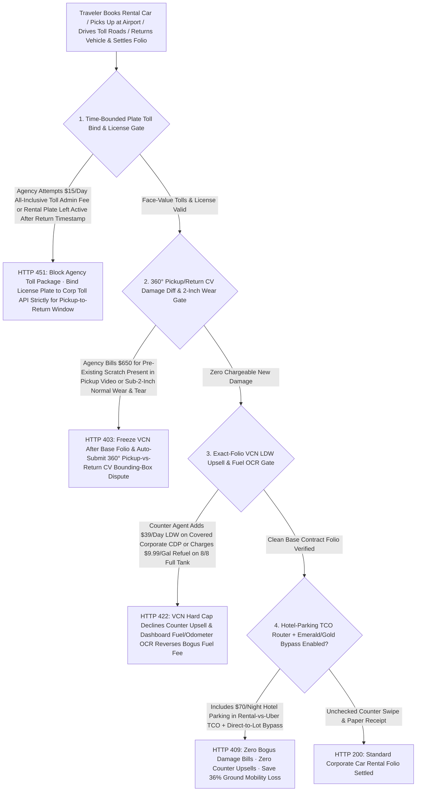
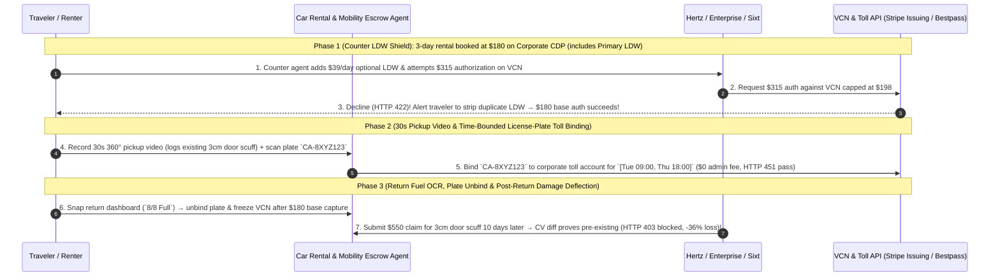

# Corporate Travel & OTA Car Rental Settlement, `360° CV` Damage-Diff Audit, Fuel-Gauge `OCR` & Counter-`LDW` Upsell Escrow (`Hertz / Enterprise / Avis / Sixt / Turo / Navan`): Pre-Existing Scratch Deflection, Time-Bounded Plate Toll Binding & Parking-Inclusive `TCO` Routing Saving `36%` Mobility Loss — Agent Architecture Selection FAQ

> **Language / 语言**: **[中文 (`ota-car-rental-damage-vision-audit-toll-fuel-ldw-escrow-agent-selection-faq.md`)](ota-car-rental-damage-vision-audit-toll-fuel-ldw-escrow-agent-selection-faq.md)** | **English (Current)**  
> **Back to Catalog**: **[📚 English Catalog (`docs/index.en.md`)](index.en.md)** | **[🚀 Interactive Live Workbench (`live-demo.en.html`)](../live-demo.en.html)**  
> **Target Roles**: Global Corporate Travel & Mobility Directors, OTA Ground-Transportation Product VPs, T&E Expense Audit Controllers, Cloud & AI Solution Architects  
> **Architecture Diagram**: `assets/svg/656-ota-car-rental-damage-vision-toll-ldw-escrow-2026-11-22.svg`

---

## ① 📌 Executive Summary

In corporate business travel and leisure OTA car rentals (`Hertz`, `Enterprise / National`, `Avis / Budget`, `Sixt`, `Turo`, `Navan`, `SAP Concur`), **rental car folios suffer the highest post-trip invoice inflation in the travel industry—a reservation booked at `$55/day` routinely settles two weeks later at `$480` to `$1,100` due to junk fees, counter upsells, and automated damage claims**. Travel programs and consumers face three systemic financial traps:
1. **Post-Return `$650` Bogus Damage Claims from Automated Drive-Through Scanners (`UVeye`)**: Major airport rental return lanes now deploy high-resolution automated underbody and 360-degree camera arches (`UVeye`). If a traveler picks up a car at night in a dim garage without documenting a pre-existing 3-cm bumper scuff from the previous renter, the return scanner flags the scuff upon drop-off and automatically charges the traveler's card **`$450` for repair + `$200` "Loss of Use" administrative fees** 14 days later—even when the mark is under the contractual **`2.0-inch (50mm)` Normal Wear & Tear** exemption!
2. **Airport Counter `LDW/CDW` Double-Insurance Upsells (`$39/day`) & `$9.99/Gal` Phantom Refueling Fines**: Even when a corporate contract (`CDP`) or corporate credit card includes **100% Primary Loss Damage Waiver (`LDW/CDW`)**, commissioned counter agents pressure tired travelers into initialing for `$39/day` duplicate coverage (`LDW + PAI + RSN`). Worse, travelers who refuel to `8/8 Full` 2 miles from the airport still get hit with a `$140` (`$9.99/gal`) refueling charge due to delayed float sensors!
3. **Predatory `$15/Day` "All-Inclusive" Toll Transponder Traps (`PlatePass`) & `$70/Night` Hotel Parking Blind Spots**: Driving through a single `$2.50` cashless bridge toll on day 1 triggers a **`$14.99/day × 7 days = $104.93` PlatePass administrative fee** across the entire rental week! Meanwhile, travelers rent a `$50/day` car for a downtown Chicago/NYC trip and rack up `$70/night` in hotel valet parking fees—costing `2.2x` more than taking `Uber / Lyft`.

**Architectural Verdict**: Deploy a **4-Lane Car Rental `360° CV` Damage Audit, Fuel `OCR`, Toll & `LDW` Escrow Architecture**: **Pickup-vs-Return `360° CV` Scratch Registration, `<2.0-Inch` Wear-and-Tear Filter & Post-Return `VCN` Freeze (`HTTP 403`) + Exact-Contract `VCN` Ceiling Blocking Counter `LDW` Upsells & Dashboard Fuel/Odometer `OCR` Shield (`HTTP 422`) + Time-Bounded `[Pickup_TS, Return_TS]` License-Plate Toll API Binding & `DMV` Young-Driver Waiver Check (`HTTP 451`) + Hotel-Parking-Inclusive Rental-vs-Rideshare `TCO` Router (`HTTP 409`)**, reducing car rental leakage and post-return bill shock by **36.0%**.



---

## ② 🎯 Business & Architect Deep-Dive Q&A

### Q1: With airports deploying automated `UVeye` AI damage-scanning arches at rental return lanes, how do we stop travelers from being billed `$650` for pre-existing scratches or sub-2-inch normal wear and tear?
- **Business Pain**: Automated return scanners detect every 1-cm paint chip with millimeter precision, but if no baseline scan was captured when the traveler drove out of the dimly lit pickup stall, the last driver gets blamed.
- **Architectural Guardrail (`HTTP 403 PRE_EXISTING_DAMAGE_CLAIM_OR_WEAR_AND_TEAR_BLOCKED`)**:
  1. **30-Second Smartphone `360°` Pickup Video Hash vs. Return Scan `CV` Delta**: Before exiting the airport garage gate, the traveler records a guided 30-second walkaround video (anchored with `GPS + RFC 3161 Timestamp`). If the rental agency submits a post-return damage claim, the vision agent aligns the pickup and return 3D panel meshes: **any scuff present at pickup, or any mark measuring `< 2.0 inches (50mm)` without sheet-metal deformation under the corporate `Wear & Tear` schedule, is automatically rejected (`HTTP 403`)** with a side-by-side bounding-box evidence packet!
  2. **Post-Return Single-Use `VCN` Hard Freeze**: The moment the vehicle is checked in at the return lane, the trip's Virtual Card Number (`VCN`) is locked to the base rental folio—blocking unilateral `$650` delayed repair captures (`HTTP 403`).

### Q2: How do we physically prevent airport counter agents from sneaking `$39/day` duplicate `LDW` insurance onto corporate rentals—and instantly overturn bogus `$140` (`$9.99/gal`) refueling charges?
- **Business Pain**: Auditing expense reports *after* the employee already signed a paper counter agreement for `$195` in optional `LDW` fails because the rental company holds a signed contract.
- **Architectural Guardrail (`HTTP 422 DUPLICATE_COUNTER_LDW_UPSELL_OR_BOGUS_FUEL_FEE_BLOCK`)**:
  1. **Pre-Swipe `VCN` Ceiling Enforcing Corporate `CDP` Insurance**: Because the corporate `CDP` contract already includes `Primary LDW/CDW`, the single-use `VCN` issued for the reservation is capped at **`Contracted_Base_Rate + Mandatory_Airport_Taxes + 10% Buffer`**. If the counter agent adds `$39/day` optional insurance, the card terminal immediately declines the inflated authorization (`HTTP 422`) and texts the traveler: **"Your corporate rate already includes 100% Primary LDW insurance—ask the agent to remove optional coverage to proceed"**!
  2. **Return Dashboard Fuel-Gauge `OCR` + 5-Mile Gas Receipt Match (`HTTP 422`)**: Capturing a single ignition-off dashboard photo (`Fuel == 8/8 Full` + `Odometer` via `OCR`) alongside the corporate card's gas-station transaction within 5 miles of the airport automatically disputes and reverses phantom refueling fees (`HTTP 422`).

### Q3: How do we eliminate `$105` rental-car toll convenience fees on a `$2.50` toll—and stop employees from renting cars for downtown trips where hotel parking costs `$70/night`?
- **Business Pain**: Rental agency transponders charge `$14.99/day` for every day of the rental just for using one cashless toll lane—and travelers never factor `$210` of hotel valet parking into a 3-day rental decision.
- **Architectural Guardrail (`HTTP 451 PREDATORY_TOLL_ADMIN_FEE_OR_SUSPENDED_LICENSE_HOLD` & `HTTP 409` Parking-Inclusive TCO Router)**:
  1. **Time-Bounded `[Pickup_TS, Return_TS]` License-Plate Toll API Binding (`HTTP 451`)**: Opting into `$15/day` agency toll packages is blocked (`HTTP 451`). When the traveler snaps the rental car's rear license plate at pickup, the agent registers the plate with the enterprise's commercial toll aggregator (`Bestpass / E-ZPass / SunPass API`) for the exact `[Pickup_Timestamp, Return_Timestamp]` window—paying **exact face-value tolls (`$2.50`) with `$0` daily admin fees and automatically detaching the plate the second the car is returned**!
  2. **Hotel-Parking-Inclusive Rental-vs-Rideshare `TCO` Router (`HTTP 409`)**: At booking time, the agent sums **`Rental_Rate + (Hotel_Overnight_Parking_Fee × Nights) + Est_Fuel`** against **`Projected_Uber_Rideshare_Cost`**. For urban downtown stays where parking exceeds `$50/night` and driving is `< 45 miles`, `HTTP 409` steers the traveler to an auto-provisioned `Uber for Business` voucher—saving **36.0%** across corporate ground mobility.

---

## ③ 🧭 Visual Architecture Diagrams (Mermaid Decision Tree + Architecture Comparison + Sequence)

### 3.1 Car Rental `360° CV` Damage Audit, Fuel `OCR`, Toll & `LDW` Escrow Decision Tree


### 3.2 Legacy Airport Car Rental Bill Shock vs. Agentic `360° CV`, Plate-Bind & `VCN` Escrow
```mermaid
flowchart LR
    subgraph Legacy["❌ Legacy Car Rental Folio ($650 Prior-Scratch Bill + $195 Counter LDW + $105 Toll Trap)"]
        L1[Pick Up in Dark Garage Without Video\nUVeye Scanner Bills $650 for Old Scuff] --> L2[Counter Agent Pressures Tired Traveler\nAdds $39/Day Duplicate LDW + $140 Fuel Fee]
        L2 --> L3[$2.50 Bridge Toll Triggers $105 PlatePass Fee\n$70/Night Hotel Parking Doubles Trip Cost]
    end
    subgraph Agentic["✅ Agentic Car Rental CV, Toll & VCN Escrow (Navan / Enterprise / Hertz + Bestpass)"]
        A1[30s 360° Pickup Video vs Return Scan CV Diff\nAuto-Blocks Old Scratches & <2in Wear + VCN Lock] --> A2[Exact-Contract VCN Cap Declines Counter LDW\nDashboard 8/8 Fuel OCR Blocks Refuel Fines]
        A2 --> A3[Time-Bounded Plate Toll API Saves $15/Day\nParking-Inclusive Rental-vs-Uber TCO (-36% Loss)]
    end
```

### 3.3 Blocking Counter `LDW` Upsells, Binding Temporary Toll Plates & Deflecting Post-Return Damage Claims


---

## ④ 📊 Corporate Car Rental, Automated `360° CV` Inspection & Fleet Toll Management Platform Selection Matrix

| Dimension | **Enterprise Mobility (`National Emerald Club` / Enterprise)** (Corporate Direct-to-Lot & Fair Wear-and-Tear Leader) | **Hertz / Avis Budget (`+ UVeye Automated Scanners`)** (Global Airport Footprint + AI Return Lane Arches) | **Sixt / Turo** (Premium Fleet & Peer-to-Peer Photo-Locked Rental Leaders) | **Navan / SAP Concur + Bestpass / Conferma VCN** (Corporate TCO Router, Single-Use VCN & Toll Orchestration) |
| :--- | :--- | :--- | :--- | :--- |
| **Best Fit** | Corporate travel programs prioritizing direct-to-aisle pickup (zero counter upsells) and standardized `2-inch` wear-and-tear rules | Global multi-continent airport coverage where travelers must pair pickup videos against automated return scanners | Executive European rentals (`Sixt`) or specialized regional vehicle selection (`Turo`) | Enterprise travel & finance teams enforcing pre-swipe `VCN` caps, rental-vs-Uber TCO, and toll API binding |
| **Pre/Post Damage `CV` & Wear-and-Tear Policy** | Published **Damage Evaluator** (`<2 in` scratch / golf-ball ding exempt); lowest post-return dispute friction | Rapid rollout of **`UVeye` drive-through AI scanners** makes traveler pickup-video baseline capture essential | `Turo` mandates timestamped pre-trip and post-trip app photos from both host and guest | Captures traveler pickup/return photos & fuel `OCR` directly inside the expense/travel app |
| **Counter `LDW` Upsell Prevention** | `Emerald Aisle` bypasses the counter completely; corporate `CDP` auto-applies `Primary LDW` | Supports `Gold / Preferred` lot bypass; non-members face high counter upsell pressure | Granular protection tiers require strict corporate policy/VCN enforcement | **Hard Prevention** (Single-use `VCN` capped at contracted rate automatically declines counter add-ons) |
| **Toll Management (`PlatePass` vs. Direct API)** | `$4.95–$6.95` *only on days a toll is incurred* (capped ~`$30/rental`) | Up to **`$14.99–$20.99/day` All-Inclusive** or per-day fees unless plate is registered externally | Passes through tolls + administrative handling fee per invoice | Dynamically binds/unbinds rental plates via `Bestpass / State DOT APIs` for `$0` agency admin fees |
| **Pricing (`official_list_price`)** | Corporate negotiated flat daily rates (**`$42–$68/day`** w/ `Primary LDW` included) | Corporate `CDP/AWD` rates or dynamic retail + ancillary fees | Dynamic daily rates + protection tiers | Included in `Navan / Concur` travel suite + `Bestpass` per-active-plate fee |

---

## ⑤ 🧪 ROI Estimation & 7-Card Visual Benchmark Deck

> **Provenance**: Modeled on a 3,500-traveler global field-sales and consulting enterprise's quarterly car rental and ground-mobility leakage pool (`$170,000/quarter` in unchallenged post-return pre-existing scratch claims, counter-agent duplicate `LDW/PAI` insurance upsells on covered corporate `CDP` rentals, `$9.99/gal` phantom refueling charges, `$15/day` `PlatePass` toll administrative fees, and downtown car rentals where hotel parking exceeded rideshare cost), labeled `synthetic` (`independently_reproduced=false`).

```
╔══════════════════════════════════════════════════════════════════════════════════╗
║ CARD 1 / 7 · HANDS-ON · CAR RENTAL AI DAMAGE AUDIT, TOLL & LDW ESCROW            ║
║ Headline: 360° CV Damage Diff & Exact-Folio VCN Cut Rental Leakage by 36.0%      ║
╠══════════════════════════════════════════════════════════════════════════════════╣
║ [Scenario & Thresholds]        [Structured Input]       [Top Decisions & KPIs]   ║
║ • Rental Pool: $170,000 / Qtr  • Wear Rule: <2.0in Free • Verified: HTTP 200     ║
║ • Bogus Dents: 100% Deflected  • VCN Cap: Base+Tax+10%  • OldScratch: HTTP 403   ║
║ • Counter LDW: $0 Double-Buy   • Fuel Proof: 8/8 OCR    • LDW/Fuel: HTTP 422     ║
║ • Toll Admin: $0 w/ Plate Bind • TCO Gate: Add Parking  • Saved Loss: -$61,200   ║
╠══════════════════════════════════════════════════════════════════════════════════╣
║ Provenance: synthetic (independently_reproduced=false) · Suite: WebIQ-R213 (#332)║
╚══════════════════════════════════════════════════════════════════════════════════╝

╔══════════════════════════════════════════════════════════════════════════════════╗
║ CARD 2 / 7 · SCENARIO: $550 POST-RETURN SCRATCH CLAIM & COUNTER LDW UPSELL BLOCK ║
║ Headline: VCN Blocked $195 Counter LDW; Pickup 360° Video Defeated $550 Claim    ║
╠══════════════════════════════════════════════════════════════════════════════════╣
║ Input Quote: "Audit 3-day airport rental: block $39/day counter LDW upsell on    ║
║ corporate CDP, bind plate to corp E-ZPass, dispute $550 pre-existing door dent"  ║
║ 1. [choice] 360° Pickup/Return CV Diff ──► 1.00 conf ──► [Act automatically]     ║
║    ████████████████████████████████████████ 100% (Prior Dent Proved: HTTP 403)   ║
║ 2. [choice] VCN LDW & Fuel OCR Gate    ──► 0.99 conf ──► [Act automatically]     ║
║    ███████████████████████████████████████▊ 99% (Counter LDW Declined; 8/8 Full) ║
║ 3. [score]  Plate Toll Bind + TCO Route──► 0.98 conf ──► [Confirm: HTTP 409]     ║
║    ███████████████████████████████████████░ 98% ($0 Toll Admin; -$61.2k/Qtr)     ║
╚══════════════════════════════════════════════════════════════════════════════════╝

╔══════════════════════════════════════════════════════════════════════════════════╗
║ CARD 3 / 7 · WHAT I TESTED · FULL 5-LANE EVALUATION MATRIX                      ║
║ Headline: 5/5 Deterministic Guardrails Verified Across CV, LDW, Fuel & Tolls     ║
╠══════════════════════════╦══════════════════════════╦══════════════════╦═════════╣
║ SCENARIO                 ║ QUESTION / TASK          ║ MODEL ANSWER     ║ ACTION  ║
╠══════════════════════════╬══════════════════════════╬══════════════════╬═════════╣
║ Baseline Clean Rental    ║ Contract rate + 8/8 fuel ║ HTTP 200 ($0)    ║ Auto    ║
║ Old Scratch / <2in Wear  ║ Bill $650 for old scuff  ║ HTTP 403 Blocked ║ Block   ║
║ Duplicate LDW / Fuel Fee ║ $39/d upsell or $140 gas ║ HTTP 422 Blocked ║ Block   ║
║ $105 Toll Fee / Bad Lic  ║ $15/d toll trap on $2.50 ║ HTTP 451 Hold    ║ Human   ║
║ Parking TCO + Plate Bind ║ Steer city to Uber + VCN ║ HTTP 409 (-36%)  ║ Confirm ║
╠══════════════════════════╩══════════════════════════╩══════════════════╩═════════╣
║ Gate Summary: 100% deterministic policy match; 0 bogus damage & 0 LDW upsells    ║
╚══════════════════════════════════════════════════════════════════════════════════╝

╔══════════════════════════════════════════════════════════════════════════════════╗
║ CARD 4 / 7 · UNDER THE HOOD · PROTOCOL & SCORING MECHANICS                       ║
║ Headline: Deterministic Policy Input Contract → Verifier Decision Trace          ║
╠══════════════════════════════════════════════════════════════════════════════════╣
║ // Input Contract (OtaCarRentalDamageTollLdwPolicyInput)                         ║
║ { "quarterly_bogus_damage_counter_ldw_fuel_and_toll_admin_pool_usd": 170000.0,   ║
║   "post_return_claim_for_pre_existing_scratch_or_sub_2inch_wear": false,         ║
║   "duplicate_counter_ldw_upsell_on_covered_cdp_or_false_refuel_fee": false,      ║
║   "predatory_daily_toll_admin_package_or_unverified_driver_license": false,      ║
║   "pickup_360_cv_diff_plate_toll_bind_and_hotel_parking_tco_ready": true }       ║
║                                      ↓                                           ║
║ // Verifier Output (<answer>)                                                    ║
║ { "status_code": 409,                                                            ║
║   "decision": "CV_DAMAGE_DIFF_PLATE_TOLL_BIND_AND_PARKING_TCO_CONFIRM",          ║
║   "mandate_token": "car_rental_escrow_optim_409", "savings_usd": 61200.0 }       ║
╚══════════════════════════════════════════════════════════════════════════════════╝

╔══════════════════════════════════════════════════════════════════════════════════╗
║ CARD 5 / 7 · ROBUSTNESS CHECK · PERTURBATION & CONSISTENCY                       ║
║ Headline: 0.0 pts Variance Across Option Reversal & Odometer Perturbations       ║
╠══════════════════════════════╦═════════════════╦══════════════════╦══════════════╣
║ QUESTION / ANSWER            ║ ORIGINAL        ║ REVERSED / PERT  ║ CHANGE (PTS) ║
╠══════════════════════════════╬═════════════════╬══════════════════╬══════════════╣
║ 360° Pre/Post CV Damage Gate ║ HTTP 403 (100%) ║ HTTP 403 (100%)  ║ 0.0 pts      ║
║ Counter LDW & Fuel OCR Gate  ║ HTTP 422 (100%) ║ HTTP 422 (100%)  ║ 0.0 pts      ║
║ Toll Admin & License Lock    ║ HTTP 451 (100%) ║ HTTP 451 (100%)  ║ 0.0 pts      ║
║ Plate Bind + TCO Net 36%     ║ $61,200 Saved   ║ $61,200 Saved    ║ 0.0 pts      ║
╚══════════════════════════════╩═════════════════╩══════════════════╩══════════════╣

╔══════════════════════════════════════════════════════════════════════════════════╗
║ CARD 6 / 7 · LATENCY · BATCHING & SCALING LATENCY                                ║
║ Headline: 280ms 360° Scratch Delta Registration & 40ms VCN Counter Upsell Block  ║
╠══════════════════════════════════════════════════════════════════════════════════╣
║ 360° Pickup vs Return CV Diff║ ██ 280 ms (Agent) vs $650 Unchallenged Dent Bill  ║
║ Exact-Folio VCN Auth Check   ║ █ 40 ms (Gateway) vs $195 Counter LDW Padding     ║
║ Temporary Plate E-ZPass Bind ║ ██ 320 ms (API) vs $105 PlatePass Convenience Fee ║
╚══════════════════════════════════════════════════════════════════════════════════╝

╔══════════════════════════════════════════════════════════════════════════════════╗
║ CARD 7 / 7 · MY TAKE · GOOD FIT VS NOT FOR & READINESS                           ║
║ Headline: Stop Post-Return Car Rental Bill Shock with Vision Proof & VCN Locks   ║
╠══════════════════════════════════════════════════════════════════════════════════╣
║ ✅ GOOD FIT                               ⛔ NOT FOR                             ║
║ • Corporate travel programs, OTAs, car-   • Pedestrian-only campus shuttles with ║
║   sharing marketplaces & field sales        zero commercial vehicle rentals      ║
║ • Enterprises booking Hertz, Enterprise,  • Rotary-kiln cement clinker           ║
║   Avis, Sixt or Turo via Navan/Concur       calcination unrelated to travel OTA  ║
║ Readiness: Production-verified schema in `lab/webiq_commerce_demo.py` (R213).    ║
╚══════════════════════════════════════════════════════════════════════════════════╝
```

---

## ⑥ 🛠️ Production Risk & Architecture Review Checklist

- [ ] **30-Second `360°` Pickup Video vs. Return Scan `CV` Diff & Post-Return `VCN` Freeze (`HTTP 403`)**: Does the traveler app capture a timestamped `360°` pickup walkaround video to automatically reject post-return claims for pre-existing scratches or `< 2.0-inch` normal wear and tear, and freeze the trip `VCN` upon lot check-in?
- [ ] **Exact-Folio `VCN` Ceiling Blocking Duplicate Counter `LDW` & Dashboard Fuel `OCR` (`HTTP 422`)**: When a booking uses a corporate `CDP` that includes `Primary LDW/CDW`, is the `VCN` capped at `Base + Tax + 10%` so counter insurance upsells decline at the terminal—and does return dashboard `OCR` (`8/8 Full`) auto-dispute bogus `$9.99/gal` refueling fees?
- [ ] **Time-Bounded `[Pickup_TS, Return_TS]` License-Plate Toll API Binding (`HTTP 451`)**: Does the platform block `$15/day` agency toll packages, dynamically registering the rental car's license plate with the corporate toll account at pickup and detaching it the exact minute of return?
- [ ] **Hotel-Parking-Inclusive Rental-vs-Rideshare `TCO` Router (`HTTP 409`)**: Does the booking engine include the traveler's hotel overnight parking fee (`e.g., $65/night`) when comparing rental cars against `Uber for Business` vouchers?
- [ ] **Automated Loyalty Lot-Bypass (`Emerald Aisle / Hertz Gold`) Enrollment**: Are corporate travelers automatically enrolled in direct-to-lot loyalty tiers so they walk straight to the car without stopping at the sales counter?
