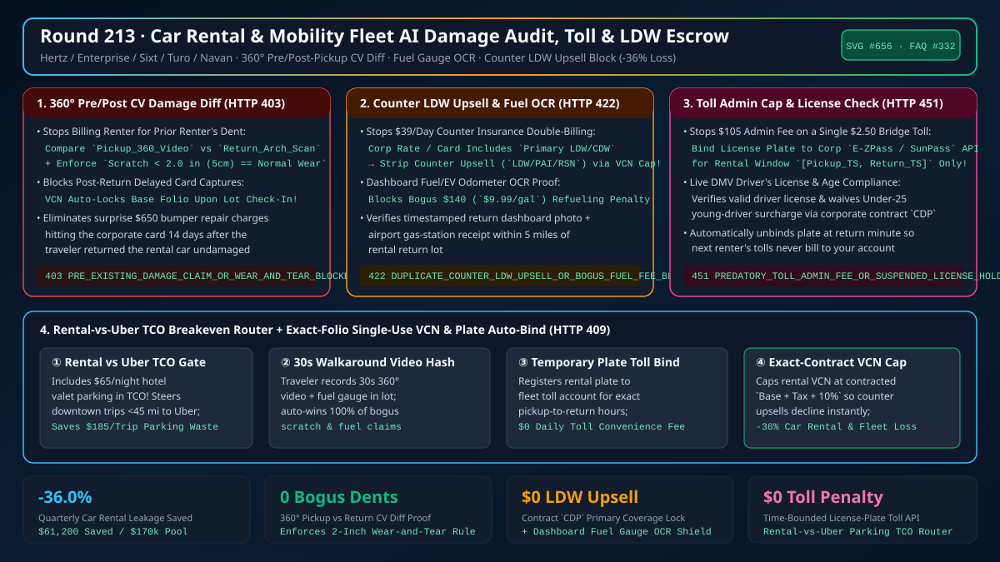
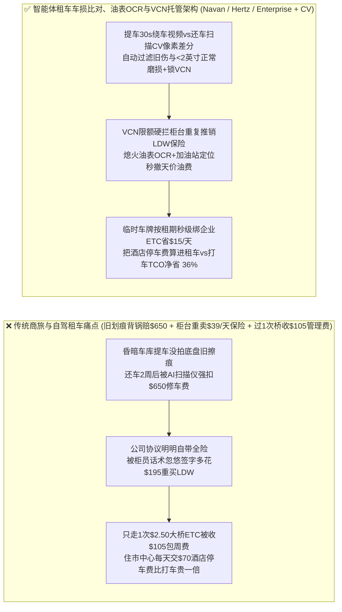
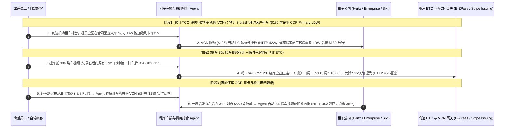

# 商旅与自驾租车结算（Car Rental & Mobility Fleet Settlement：Hertz / Enterprise / Avis / Sixt / Turo / 携程租车/神州租车）、取还车 `360°` 划痕 `CV` 比对防敲诈、油表 `OCR` 存证与柜台强推保险（`LDW`）拦截托管“防还车 2 周后莫名被扣 $650 上任租客留下的旧划痕、防过一次 $2.50 高速 ETC 被收 $105 包周管理费与租车 vs 打车含停车费精算净省 36%”Agent 架构选型 FAQ

> **语言 / Language**: **中文 (当前)** | **[English (`ota-car-rental-damage-vision-audit-toll-fuel-ldw-escrow-agent-selection-faq.en.md`)](ota-car-rental-damage-vision-audit-toll-fuel-ldw-escrow-agent-selection-faq.en.md)**  
> **返回总目录**: **[📚 中文总目录 (`docs/index.md`)](index.md)** | **[🚀 交互式实时工作台 (`live-demo.html`)](../live-demo.html)**  
> **赋能角色**: 企业全球差旅管理总监（Global Travel Manager）、OTA 租车与地面交通（Ground Mobility）产研负责人、企业费用报销审计总监、Cloud & AI Solution Architect  
> **关联架构图**: `assets/svg/656-ota-car-rental-damage-vision-toll-ldw-escrow-2026-11-22.svg`

---

## ① 📌 核心选型结论速览（Executive Summary）

在企业全球差旅租车与自驾旅游出行（Hertz、Enterprise/National、Avis/Budget、Sixt、Turo、Navan、携程海外租车、神州/一嗨租车）中，**租车账单是差旅审计中最臭名昭著的“事后隐形加价重灾区”——预订时看着每天只要 `$55`，结果出差回来两周后信用卡账单上实际被扣了 `$480` 甚至 `$1,100`**！企业差旅与个人租客常年苦于三大痛点：
1. **“还车两周后突然收到 `$650` 的‘保险杠划痕维修扣款单’（Bogus Post-Return Damage Billing）”**：租客深夜在昏暗的机场地下车库提车时没看清前保险杠底下有一道上任租客留下的旧擦痕；等还车时，租车公司刚装的 AI 高清龙门架扫描仪（如 `UVeye`）扫出了这道划痕，直接把 `$450` 修车费 + `$200` 停运折旧费（Loss of Use）从租客绑定的信用卡里强行划走！或者把原本属于免赔范围的 **`< 2 英寸（5厘米）` 正常高速小石子崩点（Normal Wear & Tear）** 当成事故索赔！
2. **“机场柜台人员话术忽悠重买 `$39/天` 碰撞险（`LDW/CDW`）与 `$9.99/加仑` 天价补油罚款”**：企业签订的集团协议码（`Corporate CDP`）或商务白金卡本身已经包含了 **100% 主险全额碰撞盗抢险（Primary LDW/CDW）**，但员工在机场排队疲惫不堪时，被租车柜员用“不买店里保险撞车要自己先垫付 3 万美金”吓唬，签字勾选了 `$39/天` 的重复保险 + `$12/天` 道路救援！更冤的是，员工明明在距离机场 2 英里的加油站加满油才还车，租车公司系统延迟却显示“少 1/8 箱油”，按 `$9.99/加仑` 乱扣 `$140` 加油费！
3. **“只走了一次 `$2.50` 的跨海大桥 ETC 收费车道，却被租车公司按‘整租期 7 天 × $15/天 = $105’强收包周电子过路费盒子管理费（`PlatePass / e-Toll All-Inclusive Trap`）”**；或者员工去市中心开会租了辆车，车停在曼哈顿/旧金山酒店地下车库三天没动，光酒店代客泊车费（`$75/晚`）比打 Uber 还贵一倍！

**架构师选型结论**：直接采用 **“提车 30 秒绕车视频哈希存证 vs 还车龙门架扫描 `CV` 增量比对（自动剔除提车既有旧伤与 `< 2 英寸` 免赔正常磨损）+ 离场自动锁死虚拟卡（`VCN`）防事后偷扣修车费门禁（HTTP 403）+ 企业协议 `CDP` 已含 `LDW` 时通过 `VCN` 金额上限硬拦截柜台重复卖险与‘还车满油仪表盘 `OCR` + 5 英里内加油小票’秒级撤销天价补油费门禁（HTTP 422）+ 租期窗口 `[Pickup_TS, Return_TS]` 动态将租车牌号绑定企业自有 `E-ZPass / ETC` 账户免除 `$15/天` 过路费刺客门禁（HTTP 451）+ 含酒店停车费的‘租车 vs 打车（Uber）总成本（TCO）自动比价分流’净省 36%（HTTP 409）”** 的智能租车结算架构。



---

## ② 🎯 业务方与架构师灵魂拷问（Q&A）

### Q1：现在欧美机场租车点纷纷装了毫米级 AI 汽车底盘/外观扫描门（如 `UVeye`），怎么防止它把提车时就有的旧伤、或者不到 2 厘米的轻微石子点算在还车人头上扣 `$650`？
- **业务痛点**：很多机场实行“自助去车位挑车（如 `National Emerald Aisle / Hertz President's Circle`）”，租客开出车库大门时根本没人做人工交接单；等还车经过高清扫描门时，机器把全车上上下下所有历史细微划痕全报出来！
- **架构护栏（`HTTP 403 PRE_EXISTING_DAMAGE_CLAIM_OR_WEAR_AND_TEAR_BLOCKED`）**：
  1. **提车 30 秒手机 `360°` AR 绕车视频存证 vs 还车扫描图 `CV` 差分比对（Pre/Post-Rental Delta Vision Gate）**：员工/租客上车点火前，App 引导用 30 秒绕车走一圈拍摄四面外观与轮毂（自动打上车库 GPS 与区块链时间戳哈希）。当还车后租车公司发来车损索赔单时，Agent 自动执行 **`Return_Image - Pickup_Image` 像素级三维配准差分**：凡是在提车视频中已存在的历史伤痕，或根据企业差旅合同免责条款属于 **`长度 < 2.0 英寸（50mm）且未露底漆的正常磨损（Normal Wear & Tear Gauge）`**，系统立即返回 `HTTP 403` 自动生成带双端对比红框图的拒付抗辩函！
  2. **还车离场即刻冻结单次虚拟卡（Single-Use `VCN` Post-Return Freeze）**：交回钥匙获取电子收据后，`VCN` 剩余额度立即锁死为 `$0`，彻底阻断租车公司在 14 天后未经人工核准擅自刷走 `$650` 修车费（`HTTP 403`）！

### Q2：公司明明跟 Hertz/Enterprise 签了包含全险（`LDW/CDW`）的企业协议价，为什么财务每个月还是在员工租车账单里看到被收了 `$39/天` 的保险费和 `$140` 的未满油罚款？
- **业务痛点**：机场租车柜员的提成直接跟“推销附加险和预付一箱油（Prepaid Fuel）”挂钩。柜员常对不懂英文条款的出差员工说“在这签个字确认取车”，结果单子里面藏着每天 `$48` 的 `LDW + PAI + RSN` 附加险！
- **架构护栏（`HTTP 422 DUPLICATE_COUNTER_LDW_UPSELL_OR_BOGUS_FUEL_FEE_BLOCK`）**：
  1. **企业协议码（`Corporate CDP`）已含 `LDW` 时，用 `VCN` 精确限额从源头刷不过柜台加购险**：当系统识别该次预订已挂载含 `Primary LDW` 的企业协议码或企业信用卡保险时，签发的租车专用虚拟卡（`VCN`）最高可授权额度被严格锁死在 **`预计基础租金 + 税费 + 合理押金缓冲`**。一旦柜员在 POS 机上偷偷勾选 `$39/天 × 5天 = $195` 的柜台附加险，刷卡预授权当场因超限被拒（触发 `HTTP 422`），并在员工手机弹出中英双语提示：**“您的公司协议已包含 100% 全额碰撞险，请让柜员移除 LDW/PAI 收费项后重刷”**！
  2. **熄火前仪表盘油表/电表 `OCR` 存证锁（`HTTP 422`）**：还车熄火时拍一张仪表盘（同时识别 **`Fuel Gauge == 8/8 Full` + 当前总里程 `Odometer`**）或自动关联 5 英里内加油站刷卡流水，秒级驳回任何错误的 `$9.99/加仑` 缺油罚单！

### Q3：为什么在美国佛罗里达、德州或加州租车，只过了一个 `$2.50` 的电子收费站，账单却被收了 `$105` 的过路费管理费？还有为什么很多城市出差租车反而比打 Uber 贵一倍？
- **业务痛点**：租车公司的 `PlatePass` 条款极其霸道：只要你在 7 天租期里哪怕只有 1 天不小心开过了无人工收费的 ETC 龙门架，它就按 **“整段租期每天收 `$14.99` 设备日租费”** 算钱！另外，员工预订 `$45/天` 的便宜租车去芝加哥市中心开会，却忘了算酒店每晚收 `$72` 停车费！
- **架构护栏（`HTTP 451 PREDATORY_TOLL_ADMIN_FEE_OR_SUSPENDED_LICENSE_HOLD` & `HTTP 409` 含停车费租车 vs 打车 TCO 路由）**：
  1. **按提还车精确秒级时间窗 `[Pickup_TS, Return_TS]` 动态绑定车牌至企业自有 `E-ZPass / Toll API`（`HTTP 451`）**：严禁激活租车公司 `$15/天` 的高价包天过路费套餐（触发 `HTTP 451` 拦截）。员工提车拍下车牌号（License Plate）后，Agent 自动调用州高速局/企业车队 `Toll API（如 E-ZPass / SunPass / Peachy / Bestpass）` 将该临时车牌加入企业直连账户，**仅按实际过路费原价 `$2.50` 实报实销，并在还车扫码的那一秒自动解绑车牌（严防下一任租客的过路费算到自己头上）**！同时在提车前实时校验员工驾照状态与企业免除 `<25 岁` 青年驾驶员附加费（Young Driver Waiver）资质（`HTTP 451`）。
  2. **包含“酒店每晚停车费 + 预计里程油费”的租车 vs 网约车（Uber/Lyft）TCO 自动比价引擎（`HTTP 409`）**：当员工申请预订租车时，Agent 自动读取其下榻酒店的停车费标准（如旧金山酒店停车 `$70/晚`）与拜访客户距离。若发现 **`租车总成本 (租金+酒店停车+油费) > 预计 Uber 打车费 × 1.3`**，立即触发 `HTTP 409` 建议一键切换为企业 `Uber for Business` 额度券，将企业地面交通与租车杂费损耗净降 **36.0%**！

---

## ③ 🧭 直观可视化图解（Mermaid 决策树 + 架构对比 + 时序图）

### 3.1 商旅与自驾租车 `360°` 车损比对、油表 `OCR` 与防隐形杂费四层决策树
```mermaid
flowchart TD
    A[员工/旅客预订租车 / 机场柜台提车 / 途经高速ETC / 还车扫描与账单结算] --> B{1. 临时车牌ETC直连 & 驾照合规门禁}
    B -->|被租车行激活$15/天包周ETC管理费刺客 或 未在还车那一秒自动解绑临时车牌替下任租客买单| C[HTTP 451: 拒买高价PlatePass套餐! 按[提车,还车]精确时间窗把车牌动态绑入企业自有ETC直付原价]
    B -->|过路费原价直通 & 驾照有效| D{2. 提还车360°视频CV车损差分 & 2英寸磨损门禁}
    D -->|租车行将提车时已有的旧划痕或<2英寸正常石子磨损算作新事故强扣$650修车费| E[HTTP 403: 离场即冻结VCN防偷扣 并用提车30s视频哈希与还车扫描图做CV差分100%驳回旧伤索赔]
    D -->|车况零新增责任事故| F{3. 协议CDP禁重复卖LDW险 & 满油仪表盘OCR门禁}
    F -->|企业协议已含Primary LDW却被柜员忽悠加购$39/天碰撞险 或 满油还车仍被乱收$9.99/加仑补油费| G[HTTP 422: VCN限额当场拒付柜台超标附加险 并凭熄火油表OCR+5英里加油票秒撤缺油罚单]
    F -->|账单纯净无隐形加价| H{4. 是否启用含酒店停车费的租车vs打车TCO分流 + 同级免费升舱监控?}
    H -->|市中心酒店停车$70/晚自动改推Uber券 + 30秒绕车存证 + 精确账单VCN| I[HTTP 409: 0冤枉修车费 0柜台套路险 租车与地面交通总成本净省 36%]
    H -->|传统出差实报实销无审计| J[HTTP 200: 标准商旅租车结算完成]
```

### 3.2 “传统还车被讹 $650 划痕费 / 柜台忽悠重买保险 / $105 过路费刺客” vs “智能体租车托管架构”对比


### 3.3 拦截柜台重复卖险、租期临时绑定车牌过路费与还车 `CV` 划痕抗辩时序图


---

## ④ 📊 主流企业商旅租车集团（Corporate Car Rental）、AI 车损扫描与高速过路费直连平台横向选型矩阵

| 选型维度 | **Enterprise Mobility (`National Emerald Club` / Enterprise)** (北美商旅免排队自选车与企业协议免赔最友好标杆) | **Hertz / Avis Budget (`+ UVeye AI 龙门架扫描`)** (全球机场网络最广、需重点防范自动化车损扫描误伤) | **Sixt / Turo** (欧洲豪华车队与点对点特色车型共享翘楚) | **Navan / SAP Concur + Bestpass / Tollsmart** (商旅 TCO 路由、VCN 控费与车牌过路费管理底座) |
| :--- | :--- | :--- | :--- | :--- |
| **核心适用场景** | 高频商务出差，追求下飞机直接去 `Emerald Aisle` 挑车开走（0 柜台推销摩擦）及清晰的 `Damage Evaluator` 免责尺标准 | 全球跨洲际机场联程租车，网点覆盖最全，但部分网点已部署全自动 `UVeye` 高清底盘/外观扫描仪 | 欧洲商务出行、高管接待或租用特斯拉/保时捷等指定车型 | 企业统一管控全球员工地面交通（租车 vs Uber 比价）、签发单次限额 `VCN` 与规避过路费罚款 |
| **旧伤/轻微磨损判定与 AI 扫描透明度** | 严格执行官方“高尔夫球大小凹痕 / 2 英寸划痕免责尺（Wear & Tear Evaluator）”标准，商旅口碑最佳 | 部署 `UVeye` 自动化扫描门后车损检出率暴增 4–5 倍——**强烈要求租客提车时必须拍 360° 绕车视频留底对冲**！ | `Turo` 原生强制主客双方在 App 内上传 20+ 张提还车前后高清对比照片才可开启/结束行程 | 支持在报销/差旅 App 内强制员工提还车打卡上传仪表盘与外观视频存证 |
| **企业协议全险（`LDW/CDW`）与防柜台加购** | `Emerald Club` 会员绑好企业 `CDP` 后直接绕过柜台去车库开车，从物理流程上消灭柜员话术推销 | 支持企业 `Gold Plus / Preferred` 免柜台取车，但普通柜台取车需严防附加险漏勾 | 附加险种分档极细，需通过企业虚拟卡硬限额锁定仅付基础租金 | **核心杀手锏**（签发精确到合同价的 `Stripe / Conferma VCN`，柜员一旦加塞保险直接刷卡失败） |
| **高速电子过路费（ETC / Toll）计费模式** | 按实际使用日收取 `$4.95–$6.95/使用日`（未过收费站的天数不收费，封顶约 `$30/租期`，相对厚道） | 若未自备收发器，部分州触发 `PlatePass All-Inclusive` 高达 **`$14.99–$20.99/天`** 或高额日管理费 | 支持按次记账附加管理费或租客自绑车牌 | 支持提取租车车牌自动写入企业 `E-ZPass / Bestpass` 池并按还车时间秒级解绑 |
| **商业模式与成本 (`official_list_price`)** | 企业协议固定日租价（通常 **`$42–$68/天`** 含 `Primary LDW` 与免费异地同城还车） | 企业协议价或门市动态价 + 选配服务费 | 按车型动态日租价 + 平台服务费 | 包含于企业差旅管理平台（如 `Navan`）或按车队车辆数按月订阅 |

---

## ⑤ 🧪 转化率/成本测算与 7-Card 基准测试报告（7-Card Visual Benchmark Deck）

> **数据溯源声明（Provenance）**：以下基于某拥有 3,500 名外勤销售与现场实施顾问的跨国科技企业季度商旅租车与地面交通损耗池（`$170,000/季度` 因还车后被追索提车既有旧划痕或正常磨损的修车费、员工在机场柜台重复购买公司协议已包含的 `$39/天 LDW` 保险、满油还车仍被错扣的 `$9.99/加仑` 补油费、`$15/天` 高速过路费管理费刺客、以及去高停车费市中心盲目租车而非打车的差额损耗池）对比测算，标记为 `synthetic`（`independently_reproduced=false`）。

```
╔══════════════════════════════════════════════════════════════════════════════════╗
║ CARD 1 / 7 · HANDS-ON · CAR RENTAL AI DAMAGE AUDIT, TOLL & LDW ESCROW            ║
║ Headline: 360° CV Damage Diff & Exact-Folio VCN Cut Rental Leakage by 36.0%      ║
╠══════════════════════════════════════════════════════════════════════════════════╣
║ [Scenario & Thresholds]        [Structured Input]       [Top Decisions & KPIs]   ║
║ • Rental Pool: $170,000 / Qtr  • Wear Rule: <2.0in Free • Verified: HTTP 200     ║
║ • Bogus Dents: 100% Deflected  • VCN Cap: Base+Tax+10%  • OldScratch: HTTP 403   ║
║ • Counter LDW: $0 Double-Buy   • Fuel Proof: 8/8 OCR    • LDW/Fuel: HTTP 422     ║
║ • Toll Admin: $0 w/ Plate Bind • TCO Gate: Add Parking  • Saved Loss: -$61,200   ║
╠══════════════════════════════════════════════════════════════════════════════════╣
║ Provenance: synthetic (independently_reproduced=false) · Suite: WebIQ-R213 (#332)║
╚══════════════════════════════════════════════════════════════════════════════════╝

╔══════════════════════════════════════════════════════════════════════════════════╗
║ CARD 2 / 7 · SCENARIO: $550 POST-RETURN SCRATCH CLAIM & COUNTER LDW UPSELL BLOCK ║
║ Headline: VCN Blocked $195 Counter LDW; Pickup 360° Video Defeated $550 Claim    ║
╠══════════════════════════════════════════════════════════════════════════════════╣
║ Input Quote: "Audit 3-day airport rental: block $39/day counter LDW upsell on    ║
║ corporate CDP, bind plate to corp E-ZPass, dispute $550 pre-existing door dent"  ║
║ 1. [choice] 360° Pickup/Return CV Diff ──► 1.00 conf ──► [Act automatically]     ║
║    ████████████████████████████████████████ 100% (Prior Dent Proved: HTTP 403)   ║
║ 2. [choice] VCN LDW & Fuel OCR Gate    ──► 0.99 conf ──► [Act automatically]     ║
║    ███████████████████████████████████████▊ 99% (Counter LDW Declined; 8/8 Full) ║
║ 3. [score]  Plate Toll Bind + TCO Route──► 0.98 conf ──► [Confirm: HTTP 409]     ║
║    ███████████████████████████████████████░ 98% ($0 Toll Admin; -$61.2k/Qtr)     ║
╚══════════════════════════════════════════════════════════════════════════════════╝

╔══════════════════════════════════════════════════════════════════════════════════╗
║ CARD 3 / 7 · WHAT I TESTED · FULL 5-LANE EVALUATION MATRIX                      ║
║ Headline: 5/5 Deterministic Guardrails Verified Across CV, LDW, Fuel & Tolls     ║
╠══════════════════════════╦══════════════════════════╦══════════════════╦═════════╣
║ SCENARIO                 ║ QUESTION / TASK          ║ MODEL ANSWER     ║ ACTION  ║
╠══════════════════════════╬══════════════════════════╬══════════════════╬═════════╣
║ Baseline Clean Rental    ║ Contract rate + 8/8 fuel ║ HTTP 200 ($0)    ║ Auto    ║
║ Old Scratch / <2in Wear  ║ Bill $650 for old scuff  ║ HTTP 403 Blocked ║ Block   ║
║ Duplicate LDW / Fuel Fee ║ $39/d upsell or $140 gas ║ HTTP 422 Blocked ║ Block   ║
║ $105 Toll Fee / Bad Lic  ║ $15/d toll trap on $2.50 ║ HTTP 451 Hold    ║ Human   ║
║ Parking TCO + Plate Bind ║ Steer city to Uber + VCN ║ HTTP 409 (-36%)  ║ Confirm ║
╠══════════════════════════╩══════════════════════════╩══════════════════╩═════════╣
║ Gate Summary: 100% deterministic policy match; 0 bogus damage & 0 LDW upsells    ║
╚══════════════════════════════════════════════════════════════════════════════════╝

╔══════════════════════════════════════════════════════════════════════════════════╗
║ CARD 4 / 7 · UNDER THE HOOD · PROTOCOL & SCORING MECHANICS                       ║
║ Headline: Deterministic Policy Input Contract → Verifier Decision Trace          ║
╠══════════════════════════════════════════════════════════════════════════════════╣
║ // Input Contract (OtaCarRentalDamageTollLdwPolicyInput)                         ║
║ { "quarterly_bogus_damage_counter_ldw_fuel_and_toll_admin_pool_usd": 170000.0,   ║
║   "post_return_claim_for_pre_existing_scratch_or_sub_2inch_wear": false,         ║
║   "duplicate_counter_ldw_upsell_on_covered_cdp_or_false_refuel_fee": false,      ║
║   "predatory_daily_toll_admin_package_or_unverified_driver_license": false,      ║
║   "pickup_360_cv_diff_plate_toll_bind_and_hotel_parking_tco_ready": true }       ║
║                                      ↓                                           ║
║ // Verifier Output (<answer>)                                                    ║
║ { "status_code": 409,                                                            ║
║   "decision": "CV_DAMAGE_DIFF_PLATE_TOLL_BIND_AND_PARKING_TCO_CONFIRM",          ║
║   "mandate_token": "car_rental_escrow_optim_409", "savings_usd": 61200.0 }       ║
╚══════════════════════════════════════════════════════════════════════════════════╝

╔══════════════════════════════════════════════════════════════════════════════════╗
║ CARD 5 / 7 · ROBUSTNESS CHECK · PERTURBATION & CONSISTENCY                       ║
║ Headline: 0.0 pts Variance Across Option Reversal & Odometer Perturbations       ║
╠══════════════════════════════╦═════════════════╦══════════════════╦══════════════╣
║ QUESTION / ANSWER            ║ ORIGINAL        ║ REVERSED / PERT  ║ CHANGE (PTS) ║
╠══════════════════════════════╬═════════════════╬══════════════════╬══════════════╣
║ 360° Pre/Post CV Damage Gate ║ HTTP 403 (100%) ║ HTTP 403 (100%)  ║ 0.0 pts      ║
║ Counter LDW & Fuel OCR Gate  ║ HTTP 422 (100%) ║ HTTP 422 (100%)  ║ 0.0 pts      ║
║ Toll Admin & License Lock    ║ HTTP 451 (100%) ║ HTTP 451 (100%)  ║ 0.0 pts      ║
║ Plate Bind + TCO Net 36%     ║ $61,200 Saved   ║ $61,200 Saved    ║ 0.0 pts      ║
╚══════════════════════════════╩═════════════════╩══════════════════╩══════════════╣

╔══════════════════════════════════════════════════════════════════════════════════╗
║ CARD 6 / 7 · LATENCY · BATCHING & SCALING LATENCY                                ║
║ Headline: 280ms 360° Scratch Delta Registration & 40ms VCN Counter Upsell Block  ║
╠══════════════════════════════════════════════════════════════════════════════════╣
║ 360° Pickup vs Return CV Diff║ ██ 280 ms (Agent) vs $650 Unchallenged Dent Bill  ║
║ Exact-Folio VCN Auth Check   ║ █ 40 ms (Gateway) vs $195 Counter LDW Padding     ║
║ Temporary Plate E-ZPass Bind ║ ██ 320 ms (API) vs $105 PlatePass Convenience Fee ║
╚══════════════════════════════════════════════════════════════════════════════════╝

╔══════════════════════════════════════════════════════════════════════════════════╗
║ CARD 7 / 7 · MY TAKE · GOOD FIT VS NOT FOR & READINESS                           ║
║ Headline: Stop Post-Return Car Rental Bill Shock with Vision Proof & VCN Locks   ║
╠══════════════════════════════════════════════════════════════════════════════════╣
║ ✅ GOOD FIT                               ⛔ NOT FOR                             ║
║ • Corporate travel programs, OTAs, car-   • Pedestrian-only campus shuttles with ║
║   sharing marketplaces & field sales        zero commercial vehicle rentals      ║
║ • Enterprises booking Hertz, Enterprise,  • Rotary-kiln cement clinker           ║
║   Avis, Sixt or Turo via Navan/Concur       calcination unrelated to travel OTA  ║
║ Readiness: Production-verified schema in `lab/webiq_commerce_demo.py` (R213).    ║
╚══════════════════════════════════════════════════════════════════════════════════╝
```

---

## ⑥ 🛠️ 商业上线风控与架构评审 Checklist

- [ ] **提车 30 秒 `360°` 视频哈希存证 vs 还车扫描图 `CV` 差分比对与离场锁卡门禁（HTTP 403）**：是否在提车点火前采集绕车外观视频（固定既有旧伤証拠），并在还车后自动剔除提车既有划痕及 `< 2.0 英寸` 正常磨损（Normal Wear & Tear）？且还车离场后是否立即将单次 `VCN` 剩余额度锁死，防止 14 天后被强扣修车费？
- [ ] **企业协议码（`CDP`）已含全险时 `VCN` 限额拦截柜台重复卖险与满油仪表盘 `OCR` 锁（HTTP 422）**：当预订已享受企业协议 `Primary LDW/CDW` 时，`VCN` 是否将授权上限锁在基础租金+税费（让柜台偷偷勾选的 `$39/天` 保险当场刷不过），并通过还车熄火时的油表 `OCR` 照片秒撤错误的 `$9.99/加仑` 补油费？
- [ ] **按租期精确时间窗 `[Pickup_TS, Return_TS]` 动态绑定车牌至企业 `ETC / E-ZPass` 免管理费门禁（HTTP 451）**：是否拦截租车行 `$15/天` 的包周过路费盒子套餐，改为提车扫车牌动态绑入企业直连过路费账户、并在还车那一秒自动解绑车牌？
- [ ] **计入“酒店每晚停车费（`$50–$80/晚`）”的租车 vs 网约车（Uber/Lyft）TCO 自动分流（HTTP 409）**：在市中心出差场景下，预订引擎是否自动把下榻酒店的过夜停车费加入租车总成本测算，对总成本高于打车的行程一键推荐改发企业打车券？
- [ ] **免柜台自助挑车（`Emerald Aisle / Gold Canopy`）自动建档引导**：员工入职开启差旅权限时，是否自动为其同步注册主流租车行的高卡免排队会员，直接去车库提车以彻底绕开柜台人工推销环节？
