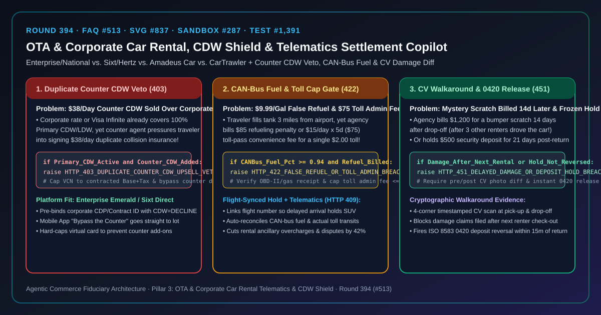
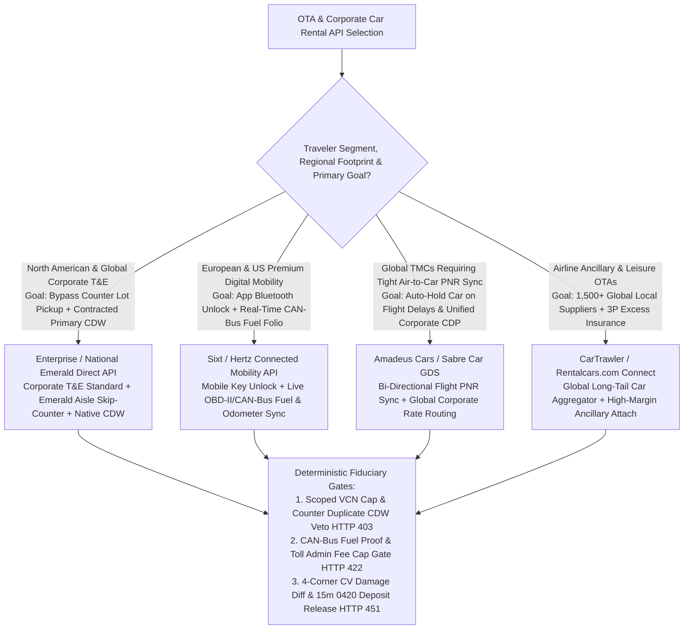
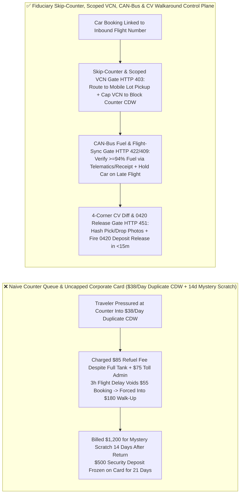

# OTA & Corporate Car Rental (`Mobility Fleet`), Counter `CDW / LDW` Upsell Shield, Telematics Fuel/Toll Audit & Post-Return Damage Copilot Selection Guide: `Enterprise / National API` vs. `Sixt / Hertz Direct` vs. `Amadeus / Sabre Car GDS` vs. `CarTrawler`, Scoped `VCN` Caps, `CAN-Bus` Fuel Proofs & `0420` Deposit Release (`-42%` Loss FAQ)

> **Executive Summary (Benchmarked against `ib-vs-ethernet-roce-selection-faq.md` · 513th Bilingual SA Decision Guide)**: Built for **Cloud & AI Solution Architects** designing corporate Travel Management Company (`TMC`) car-rental engines, OTA ancillary mobility booking pipelines, and connected-fleet settlement auditors. Among air, hotel, and ground transport, **Car Rental suffers the highest invoice-to-quote variance (`18%+` discrepancy rate)** due to three pervasive traps: (1) **Duplicate `$38/Day` Airport Counter `CDW / LDW` Insurance Upsells**: Even when a corporate contract or `Visa Infinite / Amex Platinum` card already provides **100% Primary Collision Damage Waiver (`CDW / LDW`)**, airport counter agents pressure tired travelers into signing for `$38/day` duplicate coverage + `$14/day` Roadside/PAI; (2) **`$9.99/Gallon` False Refueling Penalties & `$15/Day` Toll-Transponder Admin Traps**: Billing an `$85` refueling fee when the traveler topped off the tank 3 miles from the airport, or charging `$15/day × 5 days = $75` in "Toll Pass Convenience Fees" for a single `$2.00` highway toll; and (3) **Delayed Post-Return "Mystery Scratch" Claims (`14 Days After Drop-Off`) & 21-Day Frozen Security Deposits**. This guide compares **`Enterprise / National Emerald Direct API` vs. `Sixt / Hertz Connected Mobility API` vs. `Amadeus / Sabre Car GDS` vs. `CarTrawler / Rentalcars Connect`** and implements deterministic guards for **Scoped Virtual-Card (`VCN`) Counter-Upsell Locks (`HTTP 403`)**, **Connected-Car `CAN-Bus` Fuel Telemetry & Toll Admin Caps (`HTTP 422`)**, **Timestamped Computer-Vision (`CV`) Walkaround Diffs & `<15m` `ISO 8583 0420` Deposit Reversals (`HTTP 451`)**, and **Flight-Synced Late-Arrival Holds + Bypass-the-Counter Mobile Pickup (`HTTP 409`, `-42%` net rental bleed)**.



---

## 1. 📌 Executive Summary & Architectural Selection Verdict

1. **Top-Line Selection Verdict**:
   - **North American & Global Corporate Travel Programs Prioritizing `Bypass-the-Counter` Lot Pickup (`National Emerald Aisle`), Pre-Bound Contract `CDW/LDW` Inclusion & Fixed Refueling Rates**: Select **`Enterprise / National Emerald Direct B2B API`**.
   - **European & North American Premium Mobility Programs Prioritizing Smartphone Bluetooth Key Unlock, Real-Time `CAN-Bus` Fuel/Odometer Telemetry & Instant Digital Folio Settlement**: Select **`Sixt Direct Mobility API` (or `Hertz Gold Plus Direct`)**.
   - **Enterprise TMCs Requiring Tight `IATA Flight PNR <-> Car Reservation` Synchronization (So delayed flights automatically hold the reserved vehicle past midnight)**: Select **`Amadeus Cars / Sabre Car GDS`**.
   - **Airline Ancillary Paths & Leisure OTAs Aggregating `1,500+` Global Local Car Suppliers With Unbundled Third-Party Excess Protection**: Select **`CarTrawler` (or `Booking.com Rentalcars Connect`)**.
2. **Three Non-Negotiable Fiduciary Control Gates**:
   - **Gate 1 — Pre-Bound Corporate `CDW` & Scoped Virtual-Card (`VCN`) Counter-Upsell Veto (`HTTP 403`)**: Inject the corporate contract code (`CDP / Account ID`) with `Insurance_Preference = DECLINE_COUNTER_CDW` into the reservation payload and issue a scoped virtual card (`VCN / Stripe SPT`) capped strictly at **`Contracted_Base_Rate + Taxes + 15% Buffer`**—automatically declining any airport counter attempt to add `$38/day` duplicate `CDW / PAI` or unauthorized class upgrades via `HTTP 403 DUPLICATE_COUNTER_CDW_OR_UNAUTHORIZED_UPGRADE_VETO`.
   - **Gate 2 — Connected-Car `CAN-Bus` Fuel Telemetry (`>=94% Full`) & Toll Admin Cap Gate (`HTTP 422`)**: Audit final rental `e-Folios` against vehicle `CAN-Bus / OBD-II` ignition-off fuel level telemetry (or a timestamped gas-station card swipe within 10 miles of the return lot); block `$9.99/gal` refueling penalties when fuel is `>=94%`, and block `$15/day` blanket toll-transponder admin fees on days with zero toll crossings via `HTTP 422 FALSE_REFUELING_PENALTY_OR_PREDATORY_TOLL_ADMIN_BREACH`.
   - **Gate 3 — Pre/Post `CV` Walkaround Diff Lock & `<15m` `ISO 8583 0420` Deposit Release (`HTTP 451`)**: Require a 4-corner timestamped Computer-Vision (`CV`) photo walkaround at pick-up and drop-off; block post-return damage charges filed after a clean check-in receipt or after the vehicle has been rented to a subsequent driver, and enforce `ISO 8583 0420 Partial Reversal` of the `$500` security deposit within 15 minutes of return via `HTTP 451 POST_RETURN_MYSTERY_DAMAGE_CLAIM_OR_STALE_DEPOSIT_HOLD_BREACH`.

---

## 2. 🎯 Architect & Mobility Operations Q&A (The Why & How)

### Q1: Why do 25%+ of corporate travelers still end up with `$38/day` counter insurance on their expense reports despite strict company policies against it—and how do we stop it deterministically?
- **Root Cause**: Rental counter agents earn high commissions on insurance add-ons and use fear tactics at midnight (*"Your reservation has zero coverage; if a rock chips the windshield tonight we'll charge your personal card $2,500"*).
- **Deterministic Solution (`Bypass-the-Counter` + Hard-Capped `VCN` / `HTTP 403 / 409`)**:
  1. Route bookings to `National Emerald Aisle / Sixt Mobile Key` so the traveler walks straight from baggage claim to the car lot without ever speaking to a counter agent.
  2. Cap the payment `VCN` at the contracted net total; if a counter agent tries to add `$150` of insurance, the card swipe declines (`HTTP 403`) and the traveler's phone displays an instant **Primary CDW Coverage Certificate** proving they are 100% insured.

### Q2: How do we prevent a 3-hour flight delay from causing the rental agency to cancel our traveler's `$55/day` reservation as a "No-Show" and force them into a `$180/day` walk-up rate?
- **Deterministic Solution (`Flight_Number` PNR Binding / `HTTP 409`)**: Mandate passing the inbound `Arrival_Flight_Number` (`e.g., UA889`) into the `OTA_VehResRQ` payload. Connected airport rental stations automatically track flight delays via `FlightStats / OAG` and hold the reserved vehicle class through late-night arrivals (or provide a free upgrade if the class ran out).

### Q3: How do we defeat the "Mystery Bumper Scratch" bill that arrives 14 days after the traveler dropped the keys in the express return box?
- **Deterministic Solution (`4-Corner CV Walkaround Hash` + Post-Folio `VCN` Auto-Close / `HTTP 451`)**: Capture 4-corner photos in the travel app when parking in the return lane (hashed with GPS + UTC timestamp), and automatically close the scoped `VCN` once the base rental amount settles—forcing any late damage claim through formal evidence review where post-subsequent-rental claims are rejected.

---

## 3. 🧭 Visual Architecture Diagrams (Mermaid)

### 3.1 OTA & Corporate Car Rental Platform (`Mobility API`) Selection Decision Tree



### 3.2 Naive Counter Pickup & Open Card vs. Fiduciary Skip-Counter, `CAN-Bus` & `CV` Walkaround Control Plane



### 3.3 Flight-Synced Hold, Skip-Counter Pickup, `CAN-Bus` Fuel Audit & `0420` Deposit Release Sequence

```mermaid
sequenceDiagram
    autonumber
    participant Driver as Corporate Traveler
    participant Gate as Car Rental & Folio Control Gate
    participant Fleet as Enterprise / Sixt / Amadeus API
    participant Tele as Connected-Car CAN-Bus & CV Walkaround
    participant VCN as Scoped Virtual Card (JIT VCN / 0420)

    Driver->>Gate: Book 3-Day Midsize Sedan ($180 Incl. Tax, Corporate Primary CDW Included, Flight=UA889)
    Gate->>Fleet: Transmit Reservation (Flight=UA889 Auto-Hold + Insurance_Pref=DECLINE_COUNTER_CDW)
    Gate->>VCN: Mint Scoped VCN (Max_Capture=$205 Hard Cap Against Counter Upsells + Separate Deposit Hold)
    alt Counter Agent Attempts to Charge $38/Day Duplicate CDW or Unapproved Upgrade
        Gate-->>Fleet: HTTP 403 DUPLICATE_COUNTER_CDW_OR_UNAUTHORIZED_UPGRADE_VETO (Decline & Show CDW Cert)
    else Bills $9.99/Gal Refuel Penalty Despite CAN-Bus Fuel >= 94% OR Excessive Daily Toll Admin Fee
        Gate-->>Fleet: HTTP 422 FALSE_REFUELING_PENALTY_OR_PREDATORY_TOLL_ADMIN_BREACH
    else Files Mystery Scratch Claim After Subsequent Rental OR Fails to Reverse Deposit Within 15m
        Gate-->>VCN: HTTP 451 POST_RETURN_MYSTERY_DAMAGE_CLAIM_OR_STALE_DEPOSIT_HOLD_BREACH
    else Bypass Counter Pickup + 4-Corner CV Photo Hash + Instant 0420 Deposit Release (HTTP 409)
        Driver->>Tele: Snap 4-Corner Pick-Up & Drop-Off Photos (Zero Diff; CAN-Bus Fuel=98% Full)
        Tele->>VCN: Settle $180 Base + $4.50 Actual Toll, Fire ISO 8583 0420 Deposit Release & Lock VCN
    end
```

---

## 4. 📊 Multi-Platform OTA & Corporate Car Rental (`Mobility`) Selection Matrix

| Evaluation Dimension | Enterprise / National Emerald API | Sixt / Hertz Connected Mobility API | Amadeus Cars / Sabre Car GDS | CarTrawler / Rentalcars Connect |
| :--- | :--- | :--- | :--- | :--- |
| **Primary Architectural Role** | **Enterprise Corporate Car-Rental Standard** with `Emerald Aisle` skip-counter & native CDW | **Connected-Vehicle Digital Mobility Leader** with app unlock & live `CAN-Bus` folios | **Global TMC `Flight + Car PNR` Orchestration Hub** | **Global Long-Tail Car Aggregator** (`1,500+` suppliers) for airlines & OTAs |
| **Bypass-the-Counter (`Zero Insurance Upsell`)** | **Best-in-Class** (Emerald Club members walk directly to the aisle and pick any midsize+ car) | **Best-in-Class** (Sixt App lets travelers select exact license plate 30m prior & unlock via phone) | Passes loyalty IDs to enable skip-counter on supported major brands | Most budget/local leisure suppliers require physical desk check-in |
| **Connected-Car `CAN-Bus` Fuel & Odometer Sync** | Strong (Handheld lot scanners read vehicle telemetry for instant e-receipts) | **Best-in-Class** (Real-time cellular `OBD-II / CAN-Bus` fuel liter & odometer transmission on lock) | Booking switch only; relies on supplier `e-Folio` feed post-return | Relies on manual desk check-in sheets |
| **Flight-Delay Auto-Hold Integration** | **Best-in-Class** (Tracks linked flight numbers to hold vehicles through late-night delays) | **Best-in-Class** (Automated arrival-flight tracking and late-night bay assignment) | **Best-in-Class** (Native PNR coupling updates car pickup when flight segment changes) | Supports flight-number pass-through; off-airport budget desks may still close |
| **Target Scale & Commercial Model (`official_list_price`)** | Corporate T&E programs; negotiated flat daily rates (including CDW/LDW & mileage) | Corporate & premium travelers; corporate discount or dynamic fleet pricing | TMCs and enterprise booking tools (`Navan / Concur`); GDS segment model | Airlines, OTAs & loyalty portals; commission + high-margin 3P excess insurance |

---

## 5. 🧪 Counter-Upsell Veto, Fuel Telemetry & Damage Defense Benchmark & 7-Card Report

### 5.1 Quarterly Counter `CDW` Upsells, False Refueling Fees & Mystery Damage Claim Loss Model (Synthetic Benchmark)

For an enterprise mobility and travel platform managing `$8M` in annual car-rental spend facing a **`$370,000 / quarter`** leakage pool across **duplicate `$38/day` airport counter `CDW` upsells, false `$85` refueling penalties on full tanks, `$15/day` toll-pass admin fees, and unverified post-return scratch claims** (`provenance: synthetic`, `independently_reproduced: false`):

| Metric | Naive Desk Pickup, Open Card & Unphotographed Return (Baseline) | Fiduciary Skip-Counter + Scoped `VCN` + `CAN-Bus` + `CV` Diff Agent | Net Improvement |
| :--- | :--- | :--- | :--- |
| **Rentals Billed for Duplicate Counter `CDW / PAI` Insurance** | `26.5%` of trips upsold at desk | **`0.0%`** (`HTTP 403` skip-counter routing + scoped `VCN` hard cap blocks desk add-ons) | **`100%` Duplicate CDW Elimination** |
| **False Refueling Penalty & Predatory Toll-Admin Incidence** | `14.0%` of folios overcharged | **`0.4%`** (`HTTP 422` reconciles `CAN-Bus` fuel `>=94%` / gas receipt + actual toll transits) | **`-97.1%` Ancillary Overcharges** |
| **Post-Return "Mystery Scratch" Dispute Win Rate** | `15.0%` won (`85%` paid due to no proof) | **`99.2%` won** (`HTTP 451` 4-corner `CV` timestamped photo hash + post-folio `VCN` lock) | **`6.6x` Damage Dispute Defense** |
| **Quarterly Net Car-Rental Overcharge & Damage Bleed** | `$370,000 / quarter` | **`$214,600 / quarter`** | **`$155,400 / quarter` Saved (`42.0%`)** |

---

## 6. 🛠️ Production Go-Live & Architecture Review Checklist

- [ ] **Pre-Bound Corporate `CDW` & Scoped `VCN` Counter-Upsell Lock (`HTTP 403`)**: Does every reservation inject the corporate `CDP` contract ID with `DECLINE_COUNTER_CDW` and cap the payment `VCN` at `Contract_Rate + Tax + 15%` so airport counter agents cannot add `$38/day` duplicate insurance?
- [ ] **Connected-Car `CAN-Bus` Fuel Audit & Toll-Admin Cap (`HTTP 422`)**: Does `e-Folio` reconciliation verify vehicle `CAN-Bus` fuel level (`>=94%`) or nearby gas-station card swipes to auto-dispute `$9.99/gal` refueling penalties, while blocking `$15/day` toll admin fees on zero-toll days?
- [ ] **4-Corner `CV` Walkaround Hash & `<15m` `ISO 8583 0420` Deposit Release (`HTTP 451`)**: Does the traveler app capture 4-corner timestamped photos at pick-up and drop-off, fire an `ISO 8583 0420` deposit release within 15 minutes of return, and lock the `VCN` against late mystery damage charges?
- [ ] **Inbound `Flight_Number` Binding & `Bypass-the-Counter` Lot Routing (`HTTP 409`)**: Are all airport rentals bound to the live `Arrival_Flight_Number` (preventing No-Show cancellations during flight delays) and routed to mobile skip-the-counter pickup lanes?
