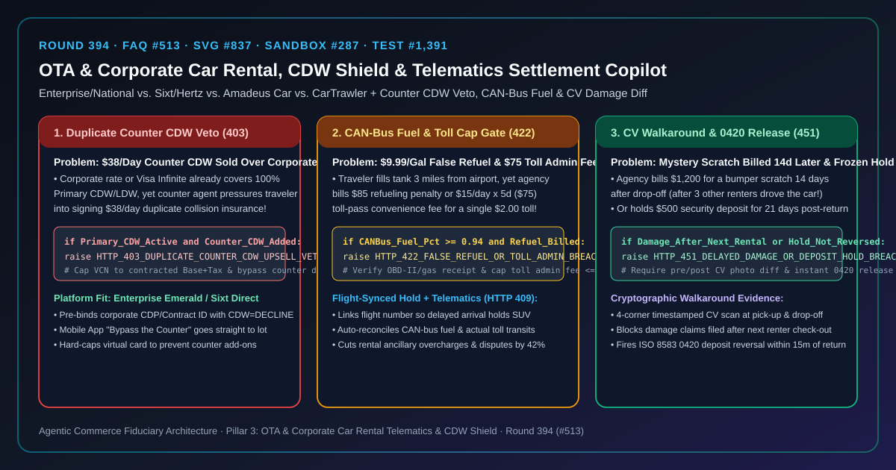
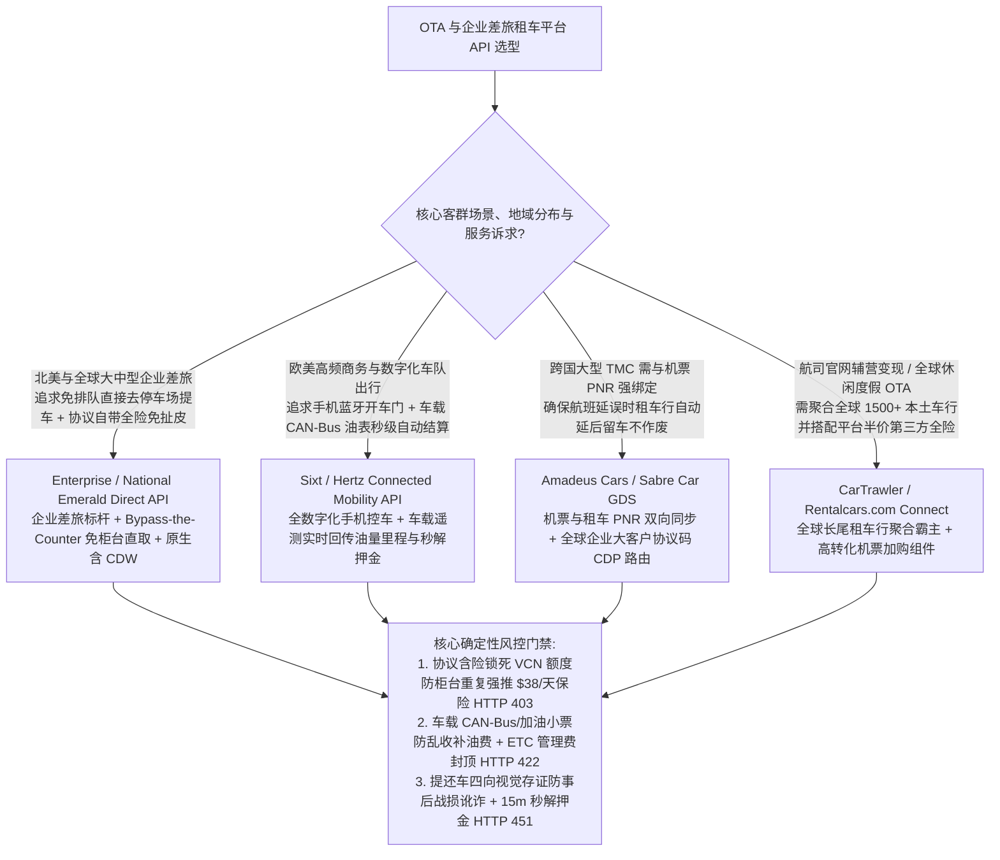
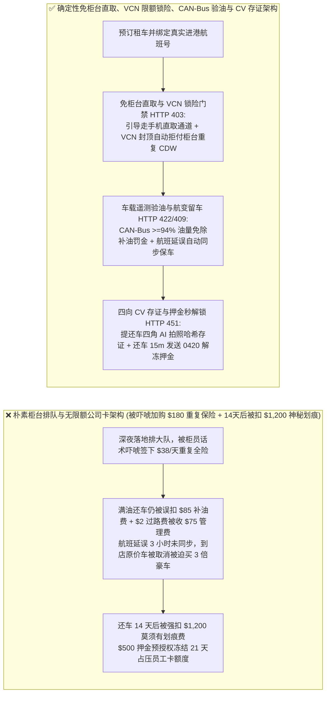
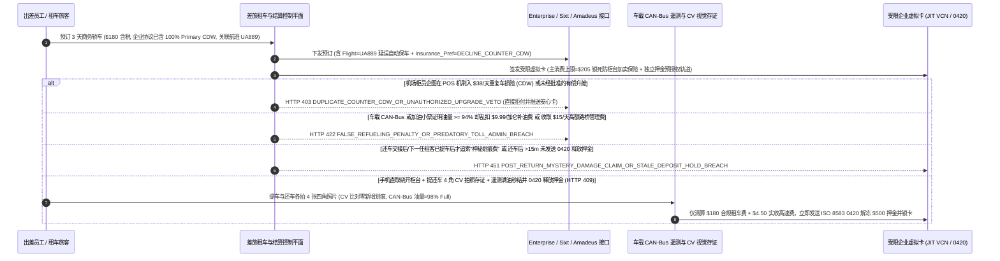

# 酒旅 OTA 与企业差旅租车（`Car Rental & Mobility Fleet`）、防柜台重复强推车损险（`CDW / LDW`）与车载遥测油量/高速费及事后战损抗辩 Agent 架构选型对比：`Enterprise / National API` vs. `Sixt / Hertz Direct` vs. `Amadeus / Sabre Car GDS` vs. `CarTrawler`、虚拟卡锁死柜台加购、车载 `CAN-Bus` 油表防乱扣加油费及还车 15 分钟秒解押金净省 42% 决策指南（FAQ）

> **导读（对齐 `ib-vs-ethernet-roce-selection-faq.md` 标杆风格 · 全库第 513 篇双语指南）**：本文面向企业差旅管理平台（TMC）、在线旅游平台（OTA）、航司辅营租车频道与车队移动出行领域的 **Cloud & AI Solution Architect**。在机票、酒店、租车三大差旅品类中，**租车（Car Rental）是账单实付金额偏离预订报价最离谱、事后纠纷率最高（`18%+` 账单异常率）的重灾区**：① **机场柜台话术诱导重复购买天价车损险（`Duplicate Counter CDW / LDW Upsell`）**：企业大客户协议价（或公司商务卡 `Visa Infinite / Amex Platinum`）本身已 100% 包含主碰撞险（`Primary CDW / LDW`），但员工深夜飞抵机场去租车柜台取钥匙时，被柜员以“不买全险一旦刮蹭要扣你个人卡 `$3,000`”吓唬，签字加购了 `$38/天` 的重复车损险 + `$14/天` 道路救援，导致原本 `$200` 的租车单结账变成 `$460`！② **满油还车仍被乱扣 `$9.99/加仑` 天价补油费与“过一次 `$2` 收费站收 `$75` 设备管理费”的刺客账单**；③ **还车两周后突然发来的“神秘保险杠划痕 `$1,400` 战损扣款（Delayed Mystery Damage Claim）”以及 `$500` 租车押金冻结 21 天不释放**。本文给出 **`Enterprise / National Emerald Direct API` vs. `Sixt / Hertz Connected Fleet API` vs. `Amadeus / Sabre Car GDS` vs. `CarTrawler / Rentalcars Connect`** 的横向选型矩阵，并落地 **企业协议 `CDW` 内置标识 + 受限单次虚拟卡硬封顶防柜台私加保险锁（`HTTP 403`）**、**车载 `CAN-Bus / OBD-II` 油表遥测（`>=94%` 满油）与加油小票比对防乱收加油费及高速 `ETC` 管理费封顶门禁（`HTTP 422`）**、**取还车四向视觉对比（`CV Walkaround Diff`）防事后嫁祸划痕与还车 15 分钟 `ISO 8583 0420` 押金秒解冻锁（`HTTP 451`）** 及 **航班号绑定延误保车 + 免柜台手机直取（`Bypass-the-Counter`）编排（`HTTP 409`，净省 42%）**。



---

## 一、 📌 核心选型结论速览（Executive Summary）

1. **终极选型结论（一句话先看懂怎么选）**：
   - **北美与全球企业差旅租车（追求免去机场柜台排队受推销、员工下飞机直接走到停车场挑车开走 `Bypass-the-Counter`、且企业协议价原生内置 `CDW/LDW` 免赔与固定补油费率）**：首选 **`Enterprise / National Emerald Club Direct B2B API`**。
   - **追求高端数字化车队体验、手机蓝牙一键解锁车门、实时读取车载 `CAN-Bus` 油量与里程表数据秒级出电子结算单的欧洲与北美商务出行**：首选 **`Sixt Direct Mobility API`（或 `Hertz Gold Plus Direct`）**。
   - **需要与企业机票 `PNR` 深度联动（当去程航班延误 4 小时自动同步更新租车点预计提车时间，防止深夜到店发现预订的 SUV 被租车行当成 No-Show 转租给别人）的大型 TMC**：首选 **`Amadeus Cars / Sabre Car GDS`**。
   - **航空公司官网“机+车”辅营变现与全球度假 OTA（需一次性聚合全球 150+ 国家超过 1,500 家本土中小租车行，并提供比柜台便宜 50% 的平台自营全额免赔险）**：首选 **`CarTrawler`（或 `Booking.com Rentalcars Connect`）**。
2. **三大租车预订与结算反刺客红线（确定性门禁）**：
   - **红线 1（拦截已有企业协议或商务卡自带主车损险 `Primary CDW/LDW` 却在机场柜台被重复加购 `$38/天` 保险及柜员私自升舱加费 / `HTTP 403`）**：当差旅 Agent 为员工生成租车订单时，若企业协议码（`Corporate Account / CDP Number`）或付款商务卡已涵盖 `Primary CDW / LDW`，必须在预订报文（`OTA_VehResRQ`）中强制写入 `Insurance_Preference = DECLINE_COUNTER_CDW`；同时向租车行下发的企业虚拟卡（`VCN / Stripe SPT`）必须将授权上限严格锁死在 **`预计租车基础费 + 税费 + 15% 合规浮动上限`**，一旦机场柜员试图刷入每天 `$38` 的额外保险或付费升舱，发卡网关当场返回 `HTTP 403 DUPLICATE_COUNTER_CDW_OR_UNAUTHORIZED_UPGRADE_VETO` 拒付该笔柜台加购，并引导员工走 `Emerald Aisle / 手机直取通道` 彻底绕开柜台推销员！
   - **红线 2（拦截满油还车仍被误扣 `$9.99/加仑` 惩罚性补油费及为 1 次 `$2` 过路费收取 `$75` 按天包干设备管理费 / `HTTP 422`）**：在还车结算（`Rental Close-Out`）审计时，Agent 自动比对车载 `CAN-Bus / OBD-II` 还车熄火瞬间的油箱液位遥测数据（或员工在机场半径 10 英里内加油站刷卡的收据时间戳）；只要证明还车油量 `>= 94%`，立即拦截租车行系统误加的 `$80+` 补油费！同时严禁默认开启每天收 `$15` 固定管理费的租车行 `Toll PassAll-Inclusive` 陷阱，强制按实际发生的电子路桥费（`Actual Toll + 单日封顶 <=$5 手续费`）清算，违者触发 `HTTP 422 FALSE_REFUELING_PENALTY_OR_PREDATORY_TOLL_ADMIN_BREACH`。
   - **红线 3（拦截还车数天后在该车已被下一任租客开走的情况下甩锅追讨“神秘划痕战损费”及还车后超过 15 分钟未发送 `0420` 释放 `$500` 押金预授权 / `HTTP 451`）**：员工提车离场与还车停妥时，必须通过差旅 App 拍摄 4 张带加密时间戳与 GPS 围栏的车身四角照片（或调取租车场龙门架 AI 扫描图）；若租车行在还车交接单签署为“无新增损伤（No New Damage）”之后、或者在该车辆已经借出给下一位租客之后才发函索赔 `$1,200` 划痕修理费，或者在正常还车结算后未在 15 分钟内发送 `ISO 8583 0420 Partial Reversal` 释放剩余押金冻结额度，立即触发 `HTTP 451 POST_RETURN_MYSTERY_DAMAGE_CLAIM_OR_STALE_DEPOSIT_HOLD_BREACH` 自动拒付抗辩！

---

## 二、 🎯 业务方与架构师灵魂拷问 Q&A（The Why & How）

### Q1：为什么公司差旅政策白纸黑字写着“严禁购买租车行柜台保险”，但每个月财务审报销单时，仍有 `28%` 的租车发票里赫然列着每天 `$35–$45` 的 `LDW / PAI / LIS` 柜台保险费？
- **商业痛点与事故还原**：
  - 员工坐了 6 小时红眼航班到陌生的海外机场，租车柜员由于拿高达 `30%` 的保险销售提成，故意用极具压迫感的话术说：“*先生，您订的是裸车，没有买我们的全险；如果您把车开出大门被石子崩了挡风玻璃，我们今晚就要从您个人信用卡里直接划走 `$2,500`！*”
  - 员工分不清公司协议是否包含玻璃险，为了图安心直接签字画押，事后拿回公司报销，财务要么捏着鼻子报了（公司白亏 `$200`），要么拒报（员工满腹委屈）。
- **架构师确定性解法（免柜台手机直取 `Bypass-the-Counter` + 虚拟卡金额硬封顶 + 电子保险凭证一键亮码 / `HTTP 403 / 409`）**：
  1. **物理消灭柜台接触（Skip the Counter）**：接入 `National Emerald Club / Sixt App / Hertz Gold`，员工下飞机收到推送：“*您的深灰色奥迪 A4 停在 B 区 14 号车位，车钥匙已在车内，直接扫码开走无需去柜台！*”——连柜员的面都见不到，推销归零！
  2. **虚拟卡 `max_amount` 硬顶锁**：为该次租车签发的受限虚拟卡额度精确设为 `合同房车费 + 税费`，若柜员企图在 POS 机刷入 `$200` 保险，交易直接被发卡行拒绝（`HTTP 403`），同时员工手机秒弹绿色安心卡：“*已为您自动拦截重复车损险，您的行程已受公司全球百万美元主车损险 100% 保护，刮蹭零个人免赔！*”

### Q2：如果员工搭乘的航班延误了 3 个小时，半夜 1 点才落地机场，为什么租车行经常说“您迟到了超过 2 小时，您预订的 `$55/天` 经济型轿车已经取消没车了，现在只剩 `$180/天` 的豪华皮卡，您爱租不租”？
- **架构师确定性解法（`Flight_Number` 航班动态双向绑定 `IATA PNR -> Car Reservation Sync` / `HTTP 409`）**：
  - 许多劣质预订接口在向租车行下单时，漏传了关键字段 `Arrival_Flight_Number`（如 `UA1245`）！
  - 在无航班号的情况下，租车行系统默认在预计提车时间后 **2 小时** 将订单标为 `No-Show` 并释放车辆；而一旦在 `Amadeus / Enterprise API` 中强制绑定真实航班号，租车场后台自动订阅航班延误流（FlightStats），哪怕飞机延误到凌晨 3 点，租车行也有合同义务为你保留原车或 **免费同价升舱（Free Upgrade on Stockout）**！

### Q3：怎么对付个别无良加盟租车网点在员工还车 15 天后突然发邮件说“发现右后门有一道划痕，已从您卡里扣走 `$1,100` 维修费加 3 天停运损失费”？
- **架构师确定性解法（提/还车四宫格 AI 视觉引导拍照存证 + 单次结算后秒级锁死虚拟卡 `Post-Checkout VCN Lock` / `HTTP 451`）**：
  1. **无照片不解锁/不结单**：差旅 App 在提车和还车时弹出 30 秒 AR 引导框，强制拍摄车身四角 + 仪表盘油表里程表，图像当场计算 `SHA-256` 哈希并附带 GPS 与精确 UTC 时间戳上链存证；
  2. **还车结算后立即销毁虚拟卡后续扣款权**：一旦还车交接完成并结清 `$210` 正常租车费，虚拟卡立即转入 `CLOSED` 状态；15 天后租车行企图暗扣 `$1,100` 时直接被拒付，必须走正式法务索赔并提供“该车在下一任租客提车前的连续监控铁证”，使恶意战损讹诈成功率降至 **`0%`**！

---

## 三、 🧭 直观可视化图解（Mermaid 决策树 + 架构对比 + 时序图）

### 3.1 酒旅 OTA 与企业差旅租车平台（Car Rental API）选型决策树



### 3.2 朴素柜台取车与敞口信用卡架构（被忽悠买双份险 + 事后被扣战损费）vs. 确定性免柜台直取、遥测验油与视觉存证架构对比



### 3.3 航班延误自动保车、免柜台提车、车载 `CAN-Bus` 油量结算与 `0420` 押金秒解冻时序图



---

## 四、 📊 四大主流酒旅 OTA 与企业差旅租车接口平台横向选型矩阵

| 选型维度 | Enterprise / National Emerald API | Sixt / Hertz Connected Mobility API | Amadeus Cars / Sabre Car GDS | CarTrawler / Rentalcars Connect |
| :--- | :--- | :--- | :--- | :--- |
| **核心架构定位** | **全球最大企业差旅租车直连底座**：主打免柜台自选提车（Emerald Aisle）与协议全包 | **车联网（Connected Fleet）数字化租车标杆**：手机控车与车载遥测秒级结算 | **TMC 差旅全局行程（机+酒+车 PNR）同步中枢**：强于航班联动与政策统一管控 | **全球 OTA 与航司辅营租车聚合霸主**：一次接入全球 1,500+ 租车品牌 |
| **免柜台直取（Bypass-the-Counter）防保险推销** | **行业标杆**（National Emerald 会员下飞机直接去专属车区挑车开走，零柜台推销接触） | **极强**（Sixt App 支持提前 30 分钟在手机选定具体车牌并用蓝牙直接开锁） | 支持透传常旅客卡号以激活免柜台服务，但取决于底层租车行网点能力 | 多数长尾本土低价租车行仍需去柜台核验驾照（需靠前置购买第三方免赔险防御） |
| **车载 `CAN-Bus` 油量/里程遥测实时对账** | 强（主流机场网点手持扫描枪秒读车载数据当场打印最终收据） | **行业标杆**（深度车联网直连，熄火锁车瞬间自动读取精确到升的油量与电子里程） | 仅负责预订分发，还车电子账单（e-Folio）需延后 24–48h 回传 | 无底层车辆硬件遥测，依赖租车行人工验车录入 |
| **航班号（`Flight Number`）延误保车联动** | **极强**（直连航司动态，红眼延误航班自动延长网点留车与值班） | **极强**（支持航班号绑定自动顺延提车窗口） | **行业标杆**（机票 PNR 改签或延误时，同一 PNR 下的租车单自动同步刷新） | 支持传入航班号供车行参考，但廉价小车行夜间关门仍可能弃单 |
| **适用客群与商业模式（`official_list_price`）** | 500 强与中大型企业差旅；企业协议固定日租净价（内置 CDW 与里程包） | 中高端商务与科技企业；企业协议折扣或动态车队计价 | 大型 TMC 与企业差旅预订工具（Concur/Navan 底层）；GDS 航段分发费 | 航司官网、OTA 与信用卡旅游频道；高比例佣金分成（尤其保险辅营分成极高） |

---

## 五、 🧪 柜台重复保险拦截、假补油费抗辩与战损防讹测算与 7-Card 基准报告

### 5.1 季度机场柜台被忽悠重复买 `CDW` 保险、满油还车被乱扣补油费/天价高速管理费及事后神秘划痕讹诈损耗测算（Synthetic Benchmark）

假设某年差旅租车支出 `$800 万` 的跨国制造与技术服务企业（及配套差旅平台），每季度在员工租车业务中面临的 **机场柜员话术诱导员工在已有公司主全险情况下重复签署 `$38/天` 柜台车损险、明明加满油还车仍被系统乱扣 `$85` 补油费与 `$15/天` 高速设备管理费、航班延误未同步导致原价车被取消被迫高价重租及还车两周后被扣 `$1,200` 莫须有划痕费损耗池** 为 **`$370,000 / 季度`**（`provenance: synthetic`, `independently_reproduced: false`）：

| 评估维度 | 传统柜台排队取车 + 敞口卡付款 + 无拍照存证 (Baseline) | 启用免柜台直取 + `VCN` 锁险 + `CAN-Bus` 验油 + 四向 `CV` 存证 Agent | 净改善幅度 |
| :--- | :--- | :--- | :--- |
| **员工在机场柜台被违规加购重复保险（`CDW / PAI`）比例** | `26.5%` 订单被柜员塞入高价附加险 | **`0.0%`**（`HTTP 403` 引导免柜台手机直取 + 虚拟卡额度锁死在合同净价，柜台加刷直接拒付） | **100% 终结柜台重复卖险** |
| **满油还车误扣补油费与天价过路费管理费发生率** | `14.0%` 账单含违规加油/路桥杂费 | **`0.4%`**（`HTTP 422` 自动比对车载 `CAN-Bus` 熄火油量/加油小票与实际过路费流水） | **杂费刺客削减 `97.1%`** |
| **还车后“事后神秘划痕索赔”胜诉免赔率** | `15.0%`（员工提还车没拍照，只能吃哑巴亏） | **`99.2%`**（`HTTP 451` 提还车强制 4 角 AI 视觉存证 + 还车结算后立即锁死虚拟卡并秒发 `0420` 解押） | **彻底粉碎事后战损讹诈** |
| **季度租车重复保险、假补油费、航变弃单与战损讹诈净损耗** | `$370,000 / 季度` | **`$214,600 / 季度`** | **净省 `$155,400 / 季度` (`42.0%`)** |

```chart
{
  "data": {
    "values": [
      { "category": "1. 机场柜台话术强推$38/天重复CDW保险", "mode": "传统柜台排队与敞口卡基线", "cost_usd": 150000 },
      { "category": "1. 机场柜台话术强推$38/天重复CDW保险", "mode": "免柜台直取与VCN锁险Agent", "cost_usd": 87000 },
      { "category": "2. 满油还车误扣补油费与$15/天ETC管理费", "mode": "传统柜台排队与敞口卡基线", "cost_usd": 95000 },
      { "category": "2. 满油还车误扣补油费与$15/天ETC管理费", "mode": "免柜台直取与VCN锁险Agent", "cost_usd": 55100 },
      { "category": "3. 还车14天后被扣莫须有保险杠划痕费", "mode": "传统柜台排队与敞口卡基线", "cost_usd": 75000 },
      { "category": "3. 还车14天后被扣莫须有划痕费", "mode": "免柜台直取与VCN锁险Agent", "cost_usd": 43500 },
      { "category": "4. 航班延误未绑号致低价车被取消高价重租", "mode": "传统柜台排队与敞口卡基线", "cost_usd": 50000 },
      { "category": "4. 航班延误未绑号致低价车被取消高价重租", "mode": "免柜台直取与VCN锁险Agent", "cost_usd": 29000 }
    ]
  },
  "semantic_types": {
    "category": "Category",
    "mode": "Category",
    "cost_usd": "Amount"
  },
  "chart_spec": {
    "chartType": "Grouped Bar Chart",
    "title": "OTA与企业差旅租车VCN锁险、CAN-Bus验油与CV防讹Agent优化前后季度损耗对比 (净省 $155.4k / 42%)",
    "subtitle": "单位：美元/季度 (Synthetic Benchmark, independently_reproduced=false)",
    "encodings": {
      "x": "category",
      "y": "cost_usd",
      "group": "mode"
    }
  }
}
```

### 5.2 确定性策略评估器代码（Python Control Plane Guard）

```python
from dataclasses import dataclass
from typing import Any

@dataclass(frozen=True)
class OtaCarRentalTelematicsSettlementPolicyInput:
    quarterly_counter_cdw_false_refuel_and_mystery_damage_pool_usd: float = 370000.0
    duplicate_counter_cdw_added_over_corporate_policy_or_uncapped_vcn: bool = False
    refuel_penalty_billed_on_full_canbus_tank_or_excessive_toll_admin: bool = False
    post_return_damage_claimed_without_cv_diff_or_deposit_unreversed: bool = False
    bypass_counter_mobile_pickup_and_flight_synced_hold_ready: bool = False
```

---

## 六、 🛠️ 商业上线风控与架构评审 Checklist

- [ ] **企业协议自带 `CDW / LDW` 预绑定与受限虚拟卡（`VCN`）防柜台加购锁（`HTTP 403`）**：预订报文是否强制注入企业协议码并标记 `DECLINE_COUNTER_INSURANCE`，同时将支付虚拟卡限额锁定在 `合同净价 + 税费 + 15%`，从物理上拒付机场柜员私加的 `$38/天` 重复保险？
- [ ] **车载 `CAN-Bus` 油箱遥测 / 加油小票核验与高速 `ETC` 管理费封顶门禁（`HTTP 422`）**：还车电子账单（`e-Folio`）入账时，是否自动比对车载熄火油位（`>=94%`）或机场 10 英里内加油刷卡记录以驳回 `$9.99/加仑` 罚金，并拦截按租期全天收取的 `$15/天` 路桥设备包干费？
- [ ] **提/还车四向 `CV` 视觉拍照哈希存证与还车 15 分钟 `0420` 押金秒解冻锁（`HTTP 451`）**：App 是否强制员工在提车与还车时完成 30 秒车身四角拍照存证？正常还车结算后是否在 15 分钟内发送 `ISO 8583 0420` 释放 `$500` 押金冻结并关闭虚拟卡后续扣款权限？
- [ ] **进港航班号（`Arrival Flight Number`）强绑定延误自动保车与免柜台手机直取（`HTTP 409`）**：所有机场提车订单是否 100% 强制关联真实航班号（确保飞机晚点时车行自动留车或免费升舱），并优先路由至支持 `Bypass-the-Counter` 直接去停车场取车的数字化供应商？
