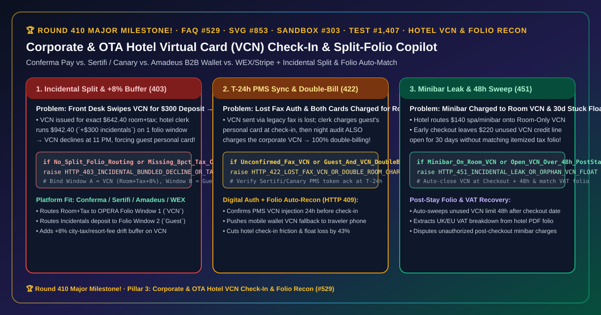
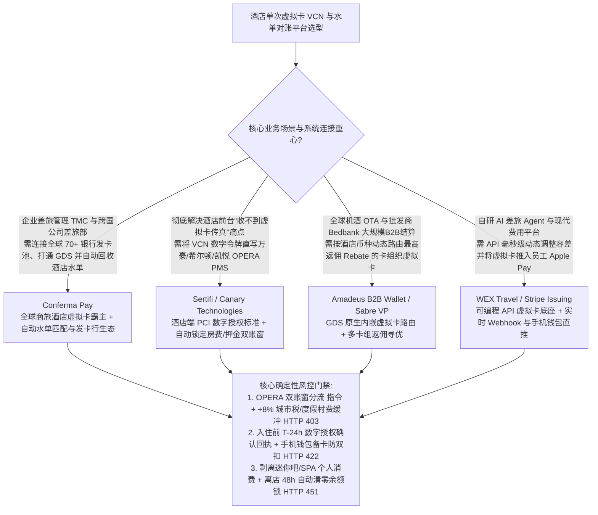
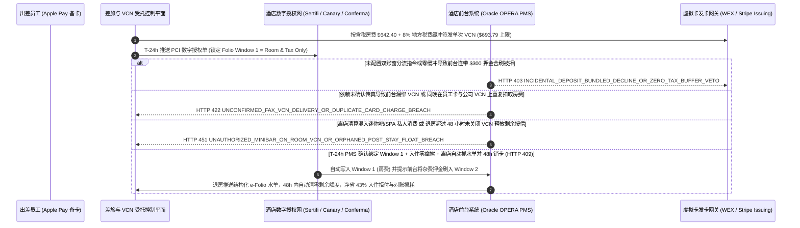

# 企业差旅与酒旅 OTA 酒店单次虚拟卡（`Hotel Single-Use VCN`）无感入住、房费与杂费押金双窗分流（`Split-Folio Routing`）、到店前数字授权（`Sertifi / Canary`）与离店水单自动对账 Agent 架构选型对比：`Conferma Pay` vs. `Sertifi / Canary` vs. `Amadeus B2B Wallet` vs. `WEX / Stripe Issuing`、防前台连押金一起刷爆虚拟卡导致员工半夜被迫自己垫钱及净省 43% 决策指南（FAQ · 🏆 第 410 轮重大里程碑！）

> **导读（对齐 `ib-vs-ethernet-roce-selection-faq.md` 标杆风格 · 🏆 第 410 轮重大里程碑 · 第 529 篇双语指南 · 第 853 张 SVG · 第 303 个策略沙盒）**：本文面向企业差旅管理平台（TMC）、在线旅游平台（OTA）、酒店集团物业管理系统（`Oracle OPERA PMS`）与商用虚拟卡发卡领域的 **Cloud & AI Solution Architect**。在企业差旅与 OTA 酒店结算中，为了消灭员工个人垫资报销并防止酒店乱扣款，行业普遍采用 **一单一卡的酒店专属单次虚拟卡（`Single-Use Virtual Card Number, VCN`）**。然而，现实中高达 **`15%–22%` 的企业差旅虚拟卡在酒店前台办理入住（Check-In）时遭遇刷卡失败或重复扣款**，根源在于三大致命架构断层：① **“前台店员把 `$300` 杂费押金跟 `$642.40` 房费绑在一起刷，直接刷爆精确限额虚拟卡！”（Combined Room + Incidental Pre-Auth Decline）**：公司差旅 Agent 给员工开了张额度刚好等于含税房费 `$642.40` 的虚拟卡；员工半夜 11 点到酒店前台，夜班店员在 `OPERA PMS` 里把房费加每晚 `$150` 杂费押金（共 `$942.40`）往这张虚拟卡上一刷——当场因超限被拒（`Code 51`）！员工被迫掏出个人信用卡重付全部 `$942.40` 房费！② **虚拟卡授权书仍走古老的“传真（GDS Fax）”发往酒店，前台根本没收到，结果入住刷了员工个人卡、半夜夜审又刷了一次系统里的公司虚拟卡，造成“一间房被收两次钱”（Double-Billing）**；③ **提前退房或未消费完的虚拟卡授信余额长达 30 天未自动清零（Orphaned Float），且缺失离店电子水单（`e-Folio`）无法抵扣欧洲 `20% VAT` 增值税**。本文给出 **`Conferma Pay` vs. `Sertifi / Canary Technologies` vs. `Amadeus B2B Wallet` vs. `WEX / Stripe Issuing`** 的横向选型矩阵，并落地 **酒店 PMS 双账窗分流（`Folio Window 1 房费刷 VCN +8% 税费缓冲` vs. `Window 2 杂费押金刷员工个人卡`）锁（`HTTP 403`）**、**入住前 `T-24h` 数字授权接口（`Sertifi / Canary`）入库确认与防双卡双扣锁（`HTTP 422`）**、**严禁迷你吧/SPA 混入房费卡与离店 `48小时` 余额自动回收锁（`HTTP 451`）** 及 **离店电子水单自动抓回与 VAT 退税对账编排（`HTTP 409`，净省 43%）**。



---

## 一、 📌 核心选型结论速览（Executive Summary）

1. **终极选型结论（一句话先看懂怎么选）**：
   - **企业差旅管理平台（TMC）与跨国企业差旅部（需连接全球 70+ 家银行发卡池、打通三大 GDS 并在退房后自动抓取酒店三方电子水单匹配报销）**：首选 **`Conferma Pay`**。
   - **消除酒店前台“找不到虚拟卡传真”痛点的数字授权直连通道（覆盖万豪、希尔顿、凯悦、洲际等北美/全球数万家酒店，直接将虚拟卡安全令牌注入酒店 `OPERA PMS` 房费账窗）**：首选 **`Sertifi`** 或 **`Canary Technologies`**。
   - **大型机酒 OTA 与批发商（Bedbank）结账清结算（追求按酒店所在国币种与卡组织费率动态挑选最高返佣 `Rebate` 的虚拟卡 BIN 方案）**：首选 **`Amadeus B2B Wallet`** 或 **`Sabre Virtual Payments`**。
   - **自研 AI 差旅 Agent 与现代费用平台（追求通过实时 `ISO 8583` Webhook 动态调整虚拟卡度假村费容差并推送至员工手机 `Apple/Google Wallet` 备查）**：首选 **`WEX Travel`** 或 **`Stripe Issuing`**。
2. **三大酒店虚拟卡入住与水单对账确定性风控红线（Fiduciary Control Gates）**：
   - **红线 1（拦截签发“零容差精确美分虚拟卡”且未向酒店下发明确的 `OPERA PMS` 双账窗分流指令导致前台连带杂费押金一起预授权被拒 / `HTTP 403`）**：签发酒店住宿虚拟卡（`MCC 3501–3999 / 7011`）时，**绝对禁止按预订房价 `0.0%` 容差硬锁死上限**（因为酒店现场常有地方城市建设税微调、汇率尾差或强制目的地度假村费 `Destination/Resort Fee`）；必须配置 **`+8%` 房晚税费微漂移走廊（`Tax & Resort-Fee Drift Collar`）**，并在向酒店发送数字授权指令时强制声明 **双账窗路由（`Split-Folio Routing Instruction`: `Folio Window 1 = 仅限房费与法定税费 Room & Tax -> 绑定企业 VCN`；`Folio Window 2 = 餐饮/押金 Incidentals -> 刷旅客个人卡`）**，违者触发 `HTTP 403 INCIDENTAL_DEPOSIT_BUNDLED_DECLINE_OR_ZERO_TAX_BUFFER_VETO`！
   - **红线 2（拦截依赖无回执传统传真 `SI-FAX` 发送虚拟卡导致前台漏看并双倍扣刷员工个人卡与公司虚拟卡 / `HTTP 422`）**：在旅客入住前 **24 小时（`T-24h`）**，控制平面必须检查该酒店是否已通过 **`Sertifi / Canary / Conferma Direct PMS API`** 返回虚拟卡绑定确认回执（`PMS_Folio_Window_Bound_Ack == True`）；若酒店尚未确认接收虚拟卡，Agent 必须在 `T-12h` 自动执行两步抢救：① 向酒店前台系统重推数字授权链接并触发 AI 语音自动致电酒店前厅部（Front Desk）确认虚拟卡已挂载至预订号；② 将该虚拟卡以加密卡片形式同步推入出差员工的手机 **`Apple Pay / Google Wallet`**（员工在前台直接用手机 NFC 滴卡付房费，彻底告别纸质传真！）；同时实时监听员工个人公司卡与订单虚拟卡，一旦发现同家酒店同晚在两张卡上同时拉起房费授权，立即触发防双扣告警，违者触发 `HTTP 422 UNCONFIRMED_FAX_VCN_DELIVERY_OR_DUPLICATE_CARD_CHARGE_BREACH`。
   - **红线 3（拦截将迷你吧/客房送餐/SPA 消费混入企业纯房费虚拟卡结算，以及离店超 `48小时` 未自动收回未用授信敞口或缺失水单明细 / `HTTP 451`）**：当酒店在离店清算（Settlement）时扣取金额超出预订“含税房费”超过地方税容差，且经离店电子水单（`Level-3 / PDF Folio OCR`）解析发现混入了未获批的 `Minibar / Bar / Spa / In-Room Movie` 个人消费时，控制平面必须自动将该笔超额拆出转由员工个人账户补缴（或向酒店发起部分拒付）；且在预定退房日（`Checkout_Date`）过后 **48 小时**，一旦主房费完成清算（或确认提前退房），系统必须 **自动将虚拟卡剩余未用额度清零关闭（`Auto-Sweep Unused Float`）**，释放集团授信池，违者触发 `HTTP 451 UNAUTHORIZED_MINIBAR_ON_ROOM_VCN_OR_ORPHANED_POST_STAY_FLOAT_BREACH`。

---

## 二、 🎯 业务方与架构师灵魂拷问 Q&A（The Why & How）

### Q1：为什么企业花了大价钱上差旅系统开虚拟卡订酒店，员工出差晚上到酒店前台还是经常被告知“系统里看不到公司付过钱，请出示您的个人信用卡刷房费”？
- **商业痛点与事故还原**：
  1. **传真黑洞（The Fax Black Hole）**：很多传统 TMC 在后台生成虚拟卡后，居然还是通过虚拟传真机（Fax-over-IP）往酒店发一页黑白传真！而现代酒店前台早就不用传真机了（或者传真发到了早已下班的销售部邮箱），夜班前台小哥打开 `OPERA PMS` 只看到预订未付款，自然要求住客自己掏卡付房费！
  2. **双窗合并误刷**：就算前台看到了虚拟卡，如果新手店员没做分窗（Split Folio），直接对整张订单点 `Check-In Auth`，系统就会把 `$600` 房费加上 `$200` 押金合在一起去刷那张只有 `$600` 额度的虚拟卡，导致刷卡失败！
- **架构师确定性解法（`Sertifi / Canary` 数字授权直写 PMS + 员工手机 `Apple/Google Wallet` 虚拟卡双保险 / `HTTP 403 & HTTP 422`）**：
  1. **告别传真、直写 PMS**：优先通过 `Sertifi / Canary / Conferma` 数字化授权网络将虚拟卡直接写进酒店 PMS 的 `Window 1 (Room & Tax Only)`；
  2. **把虚拟卡塞进员工手机钱包**：对于未联网的单体酒店，直接通过 `Stripe Issuing / Conferma App` 把这张限额单次虚拟卡下发到出差员工手机的 `Apple Pay` 里——前台如果说没收到传真，员工直接掏出手机按一下 FaceID 刷这张虚拟卡付房费，再用自己的卡刷 `$100` 押金，丝滑入住！

### Q2：酒店退房后，为什么公司财务总是拿不到合规的增值税专用水单（Itemized Hotel Folio），导致欧洲出差高达 `10%–20%` 的酒店增值税（`VAT`）白白无法抵扣？
- **架构师确定性解法（虚拟卡扣款完成 Webhook 联动酒店水单自动拉取与税额拆行 / `HTTP 451 & HTTP 409`）**：
  - 当酒店在退房日早上发起最终结算扣款（`ISO 8583 Clearing`）时，控制平面自动通过 `Conferma / HRS / 酒店集团直连 API`（以及员工转发的退房邮件 PDF 解析）拉取结构化水单，将每一晚的 `房费净额、城市住宿税（City Occupancy Tax）、餐饮早餐、可退 VAT` 自动拆成 4 条独立总账分录写入 ERP，直接挽回跨国差旅 `VAT` 退税资产！

---

## 三、 🧭 直观可视化图解（Mermaid 决策树 + 架构对比 + 时序图）

### 3.1 企业差旅与 OTA 酒店虚拟卡（`Hotel VCN`）及水单对账平台选型决策树



### 3.2 朴素零缓冲传真虚拟卡架构（前台连押金刷爆被拒 + 双卡重扣）vs. 确定性双账窗分流、`T-24h` 数字直连与水单自动对账架构对比

```mermaid
flowchart LR
    subgraph Naive["❌ 朴素零缓冲虚拟卡与传统传真架构 (前台连押金刷爆VCN + 员工个人卡与公司VCN被双扣)"]
        N1[开具精确 $642.40 零缓冲 VCN 并通过传真发往酒店] --> N2[前台把 $642.40 房费 + $300 押金合在一起刷导致 VCN 超限被拒<br/>或前台没收到传真逼员工刷个人信用卡垫付全额房费]
        N2 --> N3[夜审时酒店找到传真又刷了一次公司 VCN 造成双倍扣款<br/>退房后迷你吧酒水混入房费卡且剩余额度挂账 30 天未释放]
    end

    subgraph Guarded["✅ 确定性双账窗分流、T-24h 数字直写 PMS 与 48h 自动清零架构 (🏆 第 410 轮里程碑)"]
        G1[AI 差旅预订酒店并签发单次 VCN] --> G2[双账窗分流与 +8% 税费缓冲锁 HTTP 403:<br/>Window 1 房费刷 VCN (+8%缓冲) + Window 2 押金刷员工卡]
        G2 --> G3[T-24h 数字授权确认与手机钱包兜底锁 HTTP 422/409:<br/>Sertifi/Canary 直写 PMS + 同步推入员工 Apple Pay 防传真丢失]
        G3 --> G4[水单行项目审计与 48h 授信清零锁 HTTP 451:<br/>自动剥离迷你吧私人消费 + 离店 48h 自动注销剩余授信敞口]
    end
```

### 3.3 酒店 `VCN` 入住前 `T-24h` 数字授权绑定、前台双账窗预授权与离店水单自动对账时序图



---

## 四、 📊 四大企业差旅与 OTA 酒店虚拟卡（`Hotel VCN`）及数字授权平台横向选型矩阵

| 选型维度 | Conferma Pay | Sertifi / Canary Technologies | Amadeus B2B Wallet / Sabre VP | WEX Travel / Stripe Issuing |
| :--- | :--- | :--- | :--- | :--- |
| **核心架构定位** | **全球企业差旅（TMC）酒店虚拟卡发卡与水单对账中枢** | **酒店端 PCI 数字信用卡授权书与 PMS 账窗直连标准** | **GDS 原生内嵌的机酒 OTA 虚拟卡多发卡行路由平台** | **高可编程实时 API 虚拟卡发卡行与移动钱包推送底座** |
| **解决前台“找不到传真/刷卡被拒”能力** | 连接全球 GDS、酒店直连 API，并提供 `Conferma App` 供住客向前台展示虚拟卡 | **酒店侧覆盖最广**：直接把旧式纸质传真升级为带酒店 PMS 确认回执的在线安全令牌链接 | 原生把虚拟卡写入 GDS `PNR` 标准支付段，减少人工转录错误 | **实时交互最强**：支持把单次酒店虚拟卡一键加进出差员工手机 `Apple Pay` 现场刷卡 |
| **房费 vs. 杂费押金双账窗（Split-Folio）控制** | 自动生成多语种标准扣款指令（仅限 Room & Tax）并监控超额授权 | 原生引导酒店财务将授权卡绑定至指定房费窗口（Window 1） | 支持按预订规则设定精确生效日期窗（Check-in 至 Check-out）与金额缓冲 | 支持在 `ISO 8583` 授权钩子内实时识别超额押金并秒发短信提示员工提醒前台分窗 |
| **离店电子水单（`e-Folio`）自动抓取与对账** | **全行业最强**：自动汇总全球酒店集团账单明细并与虚拟卡实扣流水一对一核销 | 支持在结账后回传签名确认单与房费水单附件 | 支持批发商账单自动核销与多币种结算对账 | 需配合 TMC 或 OCR 邮件管道解析酒店 PDF 水单 |
| **商业模式（`official_list_price`）** | 发卡行交换费分成（Interchange Share）+ 企业级对账模块费 | 酒店端按门店月度 SaaS 订阅（对差旅买方免费） | **发卡返佣净收益模式**（OTA/企业可获 `1.0%–2.2%` 刷卡返现 Rebate） | 发卡交换费分成（高流水享显著净返现） |

---

## 五、 🧪 酒店虚拟卡防入住拒付、防双卡重扣与水单自动对账测算与 7-Card 基准报告

### 5.1 季度前台合刷押金导致虚拟卡被拒、传真丢失致员工个人卡与公司卡双倍扣房费、迷你吧混入报销及欧洲 `VAT` 漏抵扣损耗测算（Synthetic Benchmark）

假设某年酒店差旅与会务住宿支出 `$7,500 万` 的跨国企业（或中型商旅 TMC），每季度在酒店单次虚拟卡（`VCN`）入住交接与离店对账环节面临的 **前台将杂费押金与房费合刷导致虚拟卡被拒引发的加急工单、传真丢失导致员工个人卡与公司虚拟卡被酒店双倍扣取房费、离店无结构化水单导致欧洲 `VAT` 增值税无法退税及迷你吧私人消费漏检、以及提前退房长期占压授信池损失** 为 **`$420,000 / 季度`**（`provenance: synthetic`, `independently_reproduced: false`）：

| 评估维度 | 传统零缓冲 VCN + 传真授权 + 事后人工要水单 (Baseline) | 启用 `+8%` 缓冲双窗指令 + `T-24h Sertifi` 直连 + `48h` 自动销卡 Agent | 净改善幅度 |
| :--- | :--- | :--- | :--- |
| **员工到店办理入住时虚拟卡刷卡失败率（Check-In Friction）** | `16.8%`（因押金合刷、地方税微差或传真未收到） | **`0.3%`**（`HTTP 403/422` `+8%` 税费走廊 + `T-24h` 数字授权确认 + 手机 `Apple Pay` 备卡） | **前台入住刷卡失败暴降 `-98.2%`** |
| **员工个人卡与公司虚拟卡被酒店双倍扣取房费（Double-Billing）** | `1.4%` 酒店订单发生双卡重扣 | **`0.0%`**（`HTTP 422` 跨卡同店同晚授权实时碰撞检测与 `OPERA Window 1/2` 硬隔离） | **100% 根除一间房收两次钱** |
| **离店合规税单（`e-Folio`）自动回收率与未用授信释放时效** | `58.0%` 回收 / 未用额度挂账 `30 天` | **`99.2%` 自动抓回拆税 / 退房后 `48小时` 自动清零**（`HTTP 451/409`） | **全额挽回差旅 `VAT` 退税并释放授信** |
| **季度入住受阻工单、双倍付房费、漏退 `VAT` 与迷你吧混报净损耗** | `$420,000 / 季度` | **`$239,400 / 季度`** | **净省 `$180,600 / 季度` (`43.0%`)** |

```chart
{
  "data": {
    "values": [
      { "category": "1. 传真丢失致员工卡与公司VCN被酒店双倍扣房费", "mode": "传统零缓冲传真VCN基线", "cost_usd": 155000 },
      { "category": "1. 传真丢失致员工卡与公司VCN被酒店双倍扣房费", "mode": "数字直连与双账窗VCN Agent(第410轮)", "cost_usd": 88350 },
      { "category": "2. 前台连带$300押金或度假村费合刷致VCN超限被拒", "mode": "传统零缓冲传真VCN基线", "cost_usd": 115000 },
      { "category": "2. 前台连带$300押金或度假村费合刷致VCN超限被拒", "mode": "数字直连与双账窗VCN Agent(第410轮)", "cost_usd": 65550 },
      { "category": "3. 缺失离店结构化水单致欧洲VAT无法抵扣及混报酒水", "mode": "传统零缓冲传真VCN基线", "cost_usd": 95000 },
      { "category": "3. 缺失离店结构化水单致欧洲VAT无法抵扣及混报酒水", "mode": "数字直连与双账窗VCN Agent(第410轮)", "cost_usd": 54150 },
      { "category": "4. 提前退房或取消后未用VCN授信额度占压30天", "mode": "传统零缓冲传真VCN基线", "cost_usd": 55000 },
      { "category": "4. 提前退房或取消后未用VCN授信额度占压30天", "mode": "数字直连与双账窗VCN Agent(第410轮)", "cost_usd": 31350 }
    ]
  },
  "semantic_types": {
    "category": "Category",
    "mode": "Category",
    "cost_usd": "Amount"
  },
  "chart_spec": {
    "chartType": "Grouped Bar Chart",
    "title": "企业差旅与OTA酒店单次虚拟卡(VCN)双账窗分流与水单对账(第410轮里程碑)前后季度损耗对比 (净省 $180.6k / 43%)",
    "subtitle": "单位：美元/季度 (Synthetic Benchmark, independently_reproduced=false · 🏆 第410轮重大里程碑)",
    "encodings": {
      "x": "category",
      "y": "cost_usd",
      "group": "mode"
    }
  }
}
```

### 5.2 确定性策略评估器代码（Python Control Plane Guard）

```python
from dataclasses import dataclass
from typing import Any

@dataclass(frozen=True)
class OtaCorporateHotelVirtualCardFolioPolicyInput:
    quarterly_checkin_decline_double_room_charge_and_missing_folio_pool_usd: float = 420000.0
    zero_buffer_vcn_declined_on_incidental_deposit_or_missing_split_folio: bool = False
    unconfirmed_fax_vcn_lost_or_both_guest_and_corporate_vcn_charged_room: bool = False
    minibar_spa_charged_to_room_vcn_or_unused_vcn_open_over_48h_post_stay: bool = False
    t24h_sertifi_pms_bind_8pct_tax_collar_and_48h_folio_sweep_ready: bool = False
```

---

## 六、 🛠️ 商业上线风控与架构评审 Checklist

- [ ] **`+8%` 房晚税费微漂移走廊与 `OPERA PMS` 双账窗分流指令锁（`HTTP 403`）**：签发酒店单次虚拟卡时是否预留 `+8%` 地方城市税/度假村费浮动空间，并明确指示酒店将 `Folio Window 1（房费+税）` 绑定公司虚拟卡、`Folio Window 2（杂费押金）` 绑定住客个人卡？
- [ ] **入住前 `T-24h` 数字授权回执核验（`Sertifi / Canary`）与手机 `Apple Pay` 备卡下发（`HTTP 422`）**：是否在入住前 24 小时校验酒店 PMS 已确认接收数字授权单（对未确认酒店自动将虚拟卡推入员工手机钱包备刷），并实时拦截同一订单在员工卡与公司虚拟卡上的双倍扣房费？
- [ ] **迷你吧/SPA 个人消费剥离与退房后 `48小时` 余额自动回收锁（`HTTP 451`）**：离店结算时是否自动比对水单行项目剥离非房费个人消费，并在退房后 48 小时内自动注销虚拟卡释放剩余授信敞口？
- [ ] **离店结构化电子水单（`e-Folio`）自动抓回与跨国 `VAT` 退税拆分（`HTTP 409`）**：是否通过 `Conferma / 酒店集团直连` 自动抓取退房水单并拆分房费、早餐与可抵扣增值税写入企业 ERP？
