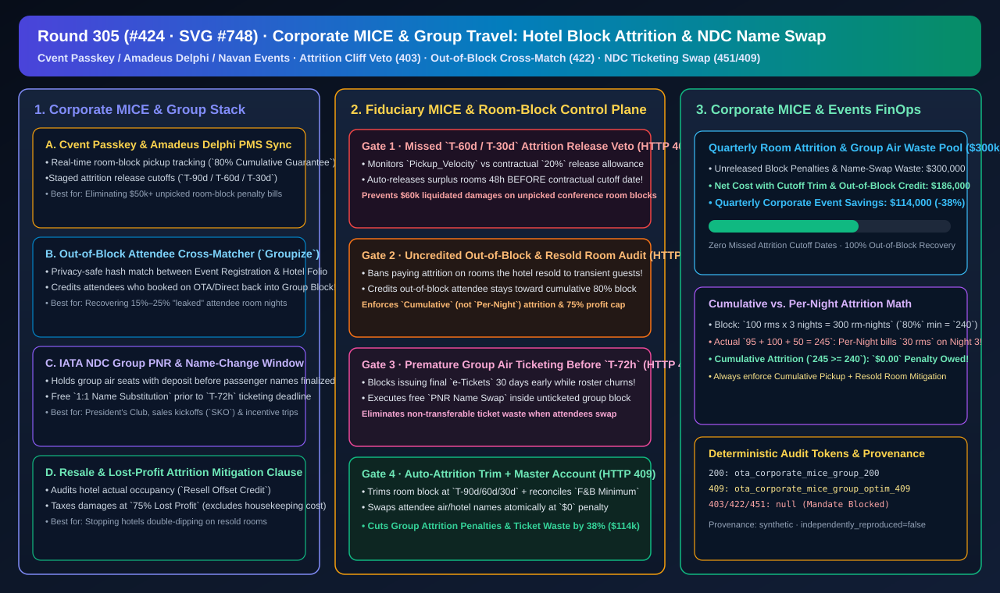
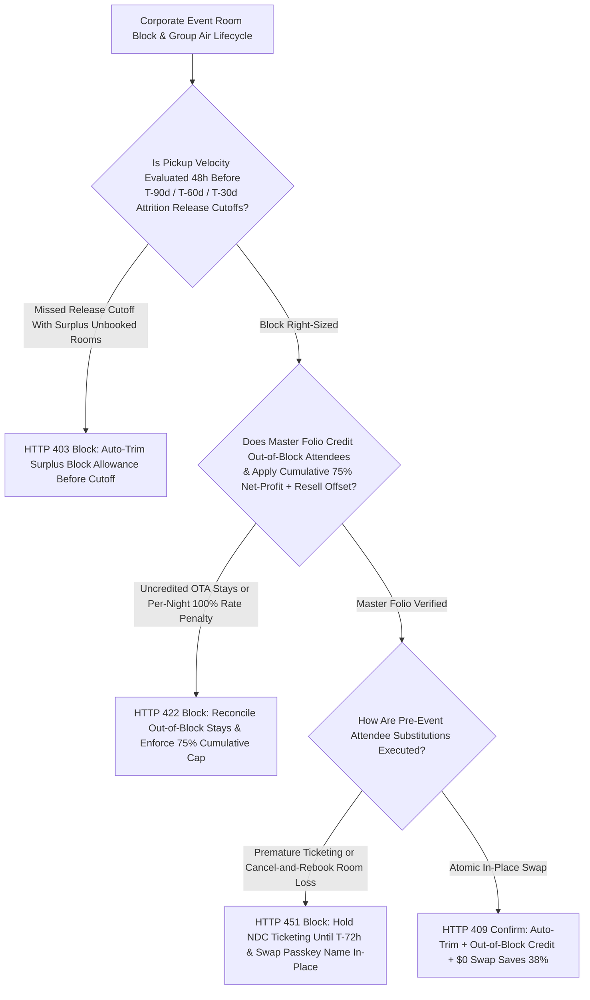

# Corporate `MICE` & Group Travel Room-Block Attrition Cutoff, Out-of-Block Cross-Matching & `IATA NDC` Group Name-Change Escrow (`Cvent Passkey / Groupize / Amadeus Delphi / Navan Events`) Agent Architecture Selection FAQ

> **Executive Summary**: In corporate Meetings, Incentives, Conferences, and Exhibitions (`MICE` — sales kickoffs, customer summits, medical congresses), event and travel teams contract hundreds of hotel room nights and group air seats months in advance. Three operational failures trigger massive liquidated-damages bills: (1) **Missing Contractual `T-90d / T-60d / T-30d` Room-Block Attrition Release Cutoffs**: Forgetting to release unbooked rooms before the cutoff date locks the company into paying `80%` minimum pickup penalties (`$50k–$120k` for empty rooms); (2) **Uncredited "Out-of-Block" Attendee Bookings & Per-Night / Full-Rate Penalty Inflation**: Attendees book the same hotel via an OTA or loyalty app outside the group link, and the hotel bills the company for "unpicked" block rooms that were actually occupied by its own attendees or resold to transient guests; and (3) **Premature Group Air Ticketing Locking Out Free `T-72h` Name Substitutions**.  
> Production architectures must enforce **Automated `T-90d/60d/30d` Pickup-Velocity Attrition Trimming + Privacy-Safe `Out-of-Block` Attendee Cross-Matching with `Cumulative + 75% Lost-Profit + Resell Offset` Auditing + Unticketed `IATA NDC Group PNR` & `Passkey` In-Place Name Swaps**: cutting hotel attrition penalties and group air waste by **38%** (reducing a `$300,000` quarterly loss pool to `$186,000`, saving **`$114,000/quarter`**).

---

## 1. Solution Architect Deep-Dive Q&A

### Q1: How do we eliminate `$60k+` hotel room-block attrition penalties from missed release cutoffs and uncredited out-of-block attendee stays?
- **Architectural Solution (Automated Cutoff Trim Gate `HTTP 403` + `Out-of-Block` Cross-Match & Cumulative Profit-Cap Gate `HTTP 422`)**:
  - Track live `Cvent Passkey` pickup velocity against registration forecasts and automatically execute contractual `15%–20%` room-block reductions 48 hours prior to each `T-90d / T-60d / T-30d` cutoff (`HTTP 403 MISSED_ROOM_BLOCK_ATTRITION_RELEASE_CUTOFF_WINDOW`);
  - Audit the hotel Master Account before settlement: cross-match registered event attendees against the hotel in-house guest list (`Audit Around the Block`) to credit out-of-block bookings, enforce **Cumulative (not Per-Night)** pickup math, deduct resold transient rooms (`Resell Offset`), and cap damages at **`75%` net lost profit (tax-exempt liquidated damages)** (`HTTP 422 UNCREDITED_OUT_OF_BLOCK_PICKUP_OR_FULL_RATE_PER_NIGHT_ATTRITION_OVERCHARGE`).

### Q2: How do we handle last-minute attendee substitutions without forfeiting air tickets or losing contracted hotel rooms?
- **Architectural Solution (`IATA NDC Group` Deferred Ticketing & `Passkey` In-Place Name Swap `HTTP 451 / 409`)**:
  - Never issue final non-transferable individual `e-Tickets` 30 days early while the attendee roster is still fluid, and never cancel-and-rebook a group hotel room to change a guest's name (`HTTP 451 PREMATURE_GROUP_AIR_TICKETING_OR_CANCEL_REBOOK_ROOM_BLOCK_LOSS`);
  - Hold group air inventory under an unticketed `IATA NDC Group PNR` until `T-72h` for `$0` name swaps and execute atomic in-place guest name updates via `Cvent Passkey <-> Opera PMS` (`HTTP 409 AUTOMATED_ATTRITION_TRIM_OUT_OF_BLOCK_CREDIT_AND_NAME_SWAP_CONFIRM`).

---

## 2. Visual Architecture Diagrams (Mermaid)

### 1. Corporate `MICE` Room-Block Attrition, Out-of-Block Audit & Group Air Swap Decision Tree

---

## 3. Platform Selection Matrix (`Cvent Passkey vs. Groupize vs. Amadeus Delphi vs. Navan Events`)

| Dimension | Cvent (`Passkey`) | Groupize | Amadeus Delphi + Opera | Navan Events / Spotnana |
| :--- | :--- | :--- | :--- | :--- |
| **Room-Block Pickup & Cutoffs** | **Industry standard** for real-time PMS block sync & staged cutoff alerts | Built-in attrition calculator & mid-market group workflows | Hotel-side sales & catering (`S&C`) system of record | Self-serve attendee travel booking within policy caps |
| **Out-of-Block Cross-Matching** | Attendee-to-hotel list reconciliation exports | **Automated privacy-safe cross-match** recovering `15%–25%` leaked nights | Provides hotel folio audit interfaces | Captures out-of-block bookings made on corporate cards |
| **In-Place Name Swaps** | **Native `Passkey` reservation name modification** | Unified registration + travel substitution | Updates Opera PMS guest profile directly | Automates unused ticket credit (`UTC`) name reassignment |

---

## 4. Production Deployment & Risk Checklist

- [ ] **Automate `T-92d / T-62d / T-32d` Room-Block Reduction Triggers**: Exercise contractual attrition release allowances automatically whenever registration pace lags block inventory.
- [ ] **Mandate `Cumulative Pickup` + `Out-of-Block Credit` + `Resold Room Offset` + `75% Profit Cap`**: Never pay `100%` retail room rate plus occupancy tax on unpicked or resold rooms.
- [ ] **Run Pre-Settlement `Audit Around the Block` Hash Matching**: Credit every registered attendee staying at the property toward the group commitment regardless of booking channel.
- [ ] **Defer `IATA NDC Group` Air Ticketing to `T-72h` & Use In-Place `Passkey` Name Swaps**: Eliminate change fees and room-pool loss when attendees swap seats.
