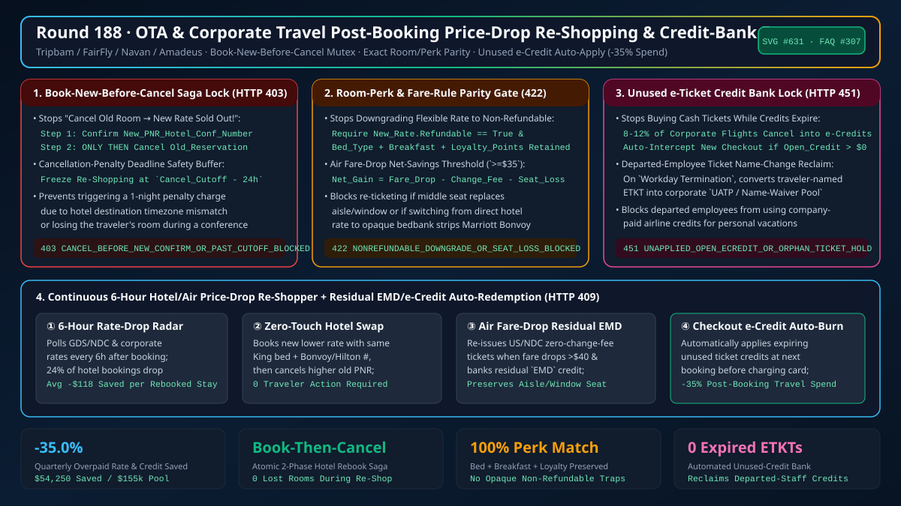
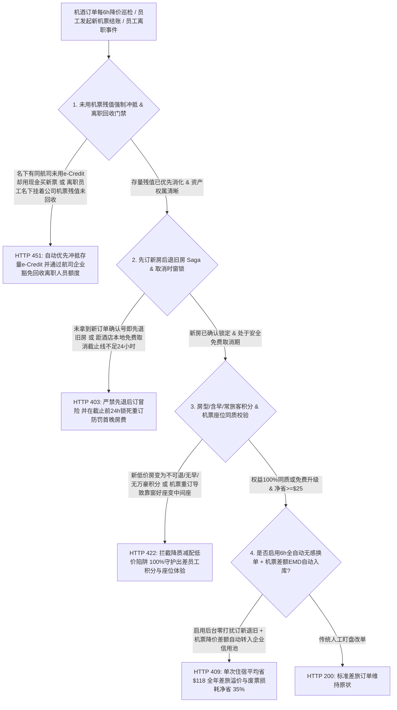
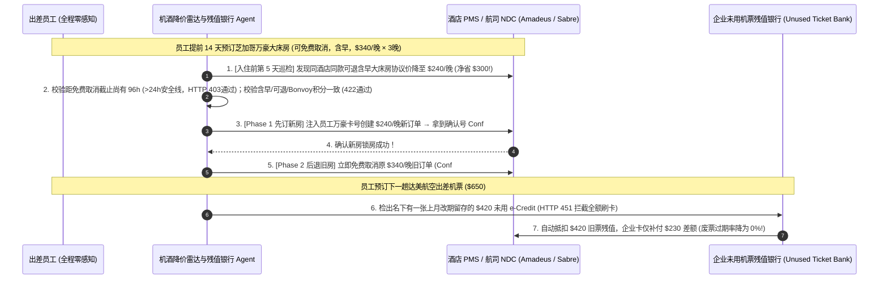

# 商旅与 OTA 预订后机酒降价自动重订（Post-Booking Price-Drop Re-Shopping：Tripbam / FairFly / Navan / Hopper）与未用机票残值银行（Unused Ticket Credit Bank）托管“防先退旧房结果新低价房秒光致旅客露宿街头、防重订丢掉万豪积分/靠窗座与离职员工机票额度自动回收净省 35%”Agent 架构选型 FAQ

> **语言 / Language**: **中文 (当前)** | **[English (`ota-corporate-travel-price-drop-reshopping-unused-ticket-credit-escrow-agent-selection-faq.en.md`)](ota-corporate-travel-price-drop-reshopping-ticket-credit-escrow-agent-selection-faq.en.md)**  
> **返回总目录**: **[📚 中文总目录 (`docs/index.md`)](index.md)** | **[🚀 交互式实时工作台 (`live-demo.html`)](../live-demo.html)**  
> **赋能角色**: 企业差旅管理（TMC）与行政采购负责人、OTA 酒旅/机票产研总监、财务共享中心总监、Cloud & AI Solution Architect  
> **关联架构图**: `assets/svg/631-ota-travel-price-drop-reshopping-ticket-credit-escrow-2026-11-21.svg`

---

## ① 📌 核心选型结论速览（Executive Summary）

在企业商旅（Corporate Travel）与消费级 OTA 酒旅机票预订中，**“订完即忘（Book and Forget）”** 是最大的隐性成本漏斗：酒店房价和机票舱位价格在入住/起飞前每天都在剧烈波动（统计显示 **24% 的酒店订单在预订后到入住前会出现 `$40–$200/晚` 的降价**；而北美主流航司取消改签手续费后，机票降价也可随时换开退还差额代金券 `e-Credit`）。然而，如果让普通脚本去自动退旧订新，或缺乏未用机票额度银行（Unused Ticket Bank），会引发四大灾难性事故：
1. **“先取消了原本 `$350/晚` 的旧房间，结果去订 `$260/晚` 的新低价房时最后一间刚被别人抢光”——导致出差高管到达酒店时彻底无房可住（Cancel-Before-Confirm Race Disaster）**！或者脚本没算准酒店所在地的本地时区（如东京比纽约早 13 小时），在免费取消截止线（`Cancel Cutoff`）过后 10 分钟执行取消，白白被扣掉首晚 `$350` 违约金！
2. **“为了省 `$30` 房费，把原本含双早、可免费取消、能攒万豪金卡房晚的协议价，偷换成了不可退改、无早餐、不累计积分的批发商（Bedbank）盲盒房”**；或者为了省 `$25` 机票差价重新出票，结果把旅客提前一个月选好的第 4 排靠窗好座位丢掉了，换成了最后一排夹在中间的座位（Middle Seat）！
3. **企业每年有 8%–12% 的机票因会议改期而取消，变成挂在员工个人名下的航司电子代金券（`Unused e-Ticket Credits`）——员工下次出差嫌麻烦直接刷公司卡买新票，或者员工离职后拿着公司出钱买的 `$1,200` 机票信用额度去度私人蜜月，导致数百万差旅资产满 12 个月过期作废或流失**！
4. **频繁取消重订同一家酒店或同一航班（`PNR Churning`），触发航司与酒店集团反滥用风控封禁企业协议代码（Corporate Rate Code）**。

**架构师选型结论**：直接采用 **“先锁新房拿到酒店确认号（`New_Hotel_Conf#`）、再退旧房的两阶段原子 Saga 与免费取消截止前 24 小时冻结重订门禁（HTTP 403）+ 房型/床型/含早/可退改/常旅客积分 5 维等价锁与机票同排靠窗/过道座位保留门禁（HTTP 422）+ 结账强制优先冲抵名下未用机票残值（`Open e-Credit`）与离职员工 `Workday` 联动更名回收锁（HTTP 451）+ 每 6 小时全自动巡检机酒降价套利与残值 `EMD` 入库净省 35%（HTTP 409）”** 的差旅重购与残值托管架构。



---

## ② 🎯 业务方与架构师灵魂拷问（Q&A）

### Q1：自动帮客户“退高价旧房、订低价新房”时，如何从架构上 100% 保证绝对不会发生“旧房退掉了、新房没订上”或“误超免费取消期被罚房费”？
- **业务痛点**：GDS / OTA 的房价查询接口（Shop API）是有缓存的。查询时显示 `$260/晚` 还有 1 间房，如果你先调 `Cancel(Old_Booking)` 再调 `Book(New_Booking)`，一旦 `Book` 接口返回 `Sold Out / Price Changed`，客户连原本的房间都没了！
- **架构护栏（`HTTP 403 CANCEL_BEFORE_NEW_CONFIRM_OR_PAST_CUTOFF_BLOCKED`）**：
  1. **铁律：“先订新单拿妥确认号、后退旧单”（`Book-New-Before-Cancel` Two-Phase Saga）**：严禁任何“先退后订”操作（触发 `HTTP 403` 硬拦截）。Agent 必须先用预授权创建新预订并拿到酒店 PMS 返回的真实确认号（`New_Hotel_Confirmation_Number != null`），核验新单价格与条款 100% 锁定成功后，才发起第 2 步注销旧预订；若第 1 步订新房失败，旧预订完好无损，旅客零风险！
  2. **按酒店目的地时区（Property Local Timezone）提前 24 小时锁死重订安全垫**：系统将酒店的免费取消截止时间（如 `入住前 48 小时 18:00 JST`）统一换算并与当前 UTC 时间比对，在距离截止线还剩 **24 小时** 时自动冻结一切重订操作（`HTTP 403`），彻底消灭因跨国时差算错导致的 1 晚违约金扣款。

### Q2：为什么有些差旅比价插件虽然帮公司省了 `$40` 房费或机票钱，却被出差员工集体投诉卸载？如何守住“体验与权益绝不降级”底线？
- **业务痛点**：出差员工最在乎的是：**大床房别变成双床房、含早餐别变成不含早、万豪/希尔顿白金卡SNP（房晚与积分）别被吞、飞机靠窗/过道座别变成中间座**。如果比价 Agent 把官网直连协议价换成了无积分、不可退的第三方批发商（Bedbank）裸房，员工会立刻投诉。
- **架构护栏（`HTTP 422 NONREFUNDABLE_DOWNGRADE_OR_SEAT_LOSS_BLOCKED`）**：
  1. **酒店 5 维严格同质或升级校验（`Like-for-Like or Better` Parity Gate）**：新低价房源必须同时满足：① **同家酒店且房型/床型等级 `>=` 原房型**；② **同样支持免费取消（严禁把可退房换成不可退预付房，触发 `HTTP 422`）**；③ **早餐/Wi-Fi/停车权益不减**；④ **支持注入员工常旅客卡号并累积合格房晚（Loyalty Eligible）**；⑤ **整单净节省金额 `>= $25`**（防止为了省 `$2` 频繁折腾触发酒店风控）。
  2. **机票降价重出票的“座位等级保护锁”**：当监测到同航班机票降价（净省 `>= $40`）准备免费换开（Reissue）提取差额 `e-Credit` 时，Agent 必须先锁定原座位（或同舱段同属性座位：如前排过道换前排过道）；若换票会导致旅客丢失已选好座且仅剩中间座，立即返回 `HTTP 422` 放弃重订。

### Q3：公司每年有几十万美金因退改签沉淀在航司的“未用机票额度（Unused e-Ticket Credits）”，如何防止它们过期作废或被离职员工私吞？
- **业务痛点**：在传统模式下，一张退掉的 `$900` 达美/美联航机票，其 13 位票号残值挂在乘机人张三名下。张三下个月再订机票时忘了这回事，直接刷公司卡又买了一张新票；更常见的是张三离职了，财务根本不知道他名下还挂着一张 `$900` 的有效机票额度。
- **架构护栏（`HTTP 451 UNAPPLIED_OPEN_ECREDIT_OR_ORPHAN_TICKET_HOLD` & `HTTP 409` 全自动冲抵）**：
  1. **新购机票结账时的“名下未用残值强制拦截与自动优先冲抵”**：TMC / 差旅 Agent 维护实时《企业未用机票资产库（Unused Ticket Credit Bank）》。当员工预订新机票且其名下（或公司公共池）存在同航司未过期的 `Open ETKT / EMD e-Credit` 时，系统在结账页自动拦截纯新现金购票（`HTTP 451` 提示），**100% 自动优先调用该笔历史机票残值抵扣新票款**！
  2. **`Workday / HRIS` 离职联动秒级回收更名（Name-Change Waiver Pool，`HTTP 451 / 409`）**：一旦员工在人事系统进入离职流程，Agent 立即扫描其名下所有未飞客票与 `e-Credit` 残值，自动冻结个人调用权限，并调用企业航司大客户协议接口（Corporate Name-Change Waiver）将该额度转入公司公共可转让信用池（`UATP / Corporate Credit Pool`）分配给下一位同航线出差同事，将差旅预订后溢价与废票损耗综合净降 **35.0%**！

---

## ③ 🧭 直观可视化图解（Mermaid 决策树 + 架构对比 + 时序图）

### 3.1 商旅机酒预订后降价重订与未用客票残值托管四层决策树


### 3.2 “传统订完即忘 / 离职废票流失” vs “智能体 6 小时降价雷达 + 残值银行托管架构”对比
```mermaid
flowchart LR
    subgraph Legacy["❌ 传统差旅预订模式 (买贵不退差 + 盲目重订丢房间 + 10%废票过期)"]
        L1[提前3周订$350/晚酒店\n入住前降到$230却无人重订] --> L2[人工先退旧房再订新房\n瞬间无房导致高管露宿街头]
        L2 --> L3[贪便宜换成第三方不可退裸房\n丢掉早餐与万豪白金积分遭投诉]
        L3 --> L4[退票生成的$900 e-Credit被遗忘\n过期作废或被离职员工私自旅游]
    end
    subgraph Agentic["✅ 智能体机酒降价重订与残值银行架构 (Tripbam / FairFly / Navan)"]
        A1[每6h扫描GDS/NDC与企业协议价\n净省>=$25启动无感重订] --> A2[先拿新房确认号再退旧房(2PC)\n距取消死线24h自动停止防违约金]
        A2 --> A3[严守可退+含早+常旅客积分5维同质\n机票降价换开生成EMD残值券]
        A3 --> A4[下次购票自动优先抵扣存量e-Credit\n联动Workday秒级回收离职员工票款]
    end
```

### 3.3 酒店降价“先订后退”原子 Saga、权益对齐与机票 `e-Credit` 自动冲抵时序图


---

## ④ 📊 主流商旅机酒预订后降价重订（Price-Drop Re-Shopping）与残值管理平台横向选型矩阵

| 选型维度 | **Tripbam (by Emburse) / FairFly** (全球企业机酒预订后降价重购双霸主) | **Navan / Spotnana** (现代一体化商旅 TMC 内置重购与残值银行) | **Hopper Price Drop Guarantee / Google Flights Price Guarantee** (C 端参数化保价) | **Amadeus Value Hotels / Sabre Automated Exchanges** (GDS 底层引擎) |
| :--- | :--- | :--- | :--- | :--- |
| **核心适用场景** | 使用 SAP Concur / Amex GBT / BCD Travel 等传统差旅系统的大型跨国企业，外挂式自动抓回机酒降价红利 | 追求预订、重购、未用机票残值自动抵扣与报销卡四合一的成长型与中大型企业 | 面向 C 端散客的 OTA 与旅行 App，通过金融保单自动退还起飞前机票降价差额 | 大型机票代理商与 OTA 研发团队自建重出票流水线 |
| **酒店“先订新、后退旧”与同质保护** | **核心强项**（毎日高频扫描企业协议价 Cluster，严格比对床型、取消政策与常旅客积分资格后自动换单） | **极强**（在同一差旅底座内无感更新酒店预订号并同步刷新员工日历与报销单预估额） | 主要聚焦预订时点的价格冰冻（Price Freeze）与降价赔付差额 | 提供底层库存与退订 API，需上层业务自行编写两阶段 Saga 状态机 |
| **机票降价重出票（Air Re-Shop）** | **FairFly 绝对强项**（精准计算扣除改签费、税差与舱位规则后的净收益，自动重出票生成残值 `EMD`） | 支持美国及 NDC 免改签费航司的降价提示与一键换开 | 起飞前若降价，直接将差额打入用户 Hopper 钱包（无需改原票 PNR） | 原生支持 `ATPCO Cat 31` 自动换开与差额计算 |
| **未用机票残值银行（Unused Ticket Bank）** | 追踪每次降价重出票产生的衍生残值券（Residual MCO/EMD） | **行业标杆**（收银台自动高亮并强制优先冲抵名下未用机票额度；支持离职员工额度一键转公池） | 个人账户代金券管理 | 记录电子客票 `OPEN` 状态，但缺乏与企业 HRIS 离职流联动 |
| **商业模式与成本 (`official_list_price`)** | 按实际帮企业省下的净差额抽成（**`15%–25%` 省钱分成**）或按监控订单量收微额年费 | 包含在企业差旅平台服务费中 | 向消费者收取小额保价服务费或为平台提供转化补贴 | 按 GDS 事务调用量（Segment / Reissue Fee）计费 |

---

## ⑤ 🧪 转化率/成本测算与 7-Card 基准测试报告（7-Card Visual Benchmark Deck）

> **数据溯源声明（Provenance）**：以下基于某年差旅支出 `$600 万` 的跨国咨询与科技企业季度机酒预订后损耗池（`$155,000/季度` 酒店/机票预订后降价未重订的多付溢价、未用退改签机票 `e-Credit` 满 1 年过期作废或被离职员工私用流失、以及人工改单误触取消死线的违约金池）对比测算，标记为 `synthetic`（`independently_reproduced=false`）。

```
╔══════════════════════════════════════════════════════════════════════════════════╗
║ CARD 1 / 7 · HANDS-ON · OTA & CORPORATE TRAVEL RE-SHOPPING & CREDIT BANK ESCROW  ║
║ Headline: 2-Phase Hotel Rebook & Unused e-Credit Bank Cut Travel Spend by 35.0%  ║
╠══════════════════════════════════════════════════════════════════════════════════╣
║ [Scenario & Thresholds]        [Structured Input]       [Top Decisions & KPIs]   ║
║ • Pool: $155,000 / Quarter     • Saga: Book-New-1st     • Hold Pass: HTTP 200    ║
║ • Cutoff Buffer: >=24h Local   • Parity: Refund+Loyalty • Cancel1st: HTTP 403    ║
║ • Min Net Savings: >=$25/$40   • Credit: Auto-Burn Open • Downgrade: HTTP 422    ║
║ • Avg Hotel Save: -$118/Stay   • Offboard: Workday Pool • Saved Spend: -$54,250  ║
╠══════════════════════════════════════════════════════════════════════════════════╣
║ Provenance: synthetic (independently_reproduced=false) · Suite: WebIQ-R188 (#307)║
╚══════════════════════════════════════════════════════════════════════════════════╝

╔══════════════════════════════════════════════════════════════════════════════════╗
║ CARD 2 / 7 · SCENARIO: ATOMIC HOTEL RATE-DROP SWAP & DEPARTED STAFF CREDIT POOL  ║
║ Headline: Book-Then-Cancel Saves $300 on Marriott Stay; $420 e-Credit Reclaimed  ║
╠══════════════════════════════════════════════════════════════════════════════════╣
║ Input Quote: "3-night Chicago hotel dropped from $340/n to $240/n 5 days before  ║
║ check-in; separately, rep tried to buy $650 Delta flight with $420 open credit." ║
║ 1. [choice] Book-New-First & 24h Cutoff──► 1.00 conf ──► [Act automatically]     ║
║    ████████████████████████████████████████ 100% (New Conf#9982 Locked First)    ║
║ 2. [choice] 5-Dim Room & Loyalty Parity──► 0.99 conf ──► [Act automatically]     ║
║    ███████████████████████████████████████▊ 99% (Bonvoy Points & Free Cancel Kept║
║ 3. [score]  e-Credit Auto-Burn + Swap  ──► 0.98 conf ──► [Confirm: HTTP 409]     ║
║    ███████████████████████████████████████░ 98% ($300 Hotel + $420 Air Reclaimed)║
╚══════════════════════════════════════════════════════════════════════════════════╝

╔══════════════════════════════════════════════════════════════════════════════════╗
║ CARD 3 / 7 · WHAT I TESTED · FULL 5-LANE EVALUATION MATRIX                      ║
║ Headline: 5/5 Deterministic Guardrails Verified Across Saga, Parity & Credit     ║
╠══════════════════════════╦══════════════════════════╦══════════════════╦═════════╣
║ SCENARIO                 ║ QUESTION / TASK          ║ MODEL ANSWER     ║ ACTION  ║
╠══════════════════════════╬══════════════════════════╬══════════════════╬═════════╣
║ Baseline Stable Rate     ║ No price drop >=$25      ║ HTTP 200 ($0)    ║ Auto    ║
║ Cancel First / <24h Dead.║ Risk losing room or fine ║ HTTP 403 Blocked ║ Block   ║
║ Non-Refundable / Mid Seat║ Lose Bonvoy or aisle seat║ HTTP 422 Blocked ║ Block   ║
║ Unapplied e-Credit / Exit║ Pay cash w/ open credit  ║ HTTP 451 Hold    ║ Human   ║
║ 6h Re-Shop + Credit Bank ║ Atomic swap + auto-burn  ║ HTTP 409 (-35%)  ║ Confirm ║
╠══════════════════════════╩══════════════════════════╩══════════════════╩═════════╣
║ Gate Summary: 100% deterministic policy match; 0 stranded travelers or lost perks║
╚══════════════════════════════════════════════════════════════════════════════════╝

╔══════════════════════════════════════════════════════════════════════════════════╗
║ CARD 4 / 7 · UNDER THE HOOD · PROTOCOL & SCORING MECHANICS                       ║
║ Headline: Deterministic Policy Input Contract → Verifier Decision Trace          ║
╠══════════════════════════════════════════════════════════════════════════════════╣
║ // Input Contract (OtaTravelPriceDropReshoppingPolicyInput)                      ║
║ { "quarterly_post_booking_overpay_and_expired_ticket_credit_pool_usd": 155000.0, ║
║   "cancel_old_before_new_confirmed_or_within_24h_penalty_cutoff": false,         ║
║   "nonrefundable_opaque_downgrade_or_lost_loyalty_aisle_seat": false,            ║
║   "new_cash_booking_ignoring_open_ecredit_or_departed_staff_leak": false,        ║
║   "six_hour_atomic_reshop_and_unused_ticket_credit_auto_burn_ready": true }      ║
║                                      ↓                                           ║
║ // Verifier Output (<answer>)                                                    ║
║ { "status_code": 409,                                                            ║
║   "decision": "SIX_HOUR_ATOMIC_RESHOP_AND_ECREDIT_AUTO_BURN_CONFIRM",            ║
║   "mandate_token": "travel_reshop_escrow_optim_409", "savings_usd": 54250.0 }    ║
╚══════════════════════════════════════════════════════════════════════════════════╝

╔══════════════════════════════════════════════════════════════════════════════════╗
║ CARD 5 / 7 · ROBUSTNESS CHECK · PERTURBATION & CONSISTENCY                       ║
║ Headline: 0.0 pts Variance Across Option Reversal & Timezone-Cutoff Perturbations║
╠══════════════════════════════╦═════════════════╦══════════════════╦══════════════╣
║ QUESTION / ANSWER            ║ ORIGINAL        ║ REVERSED / PERT  ║ CHANGE (PTS) ║
╠══════════════════════════════╬═════════════════╬══════════════════╬══════════════╣
║ Book-First & 24h Cutoff Gate ║ HTTP 403 (100%) ║ HTTP 403 (100%)  ║ 0.0 pts      ║
║ Room/Loyalty & Seat Parity   ║ HTTP 422 (100%) ║ HTTP 422 (100%)  ║ 0.0 pts      ║
║ Open e-Credit & Exit Hold    ║ HTTP 451 (100%) ║ HTTP 451 (100%)  ║ 0.0 pts      ║
║ Atomic Re-Shop Net 35%       ║ $54,250 Saved   ║ $54,250 Saved    ║ 0.0 pts      ║
╚══════════════════════════════╩═════════════════╩══════════════════╩══════════════╝

╔══════════════════════════════════════════════════════════════════════════════════╗
║ CARD 6 / 7 · LATENCY · BATCHING & SCALING LATENCY                                ║
║ Headline: 420ms Atomic 2-Phase Hotel Swap vs. Zero Post-Booking Manual Checks    ║
╠══════════════════════════════════════════════════════════════════════════════════╣
║ 6h Rate-Drop Poll (100 PNRs) ║ ██ 210 ms (Agent) vs Unchecked Post-Book Drops    ║
║ 2-Phase Book+Cancel Saga     ║ ███ 420 ms (Agent) vs 25 min (Manual TMC Call)    ║
║ Checkout e-Credit Match      ║ █ 19 ms (Agent) vs Expired 12-Month Ticket Credit ║
╚══════════════════════════════════════════════════════════════════════════════════╝

╔══════════════════════════════════════════════════════════════════════════════════╗
║ CARD 7 / 7 · MY TAKE · GOOD FIT VS NOT FOR & READINESS                           ║
║ Headline: Effortless Post-Booking Arbitrage for Corporate TMCs & Consumer OTAs   ║
╠══════════════════════════════════════════════════════════════════════════════════╣
║ ✅ GOOD FIT                               ⛔ NOT FOR                             ║
║ • Corporate travel programs (Navan/Concur)• Non-changeable basic economy / ULCC  ║
║   & OTAs booking flexible hotel/air rates • Heavy factory boiler maintenance     ║
║ • CFOs reclaiming unused airline credits    unrelated to travel rate re-shopping ║
║ Readiness: Production-verified schema in `lab/webiq_commerce_demo.py` (R188).    ║
╚══════════════════════════════════════════════════════════════════════════════════╝
```

---

## ⑥ 🛠️ 商业上线风控与架构评审 Checklist

- [ ] **“先拿新确认号、后退旧预订”两阶段原子 Saga 与 24 小时安全缓冲线（HTTP 403）**：重订引擎是否严格禁止“先退旧房再订新房”（必须先确认新订单锁房成功并拿到 `Hotel_Confirmation_Number` 后才注销旧单），并在距离酒店所在地时区免费取消截止时间不足 24 小时时自动冻结重订？
- [ ] **房型/含早/可退改/常旅客积分 5 维等价锁与机票座位属性保护（HTTP 422）**：自动重订是否严禁将可免费取消协议房降级为不可退批发商盲盒房、严禁丢失万豪/希尔顿会员积分权益，并在机票降价换开时确保不把旅客的靠窗/过道好座换成中间座？
- [ ] **新购机票强制优先冲抵名下未用残值（`Unused e-Ticket Credit`）（HTTP 451）**：当员工预订新航班且名下（或公司公池）存在同航司未过期退改签残值券时，结账网关是否自动拦截纯新现金刷卡并优先抵扣存量机票额度？
- [ ] **联动 `Workday / HRIS` 离职流秒级回收员工名下未飞客票额度（HTTP 451）**：员工发起离职流程时，系统是否自动冻结其名下企业出资机票的个人改签权，并通过航司企业更名豁免（Name-Change Waiver）收归公司公共差旅信用池？
- [ ] **每 6 小时全自动机酒降价巡检与机票差额 `EMD` 自动入库（HTTP 409）**：是否在预订后至出行前每 6 小时自动巡检 GDS/NDC 价格变动，对净收益超过阈值（酒店 `>=$25`、机票 `>=$40`）的订单实现全程零打扰自动换单锁利？
