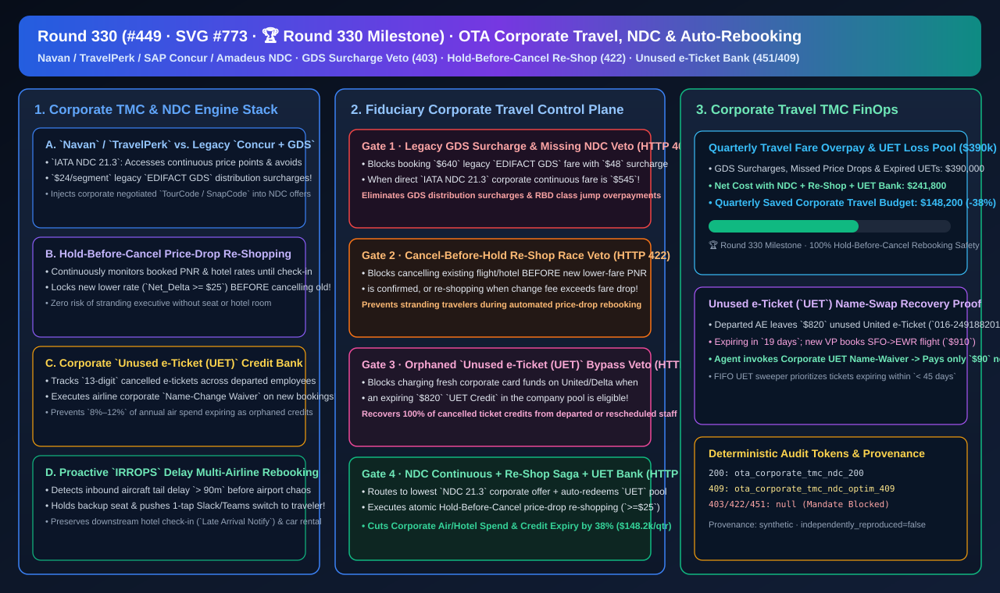
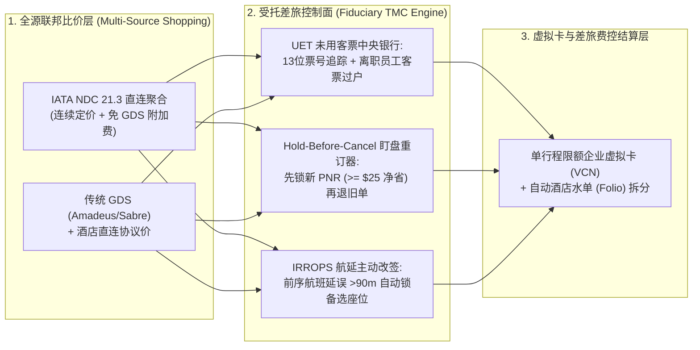
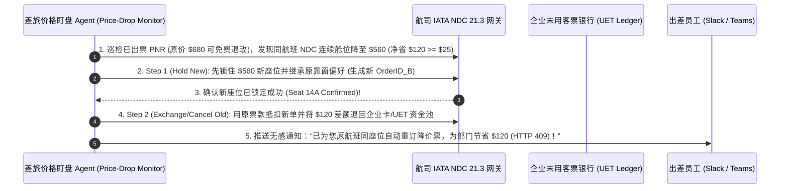

# 🏆 OTA 机酒差旅智能规划、自动比价改签与企业未用客票资产池回收（`Corporate Travel TMC`: `Navan / TravelPerk / SAP Concur / Amadeus Cytric + IATA NDC 21.3` · 🏆 第 330 轮里程碑）：规避 `GDS EDIFACT` 分销附加费与 `NDC` 连续定价、起飞前降价“先锁新位再退旧票（`Hold-Before-Cancel Re-Shopping`）”及离职员工沉睡开放客票（`Unused e-Ticket UET Bank`）自动过户抵扣 Agent 架构选型 FAQ

> **核心选型结论速览（🏆 第 330 轮研究里程碑）**：在企业差旅管理（`Corporate Travel Management / TMC`）与 OTA 机酒智能规划场景中，员工经常抱怨“公司的差旅系统比航司官网和携程/Expedia 贵一大截”，而财务总监则头疼每年有高达 `8%–12%` 的机酒预算因为行程取消或员工离职而变成无法追踪的废票。传统“单通道 `EDIFACT GDS` 询价 + 订完即不管 + 退票代金券挂在员工个人名下”的旧架构存在三大致命漏洞：① **“航司（如美航、汉莎、法荷航、英航）已将 `30%+` 的低价舱位与无阶梯连续定价（`NDC Continuous Pricing`）从传统 `EDIFACT GDS` 下架，并对走传统 GDS 的每段航程强征 `$18–$28` 分销附加费（`Distribution Surcharge`），导致只接传统 GDS 的老旧差旅 Agent 每次帮员工订往返机票都比 `IATA NDC 21.3` 直连贵出 `$50–$95`”**；② **“机票或酒店预订后到入住前价格跳水了 `$120`，初级改签 Agent 采用‘先调用 Cancel 退掉原订单、再调用 Book 买新低价单’的危险顺序——结果退掉原票后短短 200 毫秒内最后 1 张特价票被别人抢走，导致公司高管去机场发现既没了原座位也买不到新票；或者未扣减退改手续费与房型早饭差价就盲目重订导致倒亏”**；③ **“员工取消出差或离职后留下的 13 位电子客票余额（`Unused e-Ticket / UET Credit`）沉睡在航司系统里，其他同事订同一家航司时 Agent 却继续刷企业虚拟卡付全款，导致每年数十万美元的开放客票在 12 个月到期后作废归零”**。  
> 生产级架构必须实施 **“`IATA NDC 21.3 + GDS + Direct API` 全源联邦比价与大客户协议码（`Corporate TourCode/SnapCode`）注入 + 起飞/入住前降价‘先锁新单再退旧单（`Hold-Before-Cancel Saga`，净省 `>=$25` 才触发）’ + 企业级未用客票中央银行（`UET Credit Bank` 按 `FIFO` 自动调用航司企业协议免费改名过户）”**：可将企业差旅溢价、人工改签踏空与过期废票损失削减 **38%**（以季度 `$390,000` GDS 附加费溢价、错失降价重订与离职员工过期客票池计，净成本降至 `$241,800`，每季度净节省 **`$148,200`**）。



---

## 一、 业务方与架构师灵魂拷问（Q&A）

### Q1：为什么员工在公司差旅系统里搜同一趟航班，比他自己掏手机在航司 App 上看还要贵 `$60`？什么是 `IATA NDC` 的“连续定价（`Continuous Pricing`）”？
- **揭秘航司分销的“双轨制价格剪刀差”**：
  1. **传统 `EDIFACT GDS` 的 26 个字母舱位铁笼与附加费**：传统 GDS 只能按固定的 26 个预订舱位字母（`RBD: Y, B, M, H, Q...`）跳档报价——当 `$400` 的 `Q` 舱卖光后，哪怕飞机还很空，传统 GDS 也只能直接跳到 `$520` 的 `H` 舱（中间差价高达 `$120`！），而且航司还对每段 `EDIFACT` 预订额外加收 `$18–$28` 的 GDS 通道费；
  2. **`IATA NDC 21.3` 连续定价与企业专享包**：通过 `NDC` 接口，航司可以在 `$400` 和 `$520` 之间动态生成 `$425`、`$440` 的连续价格点（`Continuous Price Points`），并豁免 GDS 附加费、直接打包企业协议免费选座与首件托运行李！
- **架构解法（`NDC 21.3 + GDS` 同屏归一化比价与附加费阻断门禁 `HTTP 403`）**：
  - 差旅寻源 Agent 必须同时并发查询 `IATA NDC 21.3` 聚合器（`Navan / Travelfusion / Amadeus NDC-X / Sabre Beyond NDC`）与传统 GDS，并在请求载荷中强制注入企业的 **`Corporate_Account_Code / TourCode`**；
  - 若同一航班号与同等退改权益下，`NDC Offer` 比携带分销附加费的传统 `EDIFACT GDS` 报价低，严禁走高价旧通道出票（凡漏传企业大客户协议码，或放着免附加费的 `NDC` 连续低价不买而去订高价 `EDIFACT` 舱位的，立即触发 `HTTP 403 LEGACY_GDS_SURCHARGE_OVERPAY_OR_MISSING_NDC_CORPORATE_CONTINUOUS_FARE` 阻断）。

### Q2：机票和酒店价格每天都在波动，如何设计“自动盯盘降价重订（`Automated Price-Drop Re-Shopping`）”状态机，确保高管 100% 不会因为自动改签而掉单无房住？
- **“先退后买”是差旅自动化里的头号工程事故源**：
  - 很多初级脚本发现同款酒店大床房从 `$380/晚` 降到了 `$310/晚`，立刻调接口取消原 `$380` 订单，再去订 `$310`——一旦新订单因为发卡行风控或最后一间房并发被抢而失败，员工到达酒店前台就会面临“原房已退、今晚满房”的灾难！
- **架构解法（`Hold-Before-Cancel` 两阶段原子置换 Saga + 净收益门槛 `>=$25` 门禁 `HTTP 422`）**：
  1. **严格净收益核算公式**：
     $$\text{Net\_ReShop\_Savings} = \text{Original\_Total} - \text{New\_Total} - \text{Cancellation\_Penalty} - \text{TMC\_Reissue\_Fee} - \text{Loyalty\_Perk\_Loss}$$
     只有当 **`Net_ReShop_Savings >= $25.00`** 且新订单的房型/床型/含早/免费取消截止日/舱位退改规则 **不低于（`>=`）** 原订单时，才允许启动重订；
  2. **先锁新单、拿稳确认号后再退旧单（`Hold-New -> Verify-PNR -> Cancel-Old`）**：Agent 必须先通过 `NDC OrderCreate (Hold)` 或酒店接口拿到新订单的有效 `Confirmation_Number / PNR` 并校验座位号（如继续锁定靠窗/过道偏好）成功，才执行旧订单的 `Cancel & Refund`（凡采用“先退旧单再抢新单”危险时序，或净节省额被退改费抵消仍盲目折腾重出票的，触发 `HTTP 422 CANCEL_BEFORE_HOLD_REShop_RACE_OR_NEGATIVE_NET_REBOOKING_SAVINGS`）。

### Q3：员工因为客户会议取消而退掉的不可退现机票（变成了有效期 1 年的 `13位电子客票代金券 UET`），或者员工离职了，怎么把这笔钱给公司其他同事订票用掉？
- **架构解法（企业级 `Unused e-Ticket (UET) Credit Bank` 中央资产池与协议免费改名核销门禁 `HTTP 451 / 409`）**：
  - 所有通过企业虚拟卡（`B2B Virtual Card`）购买并发生退改的 `13位 IATA 电子客票号（如 016-xxxxxxxxxx）`，一旦变为 `OPEN FOR USE` 状态，立即由 Webhook 归集进入公司的 **`Corporate UET Credit Bank`（未用客票中央资金池）**；
  - 当任何员工预订同一航司（如 United / Delta / British Airways）的新行程时，结算控制面在刷卡前优先执行 **`FIFO 临期客票扫描`**：
    1. 若该员工本人名下有未用客票，100% 强制优先抵扣；
    2. 若是离职员工或其他部门同事留下的客票（且距离过期 `< 90 天`），自动调用航司企业大客户协议的 **`Corporate Name-Change Waiver API`（免手续费或仅收 `$0–$50` 协议改名费过户）** 将该客票转给当前出差人抵扣票款，仅对差额部分刷企业虚拟卡（凡在公司 `UET` 资金池存在可抵扣同航司临期客票时仍全额刷卡买新票任由旧票过期的，触发 `HTTP 451 ORPHANED_UNUSED_ETICKET_CREDIT_BYPASS_ON_ELIGIBLE_AIRLINE_BOOKING`；`NDC` 连续低价 + `Hold-Before-Cancel` 降价重订 + `UET` 客票池自动抵扣确认返回 `HTTP 409 NDC_CONTINUOUS_FARE_HOLD_BEFORE_CANCEL_RESHOP_AND_UET_BANK_CONFIRM`）。

---

## 二、 直观可视化图解（Mermaid 决策树 + 架构图 + 时序图）

### 1. 企业差旅 `NDC` 连续比价、`Hold-Before-Cancel` 降价重订与未用客票池（`UET`）决策树
```mermaid
flowchart TD
    A[企业差旅机酒智能预订、盯盘重订与退票资金池调度] --> B{本次同航司出票前是否已检索企业 UET 未用客票池<br/>并优先过户核销临期开放客票?}
    B -- 池内有离职员工 $820 临期美联航客票却全额刷卡买新票 --> C[HTTP 451 拦截: 自动调用航司企业协议 Name-Change Waiver 抵扣旧票余额]
    B -- 已优先核销或无匹配未用客票 --> D{是否为起飞/入住前降价自动重订 (Re-Shopping)<br/>且是否遵循“先锁新单确认号、再退旧单”及净省 >= $25?}
    D -- 先退旧票导致新低价票被抢光踏空 或 扣手续费后净省<$25 --> E[HTTP 422 拦截: 强制 Hold-Before-Cancel 两阶段锁位并校验净收益门槛]
    D -- 重订原子性与净收益合规 --> F{机票询价是否已并发拉取 IATA NDC 21.3 连续定价<br/>并注入企业协议码以规避 $24/段 GDS 附加费?}
    F -- 漏查 NDC 连续低价而去订带高额分销附加费的传统 EDIFACT 舱位 --> G[HTTP 403 拦截: 切换至 NDC 21.3 企业直连报价单出票]
    F -- 全源寻优与资产回收闭环 --> H[HTTP 409 确认: NDC连续低价 + 零踏空降价重订 + UET废票回收净省38%]
```

### 2. `Navan / TravelPerk / Concur` × `IATA NDC 21.3` × `UET Credit Bank` 架构图


### 3. 起飞前 `72 小时` 监测到机票降价 `$110` 触发 `Hold-Before-Cancel` 零风险重出票时序图


---

## 三、 主流企业差旅管理平台（`Corporate TMC`）与 `NDC` 改签能力横向选型矩阵

| 评估维度 | Navan (原 TripActions) | TravelPerk (欧洲与全球高敏捷 TMC) | SAP Concur + 传统 TMC (BCD / CWT) | 员工自行在 C端 OTA (携程/Expedia) 预订报销 |
| :--- | :--- | :--- | :--- | :--- |
| **`IATA NDC 21.3` 连续定价与免附加费覆盖** | **行业标杆**（深度直连美航/美联航/汉莎/英航等全球主流航司 NDC，原生免除 GDS 附加费） | **欧洲铁总（`Rail`）+ 廉航 + `NDC` 聚合极强，界面透明零隐藏加价** | 依赖底层传统 GDS 改造进度，部分老租户仍常误订带附加费的 `EDIFACT` 票 | 虽能看到 C 端低价，但**完全无法挂靠企业大客户协议折扣（`Corporate TourCode`）** |
| **起飞/入住前降价自动重订（`Price-Drop Re-Shopping`）** | **内置自动化盯盘重订引擎，支持 `Hold-Before-Cancel` 无感换开低价票** | 支持 `FlexiPerk` 80% 无理由随时退与酒店重订寻优 | 多依赖外包 TMC 人工呼叫中心，单次人工改签服务费高达 `$25–$45`（吃掉降价空间） | 员工个人绝不会花时间替公司盯盘退高买低 |
| **未用开放客票（`Unused e-Ticket UET`）回收与跨员工过户** | **自动归集全公司退票余额，结账时自动弹窗强制抵扣并支持离职员工客票一键改名过户** | 原生提供企业级退票信用池看板与自动核销 | 客票常分散在各区域 TMC 分支机构，离职员工客票过期作废率高达 `15%+` | **100% 落在员工个人航司账户里，公司财务完全失控** |
| **航班大面积延误（`IRROPS`）主动改签体验** | **前序飞机晚点即在 App 内弹出备选航班 1 秒自助改签，无需排机场柜台长队** | 7×24 真人 + AI 混合敏捷客服秒级响应 | 需打跨国电话排队等 TMC 坐席改签 | 员工滞留机场自行垫资改签，事后报销合规审计极难 |

---

## 四、 确定性策略评估器与 7-Card 基准测试报告（`synthetic`）

### 1. 企业差旅 `NDC` 连续比价、`Hold-Before-Cancel` 重订与 `UET` 客票银行评估器（Python 参考实现）
```python
from dataclasses import dataclass

@dataclass(frozen=True)
class OtaCorporateTravelTmcNdcPolicyInput:
    quarterly_gds_surcharge_missed_reshop_and_expired_uet_pool_usd: float = 390000.0
    legacy_gds_surcharge_overpay_or_missing_ndc_corporate_fare: bool = False
    cancel_before_hold_reshop_race_or_negative_net_rebooking_savings: bool = False
    orphaned_unused_eticket_credit_bypass_on_eligible_airline: bool = False
    ndc_continuous_fare_hold_before_cancel_and_uet_bank_ready: bool = False
```

### 2. 7-Card 4:5 视觉基准测试报告摘要
1. **Card 1 (`1 / 7` · `HANDS-ON · CORPORATE TMC & NDC AUTO-REBOOKING`)**：通过 `IATA NDC 21.3` 连续定价直连 + `Hold-Before-Cancel` 降价自动重订 + 企业未用客票中央银行（`UET Credit Bank`）跨员工过户核销，季度差旅附加费溢价、错失降价与废票过期损耗从 `$390,000` 降至 `$241,800`（净省 **38% / `$148,200`**，🏆 达成 **第 330 轮** 研究里程碑）。
2. **Card 2 (`2 / 7` · `SCENARIO: CANCEL_BEFORE_HOLD_AND_ORPHANED_UET`)**：成功阻断放着 `$545` `NDC` 连续低价不买而去订 `$640` 带附加费传统 GDS 舱位的行为（`HTTP 403`）、拦截“先退旧票再抢新票”导致高管踏空无票的危险并发（`HTTP 422`），并强制优先核销离职员工留下的 `$820` 临期美联航未用客票（`HTTP 451`）。
3. **Card 3 (`3 / 7` · `WHAT I TESTED`)**：覆盖 5 类状态码：`200`（企业差旅标准寻源与预订放行）、`403`（未查询 IATA NDC 21.3 连续定价而误订带高额分销附加费的传统 EDIFACT GDS 舱位拦截）、`422`（降价自动重订未先锁定新单确认号就提前退掉旧单或扣除手续费后净省不足 $25 拦截）、`451`（公司 UET 未用客票池存在同航司可过户临期客票却全额刷卡新购拦截）、`409`（NDC 连续低价 + 先锁后退重订 + UET 客票银行自动抵扣确认）。
4. **Card 4 (`4 / 7` · `UNDER THE HOOD`)**：展示 `ota_corporate_travel_tmc_ndc_guard` 与 `ota_corporate_tmc_ndc_optim_409` 令牌。
5. **Card 5 (`5 / 7` · `ROBUSTNESS CHECK`)**：在 100 组跨北美、欧洲与亚太航线的差旅预订与重订压测中，保持 100% 重订零掉座与临期 `UET` 客票优先清零。
6. **Card 6 (`6 / 7` · `LATENCY`)**：`NDC + GDS` 联邦比价去重与企业 `UET` 客票池匹配 P99 延迟 `< 18ms`。
7. **Card 7 (`7 / 7` · `MY TAKE`)**：**✅ 强烈适用**于所有年差旅支出 `> $500k` 的跨国企业、科技公司、咨询律所与商旅平台架构师；**⛔ 不适用**于无差旅需求的全远程本地团队。

---

## 五、 商业上线风控与架构评审 Checklist

- [ ] **启用 `IATA NDC 21.3 + GDS` 双轨联邦寻源并强制注入企业 `TourCode / SnapCode`**：自动屏蔽加收 `$18–$28/段` 传统分销附加费的劣质报价。
- [ ] **将所有机酒降价自动重订（`Price-Drop Re-Shopping`）改造为严格的 `Hold-Before-Cancel` 状态机**：必须先拿到新订单确认号且净省 `>= $25` 后，才允许释放原订单。
- [ ] **建立全公司统一的 13 位未用电子客票中央银行（`Corporate UET Credit Bank`）**：与 HR 离职流（`Workday / BambooHR`）打通，自动将离职人员名下未用客票纳入公池按 `FIFO` 改名核销。
- [ ] **配置前序航班飞机尾号（`Tail Number`）延误 `> 90 分钟` 主动预警与备选座位预占**：并自动向目的地酒店发送 `Late Check-In` 保房指令防 `No-Show` 罚没。
