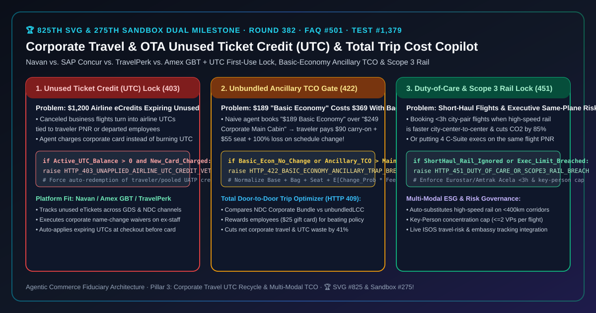
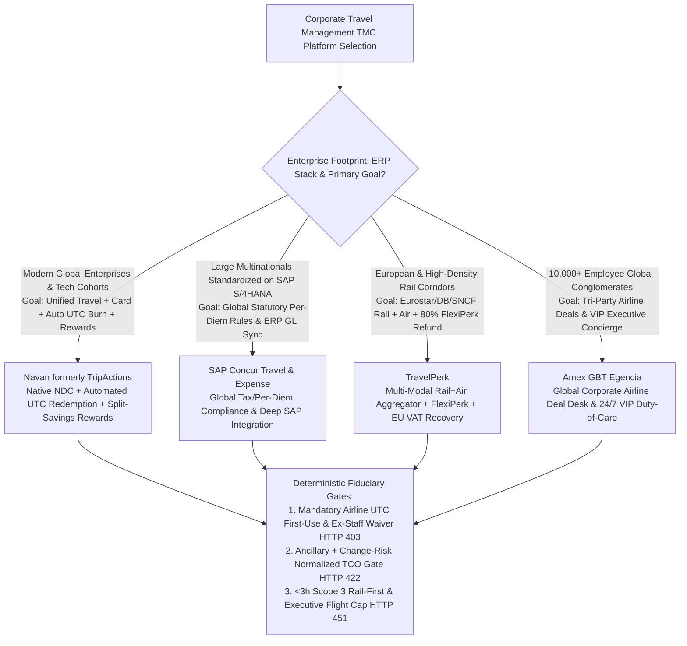
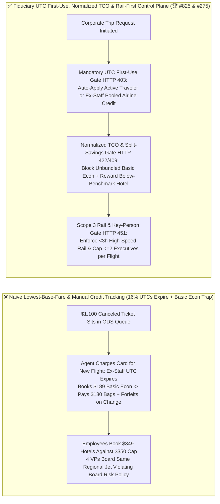

# Corporate Travel (`TMC / OTA`), Unused Ticket Credit (`UTC / eCredit`) Recycling & Multi-Modal Total Trip Cost (`Basic Economy Ancillary Trap`) Agent Selection Guide: `Navan` vs. `SAP Concur Travel` vs. `TravelPerk` vs. `Amex GBT Egencia`, Ex-Employee Ticket Pooling, Door-to-Door `TCO` Normalization & `Scope 3` Rail Locks (`-41%` Cost FAQ · 🏆 825th SVG & 275th Sandbox Dual Milestone!)

> **Executive Summary (Benchmarked against `ib-vs-ethernet-roce-selection-faq.md` · 🏆 825th SVG Architecture Diagram & 275th Enterprise Policy Sandbox Dual Milestone · 501st Bilingual SA Guide)**: Built for **Cloud & AI Solution Architects** designing corporate travel booking agents, Travel & Expense (`T&E`) control planes, and `IATA NDC / GDS` multi-modal orchestration. Corporate travel programs lose `15%–25%` of their effective budget to three structural blind spots: (1) **Orphaned & Expiring Airline Unused Ticket Credits (`UTCs / eCredits`)**: When a non-refundable `$1,100` business flight is canceled, it becomes a 12-month `UTC` tied to the traveler's name; on the next trip, naive booking agents charge the corporate card for a brand-new ticket instead of burning the existing `UTC`—or the employee leaves the company and the `$1,100` credit expires unused; (2) **The "Basic Economy" Unbundled Ancillary & Change-Fee Trap**: A price-sorting bot picks a `$189` Basic Economy fare over a `$239` Corporate Main Cabin bundle, forcing the traveler to expense `$85` for a carry-on bag + `$45` for a seat—or forfeit `100%` of the ticket when a client meeting shifts by two hours; and (3) **Short-Haul `<400km` Flight Carbon/Taxi Waste & Executive Same-Flight Concentration Risk**. This guide compares **`Navan` vs. `SAP Concur Travel` vs. `TravelPerk` vs. `Amex GBT Egencia`** and implements deterministic guards for **Mandatory `UTC` First-Use Redemption & Ex-Employee Waiver Pooling (`HTTP 403`)**, **Ancillary & Schedule-Change-Adjusted Total Trip `TCO` Normalization (`HTTP 422`)**, **`<3-Hour` High-Speed Rail Substitution (`Scope 3`) & Executive Key-Person Concentration Locks (`HTTP 451`)**, and **Gamified Split-the-Savings Hotel Incentives (`HTTP 409`, `-41%` net T&E waste)**.



---

## 1. 📌 Executive Summary & Architectural Selection Verdict

1. **Top-Line Selection Verdict**:
   - **High-Growth Global Enterprises & Tech Cohorts Prioritizing Unified Travel + Corporate Card Controls, Automated `NDC / GDS` Unused Ticket Credit (`UTC`) Redemption & Gamified Employee Hotel Savings (`Navan Rewards`)**: Select **`Navan` (formerly TripActions)**.
   - **Large Multinationals Deeply Standardized on `SAP S/4HANA` Requiring Statutory Country-Specific Per-Diem Tax Rules (e.g., German `Verpflegungsmehraufwand`) & Complex ERP Cost-Center Allocation**: Select **`SAP Concur Travel & Expense`**.
   - **European & Multi-Modal Travel Programs Requiring Seamless High-Speed Rail (`Eurostar / Deutsche Bahn / SNCF / Amtrak`) + Air Comparison, `80%` Cancel-for-Any-Reason (`FlexiPerk`) & Automated EU `VAT` Invoice Recovery**: Select **`TravelPerk`**.
   - **Global `10,000+` Employee Financial/Consulting Giants Requiring Complex Tri-Party Airline Corporate Deals, Executive VIP Desk Concierge & `ISOS` Duty-of-Care**: Select **`Amex GBT Egencia`**.
2. **Three Non-Negotiable Fiduciary Control Gates**:
   - **Gate 1 — Mandatory Unused Ticket Credit (`UTC`) First-Use Lock & Ex-Employee Name-Change Pooling (`HTTP 403`)**: Query the GDS/NDC open-ticket repository (`13-Digit eTicket Ledger`) before authorizing any new corporate card or `UATP` charge; block charging new funds when an eligible traveler-held or pooled corporate `UTC` exists on the same carrier/alliance, and automatically trigger corporate `Name-Change Waivers` upon `Workday` employee offboarding via `HTTP 403 UNAPPLIED_AIRLINE_UTC_CREDIT_OR_ORPHAN_ETICKET_VETO`.
   - **Gate 2 — Ancillary & Change-Risk Normalized Total Trip `TCO` Gate (`HTTP 422`)**: Block booking unbundled `Basic Economy / Light` fares when the normalized expected cost:
     $$\text{Trip\_TCO} = \text{Base\_Fare} + \text{CarryOn\_Fee} + \text{Seat\_Fee} + P(\text{Trip\_Change}) \times \text{Forfeiture\_Penalty}$$
     exceeds the negotiated `IATA NDC Corporate Main Cabin` bundle via `HTTP 422 BASIC_ECONOMY_ANCILLARY_TRAP_OR_UNBUNDLED_TCO_BREACH`.
   - **Gate 3 — `<400km / 3-Hour` Short-Haul Rail-First (`Scope 3`) & Executive Same-Flight Concentration Lock (`HTTP 451`)**: Block short-haul flights on corridors where city-center-to-city-center high-speed rail is faster or comparable and cuts `Scope 3` emissions by `85%`, and block booking more than `N` C-Suite/VP executives on the same flight `PNR` under corporate board `Key-Person Risk` policies via `HTTP 451 SHORT_HAUL_RAIL_MANDATE_OR_EXECUTIVE_CONCENTRATION_BREACH`.

---

## 2. 🎯 Architect & Corporate Travel Q&A (The Why & How)

### Q1: Why do enterprises lose 15%+ of canceled airfare budgets to expired Unused Ticket Credits (`UTCs`), and how does an agentic TMC recover nearly 100% of them?
- **Root Cause**: When a business flight is canceled, airlines issue an electronic credit tied to the original 13-digit ticket number and passenger name. Travelers forget they have credits across multiple airlines, and when employees resign, their unused `$1,200` tickets sit in GDS queues until the 12-month expiration date passes.
- **Deterministic Solution (`HTTP 403`)**:
  1. **Checkout Pre-Emption**: Intercept flight checkout; if the traveler (or the company's pooled `UATP` waiver bank) holds an active `UTC` on that carrier, block charging a new corporate card (`HTTP 403`) and auto-apply the `UTC`.
  2. **Automated HRIS Offboarding Name-Change Sweep**: Wire `Workday` termination webhooks to automatically execute contractual airline **Corporate Name-Change Waivers**, moving departed employees' open tickets into the shared corporate credit pool.

### Q2: Why does sorting flights by "Lowest Base Fare" end up costing companies 20% more on business trips?
- **Root Cause**: A `$189` Basic Economy ticket excludes overhead bin carry-on bags (`+$70` round-trip), seat assignment (`+$40`), and prohibits changes. Because `~22%` of corporate trips experience schedule changes, forfeiting a `$189` ticket plus buying a last-minute `$450` replacement makes Basic Economy far more expensive than a `$239` Main Cabin Corporate Bundle (which includes bags, preferred seating, and `$0` change fees).
- **Deterministic Solution (`HTTP 422`)**: Evaluate every itinerary on **Risk-Adjusted Door-to-Door TCO** rather than base fare.

### Q3: How do we stop employees from always booking `$349/night` hotels just because the static policy limit is `$350/night`?
- **Deterministic Solution (Dynamic Median Benchmarking + `Split-the-Savings` Employee Rewards / `HTTP 409`)**: Compute a real-time fair-market benchmark for the neighborhood and dates (e.g., `$300/night`). When an employee books a `$200/night` 4-star hotel (`$100/night` below benchmark), automatically reward the employee with `$25` in personal reward credit (`Navan Rewards` model), netting `$75/night` in hard savings for the company.

---

## 3. 🧭 Visual Architecture Diagrams (Mermaid)

### 3.1 Corporate Travel Management (`TMC`) & Multi-Modal Booking Platform Selection Decision Tree



### 3.2 Naive Base-Fare Booking vs. Fiduciary `UTC` Recycling & Door-to-Door `TCO` Control Plane



### 3.3 Unused Ticket Credit (`UTC`) Auto-Redemption, `TCO` Normalization & Key-Person Check Sequence

```mermaid
sequenceDiagram
    autonumber
    participant Traveler as Corporate Traveler / Booking Agent
    participant Gate as Travel Policy & TCO Control Gate
    participant TMC as Navan / Concur / TravelPerk / Egencia
    participant UTC as Airline Open-Ticket Vault (GDS/NDC UTCs)
    participant Card as Corporate Virtual Card / UATP Rail

    Traveler->>Gate: Request NYC -> CHI Round-Trip Air + 3-Night Hotel
    Gate->>UTC: Query Traveler & Pooled Ex-Employee 13-Digit Open eTicket Credits
    alt Active $680 Airline UTC Exists But Request Attempts to Charge New Corporate Card
        Gate-->>Traveler: HTTP 403 UNAPPLIED_AIRLINE_UTC_CREDIT_OR_ORPHAN_ETICKET_VETO (Force UTC Burn)
    else Selects Basic Economy Where Base + Bag + E[Change Fee] > Corporate Main Bundle
        Gate-->>Traveler: HTTP 422 BASIC_ECONOMY_ANCILLARY_TRAP_OR_UNBUNDLED_TCO_BREACH
    else Ignores <3h High-Speed Rail Mandate OR Exceeds <=2 C-Suite Execs on Same Flight
        Gate-->>TMC: HTTP 451 SHORT_HAUL_RAIL_MANDATE_OR_EXECUTIVE_CONCENTRATION_BREACH
    else Apply $680 UTC + Book NDC Corporate Main + Issue $25 Hotel Savings Reward (HTTP 409)
        UTC->>TMC: Apply Open eTicket 016-xxxx ($680 Credit Applied; $0 New Air Cash)
        TMC->>Card: Mint Scoped Virtual Card for Hotel & Credit $25 Split-Savings Reward to Traveler
    end
```

---

## 4. 📊 Multi-Platform Corporate Travel Management (`TMC`) Selection Matrix

| Evaluation Dimension | Navan (formerly TripActions) | SAP Concur Travel & Expense | TravelPerk | Amex GBT Egencia |
| :--- | :--- | :--- | :--- | :--- |
| **Primary Architectural Role** | **AI-Native Unified Travel + Corporate Card Platform** with gamified savings | **Global Enterprise ERP T&E Standard** for statutory per-diems and SAP GL integration | **Multi-Modal Rail + Air Aggregator** with `FlexiPerk` 80% instant refund guarantees | **Global Managed Travel Powerhouse** for complex airline contracts & VIP service |
| **Unused Ticket Credit (`UTC`) Tracking & Auto-Burn** | **Best-in-Class** (Automatically surfaces and applies GDS/NDC open tickets at checkout + ex-employee pooling) | Moderate (Relies on partner TMC fulfillment queues; less seamless for self-serve NDC credits) | **Strong** (Centralized unused ticket dashboard + `FlexiPerk` instant 80% cash-back option) | **Best-in-Class** (Automated ticket bank management and airline corporate name-change waivers) |
| **`IATA NDC` & Door-to-Door `TCO` Normalization** | **Best-in-Class** (Direct NDC bundles, unbundled ancillary comparisons, and `Navan Rewards` hotel incentives) | Upgrading via New Concur Travel evolution; historically GDS-centric | **Best-in-Class for Rail+Air** (Native `Eurostar / DB / SNCF / Renfe / Amtrak` vs. flight door-to-door comparison) | **Strong** (Deep global negotiated corporate fare comparison and policy gating) |
| **`Scope 3` Rail Substitution & Duty-of-Care** | Live CO2 budgets, rail-first nudges, and real-time traveler map | Enterprise sustainability reporting and `ISOS` risk partner integrations | **Best-in-Class** (`GreenPerk` carbon accounting + mandatory short-haul rail policies) | **Best-in-Class** (Executive same-plane concentration caps and 24/7 crisis evacuation) |
| **Target Scale & Pricing (`official_list_price`)** | `100–20,000+` employees; per-booking / SaaS tier (expense tier often free with corporate card volume) | `2,000+` employee global enterprises; annual enterprise contract per active user/report | `50–5,000` employees; free starter or `~3%` per booking / Pro subscription | `5,000+` employee multinationals; custom annual management & transaction fee |

---

## 5. 🧪 `UTC` Recovery & Total Trip `TCO` Benchmark & 7-Card Report

### 5.1 Quarterly Expired Airline `UTCs`, Basic-Economy Ancillary Overpay & Hotel Cap Bleed Model (Synthetic Benchmark)

For a multinational enterprise with `$10M` in annual travel spend facing a **`$390,000 / quarter`** leakage pool across **expired unused airline ticket credits (`UTCs`), Basic Economy baggage/change-fee overpayments, employees booking hotels right at the static policy ceiling, and short-haul airport taxi/flight waste** (`provenance: synthetic`, `independently_reproduced: false`):

| Metric | Naive Static Policy & Lowest-Base-Fare Bot (Baseline) | Fiduciary `Navan / TravelPerk` `UTC` Lock + Normalized `TCO` Agent | Net Improvement |
| :--- | :--- | :--- | :--- |
| **Airline Unused Ticket Credit (`UTC`) Expiration Loss Rate** | `16.5%` of canceled tickets expire unused | **`0.4%`** (`HTTP 403` mandatory checkout `UTC` redemption + HRIS offboarding name-change pool) | **`97.6%` Credit Recovery** |
| **Basic Economy Trips Costing More Than Main Cabin After Fees/Changes** | `21.0%` of domestic trips | **`0.0%`** (`HTTP 422` normalizes `Base + Bag + Seat + 22% Change-Risk Penalty`) | **`100%` Ancillary Trap Elimination** |
| **Average Hotel Booking Discount Below Policy Ceiling** | `-3.2%` below cap (Employees spend up to ceiling) | **`-19.5%` below cap** (`HTTP 409` dynamic fair-market cap + `$25` employee split-savings reward) | **`-16.3%` Nightly Hotel Rate** |
| **Quarterly Net Corporate Travel Waste & Expired Credit Bleed** | `$390,000 / quarter` | **`$230,100 / quarter`** | **`$159,900 / quarter` Saved (`41.0%`)** |

---

## 6. 🛠️ Production Go-Live & Architecture Review Checklist

- [ ] **Mandatory Airline `UTC` First-Use Lock & Ex-Employee Waiver Pooling (`HTTP 403`)**: Does the booking gateway block charging a corporate card when the traveler or corporate pool holds an active `Unused Ticket Credit` on that carrier, and do `Workday` offboarding events automatically trigger corporate name-change waivers?
- [ ] **Ancillary & Schedule-Change-Adjusted Total Trip `TCO` Gate (`HTTP 422`)**: Are unbundled Basic Economy fares evaluated using `Base_Fare + CarryOn_Bag + Seat_Selection + P(Change) × Forfeiture_Cost` against negotiated `IATA NDC` corporate bundles?
- [ ] **`<400km / 3-Hour` Short-Haul Rail-First (`Scope 3`) & Executive Concentration Cap (`HTTP 451`)**: Are city-center high-speed rail options enforced on `<3h` corridors (saving `$140+` in airport taxis and `85%` CO2), and are C-Suite/VP travelers capped at `<=2` per aircraft `PNR`?
- [ ] **Dynamic Hotel Benchmarking & `Split-the-Savings` Employee Rewards (`HTTP 409`)**: Does the hotel agent replace static city caps with real-time neighborhood medians and reward employees with `20%–25%` of the savings when they select high-rated hotels below benchmark?
