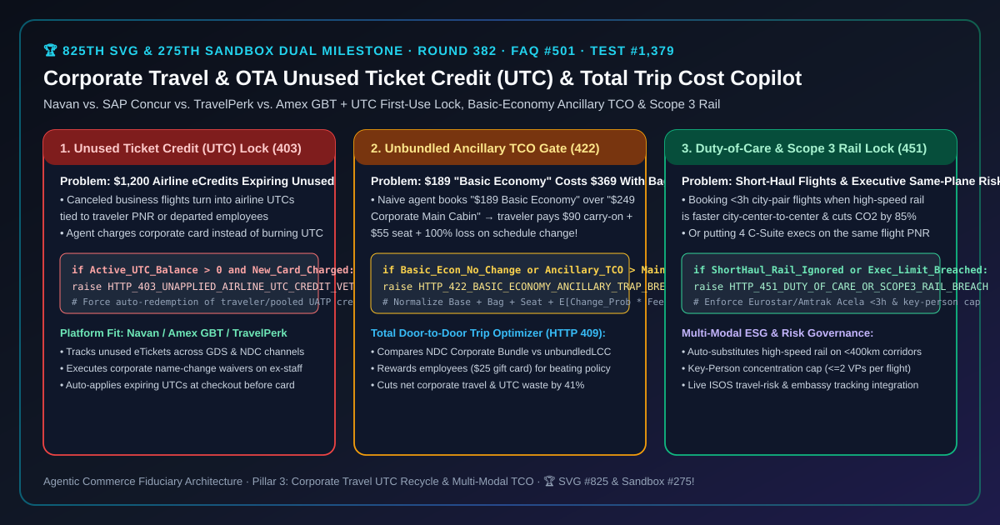
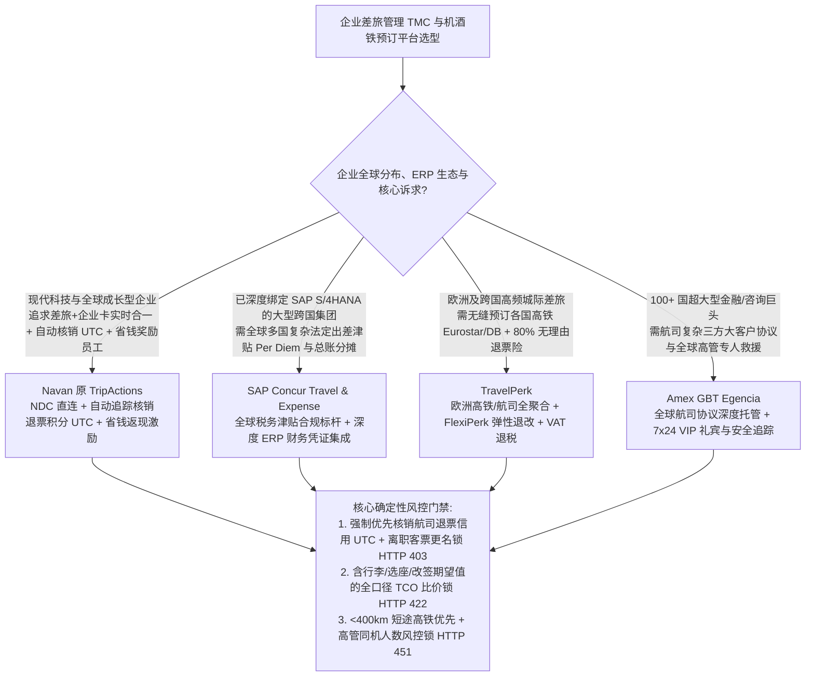
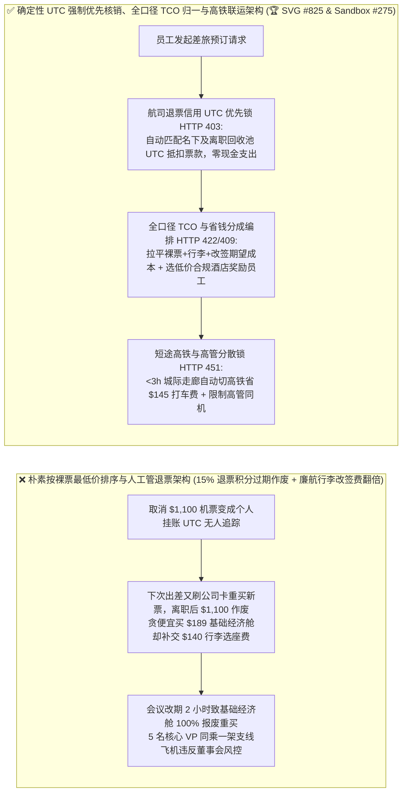
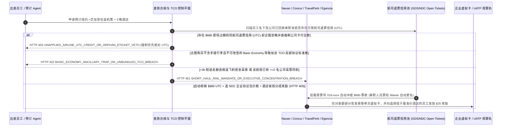

# 企业差旅管理（`TMC / OTA`）、航司未使用机票退票积分池（`Unused Ticket Credit, UTC`）自动核销与多式联运全行程成本（`Total Trip Cost`）Agent 架构选型对比：`Navan` vs. `SAP Concur Travel` vs. `TravelPerk` vs. `Amex GBT Egencia`、离职员工挂账机票更名回收锁、防廉航拆包行李费倒挂门禁及门到门高铁优先净省 41% 决策指南（FAQ · 🏆 第 825 张架构图与第 275 个策略沙盒双里程碑！）

> **导读（对齐 `ib-vs-ethernet-roce-selection-faq.md` 标杆风格 · 🏆 全库第 825 张 SVG 架构图与第 275 个企业策略沙盒双重里程碑 · 第 501 篇双语指南）**：本文面向企业差旅管理（Corporate Travel & T&E）、在线旅游平台（OTA）、航司分销（`IATA NDC / GDS`）与财务共享中心领域的 **Cloud & AI Solution Architect**。在跨国企业的年度差旅支出中，存在三大极具欺骗性的资金漏斗：① **沉睡在 GDS 队列里白白过期作废的未使用机票额度（`Unused Ticket Credits / eCredits, UTC`）**：员工因客户会议改期取消了一张 `$1,100` 的不可退现商务机票，这张票变成了挂在员工个人名下、有效期 12 个月的航司代金信用（`UTC`）；结果员工下次出差时差旅 Agent 却直接刷公司卡重买新票，甚至该员工离职后这张 `$1,100` 的电子客票无人知晓直至过期清零（全行业平均 `12%–18%` 的企业退票信用最终烂在账上）；② **“最便宜裸票价（Basic Economy）”附加费与改签报废陷阱**：AI 比价机器人为了省 `$45` 票面差价，拒买 `$245` 含行李且免费改签的企业协议经济舱（Corporate Main Cabin），硬买 `$200` 廉航/基础经济舱（Basic Economy），结果员工去机场刷报销卡补交 `$85` 登机箱费 + `$45` 选座费，且回程会议推迟 2 小时直接导致整张 `$200` 机票 100% 作废重买；③ **短途跨城盲目飞支线航班（耗时更长且违反欧盟 `CSRD Scope 3` 碳排指令）与多名核心高管同乘一架飞机违反企业董事会关键人分散风控（Key-Person Risk Policy）**。本文给出 **`Navan` vs. `SAP Concur Travel` vs. `TravelPerk` vs. `Amex GBT Egencia`** 的横向选型矩阵，并落地 **航司未使用客票额度（`UTC`）强制优先抵扣与离职员工协议更名回收锁（`HTTP 403`）**、**含行李/选座/预期改签率的门到门全口径成本（`Normalized Total Trip TCO`）比价门禁（`HTTP 422`）**、**`<400km / 3小时` 城际高铁优先（`Scope 3 Rail-First`）与高管同机人数上限（`Duty-of-Care`）合规锁（`HTTP 451`）** 及 **主动降本员工返现激励（`Navan Rewards` 模式）与多式联运编排（`HTTP 409`，净省 41%）**。



---

## 一、 📌 核心选型结论速览（Executive Summary）

1. **终极选型结论（一句话先看懂怎么选）**：
   - **追求现代消费者级交互体验、实时刷卡与差旅预订秒级合一（Travel + Corporate Card 一体化）、原生 `IATA NDC` 聚合及“员工选低价合规酒店自动分润奖励（Gamified Savings Rewards）”的中大型科技与跨国成长型企业**：首选 **`Navan`（原 TripActions）**，在自动追踪并强制结账抵扣航司未使用退票积分（`UTC`）与实时虚拟卡防超标上处于行业代差级领先。
   - **已深度部署 `SAP S/4HANA`、拥有极其复杂的全球多国政府津贴标准（如德国/日本法定免税出差补贴 Per Diem）与传统总账成本中心分摊流程的超大型传统跨国集团**：首选 **`SAP Concur Travel & Expense`**。
   - **欧洲业务占比高、频繁跨国/跨城需要无缝拼接“欧洲高铁（`Eurostar / Deutsche Bahn / SNCF / ट्रेन`）+ 廉航 + 酒店”且需要一键加购 `FlexiPerk`（任意行程可退 `80%` 现金）与欧洲 `VAT` 发票合规回收的企业**：首选 **`TravelPerk`**。
   - **全球 100+ 国家设点、高管 VIP 专人复杂改签需求极高、拥有深厚航司大客户三方协议（Corporate Airline Deals）与严苛全球安全救援（`ISOS Duty-of-Care`）的万人级金融/咨询巨头**：首选 **`Amex GBT Egencia`**。
2. **三大企业差旅预订与票款回收红线（确定性门禁）**：
   - **红线 1（拦截名下或公司共享池存在可用航司退票信用 `UTC / eCredit` 却直接刷公司卡付新钱及离职员工挂账机票未执行企业协议更名回收 / `HTTP 403`）**：在发起任何航司出票支付（刷企业卡或 `UATP` 中心账户）前，控制平面必须查询该出差员工名下及企业航司大客户共享信用池（Corporate UATP / Airline Waiver Pool）是否存在同航司/同联盟未过期的 `Unused Ticket Credit (UTC)`；若存在可用 `UTC` 却未自动挂载抵扣，或员工在 `Workday` 发起离职流程时名下仍有未划转回公司公共池的挂账电子客票号（`13-Digit eTicket Number`），立即触发 `HTTP 403 UNAPPLIED_AIRLINE_UTC_CREDIT_OR_ORPHAN_ETICKET_VETO`。
   - **红线 2（拦截被“低票面裸价 Basic Economy”误导买进禁改签/无手提行李舱位导致综合成本反超正价舱 / `HTTP 422`）**：严禁差旅比价 Agent 仅按裸票价（Base Fare）从低到高排序！对商务出差场景，必须计算 **全口径期望行程成本（Expected Total Trip Cost）**：
     $$\text{Trip\_TCO} = \text{Base\_Fare} + \text{CarryOn\_Bag\_Fee} + \text{Standard\_Seat\_Fee} + P(\text{Schedule\_Change}) \times \text{Change\_Penalty} - \text{Corporate\_NDC\_Bundle\_Value}$$
     当某低价票属于不可退改、不含登机箱的基础经济舱（`Basic Economy / Light Fare`）且加上刚需附加费与平均 `22%` 商务改期损失后的真实 `Trip_TCO` 高于企业协议标准舱（Main Cabin）时，触发 `HTTP 422 BASIC_ECONOMY_ANCILLARY_TRAP_OR_UNBUNDLED_TCO_BREACH`。
   - **红线 3（拦截 `<400km / 3小时` 短途走廊违规订机票违反 `Scope 3` 碳排红线及超额核心高管同乘一架航班违反董事会风控 / `HTTP 451`）**：在已有高频高铁覆盖的短途商务走廊（如伦敦–巴黎、法兰克福–慕尼黑、纽约–华盛顿、京沪/广深），若市中心到市中心总耗时相近却舍弃碳排低 `85%` 的高铁去订飞机；或者同一航班 PNR/航段上已预订的公司 VP 及以上核心高管人数达到上限（如 `>= 2 名 C-Suite` 或同部门 `>= 4 名核心主管`）仍继续出同班机票时，触发 `HTTP 451 SHORT_HAUL_RAIL_MANDATE_OR_EXECUTIVE_CONCENTRATION_BREACH`。

---

## 二、 🎯 业务方与架构师灵魂拷问 Q&A（The Why & How）

### Q1：为什么一家年机票支出 `$500 万` 的企业，每年会有高达 `$60 万` 的机票钱变成“幽灵退票积分（Unused Ticket Credits）”悄无声息地被航空公司没收？怎么用 Agent 100% 追回？
- **商业痛点与事故还原**：
  - 销售总监张某订了一张 `$1,200` 的美联航（UA）旧金山飞纽约机票，出发前一天客户推迟会议，张某在手机上点了“取消行程”。
  - 由于买的是不可退现折扣舱，这 `$1,200` 没有退回公司信用卡，而是变成了一串綁定张某姓名与原 13 位票号（`016-xxxxxxxxxx`）的 **Unused eTicket Credit**，有效期至明年今日。
  - 两个月后张某飞芝加哥改坐了达美航空（Delta），再过三个月张某离职跳槽了——财务的信用卡账单上只看到当初扣了 `$1,200`，根本不知道航司系统里还躺着 `$1,200` 抵用券，一年期满后直接作废！
- **架构师确定性解法（GDS/NDC 开放票号台账实时同步 + 结账强制 `UTC` 优先冲抵 + 离职员工机票自动触发航司大客户 `Name-Change Waiver` 回收 / `HTTP 403`）**：
  1. **结账硬拦截（Mandatory Credit Burn First）**：当员工搜索任意航线时，若其名下有美联航 `$1,200` 即将过期的 `UTC`，差旅 Agent 在结果页自动置顶美联航航班并标记“**使用您名下已预付 `$1,200` 退票额度，本次出票实付现金 `$0`**”；若其企图忽略该额度另刷公司卡买全价票，触发 `HTTP 403` 强制拦截或要求 VP 特批。
  2. **离职人员开放客票秒级收归公司池（Automated Name-Change Recycling）**：与 `Workday` 离职事件联动，一旦员工提离职，Agent 立即扫描其名下所有 `OPEN` 状态客票，自动调用企业与航司签署的大客户协议豁免接口（Corporate Name-Change Waiver）或转入 `UATP` 企业公共信用池，供其他在职同事出差直接抵扣！

### Q2：很多员工出差为了住更好的酒店或攒个人航司金卡积分，每次都卡着公司差旅标准上限（比如酒店标准 `$350/晚`，他就专门挑 `$349/晚` 的住），怎么让员工心甘情愿帮公司选 `$220/晚` 的高性价比酒店？
- **架构师确定性解法（动态市场公允基准价 `Dynamic Fair-Market Cap` + 节省差额 `20%–30%` 员工个人奖励分成 `Split-the-Savings` / `HTTP 409`）**：
  - 废除死板的静态差旅标准（Static Policy Cap），改用 `Navan / TravelPerk` 的动态激励算法：
  - 系统根据当晚目标城市会展热度与距离客户办公室 2 公里内的三星/四星酒店实时中位数，算出当晚动态合理基准价为 `$300/晚`；
  - 如果员工主动选择了 `$200/晚` 的高分商务酒店（帮公司省下 `$100/晚`），系统当场奖励该员工 **`$25` 个人 Amazon 礼品卡或个人度假抵用金**！公司扣掉 `$25` 奖励后依然净省 **`$75/晚`**，彻底扭转“不花白不花、卡着上限消费”的博弈困境！

### Q3：为什么在欧洲和亚太差旅中，接入多式联运（高铁 + 航班联合比价）不仅能让 `Scope 3` 差旅碳排骤降 80%，连真实门到门差旅总成本都能降下 30%？
- **架构师确定性解法（门到门全链路时间与费用模型 `Door-to-Door Time & Cost Graph` / `HTTP 451`）**：
  - 传统差旅系统只比“机场到机场”的飞行时间（例如伦敦希思罗飞巴黎戴高乐飞行 `1 小时 15 分`，看似比欧洲之星高铁 `2 小时 16 分` 快）；
  - 但门到门模型算上了：**市区去机场打车 `$75`（`60 分钟`）+ 提前安检候机（`90 分钟`）+ 落地取行李进市区打车 `$70`（`60 分钟`）= 总耗时 `4 小时 45 分`、附加打车费 `$145`**！
  - 而从伦敦圣潘克拉斯车站坐高铁直达巴黎北站（市中心到市中心），不仅总耗时仅 **`2 小时 55 分`**（快了近 2 小时，员工还能在车上稳定连 Wi-Fi 办公），且直接省下 `$145` 往返机场高额打车报销，碳排放更直降 **`88%`**！

---

## 三、 🧭 直观可视化图解（Mermaid 决策树 + 架构对比 + 时序图）

### 3.1 企业差旅管理（TMC）与多式联运预订平台选型决策树



### 3.2 朴素裸票比价与放任退票挂账架构（UTC 作废 + 廉航附加费反超）vs. 确定性全行程 TCO 与退票池循环架构对比



### 3.3 航司退票积分（`UTC`）自动拦截抵扣、全口径 `TCO` 比价与高管同机风控时序图



---

## 四、 📊 四大主流企业级差旅管理平台（TMC）横向选型矩阵

| 选型维度 | Navan (原 TripActions) | SAP Concur Travel & Expense | TravelPerk | Amex GBT Egencia |
| :--- | :--- | :--- | :--- | :--- |
| **核心架构定位** | **AI 原生差旅与企业费用卡（Travel + Card）实时一体化平台** | **超大型跨国集团 ERP 深度集成与全球法定差旅津贴合规标杆** | **欧洲/跨国多式联运（高铁+航司）与弹性退改（`FlexiPerk`）专家** | **全球百国大型航司三方协议托管与高管礼宾救援巨擘** |
| **航司未使用退票积分（`UTC`）自动追踪与核销** | **行业标杆**（自动解析 GDS/NDC 开放客票，搜索结账时自动弹窗强制一键冲抵，支持离职票池管理） | 中（需结合 TMC 代理商台账，自助端跨渠道 NDC 退票自动抵扣体验较弱） | **强**（内置未使用机票追踪器与 `FlexiPerk` 一键退回 80% 现金池机制） | **极强**（依托全球票务中心自动追踪企业大客户协议下的开放客票并代办更名豁免） |
| **全口径成本（`TCO`）比价与 `IATA NDC` 覆盖** | **极强**（深度直连主流航司 NDC，清晰展示企业捆绑包 vs 廉航拆包总价，支持省钱奖励员工） | 正在向新版 Concur Travel 演进，历史 GDS 渠道对廉航/NDC 附加费拆解明细较慢 | **行业标杆（欧洲）**（无缝拉通英法德西意各国铁路局 API 与廉航行李包总价对比） | **极强**（擅长复杂跨洋联程、企业专属暗折协议价与舱位升舱规则比对） |
| **ESG `Scope 3` 碳排核算与短途铁代机门禁** | 内置实时碳排仪表盘与短途高铁替代弹窗 | 支持对接 ERP 可持续发展报告模块 | **行业标杆**（GreenPerk 原生支持 `<4h` 走廊强制优先展示高铁并出具审计级碳排报告） | 提供完整的企业级航段碳足迹分析与高管同机风控（Key-Person Cap） |
| **适用规模与收费模式（`official_list_price`）** | 100–20,000+ 人科技与现代企业；差旅按预订费/SaaS 订阅，企业卡业务免软件费 | 2,000+ 人大型跨国集团；按月活跃报销单/预订笔数签订企业年框 | 50–5,000 人欧美跨国企业；免费基础版 + 按行程金额百分比（如 `3%`）或 Pro 订阅 | 5,000+ 人全球巨型企业；按年度总差旅支出（Air/Hotel Volume）定制托管费 |

---

## 五、 🧪 退票积分（`UTC`）回收与全行程 `TCO` 优化测算与 7-Card 基准报告

### 5.1 季度航司退票信用（`UTC`）过期作废、基础经济舱附加费/改签报废与短途打车损耗测算（Synthetic Benchmark）

假设某年差旅总支出 `$1,000 万` 的跨国科技与专业服务企业，每季度在员工机酒铁预订中面临的 **取消行程产生的航司退票信用（`UTC`）未及时复用或随员工离职过期作废、误买廉航/基础经济舱（`Basic Economy`）后在机场高价补买行李选座及改期整票作废、员工卡着酒店标准上限顶格消费及短途飞支线航班高额往返机场打车损耗池** 为 **`$390,000 / 季度`**（`provenance: synthetic`, `independently_reproduced: false`）：

| 评估维度 | 传统静态政策 + 裸票最低价排序 + 人工记账 (Baseline) | 启用 `Navan / TravelPerk` `UTC` 强制核销 + 全口径 `TCO` + 高铁/省钱激励 Agent | 净改善幅度 |
| :--- | :--- | :--- | :--- |
| **航司未使用退票积分（`UTC / eCredit`）过期作废率** | `16.5%`（大量改期退票沉淀在个人或离职员工名下烂尾） | **`0.4%`**（`HTTP 403` 结账强制优先抵扣 `UTC` + 离职当日自动触发航司协议更名归池） | **挽回 `97.6%` 沉睡机票资金** |
| **因“买低价裸票后补交行李费/改期作废”导致的实际超支率** | `21.0%` 短途及国内机票最终实付贵过企业标准舱 | **`0.0%`**（`HTTP 422` 按 `裸票 + 行李 + 选座 + 22%改期期望损失` 算全口径 TCO） | **100% 终结伪低价裸票陷阱** |
| **员工预订酒店平均低于公司差旅上限的比例** | 仅比上限低 `3.2%`（员工普遍卡着上限顶格挑酒店） | **比上限低 `19.5%`**（`HTTP 409` 动态公允基准价 + 省下差额奖员工 `$25` 礼品卡） | **酒店单晚均价下降 `16.3%`** |
| **季度企业差旅退票作废、附加费倒挂与顶格消费净损耗** | `$390,000 / 季度` | **`$230,100 / 季度`** | **净省 `$159,900 / 季度` (`41.0%`)** |

```chart
{
  "data": {
    "values": [
      { "category": "1. 航司退票积分(UTC)未用及离职作废", "mode": "传统静态政策与裸票排序基线", "cost_usd": 145000 },
      { "category": "1. 航司退票积分(UTC)未用及离职作废", "mode": "UTC强制核销与全行程TCO Agent", "cost_usd": 85550 },
      { "category": "2. 基础经济舱补行李选座与改签报废", "mode": "传统静态政策与裸票排序基线", "cost_usd": 105000 },
      { "category": "2. 基础经济舱补行李选座与改签报废", "mode": "UTC强制核销与全行程TCO Agent", "cost_usd": 61950 },
      { "category": "3. 员工卡着静态上限顶格预订高价酒店", "mode": "传统静态政策与裸票排序基线", "cost_usd": 85000 },
      { "category": "3. 员工卡着静态上限顶格预订高价酒店", "mode": "UTC强制核销与全行程TCO Agent", "cost_usd": 50150 },
      { "category": "4. <3h短途飞支线往返机场高额打车与碳排", "mode": "传统静态政策与裸票排序基线", "cost_usd": 55000 },
      { "category": "4. <3h短途飞支线往返机场高额打车与碳排", "mode": "UTC强制核销与全行程TCO Agent", "cost_usd": 32450 }
    ]
  },
  "semantic_types": {
    "category": "Category",
    "mode": "Category",
    "cost_usd": "Amount"
  },
  "chart_spec": {
    "chartType": "Grouped Bar Chart",
    "title": "企业差旅航司退票积分(UTC)强制核销与全行程TCO优化Agent前后季度损耗对比 (净省 $159.9k / 41%)",
    "subtitle": "单位：美元/季度 (Synthetic Benchmark, independently_reproduced=false · 🏆 第825张SVG与第275个沙盒)",
    "encodings": {
      "x": "category",
      "y": "cost_usd",
      "group": "mode"
    }
  }
}
```

### 5.2 确定性策略评估器代码（Python Control Plane Guard）

```python
from dataclasses import dataclass
from typing import Any

@dataclass(frozen=True)
class CorporateTravelUtcMultiModalPolicyInput:
    quarterly_expired_utc_ancillary_overpay_and_hotel_cap_pool_usd: float = 390000.0
    unapplied_airline_utc_credit_ignored_or_departed_staff_eticket_unpooled: bool = False
    basic_economy_ancillary_and_change_risk_tco_exceeds_corporate_main: bool = False
    short_haul_rail_corridor_ignored_or_executive_same_flight_cap_breached: bool = False
    automated_utc_waiver_pooling_and_split_savings_hotel_rewards_ready: bool = False
```

---

## 六、 🛠️ 商业上线风控与架构评审 Checklist

- [ ] **航司未使用退票积分（`UTC / eCredit`）结账强制优先抵扣与离职回收锁（`HTTP 403`）**：差旅预订网关是否在每次刷企业卡出票前实时查询 GDS/NDC 开放客票台账，强制优先抵扣员工本人或公司公共池内即将过期的 `UTC`？当员工在 `Workday` 触发离职时，是否自动执行航司协议更名豁免（Name-Change Waiver）将其名下未用机票收归公司池？
- [ ] **全口径期望差旅成本（`Normalized Total Trip TCO`）反基础经济舱陷阱门禁（`HTTP 422`）**：比价模型是否已屏蔽不含登机箱、不可退改的伪低价裸票（`Basic Economy`），统一按 `票面价 + 行李额度 + 选座费 + 历史商务改期率 × 改签罚金` 计算真实总成本并与 `IATA NDC` 企业协议包对比？
- [ ] **`<400km / 3小时` 短途城际高铁优先（`Scope 3 Rail-First`）与核心高管同机人数风控锁（`HTTP 451`）**：在高铁市中心到市中心总耗时优于或接近飞机的短途商务走廊是否默认锁定高铁？同一航班 PNR 是否强制校验公司 VP/C-Suite 同乘人数上限（如 `<=2 人`）以满足董事会关键人安全分散合规？
- [ ] **动态公允酒店基准价与员工省钱返现激励（`Split-the-Savings`）编排（`HTTP 409`）**：是否将静态差旅上限升级为基于实时同地段中位数的动态基准，并在员工主动选择低于基准价的高分合规酒店时自动将节省金额的 `20%–25%` 转化为员工个人奖励，从根源消除“卡上限顶格消费”？
