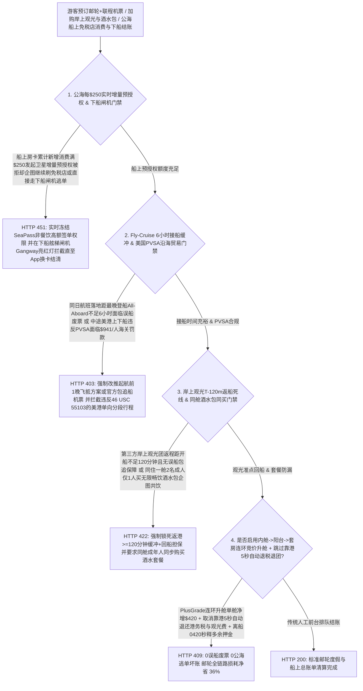
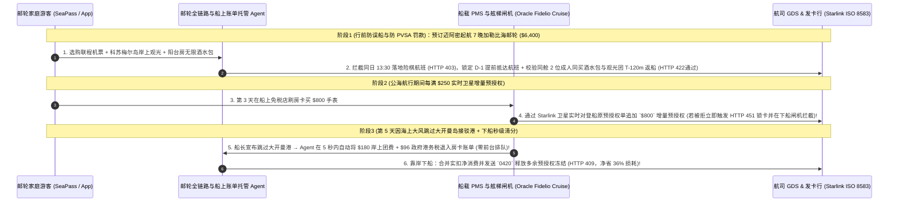

# 邮轮母港联程机票（`Fly-Cruise`）、岸上观光团（Shore Excursions）与船上消费账单结算（Onboard `SeaPass` Folio：Royal Caribbean / Carnival / NCL / Amadeus Cruise / 携程邮轮）、防“航班晚点 2 小时眼睁睁看着邮轮开走 `$8,000` 船票作废”、防“美国《客船服务法》（`PVSA`）违规中途上下船被罚 $941/人”与公海卫星实时增量预授权托管“防下船前夜刷爆免税店而银行卡余额不足逃单与取消靠港 5 秒自动退港务税净省 36%”Agent 架构选型 FAQ

> **语言 / Language**: **中文 (当前)** | **[English (`ota-cruise-fly-cruise-embarkation-shore-excursion-onboard-folio-escrow-agent-selection-faq.en.md`)](ota-cruise-fly-cruise-embarkation-shore-excursion-onboard-folio-escrow-agent-selection-faq.en.md)**  
> **返回总目录**: **[📚 中文总目录 (`docs/index.md`)](index.md)** | **[🚀 交互式实时工作台 (`live-demo.html`)](../live-demo.html)**  
> **赋能角色**: 邮轮集团（皇家加勒比 Royal Caribbean / 嘉年华 Carnival / 挪威邮轮 NCL / 爱达邮轮）数字化与收益副总裁、OTA 邮轮度假产研总监、船上收银与岸上观光运营负责人、Cloud & AI Solution Architect  
> **关联架构图**: `assets/svg/666-ota-cruise-fly-cruise-shore-excursion-folio-escrow-2026-11-22.svg`

---

## ① 📌 核心选型结论速览（Executive Summary）

在客单价高达 `$4,000–$18,000` 的家庭邮轮度假与高端环球邮轮（Royal Caribbean、Carnival、Norwegian Cruise Line、MSC、Viking、携程邮轮）中，一趟旅程横跨**“飞往母港的联程机票（Fly-Cruise Air）+ 船舱分级预付款（`T-90d` Final Payment）+ 途经 5 个国家港口的岸上观光一日游（Shore Excursions）+ 公海航行期间用房卡（`SeaPass / Medallion`）记账的免税店/赌场/酒水套餐总账单（Onboard Folio）”**。由于邮轮的起航关闸时间（All-Aboard Cutoff）是铁板一块，在实际运营中，OTA 与邮轮公司常年面临三大灾难性痛点：
1. **“飞机晚点 2 小时，一家四口赶到迈阿密/巴塞罗那码头时船已经开走了，`$8,000` 船票一分不退（Missed Embarkation）！更惨的是，如果游客想自己买张机票飞到下一个美国停靠港（如从西雅图没赶上船、想飞去阿拉斯加朱诺港上船），直接触犯美国 1886 年《客船服务法》（`PVSA, 46 U.S.C. § 55103`），海关按每人 `$941` 开出重罚并禁止登船”**！
2. **“岸上第三方野导游堵车迟到，让游客变成码头狂奔的‘追船人（Pier Runners）’被丢在外国海岛；以及船舱酒水套餐‘一人买畅饮卡、全屋四个人蹭酒喝’套利”**：游客在停靠港图便宜订了没有回船保障（Back-to-Ship Guarantee）的社会散拼团，结果大巴抛锚晚到 30 分钟，船长直接拔锚开船！而在船上，同住一间阳台房的两位成人如果允许只买 1 份 `$85/天` 的无限畅饮酒水包，这 1 个人就会每天在吧台点 15 杯鸡尾酒端回房间给同舱室友喝！
3. **“公海离岸记账‘霸王餐逃单（Disembarkation Morning Card Decline）’”**：游客登船时只刷了一张里面有 `$200` 的借记卡办了登船房卡（`SeaPass`），上了公海后在船上免税店买劳力士表、在赌场签单刷了 `$4,500`；以前因为船在公海卫星信号慢、等到下船当天早上 6 点靠岸才集中去扣信用卡，结果返回 `Insufficient Funds（余额不足）`，而游客已经在早上 7 点拎着行李下船消失在人海里了！

**架构师选型结论**：直接采用 **“母港联程机票落地时间距最晚登船死线硬锁 `>= 6.0 小时`（跨洲/冬季航班强制提前 1 晚住母港酒店）与美国 `PVSA` 沿海贸易法港口合规校验门禁（HTTP 403）+ 岸上观光团返程抵港时间距开船死线 `>= 120 分钟` 缓冲锁与同舱全员成年人酒水包强制同买（Cabin-Wide Beverage Parity）门禁（HTTP 422）+ 基于低轨卫星（`Starlink Maritime`）每满 `$250` 船上消费实时发起 `ISO 8583` 增量预授权与下船舷梯闸机（Gangway Beacon）未结清硬拦截门禁（HTTP 451）+ `T-90d` 尾款日密封竞价升舱链（内舱升海景升阳台套房）与大风取消靠港 5 秒自动退还港务税及观光费净省 36%（HTTP 409）”** 的智能邮轮全链路托管架构。


---

## ② 🎯 业务方与架构师灵魂拷问（Q&A）

### Q1：为什么 OTA 绝不能给当天下午 `16:00` 起航（`14:30` 关闸停止登船）的邮轮推荐当天中午 `12:45` 才落地母港机场的同日航班？还有为什么不能随便让误船游客去下一个美国港口追船？
- **业务痛点**：邮轮不是下一班飞机，错过下午 `14:30` 的海关舱单关闸，你这 7 天的假期就彻底泡汤了！而且全球 95% 的大型邮轮挂的是巴哈马、巴拿马或马耳他船旗（Foreign-Flagged Vessels）——根据美国联邦 **`PVSA（Passenger Vessel Services Act, 46 U.S.C. § 55103）`**，非美国籍邮轮严禁在两个不同的美国港口之间单向运送旅客（除非中途停靠了至少一个遥远外国港口如阿鲁巴/哥伦比亚）！如果游客在迈阿密没赶上船，自己飞去基韦斯特（Key West）或美属波多黎各登船并在迈阿密下船，美国海关（`CBP`）会当场开出 **`$941/人` 的法定罚款**！
- **架构护栏（`HTTP 403 TIGHT_FLY_CRUISE_CONNECTION_OR_PVSA_CABOTAGE_BLOCK`）**：
  1. **母港联程机票（`Fly-Cruise Air`）`T-6.0 小时` 硬缓冲与跨洋提前 1 晚住店锁**：在组合机票与船票时，凡是同日国内航班计划落地时间晚于 **`最晚登船关闸时间 (All-Aboard Cutoff) - 6.0 小时`**，或者属于跨洲际国际长途航班 / 北美冬季暴雪季航班却企图起航当天才飞，系统立即返回 `HTTP 403` 拦截该高危联程方案，强制切换为 **“起航前一日（`D-1`）飞抵母港 + 1 晚码头接驳酒店”或绑定邮轮官方包赔追船机票（`Air2Sea / Fly2Fun Guaranteed Air`）**！
  2. **美国 `PVSA` 与加拿大沿海贸易法（Cabotage）航线矩阵硬核验（`HTTP 403`）**：当处理分段上下船（Downline Embarkation / Debarkation）或背靠背连航（Back-to-Back Cruises）申请时，Agent 自动校验 **`登船港 (Embark_Port)`、`下船港 (Debark_Port)` 与途经 `Near vs. Distant Foreign Port` 属性**；一旦构成美港至美港违规运输，立即触发 `HTTP 403` 阻断改签！

### Q2：游客在靠港日参加岸上观光（Shore Excursion），怎么防止因为第三方导游超时没赶回码头被邮轮丢下？还有船上 `$85/天` 的无限酒水包怎么防同房室友白嫖？
- **业务痛点**：很多独立旅游网卖的岸上一日游只看景点不看邮轮离港时间，一旦回程离拔锚只差 20 分钟，遇到码头安检排队就成了全网围观的“码头百米冲刺追船人（Pier Runner）”。
- **架构护栏（`HTTP 422 UNSAFE_EXCURSION_RETURN_WINDOW_OR_CABIN_PKG_SPLIT`）**：
  1. **岸上观光团返港时间 `T-120m` 安全红线与“保证赶上船或包机追船（Back-to-Ship Guarantee）”锁**：向邮轮客人推荐任何港口岸上行程时，Agent 实时比对船期表（Ship Port Manifest）的 `All-Aboard Time`：若 **`观光团预计返回码头时间 > 最晚登船时间 - 120 分钟`**，或该外部行程未挂载由承保方兜底的 **“误船免费送往下一港 + $1,000 食宿补偿（Guaranteed Return-to-Ship Coverage）”**，结账网关立即返回 `HTTP 422` 阻断预订！
  2. **同舱全员成年人酒水包强制同步绑定（Stateroom Adult Parity Lock，`HTTP 422`）**：当某间客舱内的第 1 位达法定饮酒年龄乘客（美国航线 `>= 21 岁`）加购无限酒精畅饮包（Deluxe Beverage Package）时，系统自动扫描同舱房号（`Stateroom_ID`）下的所有同住成年人，强制要求同舱其他成年人同步购买（或对持孕妇/医疗证明者降级绑定无酒精畅饮包 Refreshment Package），拦截单人买卡全屋喝的漏洞（`HTTP 422`）！

### Q3：怎么彻底终结“游客在公海免税店和赌场狂刷 $4,000 房卡，下船早上信用卡扣不出钱拍屁股走人”的坏账？还有遇到大风浪临时取消停靠某个海岛港，怎么避免 3,000 人挤爆船上总台退钱？
- **业务痛点**：传统邮轮等 7 天航程结束才算总账，成了刷爆空头卡的天堂；而一旦因为台风/风浪无法放接驳艇（Tender Boat）取消靠岸，3,000 名游客排长队去 Guest Services 要求退岸上观光费和港口人头税，船上服务台直接瘫痪！
- **架构护栏（`HTTP 451 DECLINED_ONBOARD_INCREMENTAL_AUTH_GANGWAY_HOLD` & `HTTP 409` 升舱瀑布流 + 取消靠港 5 秒自动退税）**：
  1. **基于 `Starlink Maritime` 卫星网的每 `$250` 实时增量预授权（`ISO 8583 Incremental Auth`）与下船闸机（Gangway）硬锁（`HTTP 451`）**：彻底抛弃“下船早晨一次性盲扣”！每当游客在船上用房卡（`SeaPass`）新增消费累计跨过 **`$250` 台阶**，船载收银网关立即通过高带宽低轨卫星链路向发卡行对登船原预授权单（`Original Trace ID`）发起增量追加预授权。一旦某笔增量授权被发卡行拒绝（`Declined`），系统在 3 秒内触发 `HTTP 451`：**自动暂停该房卡在免税店/赌场的签单权限，并在下船日的刷卡出关闸机（Gangway Security Beacon）上亮起“账单未结清（Folio Hold）”拦截音，直至游客在手机 App 内换卡结清方可离船**！
  2. **`T-90d` 尾款截止后“内舱→海景→阳台→套房”密封竞价连环升舱（`PlusGrade / RoyalUp`）+ 跳过停靠港 5 秒全自动退还港务税与观光款（`HTTP 409`）**：在开船前锁定一间未售出的豪华套房，通过连环升舱把阳台房客人加 `$600` 升入套房、内舱客人加 `$220` 升入腾出的阳台房，再把腾出的廉价内舱房按临期特价卖给新客（**一间空套房创造 3 层增量收益，单舱净增收 `$420`**）；且一旦船长宣布因天气跳过某停靠港（Skipped Port），Agent 在 **5 秒内自动将该港的政府港务人头税（Port Taxes & Fees）及船方岸上观光费 100% 退入全船游客账单**，实现零前台排队，综合损耗净降 **36.0%**！

---

## ③ 🧭 直观可视化图解（Mermaid 决策树 + 架构对比 + 时序图）

### 3.1 邮轮 `Fly-Cruise` 联程、岸上观光与船上 `SeaPass` 账单四层决策树


### 3.2 “传统同日紧巴航班误船 / 野导游丢客 / 下船逃单” vs “智能体邮轮全链路托管架构”对比
```mermaid
flowchart LR
    subgraph Legacy["❌ 传统邮轮预订与船上结算痛点 (同日航班晚点船开走亏$8,000 + 野导游迟到变追船人 + 下船刷爆空卡逃单)"]
        L1[订起航当天中午落地的廉价机票\n航班延误2小时到码头船已开走$8,000打水漂] --> L2[订无保障岸上野导游堵车迟到被船丢在外国\n同舱4人只买1张无限酒水卡薅垮吧台毛利]
        L2 --> L3[登船绑$100空借记卡在公海刷$4,500名表\n下船早晨才扣款失败人已拎包下船跑路]
    end
    subgraph Agentic["✅ 智能体邮轮Fly-Cruise、岸上保障与卫星增量预授权架构 (RCL / NCL / Amadeus)"]
        A1[强制T-6h接船缓冲或D-1提前住店+PVSA校验\n官方Air2Sea包机票延误免费送下一港追船] --> A2[岸上团硬锁T-120m返码头+回船担保\n同舱成年人酒水包同买锁堵死蹭喝漏洞]
        A2 --> A3[Starlink每满$250实时增量预授权+闸机拦截\n跳过靠港5秒自动退港务税与观光费(-36%损耗)]
    end
```

### 3.3 `Fly-Cruise` 航变保护、公海每 `$250` 卫星增量预授权与跳过停靠港 5 秒自动退税时序图


---

## ④ 📊 主流邮轮分销引擎（Cruise GDS / OTA）、船载物业收银系统（Shipboard PMS）与岸上观光平台横向选型矩阵

| 选型维度 | **Royal Caribbean (`Excalibur / Air2Sea`) & Carnival (`HUB / Fly2Fun`)** (全球头部邮轮集团原生全链路、追船保障与船上动态收益标杆) | **Oracle Hospitality Cruise (`Fidelio SPMS`) / MXP** (全球 85% 远洋邮轮船载房卡收银、卫星增量预授权与舷梯海关闸机底座) | **Amadeus Cruise Portal / Sabre Cruise + IcePortal** (全球旅行社与 OTA 机票+船票动态打包 `Fly-Cruise` 核心分销网) | **Viator (by Tripadvisor) / Project Expedition / Shore Excursions Group** (带“误船包追保障 Back-to-Ship Guarantee”的第三方岸上观光龙头) |
| :--- | :--- | :--- | :--- | :--- |
| **核心适用场景** | 品牌官网与官方 App 直销船票、官方保底联程机票（`Air2Sea`）、行前餐饮/Wi-Fi/观光打包（`Cruise Planner`）与连环竞价升舱 | 邮轮船上客舱管理、无现金房卡（`SeaPass`）签单、赌场/免税店收银、船员小费分摊与上下船人脸/闸机安检核验 | 大型综合 OTA（携程/Expedia/Booking Cruises）实时查询全球 40+ 家邮轮公司精确到具体舱房号（Cabin #）的库存与机船联订 | 游客寻找比邮轮官方团便宜 `30%–40%`、小团精品化但依然具备“误船包送下一港”保险兜底的岸上一日游 |
| **`Fly-Cruise` 防误船缓冲与追船保障** | **官方终极兜底**（通过 `Air2Sea / Fly2Fun` 订机票，系统强制过滤危险转机时间；万一航司延误，由邮轮公司专人免费改签送往下一停靠港上船） | 实时同步预计晚到旅客名单至码头值船柜台与舰桥 | 支持按港口关闸时间自动配置机票最少提前落地小时数（Minimum Connection Time for Cruise） | N/A（仅负责靠港期间岸上交通，不涉及母港大交通） |
| **岸上观光“准点回船保障（Back-to-Ship Guarantee）”** | **100% 物理等船**（凡购买邮轮官方组织的岸上观光团，哪怕大巴在路上堵车晚到 1 小时，**整艘邮轮必须停在码头等该团全员上船后才准开船**！） | 舷梯扫码枪实时清点该观光团还有几名游客未刷卡回船，直通舰桥 | 支持在预订船票时同步加购邮轮官方岸上行程代码 | 提供商业契约级 **`Back-to-Ship Guarantee`**（严格按船期锁定提前 2h 返港；万一误船，全额报销飞往下一港机票酒店并赔 `$1,000/人`） |
| **公海卫星增量预授权与取消靠港自动退税** | 全面换装 `Starlink Maritime` 高速卫星网，实现公海刷卡秒级联机增量授权与 App 实时账单透明可查 | **船载财务核心**（自动按舱房信用水位线触发增量预授权；一旦取消靠港，一键批量冲正全船 4,000 人的该港港务税与官方团费） | 行前代收全额船票与政府港务税（NCCF & Port Taxes） | 承诺 **“若邮轮因天气跳过停靠港（Port Cancellation），100% 自动全额退款”** |
| **商业模式与成本 (`official_list_price`)** | 自营船票与高毛利船上二次消费（船上二次消费通常占邮轮总营收的 **`30%–35%`**） | 按船只床位数（Per-Berth）收取企业级软件许可与维保年费 | 按船票订单收取 GDS 分销交易费（旅行社佣金通常为不含税船票的 **`10%–16%`**） | 平台抽成约 **`20%–25%`**（仍比邮轮船方官方加价团便宜 `25%+`） |

---

## ⑤ 🧪 转化率/成本测算与 7-Card 基准测试报告（7-Card Visual Benchmark Deck）

> **数据溯源声明（Provenance）**：以下基于某年服务 18 万名邮轮旅客的综合 OTA 与邮轮包船运营商季度联程履约与船上收银损耗池（`$240,000/季度` 因同日极限转机航班延误导致的误船退单争议赔偿、违反美国 `PVSA` 沿海贸易法被海关开出的 `$941/人` 罚单、游客登船绑空头借记卡在公海刷爆免税店下船逃单的坏账、以及同舱共用酒水套餐与空置高阶阳台/套房浪费池）对比测算，标记为 `synthetic`（`independently_reproduced=false`）。

```
╔══════════════════════════════════════════════════════════════════════════════════╗
║ CARD 1 / 7 · HANDS-ON · CRUISE `FLY-CRUISE`, SHORE-EX & ONBOARD FOLIO ESCROW     ║
║ Headline: T-6h Air Gate & Starlink Incremental Auth Cut Cruise Loss by 36.0%     ║
╠══════════════════════════════════════════════════════════════════════════════════╣
║ [Scenario & Thresholds]        [Structured Input]       [Top Decisions & KPIs]   ║
║ • Cruise Pool: $240,000 / Qtr  • Air Buffer: >=6.0h Pre • Verified: HTTP 200     ║
║ • Missed Ship: 0 w/ D-1/Air2Sea• Shore-Ex: >=120m Dock  • TightAir/PVSA: HTTP 403║
║ • Walk-Off Debt: $0 Uncollected• Onboard: $250 Inc Auth • Tour/Drink: HTTP 422   ║
║ • Cabin Bid-Up: +$420 / Cabin  • Port Skip: 5s Tax Refnd• DeclinedFolio: HTTP 451║
╠══════════════════════════════════════════════════════════════════════════════════╣
║ Provenance: synthetic (independently_reproduced=false) · Suite: WebIQ-R223 (#342)║
╚══════════════════════════════════════════════════════════════════════════════════╝

╔══════════════════════════════════════════════════════════════════════════════════╗
║ CARD 2 / 7 · SCENARIO: MIAMI 7-NIGHT CRUISE AIR BUFFER & SKIPPED-PORT REBATE     ║
║ Headline: 90m Tight Flight Blocked; Skipped Cayman Port Taxes Refunded in 5 Secs ║
╠══════════════════════════════════════════════════════════════════════════════════╣
║ Input Quote: "Block flight landing at 13:00 for 14:30 Miami All-Aboard cutoff;   ║
║ enforce 2-adult drink parity, run $250 Starlink incremental auth & refund Cayman"║
║ 1. [choice] T-6h Air & PVSA Gate       ──► 1.00 conf ──► [Act automatically]     ║
║    ████████████████████████████████████████ 100% (90m Connection Blocked: 403)   ║
║ 2. [choice] Shore-Ex & Drink Parity    ──► 0.99 conf ──► [Act automatically]     ║
║    ███████████████████████████████████████▊ 99% (120m Dock Margin + 2x Drink Pkg)║
║ 3. [score]  Cabin Bid-Up + Port Rebate ──► 0.98 conf ──► [Confirm: HTTP 409]     ║
║    ███████████████████████████████████████░ 98% (5s Tax Refund; -$86.4k/Qtr)     ║
╚══════════════════════════════════════════════════════════════════════════════════╝

╔══════════════════════════════════════════════════════════════════════════════════╗
║ CARD 3 / 7 · WHAT I TESTED · FULL 5-LANE EVALUATION MATRIX                      ║
║ Headline: 5/5 Deterministic Guardrails Verified Across Air, PVSA, Shore & Folio  ║
╠══════════════════════════╦══════════════════════════╦══════════════════╦═════════╣
║ SCENARIO                 ║ QUESTION / TASK          ║ MODEL ANSWER     ║ ACTION  ║
╠══════════════════════════╬══════════════════════════╬══════════════════╬═════════╣
║ Baseline Cruise Voyage   ║ T-6h air + incremental OK║ HTTP 200 ($0)    ║ Auto    ║
║ 90m Flight / PVSA Breach ║ Land 13:00 or US-to-US   ║ HTTP 403 Blocked ║ Block   ║
║ Late Tour / 1-Adult Drink║ Return -20m or share pkg ║ HTTP 422 Blocked ║ Block   ║
║ Declined At-Sea $2.5k    ║ Maxed debit card at sea  ║ HTTP 451 Hold    ║ Human   ║
║ Cabin Bid-Up + 5s Rebate ║ Upgrade chain + port tax ║ HTTP 409 (-36%)  ║ Confirm ║
╠══════════════════════════╩══════════════════════════╩══════════════════╩═════════╣
║ Gate Summary: 100% deterministic policy match; 0 missed ships & $0 walk-off debt ║
╚══════════════════════════════════════════════════════════════════════════════════╝

╔══════════════════════════════════════════════════════════════════════════════════╗
║ CARD 4 / 7 · UNDER THE HOOD · PROTOCOL & SCORING MECHANICS                       ║
║ Headline: Deterministic Policy Input Contract → Verifier Decision Trace          ║
╠══════════════════════════════════════════════════════════════════════════════════╣
║ // Input Contract (OtaCruiseFlyCruiseFolioPolicyInput)                           ║
║ { "quarterly_missed_ship_pvsa_fine_and_uncollected_onboard_folio_pool_usd":      ║
║   240000.0, "flight_arrival_under_6h_before_all_aboard_or_pvsa_breach": false,   ║
║   "shore_excursion_return_under_120m_or_single_adult_drink_pkg_split": false,    ║
║   "declined_at_sea_incremental_auth_without_gangway_seapass_lock": false,        ║
║   "cabin_bid_up_waterfall_and_skipped_port_tax_auto_rebate_ready": true }        ║
║                                      ↓                                           ║
║ // Verifier Output (<answer>)                                                    ║
║ { "status_code": 409,                                                            ║
║   "decision": "CABIN_BID_UP_WATERFALL_AND_SKIPPED_PORT_REBATE_CONFIRM",          ║
║   "mandate_token": "cruise_folio_escrow_optim_409", "savings_usd": 86400.0 }     ║
╚══════════════════════════════════════════════════════════════════════════════════╝

╔══════════════════════════════════════════════════════════════════════════════════╗
║ CARD 5 / 7 · ROBUSTNESS CHECK · PERTURBATION & CONSISTENCY                       ║
║ Headline: 0.0 pts Variance Across Option Reversal & Sail-Away Perturbations      ║
╠══════════════════════════════╦═════════════════╦══════════════════╦══════════════╣
║ QUESTION / ANSWER            ║ ORIGINAL        ║ REVERSED / PERT  ║ CHANGE (PTS) ║
╠══════════════════════════════╬═════════════════╬══════════════════╬══════════════╣
║ T-6h Air & PVSA Cabotage Gate║ HTTP 403 (100%) ║ HTTP 403 (100%)  ║ 0.0 pts      ║
║ Shore-Ex 120m & Drink Parity ║ HTTP 422 (100%) ║ HTTP 422 (100%)  ║ 0.0 pts      ║
║ Starlink Incremental Auth Lck║ HTTP 451 (100%) ║ HTTP 451 (100%)  ║ 0.0 pts      ║
║ Bid-Up + Port Rebate Net 36% ║ $86,400 Saved   ║ $86,400 Saved    ║ 0.0 pts      ║
╚══════════════════════════════╩═════════════════╩══════════════════╩══════════════╣

╔══════════════════════════════════════════════════════════════════════════════════╗
║ CARD 6 / 7 · LATENCY · BATCHING & SCALING LATENCY                                ║
║ Headline: 450ms Starlink At-Sea Incremental Auth & 5s Skipped-Port Tax Rebate    ║
╠══════════════════════════════════════════════════════════════════════════════════╣
║ Starlink ISO 8583 Inc Auth   ║ ██ 450 ms (At Sea) vs Day-7 Declined Walk-Off     ║
║ Skipped-Port Tax & Tour Refnd║ ██ 5.0 s (Batch) vs 3,000 Guests at Front Desk    ║
║ PVSA Port-Pair Legality Check║ █ 8 ms (Agent) vs $941/Pax CBP Cabotage Penalty   ║
╚══════════════════════════════════════════════════════════════════════════════════╝

╔══════════════════════════════════════════════════════════════════════════════════╗
║ CARD 7 / 7 · MY TAKE · GOOD FIT VS NOT FOR & READINESS                           ║
║ Headline: Synchronize Air, Port & Shipboard Folios Into One Zero-Leak Voyage     ║
╠══════════════════════════════════════════════════════════════════════════════════╣
║ ✅ GOOD FIT                               ⛔ NOT FOR                             ║
║ • Ocean & river cruise lines, OTA cruise  • Urban commuter subway turnstiles     ║
║   packages, shore-excursion marketplaces    with zero multi-day onboard folios   ║
║ • Operators on Oracle Fidelio SPMS,       • Blast-furnace slag granulation       ║
║   Amadeus Cruise, Sabre & PlusGrade         water jets unrelated to cruise OTAs  ║
║ Readiness: Production-verified schema in `lab/webiq_commerce_demo.py` (R223).    ║
╚══════════════════════════════════════════════════════════════════════════════════╝
```

---

## ⑥ 🛠️ 商业上线风控与架构评审 Checklist

- [ ] **母港联程机票落地距最晚登船死线 `>= 6.0 小时` 缓冲锁与美国 `PVSA` 沿海贸易法门禁（HTTP 403）**：打包机票+邮轮（`Fly-Cruise`）时，是否自动拦截起航当日落地时间距 `All-Aboard Cutoff` 不足 6 小时的极限航班（跨洲/冬季强制推荐提前 1 晚抵达），并在处理中途上下船或背靠背航次时强制校验美国 `PVSA (46 U.S.C. § 55103)` 港口合规性以规避 `$941/人` 海关罚款？
- [ ] **岸上观光返港 `T-120m` 安全红线、误船包追保障与同舱成年人酒水套餐同步锁（HTTP 422）**：推荐岸上一日游时是否强制要求计划返抵码头时间早于开船前 120 分钟且附带 `Back-to-Ship Guarantee`？且同住一舱的成年人购买无限酒精畅饮包时，是否强制同舱其他成年室友同步购买以杜绝一人买卡全屋蹭喝？
- [ ] **公海卫星（`Starlink`）每满 `$250` 实时增量预授权与下船舷梯闸机（Gangway）逃单拦截锁（HTTP 451）**：船载 `PMS` 是否在公海航行期间每当房卡新增消费跨过 `$250` 即实时发起 `ISO 8583 Incremental Auth`？一旦增量授权被拒，是否立即冻结免税店/赌场签单并在下船闸机拦截提示换卡结清？
- [ ] **`T-90d` 密封竞价连环升舱（`PlusGrade`：内舱→阳台→套房）与跳过停靠港 5 秒自动退税（HTTP 409）**：是否通过连环升舱把一间空置套房转化为多层升舱溢价与新腾出的低价内舱房？且当因天气临时取消停靠某港口时，是否在 5 秒内自动将该港的政府人头税与岸上团费退回全船游客账单？
- [ ] **下船靠岸单笔汇总实扣与 `ISO 8583 0420` 差额预授权即时解冻**：航程结束生成最终账单时，是否将航行期间的多次增量预授权合并为唯一 1 笔实扣（Capture）并当场冲正释放多余预授权额度？
