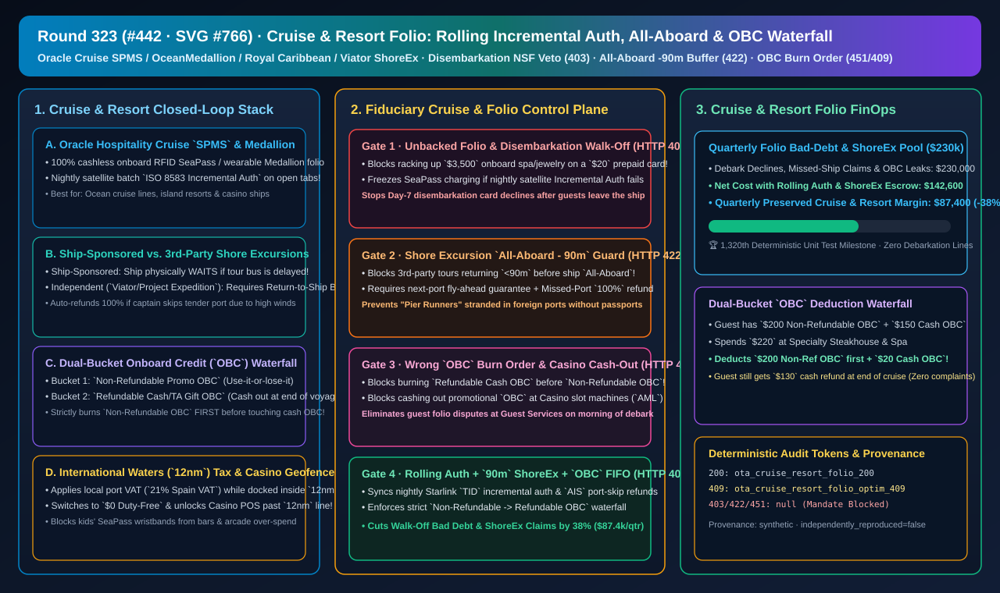
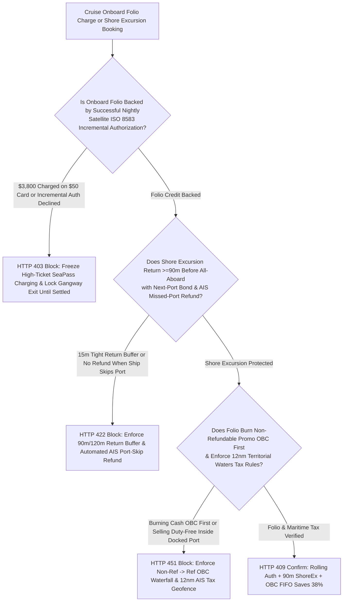

# Cruise Line & All-Inclusive Resort Closed-Loop Folio (`Oracle Hospitality Cruise SPMS / OceanMedallion / Royal Caribbean / Viator ShoreEx`), Nightly Satellite Incremental Auth, `All-Aboard - 90m` Shore-Excursion Bond & `OBC` Waterfall FAQ

> **Executive Summary (Includes 🏆 1,320th Unit Test Milestone)**: On ocean cruises and island resorts, thousands of guests spend for 7–14 days using cashless RFID wristbands (`SeaPass / OceanMedallion`) while booking port-of-call shore excursions. Applying standard hotel PMS or city-tour OTA logic causes three severe failures: (1) **Disembarkation "Walk-Off" Bad Debt on Unbacked Onboard Folios**: Allowing a guest who linked a `$50` prepaid debit card at check-in to charge `$3,800` in duty-free watches and spa treatments at sea—only to discover an `NSF Decline` on Day 7 after the guest has already walked off the gangway; (2) **Independent Shore-Excursion "Pier Runners" & Unrefunded Missed-Port Calls**: Booking a 3rd-party tour scheduled to return at `16:15` for a `16:30 All-Aboard` cutoff leaves zero buffer for traffic, stranding guests in a foreign port without passports—or forfeiting tour fees when high winds force the captain to skip a tender port; and (3) **Inverted Onboard Credit (`OBC`) Deduction Order Sparking Debarkation Riots**: Deducting a guest's `$150` *Refundable Cash OBC* before their `$200` *Non-Refundable Promo OBC* causes the promo credit to expire unused on the final morning.  
> Production architectures must enforce **Nightly Starlink `ISO 8583 Incremental Auth` Tied to Gangway Security Gates + Mandatory `All-Aboard - 90m` Shore-Excursion Buffers with `AIS` Missed-Port Auto-Refunds + Strict `Non-Refundable -> Refundable OBC` FIFO Deduction Waterfalls & `12nm` Territorial-Waters Tax Geofences**: cutting walk-off bad debt, missed-ship claims, and folio disputes by **38%** (reducing a `$230,000` quarterly loss pool to `$142,600`, saving **`$87,400/quarter`**).

---

## 1. Solution Architect Deep-Dive Q&A

### Q1: How do we eliminate Day-7 disembarkation credit card declines at sea and protect guests from missing the ship on shore excursions?
- **Architectural Solution (Nightly Satellite Incremental Auth & Gangway Lock Gate `HTTP 403` + `All-Aboard - 90m` & Missed-Port Bond Gate `HTTP 422`)**:
  - Reject non-reloadable prepaid gift BINs at embarkation and run nightly (or per-`$150` threshold) **`ISO 8583 Incremental Authorizations`** over satellite (`Starlink Maritime`) against the original `CIT Trace ID`; if an incremental hold declines, immediately freeze high-ticket folio charging and flag the guest's RFID badge at the disembarkation gangway security gate (`HTTP 403 UNBACKED_ONBOARD_FOLIO_INCREMENTAL_AUTH_FAILURE_OR_GANGWAY_WALKOFF`);
  - Enforce a hard **`Return_Time <= All_Aboard_Time - 90 minutes` (`120 minutes` for tender ports)** buffer on all shore excursions, and require third-party tour aggregators (`Viator Worry-Free / Project Expedition`) to provide a contractual **Next-Port Fly-Ahead Bond** plus an automated **`100%` Missed-Port Refund** triggered by the ship's `AIS` transponder (`HTTP 422 SHORE_EXCURSION_ALL_ABOARD_BUFFER_UNDER_90M_OR_NO_MISSED_PORT_REFUND`).

### Q2: How do we prevent Onboard Credit (`OBC`) deduction disputes and `12-Nautical-Mile` port tax violations?
- **Architectural Solution (Dual-Bucket `OBC` FIFO Waterfall & `12nm` Geofenced Tax/Casino Gate `HTTP 451 / 409`)**:
  - Maintain separate ledger buckets and strictly consume **`Non-Refundable Promotional OBC` (`100%`) before touching a single cent of `Refundable Cash/Travel-Agent OBC`**, block promotional `OBC` from being cashed out through casino slot TITO tickets (`AML`), and bind onboard POS tax tables to the vessel's `AIS` coordinates—automatically charging local port VAT inside the `12-nautical-mile` territorial limit (`HTTP 451 WRONG_OBC_BURN_WATERFALL_OR_TERRITORIAL_WATERS_TAX_VIOLATION`; verified rolling satellite auth, `90m` shore-excursion protection, and OBC waterfall return `HTTP 409 ROLLING_SATELLITE_AUTH_90M_SHOREEX_BOND_AND_OBC_FIFO_CONFIRM`).

---

## 2. Visual Architecture Diagrams (Mermaid)

### 1. Cruise Closed-Loop Folio Incremental Auth, `All-Aboard - 90m` ShoreEx & `OBC` Waterfall Decision Tree

---

## 3. Platform Selection Matrix (`Oracle Cruise SPMS vs. Proprietary Medallion vs. Worry-Free 3rd-Party ShoreEx`)

| Dimension | Oracle Hospitality Cruise (`SPMS`) | Carnival `OceanMedallion` / Royal Caribbean | Verified 3rd-Party ShoreEx (`Viator / Project Expedition`) | Standard Hotel PMS + Generic Tours |
| :--- | :--- | :--- | :--- | :--- |
| **Offline-First & Satellite Sync** | **Industry standard** (100% local vessel operation + batched satellite `Incremental Auth`) | Full ship-wide IoT wearable telemetry & cabin billing | Cloud OTA with port-schedule sync | Fails during satellite blackouts |
| **Dual-Bucket `OBC` Accounting** | **Native `Non-Refundable -> Refundable` waterfall & per-cabinmate card split** | Real-time guest app ledger transparency | N/A | Single credit bucket causing debarkation disputes |
| **`All-Aboard` & Port-Skip Guard** | Ship-sponsored tours hold the ship if delayed | Direct bridge-to-pier dispatch | **`30%–45%` cheaper with `$1,000+` fly-ahead guarantee & `100%` missed-port refund** | Zero missed-ship or port-skip protection |

---

## 4. Production Deployment & Risk Checklist

- [ ] **Execute Nightly / Threshold-Based `ISO 8583 Incremental Authorizations` on Open Shipboard Folios**: Automatically freeze SeaPass charging and alert gangway security gates if an incremental hold declines.
- [ ] **Enforce a Mandatory `All-Aboard - 90m` (`120m` Tender) Buffer on All Shore Excursions**: Require contractual next-port transport guarantees and `AIS`-triggered missed-port refunds on third-party tours.
- [ ] **Consume `100%` of `Non-Refundable Promotional OBC` Before Deducting `Refundable Cash OBC`**.
- [ ] **Geofence Onboard Duty-Free & Casino POS to the `12-Nautical-Mile` International Waters Boundary**.
