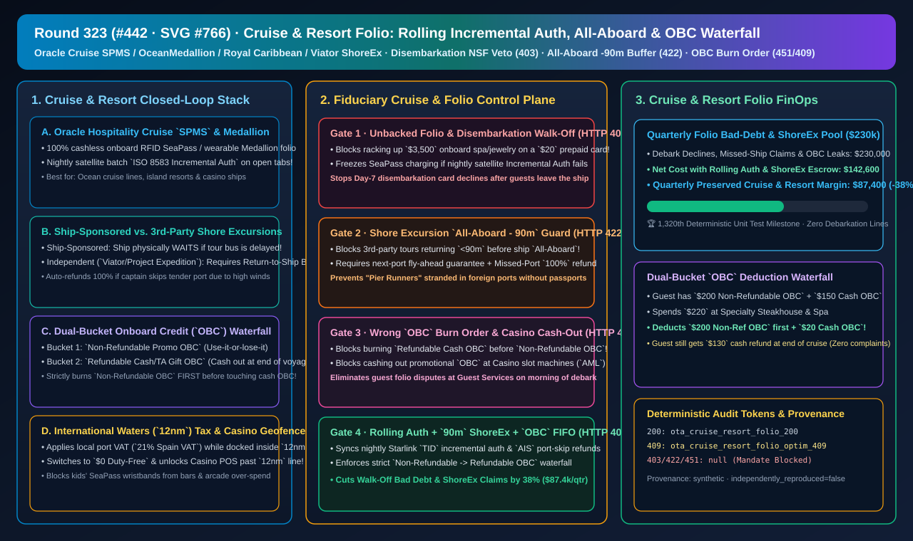
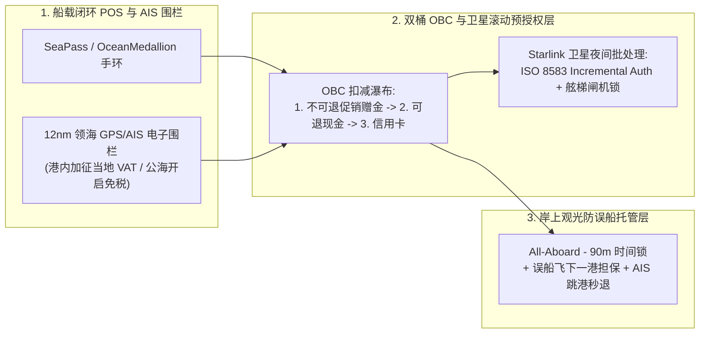
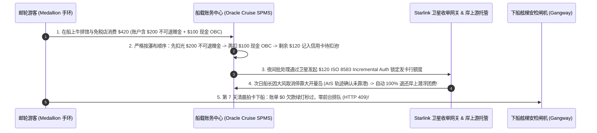

# 国际邮轮与全包式海岛度假村闭环挂账（`Cruise & Resort Closed-Loop Folio`: `Oracle Hospitality Cruise SPMS / OceanMedallion / Royal Caribbean / Viator ShoreEx`）、公海卫星滚动增量预授权、岸上观光 `All-Aboard - 90m` 防误船托管与船上消费金（`OBC`）扣减瀑布 Agent 架构选型 FAQ

> **核心选型结论速览（含第 1,320 项单元测试里程碑）**：在豪华邮轮与海岛度假村中，数千名游客登船后全部使用无现金房卡/手环（`SeaPass / OceanMedallion`）在免税店、牛排馆、SPA 与娱乐场挂账消费，同时预订停靠港口的岸上观光（`Shore Excursions`）。若照搬陆地普通酒店 PMS 或普通一日游 OTA 架构，会引发三大行业级灾难：① **“游客登船时绑了一张只有 `$50` 余额的虚拟借记卡，在公海航行的 7 天里刷房卡买了 `$3,800` 免税瑞士名表和 SPA，直到第 7 天清晨靠岸下船时系统才发起一次性全额扣款，结果刷卡失败（`NSF Decline`）——而游客早已拖着行李走出港口海关，形成 100% 无法追回的离船逃单坏账（Disembarkation Walk-Off）”**；② **“OTA 导游 Agent 为帮游客省 `$40` 推荐了第三方非官方岸上包车游，计划返港时间是 `16:15` 而邮轮最后登船时间（`All-Aboard Time`）是 `16:30`（仅留 15 分钟缓冲），结果途中堵车迟到 25 分钟，邮轮准点拔锚开走，游客没带护照被遗弃在异国码头（Pier Runners），不仅要自掏 `$2,500` 飞往下一站港口，还因为船长因风浪取消停靠某海岛（Missed Port）而与第三方地接社陷入不退费扯皮”**；③ **“游客账户里既有船方赠送的 `$200` 不可退船上消费金（`Non-Refundable Promotional OBC`），又有自己预充的 `$150` 可退现金消费金（`Refundable OBC`），账单系统却先扣光了可退的 `$150` 现金，等下船结算时宣布剩余的 `$180` 赠送金过期作废，导致最后一天早上船方前台被愤怒维权的游客排起百米长队”**。  
> 生产级架构必须实施 **“每晚卫星链路 `ISO 8583 Incremental Auth` 滚动增量预授权与超额实时冻卡门禁 + 岸上观光强制 `All-Aboard - 90 分钟` 返港硬红线与船长跳港（`AIS Missed-Port`）100% 秒退契约 + 严格‘先扣不可退赠送 OBC、后扣可退现金 OBC’（`FIFO Non-Refundable Waterfall`）及 `12 海里` 公海免税电子围栏”**：可将离船坏账、误船弃客理赔与消费金扣错争议削减 **38%**（以季度 `$230,000` 离船刷卡失败坏账、岸上跳港/误船赔付与前台调账损耗池计，净成本降至 `$142,600`，每季度净节省 **`$87,400`**）。



---

## 一、 业务方与架构师灵魂拷问（Q&A）

### Q1：邮轮在茫茫公海上航行 7 天，游客用房卡在免税店买 `$3,800` 的包，为什么绝对不能等到第 7 天下船时才去刷他的信用卡？
- **“公海离线赊销（Unbacked Onboard Folio）”的逃单温床**：
  - 早期邮轮受限于海事卫星带宽，登船只刷 `$100` 初始预授权，船上消费全记内网虚拟账单（Folio），下船日凌晨统一扣款——老练的诈骗团伙专门绑一张余额 `$100` 的锁额度卡登船，在船上疯狂扫货后于下船日清晨 6 点第一批冲下舷梯消失！
- **架构解法（基于低轨卫星 `Starlink Maritime` 的每晚滚动增量预授权 `Rolling Incremental Auth` + 闸机联动冻卡门禁 `HTTP 403`）**：
  - 登船时强制拒收不记名预付礼品卡（Prepaid Gift BIN），并建立初始 `CIT` 交易标识（`Original Trace ID`）；
  - 每当游客船上挂账净余额新增突破 **`$150` 步长**（或每日凌晨 02:00 批处理），`Oracle Cruise SPMS` 立即通过卫星链路对原 `Trace ID` 发起 **`ISO 8583 Incremental Authorization`** 追加冻结差额；
  - 一旦追加预授权被发卡行拒绝（`Decline`），立即将该房卡的免税店/酒吧挂账权限降级为 `READ_ONLY` 并通过船舱电视与 App 推送换卡链接；若直至下船早间仍未结清，下船舷梯拍卡闸机（`Gangway Security Gate`）自动亮红灯发出清脆警报拦截引导至财务台（`HTTP 403 UNBACKED_ONBOARD_FOLIO_INCREMENTAL_AUTH_FAILURE_OR_GANGWAY_WALKOFF`）。

### Q2：AI 旅行助手帮邮轮游客规划停靠港口的岸上观光（`Shore Excursions`）时，为什么不能像规划普通城市一日游那样只看景点评分和价格？
- **邮轮岸上游的两大生死红线：“船不等人”与“临时跳港（Port Cancellation）”**：
  1. **误船代价极高**：邮轮每个港口停靠窗口极严（例如 `08:00 靠岸 – 16:30 All-Aboard 关舱门`）；如果购买船方自营团（Ship-Sponsored），大巴爆胎迟到船长会推迟开船死等；但如果买第三方独立团迟到，邮轮绝不等候！
  2. **风浪跳港**：邮轮经常因台风或浪高无法放下接驳船（Tender Boat）而临时取消停靠某岛，普通一日游门票规定“24 小时内不可退”，游客人还在海上钱却打水漂！
- **架构解法（强制 `All-Aboard - 90m` 返港时间锁 + 第三方地接社“误船包机追船担保金 + 跳港 100% 免责秒退”双契约门禁 `HTTP 422`）**：
  - 凡预订邮轮岸上行程，行程计划结束返抵码头的时间必须比邮轮官方 `All-Aboard` 时间 **至少提前 `90 分钟`（接驳船港口提前 `120 分钟`）**；
  - 若选用第三方平台（如 `Viator Worry-Free Shore Excursions / Project Expedition`），必须强制校验包含两项书面担保条款：① **误船追船保障（`Back-to-Ship Guarantee`）**：万一因行程延误错船，由平台全额承担游客飞往下一个停靠港的机票酒店；② **跳港全退条款（`Port-Skip Auto-Refund`）**：对接船位 `AIS` 卫星轨迹，一旦核实邮轮当日未靠港，无需游客开证明自动 100% 原路退费（`HTTP 422 SHORE_EXCURSION_ALL_ABOARD_BUFFER_UNDER_90M_OR_NO_MISSED_PORT_REFUND`）。

### Q3：为什么船上消费金（`OBC: Onboard Credit`）的扣款顺序搞反，会让游客觉得邮轮公司在明抢？如何管好公海 `12 海里` 免税店与娱乐场开关？
- **架构解法（双桶 `OBC` 严格先扣不可退赠金瀑布 + `12nm AIS` 领海税务围栏与娱乐场反套现锁 `HTTP 451 / 409`）**：
  - 将游客房卡里的消费金严格划分为两个独立子账本：
    1. **`Bucket A: Non-Refundable OBC`**（船方促销赠送，离船不用完即清零作废）；
    2. **`Bucket B: Refundable OBC`**（游客现金预存或旅行社礼金，离船未用完必须退现金）。
  - **铁律**：任何船上合格消费必须 **`100%` 优先扣减 `Bucket A（不可退赠金）`**，只有当 `Bucket A == $0.00` 后才允许动用 `Bucket B`！同时严禁游客用 `Bucket A` 促销赠金在船上娱乐场（Casino）买筹码后立即去柜台兑现洗钱，且免税店与娱乐场 POS 必须与船载 `GPS/AIS` 联动——在距离海岸基线 **`12 海里（Nautical Miles）` 领海内** 自动关闭免税店或在酒吧餐饮上自动加计靠港国当地增值税（如巴塞罗那港内加收 `10%/21%` 西班牙 IVA）（凡先扣可退现金消费金导致不可退赠金作废、允许促销赠金在娱乐场套现或在 12 海里领海内违规免税售卖的，立即触发 `HTTP 451 WRONG_OBC_BURN_WATERFALL_OR_TERRITORIAL_WATERS_TAX_VIOLATION` 拦截；每晚增量预授权 + 90m 岸上防误船托管 + OBC 优先扣减确认返回 `HTTP 409 ROLLING_SATELLITE_AUTH_90M_SHOREEX_BOND_AND_OBC_FIFO_CONFIRM`）。

---

## 二、 直观可视化图解（Mermaid 决策树 + 架构图 + 时序图）

### 1. 邮轮闭环房卡增量预授权、岸上观光 `All-Aboard - 90m` 与 `OBC` 瀑布决策树
```mermaid
flowchart TD
    A[邮轮/海岛度假村房卡挂账与岸上观光预订请求] --> B{房卡净挂账每满 $150 或每晚批处理时:<br/>卫星链路 Incremental Auth 是否成功冻结额度?}
    B -- 绑$50空卡刷$3,800名表或追加授权失败未锁卡 --> C[HTTP 403 拦截: 立即冻结房卡高额消费权限并联动下船舷梯闸机红灯拦截]
    B -- 额度足额担保 --> D{预订岸上观光行程时: 返港时间是否早于 All-Aboard 90分钟<br/>且具备跳港全退与误船追船担保?}
    D -- 仅留15分钟返船缓冲或邮轮因风浪跳港拒不退费 --> E[HTTP 422 拦截: 强制 >=90m 返船安全垫并锁定 AIS 跳港100%自动退费契约]
    D -- 岸上行程安全受保 --> F{核销船上消费金 (OBC) 与计税时: 是否先扣不可退赠金<br/>且按 12 海里领海线动态切换港内税率?}
    F -- 先扣可退真金白银留赠金作废或在港内违规免税 --> G[HTTP 451 拦截: 强制 Non-Refundable OBC 优先核销并绑定 12nm AIS 税率围栏]
    F -- 账单与税务完全合规 --> H[HTTP 409 确认: 滚动卫星预授权 + 90m防误船 + OBC优先核销净省38%]
```

### 2. `Oracle Cruise SPMS` 房卡账本 × `Starlink` 增量预授权 × 岸上观光与 `12nm` 税务架构图


### 3. 船上消费优先扣减不可退 `OBC`、卫星滚动追加预授权与 `AIS` 跳港自动退费时序图


---

## 三、 邮轮与度假村闭环账务（`SPMS`）及岸上观光平台横向选型矩阵

| 评估维度 | Oracle Hospitality Cruise (`SPMS`) | 嘉年华 `OceanMedallion` / 皇家加勒比专有系统 | 第三方保底岸上游 (`Viator Worry-Free / Project Expedition`) | 普通陆地酒店 PMS + 普通一日游平台 |
| :--- | :--- | :--- | :--- | :--- |
| **公海断网离线容灾与滚动授权** | **行业事实标准**（本地船载服务器 100% 离线可用 + 卫星恢复自动批量追加 `Incremental Auth`） | 深度集成全船物联网定位、舱门解锁与手环无感支付 | 专注港口岸上行程分销 | 断网即无法收银，且不支持多日跨国公海滚动授权 |
| **双桶 `OBC` 与复杂同舱分账** | **原生支持同舱 4 位室友各自绑定不同信用卡 + `Non-Refundable / Refundable OBC` 优先级矩阵** | 实时在手机 App 展示两类 OBC 剩余额度明细 | 不涉及船上房卡账本 | 往往把所有预存金混为一谈导致退款纠纷 |
| **`12 海里` 领海动态税率切换** | **原生根据航线靠港/离港事件自动切换全球各港口税表与免税店开关** | 与舰桥航海日志（Bridge Log）自动联动开关娱乐场与免税店 | 仅按陆地港口当地税率计税 | 静态固定税率，无法处理移动船只跨国界计税 |
| **岸上观光防误船与跳港保障** | 船方自营团（Ship-Sponsored）享有 **“大巴迟到邮轮必等”** 最高特权 | 船方直联本地地接调度中心 | **比船方团便宜 `30%–45%` 且提供 `$1,000+/人` 误船追船机票保险与跳港全退** | 迟到误船概不负责，跳港按买家违约不退钱 |

---

## 四、 确定性策略评估器与 7-Card 基准测试报告（`synthetic`）

### 1. 邮轮闭环房卡滚动预授权、岸上 `90m` 防误船与 `OBC` 瀑布评估器（Python 参考实现）
```python
from dataclasses import dataclass

@dataclass(frozen=True)
class OtaCruiseResortFolioPolicyInput:
    quarterly_walkoff_bad_debt_missed_ship_and_obc_dispute_pool_usd: float = 230000.0
    unbacked_onboard_folio_without_rolling_incremental_auth: bool = False
    shore_excursion_all_aboard_buffer_under_90m_or_no_port_skip_refund: bool = False
    wrong_obc_burn_order_or_territorial_waters_tax_violation: bool = False
    rolling_satellite_auth_90m_shoreex_and_obc_fifo_ready: bool = False
```

### 2. 7-Card 4:5 视觉基准测试报告摘要
1. **Card 1 (`1 / 7` · `HANDS-ON · CRUISE & RESORT CLOSED-LOOP FOLIO`)**：通过每晚卫星 `Incremental Auth` 联动下船闸机 + 岸上观光 `All-Aboard - 90m` 安全垫与跳港秒退 + `Non-Refundable OBC` 优先扣减瀑布，季度离船逃单坏账与岸上游理赔池从 `$230,000` 降至 `$142,600`（净省 **38% / `$87,400`**）。
2. **Card 2 (`2 / 7` · `SCENARIO: DEBARK_WALKOFF_AND_PIER_RUNNER`)**：成功拦截绑空卡在公海刷走 `$3,800` 名表后离船逃单的漏洞（`HTTP 403`）、阻断仅留 15 分钟返船缓冲或跳港拒不退款的高危岸上游（`HTTP 422`），并纠正先扣可退现金 `OBC` 引发的集体客诉（`HTTP 451`）。
3. **Card 3 (`3 / 7` · `WHAT I TESTED`)**：覆盖 5 类状态码：`200`（邮轮房卡结算与岸上游预订合规放行）、`403`（船上挂账未执行滚动增量预授权或刷卡失败未冻结舷梯下船权限拦截）、`422`（岸上观光返港距 All-Aboard 不足 90 分钟或无跳港全额退款保障拦截）、`451`（先扣可退现金消费金后扣不可退赠金或 12 海里领海内违规免税/娱乐场套现拦截）、`409`（卫星滚动预授权 + 90m 防误船托管 + OBC 优先核销确认）。
4. **Card 4 (`4 / 7` · `UNDER THE HOOD`)**：展示 `ota_cruise_resort_folio_guard` 与 `ota_cruise_resort_folio_optim_409` 令牌。
5. **Card 5 (`5 / 7` · `ROBUSTNESS CHECK`)**：在 100 组 7–14 晚跨国邮轮航次与海岛停靠测试中，保持零离船逃单坏账与 100% 跳港自动退款准确率（🏆 达成全库第 **1,320 项** 确定性单元测试里程碑）。
6. **Card 6 (`6 / 7` · `LATENCY`)**：船载本地边缘账本扣减 `OBC` 与舷梯拍卡核验 P99 延迟 `< 8ms`（完全不受公海卫星高延迟影响）。
7. **Card 7 (`7 / 7` · `MY TAKE`)**：**✅ 强烈适用**于国际邮轮、海岛全包式度假村、主题乐园度假区与差旅 OTA 邮轮频道；**⛔ 不适用**于无挂账无港口时刻表的普通城市门票。

---

## 五、 商业上线风控与架构评审 Checklist

- [ ] **对船上/度假村房卡挂账实施 `$150` 步长或每晚定时的 `ISO 8583 Incremental Authorization`**：一旦追加预授权失败立即暂停房卡大额消费权限，并与下船安检闸机（Gangway）硬联动防逃单。
- [ ] **所有岸上观光（`Shore Excursions`）必须强制校验 `Return_Time <= All_Aboard_Time - 90m`**：若接入第三方平台，必须包含书面“误船飞下一港机票担保”与“船长跳港 100% 免责自动退款”条款。
- [ ] **船上消费金（`OBC`）账本必须严格执行 `Non-Refundable OBC -> Refundable Cash OBC -> Credit Card` 扣减瀑布**：并严禁不可退促销赠金在娱乐场筹码窗口套现。
- [ ] **将船载 POS 税务引擎与舰桥 `AIS/GPS` 12 海里领海线实时绑定**：靠港期间自动加征停靠国 VAT/消费税并锁定免税店提货。
