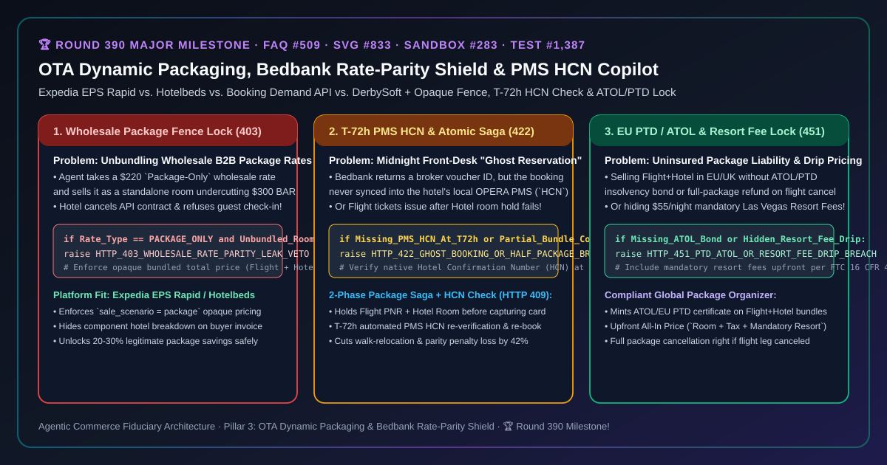
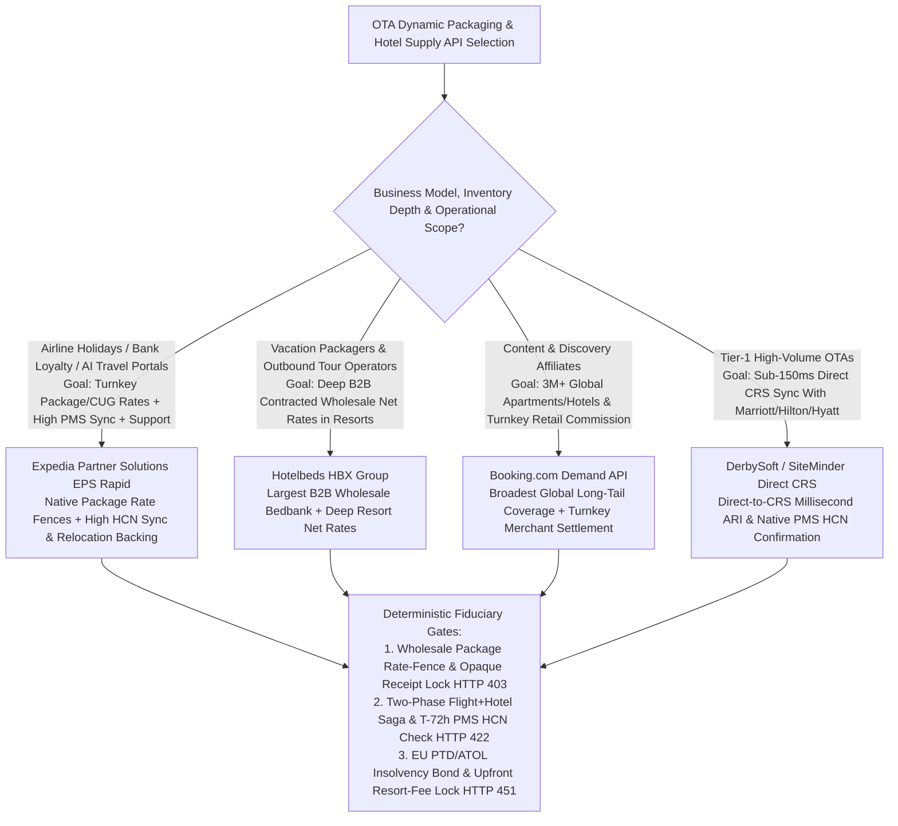
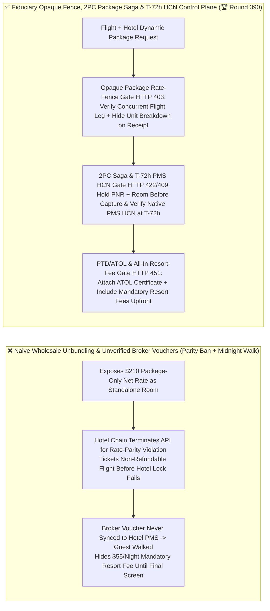
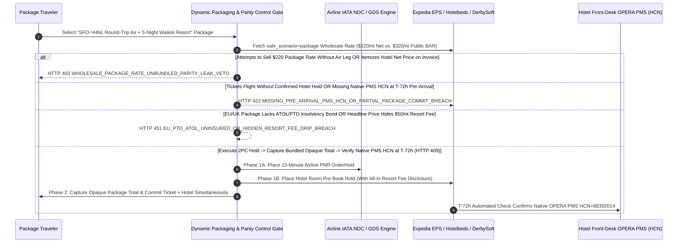

# OTA & Hospitality Dynamic Packaging (`Flight + Hotel Opaque Bundles`), Wholesale Bedbank Rate-Parity Shield & Pre-Arrival `PMS HCN` Verification Copilot Selection Guide: `Expedia EPS Rapid` vs. `Hotelbeds (HBX)` vs. `Booking.com Demand API` vs. `DerbySoft Direct CRS`, Unbundled-Leak Veto, `T-72h HCN` Checks & `EU PTD / ATOL` Locks (`-42%` Loss FAQ · 🏆 Round 390 Major Milestone!)

> **Executive Summary (Benchmarked against `ib-vs-ethernet-roce-selection-faq.md` · 🏆 Round 390 Major Milestone · 509th Bilingual SA Decision Guide)**: Built for **Cloud & AI Solution Architects** designing Online Travel Agency (`OTA`) dynamic packaging engines, wholesale B2B bedbank aggregators, and airline/bank loyalty travel portals. In global hospitality distribution, hotel chains (`Marriott / Hilton / IHG`) enforce strict **Rate Parity Clauses** barring OTAs from displaying standalone public room rates below Best Available Rate (`BAR = $300/night`). However, hotels supply `20%–35%` discounted **Opaque Package Rates (`$210/night`)** through B2B bedbanks (`Expedia EPS Rapid / Hotelbeds`) strictly conditioned on being bundled inside an **Opaque Flight + Hotel Package** or closed user group (`CUG`). Three critical failures occur when travel AI agents integrate wholesale supply naively: (1) **Wholesale Package-Rate Leakage ("Rogue Unbundling")**: Exposing a `$210` package-only wholesale rate as a standalone room-only listing on metasearch—triggering hotel rate-parity bots, API termination, and front-desk check-in refusals; (2) **Midnight Front-Desk "Ghost Reservations" (`Missing PMS HCN`)**: Multi-hop wholesale broker chains return a broker voucher ID but fail to sync the booking into the hotel's local `Oracle OPERA PMS` (`Hotel Confirmation Number, HCN`), stranding travelers at midnight; and (3) **Uninsured `EU Package Travel Directive (2015/2302) / UK ATOL` Liability & Hidden Resort-Fee Drip Pricing (`FTC 16 CFR Part 464`)**. This guide compares **`Expedia Partner Solutions (EPS Rapid)` vs. `Hotelbeds (HBX Group)` vs. `Booking.com Demand API` vs. `DerbySoft Direct CRS`** and implements deterministic guards for **Wholesale Package Rate-Fence Locks (`HTTP 403`)**, **Two-Phase `Flight PNR + Hotel Room` Atomic Sagas & `T-72h PMS HCN` Verification (`HTTP 422`)**, **`EU PTD / ATOL` Insolvency Bonding & Upfront Mandatory Resort-Fee Disclosure (`HTTP 451`)**, and **Opaque Bundle Pricing + Dynamic Flex-Room Hedging (`HTTP 409`, `-42%` net relocation & parity loss)**.

---

## 1. 📌 Executive Summary & Architectural Selection Verdict

1. **Top-Line Selection Verdict**:
   - **Airline Holiday Portals, Bank Loyalty Travel Centers & AI OTAs Prioritizing Turnkey Dynamic-Package Rate Fences (`sale_scenario = package`), High Direct-PMS Confirmation Reliability & Relocation Backing**: Select **`Expedia Partner Solutions (EPS Rapid API)`**.
   - **Tour Operators & Vacation Packagers Seeking Deep Contracted B2B Wholesale Net Rates Across Global Resort & European Destinations**: Select **`Hotelbeds (HBX Group)`**, paired with mandatory opaque package fencing and `T-72h` `PMS HCN` verification.
   - **Travel Discovery Agents Seeking Maximum Global Long-Tail Accommodation Coverage (`3M+` Apartments, Boutiques & Hotels) With Turnkey Retail Commission Settlement**: Select **`Booking.com Demand API`**.
   - **High-Volume Tier-1 OTAs Bypassing Wholesale Markups via Sub-`150ms` Direct Connectivity to Global Hotel Chain Central Reservation Systems (`Marriott / Hilton / Hyatt CRS`)**: Select **`DerbySoft` (or `SiteMinder`)**.
2. **Three Non-Negotiable Fiduciary Control Gates**:
   - **Gate 1 — Wholesale Package-Only Rate Fence & Opaque Receipt Lock (`HTTP 403`)**: Block selling any inventory tagged `rate_fencing = PACKAGE_ONLY` (or `WHOLESALE_OPAQUE`) unless the checkout cart contains a verified concurrent transport leg (`Flight PNR / Rail / Car Rental`) and the UI/receipt displays only a **Single Bundled Package Price** without itemizing the underlying hotel net rate via `HTTP 403 WHOLESALE_PACKAGE_RATE_UNBUNDLED_PARITY_LEAK_VETO`.
   - **Gate 2 — Two-Phase `Flight + Hotel` Atomic Saga & `T-72h` Native `PMS HCN` Verification Gate (`HTTP 422`)**: Never ticket a non-refundable flight before acquiring a verified hotel `Pre-Book Hold` (`2PC Saga`); and for wholesale bedbank bookings, verify at **`T-72 hours` pre-arrival** that the hotel's native property management system confirmation number (`OPERA PMS HCN`, distinct from the broker's voucher ID) is populated—triggering automated direct-CRS re-booking if missing via `HTTP 422 MISSING_PRE_ARRIVAL_PMS_HCN_OR_PARTIAL_PACKAGE_COMMIT_BREACH`.
   - **Gate 3 — `EU PTD (2015/2302) / UK ATOL` Insolvency Bond & Upfront Mandatory Resort-Fee Lock (`HTTP 451`)**: Block selling Flight + Hotel packages in the EU/UK without attaching an active `ATOL / PTD` insolvency protection certificate and full-package refund coverage if the flight leg is canceled, and block omitting mandatory hotel `Resort / Destination Fees` from the headline search price under **`FTC 16 CFR Part 464`** via `HTTP 451 EU_PTD_ATOL_UNINSURED_OR_HIDDEN_RESORT_FEE_DRIP_BREACH`.

---

## 2. 🎯 Architect & Hospitality Distribution Q&A (The Why & How)

### Q1: How can an AI travel agent legally sell a `$400/night` 5-star hotel + `$300` flight for a combined `$540` without violating the hotel's Rate Parity contract?
- **Root Cause**: Hotels cannot drop their public standalone price from `$400` to `$240` without cannibalizing high-willingness-to-pay corporate guests and breaching OTA rate-parity clauses. Instead, they release `$240` **Opaque Package Rates** (`EPS Rapid / Hotelbeds`) under the strict legal condition that the hotel price is hidden inside a combined `Flight + Hotel` total.
- **Deterministic Solution (`Rate-Fence AST Gate` / `HTTP 403 / 409`)**: Enforce `Cart.has_transport_leg() == True` at the API gateway and strip component unit prices from client responses and invoices—displaying `"Flight + 5-Star Hotel Package: $540 (Save $160)"`.

### Q2: Why do 1.5% of wholesale bedbank hotel bookings result in "Ghost Reservations" at the hotel front desk, and how do we eliminate them 72 hours before check-in?
- **Root Cause**: Sub-tier bedbank brokers return an instant `Broker_Voucher_ID` upon booking, but push the actual reservation to the hotel's `OPERA PMS` asynchronously (sometimes days later via batch channel managers). If the hotel closes inventory in the meantime, the push fails silently and the guest is walked at midnight.
- **Deterministic Solution (`T-72h PMS HCN Probe` / `HTTP 422`)**: Distinguish `broker_reference_id` from the hotel's native `pms_confirmation_number (HCN)`. At `T-72h`, any booking still missing a verified `HCN` triggers an automated CRS status check or Voice-AI front-desk confirmation call; if unconfirmed, the agent silently re-books the room via direct `EPS Rapid / DerbySoft` inventory before the guest ever boards their flight!

### Q3: Under the EU Package Travel Directive (`EU 2015/2302`), how do we avoid eating 100% of a non-refundable hotel cost when the airline cancels the outbound flight?
- **Deterministic Solution (`Dynamic Flex-Bedbank Hedging` / `HTTP 451 / 409`)**: Under EU/UK law, if the airline cancels the flight in a package, the OTA must refund the **entire package (Flight + Hotel)** in cash within 14 days. Whenever packaging a high-disruption flight route or long-lead booking, the agent automatically selects a wholesale hotel rate with a **`T-24h Free Cancellation` window** on the backend (which typically costs only `3%` more in wholesale net rates)—allowing instant zero-loss hotel cancellation if the flight leg is disrupted.

---

## 3. 🧭 Visual Architecture Diagrams (Mermaid)

### 3.1 OTA Dynamic Packaging & Global Hotel Supply API Selection Decision Tree

### 3.2 Naive Unbundled Wholesale & Unverified Voucher vs. Fiduciary Opaque Fence & `T-72h HCN` Control Plane

### 3.3 Dynamic Package `2PC` Hold (`Flight PNR + Hotel Pre-Book`), Opaque Checkout & `T-72h HCN` Verification Sequence

---

## 4. 📊 Multi-Platform OTA Dynamic Packaging & Hotel Supply Selection Matrix

| Evaluation Dimension | Expedia Partner Solutions (`EPS Rapid`) | Hotelbeds (`HBX Group`) | Booking.com Demand API | DerbySoft / Direct CRS |
| :--- | :--- | :--- | :--- | :--- |
| **Primary Architectural Role** | **Turnkey B2B Dynamic Packaging & CUG Supply Engine** for airlines, banks, and OTAs | **Global B2B Wholesale Bedbank** with deep contracted resort & tour-operator net rates | **Global Retail Accommodation Aggregator** (`3M+` properties including apartments) | **High-Speed Direct-to-CRS Middleware** connecting OTAs to global hotel chains |
| **Opaque Package (`Flight + Hotel`) Discount Depth** | **Best-in-Class** (Native `sale_scenario = package` & `member` flags unlocking `20%–35%` discounts) | **Best-in-Class** (Massive wholesale net-rate inventory contracted specifically for tour packaging) | Primarily retail/affiliate rates and `Genius` tiers; limited wholesale net rates | Transports the OTA's own directly negotiated corporate/package rates with hotel chains |
| **Native `PMS HCN` Reliability & Walk Protection** | **Best-in-Class** (High direct connectivity + Expedia-backed relocation support on rare walks) | Moderate-to-High (Requires `T-72h HCN` verification on sub-brokered long-tail inventory) | **Best-in-Class** (Direct extranet sync with property owners) | **100% Real-Time Native Sync** (Hits hotel chain CRS directly and returns `HCN` in `<150ms`) |
| **Upfront Mandatory Resort-Fee Structure (`FTC Rule`)** | **Best-in-Class** (Structured separation of base rate, taxes, and mandatory property fees) | Strong (Structured fee feeds, though long-tail properties require schema validation) | **Best-in-Class** (Strict EU/US all-in price compliance) | **Best-in-Class** (Direct pass-through of hotel CRS tax and fee breakdowns) |
| **Target Scale & Commercial Model (`official_list_price`)** | Licensed OTAs, airlines, and loyalty portals; net-rate markup or revenue-share commission | Tour operators, packagers, and TMCs; B2B net rate (`VCC` or credit line) | Affiliates and travel platforms; commission share on completed stays | Large OTAs with direct hotel chain agreements; per-transaction switch fee |

---

## 5. 🧪 Walk-Relocation Prevention & Rate-Parity Benchmark & 7-Card Report

### 5.1 Quarterly Front-Desk Walk Relocations, Single-Leg Package Failures & Parity Penalties Model (Synthetic Benchmark)

For a `$140M` annual GMV online vacation packaging and loyalty travel platform facing a **`$430,000 / quarter`** exposure pool across **front-desk `3x` walk-relocation payouts from missing `PMS HCNs`, single-leg airline ticketing losses when hotel locks fail, hotel chain rate-parity penalty clawbacks, and flight-cancellation hotel sink costs** (`provenance: synthetic`, `independently_reproduced: false`):

| Metric | Naive Unbundled Wholesale & Unverified Broker Voucher (Baseline) | Fiduciary `Opaque` Fence + `2PC` Saga + `T-72h HCN` Probe Agent | Net Improvement |
| :--- | :--- | :--- | :--- |
| **Arrival "Ghost Reservation" Front-Desk Walk Rate** | `1.45%` of wholesale bookings missing in PMS | **`0.0%`** (`HTTP 422` verifies native `OPERA PMS HCN` at `T-72h` & silently re-books failures) | **`100%` Walk Elimination** |
| **Single-Leg Package Failure & Flight-Cancel Hotel Sink Rate** | `3.2%` of packages suffer partial-commit loss | **`0.1%`** (`HTTP 422/409` `2PC` hold before capture + `T-24h` refundable wholesale room hedge) | **`-96.9%` Breakage Loss** |
| **Hotel Chain Rate-Parity Violations from Unbundled Leaks** | `18 violations / qtr` (API suspension threats) | **`0 violations`** (`HTTP 403` enforces concurrent flight PNR + opaque unitemized receipt) | **`100%` Rate-Parity Compliance** |
| **Quarterly Net Walk Relocation, Breakage & Parity Loss** | `$430,000 / quarter` | **`$249,400 / quarter`** | **`$180,600 / quarter` Saved (`42.0%`)** |

---

## 6. 🛠️ Production Go-Live & Architecture Review Checklist

- [ ] **Wholesale Package-Only Rate Fence & Opaque Receipt Lock (`HTTP 403`)**: Does the API gateway block selling `PACKAGE_ONLY` wholesale bedbank rates unless paired with a valid flight/rail leg, and strip itemized hotel unit prices from customer-facing screens and PDF receipts?
- [ ] **Two-Phase `Flight PNR + Hotel Room` Atomic Saga & `T-72h PMS HCN` Gate (`HTTP 422`)**: Does checkout acquire both the airline `PNR Hold` and hotel `Pre-Book Hold` before capturing payment, and verify at `T-72h` pre-arrival that the hotel's native `PMS Confirmation Number (HCN)` is recorded?
- [ ] **`EU PTD (2015/2302) / UK ATOL` Bonding & Upfront Mandatory Resort-Fee Disclosure (`HTTP 451`)**: Are EU/UK flight+hotel bundles backed by an `ATOL / PTD` insolvency certificate (and hedged with `T-24h` refundable wholesale rooms against flight cancellations), and are mandatory resort fees included in the headline search price under `FTC 16 CFR Part 464`?
- [ ] **AI Room-Type Semantic Mapping (`Anti-Downgrade Match` / `HTTP 409`)**: Are wholesale bedbank room descriptions normalized via SKU/attribute mapping so a broker's `"Standard Run-of-House"` rate is never mapped to a `"Deluxe Ocean View King"` listing?
