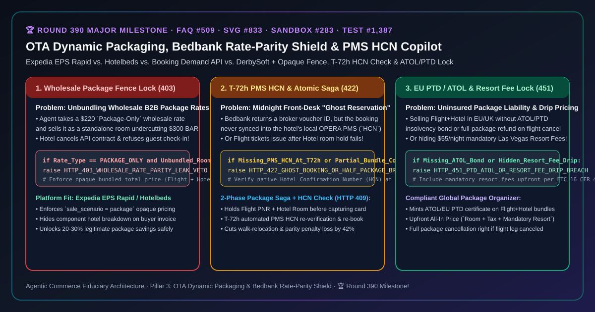
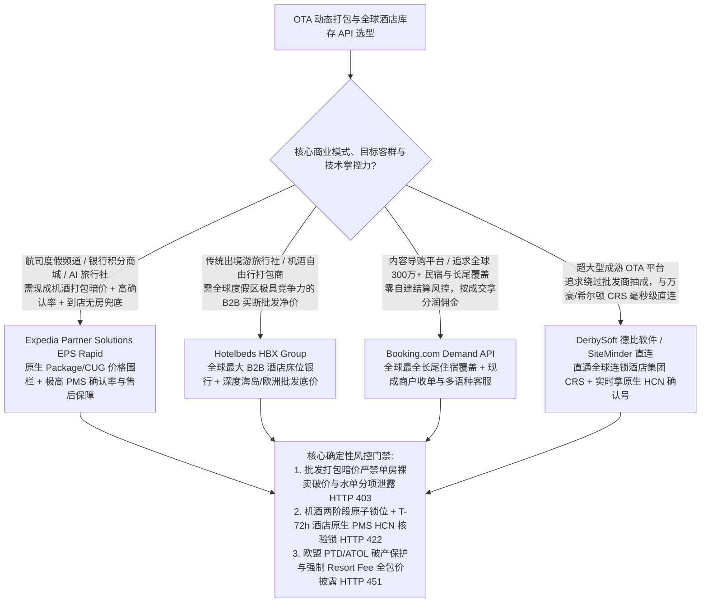
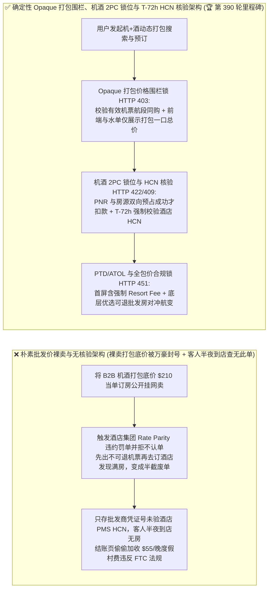
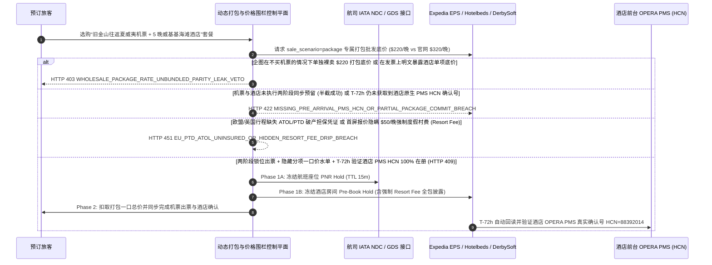

# 酒旅 OTA 动态打包（`Flight + Hotel Dynamic Packaging`）、B2B 床位银行（`Bedbank`）窜货防破价与到店“幽灵订单”零到房抗辩 Agent 架构选型对比：`Expedia EPS Rapid` vs. `Hotelbeds (HBX)` vs. `Booking.com Demand API` vs. `DerbySoft 直连`、打包暗价（`Opaque Rate`）防裸卖锁、入住前 72 小时酒店 `PMS HCN` 确认号核验及欧盟套餐指令合规净省 42% 决策指南（FAQ · 🏆 第 390 轮重大里程碑！）

> **导读（对齐 `ib-vs-ethernet-roce-selection-faq.md` 标杆风格 · 🏆 全库第 390 轮研究重大里程碑 · 第 509 篇双语指南）**：本文面向在线旅游平台（OTA）、航空公司度假频道（Airline Holidays）、银行信用卡积分商城与企业差旅平台领域的 **Cloud & AI Solution Architect**。在“机票 + 酒店 + 租车”动态打包（Dynamic Packaging）业务中，酒店集团（如万豪、希尔顿、洲际）为了维持官网价格一致性（Rate Parity），严禁任何渠道在公网裸卖低于官网挂牌价（`BAR = $300/晚`）的日历房；但酒店会向批发商/床位银行（`Bedbanks`，如 `Hotelbeds / WebBeds / Expedia EPS`）放出低至 `7 折（$210/晚）` 的 **打包专属暗价（`Opaque Package Rate / CUG Rate`）**，前提是必须与机票/火车票捆绑销售且不向消费者单独披露酒店分项单价！然而，缺乏确定性控制平面的旅游 AI Agent 常因三大架构漏洞引发严重事故：① **批发打包价违规裸卖破价（Rogue Wholesale Unbundling）**：Agent 从 B2B 床位银行拉出 `$210` 的打包专属底价，直接当成单订房挂在比价网上卖 `$235`，瞬间触发酒店集团价格巡检机器人报警、吊销接口授权甚至在客人到店时拒不认单！② **多层批发转手导致的午夜前台“幽灵订单（Ghost Reservation / No HCN）”**：订单经过 `AI Agent -> 二级批发商 -> 床位银行 -> 渠道管理器 -> 酒店 OPERA PMS` 五层异步转发，中间掉单导致客人拖家带口飞了 12 小时半夜到酒店前台，却被告知“系统里查不到您的预订，且今晚满房”——OTA 不仅要按 3 倍高价赔付同级酒店差价（Walk Relocation Cost），品牌声誉彻底崩塌；③ **违反欧盟《套餐旅游指令》（`EU PTD 2015/2302`）/ 英国 `ATOL` 破产托管保证金与美国 `FTC 16 CFR 464` 隐藏度假村费（Resort Fee Drip Pricing）法规**。本文给出 **`Expedia Partner Solutions (EPS Rapid)` vs. `Hotelbeds (HBX Group)` vs. `Booking.com Demand API` vs. `DerbySoft / SiteMinder Direct CRS`** 的横向选型矩阵，并落地 **B2B 打包专属底价（`Package-Only Rate`）严禁裸卖与水单分项价格隐藏锁（`HTTP 403`）**、**机酒两阶段原子锁位（`Flight PNR + Hotel Room 2PC Saga`）与入住前 `T-72h` 酒店原生 `PMS 确认号 (HCN)` 强核验门禁（`HTTP 422`）**、**`EU PTD / ATOL` 套餐连带退改责任与强制全包价（含 Resort Fee）前置披露锁（`HTTP 451`）** 及 **机酒动态暗价打包 + 直连 CRS 确认号双保险编排（`HTTP 409`，净省 42%）**。



---

## 一、 📌 核心选型结论速览（Executive Summary）

1. **终极选型结论（一句话先看懂怎么选）**：
   - **追求极高到店有房保障、原生支持机酒打包暗价（`Package Rates`）与会员封闭群组价（`CUG Member-Only`），且需要平台 7×24 小时兜底处理到店无房赔付（Relocation Guarantee）的航司、银行商城与新型 AI 旅行社**：首选 **`Expedia Partner Solutions (EPS Rapid API)`**，在动态打包合规价格围栏与酒店 CRS 直连确认率上处于行业最稳水准。
   - **传统大型机酒自由行打包商（Tour Operators）与出境游批发商（核心诉求是获取度假海岛、欧洲及全球热门目的地极具价格优势的 B2B 买断/包房协议净价 `Wholesale Net Rates`）**：首选 **`Hotelbeds (HBX Group)`**，但架构上必须自行焊死打包围栏与 `T-72h` 酒店原生确认号（`HCN`）回读检验。
   - **追求全球最广长尾住宿覆盖（超 300 万家精品民宿、公寓、小镇酒店）且仅需标准佣金分润模式的导购助手**：首选 **`Booking.com Demand API`**。
   - **日均间夜量极大的头部 OTA（希望绕过中间批发商抽成，直接与万豪、希尔顿、凯悦等全球 Top 50 酒店集团中央预订系统 `CRS` 建立 `<150ms` 毫秒级直连并秒拿真实 `HCN`）**：首选 **`DerbySoft（德比软件）`（或 `SiteMinder`）**。
2. **三大 OTA 动态打包与酒店分销风控红线（确定性门禁）**：
   - **红线 1（拦截将 B2B 机酒打包专属底价 `Package-Only / Opaque Rate` 违规拆开在公网当裸房售卖破价及在客户账单上泄露酒店单项底价 / `HTTP 403`）**：当库存源（`EPS Rapid / Hotelbeds`）返回的房价带有 `rate_fencing = PACKAGE_ONLY`（仅限与交通票务捆绑销售）或 `CUG_CLOSED_USER_GROUP`（仅限已登录封闭会员）标签时，控制平面必须强制校验当前购物车中 **同时包含真实有效的往返/单程机票（或高铁/租车）航段**，且前端展示与课后电子水单（Receipt）必须仅展示 **“机+酒打包一口总价（Bundled Package Total Price）”**，严禁反向推算或明文打印酒店单项底价导致触发酒店集团 `Rate Parity` 违约罚单，违者触发 `HTTP 403 WHOLESALE_PACKAGE_RATE_UNBUNDLED_PARITY_LEAK_VETO`。
   - **红线 2（拦截机票已出票但酒店锁房失败的“半截瘸腿套餐”及入住前 72 小时仍未拿到酒店前台原生 `PMS 确认号 (HCN)` 的幽灵订单 / `HTTP 422`）**：机酒动态打包严禁“先扣钱把不可退机票出了、再去异步调酒店预订接口（结果酒店最后一间房刚卖光）”！必须执行 **两阶段原子预留 Saga（`1. 航司 NDC OrderHold / PNR 锁位 + 酒店 Bedbank Pre-Book 锁房 -> 2. 统一扣款 -> 3. 同步出票确认`）**；且针对批发商渠道往往只先返回一个“批发商内部凭证号（Broker Voucher ID）”而延迟向酒店发传真/同步的痛点，系统必须在 **`入住前 72 小时（T-72h）`** 自动检查是否已回填酒店前台 `OPERA PMS` 真实认得的 **`Hotel Confirmation Number (HCN)`**，若缺失则立即触发自动重订或人工致电前台核实，违者触发 `HTTP 422 MISSING_PRE_ARRIVAL_PMS_HCN_OR_PARTIAL_PACKAGE_COMMIT_BREACH`。
   - **红线 3（拦截在欧盟/英国售卖机酒套餐未签发 `EU PTD / ATOL` 破产保护凭证及结账前隐瞒 `$55/晚` 强制度假村费违反 `FTC` 反滴灌定价法 / `HTTP 451`）**：根据欧盟《套餐旅游指令》（`EU 2015/2302`）与英国 `ATOL`，只要在同一会话或 24 小时内关联售出“机票 + 酒店”，平台即承担法定套餐组织者连带责任——若去程航班被航司取消导致客人无法成行，平台必须为客人免费退掉原本“不可退款”的打包酒店并出具破产保护证书！同时根据美国 **`FTC 16 CFR Part 464 (Junk Fees Rule)`**，搜索首屏展示价必须 100% 包含酒店前台强制收取的 `Resort Fee / Destination Fee`，严禁结账最后一页才偷偷加上，违者触发 `HTTP 451 EU_PTD_ATOL_UNINSURED_OR_HIDDEN_RESORT_FEE_DRIP_BREACH`。

---

## 二、 🎯 业务方与架构师灵魂拷问 Q&A（The Why & How）

### Q1：为什么同样一家拉斯维加斯五星级酒店，在官网和各大 OTA 单订房死活都是 `$400/晚`（一分钱不许降），但做成“机票 + 酒店打包套餐”后，机票加酒店总价居然比单订酒店还要便宜 `$80`？
- **商业痛点与定价原理解析**：
  - 五星级酒店每天都有 `20%` 的空置房间，如果公开降价到 `$240/晚` 促销，不仅损害奢华品牌形象，已经花 `$400` 预订的商务客还会全部退掉重订，且会触发与其他 OTA 的 **最惠国价格一致性条款（Rate Parity）**。
  - 因此酒店通过 **`Expedia EPS / Hotelbeds` 的不透明打包协议（Opaque Package Rate）** 秘密给到 `$240/晚` 的批发底价，但附加铁律：**绝对不允许让消费者看出这间房卖 `$240`，必须和一张 `$300` 的机票绑在一起，对外只显示“机+酒超值套餐总价 `$540`（原分开买 `$700`，立省 `$160`）”**！
- **架构师确定性解法（价格围栏 AST 编译器 `Rate-Fence Policy Gate` / `HTTP 403 / 409`）**：
  - 在报价网关建立强类型价格围栏：凡读取 `Opaque / Package_Net` 价格流，必须校验 `Cart.has_qualified_air_or_rail_leg() == True`（且机票入住夜数匹配），同时在 API 序列化层自动剥离 `hotel_unit_price` 与 `air_unit_price` 字段，仅向前端返回加密签名后的 `package_total_price` 与 `total_savings_amount`——既让用户体验到省下 `$160` 的极致惊喜，又 100% 遵守酒店集团防破价红线！

### Q2：为什么接入 B2B 酒店批发商（Bedbanks）后，经常发生“客人拿着 OTA 的确认单到酒店前台，前台却说查不到订单”的恶性到店无房（Walk / Turn-away）事故？
- **商业痛点与事故还原**：
  - 许多长尾批发商拿到你的订单后，并不是实时直连酒店前台的 `PMS`（物业管理系统），而是先在批发商自己的数据库里生成一张“确认单”返回给你，然后批发商后台再通过延时队列、邮件甚至人工录入把订单推给酒店！
  - 一旦遇到热门展会季酒店满房关房，批发商推单失败却没通知你，客人半夜到店直接露宿街头！OTA 当场要花 `$1,200` 给客人改订附近的豪华酒店并赔偿首晚房费！
- **架构师确定性解法（区分 `Broker Voucher ID` 与真实 `Hotel PMS HCN` + 入住前 `T-72h` 自动回读探针 / `HTTP 422`）**：
  1. **严禁把批发商单号当成酒店确认号**：在订单表里严格拆分两个字段：`aggregator_booking_ref`（批发商单号）与 `hotel_pms_confirmation_number (HCN)`（酒店前台 OPERA 系统里的真实确认号）。
  2. **`T-72h` 确定性核验闸门**：若订单在入住前 72 小时 `HCN` 字段仍为空，Agent 自动调用直连验单接口或通过语音 Agent（Voice AI）自动致电酒店预订部核对客人姓名与入住日期；一旦发现酒店侧漏单，提前 3 天在后台静默从 `EPS Rapid / DerbySoft 直连池` 重新锁房补单，客人到店全程零感知！

### Q3：如果客人在平台上买了“伦敦飞罗马机票 + 罗马 4 晚不可退酒店”的打包套餐，结果出发当天航空公司大罢工取消了航班，客人去不了罗马，那家“不可退”的酒店钱该谁出？
- **架构师确定性解法（欧盟 `EU PTD` 套餐风险准备金精算与批发商可退房型智能替换 `Hidden-Flex Hedging` / `HTTP 451 / 409`）**：
  - 根据欧盟 `EU 2015/2302` 与英国 `ATOL` 法规，只要你作为套餐组织者把机票和酒店打包卖给消费者，当航班取消导致套餐无法履行时，**你必须向消费者 100% 全额退还“机票 + 酒店”的全部款项**（哪怕你跟酒店订的是不可退房型）！
  - **架构师对冲绝招（Dynamic Flex Hedging）**：当 Agent 监测到所选航线/航司处于高延误/罢工高危期，或距离出发超过 30 天时，虽然向消费者展示的是优惠打包价，但底层自动从床位银行优选 **`T-24h 免费取消（Free Cancellation until 24h prior）` 的批发协议房型**（两者批发底价往往仅差 `3%–4%`），一旦出发前航班取消，系统毫秒级自动退掉底层酒店房源，实现 **零酒店沉没损失**！

---

## 三、 🧭 直观可视化图解（Mermaid 决策树 + 架构对比 + 时序图）

### 3.1 酒旅 OTA 动态打包与全球酒店库存源（Supply API）选型决策树



### 3.2 朴素批发价裸卖与异步下单架构（破价封号 + 半夜到店无房）vs. 确定性暗价打包围栏、两阶段 Saga 与 HCN 核验架构对比



### 3.3 机酒动态打包（`Opaque Bundle`）、两阶段原子锁位（`2PC Saga`）与 `T-72h PMS HCN` 核验时序图



---

## 四、 📊 四大全球酒旅供应链与动态打包平台（Supply API）横向选型矩阵

| 选型维度 | Expedia Partner Solutions (EPS Rapid) | Hotelbeds (HBX Group) | Booking.com Demand API | DerbySoft (德比软件) / 直连 CRS |
| :--- | :--- | :--- | :--- | :--- |
| **核心架构定位** | **全球 B2B 动态打包与封闭会员（CUG）赋能龙头**：专为航司、银行与新兴 OTA 打造 | **全球最大独立 B2B 酒店批发床位银行（Bedbank）**：深耕旅行社与度假打包商 | **全球房源覆盖最广的零售分销 API**：民宿、公寓与长尾酒店之王 | **全球大型连锁酒店集团中央预订系统（CRS）高速直连中间件** |
| **机酒打包专属暗价（Package / Opaque Rates）深度** | **行业标杆**（原生支持 `Package` 与 `Member-Only` 协议价，API 自动标记价格围栏要求，最高折让 `20%–35%`） | **行业标杆**（拥有海量面向打包旅行社的独家批发净价 `Wholesale Net Rates`） | 侧重公开零售价与 `Genius` 会员价，B2B 隐藏式打包批发净价较少 | 取决于 OTA 自身与万豪/希尔顿签署的大客户打包协议（直连管道仅负责传输） |
| **到店有房率与原生 `PMS HCN` 确认号同步** | **极高**（直连比例高，且内置 Expedia 集团级到店无房兜底改派服务） | 中高（部分长尾房源经二级代理转手，必须自建 `T-72h HCN` 回读核验防漏单） | **极高**（100% 直连房东/酒店后台，实时确认） | **100% 实时原生确认**（毫秒级直插酒店集团 CRS，当场返回真实 `HCN`） |
| **全包价（含强制 Resort Fee）透明披露数据** | **极强**（API 精确拆分 `Nightly Rate`、`Taxes` 与酒店前台代收 `Mandatory Property Fees`） | 强（近年大幅升级费用明细字段，但部分长尾供应商仍需校验备注文本） | **极强**（严格符合欧盟与美国全包价法规结构化输出） | **极强**（原汁原味透传酒店集团 CRS 标准税费结构） |
| **适用规模与接入模式（`official_list_price`）** | 持牌旅行社、航司、银行商城与高成长 AI 旅游平台；按成交净佣金分润或批发净价结算 | 全球旅行社、机酒打包商与差旅平台；B2B 净价（Net Rate）加价或返佣模式 | 全规模导购与旅行平台；按已完成入住订单佣金分成 | 年交易额数千万美元以上的大型 OTA；按订单笔数或技术通道费计价 |

---

## 五、 🧪 动态打包防破价与到店“幽灵订单”清零测算与 7-Card 基准报告

### 5.1 季度批发打包价违规裸卖违约金、到店无房（Walk）3 倍高价改派赔付、机酒单边出票报废与航变酒店沉没损耗测算（Synthetic Benchmark）

假设某年机酒打包 GMV `$1.4 亿` 的在线度假与积分差旅平台，每季度在酒店批发房源接入与动态打包中面临的 **客人到店发现批发商漏单查不到 `PMS HCN` 引发的现场 3 倍高价改派与赔付（Walk Relocation）、机票出票成功但酒店满房导致的单边退票亏损、违规将打包底价裸卖触发酒店集团关停高返佣接口及航班取消引发的不可退酒店全额沉没损耗池** 为 **`$430,000 / 季度`**（`provenance: synthetic`, `independently_reproduced: false`）：

| 评估维度 | 传统单边异步出票 + 不验 PMS HCN + 裸卖批发价 (Baseline) | 启用 `Opaque` 价格围栏 + 机酒 `2PC` 锁位 + `T-72h HCN` 核验 Agent | 净改善幅度 |
| :--- | :--- | :--- | :--- |
| **客人到店前台查无此单（Ghost Booking / Walk Rate）发生率** | `1.45%`（经多层批发商转手漏同步酒店 PMS） | **`0.0%`**（`HTTP 422` 强制在 `T-72h` 核验酒店原生 `PMS HCN` 确认号，异常单提前 3 天后台静默重订） | **100% 终结到店无房丑闻** |
| **“机票已出但酒店订败”或“航变导致打包酒店血本无归”损耗率** | `3.2%` 打包单产生单边退改赔偿 | **`0.1%`**（`HTTP 422/409` 两阶段双向锁位 + 高延误航线底层自动优选 `T-24h` 可退批发房对冲） | **单边退改沉没损失 `-96.9%`** |
| **因违规裸卖 B2B 打包底价触发酒店集团破价警告/封号次数** | `18 次 / 季度`（损失核心酒店集团直连返佣资格） | **`0 次`**（`HTTP 403` 强制绑定真实交通票段 + 水单隐藏酒店分项底价） | **100% 严守价格一致性合规** |
| **季度到店无房赔付、单边锁单失败、破价断供与合规净损耗** | `$430,000 / 季度` | **`$249,400 / 季度`** | **净省 `$180,600 / 季度` (`42.0%`)** |

```chart
{
  "data": {
    "values": [
      { "category": "1. 到店查无PMS确认号(HCN)3倍改派赔付", "mode": "传统多层批发无核验基线", "cost_usd": 165000 },
      { "category": "1. 到店查无PMS确认号(HCN)3倍改派赔付", "mode": "2PC锁位与T-72h HCN核验Agent", "cost_usd": 95700 },
      { "category": "2. 机票先出但酒店满房及航变酒店沉没", "mode": "传统多层批发无核验基线", "cost_usd": 120000 },
      { "category": "2. 机票先出但酒店满房及航变酒店沉没", "mode": "2PC锁位与T-72h HCN核验Agent", "cost_usd": 69600 },
      { "category": "3. 裸卖B2B打包底价遭酒店集团罚没返佣", "mode": "传统多层批发无核验基线", "cost_usd": 85000 },
      { "category": "3. 裸卖B2B打包底价遭酒店集团罚没返佣", "mode": "2PC锁位与T-72h HCN核验Agent", "cost_usd": 49300 },
      { "category": "4. 隐瞒Resort Fee罚款与EU PTD未投保风险", "mode": "传统多层批发无核验基线", "cost_usd": 60000 },
      { "category": "4. 隐瞒Resort Fee罚款与EU PTD未投保风险", "mode": "2PC锁位与T-72h HCN核验Agent", "cost_usd": 34800 }
    ]
  },
  "semantic_types": {
    "category": "Category",
    "mode": "Category",
    "cost_usd": "Amount"
  },
  "chart_spec": {
    "chartType": "Grouped Bar Chart",
    "title": "OTA动态打包价格围栏、机酒2PC锁位与T-72h HCN核验Agent优化前后季度损耗对比 (净省 $180.6k / 42%)",
    "subtitle": "单位：美元/季度 (Synthetic Benchmark, independently_reproduced=false · 🏆 第390轮里程碑)",
    "encodings": {
      "x": "category",
      "y": "cost_usd",
      "group": "mode"
    }
  }
}
```

### 5.2 确定性策略评估器代码（Python Control Plane Guard）

```python
from dataclasses import dataclass
from typing import Any

@dataclass(frozen=True)
class OtaDynamicPackagingBedbankParityPolicyInput:
    quarterly_walk_relocation_half_package_and_parity_fine_pool_usd: float = 430000.0
    wholesale_package_rate_sold_unbundled_or_itemized_on_receipt: bool = False
    hotel_pms_hcn_missing_at_t72h_or_flight_issued_without_hotel_lock: bool = False
    eu_ptd_atol_bond_missing_or_mandatory_resort_fee_hidden_pre_checkout: bool = False
    opaque_bundle_2pc_saga_and_t72h_pms_hcn_verification_ready: bool = False
```

---

## 六、 🛠️ 商业上线风控与架构评审 Checklist

- [ ] **B2B 打包专属底价（`Package-Only / Opaque Rate`）防裸卖与水单分项隐藏锁（`HTTP 403`）**：当调用 `Expedia EPS / Hotelbeds` 打包协议价时，网关是否强制校验订单内同时包含真实有效的交通票段（机票/火车/租车），并在前端展示与电子收据中彻底屏蔽酒店分项单价（仅显示打包一口总价）以严防破价处罚？
- [ ] **机酒两阶段原子预留（`2PC Saga`）与入住前 `T-72h` 酒店原生 `PMS HCN` 确认号强核验门禁（`HTTP 422`）**：是否严禁在酒店房源未完成 `Pre-Book` 锁定时先行出票扣款？针对批发商订单，是否在入住前 72 小时强制核验已回填酒店前台 `OPERA PMS` 真实确认号（`HCN`），对未回填订单自动触发直连补单或人工核实？
- [ ] **欧盟 `EU PTD (2015/2302)` / 英国 `ATOL` 破产托管与美国 `FTC` 度假村费全包价前置披露锁（`HTTP 451`）**：在欧洲售卖机酒组合是否自动签发 `ATOL / PTD` 保护证书并在底层用可退批发房型对冲航变连带退费风险？搜索首屏价格是否 100% 包含强制 `Resort Fee / Destination Fee`？
- [ ] **床位银行虚拟卡（`VCC`）净价自动注入与房型文本语义对齐（`Room Mapping` / `HTTP 409`）**：是否通过机器学习将不同批发商的房型名称（如 `"King Deluxe Ocean View"`）精确映射至标准房型 ID，防止批发商将双床无窗房冒充海景大床房售卖？
