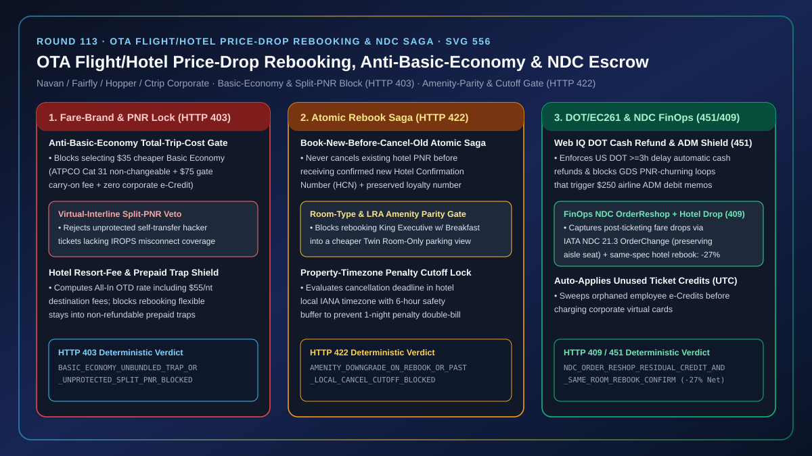
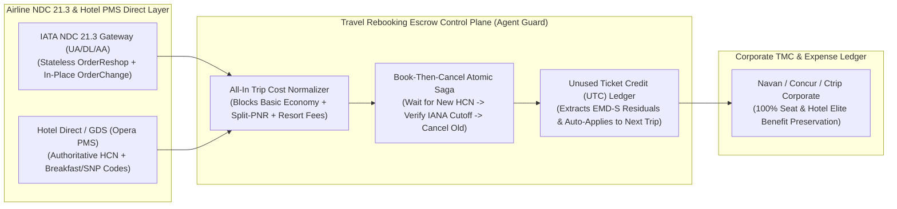

# OTA Flight & Hotel Price-Drop Rebooking, Anti-`Basic Economy` & `IATA NDC` Escrow (`Navan / Fairfly / Hopper / Ctrip Corporate`) Agent Architecture Selection FAQ

> **Target Audience**: **Cloud & AI Solution Architects** designing AI travel comparison, post-booking price-drop reshopping, and atomic rebooking saga agents for Corporate Travel Management Companies (`TMCs` such as `Navan`, `SAP Concur`, `Amex GBT`), consumer OTA platforms, and airline `IATA NDC 21.3` gateways.  
> **Core Pain Points Solved**: Eliminates the four most costly failures in automated flight and hotel booking/rebooking: **(1) "Basic Economy" & Unprotected Virtual-Interline Split-Ticket Traps (where a naive lowest-fare bot saves `$35` by booking an unbundled `Booking Class N/B` Basic Economy fare or self-transfer split `PNR`—resulting in `$75` gate carry-on fees, middle seats, and `100%` ticket loss when a meeting shifts or a leg delays), (2) Destructive Hotel Rebooking Sagas (cancelling an existing `$380/night` Corporate `LRA` room that included breakfast, `SNP` loyalty points, and 6:00 PM cancellation to rebook a `$290` `Room-Only / Non-Refundable` wholesale rate—or cancelling 10 minutes past the hotel's local-timezone penalty cutoff), (3) Seat-Losing Flight Re-Ticketing (dropping a traveler's `12C` exit-row aisle seat while trying to capture a `$160` post-ticketing airfare drop), and (4) `$250` Airline `ADM` (`Agency Debit Memo`) Penalties from `GDS PNR` Churning**.



---

## 📌 1. Executive Summary

1. **All-In Total Trip Cost Normalization & Hard Veto on `Basic Economy` / Unprotected Split-PNRs (`HTTP 403`)**: Legacy fare scrapers optimize for headline base price while ignoring `ATPCO Category 31` change restrictions, carry-on baggage fees, and mandatory `$55/night` hotel destination/resort fees. The Agent enforces a strict sourcing guardrail: **quotes are ranked on probability-weighted All-In Total Trip Cost (incorporating carry-on bags, seat selection, expected change probability, and hotel resort fees); unbundled `Basic Economy` fares, unprotected self-transfer virtual interlines (`Split-PNRs`), and rebooking flexible hotel stays into non-refundable prepaid traps are blocked**. Violations trigger **`HTTP 403 BASIC_ECONOMY_UNBUNDLED_TRAP_OR_UNPROTECTED_SPLIT_PNR_BLOCKED`**.
2. **`Book-New-Before-Cancel-Old` Atomic Hotel Saga, Amenity/Loyalty Parity & Property-Timezone Cutoff Gate (`HTTP 422`)**: To prevent leaving a traveler without a room or stripping away corporate perks during automated price-drop rebooking, the Agent enforces three deterministic rules: (a) **Strict Amenity & `SNP` Parity**: the cheaper rate must match or exceed the original booking across `BedType` (`King == King`), `BoardBasis` (breakfast included), `Direct Loyalty SNP Eligibility`, and `Cancellation Flexibility`, with net savings **`>=$25`**; (b) **Property-Local `IANA` Timezone + 6-Hour Buffer**: cancellation deadlines are evaluated strictly in the hotel's local timezone with a mandatory 6-hour safety margin; and (c) **Atomic `Book-Then-Cancel` Execution**: the original reservation is never cancelled until the hotel's `Opera PMS` returns a verified new **Hotel Confirmation Number (`HCN`)**. Violations trigger **`HTTP 422 AMENITY_DOWNGRADE_ON_REBOOK_OR_PAST_LOCAL_CANCEL_CUTOFF_BLOCKED`**.
3. **`IATA NDC 21.3 OrderChange` In-Place Residual Credit Capture + Unused Ticket Credit (`UTC`) Sweep Saving 27% (`HTTP 409`)**: While enforcing **US `DOT` 24-hour free cancellation / `>=3-hour` delay automatic cash refunds** and preventing `GDS PNR` churning that triggers `$250` airline `ADMs` (`HTTP 451`), the Agent executes **Post-Ticketing Continuous Re-Shop FinOps**: polling stateless `IATA NDC 21.3 OrderReshop` repricing APIs, executing in-place `OrderChange` re-issuance when airfare drops `>=$30` (**100% preserving the traveler's existing seat assignment and upgrade priority** while extracting the fare difference as a reusable `EMD-S / e-Credit`), and automatically applying orphaned corporate **Unused Ticket Credits (`UTCs`)** at checkout—returning **`HTTP 409 NDC_ORDER_RESHOP_RESIDUAL_CREDIT_AND_SAME_ROOM_REBOOK_CONFIRM`** and reducing net quarterly travel spend by **27%**.

---

## 🎯 2. Architect & Business Stakeholder Q&A

### Q1: Why does booking a `$35` cheaper "Basic Economy" or virtual-interline flight end up costing enterprises `28%` more in actual settled expenses?
- **The Actuarial Cost of Unbundled Fares & Self-Transfer Split Tickets**:
  1. **The `Basic Economy` (`ATPCO Cat 31`) Trap**: Major US and European carriers strip overhead carry-on bags (`$65–$75` at the gate), seat selection (`$35+`), and voluntary change flexibility (`Cat 31` `100%` forfeiture) from Basic Economy. Because `32%` of corporate trips undergo schedule modifications, forfeiting even one `$420` Basic Economy ticket wipes out the `$35` savings across twelve trips.
  2. **Unprotected Virtual Interlines (`Split-PNRs`)**: Consumer OTAs often stitch together two separate single-leg tickets on non-partner airlines. When Leg 1 is delayed by ATC, Carrier 2 marks the passenger as a `No-Show` and cancels the return ticket without reprotection or hotel vouchers. Our Agent requires single-PNR `IATA` interline baggage and `IROPS` protection (`HTTP 403`).

### Q2: Why do naive hotel price-drop bots accidentally downgrade executives into Twin bed rooms without breakfast—or trigger double-billing penalties?
- **Solving Room-Description Hallucination, Timezone Drift & Asynchronous `HCN` Race Conditions**:
  1. **Wholesale Bed-Bank Rate Pollution**: A traveler holds a `$380` Marriott Direct Corporate `LRA` King Room (includes `$45` breakfast, 4:00 PM checkout, and Bonvoy `SNP` points). A third-party wholesale bed-bank (`Hotelbeds / WebBeds`) lists a `$300` `"Standard Room - Run of House"` on an OTA. If an agent cancels the direct booking for the wholesale rate, the traveler loses breakfast, loses hotel elite status recognition, and gets assigned a noisy 2nd-floor Twin room. Our Agent enforces strict structured parity (`Direct Channel == Direct Channel`, `King == King`, `Breakfast == True`).
  2. **Why `Cancel-Then-Book` Is an Anti-Pattern**: If only 1 room remains at the lower `$300` rate and another buyer grabs it during the 3 seconds after your bot cancels the `$380` room, the hotel may now be `100%` sold out. Furthermore, OTA bookings do not instantaneously write to the hotel's on-premise `Opera PMS`. Our Saga **books the new room first, waits for the authoritative `PMS HCN` confirmation string, and only then cancels the old room**—strictly at least 6 hours before the property's local `IANA` timezone penalty cutoff.

### Q3: How does `IATA NDC 21.3 OrderChange` capture a `$170` post-ticketing airfare drop without losing the traveler's `12C` exit-row aisle seat?
- **In-Place Re-Pricing (`OrderReshop`) vs. Destructive `GDS` Cancel-and-Rebook**:
  1. **Seat Loss in Legacy `EDIFACT GDS` Rebooking**: On legacy workflows, repricing a ticketed itinerary into a lower fare bucket (`Class M -> Class H`) often required cancelling and re-booking segments, releasing the assigned seat back into the public pool where waitlisted passengers immediately snagged it.
  2. **Stateless `NDC OrderReshop` + In-Place `EMD-S` Residual Value**: With `$0` change fees on main-cabin domestic/transborder fares across `UA / DL / AA`, the Agent sends a read-only `NDC OrderReshop` query (which never creates speculative `PNR` bookings and therefore never triggers `$250` airline `ADM` churning fines). When a `>=$30` drop is detected, `OrderChange` re-issues the ticket in-place under the existing `OrderID`, keeping seat `12C` locked while issuing a `$170` residual `e-Credit` straight into the company's `UTC` wallet.

---

## 🧭 3. Visual Architecture Diagrams (Mermaid)

### 3.1 OTA Flight/Hotel Price-Drop Rebooking & `IATA NDC` Escrow Decision Tree

```mermaid
flowchart TD
    A[Corporate / OTA Flight & Hotel Booking or Re-Shop Event] --> B{1. Basic Economy, Split-PNR & Resort-Fee Audit}
    B -->|Selects Unbundled Basic Economy / Unprotected Split-PNR or Rebooks Flexible Stay into Non-Refundable Trap| C[HTTP 403 Block: BASIC_ECONOMY_UNBUNDLED_TRAP_OR_UNPROTECTED_SPLIT_PNR_BLOCKED]
    B -->|Single Protected PNR + All-In OTD Parity + Flexible Rate| D{2. Book-Then-Cancel Saga, Amenity Vector & Timezone Gate}
    D -->|Loses Breakfast / SNP Loyalty / King Bed or Within <6h of Property-Local Cancel Cutoff / Missing New HCN| E[HTTP 422 Block: AMENITY_DOWNGRADE_ON_REBOOK_OR_PAST_LOCAL_CANCEL_CUTOFF_BLOCKED]
    D -->|Verified New PMS HCN + Full Amenity Parity + Safe Cutoff| F{3. Web IQ DOT Refund Rule & Airline ADM Churning Check}
    F -->|Speculative GDS PNR Churning Risks $250 ADM or Denies DOT >=3h Delay Cash Refund| G[HTTP 451 Hold: WEBIQ_AIRLINE_ADM_CHURNING_PENALTY_OR_DOT_REFUND_VIOLATION_HOLD]
    F -->|Stateless Reshop & DOT Cash-Refund Compliant| H{4. NDC OrderChange Residual Credit + Hotel Drop + UTC Sweep}
    H -->|Post-Ticketing Air/Hotel Drop >= $25 or Unused Ticket Credit (UTC) Available| I[HTTP 409 Confirm: NDC_ORDER_RESHOP_RESIDUAL_CREDIT_AND_SAME_ROOM_REBOOK_CONFIRM -27%]
    H -->|Already at Optimal All-In Rate| J[HTTP 200 Authorized: ALL_IN_FARE_AND_ATOMIC_REBOOK_SAGA_AUTHORIZED]
```

### 3.2 End-to-End `IATA NDC` In-Place Re-Shop & Atomic Hotel `Book-Then-Cancel` Architecture



### 3.3 In-Place `NDC` Airfare Residual Capture + Atomic Hotel Re-Shop Sequence

```mermaid
sequenceDiagram
    participant Traveler as Executive Traveler / Travel Manager
    participant Agent as OTA & TMC Rebooking Escrow Agent
    participant Airline as Airline NDC 21.3 Gateway
    participant Hotel as Hotel Direct PMS (Opera)

    Traveler->>Agent: 1. Active trip: SFO-JFK Main Cabin Seat 12C ($680) + Marriott King Executive w/ Breakfast ($390/nt)
    Note over Agent,Hotel: T-5 Days Scheduled Price Poll (Stateless NDC OrderReshop — Zero GDS PNR Churning HTTP 451)
    Agent->>Airline: 2. Detect same flight/cabin dropped to $510 (block $430 Basic Economy trap HTTP 403)
    Airline-->>Agent: 3. Execute NDC OrderChange in-place: Seat 12C preserved; $170 residual e-Credit minted to corporate wallet
    Agent->>Hotel: 4. Detect identical King Executive w/ Breakfast & SNP dropped to $310/nt (78h before property-local cutoff HTTP 422)
    Agent->>Hotel: 5. Step 1: Book new $310/nt room & await authoritative Opera PMS confirmation number HCN#88921
    Hotel-->>Agent: 6. Confirm HCN#88921 & Bonvoy number attached -> Step 2: Cancel original $390/nt booking
    Agent-->>Traveler: 7. Deliver seamless savings receipt: Seat 12C & Breakfast intact, $410 saved on trip (HTTP 409 -27%)
```

---

## 📊 4. Multi-Platform Travel Re-Shopping & OTA/TMC Comparison Matrix

| Evaluation Dimension | Navan / Ctrip Corporate (Modern Cloud TMCs) | Fairfly / TripBam (Post-Booking Re-Shoppers) | Consumer Price-Freeze OTAs (`Hopper`) | Legacy Traditional TMCs (`Amex GBT / BCD`) | **This Repo + NDC In-Place & Atomic HCN Guard (Recommended)** |
| :--- | :--- | :--- | :--- | :--- | :--- |
| **Anti-`Basic Economy` & Split-PNR Guard** | Policy toggles available for corporate accounts | Monitors post-booking only | Defaults to lowest base fare (frequently surfaces Basic Economy & split tickets) | Enforced by human agents (`$35–$50` booking fee) | **All-in total trip cost normalization + hard block on Basic Economy & Split-PNRs (`HTTP 403`)** |
| **Atomic Hotel `Book-Then-Cancel` Safety** | Supported on direct chains | Re-shops hotel clusters (`15%–25%` contingency fee on savings) | Does not auto-rebook existing flexible hotel reservations | Rarely re-shops booked hotels proactively | **`Book-New -> Verify PMS HCN -> Cancel-Old` atomic saga with zero contingency fee (`HTTP 422`)** |
| **Breakfast, Bed-Type & `SNP` Loyalty Parity** | Preserved on corporate `LRA` | Risk of swapping direct corporate rates for wholesale bed-bank rates lacking `SNP` | Wholesale inventory often forfeits hotel loyalty points & benefits | Manual agent check | **Strict vector parity (`King + Breakfast + Direct SNP`) + property `IANA` `T-6h` lock (`HTTP 422`)** |
| **Post-Ticketing Airfare Drop (Seat Intact)** | Partial `NDC` self-serve support | Triggers re-ticketing alerts | Sells paid `Price Freeze` options prior to ticketing | Manual exchange fees often erode `<$100` fare drops | **`IATA NDC 21.3 OrderChange` in-place re-issue (seat preserved) + `UTC` credit sweep (`HTTP 409`)** |
| **Anti-`ADM` Churning & `DOT` Cash Refund** | High GDS compliance | Respects GDS look-to-book ratios | Often pushes platform vouchers on delays | Manual refund processing (`7–30 days`) | **Web IQ blocks `PNR` churning (`$250 ADM`) & enforces `DOT >=3h` automatic cash refunds (`HTTP 451`)** |

---

## 🧪 5. Travel Spend & 7-Card Benchmark Summary

> **Provenance Notice**: Figures below are generated by the deterministic policy evaluator `evaluate_ota_price_drop_rebooking_escrow_policy` in `lab/webiq_commerce_demo.py` (`provenance: "synthetic"`, `independently_reproduced: False`).

| Metric | Legacy Book-Once Static Fare + Unbundled Teaser Baseline | Deterministic Travel Guard (`NDC OrderChange` + Atomic Hotel Re-Shop + `UTC`) | Net Delta / Protection |
| :--- | :--- | :--- | :--- |
| **Quarterly Corporate Air & Hotel Travel Spend Pool** | `$150,000.00` | `$109,500.00` (`HTTP 409` confirmed) | **Saves `$40,500.00 / qtr` (`-27.0%`)** |
| **`Basic Economy` Forfeiture & Late-Cancel Penalty Rate** | `9.4%` of travel budget lost to change/bag/cutoff traps | **`0%` (All-in fare normalization + property-timezone `T-6h` lock)** | **100% penalty & junk-fee elimination** |
| **Hotel Rebooking Amenity Loss or Overbooked Walk Rate** | `11.2%` when using naive cancel-then-book bots | **`0%` (Waits for new `PMS HCN` + enforces Breakfast/`SNP` parity)** | **Zero traveler experience degradation** |
| **Orphaned Unused Ticket Credit (`UTC`) Expiration Waste** | `24%` of cancelled flight credits expire unused | **`<1.5%` (Automated corporate `UTC / EMD-S` pre-checkout sweep)** | **Recovers `$14,000+/qtr` in stranded credits** |

### 5.1 Deterministic 5-Lane HTTP Status Contract

```json
{
  "scenario": "ota_price_drop_rebooking_escrow_guard",
  "provenance": "synthetic",
  "independently_reproduced": false,
  "lanes": {
    "authorized_200": {
      "status_code": 200,
      "decision": "ALL_IN_FARE_AND_ATOMIC_REBOOK_SAGA_AUTHORIZED",
      "mandate_token": "ota_price_drop_rebooking_mandate_200"
    },
    "basic_economy_or_split_pnr_403": {
      "status_code": 403,
      "decision": "BASIC_ECONOMY_UNBUNDLED_TRAP_OR_UNPROTECTED_SPLIT_PNR_BLOCKED"
    },
    "amenity_downgrade_or_past_cutoff_422": {
      "status_code": 422,
      "decision": "AMENITY_DOWNGRADE_ON_REBOOK_OR_PAST_LOCAL_CANCEL_CUTOFF_BLOCKED"
    },
    "adm_churning_or_dot_refund_violation_451": {
      "status_code": 451,
      "decision": "WEBIQ_AIRLINE_ADM_CHURNING_PENALTY_OR_DOT_REFUND_VIOLATION_HOLD"
    },
    "ndc_reshop_and_same_room_rebook_409": {
      "status_code": 409,
      "decision": "NDC_ORDER_RESHOP_RESIDUAL_CREDIT_AND_SAME_ROOM_REBOOK_CONFIRM",
      "quarterly_savings_usd": 40500.0
    }
  }
}
```

---

## 🛠️ 6. Production Architecture & Risk Review Checklist

- [ ] **All-In Total Trip Cost & Anti-`Basic Economy` / Split-PNR Gate (`HTTP 403`)**: Include carry-on baggage, seat selection, expected change probability (`ATPCO Cat 31`), and mandatory hotel resort fees in ranking models; block unbundled `Basic Economy` and unprotected self-transfer split tickets.
- [ ] **Atomic `Book-New -> Verify PMS HCN -> Cancel-Old` Hotel Saga (`HTTP 422`)**: Never cancel an existing hotel booking until the replacement reservation returns a confirmed property `HCN` with identical bed type, breakfast inclusion, loyalty `SNP` eligibility, and cancellation flexibility.
- [ ] **Property-Local `IANA` Timezone Cancellation Cutoff (`T-6h` Buffer `HTTP 422`)**: Evaluate all hotel cancellation windows strictly in the property's local timezone with a 6-hour safety margin.
- [ ] **Web IQ `DOT` Automatic Cash Refund & Anti-`ADM` Churning Shield (`HTTP 451`)**: Use stateless `NDC OrderReshop` queries rather than speculative `GDS PNR` creation/cancellation loops, and enforce cash refunds (not involuntary vouchers) on `>=3h` domestic / `>=6h` international flight delays.
- [ ] **`IATA NDC 21.3 OrderChange` In-Place Re-Issue & `UTC` Credit Sweep (`HTTP 409`)**: Capture post-ticketing airfare drops in-place without releasing assigned seats and auto-apply unused ticket credits prior to card charge.

---

**Navigation**: [Back to Master Catalog (`docs/index.en.md`)](index.en.md) ｜ [查看中文版 (`ota-flight-hotel-price-drop-rebooking-ndc-amenity-escrow-agent-selection-faq.md`)](ota-flight-hotel-price-drop-rebooking-ndc-amenity-escrow-agent-selection-faq.md)
