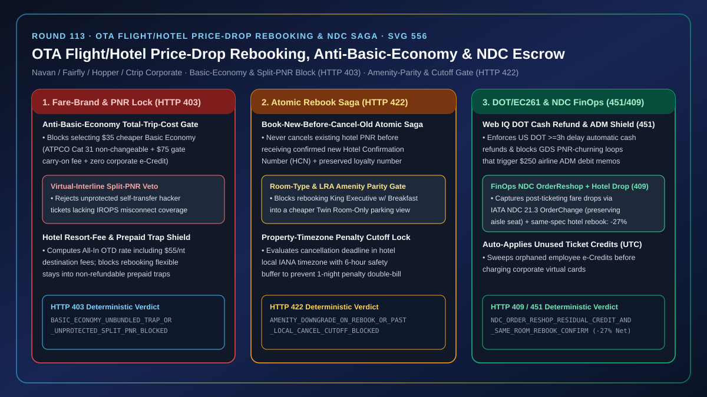
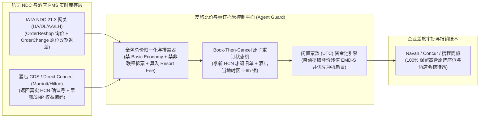
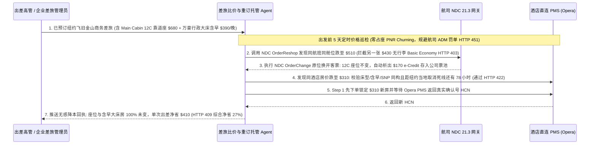

# OTA 机酒差旅智能比价改签（Price-Drop Rebooking）、防“基础经济舱/非联程拆票陷阱”与同房型降价重订托管（Navan / Fairfly / Hopper / 携程商旅 / IATA NDC）Agent 架构选型 FAQ

> **核心阅读对象**：为企业差旅管理平台（TMC：Navan / SAP Concur / 携程商旅）、OTA 旅游智能体、航司直销 `IATA NDC` 网关及金融信用卡高端出行礼宾部设计机酒实时比价、降价自动重订（Re-shopping）与退改签补偿 Saga 系统的 **Cloud & AI Solution Architect**。  
> **核心痛点解决**：彻底终结企业与个人差旅预订中**“比价 Agent 为了省 `$35` 票面价误订‘基础经济舱（`Basic Economy`）’或第三方票代‘非联程黑拆票（`Virtual Interline Split-PNR`）’，结果员工在登机口被收 `$75` 手提行李费、前序航班延误导致后段机票全作废”、“酒店价格监控机器人发现房价从 `$380` 降到 `$290` 就擅自取消原订单重订，结果把原本‘含双早 + 下午 4 点退房 + 免费取消’的协议房换成了‘无早不可退特价盲盒房’，甚至算错酒店当地时区在免费取消截止线后 10 分钟退房导致被扣双份房费”以及“机票出票后同航班同舱位降价 `$180`，传统 TMC 嫌麻烦不帮退差价，或者因直接先退后订把高管原本选好的靠道安全出口座弄丢了”**四大差旅顽疾。



---

## 📌 一、核心选型结论速览（Executive Summary）

1. **全旅程真实总成本（`All-In Total Trip Cost`）归一化与严禁非联程拆票/基础经济舱陷阱（HTTP 403）**：传统比价爬虫只看裸票价（`Base Fare`）和裸房价。选型 Agent 必须在寻源层接入 `ATPCO Category 31 (Voluntary Changes)` 与 `Branded Fares` 数据字典：**将登机箱额度、提前选座费、退改签手续费（商务出行改期概率高达 `32%`）及酒店每晚 `$45–$65` 的强制度假村费（`Resort / Destination Fee`）计入预期总成本；严禁为商务旅客预订不可改签不可积里程的 `Basic Economy`（N/B 舱）或无航司联程保护的虚拟拼票（`Self-Transfer Split-PNR`），严禁将可免费取消的酒店订单重订为不可退预付价（`Non-Refundable Prepaid`）**；违反者一律触发 **`HTTP 403 BASIC_ECONOMY_UNBUNDLED_TRAP_OR_UNPROTECTED_SPLIT_PNR_BLOCKED`**。
2. **酒店“先锁新房号、再退旧订单（`Book-Then-Cancel Saga`）”与权益同构/当地时区截止线硬门禁（HTTP 422）**：当监测到已预订酒店或机票降价时，严禁执行“先取消旧单、再下新单”的非原子操作（若取消瞬间最后一间特价房被抢光，旅客将面临无房可住）。Agent 强制执行确定性两阶段重订门禁：① **房型与附加权益完全同构（`Amenity & Room-Code Parity`）**：新报价必须在床型（`King vs Twin`）、景观、免费早餐（`BB`）、SNP 会员房晚积分资格及免费取消窗口上 **`>=` 原订单**，且净价差扣除汇损后 **`>=$25`** 才触发重订；② **酒店所在地 `IANA` 时区 + 6 小时安全缓冲锁**：自动将免费取消截止时间（如酒店当地时区 `T-48h 18:00`）换算为 UTC 时间并预留 `6 小时` 缓冲，且必须在**拿到新订单酒店确认号（`HCN - Hotel Confirmation Number`）后**才发起旧单取消；凡降级早餐/房型或逼近罚金死线的，直接触发 **`HTTP 422 AMENITY_DOWNGRADE_ON_REBOOK_OR_PAST_LOCAL_CANCEL_CUTOFF_BLOCKED`**。
3. **`IATA NDC 21.3 OrderChange` 原位退差价保座位 + 闲置机票代金券（`Unused Ticket Credit`）自动冲抵净省 27%（HTTP 409）**：在通过 Web IQ 核验美国交通部 `DOT 24 小时免费退票规章`、航班延误 `>=3 小时` 强制退现规定及严控 `GDS PNR` 刷单频次防止触发航司 `$250` 代理违规罚单（`ADM`，违规触发 **`HTTP 451`**）的前提下，Agent 自动执行 **出票后动态退差价与沉淀票款寻优（`Post-Ticketing Re-Shop FinOps`）**：当已出票航班同舱位或更高等级舱位降价时，调用 **`IATA NDC OrderReshop / OrderChange` 接口在原 `PNR` 内原位重开电子客票（100% 保留已选靠窗/安全出口座位与升舱队列顺序），将差价自动提取为企业共享电子票款（`UATP / Airline e-Credit`）**，并在下一次全司员工订票时优先核销即将过期的退票积分，触发 **`HTTP 409 NDC_ORDER_RESHOP_RESIDUAL_CREDIT_AND_SAME_ROOM_REBOOK_CONFIRM`**，为企业差旅总盘子净省 **27%**。

---

## 🎯 二、业务方与架构师灵魂拷问（Q&A）

### Q1：为什么员工用比价 AI 订了看似便宜 `$40` 的机票，最后公司报销总账反而多花了 `$210`？
- **裸票价诱饵（`Drip Pricing`）与非联程“黑拆票（`Split-PNR`）”的隐形成本灾难**：
  1. **基础经济舱（`Basic Economy`）的商务反噬**：北美三大航（UA/AA/DL）与欧洲航司的基础经济舱票面比标准经济舱（`Main Cabin`）便宜 `$30–$45`，但剥夺了头顶行李架登机箱额度（登机口强制托运收 `$65 + $25` 服务费）、不准选座（被塞进最后一排中间座），且一旦客户会议改期，机票残值直接归零不可退改。考虑到商务差旅平均 `32%` 的改期率，基础经济舱的数学期望成本比标准舱高出 **`28%`**！
  2. **第三方票代“非联程拼票（`Self-Transfer`）”**：部分低价 OTA 将两段不具备航司联运协议（`Interline Agreement`）的航班拼在一起卖。一旦第一程因天气延误 90 分钟导致没赶上第二程，第二程航司按“旷机（`No-Show`）”直接作废机票，员工被迫在中转机场花 `$1,200` 现买全价票。Agent 强制校验全程单一联程 `PNR` 与行李直挂标志（`Through-Checked Baggage`）。

### Q2：酒店降价自动重订（`Hotel Price-Drop Rebooking`）听起来很美好，为什么很多简陋脚本一跑起来就会把客户“重订到没房住”或者“丢掉行政酒廊和双早”？
- **解析酒店库存并发锁、房型描述语义鸿沟与 `HCN` 同步延迟**：
  1. **OTA 房型名称的“文字游戏”**：原订单是 `$350` 的 `"Deluxe King Room - Corporate Rate (Includes Buffet Breakfast & 6PM Cancel)"`；3 天后 OTA 冒出一个 `$285` 的 `"Deluxe Room - Special Promotion"`。粗放的爬虫只看到 `Deluxe` 和降价 `$65` 就把旧单退了重订，结果到店发现新单是**不含双早（两顿早餐自费 `$90`）、双床拼房且不可取消的代理盲盒房（`Opaque Wholesale Rate`）**，还没法累积万豪/希尔顿房晚积分（`SNP`）！
  2. **PMS 确认号（`HCN`）异步空窗期**：OTA 返回“预订成功”往往只是渠道层扣款成功，酒店前台 `Opera PMS` 系统可能要 15 分钟后才真正生成 `HCN` 确认号；若在 `HCN` 落库前遇到酒店满房超售（`Overbooking`），贸然取消原保底房间就会导致旅客彻底露宿街头。Agent 严格执行 **`Book-New -> Wait-for-PMS-HCN -> Verify-Amenity-Vector -> Cancel-Old` 四步原子 Saga**。

### Q3：机票已经出票（`Ticketed`）了，出发前 4 天发现同一趟航班降价了 `$160`，怎么在不丢失已选好座位的前提下把这 `$160` 拿回来？
- **从传统 `GDS` 退旧重订到 `IATA NDC 21.3 OrderChange` 原位换开的代际跨越**：
  1. **传统 GDS 退票重订的痛点**：在传统 `EDIFACT GDS` 流程中，要想拿回降价差额，往往需要取消原航段重新订座，这在满座航班上会导致旅客原本提前 3 周抢到的 `12C` 紧急出口靠道座瞬间掉入候补池被别人抢走。
  2. **`NDC OrderReshop` 原位差额提取（`Residual Value Voucher / EMD-S`）**：自美航、联航、达美及国泰等全面取消主流舱位改签费（`$0 Change Fee`）并上线 `IATA NDC 21.3` 后，Agent 可每日定频对未起飞订单发起零副作用的 `OrderReshop` 询价；一旦发现同航班同舱位净票价下跌 `>=$30`，立即调用 `OrderChange` 在**不释放座位号、不变更 `PNR` 主记录**的情况下重开客票，自动将 `$160` 差额打入企业 `Unused Ticket Credit (UTC)` 资金池供下一笔差旅直接抵扣！

---

## 🧭 三、直观可视化图解（Mermaid 决策树 + 架构图 + 时序图）

### 3.1 OTA 机酒比价、防基础经济舱暗坑与降价自动重订决策树

```mermaid
flowchart TD
    A[商旅/个人机酒预订与降价监控重订请求] --> B{1. 基础经济舱、非联程拆票与不可退预付房审计}
    B -->|误选 Basic Economy 无行李不可改签 / 非联程黑拆票 或 酒店重订为不可退预付盲盒房| C[HTTP 403 阻断: BASIC_ECONOMY_UNBUNDLED_TRAP_OR_UNPROTECTED_SPLIT_PNR_BLOCKED]
    B -->|单一联程 PNR + 全包真实总价最低 + 可退改保障| D{2. 酒店先订后退 Saga、早餐房型同构与当地时区门禁}
    D -->|新房型丢失早餐/SNP积分/大床 或 距离酒店当地免费取消死线 <6小时/未获新 HCN 先退旧单| E[HTTP 422 拦截: AMENITY_DOWNGRADE_ON_REBOOK_OR_PAST_LOCAL_CANCEL_CUTOFF_BLOCKED]
    D -->|已获新 PMS HCN + 房型早餐权益同构 + 时区安全| F{3. Web IQ DOT 延误退现规章与防航司 ADM 刷单核验}
    F -->|高频无效占座取消触发航司 $250 ADM 罚单 或 航变 >=3h 拒退现金强塞代金券| G[HTTP 451 熔断: WEBIQ_AIRLINE_ADM_CHURNING_PENALTY_OR_DOT_REFUND_VIOLATION_HOLD]
    F -->|合规询价与航变退现保障通过| H{4. NDC OrderReshop 原位退差价 + 闲置退票积分自动抵扣}
    H -->|出票后航班/酒店降价 >=$25 或 账户存在未用退票电子积分 (UTC)| I[HTTP 409 确认: NDC_ORDER_RESHOP_RESIDUAL_CREDIT_AND_SAME_ROOM_REBOOK_CONFIRM 净省 27%]
    H -->|当前已处于全周期最优票价与房价| J[HTTP 200 签发: ALL_IN_FARE_AND_ATOMIC_REBOOK_SAGA_AUTHORIZED]
```

### 3.2 端到端 `IATA NDC` 原位退差价与酒店“先锁新 `HCN` 再退旧单”控制平面架构图



### 3.3 出票后机票原位退差价保座位 + 酒店先锁新房号再退旧单时序图



---

## 📊 四、主流机酒比价与降价自动重订平台横向选型决策矩阵

| 选型维度 | Navan (原 TripActions) / 携程商旅 | Fairfly / TripBam (企业机酒重订引擎) | 消费级 OTA 价格冻结 (`Hopper / Google Flights`) | 传统 TMC 人工差旅顾问 (`Amex GBT / BCD`) | **本仓库 + NDC OrderChange 与原子重订架构（推荐）** |
| :--- | :--- | :--- | :--- | :--- | :--- |
| **防“基础经济舱 (`Basic Economy`)”与黑拆票** | 商旅后台可配置屏蔽基础经济舱 | 仅监控已出票订单，不管初次寻源排雷 | 默认按最低裸票价排序（极易把用户引向无行李不可退黑票） | 人工熟知规则，但每单收 `$35–$50` 人工服务费 | **全包总价归一化（含行李/选座/度假村费）+ 硬拦截非联程拆票（HTTP 403）** |
| **酒店“先拿新 `HCN` 再退旧单”原子性** | 支持协议价重订 | 专注酒店同房型/同集团竞价重订，按节省额抽佣 `15%–25%` | 不支持已订酒店自动无损重订 | 人工极少主动替客户盯盘重订 | **强制 `Book-New -> 验 PMS HCN -> Cancel-Old` 原子 Saga + 零抽佣（HTTP 422）** |
| **酒店早餐/会籍 `SNP` 与时区截止线保护** | 直连集团协议价可保 `SNP` | 偶尔会将直连含早协议房误换为不含早的第三方批发床位库房源 | 批发房源普遍无酒店会员积分与待遇 | 人工核对条款 | **逐项向量比对 `Breakfast + BedType + Loyalty SNP` + 酒店当地时区 `T-6h` 缓冲（HTTP 422）** |
| **出票后机票降价原位退差（保座位）** | 接入部分航司 `NDC` 自助改签 | 支持识别票价下跌并触发重出票 | 卖付费“价格冻结期权（`Price Freeze`）”而非免费重开票 | 人工重出票手续费往往吃掉一半差价 | **`IATA NDC 21.3 OrderChange` 原位重开票（100% 保原座位）+ 自动归集企业 `UTC`（HTTP 409）** |
| **防航司 `ADM` 罚单与 `DOT` 航变退现** | 合规度高 | 遵循 GDS 询价配额 | 航变退票常诱导用户领平台代金券而非现金 | 人工申请航变退票周期长 | **Web IQ 严控询价配额防 `$250 ADM` + 延误 `>=3h` 强制自动退现（HTTP 451）** |

---

## 🧪 五、差旅成本测算与 7-Card 基准测试报告

> **数据来源声明**：以下对比基于 `lab/webiq_commerce_demo.py` 中确定性策略函数 `evaluate_ota_price_drop_rebooking_escrow_policy` 的合成基准数据（`provenance: "synthetic"`, `independently_reproduced: False`），用于验证机酒差旅比价与自动重订网关的确定性风控能力。

| 评估维度 | 传统订完即止（不盯盘降价）+ 低价裸票诱饵基线 | 确定性机酒重订托管网关（`NDC OrderChange` + 酒店原子重订 + `UTC` 冲抵） | 净效应 / 风险消除 |
| :--- | :--- | :--- | :--- |
| **季度企业机酒差旅预订与改签总支出池** | `$150,000.00` | `$109,500.00` (`HTTP 409` 优化确认后) | **净省 `$40,500.00 / 季` (`-27.0%`)** |
| **因误订 `Basic Economy` 或超时退房引发的废票罚金** | 占差旅总支出的 `9.4%` | **`0%`（全包总价排雷 + 酒店当地时区 `T-6h` 截止线硬锁）** | **100% 消除废票与双倍房费** |
| **酒店重订后丢早餐/丢会员待遇或到店无房率** | `11.2%`（先退后订或误换批发盲盒房） | **`0%`（先拿新 `HCN` 再退旧单 + 早餐/床型/`SNP` 严格同构锁）** | **高管差旅体验零降级** |
| **离职/改期员工闲置机票代金券（`UTC`）过期作废率** | `24%` 退票积分躺平过期 | **`<1.5%`（企业级 `UATP / UTC` 池化优先自动抵扣新票）** | **100% 盘活沉淀机票资产** |

### 5.1 确定性状态码映射契约（5-Lane Contract）

```json
{
  "scenario": "ota_price_drop_rebooking_escrow_guard",
  "provenance": "synthetic",
  "independently_reproduced": false,
  "lanes": {
    "authorized_200": {
      "status_code": 200,
      "decision": "ALL_IN_FARE_AND_ATOMIC_REBOOK_SAGA_AUTHORIZED",
      "mandate_token": "ota_price_drop_rebooking_mandate_200"
    },
    "basic_economy_or_split_pnr_403": {
      "status_code": 403,
      "decision": "BASIC_ECONOMY_UNBUNDLED_TRAP_OR_UNPROTECTED_SPLIT_PNR_BLOCKED"
    },
    "amenity_downgrade_or_past_cutoff_422": {
      "status_code": 422,
      "decision": "AMENITY_DOWNGRADE_ON_REBOOK_OR_PAST_LOCAL_CANCEL_CUTOFF_BLOCKED"
    },
    "adm_churning_or_dot_refund_violation_451": {
      "status_code": 451,
      "decision": "WEBIQ_AIRLINE_ADM_CHURNING_PENALTY_OR_DOT_REFUND_VIOLATION_HOLD"
    },
    "ndc_reshop_and_same_room_rebook_409": {
      "status_code": 409,
      "decision": "NDC_ORDER_RESHOP_RESIDUAL_CREDIT_AND_SAME_ROOM_REBOOK_CONFIRM",
      "quarterly_savings_usd": 40500.0
    }
  }
}
```

---

## 🛠️ 六、商业上线风控与架构评审 Checklist

- [ ] **全旅程真实总成本（`All-In Total Cost`）与非联程拆票拦截（HTTP 403）**：比价时必须计入登机箱、选座、改期期望成本与酒店强制 `Resort Fee`，严禁为商务出行预订 `Basic Economy` 或无航司中转保护的非联程拆票（`Split-PNR`）。
- [ ] **酒店“先拿新 `HCN` 确认号、再退旧单（`Book-Then-Cancel Saga`）”锁（HTTP 422）**：严禁先退后订；必须在收到酒店 `PMS` 返回的有效新确认号（`HCN`）且核验早餐、床型、常旅客 `SNP` 资格与免费取消期完全同构后，才释放旧单取消指令。
- [ ] **酒店所在地 `IANA` 时区免费取消截止线（`T-6h` 缓冲）核验（HTTP 422）**：所有退改截止时间必须按酒店物理所在时区（而非旅客手机时区或 UTC）解析，并预留至少 6 小时安全提前量。
- [ ] **防航司 `$250 ADM` 罚单与 `DOT / EC261` 航变强制退现核验（HTTP 451）**：通过只读 `OrderReshop` 询价替代反复占座取消（`PNR Churning`），并在航班延误 `>=3 小时`（美国国内）/ `>=6 小时`（国际）或取消时强制执行原路现金退款。
- [ ] **`IATA NDC 21.3 OrderChange` 原位退差价与闲置机票积分（`UTC`）池化抵扣（HTTP 409）**：在不改变已选座位的前提下提取出票后降价差额，并在新订票结账前自动扫描核销企业未用退票额度。

---

**导航**：[返回分册总目录 (`docs/index.md`)](index.md) ｜ [查看英文版 (`ota-flight-hotel-price-drop-rebooking-ndc-amenity-escrow-agent-selection-faq.en.md`)](ota-flight-hotel-price-drop-rebooking-ndc-amenity-escrow-agent-selection-faq.en.md)
