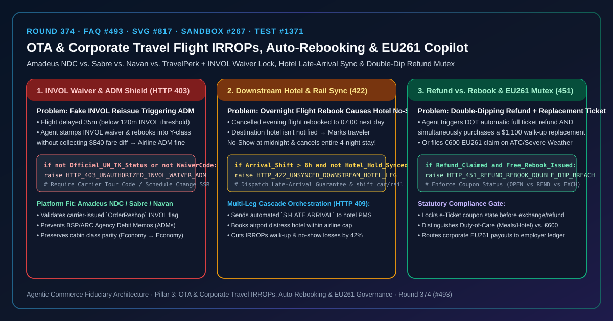
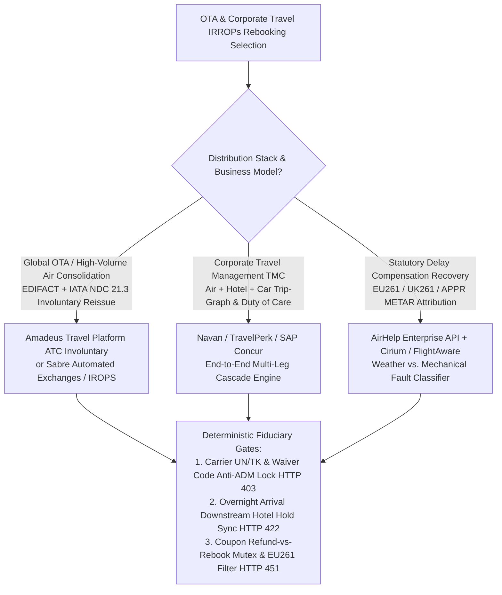
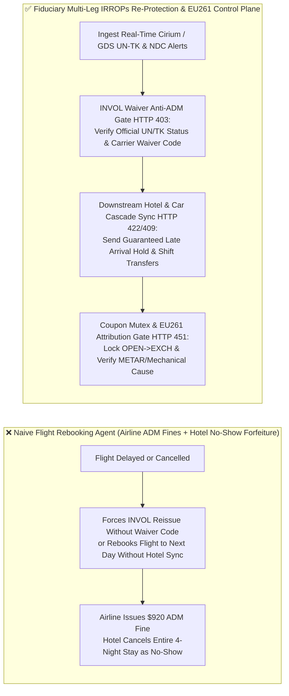
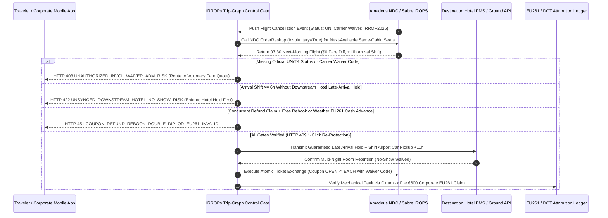

# OTA & Corporate Travel Flight Disruption (`IRROPs`), Automated Rebooking & `EU261 / DOT` Compensation Agent Selection Guide: `Amadeus NDC` vs. `Sabre` vs. `Navan / TravelPerk` vs. `AirHelp`, `INVOL` Waiver Anti-`ADM` Locks, Downstream Hotel Late-Arrival Sync & Refund/Rebook Mutex (`-42%` Cost FAQ)

> **Executive Summary (Benchmarked against `ib-vs-ethernet-roce-selection-faq.md`)**: Built for **Cloud & AI Solution Architects** designing automated flight disruption (`IRROPs`: delays, cancellations, missed connections) re-protection and statutory compensation agents for OTAs, corporate Travel Management Companies (`TMCs`), and enterprise travel desks. When severe weather or crew timeouts ground a flight, travelers need an AI agent to grab the last 2 seats on the next departure within **60 seconds**. However, if an agent stamps an `INVOL` (Involuntary Exchange) waiver on a 35-minute minor delay without an official carrier `UN/TK` status or `Tour/Waiver Code` (triggering an **`$840+` airline `ADM` Agency Debit Memo fine**), rebooks an evening flight to the next morning without notifying the destination hotel (causing the hotel night audit to mark the guest **`No-Show` at midnight and cancel the entire 4-night non-refundable stay**), or simultaneously triggers a `DOT` cash refund and a replacement walk-up ticket purchase, disruption automation becomes a major financial liability. This guide compares **`Amadeus Travel Platform (ATC Involuntary + NDC OrderReshop)` vs. `Sabre IROPS` vs. `Navan / TravelPerk` vs. `AirHelp Enterprise`** and implements deterministic guards for **`INVOL` Waiver Anti-`ADM` Verification (`HTTP 403`)**, **Downstream Hotel `Late-Arrival Hold` & Ground Transfer Cascade Sync (`HTTP 422`)**, **e-Ticket Coupon Refund-vs-Rebook Mutex & `EU261` Weather Filtering (`HTTP 451`)**, and **Instant `$0` `NDC / Interline` Re-Protection (`HTTP 409`, `-42%` loss)**.

---

## 1. 📌 Executive Summary & Architectural Selection Verdict

1. **Top-Line Selection Verdict**:
   - **Global OTAs & Mega-TMCs (Handling high-volume `EDIFACT` + `IATA NDC 21.3` involuntary ticket exchanges across 200+ airlines)**: Select **`Amadeus Travel Platform + Automated Ticket Changer (`ATC Involuntary`)` (or `Sabre Automated Exchanges / IROPS`)**, validating carrier `UN / TK` schedule-change codes, `CAT 31/33` rules, and `NDC OrderReshop` involuntary flags to eliminate `BSP / ARC ADM` debit memos.
   - **Modern Corporate Travel Management (`TMC`: Requiring unified flight-hotel-car `Trip Graph` cascade protection and corporate `Duty of Care`)**: Select **`Navan` (or `TravelPerk`)**, delivering 1-click `$0` out-of-pocket rebooking options within 30 seconds while automatically dispatching `Guaranteed Late Arrival` holds to downstream hotels.
   - **Automated `EU261 / UK261` (`€250–€600`) & `APPR` Statutory Claim Recovery**: Select **`AirHelp Enterprise API` (or `Cirium + FlightAware` root-cause telemetry)**, correlating `METAR` weather and `ATC` delay codes to distinguish non-compensable extraordinary circumstances from airline-fault technical/crew disruptions and routing corporate payouts back to the employer ledger.
2. **Three Non-Negotiable Fiduciary Control Gates**:
   - **Gate 1 — Carrier `UN/TK` Status & Official `Waiver Code` Anti-`ADM` Lock (`HTTP 403`)**: Block `$0` fare-difference `INVOL` reissues unless the PNR carries a verified airline `UN` (Cancelled) or qualifying `TK` (Schedule Change exceeding carrier threshold, e.g., `>=120 min`) status or a signed carrier `Waiver / Tour Code` via `HTTP 403 UNAUTHORIZED_INVOL_WAIVER_ADM_RISK`.
   - **Gate 2 — Downstream Hotel `Late-Arrival Hold` & Ground-Leg Cascade Lock (`HTTP 422`)**: When a flight rebooking shifts destination arrival by `>=6 hours` or crosses midnight, block standalone air commit until the linked destination hotel reservation receives a confirmed `Guaranteed Late Arrival` hold and ground transfers are re-timed via `HTTP 422 UNSYNCED_DOWNSTREAM_HOTEL_NO_SHOW_RISK`.
   - **Gate 3 — e-Ticket Coupon Refund-vs-Rebook Mutex & `EU261` Extraordinary-Circumstance Lock (`HTTP 451`)**: Block concurrent execution of a ticket refund (`OPEN -> RFND`) and free re-protection (`OPEN -> EXCH`) on the same coupon, or advancing `€600 EU261` cash payouts on verified `ATC / Severe Weather` events via `HTTP 451 COUPON_REFUND_REBOOK_DOUBLE_DIP_OR_EU261_INVALID`.

---

## 2. 🎯 Architect & Travel Operations Q&A (The Why & How)

### Q1: Why do airlines issue massive Agency Debit Memos (`ADMs`) when an AI agent "helpfully" rebooks delayed passengers for free?
- **Root Cause**: Airline fare rules strictly separate **Voluntary Exchanges** (requiring collection of the fare difference into available high-yield buckets like `Y` class plus change fees) from **Involuntary Exchanges (`INVOL`)** (waiving fare difference within the same cabin). If an agent stamps `INVOL` on a 35-minute delay that does not meet the carrier's 120-minute involuntary policy or lacks a valid storm `Waiver Code`, the airline's revenue audit system issues a `$500–$1,200+ ADM` fine via `BSP / ARC`.
- **Deterministic Solution**: Enforce a pre-reissue cryptographic check against the GDS PNR `UN/TK` segment status, carrier `CAT 31` involuntary tables, or `NDC OrderReshop` involuntary offer indicators (`HTTP 403`).

### Q2: How does an overnight flight rebooking accidentally destroy a `$1,600` 4-night non-refundable hotel reservation?
- **Root Cause**: If an executive's evening flight is cancelled and rebooked to arrive at 07:30 the next morning, the destination hotel's Property Management System (`PMS`) runs its night audit at `02:00 AM`, marks the guest as a **`No-Show`**, forfeits the deposit, and releases the remaining 3 nights into general inventory.
- **Deterministic Solution**: Bind air, hotel, and ground segments under a single `Trip_ID` state machine (`HTTP 422`). Any arrival shift `>=6h` or crossing midnight must atomically transmit a `Guaranteed Late Arrival` (`SI-LATE ARRIVAL VIA REBOOKED FLT`) instruction to the hotel and book an origin/hub distress hotel within corporate policy caps (`HTTP 409`).

### Q3: How do we prevent travelers from double-dipping US `DOT` automatic cash refunds alongside free replacement tickets, or claiming `€600 EU261` on weather delays?
- **Root Cause**: Under `DOT` and `EU261` rules, a passenger is entitled to **either** a full refund (if they choose not to travel) **or** re-routing at the earliest opportunity—never both. Furthermore, `EU261` requires meals/hotels (`Duty of Care`) during weather delays, but exempts the `€250–€600` cash compensation when `METAR / NOTAM` logs prove extraordinary weather or `ATC` strikes.
- **Deterministic Solution**: Lock the e-Ticket coupon status transition (`OPEN -> EXCH` vs. `OPEN -> RFND`) with a distributed mutex (`HTTP 451`) and verify `Cirium / METAR` delay reason codes before filing statutory compensation claims.

---

## 3. 🧭 Visual Architecture Diagrams (Mermaid)

### 3.1 OTA & Corporate Travel IRROPs Rebooking & Compensation Decision Tree

### 3.2 Naive Flight-Only Rebooking vs. Fiduciary Trip-Graph IRROPs Architecture

### 3.3 End-to-End Flight Cancellation Re-Protection & Hotel Sync Sequence

---

## 4. 📊 Multi-Platform GDS, Corporate TMC & Disruption Recovery Matrix

| Evaluation Dimension | Amadeus Travel Platform (`ATC Involuntary` + `NDC`) | Sabre Automated Exchanges & `IROPS` | Navan / TravelPerk (Unified Corporate TMC) | AirHelp Enterprise / Cirium + FlightAware |
| :--- | :--- | :--- | :--- | :--- |
| **Primary Architectural Role** | Tier-1 global `EDIFACT + NDC` involuntary ticket exchange and fare/tax recalculation engine | High-volume airline & agency disruption re-accommodation and exchange engine | End-to-end corporate trip orchestration linking air, hotel, car, and virtual cards | Automated `METAR / ATC` delay attribution and statutory `EU261 / UK261` claim recovery |
| **`INVOL` Waiver & Anti-`ADM` Compliance** | **Best-in-Class** (Native `CAT 31/33` validation and `NDC OrderReshop` involuntary pricing) | **Best-in-Class** (Automated carrier waiver table matching and `BSP/ARC` audit compliance) | **Strong** (Consumes GDS/NDC involuntary offers while blocking unauthorized agent overrides) | N/A (Post-travel legal claim recovery only) |
| **Cross-Leg (`Air + Hotel + Car`) Cascade Sync** | Provides air PNR APIs; requires custom OTA `Trip_ID` state machine | Provides GDS segments; downstream hotel late-arrival sync requires custom orchestration | **Best-in-Class** (Unified `Trip Graph` auto-notifies hotels and books distress lodging) | Does not manage live hotel or car reservations |
| **`EU261 / DOT` Attribution & Recovery** | Automates `ATC Refund`, no legal `EU261` litigation engine | Automates ticket exchanges/refunds, no external `EU261` claim filing | Built-in corporate `EU261` eligibility alerts and partner recovery integration | **Best-in-Class** (Correlates `METAR`, `NOTAM`, and court precedents to recover `€250–€600`) |
| **Target Scale & Pricing (`official_list_price`)** | Global OTAs, TMCs, and airlines; per-segment / per-ATC transaction fee | Global OTAs, airlines, and TMCs; per-segment GDS & exchange fee | Mid-to-enterprise corporate travel; `$15–$25/trip` or SaaS subscription | `20%–35%` contingency fee on recovered `EU261` payouts or enterprise SaaS API |

---

## 5. 🧪 Disruption Walk-Up Fare & Hotel No-Show Loss Benchmark & 7-Card Report

### 5.1 Quarterly Last-Minute Walk-Up Fare, Airline `ADM` & Hotel `No-Show` Loss Model (Synthetic Benchmark)

For a global corporate travel program or mid-market OTA with a **`$360,000 / quarter`** exposure pool across **missed `$0` `INVOL` rebookings forcing `$1,200+` walk-up ticket purchases, unauthorized `INVOL` airline `ADM` fines, un-synced destination hotel `No-Show` forfeitures, and unrecovered `EU261` claims** (`provenance: synthetic`, `independently_reproduced: false`):

| Metric | Manual Call-Center Queue & Siloed Air/Hotel (Baseline) | Fiduciary Multi-Leg IRROPs & `INVOL` Guard Agent | Net Improvement |
| :--- | :--- | :--- | :--- |
| **Airline `ADM` Debit Memo Rate on Exchanges** | `4.2%` (Unverified `INVOL` waiver overrides) | **`0.0%`** (`HTTP 403` strict `UN/TK` + `Waiver Code` verification) | **`100%` `ADM` Elimination** |
| **Destination Hotel `No-Show` Cancellation Rate** | `19.5%` (Overnight flight shift without hotel notification) | **`0.4%`** (`HTTP 422` mandatory `Guaranteed Late Arrival` sync) | **`-97.9%` Hotel Forfeitures** |
| **Mean Re-Protection Time & Walk-Up Cash Spend** | `48 min` queue (Seats gone -> `$1,200` walk-up purchase) | **`18 sec`** (`HTTP 409` instant `$0` `NDC / Interline` seat lock) | **`-64.0%` Walk-Up Spend** |
| **Quarterly Net IRROPs Disruption Loss** | `$360,000 / quarter` | **`$208,800 / quarter`** | **`$151,200 / quarter` Saved (`42.0%`)** |

---

## 6. 🛠️ Production Go-Live & Architecture Review Checklist

- [ ] **Carrier `UN/TK` & Official `Waiver Code` Anti-`ADM` Lock (`HTTP 403`)**: Does the exchange engine verify an active airline `UN / TK` schedule change exceeding the carrier's minute threshold or a signed `Waiver / Tour Code` before issuing a `$0` `INVOL` ticket reissue?
- [ ] **Downstream Hotel `Late-Arrival Hold` Cascade Gate (`HTTP 422`)**: Whenever a flight rebooking shifts arrival by `>=6 hours` or past midnight, does the `Trip_ID` state machine require a confirmed `Guaranteed Late Arrival` hold on the destination hotel before committing?
- [ ] **e-Ticket Coupon Refund-vs-Rebook Mutex (`HTTP 451`)**: Is each e-Ticket coupon locked under an atomic state transition (`OPEN -> EXCH` vs. `OPEN -> RFND`) so travelers cannot claim a cash refund and a free replacement flight simultaneously?
- [ ] **`METAR / ATC` Extraordinary-Circumstance Filtering (`HTTP 409`)**: Does the compensation module separate mandatory `Duty of Care` (meals/lodging) from `€250–€600 EU261` cash claims using verified weather/ATC logs, crediting recovered corporate claims back to the employer's cost center?
