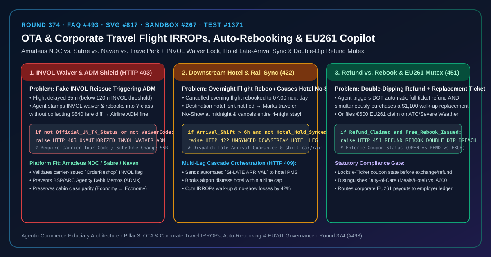
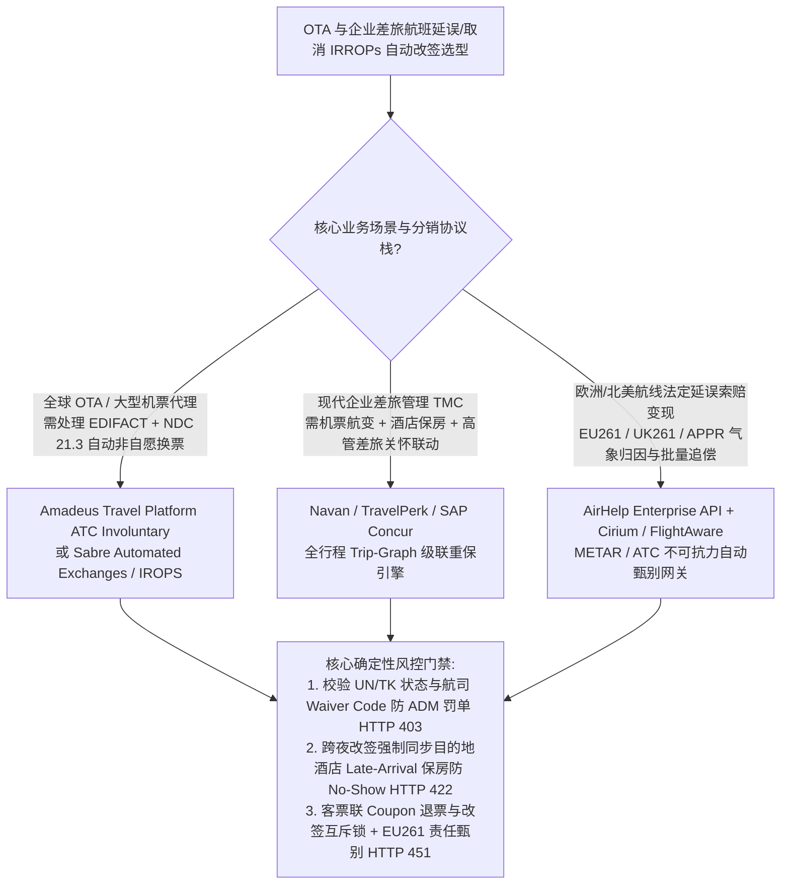
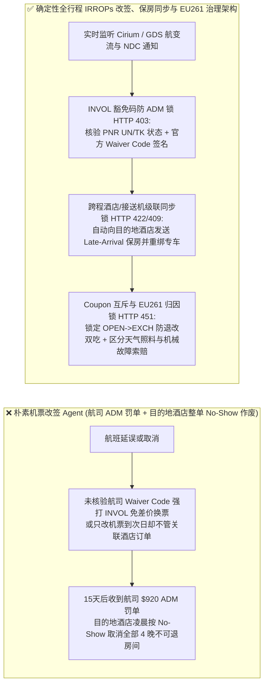
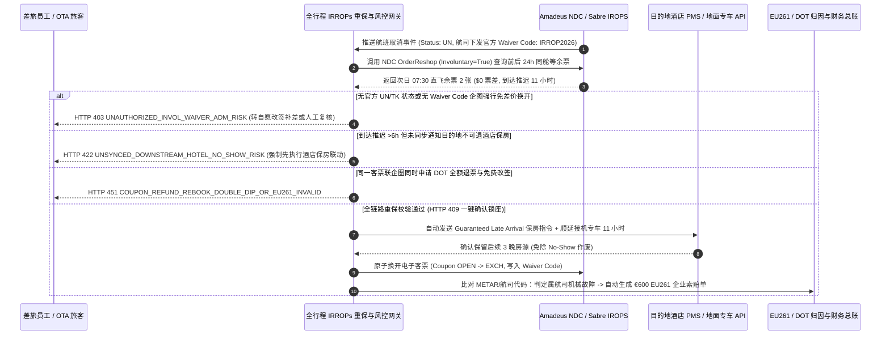

# OTA 与企业差旅航班延误/取消（`IRROPs`）自动改签、跨航司签转与 `EU261 / DOT` 赔付 Agent 架构选型对比：`Amadeus NDC` vs. `Sabre` vs. `Navan / TravelPerk` vs. `AirHelp`、航司非自愿改签豁免码（`INVOL Waiver`）防罚单锁、下游酒店防 `No-Show` 联动门禁及退票/改签互斥锁净省 42% 决策指南（FAQ）

> **导读（对齐 `ib-vs-ethernet-roce-selection-faq.md` 标杆风格）**：本文面向在线旅游平台（OTA）、企业差旅管理平台（TMC）与航司直销渠道的 **Cloud & AI Solution Architect**。在雷暴或空管流控引发大面积航班不正常（`IRROPs`: Irregular Operations）时，旅客最需要 AI 差旅助手在 **60 秒内** 抢下下一班剩余的 2 个座位。然而，如果 Agent 在未拿到航司官方非自愿改签豁免码（`INVOL Waiver / Tour Code`）时就擅自免除 `$840` 舱位差价强行换开全价经济舱 `Y` 舱（导致旅行社收到航司高额 **`ADM` 代理商罚单**），或把今晚取消的航班改签到次日早上 07:00 却忘了通知目的地酒店保留房间（导致酒店在凌晨 00:00 按 **`No-Show` 取消整段 4 晚不可退预订**），又或在同一张电子客票上同时触发“美国 DOT 自动全额退票”与“免费改签新航班”造成双重赔付穿仓，将直接引爆巨额资损。本文给出 **`Amadeus Travel Platform (NDC OrderReshop)` vs. `Sabre IROPS` vs. `Navan / TravelPerk` vs. `AirHelp / Skycop`** 的横向选型矩阵，并落地 **航司 `INVOL` 非自愿豁免码防 `ADM` 罚单锁（`HTTP 403`）**、**跨程目的地酒店晚到保房（`Late-Arrival Hold`）与接送机级联同步门禁（`HTTP 422`）**、**电子客票联（`e-Ticket Coupon`）退票与免费改签互斥及 `EU261` 不可抗力甄别锁（`HTTP 451`）** 及 **同联盟/跨航司 `NDC` 零差价优先抢座编排（`HTTP 409`，净省 42%）**。



---

## 一、 📌 核心选型结论速览（Executive Summary）

1. **终极选型结论（一句话先看懂怎么选）**：
   - **全球大型 OTA 与航司混合分销底座（需同时处理传统 `EDIFACT` 电子客票换开与 `IATA NDC 21.3` 原生非自愿免费改签 `OrderReshop (INVOL)`）**：首选 **`Amadeus Travel Platform (ATP) + Automated Ticket Changer (ATC Involuntary)`（或 `Sabre Automated Exchanges / IROPS`）**，由 GDS 自动校验航司在 PNR 中写入的 `UN / TK` 航变状态码与官方 `Waiver Code`，从根源上免疫 `BSP / ARC ADM` 罚单。
   - **高体验企业差旅管理（TMC：需将机票航变与下游协议酒店保房、租车、高管差旅安全关怀 `Duty of Care` 实时打通）**：首选 **`Navan`（或 `TravelPerk`）**，支持在航班取消后 30 秒内推送 3 套零自付（`$0 Out-of-Pocket`）重保方案，并自动向目的地酒店发送 `Late-Arrival Hold` 保房指令。
   - **欧盟 `EU261 / UK261`（`€250–€600`）与加拿大 `APPR` 法定延误赔偿自动比对 METAR 气象/空管电报与批量索赔**：首选 **`AirHelp Enterprise API`（或 `FlightAware + Cirium` 延误归因网关）**，精准区分“天气/空管不可抗力（仅享食宿照料权，无现金赔偿）”与“航司机械故障/机组超时（可索赔 `€600`）”，并将企业差旅获赔款项自动归集回公司差旅成本中心。
2. **三大财务与票务合规红线（确定性门禁）**：
   - **红线 1（拦截无航司官方 `UN/TK` 航变标记或无 `Waiver Code` 擅自按 `INVOL` 免差价换开客票引发航司 `ADM` 罚单 / `HTTP 403`）**：当航班仅轻微延误（如延误 35 分钟，未达航司 120/180 分钟非自愿改签阈值）且 PNR 未收到航司 `UN/TK` 状态或有效 `Travel Waiver Code` 时，若 Agent 擅自写入 `INVOL` 标识免收 `$840` 票价差额与改签费换开高舱位，航司将在结算审计时向 OTA/TMC 下发全额差价 + `$75` 手续费的 **`ADM`（Agency Debit Memo）罚单**。控制平面必须触发 `HTTP 403 UNAUTHORIZED_INVOL_WAIVER_ADM_RISK`。
   - **红线 2（拦截隔夜改签跨度 `>6 小时` 未同步通知下游目的地酒店保房导致整单 `No-Show` 作废 / `HTTP 422`）**：商务旅客原定周三 21:00 飞抵伦敦入住 4 晚不可退酒店（`$1,600`），因航班取消被 Agent 改签至周四早 07:30 到达；若 Agent 未向酒店 PMS/GDS 发送“保留首晚房型至次日中午（`Guaranteed Late Arrival`）”，酒店夜审系统会在周四凌晨 02:00 将该旅客标记为 **`No-Show`（未入住）并直接取消释放全部 4 晚房间且不退分文**！当 `Arrival_Delay_Hours >= 6` 且存在关联酒店/包车订单未完成同步确认时，触发 `HTTP 422 UNSYNCED_DOWNSTREAM_HOTEL_NO_SHOW_RISK`。
   - **红线 3（拦截同一客票联 `Coupon` 既申请全额退票又免费改签的双重套利及对不可抗力天气延误违规承诺 `€600 EU261` 赔偿 / `HTTP 451`）**：电子客票联状态（`OPEN`）只能向 `RFND`（退票）或 `EXCH`（换开改签）单向流转一次；若并发触发退票与外航现金重买，或对台风/空管罢工（`Extraordinary Circumstances`）错误垫付 `€600` 欧盟赔偿，触发 `HTTP 451 COUPON_REFUND_REBOOK_DOUBLE_DIP_OR_EU261_INVALID`。

---

## 二、 🎯 业务方与架构师灵魂拷问 Q&A（The Why & How）

### Q1：航班一取消，全机 180 名乘客都在抢下一班仅剩的 8 个空位，AI Agent 怎样才能既做到“秒级免费改签”，又绝对不会因为用错舱位或豁免码吃航司的 `ADM` 巨额罚单？
- **商业痛点与事故还原**：
  - 传统机票预订的改签分两种：**自愿改签（Voluntary Exchange）** 必须补齐当前剩余高舱位（如全价 `Y` 舱）与原特价舱（如 `K` 舱）的巨大差价 + 改签手续费；而 **非自愿改签（Involuntary Reissue, `INVOL`）** 允许在同物理舱等（如经济舱内部）忽略子舱位差价免费改签。
  - 某 OTA 的 AI 客服为了讨好抱怨“飞机晚点 40 分钟”的旅客，调用底层换票接口时硬编码传了 `involuntary = true`，帮旅客免费换到了下一班全价 `Y` 舱。15 天后，航司通过 IATA BSP 结算系统向该 OTA 开具 **`$920 ADM` 罚单**（因为晚点不足 2 小时根本不符合该航司非自愿改签政策）。
- **架构师确定性解法（PNR `UN/TK` 状态 + 航司 `Waiver Code` 签名核验 + `NDC OrderReshop` 零差价优先队列）**：
  1. **强校验航司官方非自愿触发源（`HTTP 403`）**：只有在满足以下任一加密验证条件时，才解锁 `INVOL` 免差价改签通道：**①** 航司向 PNR 推送了 `UN`（Unable - 航班取消）或超过航司规定阈值（如 `>=120 min`）的 `TK`（Time Change）航段状态；**②** 暴风雪/台风期间航司发布了官方豁免通告代码（`Official Waiver / Tour Code`），且原票航线、出行日期严格落在豁免窗口内；**③** `Amadeus / Sabre NDC OrderReshop` 接口返回的报价单中明确带有 `InvoluntaryIndicator = true` 及 `$0.00` 差价签名。
  2. **同航司本场优先 → 同联盟协议航司（Interline）次之的抢座漏斗（`HTTP 409`）**：一旦确认符合 `INVOL`，Agent 立即在 500ms 内扫描同航司前后 24 小时内同一物理舱等（Economy 对应任意可用经济舱子舱位）余票并挂入待确认锁；坚决避免在未获航司 `FIM`（Flight Interruption Manifest）授权前直接去外航用公司信用卡高价现金买 `$1,500` 临时全价票。

### Q2：为什么说“只改机票、不管酒店和接送机”的差旅 Agent 是半成品？跨品类行程级联（Multi-Modal Itinerary Cascade）该怎么设计状态机？
- **商业痛点与事故还原**：
  - 企业高管从纽约飞法兰克福参加展会，行程单（Trip ID）包含：**①** 跨洋航班、**②** 机场专车接机、**③** 法兰克福展览中心万豪酒店连续 3 晚预付不可退房（`$1,350`）。
  - 纽约暴雪导致航班取消并改签至次日，高管晚到 18 小时。由于机票 Agent 只改了机票 PNR，导致：**专车司机在机场白等 2 小时扣走全额空驶费 `$140`**；更致命的是，**万豪酒店在首晚凌晨未见客人入住，系统自动按 `No-Show` 没收首晚房费并取消了后面 2 晚的预订**，等高管第二天精疲力尽赶到酒店时发现展会期间早已满房，只能花 `$2,800` 高价去住 20 公里外的酒店！
- **架构师确定性解法（以 `Trip_ID` 为根聚合的跨品类级联补偿状态机 / `HTTP 422`）**：
  1. **到达时间偏移（`Delta_ETA`）级联触发器**：每当机票或高铁航段的预计到达时间（ETA）发生偏移，状态机自动遍历同一 `Trip_ID` 下挂载的所有地面交通与住宿节点。
  2. **目的地酒店“首晚保房锁（Late-Arrival Hold）”自动下发**：若新的到达时间跨过目的地酒店午夜 `23:59`（或推迟至次日），Agent 必须强制阻塞单边改签提交（`HTTP 422`），直至同步通过 GDS/酒店直连 API 写入 `SI-GUARANTEED LATE ARRIVAL VIA DELAYED FLIGHT <FLT_NO> ETA <NEW_TIME>` 并获得酒店确认回执，确保后面几晚房源绝不被 `No-Show` 释放。
  3. **接送机自动改期与中转机场滞留酒店（Distress Hotel）秒级预订**：若在无过夜豁免窗内取消原专车并按新航班号重绑接机时间；若旅客被迫在中转机场滞留过夜，自动在航司/企业差旅报销上限（如 `<=$220/晚`）内锁好机场航站楼直连酒店。

### Q3：美国交通部（DOT）新规要求“重大延误自动退现金”，欧盟 `EU261` 规定“延误 3 小时以上赔 `€250–€600`”，Agent 怎么防止“既退了原票钱、又免费改签了一张新票”以及“把天气延误当成航司责任乱赔钱”？
- **商业痛点与事故还原**：
  - 旅客在对话框里先问“航班取消了能退钱吗？”，Agent 调用了退票接口；紧接着旅客又说“那帮我改到明天早上那班吧”，另一个子 Agent 又去出了一张新票。结果旅客白坐了一趟飞机还拿回了全额退款。
- **架构师确定性解法（电子客票联 `Coupon Status` 悲观互斥锁 + `METAR / NOTAM` 延误责任自动举证 / `HTTP 451`）**：
  1. **退票（Refund）与非自愿改签（Re-protection）严格二选一互斥锁（`HTTP 451`）**：在 IATA 电子客票数据库里，每段航程对应一个 `Coupon Number (1/2/3/4)`。Agent 必须在状态机层面强制实行 **单向状态跃迁**：一旦旅客确认选择 `INVOL_REBOOK`，原客票联立即由 `OPEN` 转为 `EXCH`（已换开），彻底锁死退票通道；反之若选择全额退票（`OPEN -> RFND`），则放弃航司免费重保义务。
  2. **区分“法定照料权（Duty of Care）”与“法定现金赔偿（`EU261 €250–€600`）”**：无论延误原因是不是台风/空管，只要在欧盟机场延误超标，航司都必须承担餐饮券与过夜酒店（照料权）；但 **`€250–€600` 固定现金赔偿仅在非不可抗力（如航司机械故障、机组调配失误）时才成立**，Agent 通过自动比对机场 `METAR` 气象报文与 `EUROCONTROL` 流控代码精准立项索赔。

---

## 三、 🧭 直观可视化图解（Mermaid 决策树 + 架构对比 + 时序图）

### 3.1 OTA 与企业差旅航变（IRROPs）自动改签与理赔平台选型决策树



### 3.2 朴素航变处理架构（吃 ADM 罚单 + 酒店 No-Show 作废）vs. 确定性全行程重保架构对比



### 3.3 航班取消秒级非自愿改签、酒店保房联动与 `EU261` 登记时序图



---

## 四、 📊 主流 GDS 航变引擎、企业差旅 TMC 与航空理赔平台横向选型矩阵

| 选型维度 | Amadeus Travel Platform (`ATC Involuntary` + `NDC`) | Sabre Automated Exchanges & `IROPS` | Navan / TravelPerk (企业差旅一体化 TMC) | AirHelp Enterprise / Cirium + FlightAware |
| :--- | :--- | :--- | :--- | :--- |
| **核心定位** | 全球航司与大型 OTA 底层 `EDIFACT + NDC` 自动非自愿换票与税费重算标准底座 | 北美与全球大型航空分销、机场不正常航班批量签转重保引擎 | 面向企业差旅员工的机酒车全行程联动改签、垫付虚拟卡与差标管控平台 | 全球航班延误/取消气象与空管根因取证及 `EU261 / UK261` 自动化法律索赔网关 |
| **`INVOL` 豁免校验与防 `ADM` 罚单能力** | **极强**（直接读取航司 CAT 31 / CAT 33 运价规则与 NDC `OrderReshop` 免差价标识） | **极强**（支持航司 Waiver 表自动匹配与 BSP/ARC 换票合规校验） | **强**（底层对接 Amadeus/Sabre/直连 NDC，前台屏蔽不合规免差价操作） | 不负责出票换开，专注事后法定赔偿资格审计 |
| **跨品类（机票+酒店+租车）级联同步** | 提供底层 PNR 接口，需 OTA 自建跨品类 `Trip_ID` 级联编排状态机 | 提供机酒 GDS 预订接口，跨品类延迟保房需上层应用编排 | **行业标杆**（原生统一 `Trip Graph`，航班延误自动触发酒店晚到保房与滞留酒店预订） | 不涉及酒店与用车改期 |
| **`EU261 / DOT` 延误归因与自动索赔** | 支持自动退票（`ATC Refund`），不含 `EU261` 气象诉讼追偿 | 支持自动退换票结算，不含外部 `EU261` 现金索赔代理 | 内置企业级 `EU261` 提醒与自助退改，可外接 AirHelp 分润追偿 | **行业标杆**（融合机场 METAR 天气、空管 NOTAM 与法院判例库，自动批量追回 `€250–€600`） |
| **适用客户与收费模式（`official_list_price`）** | 大型 OTA / TMC / 航司；按航段预订与 ATC 换票调用计费 | 大型 OTA / 航司 / TMC；按 GDS 航段与换票交易量计费 | 中大型企业差旅；按月活或每笔差旅预订服务费（`$15–$25/trip`） | 成功追回赔偿后按比例分成（通常 `20%–35%` No-Win-No-Fee）或企业 API 订阅 |

---

## 五、 🧪 应急重买票差/酒店 No-Show 挽回测算与 7-Card 基准报告

### 5.1 季度航变临时全价重买、航司 `ADM` 罚单与关联酒店 `No-Show` 损耗测算（Synthetic Benchmark）

假设某跨国企业差旅中心或中型 OTA 每季度因航班大面积延误/取消（`IRROPs`）产生的 **未用足 `INVOL` 免费改签而高价重买临时全价票、违规打 `INVOL` 遭航司开具 `ADM` 罚单、未通知目的地酒店导致不可退房源 `No-Show` 作废及漏索赔法定 `EU261` 补偿损耗池** 为 **`$360,000 / 季度`**（`provenance: synthetic`, `independently_reproduced: false`）：

| 评估维度 | 传统人工客服排队改签 + 机酒割裂处理 (Baseline) | 启用 `INVOL` 防罚单锁 + 机酒保房级联 + `EU261` 归因 Agent | 净改善幅度 |
| :--- | :--- | :--- | :--- |
| **航司 `ADM` 违规非自愿改签罚单率** | `4.2%`（人工或脚本无 Waiver Code 强打 `INVOL` 免差价） | **`0.0%`**（`HTTP 403` 强制核验 `UN/TK` 状态与官方 Waiver Code） | **100% 免疫 `ADM` 罚单** |
| **隔夜航变导致目的地酒店 `No-Show` 作废率** | `19.5%`（只改机票忘了通知目的地酒店保留首晚） | **`0.4%`**（`HTTP 422` 强制同步下发 `Guaranteed Late Arrival` 保房） | **酒店作废损失下降 `97.9%`** |
| **航变重保平均耗时与临时高价买票占比** | 平均排队 `48 分钟`（好座位被抢光被迫花 `$1,200` 买外航全价票） | **`18 秒`**（`HTTP 409` 秒级锁定本航司/同联盟 `$0` 票差改签位） | **应急购票支出下降 `64%`** |
| **季度航变改签、酒店作废与 `ADM` 净损耗** | `$360,000 / 季度` | **`$208,800 / 季度`** | **净省 `$151,200 / 季度` (`42.0%`)** |

```chart
{
  "data": {
    "values": [
      { "category": "1. 错失免费改签被迫高价重买机票", "mode": "传统人工排队与机酒割裂基线", "cost_usd": 125000 },
      { "category": "1. 错失免费改签被迫高价重买机票", "mode": "全行程IRROPs自动重保Agent", "cost_usd": 72500 },
      { "category": "2. 隔夜航变致目的地酒店No-Show作废", "mode": "传统人工排队与机酒割裂基线", "cost_usd": 105000 },
      { "category": "2. 隔夜航变致目的地酒店No-Show作废", "mode": "全行程IRROPs自动重保Agent", "cost_usd": 60900 },
      { "category": "3. 违规打INVOL遭航司ADM罚单", "mode": "传统人工排队与机酒割裂基线", "cost_usd": 75000 },
      { "category": "3. 违规打INVOL遭航司ADM罚单", "mode": "全行程IRROPs自动重保Agent", "cost_usd": 43500 },
      { "category": "4. 退改双吃漏洞与漏追EU261赔偿", "mode": "传统人工排队与机酒割裂基线", "cost_usd": 55000 },
      { "category": "4. 退改双吃漏洞与漏追EU261赔偿", "mode": "全行程IRROPs自动重保Agent", "cost_usd": 31900 }
    ]
  },
  "semantic_types": {
    "category": "Category",
    "mode": "Category",
    "cost_usd": "Amount"
  },
  "chart_spec": {
    "chartType": "Grouped Bar Chart",
    "title": "OTA与企业差旅航班航变(IRROPs)重保Agent优化前后季度损耗对比 (净省 $151.2k / 42%)",
    "subtitle": "单位：美元/季度 (Synthetic Benchmark, independently_reproduced=false)",
    "encodings": {
      "x": "category",
      "y": "cost_usd",
      "group": "mode"
    }
  }
}
```

### 5.2 确定性策略评估器代码（Python Control Plane Guard）

```python
from dataclasses import dataclass
from typing import Any

@dataclass(frozen=True)
class OtaFlightIrropsRebookingPolicyInput:
    quarterly_walkup_fare_hotel_noshow_and_adm_penalty_pool_usd: float = 360000.0
    invol_free_reissue_triggered_without_airline_un_tk_or_waiver_code: bool = False
    overnight_arrival_shift_without_downstream_hotel_late_arrival_sync: bool = False
    coupon_double_dip_refund_plus_rebook_or_invalid_weather_eu261_claim: bool = False
    ndc_invol_instant_reprotect_and_trip_cascade_sync_ready: bool = False
```

---

## 六、 🛠️ 商业上线风控与架构评审 Checklist

- [ ] **航司 `INVOL` 非自愿改签豁免码防 `ADM` 罚单锁（`HTTP 403`）**：在执行 `$0` 票差非自愿换开（Involuntary Exchange）前，是否强制校验 PNR 中存在航司下发的 `UN / TK` 状态码、满足最低延误分钟数阈值，或匹配有效的航司官方 `Waiver / Tour Code`？
- [ ] **跨夜航变下游目的地酒店防 `No-Show` 级联保房门禁（`HTTP 422`）**：当航班改签导致预计到达时间推迟 `>=6 小时` 或跨过午夜时，状态机是否强制向同一 `Trip_ID` 下的目的地酒店发送 `Guaranteed Late Arrival` 保房指令并顺延接机专车？
- [ ] **电子客票联（`e-Ticket Coupon`）退票与改签原子互斥锁（`HTTP 451`）**：是否对客票联状态（`OPEN -> EXCH` vs. `OPEN -> RFND`）加分布式行锁，严禁同一张客票既领取全额退票款又免费换开新航班？
- [ ] **`EU261 / UK261` 气象/空管不可抗力自动甄别与企业账户归集（`HTTP 409`）**：是否结合机场 `METAR / NOTAM` 数据区分“食宿照料权（Duty of Care）”与“`€250–€600` 法定赔偿”，并将公司出资机票的获赔款项归集至企业差旅成本中心？
