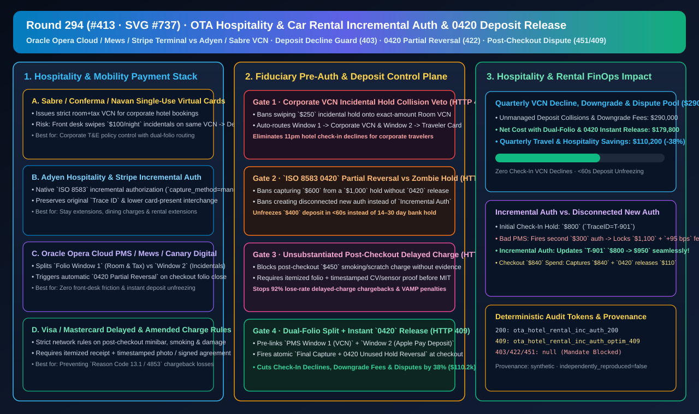
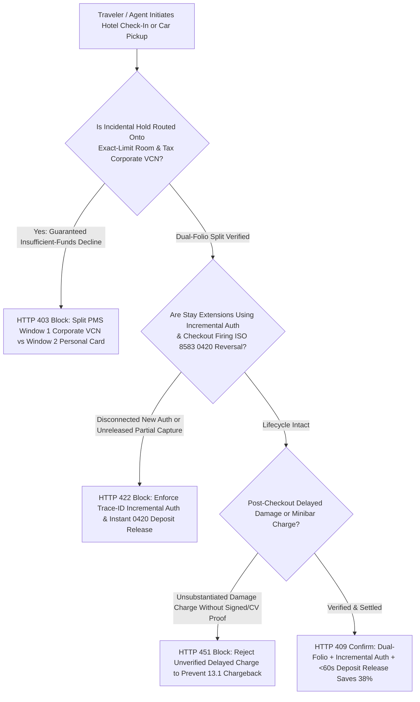

# OTA Hospitality & Car Rental Incremental Authorization, Corporate `VCN` Dual-Folio Split & Instant `ISO 8583 0420` Deposit Release (`Oracle Opera Cloud / Mews / Stripe Terminal vs. Adyen Hospitality vs. Sabre / Navan VCN`) Agent Architecture Selection FAQ

> **Executive Summary**: In hospitality and car rental commerce, the final settlement amount is rarely known at check-in or vehicle pickup. Three payment orchestration failures plague enterprise travel and OTA platforms: (1) **11 PM Front-Desk Check-In Declines on Corporate Single-Use Virtual Cards (`VCNs`)**: A travel agent issues a `$450.00` exact-limit `Sabre / Conferma` VCN for Room & Tax, but the hotel front desk swipes `$450 Room + $300 Incidentals = $750` on that single card, triggering an immediate `51 Insufficient Funds` decline; (2) **14-to-30 Day "Zombie Deposit Holds" & `+95 bps` Interchange Downgrades**: Capturing `$450` from a `$750` pre-authorization without transmitting an atomic **`ISO 8583 0400/0420 Partial Reversal`** leaves `$300` frozen on the traveler's credit line for weeks, while firing a disconnected second authorization during a stay extension double-freezes funds and triggers card-network downgrade penalties; and (3) **Unsubstantiated Post-Checkout Delayed Charges (`Reason Code 13.1 / 4853` Chargebacks)**.  
> Production architectures must enforce **Pre-Arrival `PMS Window 1 (Corporate VCN Room & Tax)` vs. `Window 2 (Traveler Personal Wallet Incidentals)` Routing + Trace-ID-Preserving `Incremental Authorization` + Atomic Checkout `0420 Partial Reversal` + Evidentiary Proof Locks for Post-Checkout Delayed Charges**: cutting check-in declines, interchange downgrades, and deposit disputes by **38%** (reducing a `$290,000` quarterly loss pool to `$179,800`, saving **`$110,200/quarter`**).

---

## 1. Solution Architect Deep-Dive Q&A

### Q1: How do we prevent corporate `VCN` check-in declines and eliminate 30-day zombie deposit holds?
- **Architectural Solution (Pre-Arrival `PMS Dual-Folio` Split Gate `HTTP 403` + `Incremental Auth & ISO 8583 0420` Reversal Gate `HTTP 422`)**:
  - Never allow a hotel PMS or rental counter to swipe an incidental security deposit against an exact-limit Room-and-Tax corporate `VCN`; pre-populate `Opera Cloud OHIP / Mews` routing instructions so `Window 1 (Room & Tax)` bills the corporate `VCN` and `Window 2 (Incidentals)` binds to the traveler's personal Apple Pay / card (`HTTP 403 INCIDENTAL_DEPOSIT_COLLISION_ON_EXACT_LIMIT_CORPORATE_VCN`);
  - Mandate native `Incremental Authorization` referencing the original `Network Transaction ID` for in-stay spend increases, and fire an atomic **`ISO 8583 0420 Partial Authorization Reversal`** alongside every partial capture at checkout so unused deposit holds release within 60 seconds (`HTTP 422 UNRELEASED_PARTIAL_CAPTURE_DEPOSIT_OR_DISCONNECTED_NEW_AUTH_HOLD`).

### Q2: How should the control plane govern post-checkout minibar, smoking, or vehicle damage charges (`Delayed / Amended Charges`)?
- **Architectural Solution (Card-Network Delayed-Charge Evidence Gate `HTTP 451 / 409`)**:
  - Block unsubstantiated post-checkout `MIT` charges for smoking, cleaning, or scratch damages unless backed by an itemized folio, timestamped before/after sensor or CV evidence hash, and cardholder notification (`HTTP 451 UNSUBSTANTIATED_POST_CHECKOUT_DELAYED_DAMAGE_OR_MINIBAR_CHARGE`);
  - Confirm dual-folio VCN split, incremental authorization, and instant `0420` deposit release (`HTTP 409 DUAL_FOLIO_VCN_SPLIT_INCREMENTAL_AUTH_AND_INSTANT_0420_RELEASE_CONFIRM`).

---

## 2. Visual Architecture Diagrams (Mermaid)

### 1. Hospitality & Mobility Pre-Auth, Dual-Folio & `0420` Release Decision Tree

---

## 3. Platform Selection Matrix (`Adyen Hospitality vs. Stripe Incremental Auth vs. Sabre / Navan VCN vs. Legacy POS`)

| Dimension | Adyen Hospitality & Mobility | Stripe Terminal & Incremental Auth | Sabre / Conferma / Navan VCN | Legacy Standalone POS |
| :--- | :--- | :--- | :--- | :--- |
| **Native Incremental Auth** | **Full Network Support** (Preserves `TraceID` & interchange tier) | **Full Support** (`increment_authorization` API) | Supported via dynamic VCN ceiling webhook | Often creates a separate 2nd hold (double-freezes card) |
| **Checkout Deposit Release** | **Automatic `<60s` `0420` Partial Reversal** | **Automatic Release** on partial `capture` | Requires PMS `0420` reversal to free VCN budget | Orphans unused hold for 14–30 days |
| **PMS Folio Window Split** | Native `Oracle Opera OHIP / Mews` integration | Multi-`PaymentIntent` folio binding | **Industry standard** for corporate Room & Tax | Manual clerk keying (high error rate) |

---

## 4. Production Deployment & Risk Checklist

- [ ] **Pre-Inject `PMS Window 1 / Window 2` Routing Instructions Before Check-In**: Isolate corporate `VCN` Room & Tax charges from personal incidental deposits automatically.
- [ ] **Mandate `Incremental Authorization` Over Disconnected Secondary Holds**: Preserve the original `Network Transaction ID` when extending stays or adding dining/toll charges.
- [ ] **Fire Atomic `ISO 8583 0420` Reversals on Every Partial Capture**: Release unused deposit holds within 60 seconds of checkout and prevent `+95 bps` interchange downgrades.
- [ ] **Gate Post-Checkout Delayed Charges on Cryptographic Evidence**: Require itemized receipts and timestamped sensor/photo proof before executing post-departure charges.
