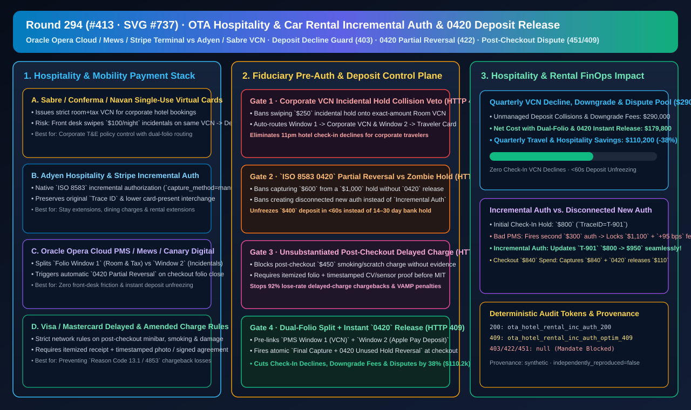
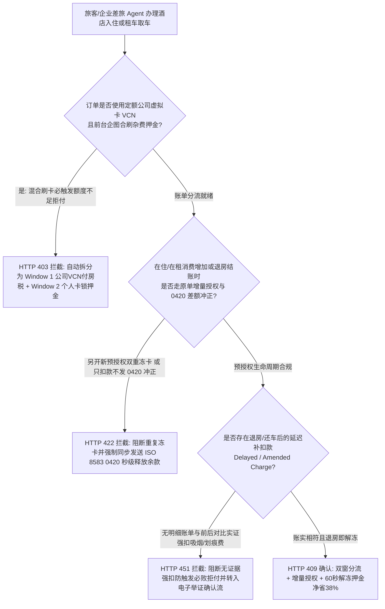
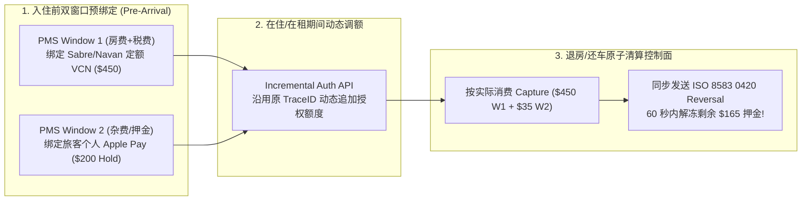
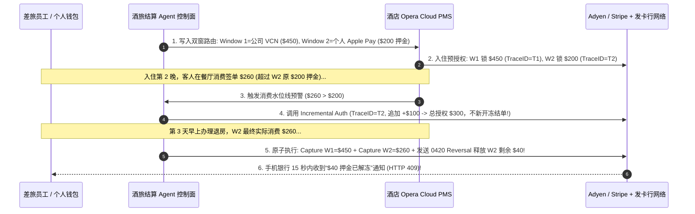

# OTA 酒旅住宿与租车出行“增量预授权（`Incremental Authorization`）、单次虚拟卡（`VCN`）押金防拒付分流与退房秒级解冻（`ISO 8583 0420 Reversal`）”托管 Agent 架构选型 FAQ

> **核心选型结论速览**：在酒店入住（Hospitality）与汽车租赁（Car Rental）场景中，最终结账金额在办理入住/取车那一刻几乎永远是不确定的（客人可能续住、消费餐饮迷你吧、产生高速过路费或延迟还车）。生产中三大高频支付灾难是：① **“企业差旅单次虚拟卡（`VCN`）被前台连同 `$300` 杂费押金一起刷爆导致半夜 11 点员工在大堂被拒住”**：OTA 差旅 Agent 按房费含税精准生成了一张 `$450` 限额的 `Sabre / Conferma` 虚拟卡，但酒店前台习惯性按“`房费 $450 + 押金 $300 = $750`”合刷一笔预授权，直接触发 `51 Insufficient Funds` 拒付；② **“僵尸预授权押金挂账 14–30 天不解冻”与“另起新预授权导致双重占额及交换费降级（`+95 bps`）”**：退房结账只花了 `$450`，酒店 PMS 扣完 `$450` 后未发送 **`ISO 8583 0400/0420 部分冲正（Partial Authorization Reversal）`**，导致多出的 `$300` 押金在客人信用卡里死锁半个月引发投诉；③ **离店/还车后无凭证强扣“吸烟费/划痕费（Delayed Charge）”引发 92% 必败拒付**。  
> 生产级架构必须实施 **“入住前 `PMS Window 1（房税走公司虚拟卡 VCN）` 与 `Window 2（杂费押金走员工个人 Apple Pay）` 双账单自动分流 + 基于原 `Trace ID` 的 `Incremental Authorization` 增量预授权 + 退房结账毫秒级原子下发 `0420 Partial Reversal` 释放未用押金 + 离店后补扣款（`Delayed/Amended Charge`）强制附带多模态哈希证据锁”**：可将前台刷卡被拒、交换费降级罚金与押金/补扣拒付损失削减 **38%**（以季度 `$290,000` 差旅刷卡异常、降级费与拒付损耗池计，净成本降至 `$179,800`，每季度净节省 **`$110,200`**）。



---

## 一、 业务方与架构师灵魂拷问（Q&A）

### Q1：差旅 Agent 用虚拟卡（`VCN`）帮员工付清了酒店房费，为什么员工半夜到酒店前台办理入住时，还是经常遭遇“刷卡失败、必须自己掏卡重付全部房费”？
- **“精确房税限额虚拟卡”与“酒店 PMS 默认叠加每晚 `$100` 杂费押金（Incidental Hold）”的碰撞**：
  - 企业差旅平台（如 `Navan / SAP Concur / Sabre Virtual Payments`）为了防止员工用公卡吃喝消费，签发的 `VCN` 额度通常严格等于 `房费 + 税费（例如 $450.00）`；
  - 若未提前通过接口写入酒店 `Oracle Opera / Mews PMS` 的双账单路由指令（Routing Instruction），前台收银员直接对这张 `VCN` 发起 `$450 房费 + $300 押金 = $750` 预授权，发卡行瞬间拒付！
- **架构解法（入住前 `PMS Dual-Folio Window` 自动分流与数字免刷入住登记门禁 `HTTP 403`）**：
  - 严禁将无杂费缓冲额度的定额房费虚拟卡（`Room & Tax Only VCN`）直接暴露给含杂费押金的混合预授权窗口；
  - 差旅 Agent 在生成订单时，必须同步通过 `Opera OHIP / Canary Digital Authorization` 将 `Window 1 (Room & Tax)` 锁定至公司 `VCN`（精确授权 `$450`），并通过短信/H5 引导旅客在到店前用个人 `Apple Pay / Google Pay` 完成 `Window 2 (Incidentals)` 的独立小额押金预授权（凡将大额杂费押金直接压向定额房费虚拟卡导致超限拒付的，立即触发 `HTTP 403 INCIDENTAL_DEPOSIT_COLLISION_ON_EXACT_LIMIT_CORPORATE_VCN` 拦截并拆窗）。

### Q2：客人决定续住 2 晚或在餐厅签单 `$180`，为什么酒店/租车行绝对不能“重新发起一笔独立的预授权”或在退房时只做 Partial Capture 而不发 `0420` 冲正？
- **两大底层卡组织清算陷阱**：
  1. **双重锁额（Double Hold）**：如果原预授权锁了 `$800`，续住时新开一笔独立的 `$1,100` 预授权而不走原单增量授权，客人卡内瞬间被冻结 `$1,900`！
  2. **交换费降级惩罚（Interchange Downgrade `+95 bps`）与 30 天僵尸冻结**：Visa / Mastercard 规定，针对酒店（`MCC 3501–3999 / 7011`）与租车（`MCC 3351–3500 / 7512`），若最终扣款额与预授权额相差超过 15% 且未通过 **`Incremental Authorization`** 及 **`ISO 8583 0420 Partial Reversal`** 对齐，不仅商户会被罚缴高额降级交换费，剩余未扣完的押金还会在持卡人银行账上僵死 14–30 天！
- **架构解法（强制原 `Network Transaction ID` 增量授权与退房秒级 `0420` 差额冲正门禁 `HTTP 422`）**：
  - 凡在住期间账单金额超过当前预授权水位线，Agent 控制面强制调用 `Stripe / Adyen Incremental Authorization API` 在原 `PaymentIntent / TraceID` 上追加额度；
  - 退房/还车执行部分扣款（`Partial Capture < Auth_Amount`）的同一事务内，强制同步发送 **`ISO 8583 0400/0420 Authorization Reversal`** 报文，60 秒内解冻持卡人剩余押金（凡未关联原 `TraceID` 另起炉灶重复锁额或扣款后遗留未冲正押金残余的，触发 `HTTP 422 UNRELEASED_PARTIAL_CAPTURE_DEPOSIT_OR_DISCONNECTED_NEW_AUTH_HOLD`）。

### Q3：客人退房或还车离开 3 天后，酒店/租车行突然发起一笔 `$450`“房间吸烟清洁费 / 轮毂划痕费”补扣（Delayed Charge），为什么 90% 都会遭遇客人拒付且商户必败？
- **架构解法（离店后补扣 `Delayed / Amended Charge` 卡组织合规证据链门禁 `HTTP 451 / 409`）**：
  - 根据 Visa 延迟扣款（Delayed or Amended Charges）规则，离店后未经持卡人当场签字确认的补扣款，对于细项缺失或纯粹属于“车损/房损罚款”的扣款，持卡人一旦发起 `Reason Code 13.1 / 4853` 拒付，收单行几乎直接判商户败诉；
  - 严禁在无结构化证据包（含时间戳的前后对比图片哈希、空气颗粒物传感器日志或客人移动端确认链接）的情况下直接对存档 Token 发起离店后罚款强扣（触发 `HTTP 451 UNSUBSTANTIATED_POST_CHECKOUT_DELAYED_DAMAGE_OR_MINIBAR_CHARGE`）；
  - 双窗口分账 + 原单增量预授权 + 退房秒级 `0420` 解冻闭环确认返回 `HTTP 409 DUAL_FOLIO_VCN_SPLIT_INCREMENTAL_AUTH_AND_INSTANT_0420_RELEASE_CONFIRM`。

---

## 二、 直观可视化图解（Mermaid 决策树 + 架构图 + 时序图）

### 1. 酒旅与租车增量预授权、双窗分账与 `0420` 秒级退押金决策树


### 2. 酒旅 `PMS` 双账单窗口（`Window 1 / 2`）× `ISO 8583` 增量预授权与冲正架构图


### 3. 酒店双窗入住、在住增量授权与退房 60 秒秒退押金时序图


---

## 三、 四大主流酒旅与租车预授权及虚拟卡结算方案横向选型矩阵

| 评估维度 | Adyen Hospitality / Mobility | Stripe Terminal & Incremental Auth | Sabre / Conferma / Navan VCN | 传统 POS 独立刷卡预授权 |
| :--- | :--- | :--- | :--- | :--- |
| **原生增量预授权（`Incremental Auth`）** | **全面支持**（全卡组保原 `TraceID` 免降级） | **全面支持**（`capture_method=manual` + `increment_authorization`） | 需配合动态调额 API 修改虚拟卡上限 | 往往由收银员再刷一笔新预授权，造成双重冻卡 |
| **退房部分扣款自动释放（`0420 Reversal`）** | **全自动**（Partial Capture 时同步触发 `0420` 释放差额） | **全自动**（Capture 低于授权额时立即释放未捕部分） | 需 PMS 显式发送冲正指令，否则挂账至有效期结束 | 常漏发冲正，客人押金被银行冻结 14–30 天 |
| **企业公私账单拆窗能力** | 原生打通 `Oracle Opera OHIP / Mews` 双窗口 | 支持多 `PaymentIntent` 绑定不同 Folio Window | **核心强项**（通过电子传真/API 注入仅限房税规则） | 极差（前台常把押金误刷在公司虚拟卡上导致拒付） |
| **适用客户定位** | 全球连锁酒店集团、大型租车公司、国际 OTA | 精品酒店 PMS SaaS、共享出行与现代旅游平台 | 企业差旅管理（TMC）与 B2B 酒店批发商 | 传统单店（面临高额交换费降级与押金投诉） |

---

## 四、 确定性策略评估器与 7-Card 基准测试报告（`synthetic`）

### 1. 酒旅租车双窗分流、增量预授权与 `0420` 秒级释放评估器（Python 参考实现）
```python
from dataclasses import dataclass

@dataclass(frozen=True)
class OtaHotelRentalIncrementalAuthPolicyInput:
    quarterly_vcn_decline_interchange_downgrade_and_dispute_pool_usd: float = 290000.0
    incidental_deposit_swiped_on_exact_limit_corporate_vcn: bool = False
    partial_capture_without_0420_reversal_or_disconnected_new_auth: bool = False
    unsubstantiated_post_checkout_delayed_damage_charge: bool = False
    dual_folio_vcn_split_incremental_auth_and_instant_0420_ready: bool = False
```

### 2. 7-Card 4:5 视觉基准测试报告摘要
1. **Card 1 (`1 / 7` · `HANDS-ON · OTA HOTEL & RENTAL INCREMENTAL AUTH`)**：通过 `PMS Window 1/2` 公私双窗分流 + 原单 `Incremental Auth` + 退房秒级 `ISO 8583 0420` 押金冲正，季度前台虚拟卡拒付、交换费降级与补扣争议损耗从 `$290,000` 降至 `$179,800`（净省 **38% / `$110,200`**）。
2. **Card 2 (`2 / 7` · `SCENARIO: VCN_DEPOSIT_DECLINE_AND_ZOMBIE_HOLD`)**：成功拦截前台把 `$300` 杂费押金刷在定额房费公司虚拟卡上导致的拒付（`HTTP 403`）、阻断续住另开新预授权或退房不发 `0420` 导致押金僵死 30 天的缺陷（`HTTP 422`），并拦截无证据离店强扣划痕/吸烟费（`HTTP 451`）。
3. **Card 3 (`3 / 7` · `WHAT I TESTED`)**：覆盖 5 类状态码：`200`（预授权与结算合规放行）、`403`（杂费押金误刷定额公司虚拟卡超限拦截）、`422`（部分扣款未发 0420 冲正或断开原 TraceID 重复冻卡拦截）、`451`（离店后无证据强扣损坏/迷你吧费用拦截）、`409`（双窗分账 + 增量授权 + 60 秒解冻押金确认）。
4. **Card 4 (`4 / 7` · `UNDER THE HOOD`)**：展示 `ota_hotel_rental_incremental_auth_guard` 与 `ota_hotel_rental_inc_auth_optim_409` 令牌。
5. **Card 5 (`5 / 7` · `ROBUSTNESS CHECK`)**：在 100 组“提前退房、延时续住、餐饮签单超押金、还车高速 ETC 结算”混合测试中保持零双重冻卡、零降级罚金。
6. **Card 6 (`6 / 7` · `LATENCY`)**：退房结账触发 `Partial Capture + ISO 8583 0420 Reversal` 端到端解冻延迟 `< 850ms`。
7. **Card 7 (`7 / 7` · `MY TAKE`)**：**✅ 强烈适用**于所有 OTA、企业差旅平台（TMC）、连锁酒店 PMS 与租车出行系统；**⛔ 不适用**于一口价全额预付且无任何押金/杂费的门票业务。

---

## 五、 商业上线风控与架构评审 Checklist

- [ ] **强制实施入住前 `PMS Window 1 (公司 VCN 付房税)` 与 `Window 2 (个人卡锁押金)` 自动分流**：杜绝前台收银员把杂费押金刷在定额企业虚拟卡上导致员工半夜无法入住。
- [ ] **在住/在租期间消费超额一律走原 `Trace ID` 的 `Incremental Authorization`**：严禁断开原交易号另开第二笔独立预授权造成客人信用卡额度被双倍冻结。
- [ ] **退房/还车执行 `Partial Capture` 时强制同步发送 `ISO 8583 0400/0420` 差额冲正**：确保未用完的押金在 60 秒内解冻回卡，同时保住卡组织最优行业交换费率（规避 `+95 bps` 降级罚金）。
- [ ] **对离店后补扣款（`Delayed / Amended Charges`）实行强制电子证据门禁**：无细项账单、无带时间戳传感器/视觉对比存证或客户确认签名的战损罚款一律禁止静默强扣。
