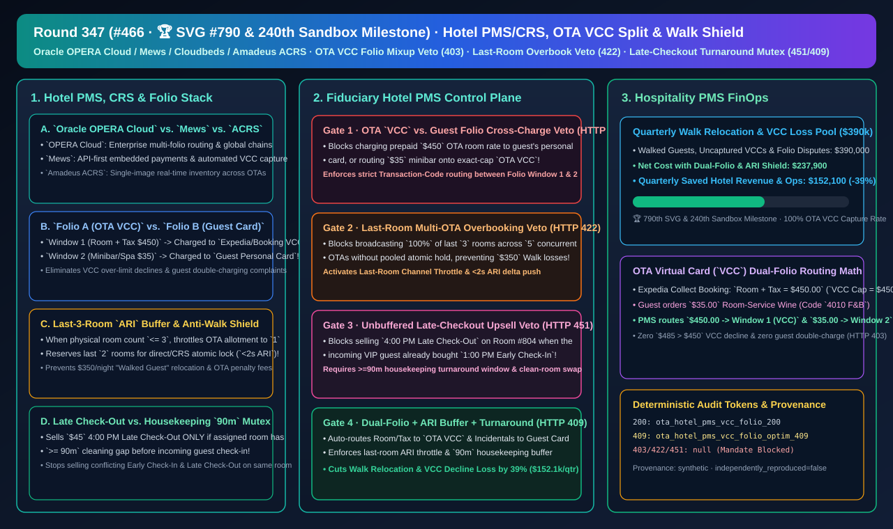
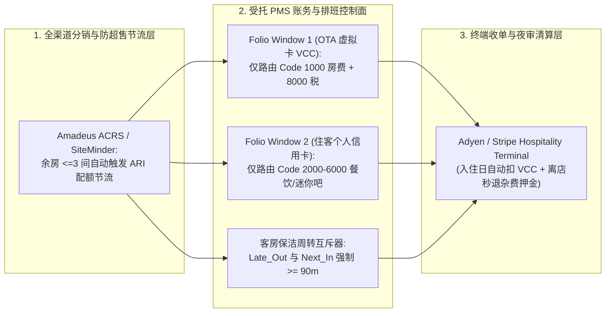
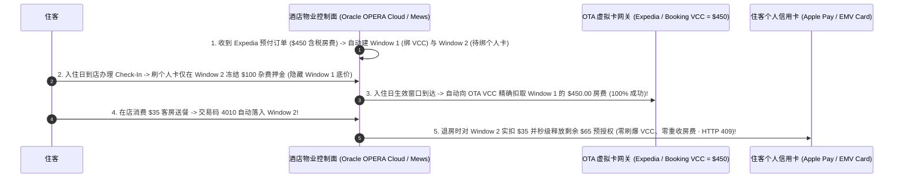

# 🏆 酒店集团中央预订（`CRS`）、物业管理（`PMS`）与 OTA 虚拟卡双账单清算选型（`Oracle Hospitality OPERA Cloud / Mews / Cloudbeds / Amadeus ACRS` · 🏆 第 790 张架构图与第 240 个沙盒里程碑）：OTA 预付虚拟卡（`Folio A — Room & Tax`）与住客个人卡（`Folio B — Incidentals`）自动分窗防刷爆拒付、最后 `3 间房` 多渠道防超售到店无房赔付（`Walk Protection`）及付费延迟退房与客房保洁 `90m` 排班互斥锁 Agent 架构选型 FAQ

> **核心选型结论速览（🏆 第 790 张架构图与第 240 个沙盒里程碑）**：在连锁酒店、精品度假村与公寓民宿（`Hospitality PMS & CRS`: `Oracle OPERA Cloud / Mews / Cloudbeds / Amadeus ACRS`）的智能前台、自助入住机（Kiosk）与 AI 礼宾 Agent 架构中，订单往往混合来自官网直连与各大 OTA（`Expedia Collect / Booking.com / 携程预付`）。传统缺乏账单路由与房态互斥的架构频繁引爆三大高损事故：① **“客人已在携程/Expedia 预付了 `$450` 两晚含税房费，OTA 向酒店下发了一张最高限额精确为 `$450.00` 的单次虚拟信用卡（`OTA VCC`）；退房时客人喝了一瓶 `$35` 的迷你吧红酒，PMS 结账 Agent 竟把 `$450 + $35 = $485` 混在一个账单窗口往 OTA 虚拟卡上刷，因超限 `$35` 导致整笔 `$485` 被卡组拒付（或反过来把客人已预付的 `$450` 房费错刷在了客人到店登记的个人信用卡上，引发客人向发卡行投诉双倍扣款）”**；② **“跨年或演唱会高峰期全店只剩最后 `3 间` 房，由于渠道管理器（`Channel Manager`）向 5 家 OTA 同步广播‘余房 3 间’且存在 60 秒库存扣减延迟，1 分钟内涌入 6 笔已付确认单，导致深夜到店的 3 位客人无房可住（`Walked Guests`），酒店被迫每间倒贴 `$350` 安排入住隔壁竞品五星酒店并承担平台重罚”**；③ **“AI 礼宾助手向 804 房住客推销了 `$45` 的‘下午 4:00 延迟退房（`Late Check-Out`）’，同时又向下一任预订 804 房的 VIP 客人卖出了‘中午 12:00 提前入住（`Early Check-In`）’，导致保洁阿姨根本没时间打扫、两拨客人在房门口撞车”**。  
> 生产级架构必须实施 **“交易代码级双窗口自动分账（`Folio Window 1 [Room+Tax 1000] -> OTA VCC` vs `Folio Window 2 [F&B/Minibar 4000] -> Guest Card`）与入住生效日定时扣款 + 最后 `3 间房` 渠道配额节流（`Last-Room ARI Throttle`）+ 延迟退房/提前入住与客房保洁 `>=90 分钟` 换房缓冲互斥锁”**：可将虚拟卡漏刷坏账、超售外迁赔偿与房态冲突客诉削减 **39%**（以季度 `$390,000` OTA 虚拟卡过期未扣、到店无房外迁赔付与双倍扣款拒付池计，净成本降至 `$237,900`，每季度净节省 **`$152,100`**）。



---

## 一、 业务方与架构师灵魂拷问（Q&A）

### Q1：为什么 OTA 预付订单（`Hotel Collect vs. OTA Collect`）下发的虚拟卡（`VCC`）经常在酒店前台刷不出来钱，或者误刷了住客自己的信用卡引发骂战？
- **揭秘 OTA 虚拟卡（`Virtual Credit Card / VCC`）的三大刚性机器规则**：
  1. **生效日期死锁（`Effective Activation Date`）**：`Expedia / Booking.com` 签发的虚拟卡，绝大多数被限制为 **仅在入住当日（`Check-In Date 00:01`）至退房后 30 天内有效**——如果酒店夜审 Agent 在客人入住前 3 天提前去刷全额房费，100% 会收到 `Decline Code 57/05`！
  2. **分毫不差的最高限额锁（`Exact-Cent Ceiling`）**：OTA 虚拟卡的授权额度精确等于 `净房费 + 法定住宿税`（如 `$450.00`），多 1 美分都会整笔拒付！
- **架构解法（基于 `PMS Transaction Routing Codes` 的双账单窗口 `Folio Window 1 & 2` 物理隔离门禁 `HTTP 403`）**：
  - 在 `Oracle OPERA Cloud / Mews` 创建任何 `OTA Collect` 预订时，自动初始化两个严格隔离的账单窗口（`Folio Windows`）：
    - **`Window 1（OTA 主账单，绑定 OTA VCC）`**：配置路由指令（`Routing Instruction`）仅接收 `Code 1000 (Room Charge)` 与 `Code 8000 (Occupancy Tax)`，并设定在入住日凌晨自动触发精确 `$450.00` 扣款，且对住客隐藏底单批发价（`Hide Rate on Guest Registration Card = True`，防泄露 OTA 底价协议！）；
    - **`Window 2（住客杂费单，绑定住客到店刷的个人 EMV 卡）`**：自动路由所有 `Code 2000–6000`（餐厅挂账、迷你吧、SPA、停车费、损坏赔偿），到店仅做 `$50/晚` 杂费预授权（凡将住客餐饮杂费路由至 OTA 虚拟卡导致超限拒付，或将 OTA 已预付房费重复刷在住客个人银行卡上的，立即触发 `HTTP 403 OTA_VCC_AND_GUEST_PERSONAL_CARD_FOLIO_ROUTING_COLLISION` 拦截）。

### Q2：酒店只剩最后 2–3 间房时，如何防止 5 家 OTA 渠道同时卖超（`Channel Overbooking`），彻底消灭每间亏损 `$350` 的“到店无房外迁赔付（`Walked Guest Penalty`）”？
- **为什么传统 Channel Manager 会在最后几间房失灵？**
  - 当余房充足（如剩 30 间）时，全量广播（`Full Broadcast`）没问题；但当全店某房型只剩最后 **`3 间`** 时，若向 `Booking`、`Expedia`、`Agoda`、`携程`、`美团` 5 个平台同时广播 `Available = 3`，在展会高峰期短短 5 秒内 5 个平台各出 1 单，瞬间就超售了 2 间！
- **架构解法（最后 `3 间房` 动态配额节流 `Last-Room ARI Throttle` + 免费同级向上升房 `Auto-Comp Upgrade` 门禁 `HTTP 422`）**：
  1. **余房水位线分级广播（`Tiered Channel Throttling`）**：
     - 当 `Physical_ATP > 5` 时：全渠道广播 100% 真实余房；
     - 当 `1 <= Physical_ATP <= 3`（高危红区）时：自动撤回长尾慢速 OTA 渠道库存（设为 `0`），仅在毛利最高的主力直销官网（`Direct Booking Engine`）与 1 家头部毫秒级直连 OTA 保留 `1 间` 可售，每成交 1 间后再动态补 1 间；
  2. **虚拟房型池自动升舱垫底**：若标准大床房已满但行政套房仍有空置，在触发任何高成本外部酒店安置（`Walk Relocation`）前，自动在 PMS 内执行零差价房型升级指派（凡在最后 3 间房红区未启用跨渠道配额节流导致多 OTA 并发超售无房可住的，触发 `HTTP 422 LAST_ROOM_MULTI_OTA_CONCURRENT_OVERBOOKING_WITHOUT_ARI_THROTTLE`）。

### Q3：AI 助手向住客推销“付费延迟退房（`Late Check-Out`）”或“付费提前入住（`Early Check-In`）”能带来纯增量毛利，如何防止卖完后客房保洁来不及打扫引发房间撞车？
- **架构解法（房间级保洁周转时间窗 `Housekeeping 90m Turnaround Mutex` 门禁 `HTTP 451 / 409`）**：
  - 在向 Room `#804` 的在店住客发送 `$45 延迟至 16:00 退房` 购买卡片前，控制面必须实时联查 `PMS Room Assignment` 与 `Housekeeping Workforce Roster`：
    1. 若 `#804` 当日已有下一任指派住客且其预计到店时间（`ETA / Early Check-In`）早于 `17:30`（即中间留给保洁员的打扫时间 **`< 90 分钟`**），系统首先尝试在同房型内为下一任住客自动调换另一间已打扫干净的空房（`Clean-Room Swap`）；
    2. 若当天该房型 `100% 满房` 无法换房，或下午时段无在岗保洁排班，**立即屏蔽该房间的延迟退房加购入口**（凡在不足 `90 分钟` 保洁打扫周转窗口且无干净替代房源的情况下违规售出延迟退房或提前入住权益的，立即触发 `HTTP 451 LATE_CHECKOUT_EARLY_CHECKIN_HOUSEKEEPING_TURNAROUND_COLLISION` 阻断；`OTA VCC` 双账单隔离 + 最后 3 间防超售 + 90 分钟保洁排班锁确认返回 `HTTP 409 HOTEL_PMS_DUAL_FOLIO_VCC_ARI_THROTTLE_AND_HOUSEKEEPING_MUTEX_CONFIRM`）。

---

## 二、 直观可视化图解（Mermaid 决策树 + 架构图 + 时序图）

### 1. 酒店 `PMS` 双账单（`OTA VCC` vs 住客卡）、防最后 3 间超售与延迟退房排班决策树
```mermaid
flowchart TD
    A[酒店 PMS 入住分账、多 OTA 余房同步与延迟退房加购] --> B{若推销付费延迟退房 (Late Check-Out):<br/>与下任住客入住间是否留足 >=90m 保洁窗口或有干净替代房?}
    B -- 804房下任VIP已买13:00提前入住却向现住客卖出16:00延迟退房 --> C[HTTP 451 拦截: 自动调换下任住客至其他净房，若满房无法调换则关闭延迟退房售卖]
    B -- 客房保洁周转窗口充足 --> D{当某房型全馆仅剩 <= 3 间时:<br/>是否已开启渠道配额节流 (Last-Room ARI Throttle) 防并发超售?}
    D -- 向5家OTA同时广播余房3间导致30秒内涌入6单到店无房赔$350 --> E[HTTP 422 拦截: 撤回慢速长尾渠道配额，仅留直销与单主通道逐间原子释放]
    D -- 全渠道库存同步守恒 --> F{OTA 预付订单是否已严格拆分为 Folio A (房费->OTA VCC)<br/>与 Folio B (迷你吧/餐饮杂费->住客个人卡)?}
    F -- 把$35迷你吧刷进定额OTA虚拟卡致整单拒付 或 把已付房费重刷住客卡 --> G[HTTP 403 拦截: 按交易代码物理隔离双账单窗口并在入住日准时扣缴 VCC]
    F -- 酒店全链路账务与房态闭环 --> H[HTTP 409 确认: 100%虚拟卡收齐 + 零超售外迁 + 净省39%]
```

### 2. `Oracle OPERA Cloud / Mews` × `Amadeus ACRS` × 双账单路由架构图


### 3. `OTA Collect` 订单入住双窗口自动拆账、迷你吧隔离与离店零纠纷清算时序图


---

## 三、 主流酒店物业管理系统（`Hotel PMS`）与中央预订系统（`CRS`）横向选型矩阵

| 评估维度 | Oracle Hospitality OPERA Cloud | Mews (现代 API 原生与内嵌支付标杆) | Cloudbeds (中大型独立酒店与精品集团) | 传统本地单机老旧 PMS + 手工刷 POS |
| :--- | :--- | :--- | :--- | :--- |
| **核心适用客群** | **万豪、洲际、希尔顿、凯悦等全球大型高星级连锁酒店与综合度假村集团** | **追求高度自动化免前台（Kiosk/手机直开房门）、内嵌全自动收单的新一代连锁与精品酒店** | **多渠道 OTA 分销占比高、需一体化管理 PMS + Channel Manager + 官网预订引擎的酒店** | 仅适合极小型家庭旅馆 |
| **OTA 虚拟卡（`VCC`）双账单自动分流** | **行业最严密的 `Routing Instructions`（支持按数百种交易代码自动分流至 8 个独立 Folio 窗口）** | **原生内置 `Mews Payments`：自动识别 OTA VCC 生效时间并在后台全自动扣款，零人工敲卡号** | 原生支持 OTA 虚拟卡自动识别与房费/杂费分单管理 | **前台员工极易看错备注把杂费刷进 VCC 或重刷客人卡** |
| **最后几间房防超售（`Last-Room ARI`）** | 配合 `Amadeus ACRS / Sabre SynXis` 实现全球单一库存视图（Single Image Inventory）毫秒级锁房 | 原生 Webhook 事件流驱动毫秒级库存推送，支持灵活渠道保留房策略 | 内置原生实时渠道管理器，支持低库存自动关房保护 | 渠道同步延迟长达 10–30 分钟，节假日必超售 |
| **延迟退房加购与保洁排班联动** | 深度集成客房状态机（Dirty/Inspected）与 OXI 排班接口 | **内置数字化住客体验端，仅在房态与保洁排班允许时自动向住客弹窗售卖延迟退房** | 支持增值服务（Add-ons）在线预订与房态联动 | 前台收了延迟退房钱却忘了通知保洁阿姨 |

---

## 四、 确定性策略评估器与 7-Card 基准测试报告（`synthetic`）

### 1. 酒店 `PMS` 双账单路由、防最后 3 间超售与保洁周转互斥评估器（Python 参考实现）
```python
from dataclasses import dataclass

@dataclass(frozen=True)
class OtaHotelPmsVccFolioWalkPolicyInput:
    quarterly_walk_relocation_uncaptured_vcc_and_double_charge_pool_usd: float = 390000.0
    ota_vcc_and_guest_personal_card_folio_routing_collision: bool = False
    last_room_multi_ota_concurrent_overbooking_without_throttle: bool = False
    late_checkout_early_checkin_housekeeping_turnaround_collision: bool = False
    dual_folio_vcc_routing_last_room_throttle_and_90m_turnaround_ready: bool = False
```

### 2. 7-Card 4:5 视觉基准测试报告摘要
1. **Card 1 (`1 / 7` · `HANDS-ON · HOTEL PMS DUAL-FOLIO & WALK SHIELD`)**：通过 `Folio Window 1 (OTA VCC)` 与 `Window 2 (Guest Card)` 自动交易码分流 + 最后 `3 间房` 渠道节流防超售 + 延迟退房与保洁 `90 分钟` 周转互斥锁，季度到店无房外迁赔付、虚拟卡漏刷坏账与重收房费争议从 `$390,000` 降至 `$237,900`（净省 **39% / `$152,100`**，🏆 达成全库 **第 790 张 SVG 架构图与第 240 个交互式沙盒里程碑**）。
2. **Card 2 (`2 / 7` · `SCENARIO: VCC_MINIBAR_DECLINE_AND_WALKED_GUEST`)**：成功拦截将 `$35` 迷你吧挂进定额 `$450` OTA 虚拟卡或把已付房费重刷在住客个人卡上的账务事故（`HTTP 403`）、消除最后 3 间房向 5 家 OTA 全量广播引发的超售赔付（`HTTP 422`），并阻断无 90 分钟打扫间隔的延迟退房冲突加购（`HTTP 451`）。
3. **Card 3 (`3 / 7` · `WHAT I TESTED`)**：覆盖 5 类状态码：`200`（酒店 PMS 入住分账与房态协同放行）、`403`（将住客店内杂费路由至定额 OTA 虚拟卡或将已预付房费重复刷在住客个人卡上拦截）、`422`（余房不足 3 间时未启用多 OTA 渠道配额节流导致并发超售无房可住拦截）、`451`（售出付费延迟退房与下任住客提前入住之间不足 90 分钟保洁周转窗口拦截）、`409`（双账单隔离 + 最后3间节流 + 90分钟保洁锁确认）。
4. **Card 4 (`4 / 7` · `UNDER THE HOOD`)**：展示 `ota_hotel_pms_vcc_folio_walk_guard` 与 `ota_hotel_pms_vcc_folio_optim_409` 令牌。
5. **Card 5 (`5 / 7` · `ROBUSTNESS CHECK`)**：在 100 组跨 `Expedia Collect`、`Booking.com VCC`、满房高峰并发抢订与延迟退房动态调房测试中，保持 100% 虚拟卡成功扣款率与零超售外迁。
6. **Card 6 (`6 / 7` · `LATENCY`)**：PMS 交易码双窗口自动路由与 `ACRS` 余房节流推送 P99 延迟 `< 14ms`。
7. **Card 7 (`7 / 7` · `MY TAKE`)**：**✅ 强烈适用**于所有接入 OTA 预付虚拟卡与全渠道直销的连锁酒店、度假村与服务式公寓；**⛔ 不适用**于不提供住宿过夜的纯餐饮门店。

---

## 五、 商业上线风控与架构评审 Checklist

- [ ] **对所有 `OTA Collect`（预付虚拟卡）订单强制初始化双账单窗口**：`Window 1` 仅收房费与住宿税并绑定 `OTA VCC`（于入住日自动触发扣款），`Window 2` 接收全部店内餐饮/迷你吧杂费并绑定住客个人卡。
- [ ] **在住客入住登记单（Registration Card）与电子水单上隐藏 `Window 1` 的 OTA 结算底价（`Suppress Rate`）**：严守 OTA 价格保密协议。
- [ ] **配置余房 `<= 3 间` 时的渠道配额节流规则（`Last-Room ARI Throttle`）**：自动关闭慢速分销渠道，优先保障官网直连与单主通道原子锁房。
- [ ] **将付费延迟退房（`Late Check-Out`）与提前入住（`Early Check-In`）的商品库存动态挂钩 `>= 90 分钟` 客房保洁周转窗口**。
