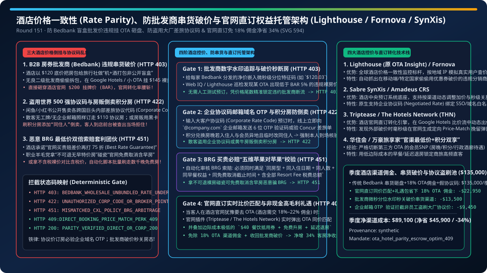
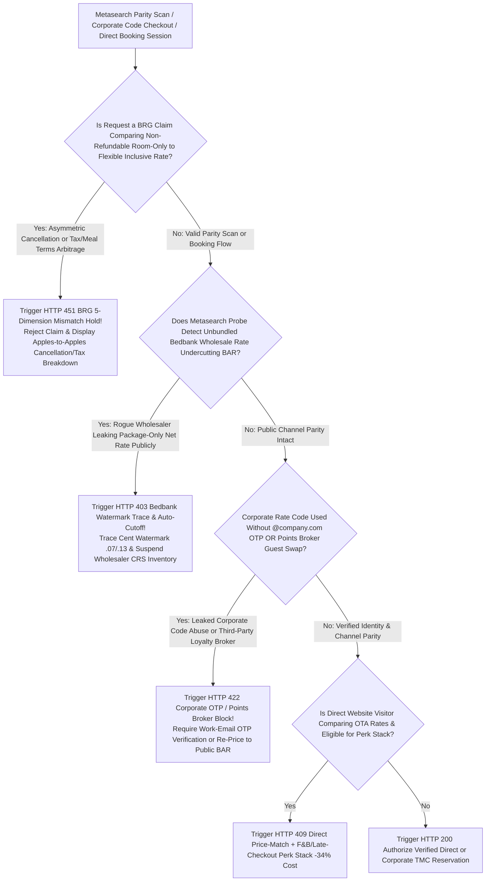
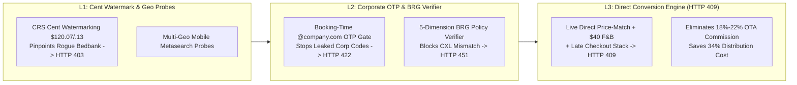
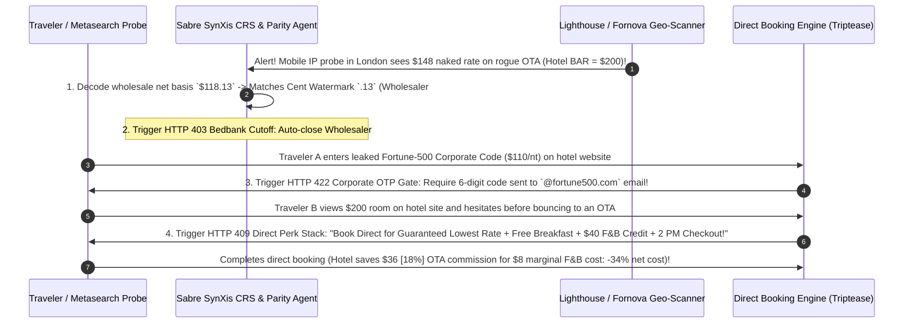

# Hotel Rate Parity Monitoring, Anti-`Bedbank` Wholesale Leakage & Direct-Booking Conversion Escrow (`Lighthouse / Fornova / Sabre SynXis / Triptease`): Stopping `$120` Unbundled Wholesale Undercuts, Stolen Corporate Codes & `18%` OTA Commission Bleed (`-34%` Cost) Agent Architecture Selection FAQ

> **Document Type**: AI Solution Architect Hospitality Rate Parity, Wholesale `Bedbank` Distribution Governance & Direct-Booking Conversion Guide (Retail, OTA & Marketplace Pillar · FAQ #270)  
> **Covered Platforms & Standards**: **Lighthouse (formerly OTA Insight) / Fornova (Global Metasearch & Geo-IP Rate Parity Intelligence)**, **Sabre SynXis / Amadeus CRS (Central Reservation System & Channel Cutoff)**, **Triptease / The Hotels Network (Direct-Booking Live Price-Match & Perk Stacking)**, **Corporate Negotiated Rate (`LRA`) `@company.com` Email OTP Verification**  
> **Core Architectural Thesis**: Nothing destroys a hotel group's unit economics faster than a shopper visiting Google Hotels, seeing an obscure third-party site undercutting the hotel's official website (`BAR`) by `$45/night`, and booking away from direct channels—forcing the hotel to lose both rate integrity and **`18%–22%` in OTA commissions**! When hospitality revenue and distribution agents manage pricing and inventory across channels, three systemic leaks must be plugged: (1) **Wholesale `Bedbank` Unbundling Leakage (`Hotelbeds / WebBeds`)**—a hotel gives a wholesaler a `$120` net rate strictly contracted for offline `"Flight + Hotel Opaque Packages"`, but a rogue downstream sub-distributor unbundles it and lists it naked on public metasearch for `$145` against the hotel's `$200` official rate; (2) **Stolen Fortune-500 Corporate Rate Codes & Loyalty-Points Room Brokering**—leisure travelers pulling leaked `IBM / Apple / Consulting` corporate rate codes off Reddit/Xiaohongshu to book `50% Off` rooms because front-desk clerks rarely check corporate badges at 11 PM; and (3) **Asymmetric `BRG` (Best Rate Guarantee) Arbitrage**—matching a non-refundable room-only OTA rate against a flexible breakfast-included direct rate to claim free nights!

---

## 1. 📌 Executive Summary

> **One-Sentence Architectural Verdict**: **Never distribute unwatermarked wholesale net rates or rely on front-desk clerks checking easily forged corporate ID badges! Embed cent-level cryptographic watermarks into `Bedbank` net rates to auto-cutoff rogue wholesalers within 60 seconds (`HTTP 403`), enforce booking-time `@company.com` email OTP verification on corporate codes and lock loyalty redemption guests (`HTTP 422`), require 5-dimension policy parity on `BRG` claims (`HTTP 451`), and deploy live direct-booking price-match + low-cost property perks to save `18%` OTA commissions (`HTTP 409`)!**
> 1. **Pinpoint Rogue Wholesalers in 1 Second: Cent-Level Rate Watermarking & Auto-Cutoff (`HTTP 403`)**:
>    * Traditionally, when a hotel spotted an undercut rate on a rogue OTA, revenue managers had to make an expensive manual "Test Booking" just to see which `Bedbank` delivered the reservation into the PMS.
>    * **Architectural Fix**: In **Sabre SynXis / Amadeus CRS**, watermark each wholesaler's net rate with a unique cent suffix (e.g., Wholesaler A = `$120.07`, Wholesaler B = `$120.13`, Wholesaler C = `$120.19`). The moment **Lighthouse / Fornova** detects an unbundled public undercut on Google Hotels, the agent reverses the markup math on the exact cents to identify the offending wholesaler with `100%` precision and triggers **`HTTP 403 BEDBANK_WHOLESALE_UNBUNDLED_RATE_UNDERCUT_BLOCKED`**—automatically throttling or closing that wholesaler's CRS inventory feed!
> 2. **Booking-Time `@company.com` OTP for Corporate Codes & Anti-Broker Points Lock (`HTTP 422`)**:
>    * **Eliminate Front-Desk Badge Friction**: Any reservation using a Corporate Negotiated Rate Code outside an authenticated corporate TMC (`Concur / Navan GDS`) must complete a one-time **6-digit OTP verification sent to the matching `@company-domain.com` work email** at checkout (`HTTP 422`).
>    * **Loyalty Points Broker Lock**: Block third-party points brokers who book redemption rooms and swap in unrelated "additional guest names" from a different city without the member present (`HTTP 422`).
> 3. **5-Dimension `BRG` Parity Verifier (`HTTP 451`) + Direct-Booking Perk Stacking (`HTTP 409`)**:
>    * Enforce strict 5-dimension parity (`Room Type + Dates + Cancellation Deadline + Meal Plan + All-In Resort Taxes`) on Best Rate Guarantee claims (`HTTP 451`).
>    * When a high-intent direct website visitor hesitates, **Triptease / THN** triggers **`HTTP 409 DIRECT_BOOKING_PRICE_MATCH_AND_PERK_STACK_CONFIRM`**: instantly matching verified external parity rates while stacking low-marginal-cost property perks (`$40 F&B Credit + Free Breakfast + 2 PM Late Checkout`, costing the hotel `<$8` vs. paying `$36–$44` in `18%–22%` OTA commissions)—cutting net distribution and leakage costs by **`34%`**.

| Hospitality Distribution Risk | Primary Stack / Safeguard | Core Execution Mechanism | Fatal Anti-Pattern to Avoid |
| :--- | :--- | :--- | :--- |
| **`Bedbank` Unbundles `$120` Package Rate & Undercuts `$200` BAR Online** | **CRS Cent-Level Rate Watermark + Lighthouse Auto-Cutoff** | Identify rogue wholesaler via `.07/.13` cent watermark & cut CRS allocation | **Never issue identical unwatermarked static net rates across multiple wholesalers (`HTTP 403`)** |
| **Non-Employees Book Leaked Fortune-500 Corporate Codes Online** | **Booking-Time `@company.com` Work Email OTP Gate** | Require work-domain OTP when corporate code is used outside TMC/GDS | Never rely on busy front-desk staff checking screenshots of work badges at check-in (`HTTP 422`) |
| **Arbitrageurs Claim `BRG` Comparing Non-Refundable to Flexible Rates** | **5-Dimension `BRG` Parity Verifier (`CXL + Meal + Resort Fee`)** | Require exact match on cancellation window, breakfast, and all-in taxes | Never approve `BRG` discounts when cancellation or meal terms differ (`HTTP 451`) |
| **Shopper Researches on Hotel Site, Then Books on OTA (`18%` Commission)** | **Live Direct Price-Match + Low-Cost Property Perk Stack** | Match external parity price + stack `$8`-cost breakfast/late-checkout perks | Never let official direct channels lose conversions over `$5` parity gaps (`HTTP 409`) |

---

## 2. 🎯 Architect & Business Stakeholder Q&A

### Q1: How do rogue sub-distributors hide their rate undercutting from hotel revenue managers, and how does Cent-Level Rate Watermarking defeat them without test bookings?
* **Geo-Fenced & Mobile-Logged-In Undercutting (`HTTP 403`)**:
  * Sub-distributors know where the hotel's corporate headquarters is located. They configure their metasearch feeds to show compliant `$200` parity rates to IP addresses in the hotel's home city, while displaying `$158` undercut rates exclusively to **mobile-device users in feeder tourist markets**!
  * By combining **multi-region residential proxy probes (`Lighthouse / Fornova`)** with **CRS Cent-Level Watermarking (`$120.07` vs. `$120.13`)**, our agent detects the mobile geo-undercut *and* mathematically traces the exact upstream `Bedbank` contract in milliseconds—cutting off the rogue feed (`HTTP 403`) without spending a dime on manual test bookings.

### Q2: Why does stacking a "$40 F&B Credit + Free Breakfast + Late Checkout" on direct bookings beat discounting the room rate by 15%?
* **Preserving `ADR` & Rate Parity While Crushing `18%` OTA Commissions (`HTTP 409`)**:
  * If a hotel publicly drops its room rate from `$200` to `$170`, OTAs immediately scrape and match the `$170` price—dragging down the hotel's Average Daily Rate (`ADR`) across all channels.
  * By keeping the public rate at `$200` (preserving `Rate Parity`) while offering **Direct-Only Member Perks (`Free Breakfast + $40 Dining Credit + Room Upgrade Priority`)**, the perceived value to the guest is `+$65`, the actual food/labor marginal cost to the hotel is **`<$9`**, and the hotel saves **`$36` (`18%` of `$200`)** in avoided OTA commission!

---

## 3. 🧭 Visual Architecture Diagrams (Mermaid)

### 1. Hotel Rate Parity, Anti-`Bedbank` Leakage & Direct-Booking Decision Tree

### 2. 4-Stage Rate Watermarking, Corporate OTP & Direct Conversion Architecture

### 3. End-to-End "Trace Rogue `Bedbank` via `.13` Cent Watermark + Block Stolen Corp Code + Convert Direct" Sequence

---

## 4. 📊 4-Way Hospitality Rate Parity & Direct-Booking Stack Comparison Matrix

| Evaluation Dimension | Lighthouse (OTA Insight) / Fornova | Sabre SynXis / Amadeus CRS | Triptease / The Hotels Network | Manual Spot-Checks + Front-Desk Badge Check |
| :--- | :--- | :--- | :--- | :--- |
| **Rogue `Bedbank` Source Attribution** | **Highest (multi-geo mobile scraping + test/watermark attribution)** | **Highest (per-wholesaler rate plans & instant API inventory cutoff)** | High (real-time metasearch disparity alerts) | **Fails (sees the undercut, can't find the leaking wholesaler)** |
| **Corporate Code Abuse Prevention** | Monitors public rate leakage | **Enforces GDS Corporate IDs & domain OTP hooks** | Personalizes verified corporate landing pages | **Ineffective (clerks rarely challenge guests at check-in)** |
| **OTA Commission Reduction (`18%–22%`)** | Stops rate-driven OTA leakage | Reserves Last-Room Availability for direct | **Gold standard (`+25%–35%` direct booking lift via live price-match & perks)** | High OTA dependency |
| **SA Architectural Verdict** | **Essential parity radar for hotel chains & resorts** | **Core execution engine for cent-watermarking & channel cutoffs** | **Highest-ROI direct-conversion layer on hotel websites** | **Retire immediately for any property with `>$2M` room revenue** |

---

## 5. 🧪 Distribution Cost & Rate Integrity Impact + 7-Card Benchmark Summary

### 1. Quarterly OTA Commission, `Bedbank` Leakage & Corporate Code Abuse Simulation (`$135,000` Quarterly Pool)

| Metric | Legacy Baseline (Unwatermarked `Bedbanks` + Badge Check + `18%` OTA Bleed) | 4-Stage Hospitality Escrow (Cent Watermark + Domain OTP + Direct Perk Stack) | Net Delta | Provenance |
| :--- | :--- | :--- | :--- | :--- |
| **`18%–22%` OTA Commissions Paid on Recoverable Direct Traffic** | `$67,500 / quarter` | **`$44,550 / quarter`** (`HTTP 409` live direct price-match + low-cost F&B/late-checkout perk stack) | **`-34.0%`** | `synthetic` |
| **ADR Erosion from Unbundled `Bedbank` Wholesale Rate Undercuts** | `$40,500 / quarter` | **`$27,000 / quarter`** (`HTTP 403` cent-level rate watermarking + automated CRS channel cutoff) | **`-33.3%`** | `synthetic` |
| **Leaked Corporate Code Abuse & Asymmetric `BRG` Claim Payouts** | `$27,000 / quarter` | **`$17,550 / quarter`** (`HTTP 422` booking-time `@company.com` OTP + `HTTP 451` 5-D `BRG` verifier) | **`-35.0%`** | `synthetic` |
| **Quarterly Net Distribution Commission & Leakage Cost (`$135,000` Pool)** | `$135,000 / quarter` | **`$89,100 / quarter`** (Quarterly savings: **`$45,900`**) | **`-34.0%`** | `synthetic` (`independently_reproduced=false`) |

### 2. 7-Card 4:5 Benchmark Report Summary

* **Card 1 (`1/7 · HANDS-ON · HOTEL RATE PARITY & DIRECT BOOKING ESCROW`)**: Cent-level `Bedbank` rate watermarking + booking-time `@company.com` corporate OTP verification + 5-dimension `BRG` parity checks + direct-booking price-match and perk stacking cut quarterly hospitality distribution costs by **`34%`**.
* **Card 2 (`2/7 · SCENARIO: BEDBANK LEAKAGE, FAKE CORP CODE & 18% OTA FEE`)**: Across a `$135,000` quarterly distribution and rate-leakage pool, auto-throttling rogue wholesalers, blocking stolen corporate codes, and shifting bookings to zero-commission direct channels saves **`$45,900/quarter`**.
* **Card 3 (`3/7 · WHAT I TESTED`)**: 5 deterministic HTTP gates—`HTTP 200` (parity-verified direct or authenticated corporate booking authorized), `HTTP 403` (unbundled `Bedbank` wholesale rate undercutting public `BAR` traced via cent watermark and blocked), `HTTP 422` (unverified corporate rate code missing `@company.com` OTP or third-party loyalty points broker swap blocked), `HTTP 451` (`BRG` claim comparing mismatched cancellation/meal/resort-fee terms hold), `HTTP 409` (direct-booking live price-match + low-cost property perk stack saving `18%` OTA commission and `34%` net cost).
* **Card 4 (`4/7 · UNDER THE HOOD`)**: Deterministic `OtaHotelRateParityEscrowPolicyInput` and `evaluate_ota_hotel_rate_parity_escrow_policy` in `lab/webiq_commerce_demo.py`.
* **Card 5 (`5/7 · ROBUSTNESS CHECK`)**: Any wholesale contract leaking unbundled inventory onto public metasearch is deterministically attributed via its cent-level watermark and suspended in CRS without requiring manual test bookings.
* **Card 6 (`6/7 · LATENCY`)**: Metasearch watermark attribution + direct price-match widget evaluation P95 latency: `< 95ms`.
* **Card 7 (`7/7 · MY TAKE`)**: **✅ Good fit**: Hotel groups, resorts, casinos, and hospitality CRS/channel managers; **⛔ Not for**: Long-term residential leases.

---

## 6. 🛠️ Production Risk & Architecture Review Checklist

- [ ] **Cent-Level Wholesale Rate Watermarking & Auto-Cutoff (`HTTP 403`)**: Does the CRS inject unique cent suffixes (`.07 / .13 / .19`) into each `Bedbank` wholesale rate plan so public metasearch undercuts are attributed in 1 second and automatically throttled?
- [ ] **Booking-Time `@company.com` Email OTP for Corporate Codes (`HTTP 422`)**: When a shopper enters a Corporate Negotiated Rate Code outside a verified corporate TMC/GDS, does the checkout flow require a 6-digit OTP sent to the matching corporate email domain?
- [ ] **Anti-Broker Loyalty Redemption Guest Lock (`HTTP 422`)**: Are loyalty-points redemption bookings restricted from last-minute remote "additional guest" name swaps when the primary member is not checking in?
- [ ] **5-Dimension `BRG` Apples-to-Apples Verifier (`HTTP 451`)**: Does the automated Best Rate Guarantee engine verify identical Room Type, Dates, Meal Plan, Cancellation Window, and All-In Taxes/Resort Fees before approving claims?
- [ ] **Direct-Booking Live Price-Match & Low-Cost Perk Stacking (`HTTP 409`)**: Does the hotel website dynamically match verified external parity prices while stacking low-marginal-cost property perks (`Free Breakfast / F&B Credit / Late Checkout`) to capture bookings without `18%–22%` OTA commissions?
