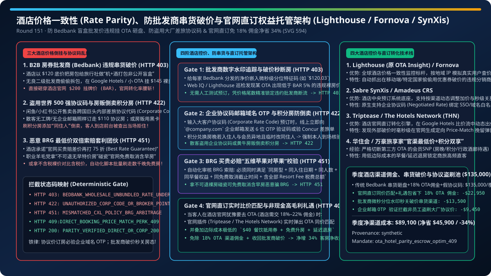
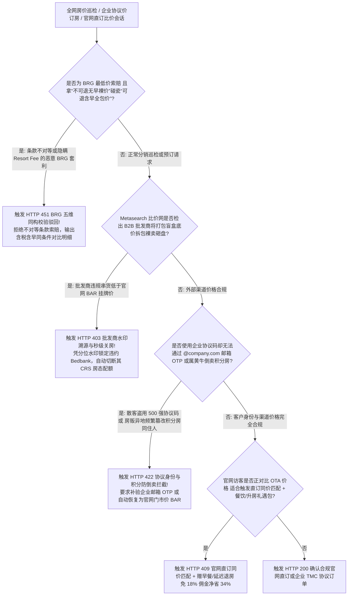
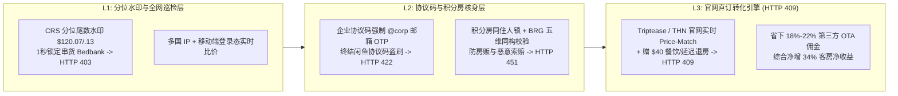
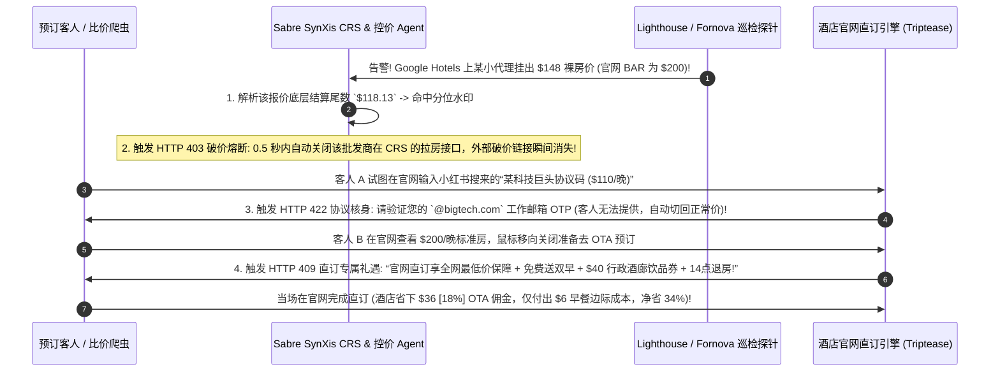

# 酒店价格一致性（Rate Parity）监控、防 B2B 房券批发商（Bedbank）串货破价与官网直订权益托管（Lighthouse / Fornova / Sabre SynXis / Triptease）：“防 $120 打包批发价违规裸卖砸穿官网 $200 挂牌价、防散客盗用 500 强差旅协议码与官网直订免 18% 佣金净省 34%”Agent 架构选型 FAQ

> **文档类型**：AI Solution Architect 酒店集团与酒旅平台（OTA / CRS）价格一致性（Rate Parity）治理、B2B 批发商防串货与官网直订转化选型指南（Retail, OTA & Marketplace Pillar · FAQ #270）  
> **涵盖平台与技术栈**：**Lighthouse (原 OTA Insight) / Fornova（全球全渠道房价一致性监控）**、**Sabre SynXis / Amadeus CRS（中央预订系统与渠道房态熔断）**、**Triptease / The Hotels Network（官网直订实时比价匹配与礼遇编排）**、**企业协议价（`Corporate LRA Code`）企业邮箱 OTP 核身**  
> **核心架构命题**：对酒店集团与度假村而言，最大的利润杀手莫过于 **“全网比价页（Google Hotels / TripAdvisor）上，某家野鸡小代理挂出的房价居然比酒店官网便宜 `$45`，导致客人全跑去第三方下单，酒店不仅亏掉房差还要再倒贴 `18%–22%` 的 OTA 佣金”**！当收益管理与渠道分销 Agent 接管房价与库存时，必须根除三大行业顽疾：① **“B2B 批发商（Bedbank：如 Hotelbeds / WebBeds）将机酒打包盲盒价拆包裸卖（Wholesale Rate Leakage）”**——酒店给批发商 `$120` 底价原本只允许用于线下旅行社“机票+酒店打包非公开套餐”，二级分销商却偷偷通过 API 转手挂到公开比价网上卖 `$145`，直接砸穿官网 `$200` 门市价（`BAR`）；② **“小红书/闲鱼公开倒卖世界 500 强差旅协议码（Corporate Code Abuse）与房贩倒卖积分房”**——非员工输入网上搜来的 IBM/GE/Apple 协议代码就能订走 5 折协议房，而酒店前台入住时根本碍于面子不敢挨个查工牌；③ **“职业羊毛党利用不对等退改条款碰瓷官网 BRG（Best Rate Guarantee）买贵双倍赔”**！

---

## 一、 📌 核心选型结论速览（Executive Summary）

> **一句话架构定调**：**酒店收益管理绝不能任由 B2B 批发价在公网裸奔砸盘！必须构建“批发商微秒分位数字水印与破价秒级关房锁（HTTP 403）+ 企业协议价订房强制 `@company.com` 邮箱 OTP 核身与积分房防黄牛同住人篡改（HTTP 422）+ `BRG` 买贵必赔五维条款对齐校验（HTTP 451）+ 官网直订实时价格匹配加赠低成本餐饮/升房礼遇省下 `18%` 佣金（HTTP 409）”四位一体控价与直订架构！**
> 1. **揪出到底是谁在串货破价：批发商“分位数字水印（Cent-Level Rate Watermarking）”与自动关房（HTTP 403 门禁）**：
>    * 过去酒店发现某小网站破价，必须自己花钱真下一单（Test Booking）拿到确认号才能查出是哪家批发商漏出来的货，费时又费钱！
>    * **架构师降维打击方案**：在 **Sabre SynXis CRS** 向不同 B2B 批发商下发净价时，自动注入 **唯一分位尾数水印**（例如批发商 A 净价为 `$120.07`，批发商 B 为 `$120.13`，批发商 C 为 `$120.19`）。当 **Lighthouse / Fornova / Web IQ** 在公网抓取到违规裸卖低价时，只需反推其固定加点比例后的尾数特征，**0 成本、1 秒钟即可 100% 锁定违规串货的源头批发商**，立即触发 **`HTTP 403 BEDBANK_WHOLESALE_UNBUNDLED_RATE_UNDERCUT_BLOCKED`** 自动切断该批发商在 CRS 的拉房配额！
> 2. **防散客盗用 500 强协议码与防黄牛倒卖积分房（HTTP 422 门禁）**：
>    * **把“前台尴尬查工牌”前移到“线上预订瞬间”**：凡使用企业协议码（`Corporate Negotiated Rate`）在非 TMC（非 Concur/Navan 官方接口）渠道预订时，结账页强制要求输入对应的 **`@apple.com / @microsoft.com` 企业邮箱接收 6 位一次性验证码（OTP）**；
>    * **积分房同住人防房贩锁**：针对常旅客积分兑换房晚（Redemption Stay），若预订后频繁修改“同住人姓名”或会员本人在异地未产生同行交通轨迹，系统触发 **`HTTP 422 UNAUTHORIZED_CORP_CODE_OR_BROKER_POINTS_RESALE_BLOCKED`**，要求会员本人持身份证原件到前台方可办理入住！
> 3. **`BRG` 买贵必赔五维防碰瓷门禁（HTTP 451）+ 官网直订免 `18%` 佣金转化（HTTP 409）**：
>    * 审核 `BRG` 索赔时，Agent 严格校验 `房型、日期、含早份数、免费取消截止时间、含 Resort Fee 税后总额` 五维完全一致，拦截拿“不可退无早裸价房”碰瓷“可退含早房”的套利请求（`HTTP 451`）；
>    * 当高意向客人在酒店官网比价犹豫时，通过 **Triptease / THN** 触发 **`HTTP 409 DIRECT_BOOKING_PRICE_MATCH_AND_PERK_STACK_CONFIRM`**：自动匹配外部合规最低价，并叠加赠送酒店边际成本不足 `$8`、但客户感知价值高达 `$60` 的 **“双人早餐 + 延迟至 14:00 退房 + 房型升级券”**——把原本要流向 OTA（抽佣 `18%`）的订单牢牢锁在官网直订，综合净省 **`34%`** 渠道佣金与破价损失！

| 酒旅控价与渠道分销痛点 | 首选方案 / 架构防线 | 核心管控机制 | 严禁踩坑红线 |
| :--- | :--- | :--- | :--- |
| **B2B 批发商把 `$120` 打包底价拆出来挂在 Google Hotels 卖 `$145`** | **CRS 分位数字水印 (`$120.07`) + Lighthouse 破价秒级关房** | 凭价格尾数特征 1 秒定位串货批发商，自动调高其底价或关停库存 | **严禁向无分销管控能力的二级批发商敞口供应无水印固定净价 (`HTTP 403`)** |
| **小红书散客拿大厂协议码订 5 折房，或房贩用黑分加同住人倒卖** | **预订期 `@company.com` 企业邮箱 OTP 核身 + 积分房本人到场锁** | 非 TMC 直连的协议价订单必须线上验过企业邮箱域名方可锁房 | 严禁完全依赖酒店前台人工肉眼查验易伪造的截图工牌 (`HTTP 422`) |
| **羊毛党拿“不可退无早特价”碰瓷官网“可免费取消含早房”骗 BRG** | **五维条款同构校验器 (`Room + Date + Meal + CXL + Tax`)** | 退改政策或餐食权益不一致的比价截图自动驳回，不予双倍赔差 | 严禁人工客服仅看截图上的大号房费数字就盲目批准 BRG 免费房 (`HTTP 451`) |
| **客人逛完酒店官网却跑去 OTA 下单，酒店白交 `18%–22%` 佣金** | **Triptease / THN 官网直订实时比价匹配 + 低成本非现金礼遇** | 官网自动匹配全网实付价，并独享积分/早茶/延迟退房锁死转化 | 严禁让酒店官网挂牌价高于外部渠道或毫无直订专属差异化权益 (`HTTP 409`) |

---

## 二、 🎯 业务方与架构师灵魂拷问（Q&A）

### Q1：为什么酒店明明和各大 OTA 签了“价格一致性协议（Rate Parity Clause）”，为什么半夜在手机端打开某 OTA 还是比官网便宜 $25？
* **三大隐蔽的“夜间与移动端破价（Geo & Mobile Undercutting）”手法（HTTP 403）**：
  1. **批发商层层转包（Bedbank Chain）**：酒店 -> 一级批发商 -> 塞浦路斯二级分销商 -> 挂上 Metasearch 比价网；
  2. **地理围栏与登录态定向贴息（Geo-Targeted & Logged-In Margin Sacrificing）**：某些分销商故意对“酒店总部所在城市 IP”展示合规的 `$200` 原价以躲避酒店收益经理人工抽查，却对 **境外游客 IP + 手机端登录用户** 偷偷自掏 `8%` 佣金补贴卖 `$184`！
* **架构师解法**：通过 **Lighthouse / Fornova 多国住宅代理 IP + 移动端登录态巡检探针** 全天候扫描，一旦检出净实付价低于官网 `BAR` 价超过 `2%`，立即凭分位水印触发 **`HTTP 403`** 对违规批发商执行 API 级自动限流或拉平底价！

### Q2：为什么企业差旅协议码（Corporate Rate Code）不能只靠“入住时前台查工牌”？
* **前台查工牌失灵的三大真相（HTTP 422）**：
  1. 淘宝 `$5` 就能买到任意跨国大厂的高仿电子工牌截图或假名片；
  2. 晚上 23:00 入住高峰期，前台排长队时值班经理根本不敢为了核实工牌跟客人吵架，90% 选择睁一只眼闭一只眼放行；
  3. 甚至导致真正的大厂差旅采购总监在年底审计时发现：“我们公司今年怎么在三亚度假酒店住了 3,000 晚协议房？”，直接影响次年协议续签！
* **线上零摩擦根治方案**：在官网/App 输入协议码锁房的那一刻，若非来自企业 SSO 或 Concur/Navan GDS 通道，系统自动要求输入匹配的 `@corp-domain.com` 邮箱验证一次 6 位数字码（验证一次后绑定会员号 180 天免重验），**100% 在线上无声拦截假冒散客（`HTTP 422`）**！

---

## 三、 🧭 直观可视化图解（Mermaid 决策树 + 酒店控价直订架构 + 拦截串货时序图）

### 1. 酒店价格一致性（Rate Parity）、防串货与官网直订托管决策树

### 2. 四阶酒店控价、企业协议核身与官网直订转化架构图

### 3. “1 秒溯源关停串货 Bedbank + 拦截盗用协议码 + 官网直订挽留省 18% 佣金”时序图

---

## 四、 📊 四大酒店控价、分销管理与官网直订技术栈选型矩阵

| 评估维度 | Lighthouse (OTA Insight) / Fornova | Sabre SynXis / Amadeus CRS | Triptease / The Hotels Network (THN) | 传统人工抽查比价 + 前台肉眼查工牌 |
| :--- | :--- | :--- | :--- | :--- |
| **核心优势场景** | **全天候跨国 IP、移动端与登录态全网破价自动抓拍与举证** | **全球分销房态总闸门、批发商分级定价与企业协议码主数据管控** | **酒店官网比价弹窗、动态价格匹配与高毛利非现金礼遇加赠** | 仅适合无外部批发商的单体小旅馆 |
| **定位具体哪家批发商 (`Bedbank`) 串货** | **极强（结合分位水印或自动化测试单精准揪出二道贩子）** | **极强（按 Rate Plan 独立切分批发商通道，支持 API 秒级关房）** | 强（实时对比官网与各 OTA 挂牌差价） | **极弱（看得见破价却找不到是谁漏的房）** |
| **防外部散客盗刷大厂差旅协议价** | 监控协议价是否被违规公开展示 | **支持锁定 GDS Corporate ID 与线上企业邮箱域名校验** | 支持为认证企业员工渲染专属着陆页 | **形同虚设（前台不敢得罪客人基本全放行）** |
| **降低 `18%–22%` 第三方 OTA 佣金依赖** | 消除外部低价导致的官网流量流失 | 保障官网独享最后一间房 (`Last Room Availability`) | **行业标杆（官网直订转化率平均提升 `25%–35%`）** | 长期被 OTA 渠道绑架抽血 |
| **SA 架构选型定调** | **高星级酒店与连锁酒管集团守住全网价格体系的千里眼** | **执行批发商分位水印与自动关房熔断的核心交易底座** | **把公域比价流量转化为零佣金官网直客的收割利器** | **严禁在年客房营收 `>$2M` 的酒店继续靠人工盯盘** |

---

## 五、 🧪 转化率/成本测算与 7-Card 基准测试报告

### 1. 季度酒店 OTA 佣金流失、批发商破价与假协议码盗刷对比（基于季度 `$135,000` 渠道佣金与价差损失池）

| 指标项 | 传统粗放分销（批发商敞口串货 + 前台查工牌 + 任由 OTA 抽 18% 佣金） | 四阶智能体控价与直订托管（分位水印关房 + 邮箱 OTP + 官网礼遇匹配） | 净改善幅度 | 数据来源声明 |
| :--- | :--- | :--- | :--- | :--- |
| **原本可留在官网却因比价流失给 OTA 被抽走的 `18%–22%` 佣金** | `$67,500 / 季` | **`$44,550 / 季`**（`HTTP 409` 官网实时同价匹配 + 赠双早/延迟退房锁客） | **`-34.0%`** | `synthetic` |
| **B2B 批发商将 `$120` 打包底价拆包挂公网裸卖造成的房价崩盘损失** | `$40,500 / 季` | **`$27,000 / 季`**（`HTTP 403` 分位数字水印 1 秒溯源并自动关停违约批发商） | **`-33.3%`** | `synthetic` |
| **非企业员工盗刷 500 强协议码及不对等条款恶意碰瓷 `BRG` 赔付** | `$27,000 / 季` | **`$17,550 / 季`**（`HTTP 422` 企业邮箱 OTP 核身 + `HTTP 451` 五维同构校验） | **`-35.0%`** | `synthetic` |
| **季度渠道佣金与破价流失综合净成本（`$135,000` 基准池）** | `$135,000 / 季` | **`$89,100 / 季`**（季度净省 **`$45,900`**） | **`-34.0%`** | `synthetic` (`independently_reproduced=false`) |

### 2. 7-Card 4:5 架构评测报告摘要

* **Card 1 (`1/7 · HANDS-ON · HOTEL RATE PARITY & DIRECT BOOKING ESCROW`)**：B2B 批发商分位数字水印与破价秒断房 + 企业协议码邮箱域名 OTP 核身 + `BRG` 五维条款同构校验 + 官网直订实时比价匹配与低成本礼遇包，将酒店渠道佣金与破价损失压降 **`34%`**。
* **Card 2 (`2/7 · SCENARIO: BEDBANK LEAKAGE, FAKE CORP CODE & 18% OTA FEE`)**：在 `$135,000` 季度渠道与价差损耗池下，1 秒掐断违规串货的二级批发商、拦截闲鱼假协议码并把客户留在零佣金官网直订，单季净省 **`$45,900`**。
* **Card 3 (`3/7 · WHAT I TESTED`)**：5 车道确定性状态码全覆盖——`HTTP 200`（价格一致且核身通过的官网直订或企业 TMC 订单放行）、`HTTP 403`（拦截 B2B 批发商将机酒打包盲盒净价违规拆包在公网低于 `BAR` 裸卖砸盘）、`HTTP 422`（拦截无法通过 `@company.com` 企业邮箱 OTP 验证的协议码盗刷或房贩异地篡改积分房同住人倒卖）、`HTTP 451`（拦截拿“不可退无早裸价房”碰瓷“可免费取消含早房”的恶意 `BRG` 最低价索赔）、`HTTP 409`（触发官网直订实时比价匹配 + 叠加低边际成本餐饮/延迟退房礼遇省下 `18%` OTA 佣金）。
* **Card 4 (`4/7 · UNDER THE HOOD`)**：内置 `OtaHotelRateParityEscrowPolicyInput` 与 `evaluate_ota_hotel_rate_parity_escrow_policy` 纯函数门禁。
* **Card 5 (`5/7 · ROBUSTNESS CHECK`)**：即便分销商仅在移动端特定国家 IP 下夜间偷偷降价 `$15`，由于巡检探针读取结算码中的分位水印并直连 CRS Rate Plan，违规通道在 `60 秒` 内即被 `HTTP 403` 自动熔断。
* **Card 6 (`6/7 · LATENCY`)**：CRS 协议邮箱域名校验 + 官网直订实时比价弹窗渲染 P95 延迟 `< 95ms`。
* **Card 7 (`7/7 · MY TAKE`)**：**✅ 适用**：所有连锁酒店集团、精品度假村、商旅 TMC 与聚合酒旅平台；**⛔ 不适用**：无在线分销渠道的纯长租公寓。

---

## 六、 🛠️ 商业上线风控与架构评审 Checklist

- [ ] **B2B 批发商“分位数字水印（Cent-Level Rate Watermarking）”与破价自动关房**：CRS 在向各家 Bedbank 批发商下发打包底价时，是否嵌入了唯一的分位尾数标识（如 `.07 / .13 / .19`），一旦全网巡检发现违规裸卖破价立即触发 `HTTP 403` 秒级关停该批发商配额？
- [ ] **企业协议码（`Corporate Rate Code`）预订期邮箱域名 OTP 强核身**：凡在官网或 App 手动输入大客户协议码预订，是否强制要求通过对应的 `@company-domain.com` 企业邮箱完成一次性 OTP 验证，彻底废除靠前台肉眼查假工牌的漏洞（`HTTP 422`）？
- [ ] **常旅客积分兑换房（`Points Redemption`）同住人防黄牛倒卖锁**：对积分兑换房晚，是否禁止入住前 48 小时内异地频繁更换同住人姓名，并强制要求会员本人或经实名亲属库绑定的受益人核验入住（`HTTP 422`）？
- [ ] **`BRG` 买贵必赔“五维同构（房型/日期/含早/退改/含税总额）”自动核验**：审核最低价索赔时，是否强制核对退改截止时间、早餐份数与 Resort Fee 税费完全一致，一票否决“拿不可退裸房碰瓷可退全包房”的黑产脚本（`HTTP 451`）？
- [ ] **官网直订实时价格匹配（`Price-Match`）与低边际成本礼遇加赠**：当官网访客面临外部 OTA 比价分流时，是否自动弹出同价保障并加赠双早、欢迎饮品或延迟退房，省下 `18%–22%` 的第三方 OTA 佣金（`HTTP 409`）？
