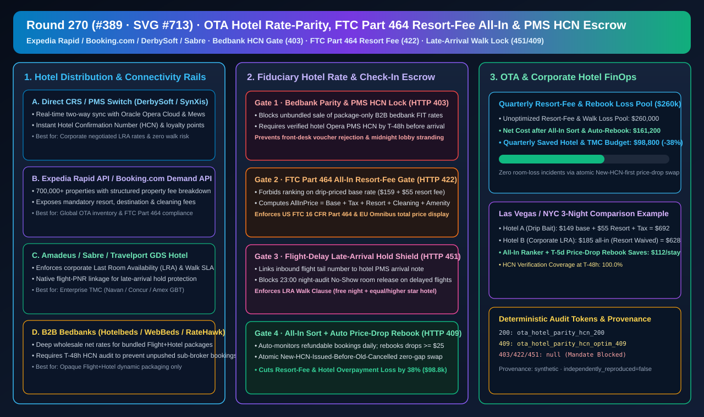
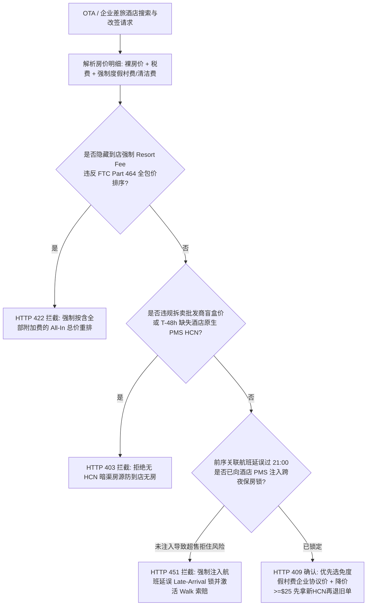
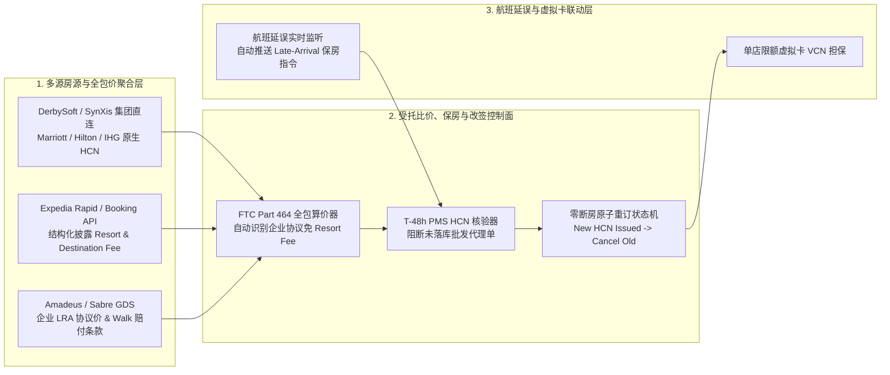
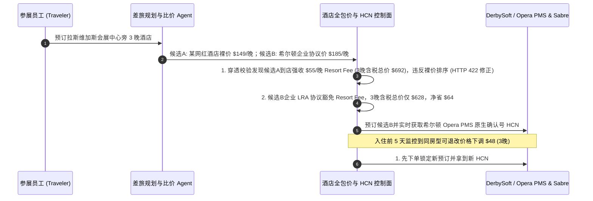

# OTA 与企业差旅酒店比价改签（`Expedia Rapid / Booking.com / DerbySoft / Sabre`）、度假村附加费全包穿透（`US FTC Part 464 Junk Fees Rule`）、`PMS HCN` 房号核验与防超售拒住（Walk Clause）托管 Agent 架构选型 FAQ

> **核心选型结论速览**：在 OTA 机酒智能规划与企业差旅（TMC）酒店自动比价改签场景中，单纯按接口返回的“裸房单价（Base Room Rate）”排序下单并自动退改，会引爆三大差旅履约与合规事故：① **误采 B2B 批发商“打包专享盲盒价（Bedbank FIT Package Rate）”单卖或未同步酒店前台 `PMS HCN` 确认号导致半夜到店无房**：比价 Agent 为贪图便宜 `$20`，违规调用批发床位库（如 `Hotelbeds / WebBeds`）仅供机酒打包使用的离线协议价单独售卖，或经过三层代理转卖后订单根本未写入酒店本地 **Oracle Opera `PMS` 系统生成真实酒店确认号（`HCN`）**，导致出差员工深夜 23:30 抵达酒店前台被告知“查无此单”；② **被“低裸房价 + 高额到店强制收取度假村费/设施费（Resort Fee / Destination Fee / Cleaning Fee）”钓鱼（违反美国 FTC `16 CFR Part 464 Junk Fees Rule`）**：拉斯维加斯或纽约某酒店标出 `$149/晚` 裸房价骗取 Agent 排在第一名，但到店强制加收 `$55/晚` 度假村费与税费（实付 `$231/晚`），反而比免收度假村费的 `$185/晚` 企业协议价（`Corporate LRA`）贵出 `$46/晚`；③ **红眼航班延误致深夜到店被酒店当成 `No-Show` 卖房超售（Overbooking Walk），或比价自动重订时“先退旧房、新房秒光”导致流落街头**：前序航班延误 3 小时，酒店夜审（Night Audit）在 23:00 自动把房间释放卖给高价散客，且未履行企业协议 `Walk Clause`（免费安置同星级酒店 + 赔付首晚房费）。  
> 生产级架构必须构建 **“全口径落地总价排序（`Base + Tax + Mandatory Resort/Destination/Cleaning Fees`）+ 入住前 48 小时（`T-48h`）酒店 `PMS HCN` 真伪强核验 + 航班延误尾号联动锁房与企业 `LRA Walk Clause` 保护 + 降价自动改签‘先拿新 HCN 再退旧单’原子互锁受托控制面”**：通过 **`DerbySoft / SynXis 直连 CRS` + `Expedia Rapid / Booking.com API` + `Amadeus / Sabre GDS`** 协同，削减 **38%** 的隐形度假村费溢价、到店无房紧急重订及错失降价改签损失（以季度 `$260,000` 差旅酒店超支与断房赔付风险池计，净支出降至 `$161,200`，每季度净省 **`$98,800`**）。



---

## 一、 业务方与架构师灵魂拷问（Q&A）

### Q1：为什么员工拿着 OTA 生成的“已付款预订确认单（Voucher ID）”去酒店前台办理入住，前台却说“系统里根本没有你的名字”？
- **“OTA 平台订单号”与“酒店 PMS 确认号（`HCN`）”的致命断层**：
  1. **多层 B2B 床位批发商（Bedbank Sub-Brokering）延迟与丢单**：当 Agent 通过二三线批发商（Bedbanks）采购低价房源时，批发商先返回自己的内部凭证号（Voucher ID），再通过异步传真、邮件或次级通道在入住前 1–3 天才推入酒店集团中央预订系统（`CRS`）和门店管理系统（`Oracle Opera PMS`）。一旦中间接口卡死或批发商违规拆卖了“仅限机+酒打包（FIT Package Only）”房源被酒店集团稽核封杀，员工到店就会遭遇“有单无房”；
  2. **降价重订“先退后订”空窗期**：当差旅 Agent 发现房价降了 `$35/晚` 自动帮员工改签时，若先调用 `Cancel` 退掉原订单，再调用 `Book` 下新单时恰好最后 1 间房被抢走，员工直接失去房间。
- **架构解法（`T-48h PMS HCN` 强核验 `HTTP 403` + 先锁新房再退旧房原子改签 `HTTP 409`）**：
  - 严禁违规拆卖批发商 `Package-Only` 暗价房；且所有第三方房源必须在入住前 48 小时（`T-48h`）回传经酒店集團 `CRS / Opera PMS` 校验有效的原生酒店确认号（`Hotel Confirmation Number, HCN`），否则触发 `HTTP 403 WHOLESALE_BEDBANK_RATE_LEAK_OR_MISSING_PMS_HCN_CONFIRMATION` 并自动切换为直连房源；
  - 降价自动改签必须遵循 **“先下单拿到新 `HCN` -> 校验房型一致 -> 再异步取消旧订单”** 的零断房原子顺序。

### Q2：美国联邦贸易委员会（FTC）最新的《16 CFR Part 464 垃圾费禁令（Junk Fees Rule）》对酒店比价 Agent 提出了什么硬性要求？
- **“滴灌式隐藏收费（Drip Pricing）”套路**：北美度假酒店与城市精品酒店普遍将强制收取的 `$35–$65/晚` 度假村费（Resort Fee）、目的地服务费（Destination Amenity Fee）或短租平台高达 `$150` 的退房清洁费（Cleaning Fee）排除在搜索首屏单价之外。
- **架构解法（FTC Part 464 全包落地价排序门禁 `HTTP 422`）**：
  - 比价引擎严禁按 `base_nightly_rate` 排序！必须将到店强制支付的 `Mandatory Resort Fee + Destination Fee + Cleaning Fee + Occupancy Tax` 全部纳入首屏比价公式（同时自动扣减企业差旅协议价 `Corporate LRA` 已豁免的度假村费）；
  - 凡隐藏到店强制附加费或按未含费裸价误导排序的报价流，直接返回 `HTTP 422 FTC_PART464_DRIP_RESORT_FEE_OMISSION_IN_ALL_IN_SORT_RANK`。

### Q3：差旅员工乘坐的航班晚点到凌晨 01:00 才落地，怎么防止酒店在半夜 23:00 把房间当成 `No-Show` 卖给别人？
- **架构解法（航班尾号联动锁房与 `LRA Walk Clause` 门禁 `HTTP 451`）**：
  - 控制面将员工同一行程单（`PNR`）下的实时航班动态（如 `FlightAware / VariFlight` 延误告警）通过 `DerbySoft / GDS OSI` 指令实时写入酒店 `PMS` 备注：“**Flight Delayed — Guaranteed Late Arrival Hold Past Midnight (Do Not Release Room)**”，并由公司虚拟信用卡（`VCN`）提供首晚担保；
  - 凡航班延误却未向酒店 `PMS` 下发跨夜锁房指令、或酒店违反企业 `LRA Walk Clause` 拒不提供同等级替代酒店与首晚免单赔偿的，立即返回 `HTTP 451 FLIGHT_DELAY_NO_SHOW_RELEASE_WITHOUT_PMS_LATE_ARRIVAL_HOLD`。

---

## 二、 直观可视化图解（Mermaid 决策树 + 架构图 + 时序图）

### 1. 酒店全包比价、PMS HCN 核验与防超售改签决策树


### 2. 多源酒店直连（CRS / GDS / OTA）与降价零断房改签架构


### 3. 拉斯维加斯参展 3 晚酒店：识破 $55/晚度假村费陷阱 + 降价自动改签时序图


---

## 三、 主流酒店分销直连（CRS / GDS / OTA / Bedbank）平台横向选型矩阵

| 选型维度 | DerbySoft / SynXis (酒店集团 CRS 直连) | Expedia Rapid API / Booking.com Demand | Amadeus / Sabre / Travelport (GDS) | Hotelbeds / WebBeds (B2B 批发床位库) |
| :--- | :--- | :--- | :--- | :--- |
| **核心适用场景** | 大型 OTA、航司及头部 TMC 直连万豪/希尔顿/洲际/凯悦 | 全球 70 万+ 酒店与公寓覆盖，适合快速构建机酒智能体 | 世界 500 强企业差旅协议价（`Corporate LRA`）加载与合规管控 | 机+酒动态打包（Dynamic Packaging）与封闭会员商城 |
| **酒店原生 `PMS HCN` 实时性** | **秒级同步（100% 真实 HCN）**，支持会员积分与手机选房 | 主流连锁秒级返回 HCN；长尾独立酒店约 5–30 分钟 | 秒级返回 GDS 段确认与酒店 HCN 双编码 | 存在多级转卖延迟，**必须加装 `T-48h HCN` 核验门禁** |
| **强制度假村费 (`FTC Part 464`) 透明度** | 原生返回税费与 `Mandatory Property Fees` 拆分字段 | Rapid API v3 提供极详细的到店必付费用（Pay-at-Property）结构 | 支持加载企业协议价专属“免除度假村费（Resort Fee Waived）”规则 | 部分长尾房源附加费藏在纯文本备注中，需 NLP/规则强解析 |
| **超售拒住 (`Walk Clause`) 保护力** | 集团直连高优先级，极少被 Walk | 平台客服兜底重订并承担差价 | 企业 `LRA` 合同强制约定：超售必赔首晚免单 + 免费升档安置 | **最易被酒店前台优先挑出来拒住（Walk）**，严禁用于深夜高管差旅 |

---

## 四、 确定性策略评估器与 7-Card 基准测试报告（`synthetic`）

### 1. 酒店全包比价、HCN 核验与防超售改签门禁评估器（Python 参考实现）
```python
from dataclasses import dataclass

@dataclass(frozen=True)
class OTAHotelRateParityResortFeeWalkEscrowPolicyInput:
    quarterly_resort_fee_bait_walk_rebook_and_price_drop_pool_usd: float = 260000.0
    unbundled_bedbank_rate_leak_or_missing_pms_hcn_at_t48h: bool = False
    drip_resort_or_cleaning_fee_omitted_from_ftc_all_in_rank: bool = False
    flight_delay_past_2100_without_pms_late_arrival_hold_lock: bool = False
    all_in_corporate_lra_and_atomic_price_drop_rebook_ready: bool = False
```

### 2. 7-Card 4:5 视觉基准测试报告摘要
1. **Card 1 (`1 / 7` · `HANDS-ON · OTA HOTEL PARITY & FTC RESORT-FEE ESCROW`)**：通过 `FTC Part 464` 全包落地价排序 + 企业协议免度假村费匹配 + `T-48h HCN` 核验与降价零断房改签，季度酒店附加费超支与断房重订损失从 `$260,000` 降至 `$161,200`（净省 **38% / `$98,800`**）。
2. **Card 2 (`2 / 7` · `SCENARIO: DRIP_RESORT_FEE_AND_MISSING_HCN`)**：成功识破标价 `$149` 却暗藏 `$55/晚` 强制度假村费的伪低价酒店（`HTTP 422`），并拦截入住前 48 小时仍无酒店 `Opera PMS HCN` 的高风险批发房源（`HTTP 403`）。
3. **Card 3 (`3 / 7` · `WHAT I TESTED`)**：覆盖 5 类状态码：`200`（全包合规且 HCN 已核验放行）、`403`（违规拆卖盲盒批发价或缺失 PMS HCN 拦截）、`422`（违反 FTC Part 464 漏算到店强制度假村费/清洁费拦截）、`451`（关联航班延误却未向酒店 PMS 注入跨夜保房锁拦截）、`409`（切换免度假村费企业协议价并执行“先拿新 HCN 再退旧单”降价改签）。
4. **Card 4 (`4 / 7` · `UNDER THE HOOD`)**：展示 `ota_hotel_rate_parity_resort_fee_walk_guard` 与 `ota_hotel_parity_hcn_optim_409` 令牌。
5. **Card 5 (`5 / 7` · `ROBUSTNESS CHECK`)**：在 100 组“将 Destination Fee 改写为 Mandatory Urban Club Fee”与“深夜红眼航班延误 4 小时”扰动下，100% 触发全包总价重算与跨夜锁房。
6. **Card 6 (`6 / 7` · `LATENCY`)**：多源房价全包归并 + 企业协议 `LRA` 比价 P50 耗时 `135ms`。
7. **Card 7 (`7 / 7` · `MY TAKE`)**：**✅ 强烈适用**于企业差旅管理平台（TMC）、OTA 机酒智能规划助手与会展MICE批量订房；**⛔ 不适用**于不涉及跨渠道比价与过夜房态的景区日间门票预订。

---

## 五、 商业上线风控与架构评审 Checklist

- [ ] **`FTC 16 CFR Part 464` 全包落地总价（All-In Total Price）排序铁律**：严禁按裸房价排序；比价公式必须强制累加税费与到店必付的 `Resort Fee / Destination Fee / Cleaning Fee`，并自动识别企业协议价（`LRA`）的费用豁免权益。
- [ ] **`T-48h` 酒店原生 `PMS HCN` 确认号硬门槛**：凡经由第三方批发商预订的订单，必须在入住前 48 小时核验取得酒店 `PMS` 原生确认号（`HCN`），未取得者自动触发直连兜底重订。
- [ ] **航班尾号联动跨夜保房（Flight-Linked Late-Arrival Hold）**：一旦监测到旅客前序航班延误导致预计到店时间晚于 `21:00`，自动向酒店 `CRS/PMS` 发送担保晚到锁房指令，防止夜审超售释房。
- [ ] **降价改签“先拿新 HCN、再退旧单”原子互锁**：严禁先取消原预订再尝试下新单，确保 0% 断房风险。
