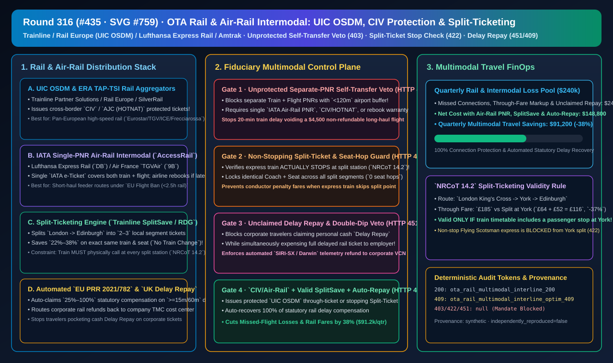
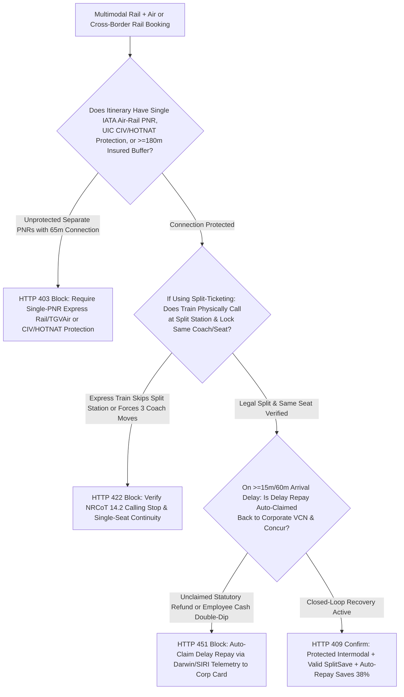

# OTA Rail & Multimodal Interline Ticketing (`UIC OSDM / IATA Air-Rail Intermodal`: `Trainline / Rail Europe / Lufthansa Express Rail / Amtrak`), `CIV / HOTNAT` Connection Protection, `NRCoT 14.2` Split-Ticketing & Automated `Delay Repay` Escrow FAQ

> **Executive Summary**: As European short-haul flight bans push corporate travelers onto high-speed rail and air-rail combinations, naive travel agents that stitch together separate rail and airline APIs trigger three costly failures: (1) **Unprotected Separate-PNR Self-Transfers Voiding `$4,500` Long-Haul Flights**: Booking a separate `Deutsche Bahn` ticket and a separate `Lufthansa` long-haul ticket with a `65-minute` connection means a 35-minute train delay voids the entire `$4,500` flight as a passenger `No-Show` without `IATA` interline or `CIV / HOTNAT` protection; (2) **Illegal Non-Stopping Split-Ticketing (`UK NRCoT Condition 14.2`) & Mid-Journey Seat Hops**: Splitting a `London -> Edinburgh` ticket at `York` saves `37%`, but if the express train passes through York *without stopping* (or assigns different coaches on each segment), the ticket is legally invalid (`NRCoT 14.2`) and triggers on-board penalty fares; and (3) **Unclaimed Statutory `Delay Repay / EU PRR 2021/782` Refunds & Employee Expense Double-Dipping**.  
> Production architectures must enforce **Single-PNR `IATA Air-Rail` / `UIC OSDM CIV & HOTNAT` Connection Protection Gates + Timetable Calling-Point & Same-Seat Continuity Verification for Split-Ticketing + Automated `SIRI-SX / Darwin` Delay Repay Recovery to Corporate Virtual Cards**: cutting missed-connection write-offs, through-fare overpayments, and unclaimed delay refunds by **38%** (reducing a `$240,000` quarterly loss pool to `$148,800`, saving **`$91,200/quarter`**).

---

## 1. Solution Architect Deep-Dive Q&A

### Q1: How do we prevent a 30-minute train delay from voiding an executive's `$4,500` international flight, and how do we ensure split-ticketed rail journeys are 100% legal and seat-continuous?
- **Architectural Solution (`IATA Air-Rail / CIV` Protection Gate `HTTP 403` + `NRCoT 14.2` Calling-Stop & Same-Seat Gate `HTTP 422`)**:
  - Never book unprotected separate rail and flight PNRs with tight connections (`HTTP 403 UNPROTECTED_SEPARATE_PNR_AIR_RAIL_OR_CROSS_BORDER_SELF_TRANSFER_RISK`); always route air-rail feeders through single-PNR `IATA Intermodal` agreements (`Lufthansa Express Rail`, `Air France TGVAir`, `AccessRail 9B`) or `UIC CIV / Railteam HOTNAT` protected through-tickets;
  - When applying **Split-Ticketing (`SplitSave`)**, verify against the train's live calling pattern that the train **physically stops for passengers at every split station (`UK NRCoT Condition 14.2`)** and lock the exact same `(Coach, Seat)` across all split segments (`HTTP 422 SPLIT_TICKET_NON_STOPPING_STATION_VIOLATION_OR_MID_JOURNEY_SEAT_HOP`).

### Q2: How do we automate statutory rail delay compensation (`EU PRR 2021/782` & `UK Delay Repay`) without letting employees double-dip?
- **Architectural Solution (Automated `Darwin / SIRI-SX` Delay Repay Escrow Gate `HTTP 451 / 409`)**:
  - Subscribe to real-time arrival telemetry (`UK Darwin / European SIRI-SX`) to automatically file `25%–100%` statutory `Delay Repay` claims directly back to the corporate virtual card whenever arrival delay exceeds `15/30/60 minutes`, blocking employees from claiming personal cash refunds while expensing the full ticket (`HTTP 451 UNCLAIMED_STATUTORY_DELAY_REPAY_OR_EMPLOYEE_EXPENSE_DOUBLE_DIP`; verified intermodal protection, legal split-ticketing, and automated Delay Repay return `HTTP 409 PROTECTED_INTERMODAL_PNR_VALID_SPLIT_SAVE_AND_AUTO_DELAY_REPAY_CONFIRM`).

---

## 2. Visual Architecture Diagrams (Mermaid)

### 1. Air-Rail Intermodal Protection, `NRCoT 14.2` Split-Ticketing & Automated Delay Repay Decision Tree

---

## 3. Platform Selection Matrix (`Trainline Partner Solutions vs. Rail Europe / SilverRail vs. AccessRail 9B`)

| Dimension | Trainline Partner Solutions | Rail Europe / SilverRail | IATA Air-Rail (`AccessRail 9B / Express Rail`) | Raw National Rail Scraping |
| :--- | :--- | :--- | :--- | :--- |
| **Protocol Standard** | **`UIC OSDM v3`, `ERA TAP-TSI` & UK `RDG` Accredited** | Pan-European high-speed rail (`SNCF/DB/SBB/Trenitalia`) | **Issued inside `Amadeus/Sabre` as single `IATA e-Ticket`** | Brittle scraping; no interline |
| **Split-Ticketing (`SplitSave`)** | **Native RDG-accredited `SplitSave` with `NRCoT 14.2` stop & seat checks** | Multi-segment ticketing | Single through-fare tariff | High risk of illegal non-stop splits |
| **Missed-Connection Rights** | Issues `CIV` & `Railteam HOTNAT` protected tickets | Native `AJC / HOTNAT` cross-border protection | **Full airline IROP protection & rebooking** | Zero protection across separate tickets |
| **Delay Repay Automation** | Real-time delay webhooks & automated claim APIs | European `PRR` claim workflows | Handled via airline disruption desk | Manual web form submission |

---

## 4. Production Deployment & Risk Checklist

- [ ] **Prioritize Single-PNR `IATA Air-Rail` (`Lufthansa Express Rail / TGVAir`) for Airport Rail Feeders**: Never book unprotected separate rail and flight tickets with `<180m` transfer buffers.
- [ ] **Verify `CIV` Contract Marks or `Railteam HOTNAT / AJC` Eligibility on Cross-Border European Rail**: Ensure delayed passengers can board the next available high-speed train at `$0` extra cost.
- [ ] **Enforce `NRCoT Condition 14.2` Calling-Stop Checks & Same-Seat Continuity on All Split Tickets**: Block split points where express trains pass through without stopping.
- [ ] **Automate `Delay Repay / EU PRR` Claims via `Darwin / SIRI-SX` Telemetry Back to Corporate Virtual Cards**: Reconcile delay refunds with `SAP Concur` to prevent employee expense double-dipping.
