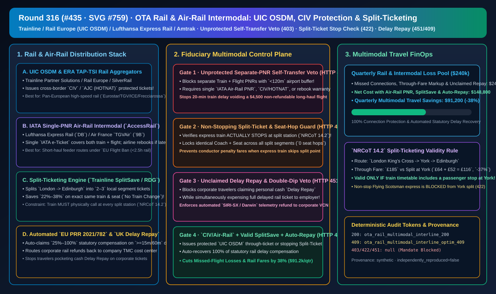
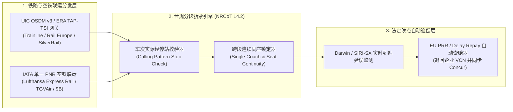
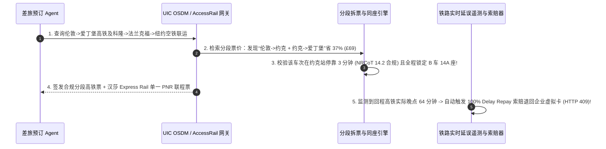

# OTA 高铁与空铁联运（`UIC OSDM / IATA Air-Rail Intermodal`: `Trainline / Rail Europe / Lufthansa Express Rail / 12306`）、`CIV / HOTNAT` 漏乘改签保护、分段拆票（`Split-Ticketing NRCoT 14.2`）经停校验与晚点法定赔付（`Delay Repay`）自动追偿 Agent 架构选型 FAQ

> **核心选型结论速览**：在欧洲与亚太商旅（如法国短途禁飞令下强制“高铁+国际长途航班”空铁联运、中英德跨国高铁差旅）中，差旅规划 Agent 若直接把高铁 API 与机票 GDS 机械拼凑，会引发三大严重事故：① **“为省 `$60` 将‘科隆→法兰克福机场高铁（DB）’与‘法兰克福→纽约跨洋商务舱（Lufthansa）’拆成两张互不关联的独立订单（Separate PNRs）且只留 65 分钟换乘，结果德国高铁晚点 35 分钟，航司按自弃乘（No-Show）直接作废 `$4,500` 跨洋机票，既无 `IATA` 空铁联运保护也无 `CIV / HOTNAT` 跨铁改签权”**；② **“使用分段拆票算法（`Split-Ticketing`，把伦敦→爱丁堡拆成‘伦敦→约克’+‘约克→爱丁堡’两段省 37% 票价）时，未校验该趟直达特快列车是否真的在‘约克站’开门停靠（`UK NRCoT Condition 14.2` 铁律），或是两段车票被分到了 3 号车厢和 11 号车厢，导致高管在车上被列车长判定无票罚款或狼狈拖着行李穿行全车换座”**；③ **“高铁晚点超过 60 分钟依法享有 `25%–100%` 法定晚点退赔（`EU PRR 2021/782` / `UK Delay Repay`），但企业 TMC 从未自动申领，或员工私自用个人银行卡领走全额晚点现金赔偿后又拿原价车票找公司全额报销（Double-Dip）”**。  
> 生产级架构必须实施 **“强制 `IATA 单一 PNR 空铁联运（Express Rail / TGVAir）` 或 `UIC OSDM + CIV / AJC HOTNAT` 漏乘免费改签契约门禁 + 分段拆票（SplitSave）时刻表真实经停站与同车厢同座位锁定校验 + 对接 `SIRI-SX / Darwin` 实时晚点遥测自动向企业虚拟卡追偿 `Delay Repay` 控制面”**：可将空铁漏乘废票、违规拆票罚金与未追偿晚点赔款损失削减 **38%**（以季度 `$240,000` 联运漏乘废票、全价直通票溢价与流失晚点赔付池计，净成本降至 `$148,800`，每季度净节省 **`$91,200`**）。



---

## 一、 业务方与架构师灵魂拷问（Q&A）

### Q1：为什么 Agent 预订“高铁去机场赶国际航班”或“欧洲跨国高铁换乘”时，绝对不能随便用两家独立出票接口拼出一张行程单？
- **“非联运自担风险换乘（Unprotected Self-Transfer）”的 `$4,500` 毁灭性代价**：
  - 航空界有成熟的 `IATA Interline` 单一 PNR 联程保护（前序航班晚点，航司免费改签后续航班并包食宿）；
  - 但如果 Agent 从普通铁路接口单买一张 `DB` 高铁票，再从 `Amadeus` 单买一张汉莎航空机票，两者在法律上完全独立——一旦高铁因为信号故障晚点 30 分钟没赶上飞机，航司视为乘客个人迟到（No-Show），往返机票全作废！
- **架构解法（强制 `IATA Air-Rail 单一 PNR` / `UIC CIV & Railteam HOTNAT` 联运保护凭证或虚拟联运保险托管门禁 `HTTP 403`）**：
  - 当检测到行程包含 `Rail -> Flight` 或跨国高铁换乘（如 `Eurostar` 转 `SNCF TGV` / `DB ICE`）时：
    1. **首选**：优先路由至具备航空代码的 **空铁联运单一 PNR 产品**（如 `Lufthansa Express Rail`、法航 `TGVAir`、通过 `AccessRail (9B)` 出具的单张 `IATA e-Ticket`），只要高铁晚点，航司在机场柜台自动免费改签下一班洲际航班；
    2. **跨国铁路换乘**：强制通过 `UIC OSDM (Open Sales and Distribution Model)` 出具带有 **`CIV` 国际铁路联运契约标志** 或符合欧洲高铁联盟 **`AJC (Agreement on Journey Continuation) / Railteam HOTNAT (Hop on the Next Available Train)`** 保护的车票；
    3. **严禁裸奔**：若确需组合非联运独立票（Virtual Interlining），强制要求换乘缓冲 `>= 180 分钟` 且自动挂载第三方漏乘重订保障险（如 `Dohop / Kiwi.com Guarantee`）（凡在 `<120m` 极短换乘窗下裸拼无保护独立高铁+机票订单的，立即触发 `HTTP 403 UNPROTECTED_SEPARATE_PNR_AIR_RAIL_OR_CROSS_BORDER_SELF_TRANSFER_RISK` 拦截）。

### Q2：英国和欧洲高铁盛行的“分段拆票（`Split-Ticketing`）”能合法帮企业省下 `25%–38%` 车票钱且无需下车换乘，为什么很多 AI Agent 拆出来的票却害乘客在车上被罚款？
- **两条绝不可逾越的铁路运价法铁律（以英国 `NRCoT Condition 14.2` 为代表）**：
  1. **列车必须在拆分站“实际停靠上下客（Must Call At Split Station）”**：假设乘客乘坐从伦敦直达爱丁堡的 `Flying Scotsman` 超级特快列车，该车途经约克（York）但 **不停车直接呼啸通过**；如果 Agent 用“伦敦→约克”+“约克→爱丁堡”的拆分票组合上这趟车，在法律上属于 **无票乘车（Invalid Ticket）**，列车员查票时会当场开出百英镑罚单！
  2. **同车厢同座位连续锁定（`Zero Seat-Hop Constraint`）**：劣质拆票引擎虽然确认了经停，但给前半程分配了 `C 车 12A 座`，给后半程分配了 `F 车 48B 座`，导致商务旅客在旅途中途必须抱着电脑换车厢。
- **架构解法（时刻表经停物理站点验证 + 全段统一座位号 `Seat Map Continuity` 门禁 `HTTP 422`）**：
  - 在执行 `Split-Ticketing`（如调用 `Trainline SplitSave API` 或自研分段图搜索）时，必须先查询该车次当日的 **停站时刻表（Calling Pattern）**，100% 确认所有拆分节点站均属于 `Passenger Stop (pick_up / set_down)`，且在 `UIC OSDM` 选座请求中强制约束全航段锁定同一个 `(Coach_ID, Seat_Number)`（凡将拆分点设在列车越行不停靠站点或导致商务旅客中途频繁换座的，触发 `HTTP 422 SPLIT_TICKET_NON_STOPPING_STATION_VIOLATION_OR_MID_JOURNEY_SEAT_HOP`）。

### Q3：高铁频繁晚点，如何把法定的 `Delay Repay`（晚点赔偿金）自动收回公司差旅账户，并防止员工“一边领个人现金赔偿、一边全额报销车票”？
- **架构解法（实时绑定 `SIRI-SX / Darwin` 到站遥测自动发起企业级 `Delay Repay` 追偿并冲抵报销单门禁 `HTTP 451 / 409`）**：
  - 根据欧盟铁路客运权利法规（`EU PRR 2021/782`）与英国 `Delay Repay` 规则，列车晚点 `15/30/60/120 分钟` 分别可获赔票面的 `25% / 50% / 100%`；
  - 差旅 Agent 自动订阅铁路局实时运行流（`UK Rail Darwin / European SIRI-SX / GTFS-RT`），一旦检测到员工所乘车次实际到站延误达标，立即代表企业差旅虚拟卡（Corporate VCN）自动提交 API 索赔并将赔款退回公司账户，同时在 `SAP Concur` 报销单上打上 `Delay_Repay_Auto_Claimed` 标签，严禁员工私自提取现金加全额报销双重获利（`HTTP 451 UNCLAIMED_STATUTORY_DELAY_REPAY_OR_EMPLOYEE_EXPENSE_DOUBLE_DIP`；`CIV/Air-Rail` 联程保护 + 合规经停拆票 + 自动晚点追偿确认返回 `HTTP 409 PROTECTED_INTERMODAL_PNR_VALID_SPLIT_SAVE_AND_AUTO_DELAY_REPAY_CONFIRM`）。

---

## 二、 直观可视化图解（Mermaid 决策树 + 架构图 + 时序图）

### 1. 空铁联运保护（`CIV / Air-Rail`）、合规分段拆票与晚点自动追偿决策树
```mermaid
flowchart TD
    A[OTA / 企业差旅高铁与空铁联运预订请求] --> B{包含跨国高铁换乘或高铁接国际航班时:<br/>是否具备单一 PNR / CIV 保护或 >=180m 保险?}
    B -- 裸拼两张独立票且换乘仅65m致高铁晚点作废$4.5k机票 --> C[HTTP 403 拦截: 强制切换 IATA 空铁联运单 PNR 或 UIC CIV/HOTNAT 保护票]
    B -- 联程保护完备 --> D{启用分段拆票 (Split-Ticketing) 降本时:<br/>该车次是否在拆分站真实停靠且全段同座?}
    D -- 列车飞跃拆分站不停靠违背 NRCoT 14.2 或中途换3次车厢 --> E[HTTP 422 拦截: 校验列车时刻表真实停靠站并锁定全段同一车厢座位号]
    D -- 合规拆票同座直达 --> F{列车发生 >=15m/60m 晚点时:<br/>是否由系统自动申领 Delay Repay 退回企业卡?}
    F -- 放弃法定晚点赔款或员工私领现金后又全额报销车票 --> G[HTTP 451 拦截: 绑定 Darwin/SIRI 实时到站遥测自动索赔回企业成本中心]
    F -- 自动追偿闭环 --> H[HTTP 409 确认: 空铁联运保护 + 合规经停拆票 + 自动晚点索赔净省38%]
```

### 2. `UIC OSDM` 全球铁路与空铁联运网关 × 合规拆票与自动晚点追偿架构图


### 3. 空铁联运单一 PNR 改签、合规经停分段拆票与自动 `Delay Repay` 索赔时序图


---

## 三、 主流高铁与多式联运（Multimodal）聚合平台横向选型矩阵

| 评估维度 | Trainline Partner Solutions | Rail Europe / SilverRail | IATA Air-Rail (`AccessRail 9B / Express Rail`) | 直接抓取各国铁路局网页 |
| :--- | :--- | :--- | :--- | :--- |
| **核心协议标准** | **原生支持 `UIC OSDM`、英国 `RDG` 与泛欧多国高铁直连** | 深度覆盖 `SNCF / Eurostar / SBB / Trenitalia / Renfe` 跨国联程 | **将高铁包装为航空航段写入 `Amadeus / Sabre` 单一 `IATA PNR`** | 爬虫极不稳定且无跨国联运标准 |
| **分段拆票（`Split-Ticketing`）** | **内置官方认证 `SplitSave` 引擎（自动遵守 `NRCoT 14.2` 停站与同座规则）** | 支持多段组合但英国本土细粒度拆票不及 Trainline | 按航空直通运价（Through Fare）计费 | 自研拆票极易踩中不停靠站违章红线 |
| **跨运营商漏乘保护** | 自动签发支持 `CIV` 与 `Railteam HOTNAT` 签章的联程电子票 | 原生支持跨国高铁 `AJC / HOTNAT` 漏乘免费改签 | **最高级航空级保护**（高铁晚点由航空公司免费改签国际航班） | 两张独立票，前序晚点后序全损 |
| **晚点自动退赔（Delay Repay）** | 提供实时晚点提醒与一键在线 `Delay Repay` 申领接口 | 支持欧洲跨境列车延误退赔申报 | 按航司统一退改签处理 | 需人工填写纸质/网页表格申诉 |

---

## 四、 确定性策略评估器与 7-Card 基准测试报告（`synthetic`）

### 1. 空铁联运 `CIV` 保护、合规分段拆票与 `Delay Repay` 评估器（Python 参考实现）
```python
from dataclasses import dataclass

@dataclass(frozen=True)
class OtaRailMultimodalInterlinePolicyInput:
    quarterly_missed_connection_through_fare_and_unclaimed_repay_pool_usd: float = 240000.0
    unprotected_separate_pnr_air_rail_or_tight_self_transfer: bool = False
    split_ticket_non_stopping_station_or_mid_journey_seat_hop: bool = False
    unclaimed_statutory_delay_repay_or_employee_double_dip: bool = False
    protected_intermodal_pnr_valid_splitsave_and_auto_repay_ready: bool = False
```

### 2. 7-Card 4:5 视觉基准测试报告摘要
1. **Card 1 (`1 / 7` · `HANDS-ON · OTA RAIL & MULTIMODAL INTERLINE`)**：通过 `IATA Air-Rail / UIC CIV` 联程保护 + 合规经停同座分段拆票（`SplitSave`）+ 自动 `Delay Repay` 晚点追偿，季度空铁漏乘废票、直通票溢价与晚点流失赔款从 `$240,000` 降至 `$148,800`（净省 **38% / `$91,200`**）。
2. **Card 2 (`2 / 7` · `SCENARIO: SELF_TRANSFER_VOID_AND_ILLEGAL_SPLIT`)**：成功拦截将高铁与国际航班拆成两张无保护独立订单导致晚点作废 `$4,500` 机票的险情（`HTTP 403`）、阻断在特快列车不停靠站违规拆票或中途换座的操作（`HTTP 422`），并杜绝放弃法定晚点赔款或员工双重获利的漏洞（`HTTP 451`）。
3. **Card 3 (`3 / 7` · `WHAT I TESTED`)**：覆盖 5 类状态码：`200`（多式联运合规出票放行）、`403`（无保护独立 PNR 空铁/跨国高铁极短换乘风险拦截）、`422`（分段拆票违背 NRCoT 14.2 列车不停靠或未锁定同座拦截）、`451`（未追偿法定晚点赔付或员工私领赔偿双重报销拦截）、`409`（联运保护 + 合规拆票 + 自动晚点索赔确认）。
4. **Card 4 (`4 / 7` · `UNDER THE HOOD`)**：展示 `ota_rail_multimodal_interline_guard` 与 `ota_rail_multimodal_interline_optim_409` 令牌。
5. **Card 5 (`5 / 7` · `ROBUSTNESS CHECK`)**：在 100 组跨欧洲/英国高铁与空铁联运时刻表测试中，保持 100% 停站合规校验与零漏乘废票损失。
6. **Card 6 (`6 / 7` · `LATENCY`)**：`UIC OSDM` 停站时刻表校验与同车厢座位图连续性求解 P99 延迟 `< 38ms`。
7. **Card 7 (`7 / 7` · `MY TAKE`)**：**✅ 强烈适用**于所有涉足欧洲、英国及亚太跨国商旅、OTA 多式联运与空铁接驳的企业差旅平台；**⛔ 不适用**于无固定时刻表的市内网约车打车。

---

## 五、 商业上线风控与架构评审 Checklist

- [ ] **高铁接驳国际航班优先选用 `IATA Air-Rail` 单一 PNR（如 `Lufthansa Express Rail / TGVAir`）**：若无单一 PNR，强制要求换乘缓冲 `>= 180 分钟` 并挂载漏乘重订保障险。
- [ ] **跨国欧洲高铁换乘强制校验 `CIV` 国际联运标志或 `Railteam HOTNAT / AJC` 协议覆盖**：确保前序高铁延误时乘客可免费搭乘下一班后续高铁。
- [ ] **分段拆票（`Split-Ticketing`）必须 100% 验证列车在该拆分站实际停靠上下客（`NRCoT 14.2`）且全程锁定同一车厢座位号**：严禁拆分在越行不停靠站或让商务旅客中途换车厢。
- [ ] **对接 `Darwin / SIRI-SX` 实时到站遥测自动向企业差旅卡追偿 `Delay Repay / EU PRR` 法定晚点赔款**：并与 `Concur` 报销单联动防止员工个人领现加全额报销双重获利。
