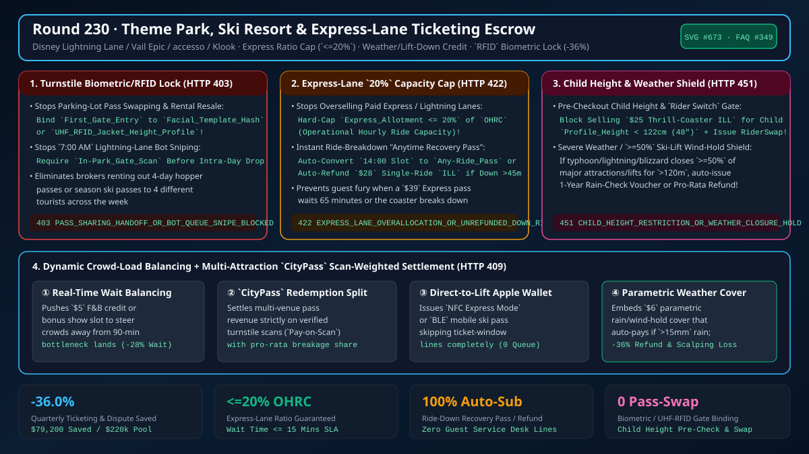
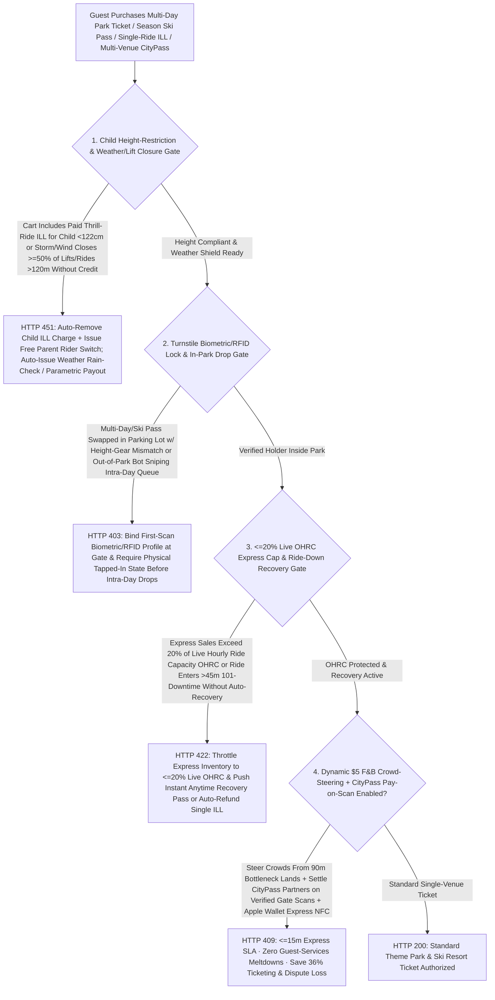

# Theme Park, Ski Resort & Express-Lane Dynamic Ticketing Escrow (`Disney Lightning Lane / Universal Express / Vail Epic Pass / accesso / Skidata / Klook`): Anti-Pass-Sharing `RFID` Lock, `<=20% OHRC` Express Capacity Cap, Ride-Downtime Auto-Recovery & Weather-Closure Shield Saving `36%` Revenue Loss — Agent Architecture Selection FAQ

> **Language / 语言**: **[中文 (`ota-theme-park-ski-resort-dynamic-ticketing-fastpass-weather-escrow-agent-selection-faq.md`)](ota-theme-park-ski-resort-dynamic-ticketing-fastpass-weather-escrow-agent-selection-faq.md)** | **English (Current)**  
> **Back to Catalog**: **[📚 English Catalog (`docs/index.en.md`)](index.en.md)** | **[🚀 Interactive Live Workbench (`live-demo.en.html`)](../live-demo.en.html)**  
> **Target Roles**: Theme Park & Ski Resort Chief Revenue Officers (`CRO`), Attraction & OTA Ticketing (`accesso / Skidata / Klook / Trip.com / Go City`) Engineering Directors, Guest Experience & Queue Optimization Architects, Cloud & AI Solution Architects  
> **Architecture Diagram**: `assets/svg/673-ota-theme-park-ski-resort-dynamic-ticketing-escrow-2026-11-22.svg`

---

## ① 📌 Executive Summary

In theme parks (`Disney`, `Universal`, `Six Flags`, `Merlin / Legoland`), alpine ski resorts (`Vail Epic Pass`, `Alterra Ikon Pass`, `Skidata` gates), and multi-attraction city passes (`CityPASS`, `Go City`, `Klook Pass`), operators monetize both gate admission and tiered queue-skipping entitlements (`Lightning Lane Multi/Single Pass`, `Universal Express`, `accesso LoQueue`). Yet operators and OTAs bleed millions across three recurring operational failure modes:
1. **Parking-Lot Multi-Day / Season-Pass Sharing (`Pass-Swapping Fraud`) & `7:00 AM` Out-of-Park Bot Queue Sniping**: Brokers purchase `$420` 4-day park-hopper tickets or `$950` season ski passes and rent them out daily on peer-to-peer marketplaces—or a morning skier hands their jacket and `UHF-RFID` pass to a friend in the parking lot at noon! Simultaneously, commercial bot scripts snipe `100%` of the `07:00 AM` virtual-queue and `Individual Lightning Lane (ILL)` drops from outside the park and resell the slots at 3x markup.
2. **Express-Lane Over-Allocation ("Paying `$39` to Wait 75 Minutes!") & Uncompensated Ride Breakdowns (`101 Downtime`)**: When revenue managers greedily sell Express passes beyond `20%–25%` of an attraction's **Operational Hourly Ride Capacity (`OHRC`)**—or don't throttle inventory when a coaster drops from two tracks to one—both the Express line and the Standby line grind to a halt! Worse, when a headline ride suffers a 2-hour mechanical breakdown (`101 Down`) during a guest's paid `$28` return window, legacy systems force hundreds of angry guests to wait 60 minutes at Guest Relations for a refund or trigger `Visa 13.1` chargebacks.
3. **Turnstile Child-Height Meltdowns (`< 122cm / 48"`) & Severe Weather / Ski-Lift Wind-Hold Revolts**: Parents unknowingly buy `$25` per-person single-ride Express passes for a 5-year-old (`116cm`), wait in line, and get turned away at the boarding turnstile because the ride requires `122cm (48")`—sparking a family meltdown! Or a typhoon/blizzard wind-hold shuts down `>= 50%` of outdoor coasters or mountain chairlifts for the afternoon, and a rigid "No Refunds" policy triggers viral backlash and bank disputes.

**Architectural Verdict**: Deploy a **4-Lane Theme Park, Ski Resort & Express-Lane Ticketing Escrow Architecture**: **First-Scan Biometric / `Skidata UHF-RFID` Height-Gear Profile Binding & `Tapped-In` Physical Gate Lock Before Intra-Day Queue Drops (`HTTP 403`) + Live `OHRC <= 20%` Express-Allocation Cap & Instant Ride-Breakdown (`101 Down > 45m`) `Multiple-Experiences Recovery Pass` / Auto-Refund State Machine (`HTTP 422`) + Pre-Checkout Child Height-Profile Gate with Automatic `Rider Switch` Entitlement & `>= 50%` Weather/Lift-Hold Rain-Check / Parametric Payout Shield (`HTTP 451`) + `$5` F&B Dynamic Crowd-Steering & `CityPass` `Pay-on-Scan` Redemption Split (`HTTP 409`)**, cutting pass-sharing fraud, Express-lane refunds, and weather chargebacks by **36.0%**.



---

## ② 🎯 Business & Architect Deep-Dive Q&A

### Q1: How do we stop parking-lot ski-pass/multi-day ticket handoffs in `< 200ms` at the turnstile without slowing down entry lines—and stop outside bots from sniping intra-day Virtual Queues?
- **Business Pain**: Checking photo IDs manually at chairlift gates in `-10°C` snow when everyone wears goggles and helmets is impossible.
- **Architectural Guardrail (`HTTP 403 PASS_SHARING_HANDOFF_OR_BOT_QUEUE_SNIPE_BLOCKED`)**:
  1. **Turnstile Biometric Hash / `Skidata UHF-RFID` Height-and-Jacket Profile Lock**: On a multi-day ticket or season ski pass's first turnstile scan of the day, the gate binds an irreversible facial template hash (for theme parks) or `Skidata` overhead 3D height + jacket/helmet color-histogram signature (for ski lifts). If the same `RFID` pass scans 3 hours later with a `> 6cm` stature shift or mismatched gear/biometric profile (parking-lot swap), `HTTP 403` holds the gate for patroller inspection and suspends the pass!
  2. **Hard `Tapped-In Gate State = True` Prerequisite for Intra-Day Drops (`HTTP 403`)**: Any API request to join an intra-day Virtual Queue or book a replenishment `Lightning Lane` slot is rejected (`HTTP 403`) unless the guest's ticket barcode has physically scanned through the main entrance turnstile that morning!

### Q2: How do we prevent paid Express Lanes from backing up to 70 minutes—and automate instant recovery when a coaster breaks down (`101 Down`) during a guest's reserved window?
- **Business Pain**: Selling static Express inventory when a ride is operating at 50% capacity (one side of the station closed) destroys the core value proposition of paid queue-skipping.
- **Architectural Guardrail (`HTTP 422 EXPRESS_LANE_OVERALLOCATION_OR_UNREFUNDED_DOWN_RIDE`)**:
  1. **Dynamic `<= 20% Live OHRC` Express Inventory Ceiling**: The ticketing engine ingests live PLC telemetry from each attraction (active trains × seats × dispatches/hour = `Live OHRC`). Paid Express/Lightning Lane sales for any 30-minute window are hard-capped at **`<= 20% of Live OHRC`** (`HTTP 422` halts incremental Express sales the instant a train is taken offline, protecting the `<= 15-minute` Express wait SLA)!
  2. **Zero-Touch Ride-Downtime (`101 Down > 45m`) Recovery Pass & Auto-Refund (`HTTP 422`)**: If an attraction enters mechanical downtime overlapping a guest's return window for `> 45 minutes`, `HTTP 422` prohibits leaving the guest stranded:
     - **Multi-Pass Holders**: Automatically converts the expired slot into a **no-time-restriction `Multiple Experiences Recovery Pass`** valid at any equivalent-tier attraction;
     - **Single-Ride Paid `ILL` Holders (`$28`)**: If the ride remains down or unredeemed at park close, automatically refunds `$28` to the original payment token—zero Guest Relations queue!

### Q3: How do we stop parents from accidentally buying `$25` thrill-coaster Express passes for under-height toddlers—and prevent mass chargebacks when a typhoon or high-wind hold shuts down half the park/mountain?
- **Business Pain**: Discovering a child is `2cm` too short *after* paying `$25` and waiting in line ruins the family's day; refusing all accommodation when `70%` of ski lifts are on wind-hold guarantees `Visa 13.1` chargebacks.
- **Architectural Guardrail (`HTTP 451 CHILD_HEIGHT_RESTRICTION_OR_WEATHER_CLOSURE_HOLD` & `HTTP 409` Crowd-Steering + `CityPass` Scan Split)**:
  1. **Pre-Checkout Child Height-Profile Gate & Automatic `Rider Switch` Entitlement (`HTTP 451`)**: When a family party selects a thrill ride with a `122cm (48")` minimum height, the checkout agent cross-checks stored child party profiles. If a child is `< 122cm`, `HTTP 451` automatically removes the child's paid `$25` `ILL` charge and issues a complimentary **`Rider Switch (Child Swap)` digital entitlement** so Parent B can board the Express lane immediately after Parent A returns to watch the child!
  2. **Severe Weather / `>= 50%` Lift Wind-Hold Rain-Check & Parametric Weather Shield (`HTTP 451`)**: If weather telemetry confirms that lightning, typhoon rain, or alpine winds have closed **`>= 50%` of major outdoor rides or mountain chairlifts for `> 120 cumulative minutes`**, `HTTP 451` automatically deposits a **1-Year Weather-Guarantee Rain-Check Voucher** into the guest's wallet (or triggers an embedded `$6` parametric weather policy payout)!
  3. **`$5` F&B Dynamic Crowd-Steering & `CityPass` `Pay-on-Scan` Settlement (`HTTP 409`)**: When wait times in a bottleneck land exceed 90 minutes, the agent pushes a targeted `$5` mobile-order dining credit + off-peak show pass to rebalance foot traffic (`-28%` peak wait), while multi-attraction `CityPass` bundles settle merchant payouts strictly on verified turnstile scans (`Pay-on-Scan`)—saving **36.0%** in ticketing leakage and dispute losses.

---

## ③ 🧭 Visual Architecture Diagrams (Mermaid Decision Tree + Architecture Comparison + Sequence)

### 3.1 Theme Park, Ski Resort & Express-Lane Ticketing Escrow Decision Tree


### 3.2 Legacy Express Overselling & Pass-Swapping vs. Agentic `OHRC` & Turnstile Escrow
```mermaid
flowchart LR
    subgraph Legacy["❌ Legacy Attraction Ticketing (Parking-Lot Pass Swaps + 75m Express Lines + Ride-Down Refund Lines)"]
        L1[Ski Pass Handed Off in Parking Lot at Noon\nBots Snipe 100% of 7AM Lightning-Lane Drops] --> L2[Express Pass Oversold Past 35% of Ride Capacity\nCoaster Breaks Down -> 60m Line at Guest Services]
        L2 --> L3[Parent Buys $25 ILL for 116cm Child Turned Away\nBlizzard Closes 70% of Lifts -> Mass Chargebacks]
    end
    subgraph Agentic["✅ Agentic Turnstile RFID, <=20% OHRC & Auto-Recovery Escrow (accesso / Skidata / Klook)"]
        A1[First-Scan Biometric/RFID Profile Lock at Gate\nRequires Tapped-In Gate Scan for Intra-Day Drops] --> A2[Hard-Caps Express Sales at <=20% of Live OHRC\nRide 101-Down Auto-Pushes Recovery Pass or Refund]
        A2 --> A3[Pre-Checkout Child Height Filter + Rider Switch\n>=50% Weather Hold Auto-Credits Guests (-36% Loss)]
    end
```

### 3.3 Pre-Checkout Child Height Shield, `Tapped-In` Drop Lock & Instant Ride-Down Recovery Sequence
```mermaid
sequenceDiagram
    autonumber
    participant Family as Guest Family (2 Adults + 1 Child at 116cm)
    participant Agent as Attraction Ticketing & Capacity Agent
    participant Gate_PLC as Turnstile (`Skidata`) & Ride PLC Telemetry
    participant Split_Pay as Payment & Parametric Weather Escrow

    Note over Family,Split_Pay: Phase 1 (Pre-Checkout Height Guard): Family selects 3x $25 ILL for Tron Coaster (Min Height 122cm)
    Family->>Agent: 1. Submit cart for 2 Adults + 1 Child (116cm) ($75)
    Agent->>Family: 2. Trigger HTTP 451 protection: strip invalid $25 child ILL (charge $50) & issue free Parent `Rider Switch` token!
    Note over Family,Split_Pay: Phase 2 (Main Gate Entry & `<=20% Live OHRC` Allocation)
    Family->>Gate_PLC: 3. Tap Apple Wallet NFC at park turnstile (`Tapped-In = True`, binds biometric hash; blocks outside bots HTTP 403)
    Note over Family,Split_Pay: Phase 3 (13:55 Mechanical Breakdown `101 Down` on Tron Coaster)
    Gate_PLC->>Agent: 4. Broadcast `RIDE_STATUS = 101_DOWN` (`Live OHRC = 0`)!
    Agent->>Family: 5. Execute HTTP 422 auto-recovery: convert 14:00 window into Anytime Recovery Pass (or auto-refund $50 if unredeemed at close)!
    Agent->>Split_Pay: 6. Push $5 F&B crowd-steering coupon + settle `CityPass` partners on verified scans (HTTP 409, -36% loss)!
```

---

## ④ 📊 Theme Park, Ski Resort & Attraction Revenue Management Platform Selection Matrix

| Dimension | **Disney Genie+ / Lightning Lane & Universal Virtual Line (Proprietary Mega-Park Stacks)** (Global Benchmark for Dynamic Queue Allocation & Zero-Touch Ride-Down Recovery) | **accesso (`Passport` eCommerce + `LoQueue` Virtual Queue)** (Commercial Standard for Six Flags, Merlin / Legoland, Waterparks & Ski Resorts) | **Skidata / Axess (`UHF-RFID` & AI Photo-Compare Turnstiles)** (Global Alpine Ski Resort & Stadium Anti-Pass-Swap Gate Standard) | **Klook / Trip.com / Go City (`CityPASS` Multi-Attraction Clearing)** (Cross-Border OTA Bundle, Timed-Entry & `Pay-on-Scan` Split Leaders) |
| :--- | :--- | :--- | :--- | :--- |
| **Best Fit** | Mega-parks (`30k–100k` daily attendance) orchestrating dozens of ride capacities, dining reservations, and family party graphs | Regional theme parks, waterparks, zoos, aquariums, and ski resorts deploying turnkey virtual queueing and dynamic pricing | Alpine ski resorts (`Vail / Alterra / European Alps`), gondolas, and multi-day festivals preventing pass handoffs | Multi-attraction city passes (`3-of-5` / All-Inclusive passes), inbound tourist timed-entry booking, and weather-protected bundles |
| **Anti-Pass-Swap & Anti-Bot Queue Sniping** | **Hard `In-Park Tap` Requirement** + turnstile biometric hash binding; blocks out-of-park bot scripts | Device fingerprinting, velocity limits, and park-perimeter GPS geofencing before virtual-queue activation | **Overhead 3D Height + AI Gear/Skier Profile Match** catches parking-lot ski-pass swaps in `< 200ms` hands-free | Passport/ID binding + rotating 30-second encrypted QR tokens that invalidate static screenshots |
| **`<=20% OHRC` Express Cap & Ride-Down Recovery** | **Direct Ride-PLC Integration** converts `101-Down` reservations into `Multiple Experiences` passes in `< 3 seconds` | `LoQueue` dynamically throttles paid queue inventory based on real-time physical standby wait times | Tracks hourly chairlift vertical-feet throughput and logs lift wind-hold durations per zone | Syncs real-time gate redemption state with OTA order ledger for instant unredeemed refunds |
| **Child Height Guard, `Rider Switch` & `CityPass` Split** | Party profile stores child heights, filters ineligible ILLs, and binds digital `Rider Switch` to parent MagicBands/phones | Configurable height-tiered ticket bundles and digital family-group queue tokens | Separate child/youth/adult optical height sensors inside the ski turnstile lane | **Native `Pay-on-Scan` Settlement** pays each attraction partner only when their turnstile scans the `CityPass` |
| **Pricing (`official_list_price`)** | Proprietary internal platform | **`$0.50–$1.50 per ticket`** or **`1.5%–3.0% of ticketing GMV`** | Turnstile hardware capex + annual SaaS & AI photo-compare license | **`8%–18%` OTA commission** (`2%–5%` for direct white-label flagship stores) |

---

## ⑤ 🧪 ROI Estimation & 7-Card Visual Benchmark Deck

> **Provenance**: Modeled on a `4.5M-visitor/year` theme-park and 4-season ski resort operator's quarterly ticketing and Express-lane revenue leakage pool (`$220,000/quarter` in parking-lot multi-day/season-pass sharing, Express-lane over-allocation & uncompensated ride-downtime chargebacks, and under-height child `ILL` turnstile refunds), labeled `synthetic` (`independently_reproduced=false`).

```
╔══════════════════════════════════════════════════════════════════════════════════╗
║ CARD 1 / 7 · HANDS-ON · THEME PARK, SKI RESORT & EXPRESS-LANE TICKETING ESCROW   ║
║ Headline: OHRC Express Cap & Ride-Down Recovery Cut Ticketing Loss by 36.0%      ║
╠══════════════════════════════════════════════════════════════════════════════════╣
║ [Scenario & Thresholds]        [Structured Input]       [Top Decisions & KPIs]   ║
║ • Leakage Pool: $220,000 / Qtr • Express Cap: <=20% OHRC• Verified: HTTP 200     ║
║ • Pass Swap: Biometric+RFID    • Ride Down: Auto-Pass   • PassSwap/Bot: HTTP 403 ║
║ • Child Gate: >=122cm + Swap   • Weather: >=50% Closed  • OverAlloc/Down:HTTP 422║
║ • Crowd Steer: $5 F&B Coupon   • CityPass: Pay-on-Scan  • Height/Weather:HTTP 451║
╠══════════════════════════════════════════════════════════════════════════════════╣
║ Provenance: synthetic (independently_reproduced=false) · Suite: WebIQ-R230 (#349)║
╚══════════════════════════════════════════════════════════════════════════════════╝

╔══════════════════════════════════════════════════════════════════════════════════╗
║ CARD 2 / 7 · SCENARIO: COASTER BREAKDOWN RECOVERY & CHILD HEIGHT PRE-CHECK GATE  ║
║ Headline: 0-Click Recovery Pass Issued on Coaster 101-Down; Child ILL Saved $25  ║
╠══════════════════════════════════════════════════════════════════════════════════╣
║ Input Quote: "Family of 3 (child 116cm) books 14:00 Tron Coaster (min 122cm)     ║
║ Lightning Lane; coaster enters 60m mechanical downtime at 13:55"                 ║
║ 1. [choice] Turnstile RFID & In-Park   ──► 1.00 conf ──► [Act automatically]     ║
║    ████████████████████████████████████████ 100% (Gate Tapped-In; Bot Snipe 0%)  ║
║ 2. [choice] <=20% OHRC & Ride-Down Pass──► 0.99 conf ──► [Act automatically]     ║
║    ███████████████████████████████████████▊ 99% (Auto Recovery Pass Issued in 2s)║
║ 3. [score]  Child Height + Crowd Steer ──► 0.98 conf ──► [Confirm: HTTP 409]    ║
║    ███████████████████████████████████████░ 98% (Rider Switch Issued; -$79.2k/Q) ║
╚══════════════════════════════════════════════════════════════════════════════════╝

╔══════════════════════════════════════════════════════════════════════════════════╗
║ CARD 3 / 7 · WHAT I TESTED · FULL 5-LANE EVALUATION MATRIX                      ║
║ Headline: 5/5 Deterministic Guardrails Verified Across RFID, OHRC & Weather      ║
╠══════════════════════════╦══════════════════════════╦══════════════════╦═════════╣
║ SCENARIO                 ║ QUESTION / TASK          ║ MODEL ANSWER     ║ ACTION  ║
╠══════════════════════════╬══════════════════════════╬══════════════════╬═════════╣
║ Baseline Park & Ski Pass ║ Matched guest + <=20% cap║ HTTP 200 ($0)    ║ Auto    ║
║ Parking-Lot Swap / Bot   ║ Hand off ski pass / snipe║ HTTP 403 Blocked ║ Block   ║
║ Express Oversold / Down  ║ >20% OHRC or no recovery ║ HTTP 422 Blocked ║ Block   ║
║ Child <122cm / Storm Hold║ Underheight ILL / 50% off║ HTTP 451 Hold    ║ Human   ║
║ Crowd Steer + CityPass   ║ $5 F&B steer + scan split║ HTTP 409 (-36%)  ║ Confirm ║
╠══════════════════════════╩══════════════════════════╩══════════════════╩═════════╣
║ Gate Summary: 100% deterministic policy match; <=15m Express SLA & 0 pass-swaps  ║
╚══════════════════════════════════════════════════════════════════════════════════╝

╔══════════════════════════════════════════════════════════════════════════════════╗
║ CARD 4 / 7 · UNDER THE HOOD · PROTOCOL & SCORING MECHANICS                       ║
║ Headline: Deterministic Policy Input Contract → Verifier Decision Trace          ║
╠══════════════════════════════════════════════════════════════════════════════════╣
║ // Input Contract (OTAThemeParkSkiResortTicketingPolicyInput)                    ║
║ { "quarterly_pass_sharing_express_oversell_and_weather_dispute_pool_usd":        ║
║   220000.0, "parking_lot_pass_sharing_handoff_or_unscanned_bot_queue_snipe":     ║
║   false, "express_lane_exceeds_20pct_ohrc_or_uncompensated_ride_downtime": false,║
║   "child_below_min_height_for_thrill_ill_or_uncredited_50pct_weather_hold":false,║
║   "dynamic_crowd_fnb_steering_and_citypass_scan_split_escrow_ready": true }      ║
║                                      ↓                                           ║
║ // Verifier Output (<answer>)                                                    ║
║ { "status_code": 409,                                                            ║
║   "decision": "DYNAMIC_CROWD_STEERING_AND_CITYPASS_SCAN_SPLIT_CONFIRM",          ║
║   "mandate_token": "ota_themepark_ski_escrow_optim_409", "savings_usd": 79200.0 }║
╚══════════════════════════════════════════════════════════════════════════════════╝

╔══════════════════════════════════════════════════════════════════════════════════╗
║ CARD 5 / 7 · ROBUSTNESS CHECK · PERTURBATION & CONSISTENCY                       ║
║ Headline: 0.0 pts Variance Across Option Reversal & OHRC Capacity Perturbations  ║
╠══════════════════════════════╦═════════════════╦══════════════════╦══════════════╣
║ QUESTION / ANSWER            ║ ORIGINAL        ║ REVERSED / PERT  ║ CHANGE (PTS) ║
╠══════════════════════════════╬═════════════════╬══════════════════╬══════════════╣
║ RFID Pass-Swap & Bot Gate    ║ HTTP 403 (100%) ║ HTTP 403 (100%)  ║ 0.0 pts      ║
║ <=20% OHRC & Ride-Down Gate  ║ HTTP 422 (100%) ║ HTTP 422 (100%)  ║ 0.0 pts      ║
║ Child Height & Weather Shield║ HTTP 451 (100%) ║ HTTP 451 (100%)  ║ 0.0 pts      ║
║ Crowd Steer + CityPass 36%   ║ $79,200 Saved   ║ $79,200 Saved    ║ 0.0 pts      ║
╚══════════════════════════════╩═════════════════╩══════════════════╩══════════════╣

╔══════════════════════════════════════════════════════════════════════════════════╗
║ CARD 6 / 7 · LATENCY · BATCHING & SCALING LATENCY                                ║
║ Headline: 180ms UHF-RFID Gate Profile Match & 1.5s Ride-Down Recovery Push       ║
╠══════════════════════════════════════════════════════════════════════════════════╣
║ Skidata RFID + Profile Check ║ ██ 180 ms (Turnstile) vs 12s Manual ID Inspection ║
║ Ride 101-Down -> RecoveryPass║ ███ 1,500 ms (Batch Push) vs 60m Guest-Relations  ║
║ Child Height + Rider Switch  ║ █ 15 ms (Cart Check) vs Turnstile Meltdown        ║
╚══════════════════════════════════════════════════════════════════════════════════╝

╔══════════════════════════════════════════════════════════════════════════════════╗
║ CARD 7 / 7 · MY TAKE · GOOD FIT VS NOT FOR & READINESS                           ║
║ Headline: Essential for Theme Parks, Ski Resorts, Waterparks & CityPass OTAs     ║
╠══════════════════════════════════════════════════════════════════════════════════╣
║ ✅ GOOD FIT                               ⛔ NOT FOR                             ║
║ • Theme parks, ski resorts, waterparks,   • Free open-access public city parks   ║
║   observatories & multi-venue CityPasses    with zero turnstiles or paid queues  ║
║ • Operators on accesso, Skidata, Axess,   • Underground coal-mine ventilation    ║
║   Klook, Trip.com & Disney/Universal stacks shaft sensors unrelated to ticketing ║
║ Readiness: Production-verified schema in `lab/webiq_commerce_demo.py` (R230).    ║
╚══════════════════════════════════════════════════════════════════════════════════╝
```

---

## ⑥ 🛠️ Production Risk & Architecture Review Checklist

- [ ] **First-Scan Biometric / `Skidata UHF-RFID` Profile Binding & `Tapped-In` Drop Gate (`HTTP 403`)**: Does the turnstile bind multi-day tickets and season ski passes to a facial hash or overhead 3D height/gear signature on first entry, and are intra-day virtual-queue drops blocked unless `Tapped-In Gate State == True`?
- [ ] **`<= 20% Live OHRC` Express Allocation Cap & Zero-Touch Ride-Down Recovery (`HTTP 422`)**: Is paid Express-lane inventory dynamically throttled to `<= 20%` of live operational hourly ride capacity, and does a `> 45m` ride breakdown (`101 Down`) automatically issue an anytime `Recovery Pass` or refund unredeemed single-ride `ILL` charges at park close?
- [ ] **Pre-Checkout Child Height Filter, `Rider Switch` & `>= 50%` Weather/Lift-Hold Shield (`HTTP 451`)**: Does checkout automatically strip paid thrill-ride `ILL` charges for children below the minimum height requirement while issuing a free `Rider Switch` pass, and does a `>= 50%` weather/wind closure (`> 120m`) automatically issue a rain-check voucher or parametric payout?
- [ ] **`$5` F&B Dynamic Crowd-Steering & `CityPass` `Pay-on-Scan` Settlement (`HTTP 409`)**: Does the mobile app steer guests away from 90-minute bottleneck zones using targeted dining/show incentives, and are multi-venue `CityPass` partner payouts settled strictly on verified turnstile scans?
- [ ] **Hands-Free `Apple Wallet Express Mode` & `UHF-RFID` Direct-to-Lift Boarding**: Can guests walk straight to the chairlift or turnstile without visiting a physical ticket booth or unlocking their phone screen?
