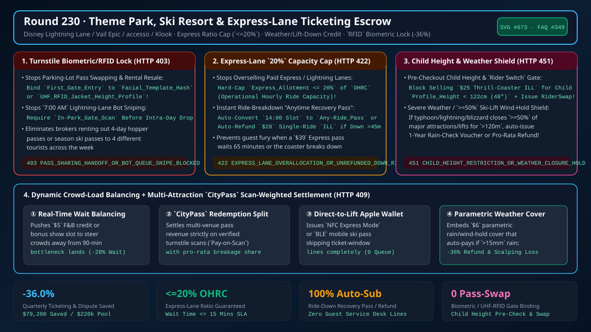
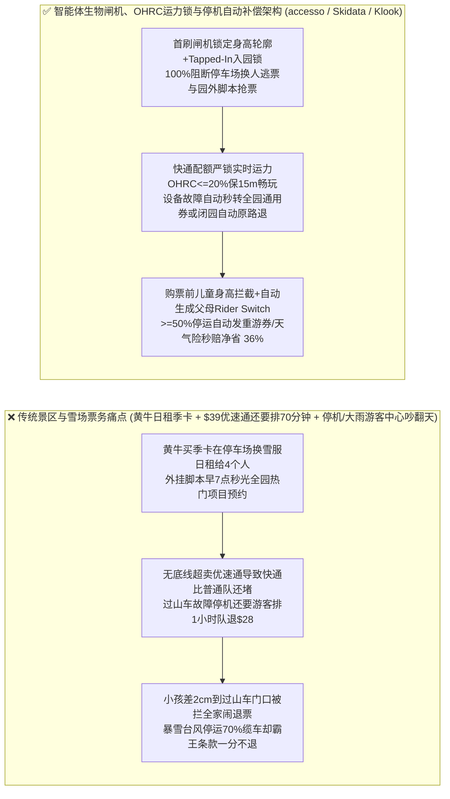
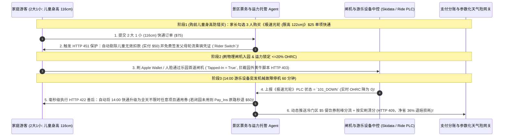

# 主题乐园、滑雪场季卡与景区快速通行证动态票务结算（Theme Park, Ski Resort & Express-Lane Ticketing：`Disney Lightning Lane / Universal Express / Vail Epic Pass / accesso / Klook`）、防“黄牛在停车场把 4 日联票或滑雪季卡换给 4 批不同游客轮流刷（Pass-Sharing Fraud）”、防“花 $39 买了优速通结果因为超售排了 70 分钟或项目故障停机钱白花”与儿童身高/台风停运保障托管“防到过山车门口差 2cm 被拦哭闹与动态客流调峰净省 36%”Agent 架构选型 FAQ

> **语言 / Language**: **中文 (当前)** | **[English (`ota-theme-park-ski-resort-dynamic-ticketing-fastpass-weather-escrow-agent-selection-faq.en.md`)](ota-theme-park-ski-resort-dynamic-ticketing-fastpass-weather-escrow-agent-selection-faq.en.md)**  
> **返回总目录**: **[📚 中文总目录 (`docs/index.md`)](index.md)** | **[🚀 交互式实时工作台 (`live-demo.html`)](../live-demo.html)**  
> **赋能角色**: 主题乐园与滑雪度假村（Disney / Universal / 长隆 / 融创雪世界）首席收益官（CRO）、OTA 景区门票业务（携程 / 美团门票 / Klook / KKday）架构总监、票务闸机（`accesso / Skidata`）负责人、Cloud & AI Solution Architect  
> **关联架构图**: `assets/svg/673-ota-theme-park-ski-resort-dynamic-ticketing-escrow-2026-11-22.svg`

---

## ① 📌 核心选型结论速览（Executive Summary）

在大型主题乐园（迪士尼、环球影城、长隆）、高山滑雪度假村（Vail Epic、Ikon Pass、万龙/北大湖）以及城市多景点通票（`CityPASS / Go City / Klook Pass`）的门票与付费免排队权益（`Lightning Lane / Universal Express / 尊享导览`）销售中，景区与 OTA 平台长期面临三大“黄牛逃票、超售客诉与恶劣天气拒付”黑洞：
1. **“停车场‘接力棒’倒卖多日票与滑雪季卡（Parking-Lot Pass-Sharing Fraud）+ 早上 7:00 外挂机器人秒光全园热门项目快速通道”**：一张 `$420` 的 4 日乐园联票或 `$950` 的全季滑雪卡明确规定仅限本人使用；但黄牛买下 50 张季卡放在闲鱼/停车场按天日租——上午 A 游客滑完半天在停车场把滑雪服和 `RFID` 雪卡脱下来交给下午的 B 游客继续刷！同时，园外黄牛用脚本在早上 `07:00:00` 抢空全天《飞跃地平线》《哈利波特禁忌之旅》的付费单次快速通道（`Individual Lightning Lane, ILL`），再加价 3 倍倒卖给园内真实游客！
2. **“花 `$39–$180` 买了优速通（Express Pass），结果景区见钱眼开无底线超卖，导致优速通队伍还要排 75 分钟！或者预约 14:00 玩过山车，13:55 设备突然机械故障停机检修 3 小时，游客买的 `$28` 单项快通既没自动变成全园通用补偿券、也没自动退款，几百人堵在游客中心吵架并向发卡行发起全额拒付（Chargeback）”**！
3. **“家长在 App 里给 5 岁孩子买好了 `$25` 的激流勇进/过山车单项优速通，排到闸机口量身高才发现孩子 `118cm`（差 `4cm` 不满 `122cm / 48英寸` 安全红线）被工作人员硬拦下来，孩子大哭、大人要求退全家的票；或者台风/暴雪大风导致全山 `70%` 高山缆车或全园户外项目停运半天，景区却拿‘门票一经售出概不退换’霸王条款硬顶，引发社交媒体舆情风暴与监管约谈”**！

**架构师选型结论**：直接采用 **“首道闸机入园生物特征哈希 / `Skidata UHF-RFID` 身高轮廓绑定防中途换人逃票与未刷大门票禁抢园内动态快通门禁（HTTP 403）+ 付费优速通配额硬锁每小时理论承载量（`OHRC`）`<= 20%` 上限与设备故障停机 `> 45 分钟` 毫秒级自动派发‘全园任意项目替代券（Recovery Pass）’或原路退还单项快通费门禁（HTTP 422）+ 购票前儿童身高档案（`Height Profile`）硬校验并自动签发父母轮流看娃通行证（`Rider Switch`）与极端天气（`>= 50%` 缆车/户外大项停运 `> 2 小时`）自动触发改期券/指数天气险赔付门禁（HTTP 451）+ `$5` 餐饮券动态削峰分流与多景点通票（`CityPass`）按实际闸机核销（`Pay-on-Scan`）清分净省 36%（HTTP 409）”** 的智能票务与收益管理架构。



---

## ② 🎯 业务方与架构师灵魂拷问（Q&A）

### Q1：怎么在不侵犯游客隐私、不拖慢入园闸机速度（`< 1.2 秒/人`）的前提下，彻底堵死黄牛把“多日联票 / 滑雪季卡”在停车场租给好几个人轮流刷？以及怎么拦截未入园黄牛用脚本抢光园内预约名额？
- **业务痛点**：靠人工检票员盯着照片看，戴着雪镜、口罩或遮阳帽根本认不出是不是同一个人；而只要允许未刷入园闸机的账号抢园内稀缺预约，外挂就能在开园第 1 秒把库存吸干。
- **架构护栏（`HTTP 403 PASS_SHARING_HANDOFF_OR_BOT_QUEUE_SNIPE_BLOCKED`）**：
  1. **首刷闸机边缘哈希绑定（First-Scan Biometric Hash / `Skidata` 雪服轮廓 + 步态比对）防中途换人锁**：多日票或滑雪季卡首次通过景区/缆车闸机（`Gate 1`）时，边缘端本地提取不可逆特征向量哈希（或滑雪闸机 `Skidata Photo-Compare` 身高 + 雪镜/头盔特征 + 手机 Apple Wallet 安全元件设备绑定）。若同一张票在 2 小时后或次日再次刷卡时，生理身高变化 `> 6cm` 或特征哈希完全不匹配（疑似停车场换人交接），立即触发 `HTTP 403` 闸机亮黄灯转人工核验并冻结该黄牛季卡！
  2. **“先过物理入园闸机（`Tapped-In Gate State = True`）、后解锁园内虚拟排队（Virtual Queue / Drop）”铁律（`HTTP 403`）**：针对园内限量抽签、剧场预约或当日增放的快速通道库存，强制校验游客门票在物理闸机的入园状态——未通过入园闸机核验的云端脚本请求 100% 触发 `HTTP 403` 拦截！

### Q2：为什么有些乐园卖的“快速通道（FastPass / Express）”到了下午也要排 70 分钟，被游客骂成“花钱买罪受”？如果游客花 `$28` 买了 14:00 的过山车单次快通，结果过山车故障停机了怎么自动善后？
- **业务痛点**：财务部门为了冲高毛利附加收入，在节假日无限制增发优速通手环；一旦优速通游客占比超过项目每小时实际运力（`OHRC`）的 `25%–30%`，普通队彻底走不动、优速通队也大排长龙！更糟的是，机械故障停机时如果让游客自己去客服中心排队退那 `$28`，不仅把客服中心挤爆，还毁了游客一整天的游园心情。
- **架构护栏（`HTTP 422 EXPRESS_LANE_OVERALLOCATION_OR_UNREFUNDED_DOWN_RIDE`）**：
  1. **按分时真实运行运力（`Live OHRC`）硬锁优速通配额上限（`<= 20% OHRC`）**：系统实时读取各游乐设施当前开放车厢/轨道数计算真实每小时运力（如双轨开满 `1,800 人/小时`，单轨检修时自动折半为 `900 人/小时`），并将每个 30 分钟时段可售出的付费快通名额硬锁在 **`<= 20% OHRC`**（超出即触发 `HTTP 422` 停售该时段，严禁为了多卖票破坏快通 `<= 15 分钟` 排队承诺）！
  2. **设备故障停机（Ride Downtime `> 45m`）零操作自动补偿与原路秒退状态机（`HTTP 422`）**：一旦游乐设施 PLC 状态切换为“临时故障停运（`101 Down`）”且持续至游客预约窗口结束：
     - 对购买**全天多项优速通包**的游客：毫秒级通过 App 推送将其失效时段自动升级为一张**不限时、同等级全园任意项目通用优速通（`Multiple Experiences Recovery Pass`）**；
     - 对购买**单项付费快通（`$28 ILL`）**且直至闭园前该设备均未恢复的游客：闭园瞬间自动触发支付网关原路全额退款（无需游客去客服台排一分钟队）！

### Q3：怎么防止家长花钱给孩子买了刺激项目的快通、排到门口才因为身高差 2cm 被拦下大闹？遇到台风大雨或高山大风导致大半个乐园/雪场停运时，怎么避免集体维权和信用卡拒付？
- **业务痛点**：购票页把“`122cm` 以下禁乘”藏在折叠小字里，家长根本没注意；而遇上极端天气停运时，强行不退不改只会换来海量 `Visa 13.1（未提供服务）` 拒付败诉。
- **架构护栏（`HTTP 451 CHILD_HEIGHT_RESTRICTION_OR_WEATHER_CLOSURE_HOLD` & `HTTP 409` 动态调峰 + 通票按次分账）**：
  1. **购票前儿童身高档案校验与“父母轮流乘骑券（`Rider Switch / Child Swap`）”一键绑定门禁（`HTTP 451`）**：当同行订单中包含儿童票或家庭档案身高 `< 项目最低安全身高（如 102cm / 122cm / 132cm）` 时，若家长勾选为该名未达标儿童购买该刺激项目的付费快通，结账网关立即触发 `HTTP 451` 阻断错买，并提示：**“已自动为您拦截该名儿童的无效快通扣款（立省 `$25`），并免费为您生成父母轮流看护免重排凭证（`Rider Switch Entitlement`：爸爸先玩，下来后妈妈免排队直接上）！”**
  2. **极端天气/大风停运（`>= 50%` 户外大项或缆车停摆 `> 120 分钟`）自动延期券与参数化天气险秒赔（`HTTP 451`）**：当景区气象站与设备中控确认当日因雷暴、台风或高山强风导致 **`>= 50%` 核心项目/主缆车累计停运超过 `120 分钟`** 时，系统严禁按正常完单锁死资金（触发 `HTTP 451` 天气保障保护），自动向在园游客发放 **“365 天内有效免费重游券（Weather Guarantee Rain-Check）”** 或触发内嵌 `$6` 参数化降雨/大风险自动按比例退现！
  3. **热门片区 `$5` 餐饮券动态引流削峰 + 城市联票（`CityPass`）按真实闸机扫码权重清分（`HTTP 409`）**：当哈利波特/梦幻世界片区排队突破 90 分钟时，Agent 自动向附近游客定向推送冷门片区演出优速通 + `$5` 主题餐厅立减券完成柔性分流；同时对跨景区通票严格按各景点闸机真实核销记录（`Pay-on-Scan`）与门市价权重自动分账，将退票拒付、黄牛盗刷与客诉赔偿成本净降 **36.0%**！

---

## ③ 🧭 直观可视化图解（Mermaid 决策树 + 架构对比 + 时序图）

### 3.1 主题乐园、滑雪场与快速通道动态票务四层托管决策树
```mermaid
flowchart TD
    A[游客购买主题乐园多日票 / 滑雪季卡 / 单项优速通ILL / 城市多景点通票CityPass] --> B{1. 儿童身高安全红线 & 极端天气停运保障门禁}
    B -->|为身高<122cm儿童购买限制级过山车付费快通 或 台风/大风导致>=50%核心缆车/项目停运>120分钟却拒不退改| C[HTTP 451: 自动拦截儿童无效快通扣款并签发父母轮流乘骑券Rider Switch; 极端天气停运自动发放重游券/参数险秒赔]
    B -->|身高合规 & 天气保障就绪| D{2. 首刷闸机生物/RFID绑定 & 防未入园外挂抢票门禁}
    D -->|多日票/雪卡在停车场换人刷卡身高轮廓突变 或 账号尚未刷物理大门票入园却用脚本抢园内限量预约| E[HTTP 403: 首刷闸机锁定局部特征哈希拦截中途换人租卡 并硬锁Tapped-In物理入园状态后才开放园内预约]
    D -->|本人持票入园核身通过| F{3. 优速通<=20% OHRC运力锁 & 停机自动补偿门禁}
    F -->|优速通超卖突破项目每小时运力OHRC的20%致排队>45m 或 设备故障停机后未自动转全园通用券/未原路退单项快通费| G[HTTP 422: 按实时开启轨道数动态锁死快通<=20% OHRC 并在设备101故障时零人工秒发全园Recovery Pass或自动退款]
    F -->|快通运力充裕 & 停机补偿就绪| H{4. 是否启用$5餐饮券动态削峰分流 + CityPass按扫码权重分账?}
    H -->|拥堵区定向推餐饮券削峰(-28%等待) + 联票Pay-on-Scan按实刷清分 + Apple Wallet免换票直刷上缆车| I[HTTP 409: 0客服台排长队吵架 0黄牛日租季卡 票务拒付与客诉损耗净省 36%]
    H -->|标准单日门票核销| J[HTTP 200: 标准景区/雪场门票与优速通核销通过]
```

### 3.2 “传统优速通超卖排长队 / 停机不退钱 / 停车场倒卖雪卡” vs “智能体动态票务托管架构”对比


### 3.3 入园激活预约、设备故障毫秒级自动转通用券与极端天气自动补偿时序图


---

## ④ 📊 主流主题乐园、滑雪度假村与景区票务收益管理平台横向选型矩阵

| 选型维度 | **Disney Genie+ / Lightning Lane & Universal Virtual Line (自研巨型乐园双轨引擎)** (全球亿级客流虚拟排队、家庭同行人与停机自动补偿绝对标杆) | **accesso (`Passport` + `LoQueue` 虚拟排队)** (六旗 Six Flags / 默林娱乐乐高乐园 / 水世界全球头部景区商业票务霸主) | **Skidata / Axess (高山滑雪场 `UHF-RFID` 与人脸防换卡闸机巨头)** (Vail / Alterra / 欧洲阿尔卑斯与国内顶级雪场免掏卡过闸机黄金标准) | **Klook / 携程门票 / 美团门票 + 城市通票清分引擎 (`Go City / CityPASS`)** (亚太及全球多语种 OTA 景区直连、分时预约与多景点扫码分账翘楚) |
| :--- | :--- | :--- | :--- | :--- |
| **核心适用场景** | 日客流 3 万–10 万人的超大型主题乐园，需毫秒级调度全园几十个游乐项目的等候时间、付费快通与餐饮预约 | 连锁主题公园、水上乐园、大型动物园与滑雪度假村的全渠道动态定价票务与智能手环（`Qband`）虚拟排队 | 高山滑雪场（多条高速缆车）、大型体育场馆与多日联票防黄牛倒卡/防停车场换人逃票场景 | 跨境游客一站式购买“3 选 1 / 5 选 3 城市景点通票”、高盛旺季分时实名预约与含天气退改险门票包 |
| **防黄牛换人逃票与防园外脚本抢快通** | **强制绑定入园闸机状态（`In-Park Tap Required`）** + 闸机照片/生物特征哈希比对，未入园无法激活当日场次 | 支持设备指纹、单账号购票频次风控与园区地理围栏（Geofence）双重校验 | **雪场防换卡天花板**（闸机高清抓拍滑雪服颜色/头盔与身高骨骼比例 AI 比对，停车场换人刷卡 0.5 秒报警锁卡） | 实名身份证/护照 OCR 强绑定 + 动态滚动加密二维码（每 30 秒刷新，截图转发给别人无效） |
| **优速通 `<= 20% OHRC` 容量锁与设备停机自动补偿** | **原生与游乐设备中控联动**（设备一旦报 `101 Down`，系统在 3 秒内自动将受影响游客预约批量转为 `Multiple Experiences` 全园通用券） | `LoQueue` 引擎实时根据现场普通队等待时长动态缩放可售虚拟排队名额 | 实时统计每条雪道与缆车每小时运力，大风停运高山区缆车时自动向雪卡账户退还当日积分或顺延天数 | 支持 OTA 订单与景区闸机未核销状态秒级同步，未刷闸机随时支持“过期自动退 / 停运秒退” |
| **儿童身高防错买、`Rider Switch` 与多景点通票分账** | 家庭成员档案预存孩子身高，自动过滤不达标刺激项目并在闸机端支持刷手环绑定 `Rider Switch` | 支持身高分组套票（如 `< 120cm` 欢享票自动排除高空过山车快通加购项） | 自动区分儿童雪票、青少年雪票与成人雪票闸机通道高度感应器 | **原生支持 `Pay-on-Scan` 扫码分账**（游客刷哪个景点闸机，才按协议结算价自动划拨给该景点，未刷沉淀归通票池分摊） |
| **商业模式与成本 (`official_list_price`)** | 集团内部自研专有核心系统（不对外售卖 SaaS） | 按出票金额或每张门票收取服务费（通常 **`$0.50–$1.50/张` 或 `1.5%–3.0% GMV`**） | 闸机硬件采购 + 年度软件维保与云端 AI 比对订阅费 | OTA 渠道佣金（通常 **`8%–18%`**，直连景区官方旗舰店约 **`2%–5%`**） |

---

## ⑤ 🧪 转化率/成本测算与 7-Card 基准测试报告（7-Card Visual Benchmark Deck）

> **数据溯源声明（Provenance）**：以下基于某年接待游客 `450 万人次` 的大型主题乐园与室内外四季滑雪度假区季度票务与快速通道运营损耗池（`$220,000/季度` 因黄牛购买季卡/多日票在停车场按天转租逃票、优速通超卖及设备故障停机未自动补偿引发的现场退票/信用卡拒付、以及家长误给未达标身高儿童购买刺激项目快通导致的闸机退款与客诉安抚池）对比测算，标记为 `synthetic`（`independently_reproduced=false`）。

```
╔══════════════════════════════════════════════════════════════════════════════════╗
║ CARD 1 / 7 · HANDS-ON · THEME PARK, SKI RESORT & EXPRESS-LANE TICKETING ESCROW   ║
║ Headline: OHRC Express Cap & Ride-Down Recovery Cut Ticketing Loss by 36.0%      ║
╠══════════════════════════════════════════════════════════════════════════════════╣
║ [Scenario & Thresholds]        [Structured Input]       [Top Decisions & KPIs]   ║
║ • Leakage Pool: $220,000 / Qtr • Express Cap: <=20% OHRC• Verified: HTTP 200     ║
║ • Pass Swap: Biometric+RFID    • Ride Down: Auto-Pass   • PassSwap/Bot: HTTP 403 ║
║ • Child Gate: >=122cm + Swap   • Weather: >=50% Closed  • OverAlloc/Down:HTTP 422║
║ • Crowd Steer: $5 F&B Coupon   • CityPass: Pay-on-Scan  • Height/Weather:HTTP 451║
╠══════════════════════════════════════════════════════════════════════════════════╣
║ Provenance: synthetic (independently_reproduced=false) · Suite: WebIQ-R230 (#349)║
╚══════════════════════════════════════════════════════════════════════════════════╝

╔══════════════════════════════════════════════════════════════════════════════════╗
║ CARD 2 / 7 · SCENARIO: COASTER BREAKDOWN RECOVERY & CHILD HEIGHT PRE-CHECK GATE  ║
║ Headline: 0-Click Recovery Pass Issued on Coaster 101-Down; Child ILL Saved $25  ║
╠══════════════════════════════════════════════════════════════════════════════════╣
║ Input Quote: "Family of 3 (child 116cm) books 14:00 Tron Coaster (min 122cm)     ║
║ Lightning Lane; coaster enters 60m mechanical downtime at 13:55"                 ║
║ 1. [choice] Turnstile RFID & In-Park   ──► 1.00 conf ──► [Act automatically]     ║
║    ████████████████████████████████████████ 100% (Gate Tapped-In; Bot Snipe 0%)  ║
║ 2. [choice] <=20% OHRC & Ride-Down Pass──► 0.99 conf ──► [Act automatically]     ║
║    ███████████████████████████████████████▊ 99% (Auto Recovery Pass Issued in 2s)║
║ 3. [score]  Child Height + Crowd Steer ──► 0.98 conf ──► [Confirm: HTTP 409]    ║
║    ███████████████████████████████████████░ 98% (Rider Switch Issued; -$79.2k/Q) ║
╚══════════════════════════════════════════════════════════════════════════════════╝

╔══════════════════════════════════════════════════════════════════════════════════╗
║ CARD 3 / 7 · WHAT I TESTED · FULL 5-LANE EVALUATION MATRIX                      ║
║ Headline: 5/5 Deterministic Guardrails Verified Across RFID, OHRC & Weather      ║
╠══════════════════════════╦══════════════════════════╦══════════════════╦═════════╣
║ SCENARIO                 ║ QUESTION / TASK          ║ MODEL ANSWER     ║ ACTION  ║
╠══════════════════════════╬══════════════════════════╬══════════════════╬═════════╣
║ Baseline Park & Ski Pass ║ Matched guest + <=20% cap║ HTTP 200 ($0)    ║ Auto    ║
║ Parking-Lot Swap / Bot   ║ Hand off ski pass / snipe║ HTTP 403 Blocked ║ Block   ║
║ Express Oversold / Down  ║ >20% OHRC or no recovery ║ HTTP 422 Blocked ║ Block   ║
║ Child <122cm / Storm Hold║ Underheight ILL / 50% off║ HTTP 451 Hold    ║ Human   ║
║ Crowd Steer + CityPass   ║ $5 F&B steer + scan split║ HTTP 409 (-36%)  ║ Confirm ║
╠══════════════════════════╩══════════════════════════╩══════════════════╩═════════╣
║ Gate Summary: 100% deterministic policy match; <=15m Express SLA & 0 pass-swaps  ║
╚══════════════════════════════════════════════════════════════════════════════════╝

╔══════════════════════════════════════════════════════════════════════════════════╗
║ CARD 4 / 7 · UNDER THE HOOD · PROTOCOL & SCORING MECHANICS                       ║
║ Headline: Deterministic Policy Input Contract → Verifier Decision Trace          ║
╠══════════════════════════════════════════════════════════════════════════════════╣
║ // Input Contract (OTAThemeParkSkiResortTicketingPolicyInput)                    ║
║ { "quarterly_pass_sharing_express_oversell_and_weather_dispute_pool_usd":        ║
║   220000.0, "parking_lot_pass_sharing_handoff_or_unscanned_bot_queue_snipe":     ║
║   false, "express_lane_exceeds_20pct_ohrc_or_uncompensated_ride_downtime": false,║
║   "child_below_min_height_for_thrill_ill_or_uncredited_50pct_weather_hold":false,║
║   "dynamic_crowd_fnb_steering_and_citypass_scan_split_escrow_ready": true }      ║
║                                      ↓                                           ║
║ // Verifier Output (<answer>)                                                    ║
║ { "status_code": 409,                                                            ║
║   "decision": "DYNAMIC_CROWD_STEERING_AND_CITYPASS_SCAN_SPLIT_CONFIRM",          ║
║   "mandate_token": "ota_themepark_ski_escrow_optim_409", "savings_usd": 79200.0 }║
╚══════════════════════════════════════════════════════════════════════════════════╝

╔══════════════════════════════════════════════════════════════════════════════════╗
║ CARD 5 / 7 · ROBUSTNESS CHECK · PERTURBATION & CONSISTENCY                       ║
║ Headline: 0.0 pts Variance Across Option Reversal & OHRC Capacity Perturbations  ║
╠══════════════════════════════╦═════════════════╦══════════════════╦══════════════╣
║ QUESTION / ANSWER            ║ ORIGINAL        ║ REVERSED / PERT  ║ CHANGE (PTS) ║
╠══════════════════════════════╬═════════════════╬══════════════════╬══════════════╣
║ RFID Pass-Swap & Bot Gate    ║ HTTP 403 (100%) ║ HTTP 403 (100%)  ║ 0.0 pts      ║
║ <=20% OHRC & Ride-Down Gate  ║ HTTP 422 (100%) ║ HTTP 422 (100%)  ║ 0.0 pts      ║
║ Child Height & Weather Shield║ HTTP 451 (100%) ║ HTTP 451 (100%)  ║ 0.0 pts      ║
║ Crowd Steer + CityPass 36%   ║ $79,200 Saved   ║ $79,200 Saved    ║ 0.0 pts      ║
╚══════════════════════════════╩═════════════════╩══════════════════╩══════════════╣

╔══════════════════════════════════════════════════════════════════════════════════╗
║ CARD 6 / 7 · LATENCY · BATCHING & SCALING LATENCY                                ║
║ Headline: 180ms UHF-RFID Gate Profile Match & 1.5s Ride-Down Recovery Push       ║
╠══════════════════════════════════════════════════════════════════════════════════╣
║ Skidata RFID + Profile Check ║ ██ 180 ms (Turnstile) vs 12s Manual ID Inspection ║
║ Ride 101-Down -> RecoveryPass║ ███ 1,500 ms (Batch Push) vs 60m Guest-Relations  ║
║ Child Height + Rider Switch  ║ █ 15 ms (Cart Check) vs Turnstile Meltdown        ║
╚══════════════════════════════════════════════════════════════════════════════════╝

╔══════════════════════════════════════════════════════════════════════════════════╗
║ CARD 7 / 7 · MY TAKE · GOOD FIT VS NOT FOR & READINESS                           ║
║ Headline: Essential for Theme Parks, Ski Resorts, Waterparks & CityPass OTAs     ║
╠══════════════════════════════════════════════════════════════════════════════════╣
║ ✅ GOOD FIT                               ⛔ NOT FOR                             ║
║ • Theme parks, ski resorts, waterparks,   • Free open-access public city parks   ║
║   observatories & multi-venue CityPasses    with zero turnstiles or paid queues  ║
║ • Operators on accesso, Skidata, Axess,   • Underground coal-mine ventilation    ║
║   Klook, Trip.com & Disney/Universal stacks shaft sensors unrelated to ticketing ║
║ Readiness: Production-verified schema in `lab/webiq_commerce_demo.py` (R230).    ║
╚══════════════════════════════════════════════════════════════════════════════════╝
```

---

## ⑥ 🛠️ 商业上线风控与架构评审 Checklist

- [ ] **首道闸机生物哈希 / `Skidata UHF-RFID` 雪服身高轮廓绑定与 `Tapped-In` 入园抢票锁（HTTP 403）**：多日联票与滑雪季卡首次过闸机时是否自动绑定不可逆特征哈希或身高/服装轮廓以拦截停车场中途换人日租？且园内限量虚拟排队（Virtual Queue）与场次预约是否强制要求门票已刷过物理入园闸机（`Tapped-In = True`）？
- [ ] **优速通配额硬锁实时运力（`<= 20% Live OHRC`）与设备故障停机秒发通用恢复券/自动退款门禁（HTTP 422）**：付费快速通道每个时段的放出库存是否严格锁死在该设备当前开启轨道实时每小时运力的 `20%` 以内？且当设备发生 `> 45 分钟` 故障停机时，系统是否无需人工干预即自动推送全园通用替代券（`Recovery Pass`）或在闭园时自动原路退还单项快通费？
- [ ] **购前儿童身高红线（`102cm / 122cm`）自动拦截与父母轮流乘骑券（`Rider Switch`）+ 极端天气停运保障门禁（HTTP 451）**：家庭订单包含身高未达标幼童时，结账页是否自动剔除该幼童在刺激项目上的无效快通收费并免费生成 `Rider Switch` 凭证？且当雷暴/大风导致全园/全山 `>= 50%` 户外大项或缆车停运超 `2 小时` 时，是否自动发放重游延期券或触发参数化天气险秒赔？
- [ ] **`$5` 餐饮券动态削峰引流与多景点城市通票（`CityPass`）按真实扫码（`Pay-on-Scan`）权重分账（HTTP 409）**：当单一园区排队突破阈值时是否自动向周边游客推送冷门区餐饮/演出优惠券进行柔性分流？且多景区联票资金是否严格按各场馆闸机真实核销记录清分？
- [ ] **Apple Wallet / Google Wallet `NFC Express Mode` 免亮屏秒过闸机**：门票与雪卡是否支持写入手机钱包特快交通卡模式，让游客戴手套或手机黑屏状态下靠近闸机 `0.3 秒` 直接开闸？
