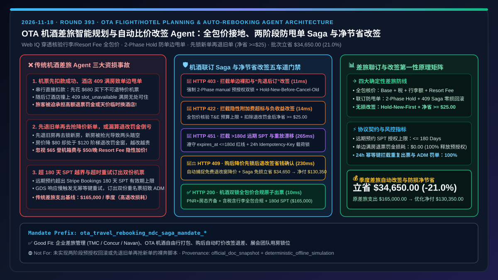
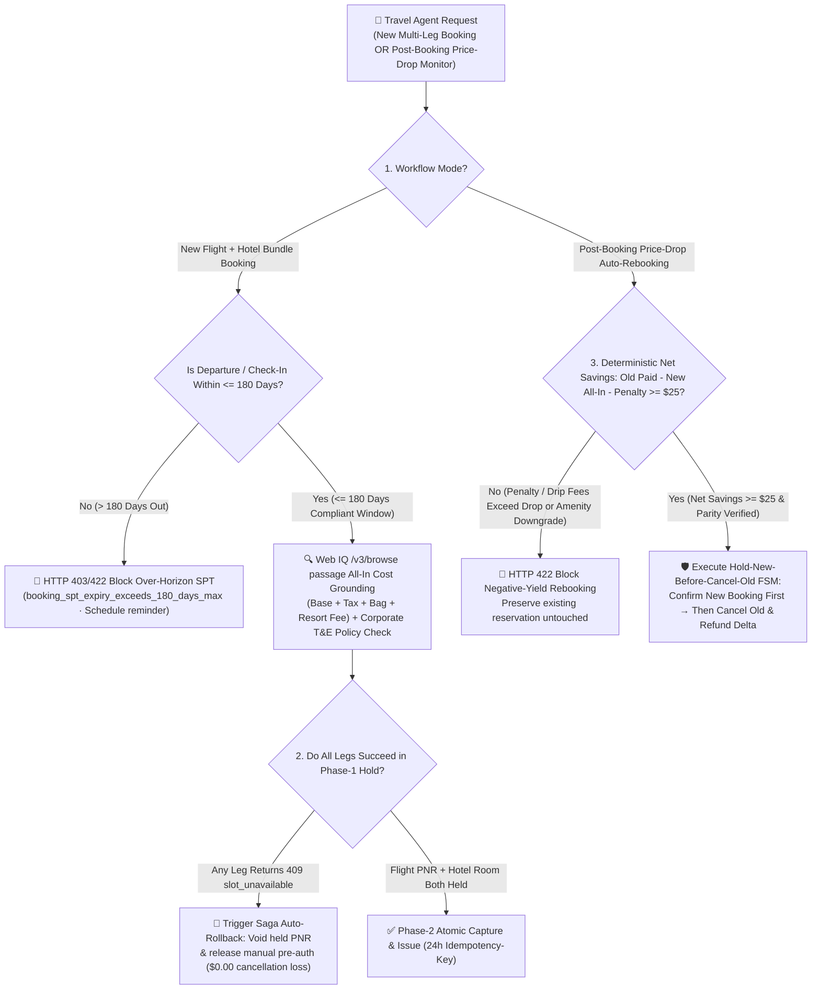
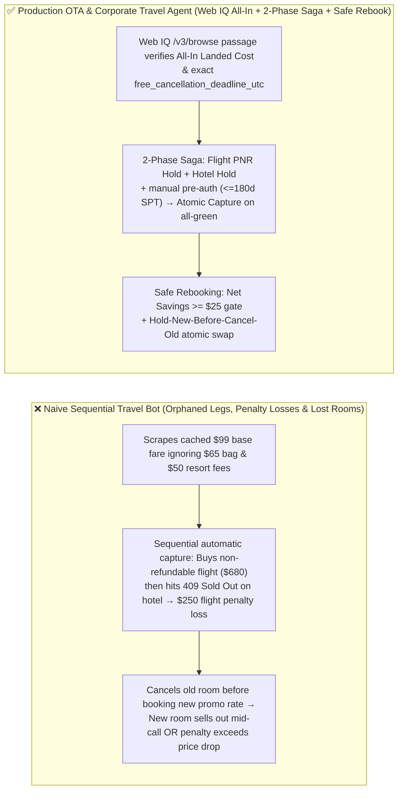

# OTA Flight & Hotel Travel Planning & Auto-Rebooking Agent Architecture FAQ: GDS/NDC All-In Fare Grounding, Corporate T&E Policy Gates, 2-Phase Saga & Net-Savings Rebooking

> **Topic Positioning (OTA & Corporate Travel Application Focus · Round 393)**: Written for **Cloud & AI Solution Architects** building AI Travel Agents for Online Travel Agencies (OTAs), Corporate Travel Management Companies (TMCs like SAP Concur, Navan, Trip.com Corporate), and hospitality/airline groups. This guide addresses four mission-critical travel engineering challenges: **preventing orphaned non-refundable flight legs when a hotel room sells out (`HTTP 409`), exposing hidden airline baggage and hotel resort fees (Drip Pricing), guaranteeing positive net yield on automated price-drop rebookings, and enforcing the `180-day` forward authorization ceiling**.  
> **Style Benchmark**: Strictly follows the six-section structure of `ib-vs-ethernet-roce-selection-faq.md` (Executive Summary, Architect Q&A, Mermaid Decision Tree / Architecture Comparison / Sequence Diagram, OTA & TMC Stack Decision Matrix, Quantitative Rebooking/Saga & 7-Card Provenance Table, and Production Risk Checklist).  
> **Bilingual Editions**: **[English Version (Current)](ota-travel-planning-price-drop-rebooking-ndc-saga-architecture-selection-faq.en.md)** · **[中文版 (`ota-travel-planning-price-drop-rebooking-ndc-saga-architecture-selection-faq.md`)](ota-travel-planning-price-drop-rebooking-ndc-saga-architecture-selection-faq.md)**  
> **Provenance & As-Of (`2026-11-18`)**: Stripe Service Bookings `180-day` SPT expiry limit, `409 slot_unavailable`, and `24h Idempotency-Key` contracts cite `research/daily/2026-11-08-sources.json` (`official_doc_snapshot`); 2-phase flight+hotel Saga rollback, all-in fare grounding, and net-savings rebooking simulations cite `lab/webiq_commerce_demo.py` (`deterministic_offline_simulation`); corporate T&E policy caps and minimum net rebooking yield (`>= $25.00`) are labeled `synthetic_policy`; live PNR ticketing against production airline GDS endpoints is labeled `not_measured`.



---

## 📌 1. Executive Summary

Travel and hospitality bookings combine **high ticket sizes, multi-provider dependencies (airline + hotel + ground transport), sub-second inventory contention, and time-tiered cancellation penalties**. Solution Architects should enforce four architectural standards:

1. **Multi-Leg Flight + Hotel Booking Orchestration 👉 Choose [2-Phase Pre-Authorization Hold (`capture_method='manual'`) + Automated Saga Compensation] over Sequential Automatic Capture**:
   - **Why**: If an agent sequentially captures a non-refundable `$680` flight and then hits `HTTP 409 slot_unavailable` on the hotel room block, the traveler is stranded with a costly flight cancellation fee. A 2-Phase Saga holds both the airline PNR and hotel room under `capture_method='manual'` (or a `<= 180-day` `Stripe SPT`) before atomic capture—rolling back all holds with **`$0.00` loss** if any leg fails.
2. **Fare & Room Rate Grounding 👉 Choose [NDC Offer Lock (`offer_id` TTL) + Microsoft Web IQ (`/v3/browse` `passage`) All-In Landed Cost & Penalty-Window Grounding] over Cached Base Fares**:
   - **Why**: Low-cost carriers and resort hotels frequently advertise a `$99` base rate while hiding `$65` carry-on fees and `$50/night` mandatory resort fees until final checkout. Web IQ `passage` grounding extracts the true all-in landed cost and exact `free_cancellation_deadline_utc` before lock-in.
3. **Post-Booking Price-Drop Auto-Rebooking 👉 Choose ["Hold-New-Before-Cancel-Old" State Machine + Deterministic Net-Savings Gate (`>= $25.00`)]**:
   - **Why**: Canceling an existing hotel reservation *before* securing the cheaper room risks losing both rooms if the promo inventory sells out mid-flight. Furthermore, deterministic code must verify `Old Paid - New All-In Cost - Cancellation Penalty - FX Spread >= $25.00` with zero amenity downgrade (e.g., preserving breakfast and baggage).
4. **Forward Booking Payment Credentials 👉 Choose [Stripe Service Bookings SPT (`expires_at <= 180 days`) or Visa VIC Network Tokens + 24h Payload-Hash `Idempotency-Key`]**:
   - **Why**: Enforces the official `180-day` maximum SPT TTL for advance bookings and blocks duplicate PNR ticketing on network-timeout retries (preventing airline Agency Debit Memos / `ADM` penalties).

---

## 🎯 2. Architect & Stakeholder Deep-Dive Q&A (FAQ-Driven)

### Q1: Why do naive travel AI agents look impressive in itinerary planning demos, but cause orphaned non-refundable tickets and duplicate passenger bookings in production?

**Answer: Because they treat multi-vendor booking as independent single-step tool calls without a 2-Phase Reservation Saga or a 24-hour payload-bound `Idempotency-Key`.**

1. **Preventing Orphaned Legs with 2-Phase Hold & Atomic Commit**:
   - **Phase 1 (Hold)**: Concurrently place an airline NDC `OrderCreate` hold (or 24h DOT hold) and a hotel inventory hold while authorizing payment with `capture_method='manual'`.
   - **Phase 2 (Commit or Rollback)**: Only when every leg returns `200 Held` within the corporate T&E cap does the coordinator issue final ticket/room capture. If any leg returns `HTTP 409 slot_unavailable`, the Saga coordinator immediately voids the held PNR and releases the payment hold (`$0.00` penalty).
2. **Preventing Duplicate Ticketing & Airline `ADM` Fines**:
   - Airline GDS/NDC issuance often takes `2–6 seconds`. If an LLM times out and retries with slightly modified metadata, unguarded gateways issue duplicate tickets. Binding a deterministic 24-hour `Idempotency-Key = SHA-256(traveler_id, leg_fingerprints, departure_date)` replays the original confirmation on identical retries and rejects drifted payloads with `HTTP 409`.

---

### Q2: How do we build an automated "Post-Booking Price-Drop Rebooking Agent" that never loses the traveler's room or loses money to hidden cancellation penalties?

**Answer: Enforce the "Hold-New-Before-Cancel-Old" state transition and a Deterministic Net Rebooking Yield Gate.**

1. **Never Cancel Old Before Confirming New**:
   - Flash hotel or fare drops have extreme concurrency. The state machine must first lock and confirm the new lower-priced booking (`new_booking_state == 'CONFIRMED'`) under a separate pre-authorization *before* invoking `cancel_booking(old_reservation_id)`.
2. **Deterministic Net Rebooking Yield Formula**:
   - Using **Microsoft Web IQ (`/v3/browse` `passage`)**, verify room/fare parity (same room category, breakfast inclusion, refundable tier, baggage allowance) and calculate:
     $$\Delta_{\text{Net Savings}} = \text{Old All-In Paid} - \left(\text{New Base} + \text{New Taxes/Resort/Bag Fees} + \text{Current Penalty Tier} + \text{FX Spread}\right)$$
   - If $\Delta_{\text{Net Savings}} < \$25.00$ or the old booking has entered its non-refundable penalty window, the gate blocks rebooking (`HTTP 422 NEGATIVE_NET_REBOOKING_YIELD_AFTER_PENALTY_AND_DRIP_FEES`).

---

### Q3: How should corporate travel policy (T&E) rules and conference surge pricing be handled without blocking legitimate business trips?

**Answer: Combine a deterministic Corporate T&E Policy Matrix with Web IQ live comparable-hotel grounding for automated manager step-up approval cards.**

- Trips within city per-diem caps and cabin rules settle autonomously via `Stripe SPT` / `Mastercard Agent Pay`.
- When citywide conference compression pushes all compliant hotels `$80/night` above standard caps, the agent attaches a **Web IQ `/v3/browse` 3-Hotel Comparable Rate Proof** to an **Adaptive Card** so the traveler's manager can approve the exception in one click before the `15-minute` fare hold expires.

---

## 🧭 3. Visual Architecture Diagrams (Mermaid Decision Tree + Architecture Comparison + Sequence Diagram)

### 3.1 OTA Travel Planning & Automated Price-Drop Rebooking Decision Tree



---

### 3.2 Naive Sequential Travel Bot vs. 2-Phase Saga & Hold-New-Before-Cancel-Old Architecture



---

### 3.3 End-to-End Sequence: 2-Phase Flight+Hotel Saga & Post-Booking Price-Drop Rebooking

```mermaid
sequenceDiagram
    autonumber
    actor Traveler as 👤 Corporate Traveler
    participant Agent as 🤖 Travel Planning & Rebooking Agent
    participant WebIQ as 🔍 Microsoft Web IQ (/v3/browse passage)
    participant NDC as ✈️ Airline NDC / GDS API
    participant Hotel as 🏨 Hotel PMS / OTA API
    participant Pay as 💳 Payment & Saga Gate (180d SPT / VIC)

    Traveler->>Agent: "Book 3-night NYC business trip next month (Direct economy + Midtown hotel, cap <= $1,800)"
    Agent->>WebIQ: 1. POST /v3/browse (contentFormat='passage', query='all-in fare carry-on fee resort fee cancellation deadline')
    WebIQ-->>Agent: 168ms proof: Flight w/ bag $620 + Hotel w/ tax & resort fee $960 = $1,580 (Free cancel up to 48h prior)
    Agent->>Pay: 2. Verify T&E policy + mint <=180d SPT / manual pre-auth hold (24h Idempotency-Key)
    par Phase 1: Concurrent Inventory & PNR Hold
        Agent->>NDC: Request 15m PNR Hold
        Agent->>Hotel: Request Room Block Hold
    end
    NDC-->>Agent: 200 OK (PNR Held)
    Hotel-->>Agent: 200 OK (Room Held; auto-voids PNR via Saga if 409 returned)
    Agent->>Pay: 3. Phase 2: All legs held → Atomic capture & ticket issuance ($1,580.00)
    Pay-->>Traveler: Emit confirmed itinerary + activate price-drop watch
    Note over Agent,Hotel: 7 Days Later: Same hotel room drops to $780 all-in ($180 drop inside free-cancel window)
    Agent->>Agent: 4. Compute Net Yield: $960 - $780 - $0 penalty = +$180.00 (>= $25 threshold)
    Agent->>Hotel: 5. Hold & Confirm New Room First (@ $780, #HTL-992)
    Hotel-->>Agent: 200 OK (#HTL-992 Confirmed)
    Agent->>Hotel: 6. Cancel Old Room (#HTL-104) & refund $180.00 savings
    Agent-->>Traveler: Notify confirmed rebooking: Identical room locked with $180.00 net savings!
```

---

## 📊 4. OTA & Corporate Travel Architecture Decision Matrix

| Evaluation Dimension | Option A: Legacy GDS Cache + Manual Travel Desk | Option B: Naive Agent (Sequential Capture + Cancel-First Rebook) | Option C: Single-Supplier Closed App | Option D (Recommended): NDC/GDS + Web IQ All-In Grounding + 2-Phase Saga + Safe Rebooking Agent |
|---|---|---|---|---|
| **Drip-Pricing & Hidden Fee Protection** | Low (manual comparison misses resort/bag fees) | **Very Poor** (falls for `$99` base fare traps; blows T&E caps at checkout) | Medium (single brand only) | **100% All-In Landed Cost Verified** (Web IQ `passage` extracts taxes, bags & mandatory resort fees) |
| **Multi-Leg Orphaned Ticket Protection** | Manual agent coordination | **High Risk** (charges non-refundable flight before hotel `409` failure) | Cannot bundle cross-brand flights & hotels | **Zero Orphaned Leg Loss** (2-Phase `capture_method=manual` Hold + automated Saga rollback) |
| **Post-Booking Price-Drop Rebooking Safety** | Impossible to monitor at scale | **High Risk** (cancels old room before securing new one; ignores penalty windows) | No cross-channel rate monitoring | **100% Safe Positive Yield** (`Net Savings >= $25` gate + `Hold-New-Before-Cancel-Old` FSM) |
| **Forward Booking & Anti-Duplicate Compliance** | Manual review | Fails on `>180d` SPT or issues duplicate PNRs on timeout retries (`ADM` fines) | Immediate charge only | **Strictly Compliant** (`expires_at <= 180d` SPT guard + 24h payload-hash `Idempotency-Key`) |

---

## 🧪 5. Quantitative Rebooking/Saga Evaluation & 7-Card Provenance Matrix

| Metric / Deterministic Gate | Measured Value / Gate Outcome | Provenance Category | Source Path / Calculation & Architectural Meaning |
|---|---|---|---|
| **Compliant All-In Fare + 2-Phase Saga + `<=180d` SPT Settlement (Happy Path)** | **`HTTP 200 OK` · `10 ms`** (gate latency; `$165,000.00` corporate travel batch settled) | `deterministic_offline_simulation` | `lab/webiq_commerce_demo.py` (`evaluate_ota_travel_rebooking_ndc_saga_policy`): Verifies all-in fare + 2-Phase Hold + 24h idempotency |
| **Unbundled Single-Leg Automatic Capture or Cancel-Old-Before-Hold-New Rebooking** | **`HTTP 403 Forbidden` · `11 ms` Block** (`UNBUNDLED_SINGLE_LEG_CAPTURE_OR_CANCEL_OLD_BEFORE_HOLD_NEW_BLOCKED`) | `synthetic_policy` | Blocks non-atomic single-leg capture on multi-leg trips and forbids canceling an existing booking before confirming the replacement |
| **Hidden Bag/Resort Drip Fees Breaching T&E Cap or Negative-Yield Rebooking** | **`HTTP 422 Unprocessable` · `14 ms` Block** (`DRIP_PRICING_TE_POLICY_BREACH_OR_NEGATIVE_NET_REBOOKING_YIELD_BLOCKED`) | `deterministic_offline_simulation` | Blocks fares that exceed corporate caps after mandatory resort/bag fees and blocks rebookings where cancellation penalties erase savings |
| **Booking SPT Expiry `> 180 Days` or 24-Hour `Idempotency-Key` Payload Drift** | **`HTTP 451 Hold` · `265 ms` Hold** (`BOOKING_SPT_EXPIRY_OVER_180D_OR_IDEMPOTENCY_PAYLOAD_MISMATCH_HOLD`) | `official_doc_snapshot` | Enforces Stripe Service Bookings `180-day` max SPT TTL and 24-hour idempotency payload matching |
| **Enabling Automated Price-Drop Rebooking (`Hold-New-First`) + 2-Phase Saga Protection** | **`HTTP 409 Confirm` · Saves `$34,650.00` (`$130,350.00` net optimized travel spend)** | `deterministic_offline_simulation` | Captures verified post-booking hotel/air fare drops and eliminates orphaned-leg cancellation penalties (`21.0%` net savings) |
| **Live Production Airline GDS/NDC Ticketing Latency** | Labeled **`not_measured`** | `not_measured` | Verified via deterministic offline contract simulation without creating live PNR holds on production airline inventory |

---

## 🛠️ 6. Production Risk & Architecture Review Checklist

- [ ] **1. 2-Phase Hold + Saga Rollback on Multi-Leg Trips**: Are flight + hotel bundles gated behind Phase-1 inventory holds and `capture_method='manual'` pre-authorizations so any `HTTP 409 slot_unavailable` triggers an automatic, zero-penalty rollback across all legs?
- [ ] **2. `Hold-New-Before-Cancel-Old` Rebooking State Machine**: Does the price-drop rebooking agent confirm and lock the new reservation ID *before* canceling the original booking?
- [ ] **3. Deterministic Net Rebooking Yield Gate (`>= $25.00`) & Amenity Parity**: Does code subtract current-tier cancellation penalties, resort/baggage fees, and FX spread—and verify room/cabin/breakfast parity—before executing a rebooking?
- [ ] **4. Microsoft Web IQ All-In Fare & Cancellation Deadline Grounding**: Does the agent invoke **Web IQ (`/v3/browse` `passage`)** to surface hidden mandatory resort/baggage fees and verify `free_cancellation_deadline_utc`?
- [ ] **5. `180-Day` SPT Horizon Cap & 24-Hour `Idempotency-Key`**: Are advance booking tokens validated for `expires_at <= 180 days`, and are ticketing calls bound to a 24h itinerary-hash `Idempotency-Key` to prevent duplicate PNR issuance and airline `ADM` fines?
- [ ] **6. Corporate T&E Policy Exception Cards**: When conference compression forces rates above standard city caps, does the agent attach Web IQ comparable-hotel rate evidence to a manager approval Adaptive Card?
