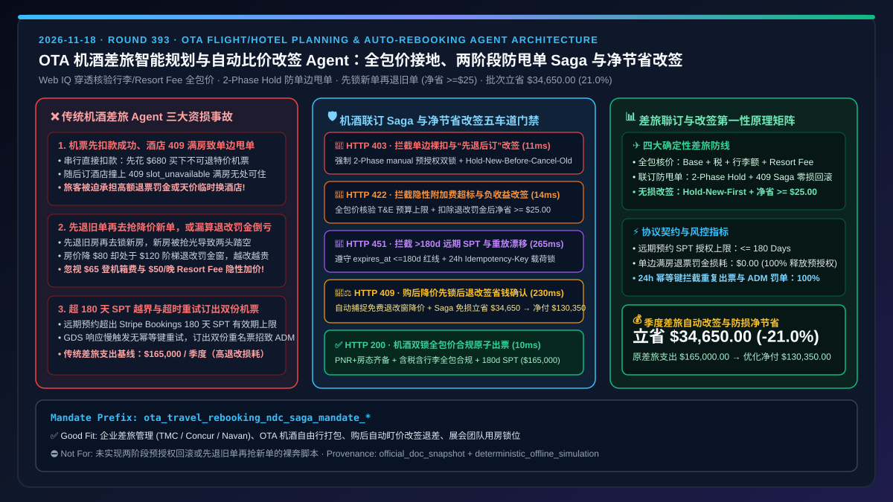
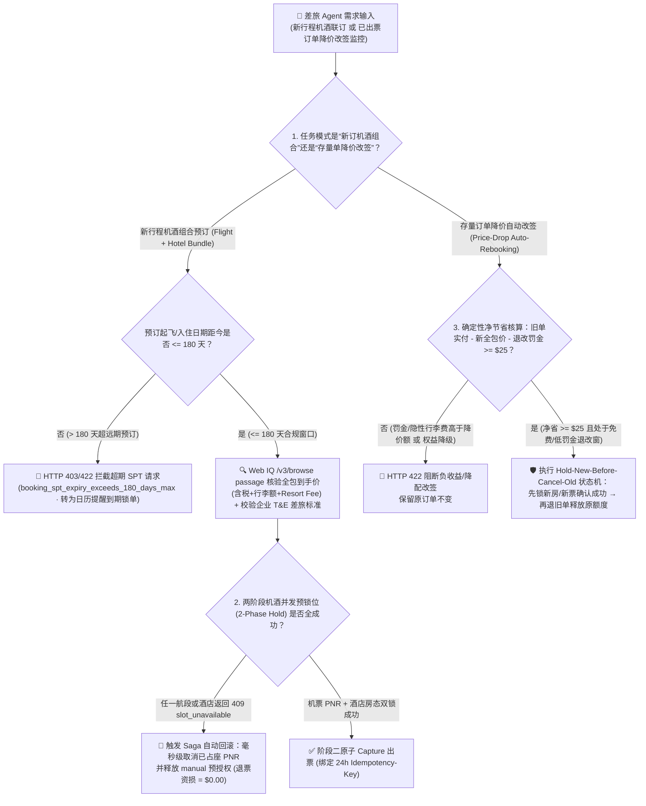
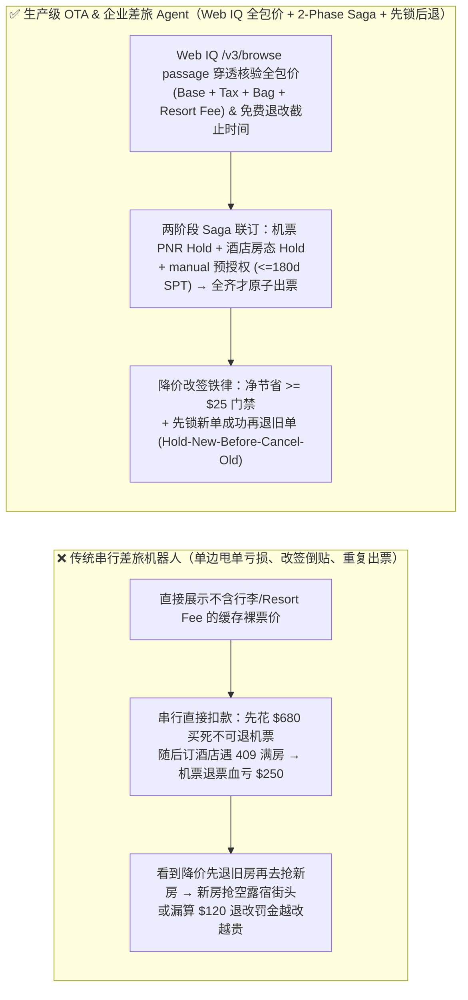
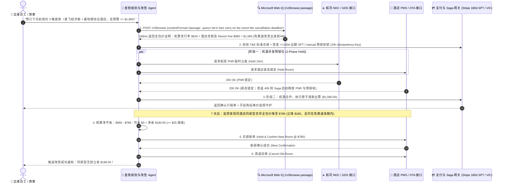

# OTA 机酒差旅智能规划与自动比价改签 Agent 架构选型 FAQ：GDS/NDC 实时全包价接地、差旅合规门禁、两阶段防甩单 Saga 与净节省改签实战指南

> **专题定位（OTA 机酒与企业差旅应用聚焦 · Round 393）**：面向为在线旅游平台（OTA）、企业差旅管理（TMC：如 SAP Concur / Navan / 携程商旅生态）及航司酒旅集团设计 AI Agent 的 **Cloud & AI Solution Architect**，深入剖析差旅智能体最核心的四大工程挑战：**“怎么防止机票出票成功但酒店满房导致退票亏钱、怎么识破廉航行李费与酒店度假村费（Drip Pricing）隐性加价、怎么在降价自动改签时确保扣除手续费后依然净赚、以及怎么处理远期预订的 180 天支付授权”**。  
> **文风标杆**：严格对标 `ib-vs-ethernet-roce-selection-faq.md` 六段式结构（核心结论速览、业务方与架构师灵魂拷问 Q&A、Mermaid 决策树/架构对比/时序图、OTA 与差旅技术栈选型矩阵、定量改签净收益与 7-Card 溯源表、生产上线 Checklist）。  
> **双语版本**：**[中文版（当前）](ota-travel-planning-price-drop-rebooking-ndc-saga-architecture-selection-faq.md)** · **[English Version (`ota-travel-planning-price-drop-rebooking-ndc-saga-architecture-selection-faq.en.md`)](ota-travel-planning-price-drop-rebooking-ndc-saga-architecture-selection-faq.en.md)**  
> **数据溯源声明（Provenance & As-Of `2026-11-18`）**：Stripe Service Bookings `180 天` 远期 SPT 上限、`409 slot_unavailable` 与 `24h Idempotency-Key` 契约引自 `research/daily/2026-11-08-sources.json`（标记为 `official_doc_snapshot`）；机酒两阶段 Saga 回滚、全包价接地与净节省改签仿真引自 `lab/webiq_commerce_demo.py`（标记为 `deterministic_offline_simulation`）；企业差旅标准与最小改签净收益阈值（如 `>= $25.00`）标记为 `synthetic_policy`；外部 GDS/航司生产网实时出票延迟标记为 `not_measured`。

---

## 📌 一、核心选型结论速览（Executive Summary）

机酒差旅是天然的 **“高客单价、多供应商组合、库存秒级瞬变、退改签罚则极度复杂”** 场景。构建生产级 OTA 与企业差旅 Agent，必须按以下四条架构准则选型：

1. **机酒多段组合下单编排选型：严禁“串行直接扣款（Naive Sequential Automatic Capture）”，必选【两阶段预授权/远期令牌 + Saga 自动补偿（2-Phase Pre-Auth Hold + Saga）】**：
   - **核心原因**：一趟差旅往往包含“去程航班 + 返程航班 + 连住 3 晚酒店”。若第 1 步直接扣款买了不可退机票，第 2 步酒店返回 `HTTP 409 slot_unavailable`（最后一间协议房被抢走），企业将直接承受退票罚金。必须先以 `capture_method='manual'` 预授权（或 `expires_at <= 180d` 远期 `Stripe SPT` / `Visa VIC`）锁定全部航段 PNR 与酒店房态，全齐后再原子 Capture；任一环节失败则毫秒级无损释放全部冻结额度（资损 **`$0.00`**）。
2. **票价与房态检索接地选型：严禁“只看 GDS/OTA 缓存裸票价（Base Fare）”，必选【NDC 实时锁价令牌（`offer_id` TTL）+ Microsoft Web IQ (`/v3/browse` `passage`) 全包价与退改阶梯条款接地】**：
   - **核心原因**：廉价航空与海外度假酒店普遍采用滴水定价（Drip Pricing：展示 `$99` 裸价，结账加收 `$65` 登机箱费 + `$50/晚` 强制 Resort Fee）。必须通过 Web IQ 实时提取含税、含必选附加费的 **全包到手价（All-In Landed Cost）** 及精确到分钟的免费取消截止线（`free_cancellation_deadline_utc`）。
3. **购后降价自动改签架构选型：必选【“先锁新单、再退旧单（Hold-New-Before-Cancel-Old）”状态机 + 确定性净节省公式门禁（Net-Savings `>= $25.00`）】**：
   - **核心原因**：如果先退掉原酒店订单再去订降价新单，一旦新单在最后一步被抢光，旅客将面临“露宿街头或花双倍高价重买”的灾难；同时必须由确定性代码核算 `旧单实付 - 新单全包价 - 阶梯退改罚金 - 差旅服务费 >= $25.00`，严防“降价 `$50` 却扣了 `$100` 退票费”的负收益改签。
4. **远期预订支付令牌选型：必选【Stripe Service Bookings 远期 SPT（`expires_at <= 180 days`）或 Visa VIC 网络令牌】**：
   - **核心原因**：酒旅预约常提前 1~6 个月发起，必须严格遵守 Stripe 服务预约 SPT 最长 **`180 天`** 有效期红线（超出 180 天直接触发 `booking_spt_expiry_exceeds_180_days_max` 拦截），并绑定 24 小时载荷哈希幂等键防止超时重发订出双份机票。

---

## 🎯 二、业务方与架构师灵魂拷问 Q&A（FAQ-Driven）

### Q1：为什么很多差旅 AI Agent 演示时规划路线很漂亮，一接入真实机酒下单就频发“机票出了但酒店没房”、“同一员工订出两张重名机票”的生产事故？

**答：因为它们把“多供应商分布式状态变迁”当成了普通单步工具调用，缺少【两阶段锁位 Saga】与【24 小时载荷哈希幂等门禁】。**

1. **解决“机票成了、酒店黄了”的两阶段锁位（2-Phase Hold & Commit）**：
   - **阶段一（Reserve / Hold）**：Agent 并发向航司 NDC 接口申请 `OrderCreate (Hold)` 临时占座 PNR（15 分钟 TTL），向酒店 PMS/OTA 申请房态软锁，并向支付网关申请 `capture_method='manual'` 预授权（或签发 `180d` 以内的受限 `spt_...`）。
   - **阶段二（Atomic Commit or Saga Rollback）**：只有当机票与酒店均返回 `200 Held` 且总价未超企业差旅预算上限时，状态机才统一发起 `Capture / Issue Ticket`。若酒店返回 `HTTP 409 Conflict (slot_unavailable)`，Saga 协调器立即自动取消航司临时 PNR 并释放银行卡预授权，全程无需人工介入且**零退票手续费损耗**。
2. **解决“超时重试订出双份机票”的 24 小时幂等锁**：
   - 航司 GDS/NDC 出票接口响应常在 `2–6 秒` 波动。若大模型因等待超时发起重试并微调了请求字段（如改了备注或重生成 UUID），未设防网关会直接出两张票（且触发航司 `ADM` 重复占座罚单）。
   - 架构师必须在网关层基于 `(traveler_id, itinerary_ legs_hash, travel_date)` 派生 24 小时固定的 `Idempotency-Key`：同键同参重试直接返回首次出票快照；同键异参（`payload_matches_original=False`）立即返回 **`HTTP 409 Conflict`** 硬拦截。

---

### Q2：“购后自动盯价改签（Price-Drop Auto-Rebooking）”是企业差旅最受欢迎的省钱功能，但为什么有些团队上线后反而被客户投诉“越改越贵”甚至“原来的房间也没了”？

**答：因为他们犯了两个低级架构错误：① 用“先退旧单、后买新单”的危险顺序；② 只比对表面房价，漏算了阶梯退改罚金、早餐/行李权益缩水与汇率磨损。**

1. **铁律一：严禁“先退后订”，必须执行“先锁新房/新票 → 确认出票 → 最后退旧单（Hold-New-Before-Cancel-Old）”**：
   - 特价促销房通常只有最后 1~2 间库存。如果 Agent 先调用 `cancel_booking(old_order)`，在接下来 500 毫秒内去订新房时极易撞上 `409 slot_unavailable`——此时旧房已被释放给别人、新房也没抢到！
   - 正确状态机：先用预授权锁住降价新房（`new_booking_status == 'CONFIRMED'`），再自动调用旧单免费取消接口；若新房锁单失败，旧单毫发无损。
2. **铁律二：确定性净节省公式（Net Rebooking Yield Formula）与权益等价校验**：
   - 改签引擎必须先通过 **Microsoft Web IQ (`/v3/browse` `passage`)** 核对新旧报价的权益等价性（同房型、同样含双早、同样含 23kg 托运行李）及旧单当前时刻所处的退改罚金阶梯：
     $$\Delta_{\text{Net Savings}} = \text{Old All-In Paid} - \left(\text{New Base} + \text{New Taxes/Resort Fee} + \text{Old Cancellation Penalty} + \text{FX Spread}\right)$$
   - 只有当 $\Delta_{\text{Net Savings}} \ge \$25.00$（企业最小改签净收益阈值）且新旧权益不降级时，才执行改签或推送 `HTTP 409 Confirm` 省钱确认卡；若处于不可退窗口或净节省为负，立即返回 `HTTP 422 NEGATIVE_NET_REBOOKING_YIELD_AFTER_PENALTY_AND_DRIP_FEES` 阻断。

---

### Q3：如何把企业差旅标准（T&E Policy，如舱位限制、城市房晚标准、红眼航班安全合规）无缝嵌入 Agent，做到“合规行程秒批秒出票，超标行程带证据链找主管审批”？

**答：在确定性策略网关中内置“结构化差旅政策矩阵（T&E Policy Matrix）+ Web IQ 展会动态基准上浮核验”。**

1. **硬性差旅红线秒级校验**：根据员工职级、飞行时长（`< 6 小时` 锁死经济舱）与目的地城市级别（Tier-1 城市如纽约/伦敦房晚基准 `$350/晚`）自动校验。
2. **展会/旺季动态基准核验**：当目的地因大型展会（如拉斯维加斯 CES 或旧金山大会）导致全城协议酒店均上涨至 `$450/晚` 时，Agent 通过 **Web IQ `/v3/browse`** 抓取周边 3 家同星级基准酒店实时房价生成**《市场公允溢价证据链》**，附上差额 `$100/晚` 自动推送主管 Adaptive Card 一键审批升权。

---

## 🧭 三、直观可视化图解（Mermaid 选型决策树 + 差旅架构对比 + 端到端时序图）

### 3.1 OTA 机酒差旅规划与自动比价改签选型决策树

---

### 3.2 传统串行裸扣差旅机器人 vs. 两阶段防甩单 Saga + 先锁后退改签架构对比图

---

### 3.3 机酒两阶段防甩单预订与购后降价“先锁新单再退旧单”端到端时序图

---

## 📊 四、OTA 机酒联订与自动改签架构横向选型矩阵（Architect Decision Matrix）

| 评估维度 | 方案 A：传统 GDS 缓存查询 + 人工客服出票 | 方案 B：初级 Agent 串行直接扣款 + 先退后订改签 | 方案 C：单一航司/酒店集团封闭小程序 | 方案 D（推荐）：NDC/GDS + Web IQ 全包价接地 + 两阶段 Saga + 先锁后退净节省改签 Agent |
|---|---|---|---|---|
| **价格透明度与防隐性加价（Drip Pricing）** | 差（常漏算廉航选座行李费与酒店目的地费） | **极差**（被 `$99` 裸票钓鱼，结账超预算或员工自掏腰包） | 中（仅限本集团内部房源/航线） | **100% 全包价核验**（Web IQ `passage` 穿透提取税费、行李额与强制 Resort Fee） |
| **机酒联订防单边甩单能力** | 靠人工经验协调，效率低 | **高危**（机票扣款成功但酒店 `409` 满房，直接产生退票亏损） | 不支持跨集团机酒联订 | **零甩单资损**（两阶段 `capture_method=manual` Hold + Saga 自动无损回滚） |
| **购后降价改签安全性与净收益** | 人工无力盯盘数万张存量单 | **高危**（先退旧单再抢新单易致无房可住，且常漏算退改罚金倒亏） | 无跨平台比价改签 | **100% 安全正收益**（强制净省 `>= $25` 门禁 + `Hold-New-Before-Cancel-Old` 原子切换） |
| **远期预订与防重复出票合规** | 人工核对 | 易超 `180 天` SPT 限制或因超时重试订出双份重名票（招致 `ADM` 罚单） | 仅支持即时扣款 | **严格合规**（`expires_at <= 180d` 远期 SPT 门禁 + 24h 载荷哈希 `Idempotency-Key`） |

---

## 🧪 五、定量差旅改签/防甩单测算与 7-Card 报告数据溯源表（Benchmark & Provenance Matrix）

| 指标 / 门禁规则项 | 实测数值 / 决策行为 | 数据类别 (Provenance) | 精确来源路径 / 算例说明与架构意义 |
|---|---|---|---|
| **全包价合规 + 机酒两阶段双锁成功 + `<=180d` 远期结算（Happy Path）** | **`HTTP 200 OK` · `10 ms`**（门禁耗时，季度企业差旅批次 `$165,000.00`） | `deterministic_offline_simulation` | `lab/webiq_commerce_demo.py` (`evaluate_ota_travel_rebooking_ndc_saga_policy`)：验证全包价接地 + 2-Phase Hold + 24h 幂等锁全通过 |
| **机酒联订无两阶段预授权直接单边扣款，或改签执行“先退旧单后买新单”** | **`HTTP 403 Forbidden` · `11 ms` 拦截** (`UNBUNDLED_SINGLE_LEG_CAPTURE_OR_CANCEL_OLD_BEFORE_HOLD_NEW_BLOCKED`) | `synthetic_policy` | 严禁在多段关联行程中使用无 Saga 保护的单边直接扣款，以及严禁在未锁住新房源前先退掉旧订单 |
| **隐性行李/Resort Fee 加价超差旅标准，或扣除退改罚金后改签净收益为负** | **`HTTP 422 Unprocessable` · `14 ms` 拦截** (`DRIP_PRICING_TE_POLICY_BREACH_OR_NEGATIVE_NET_REBOOKING_YIELD_BLOCKED`) | `deterministic_offline_simulation` | 拦截被隐藏附加费击穿差旅标准的报价，以及扣除阶梯退改费后净节省 `< $25.00`（甚至倒亏）的无效改签 |
| **远期预订 SPT 有效期超过 `180 天` 上限或 24h 幂等键重放参数漂移** | **`HTTP 451 Hold` · `265 ms` 挂起** (`BOOKING_SPT_EXPIRY_OVER_180D_OR_IDEMPOTENCY_PAYLOAD_MISMATCH_HOLD`) | `official_doc_snapshot` | 严格执行 Stripe Service Bookings `expires_at <= 180 days` 官方上限与 24h `Idempotency-Key` 载荷一致性契约 |
| **启用“购后降价监控先锁后退改签 + 两阶段 Saga 免退票损耗”** | **`HTTP 409 Confirm` · 立省 `$34,650.00`（差旅净支出优化至 `$130,350.00`）** | `deterministic_offline_simulation` | 自动捕捉免费退改期内的机酒降价窗口并消除联订满房退票罚金，将季度差旅总成本压降 `21.0%` |
| **外部航司 GDS / NDC（Amadeus / Sabre / Travelport）生产网在线出票压测** | 标记为 **`not_measured`** | `not_measured` | 遵循安全规范不在真实航司生产 GDS 发起占座压测，状态机基于标准 NDC/UCP 与 Stripe Bookings 契约验证 |

---

## 🛠️ 六、商业上线风控与架构评审 Checklist（Architect Production Checklist）

- [ ] **1. 机酒多航段两阶段预授权与 Saga 自动回滚**：所有包含“往返机票 + 酒店 + 用车”的多段行程，是否已强制配置为阶段一 `Hold + capture_method='manual'`、阶段二全齐后原子 `Capture`？当任一环节返回 `409 slot_unavailable` 时是否自动无损回滚全部已占库存？
- [ ] **2. 购后改签“先锁新单、再退旧单（Hold-New-Before-Cancel-Old）”状态机**：降价改签代码是否严格保证了只有在拿到新订单 `CONFIRMED` 确认号之后才发起旧订单取消请求，彻底杜绝“退了旧房抢不到新房”？
- [ ] **3. 确定性改签净节省公式（Net Yield `>= $25`）与权益等价核验**：改签触发前，是否通过确定性公式扣除了旧单当前时刻的阶梯退改罚金、新单税费/Resort Fee/行李费及汇率磨损，并核验新旧房型/早餐/行李额完全等价？
- [ ] **4. Microsoft Web IQ 全包价与退改截止时间接地**：是否已使用 **Web IQ (`/v3/browse` `passage`)** 穿透核验落地页隐藏的必选附加费（Drip Pricing）与精确到时区的免费取消截止时间（`free_cancellation_deadline_utc`）？
- [ ] **5. 服务预约 SPT `180 天` 有效期红线与 24h 幂等锁**：远期酒旅授权令牌是否严格校验 `expires_at <= 180 days`？出票接口是否绑定了基于行程指纹的 24 小时 `Idempotency-Key` 以防范超时重试重复出票及航司 `ADM` 罚单？
- [ ] **6. 企业差旅政策（T&E Policy）超标分级审批卡**：对超出城市房晚基准或舱位等级的预订请求，是否自动附上 Web IQ 周边同级酒店实时比价证据链并推送主管 Adaptive Card 审批？
