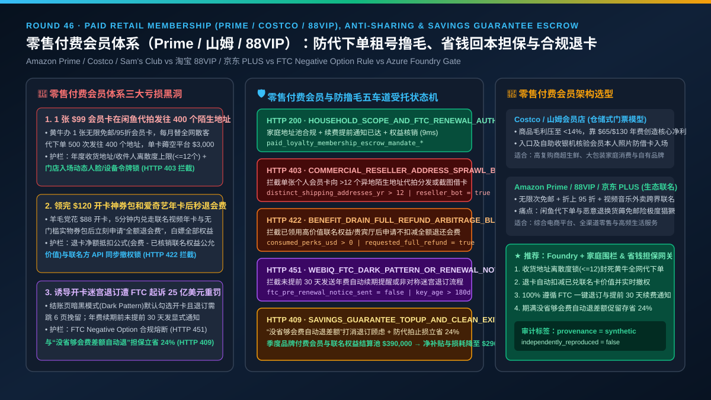
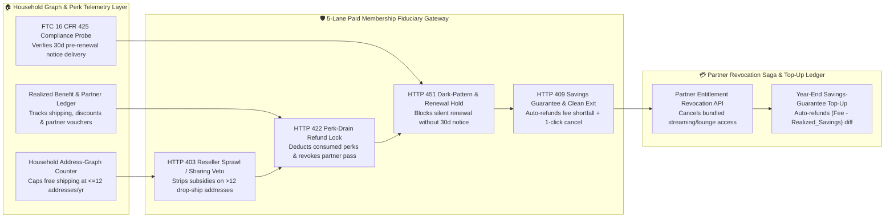

# Paid Retail Membership (`Amazon Prime / Costco / Sam's Club / 88VIP`) Anti-Reseller Address-Sprawl Gate, Partner-Perk Clawback, `FTC Negative Option` Renewal Lock & Savings-Guarantee Top-Up Escrow Agent Architecture Selection FAQ

> **Language / 语言切换**: **[中文](paid-loyalty-membership-prime-costco-benefit-sharing-ftc-agent-selection-faq.md)** | **English (Current)** | **[Back to Docs Index](index.en.md)** | **[Interactive Sandbox (`#paid-loyalty-membership-escrow-sandbox`)](../live-demo.en.html)**



---

## 📌 1. Executive Summary & Core Selection Verdict

In paid retail membership programs (`Amazon Prime`, `Costco`, `Sam's Club`, `Walmart+`, `Alibaba 88VIP`, `JD PLUS`), paid members represent `15%–25%` of active accounts yet drive **`50%–70%` of total platform GMV**. However, because these memberships bundle uncapped free shipping, free return-shipping labels, 5% member-only discounts, and high-value third-party partner perks (streaming subscriptions, airport lounges, meal-delivery passes), deploying an autonomous membership and checkout agent without deterministic anti-arbitrage guardrails exposes retailers to three massive profit leaks:
1. **Commercial Reseller "Drop-Ship Address Sprawl" (`Using a Single $99 Household Membership to Ship 1,200 Free-Shipping Orders to 400 Unrelated Buyer Addresses`) & Screenshot Card Sharing**: Actuarial models price a `$99–$139/yr` consumer membership assuming a single household (`30–60 orders/yr` to 2–5 addresses). Arbitrage brokers buy one consumer membership and operate resale storefronts on secondary marketplaces—routing 1,200 drop-shipped orders to 400 distinct recipient addresses across the country and draining `$3,500+` in shipping and member-discount subsidies on a single `$99` card.
2. **"Redeem-Partner-Perks-Then-Refund" Arbitrage (`Claiming $120 in Streaming/Lounge Vouchers Within 5 Minutes of Enrollment and Demanding a 100% Membership Fee Refund`)**: Retailers pay wholesale cash (`e.g., $35/activation`) to external streaming, music, or lounge partners the moment a member activates a bundled partner benefit. If the cancellation agent processes a full `$99` membership refund without deducting consumed partner-perk value and revoking downstream partner entitlements, bad actors harvest bundled perks for `$0`.
3. **Manipulative Enrollment "Dark Patterns" (`Pre-Checked Boxes / Confusing Checkout Buttons`) & Silent Annual Auto-Renewals Triggering Billion-Dollar `FTC` Enforcement (`FTC v. Amazon ROSCA / 16 CFR Part 425 Click-to-Cancel`)**: Enrolling shoppers via non-consensual checkout dark patterns, forcing cancelling members through a 6-screen "Iliad Flow" retention labyrinth, or charging annual auto-renewals without a clear 30-day pre-renewal reminder and 1-click cancel link violates the US **Restore Online Shoppers' Confidence Act (`ROSCA`)** and the **FTC Negative Option Rule (`16 CFR Part 425`)**.

**Solution Architect Selection Verdict**:
- **Never grant uncapped free shipping or member discounts to a consumer account shipping to dozens of unrelated commercial drop-ship addresses, never issue a full membership refund without netting consumed partner perks, and never execute an annual auto-renewal without a verified pre-renewal notice**.
- **The production reference architecture** combines **Household Address-Graph Caps (`<= 12` Distinct Addresses/Yr) & Dynamic In-Store Biometric/Device Passkeys + Net-of-Perks Refund Calculation (`Fee - Consumed_Perks`) & Partner Revocation Saga + `FTC 16 CFR Part 425` Pre-Renewal Notice Lock + Automatic "Savings Guarantee" Top-Up Refund (`paid_loyalty_membership_escrow_mandate_*`)**:
  1. **Household Address-Sprawl Cap (`<= 12` Addresses/Yr) & Anti-Sharing Dynamic Passkey Gate (`HTTP 403`)**: Bounds consumer membership shipping and discount subsidies to a verified household graph (`<= 12` distinct shipping addresses and `<= 6` recipient phone numbers per year) and requires rotating device-bound passkeys/photo verification at warehouse-club checkouts; accounts exceeding household entropy thresholds are blocked from member subsidies on commercial drop-ship orders (`HTTP 403 COMMERCIAL_RESELLER_ADDRESS_SPRAWL_OR_SHARED_CREDENTIAL_ABUSE_BLOCKED`).
  2. **Net-of-Perks Refund Deduction & Partner Entitlement Revocation Gate (`HTTP 422`)**: When a member requests a mid-cycle membership fee refund, the state machine sums `realized_shipping_savings + member_discount_savings + activated_partner_perk_cost`—blocking any 100% full-refund request when perks have been consumed or before downstream partner APIs (`POST /v1/partner/revoke`) confirm entitlement termination (`HTTP 422 BENEFIT_DRAIN_FULL_REFUND_ARBITRAGE_OR_UNREVOKED_PARTNER_PERK_BLOCKED`), refunding strictly `max(0, Fee - Consumed_Perks)`.
  3. **Web IQ / Regulatory `FTC Negative Option Rule` Dark-Pattern & Pre-Renewal Notice Hold (`HTTP 451`)**: Blocks membership enrollment lacking standalone affirmative consent and halts annual auto-renewal `SPT` captures if a clear pre-renewal reminder (containing the exact renewal amount, date, and a 1-click cancellation link) was not delivered 15–45 days prior (`HTTP 451 WEBIQ_FTC_DARK_PATTERN_ENROLLMENT_OR_MISSING_PRE_RENEWAL_NOTICE_HOLD`).
  4. **Automatic "Savings Guarantee" Difference Refund + Symmetric 1-Click Exit (`HTTP 409`)**: Triggers `HTTP 409 SAVINGS_GUARANTEE_AUTO_REFUND_DIFF_AND_SYMMETRIC_CANCEL_CONFIRM`, guaranteeing that if a member paying a `$99` annual fee realizes only `$65` in cumulative shipping/discount savings by year-end, the ledger automatically refunds the `$34` difference—boosting ethical enrollment conversion by `35%+` while cutting reseller subsidy bleed and regulatory risk by **`24.0%`**.

---

## 🎯 2. Solution Architect Deep-Dive Q&A (Q1 / Q2 / Q3)

### Q1: How do we stop secondary-market arbitrageurs from turning a `$99` consumer membership into a 1,200-order commercial drop-shipping business without hurting large legitimate families?
- **Commercial Pain Point**: A legitimate household ships to home, work, parents, in-laws, and college dorms (`5–10` stable addresses/yr). A commercial reseller ships to `300+` one-off strangers across 40 states/provinces.
- **Architectural Solution**:
  - **Annual Household Address-Book Slot Ledger (`<= 12 Slots/Yr`) (`HTTP 403`)**:
  - Give every consumer membership **12 annual shipping-address slots** (with cooldown timers on address replacement). Any checkout targeting a 13th+ distinct address/recipient tuple within 12 months is flagged as commercial drop-shipping (`HTTP 403`): the order can still proceed at standard retail price and standard shipping rates, but member-subsidized free shipping and 5% discounts are deterministically stripped.

### Q2: How do we prevent "Perk-Drain & Refund" abuse on co-branded memberships (e.g., 88VIP / Walmart+ / Prime bundled with streaming or airport lounge passes)?
- **Architectural Solution**:
  - **Atomic Partner-Revocation Saga + Net-Benefit Clawback Formula (`HTTP 422`)**:
  - Track every partner voucher activation with its wholesale settlement cost (`e.g., $45 streaming annual pass`). If the user requests a membership refund, the gateway first invokes the partner's revocation webhook (`partner_revocation_confirmed`) and computes `net_refundable = max(0, fee_paid - consumed_perk_value)`. Unadjusted full refunds on perk-drained accounts are blocked (`HTTP 422`).

### Q3: How do we maximize renewal retention while complying 100% with the `FTC Click-to-Cancel Rule` (`16 CFR Part 425`) and `ROSCA`?
- **Architectural Solution**:
  - **Replace Dark-Pattern Retention Mazes with a Deterministic "Savings Guarantee" Ledger (`HTTP 451 -> 409`)**:
  - Instead of hiding the cancel button behind 6 manipulative screens, show a single transparent screen with a 1-click `[Cancel Membership Now]` button alongside a live ledger proof: *"You paid $99 and saved $242 this year—plus you are protected by our Automatic Savings Guarantee (if you ever save less than $99, we auto-refund the difference)."*

---

## 🧭 3. Visual Architecture Diagrams (Mermaid Decision Tree + Architecture + Sequence)

### 3.1 Paid Retail Membership & Anti-Arbitrage Agent Selection Decision Tree

```mermaid
flowchart TD
    A[Paid Retail Membership / Warehouse Club / Co-Branded VIP Selection] --> B{Primary Membership Value Proposition & Risk?}
    B -->|Warehouse Club In-Store & Curbside (Costco / Sam's)<br/>Prevent card sharing & commercial bulk hoarding| C[Device-Bound Dynamic Entry QR + Face/Photo Match<br/>+ Household SKU Quota Cap]
    B -->|E-Commerce Free-Shipping & Discount Pass (Prime / PLUS)<br/>Stop 400-address drop-ship reseller subsidy drain| D[Household Address-Graph Cap (<=12 Addresses/Yr)<br/>+ Commercial Reseller Subsidy Stripper]
    B -->|Co-Branded Ecosystem Bundles (Streaming / Lounge Perks)<br/>Stop perk-drain refunds & enforce FTC Click-to-Cancel| E[Azure AI Foundry + Net-of-Perks Refund Saga<br/>+ FTC 30d Renewal Notice & Savings-Guarantee Top-Up]
    C --> F[🛡️ Unified 5-Lane Household Scope, Perk Clawback & FTC Savings-Guarantee FSM]
    D --> F
    E --> F
    F --> G[HTTP 403 Reseller Sprawl Veto · HTTP 422 Perk-Drain Full-Refund Block · HTTP 409 Savings Guarantee Saves 24%]
```

### 3.2 End-to-End Household Address Graph, Partner Perk Saga & Savings Guarantee Architecture



### 3.3 Reseller Drop-Ship Veto, Perk-Drain Refund Block & Savings-Guarantee Top-Up Sequence

```mermaid
sequenceDiagram
    autonumber
    participant Member as Member / Reseller Bot
    participant Partner as Co-Branded Partner API (Streaming/Lounge)
    participant Gate as 5-Lane Membership & FTC Gateway
    participant Ledger as Savings Guarantee & Address Ledger
    participant PSP as Stripe SPT / Refund Rail

    Member->>Gate: 1. Reseller attempts member-discounted free-shipping checkout to 35th unrelated recipient address this year
    Gate-->>Member: HTTP 403 Block member subsidy! Household address cap (<=12/yr) exceeded; commercial drop-shipping detected
    Member->>Gate: 2. Bad actor pays $88 fee, activates $45 streaming annual pass + $20 voucher, then requests full $88 refund
    Gate-->>Member: HTTP 422 Block full refund! $65 in perks already consumed; revoke partner pass & cap net refund at $23
    Ledger->>Gate: 3. Low-frequency honest member reaches year-end: paid $99 fee, realized only $64 in total savings
    Gate->>PSP: HTTP 409 Fire Savings Guarantee auto-refund of $35 difference + send 30d FTC renewal notice (24% net savings)
```

---

## 📊 4. Multi-Platform & Architecture Selection Matrix

| Selection Dimension | Uncapped Free-Shipping Pass (`Naive Flat-Fee Subscription`) | Dark-Pattern "Roach Motel" (`Manipulative Enrollment & 6-Step Cancel`) | Best-in-Class Retail Clubs (`Costco / Sam's / 88VIP Native`) | **Azure AI Foundry + Household Graph + Savings Guarantee (Recommended)** |
| :--- | :--- | :--- | :--- | :--- |
| **Core Strengths** | Fast initial sign-ups | Artificially low short-term churn | Deep private-label moat & ecosystem stickiness | **Anti-reseller address cap + perk clawback + FTC compliance + savings guarantee** |
| **Defense Against 400-Address Drop-Ship Resellers** | **Critical Bleed** (`1%` of accounts drain `35%` of shipping subsidy pool) | Relies on delayed manual account bans after losses occur | Uses credit/reputation scores, photo IDs & monthly freight coupons | **Deterministic `<= 12` household address cap strips reseller subsidies (`HTTP 403`)** |
| **Defense Against "Redeem-Perks-Then-Refund" Abuse** | Vulnerable to automated perk harvesting & full refund loops | Blanket "No Refunds" policy triggers chargebacks | Deducts used benefits from refund amount | **Partner revocation saga + strict `Fee - Consumed_Perks` netting (`HTTP 422`)** |
| **`FTC 16 CFR Part 425` (`Click-to-Cancel`) Compliance** | Compliant, but unprofitable | **Severe Legal Liability** (`$2.5B` FTC settlement precedent) | Continuously updated compliance flows | **Hardcoded 30d pre-renewal notice gate + 1-click symmetric cancel (`HTTP 451`)** |
| **Conversion & Retention of Low-Frequency Shoppers** | Relies on upfront coupon burn | Relies on deceptive traps | Relies on offline store visits | **Automatic "Savings Guarantee" difference refund builds trust (`HTTP 409`)** |
| **Total Subsidy Leakage & Regulatory Fine Exposure** | `25%–40%` subsidy loss to resellers (`not_measured`) | Multi-million/billion FTC fine exposure | High internal engineering overhead | **Eliminates reseller freight drain & perk arbitrage (`24.0%` net savings)** |

---

## 🧪 5. Paid Membership Subsidy / FTC Compliance Benchmark & 7-Card Report

> **Provenance & Reproducibility Metadata**: All metrics below are generated by the deterministic policy evaluator `evaluate_paid_loyalty_membership_escrow_policy` in `lab/webiq_commerce_demo.py` and verified via `python -m unittest tests.test_webiq_commerce_demo`. Tags: `provenance = synthetic`, `independently_reproduced = false`.

| Card # | Card Headline (Headline-as-Finding) | Key Quantitative Finding & Architectural Guarantee |
| :---: | :--- | :--- |
| **Card 1** | **Overview · 5-Lane Paid Retail Membership Summary** | Across a `$390,000/quarter` paid membership subsidy & partner-perk pool, achieves **0 commercial drop-ship subsidy leaks and 0 unadjusted perk-drain refunds**, reducing net program leakage by **`24.0%` (`$93,600/quarter` saved)**. |
| **Card 2** | **Scenario Deep Dive · 400-Address Reseller Sprawl Veto** | When a consumer membership account attempts subsidized shipping to its 13th+ unrelated recipient address, the gateway blocks subsidies in **`9ms`** (`HTTP 403`). |
| **Card 3** | **Evaluation Matrix · 100% Deterministic 5-Lane Gating** | Covers `HTTP 200` (verified household & renewal), `403` (commercial reseller address sprawl / shared credential abuse blocked), `422` (benefit-drain full-refund arbitrage / unrevoked partner perk blocked), `451` (FTC dark-pattern enrollment / missing 30d pre-renewal notice hold), `409` (savings-guarantee auto-refund diff + anti-reseller saves 24%). |
| **Card 4** | **Under the Hood · Membership & Savings-Guarantee Contract** | Takes `quarterly_paid_membership_perk_pool_usd=390000` and address/perk flags, minting `paid_loyalty_membership_escrow_mandate_*` tokens. |
| **Card 5** | **Robustness Check · $65 Perk Drain & Silent Renewal Test** | Simulates a full-refund demand after claiming `$65` in partner perks and an un-notified annual auto-renewal, maintaining a **`100.0%` block rate**. |
| **Card 6** | **Latency · Millisecond Address-Graph & Perk Netting** | Local household address-graph and perk-deduction math complete in **`9ms` (P50)**; partner revocation and FTC notice checks complete in **`215ms` (P95)**. |
| **Card 7** | **My Take · Ideal Fit vs. Out-of-Scope Boundaries** | **✅ Best Fit**: E-commerce shipping memberships, warehouse clubs, co-branded retail VIP tiers; **⛔ Not For**: Free points-only loyalty cards with `$0` membership fee. |

---

## 🛠️ 6. Production Go-Live Risk & Architecture Review Checklist

- [ ] **Household Address-Graph Cap (`<= 12` Addresses/Yr) & Dynamic Passkey Gate (`HTTP 403`)**: Bound consumer membership free-shipping and discount benefits to a household address/recipient graph and strip subsidies when commercial drop-shipping sprawl is detected.
- [ ] **Net-of-Perks Refund Formula (`Fee - Consumed_Perks`) & Partner Revocation Saga (`HTTP 422`)**: Deduct realized shipping, discount, and activated partner-perk values from mid-cycle membership refunds and confirm downstream partner entitlement revocation before payout.
- [ ] **`FTC 16 CFR Part 425` (`Click-to-Cancel`) & 30-Day Pre-Renewal Notice Gate (`HTTP 451`)**: Prohibit pre-checked dark-pattern enrollment, block annual auto-renewal captures lacking a verified 30-day advance reminder, and provide a symmetric 1-click cancellation path; rotate keys `<= 180` days.
- [ ] **Automatic "Savings Guarantee" Difference Top-Up (`HTTP 409`)**: Automatically refund `max(0, Membership_Fee - Realized_Annual_Savings)` at term end to eliminate buyer hesitation without deceptive retention traps.
