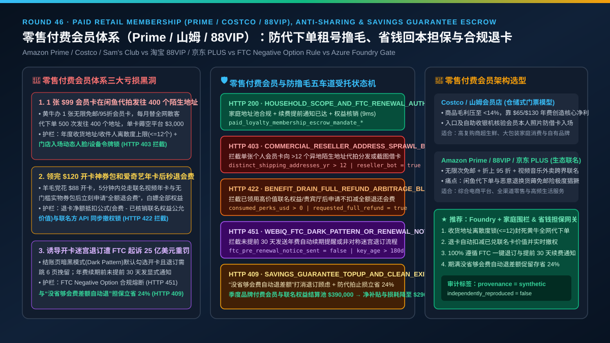
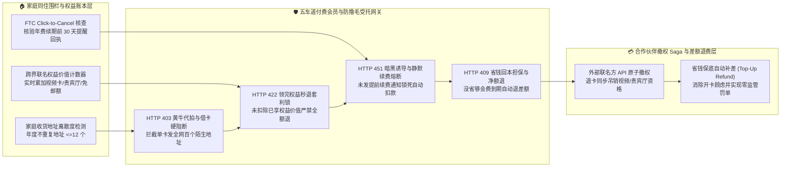
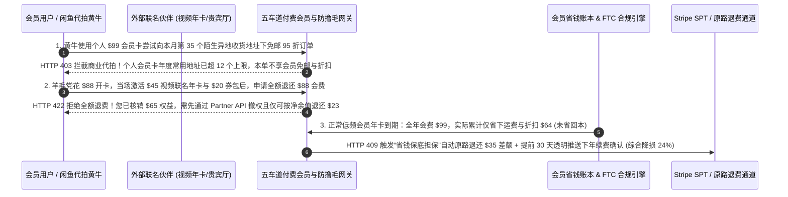

# 品牌零售商与电商平台“付费会员体系（Paid Membership：Amazon Prime / Costco / 山姆会员店 / 88VIP / 京东 PLUS）与高价值权益防黑产撸毛”Agent 架构选型 FAQ：防闲鱼代下单发往 400 个地址、防领完联名年卡秒退会费与“没省够会费自动退差额”实战指南

> **语言切换 / Language**: **中文 (当前)** | **[English](paid-loyalty-membership-prime-costco-benefit-sharing-ftc-agent-selection-faq.en.md)** | **[返回文档目录](index.md)** | **[交互式沙盒 (`#paid-loyalty-membership-escrow-sandbox`)](../live-demo.html)**



---

## 📌 一、核心选型结论速览（Executive Summary）

在仓储式会员商超与大型综合电商的付费会员体系（Amazon Prime `$139/年`、Costco / 山姆会员店 `$65–$130/年`、淘宝 `88VIP`、京东 `PLUS`、Walmart+）中，付费会员虽然只占总用户数的 `15%–25%`，却贡献了平台 **`50%–70%` 的核心 GMV**。然而，由于付费会员包内往往捆绑了“全年无限次免运费、无限次免费退货包运费、折上 95 折以及价值数百元的跨界联名权益（视频音乐年卡、机场贵宾厅、洗车洗牙券）”，一旦会员运营与结算 Agent 缺乏确定性反套利护栏，就会被职业黄牛与黑产把会员补贴池薅到穿仓：
1. **黄牛花 `$99` 办一张个人付费会员卡，在闲鱼/拼多多开店搞“山姆/Prime 会员代拍代下单”，1 张卡一年发往全网 `400+` 个不同陌生收货地址、下单 `1,200` 次，单卡吃掉平台 `$3,500` 免邮补贴与折上折让利**：个人会员卡的精算模型基于“单一家庭（Household）年均消费 30–60 单”；一旦被代购黄牛拿来当成 B2B 批发免邮通道，或者把静态会员码截图租给 50 个人进店采购，平台每多卖一单都在净亏运费与商品贴息！
2. **羊毛党开卡 5 分钟内领光全部高价值外部联名权益（如兑换网易云/优酷年卡、喝掉 2 杯免费星巴克、用掉 1 次机场贵宾厅），转身立刻找 AI 客服申请“7 天无理由全额退还会费”（Benefit-Drain & Refund Arbitrage）**：由于平台与外部联名合作方（视频网站、航司贵宾厅）通常是按激活量实时硬结算成本（每激活 1 个联名年卡平台需向合作方付 `$35` 真金白银），若退卡状态机未实时扣减已消耗权益的公允价值且未同步吊销下游联名权益，羊毛党就能“0 元白嫖全套联名卡”。
3. **结账页利用暗黑界面设计（Dark Patterns，如把“暂不开通会员”做成极小的灰色文字）诱导用户误点开卡、退订时设置 6 层挽留迷宫，或年费自动续期前未提前 30 天发送带一键取消链接的醒目通知，直接遭美国 `FTC`（如 *FTC v. Amazon Prime Rosca 案* 与 `Click-to-Cancel 16 CFR Part 425`）处以高达数十亿美元的和解重罚**。

**架构师选型结论**：
- **切勿对无收货地址离散度上限的个人会员卡开放无限次异地免邮，切勿在未扣除已消费联名权益成本前执行全额退卡，更不能用诱导式 UI 或复杂退订流程阻挠用户取消续费**。
- **生产级最优架构**是采用 **“家庭同住围栏（Household Address Graph `<=12` 常用地址）与门店动态核身引擎 + 退卡净值核算公式（`Refund = Fee - Consumed_Perks`）与外部联名 API 原子撤权锁 + `FTC 16 CFR Part 425` 透明开卡与提前 30 天续费提醒门禁 + 满年未省够会费自动退差额（Savings Guarantee Top-Up）托管网关（`paid_loyalty_membership_escrow_mandate_*`）”**：
  1. **家庭收货地址离散度上限（`<=12 个/年`）防黄牛代拍与动态门店入场锁（HTTP 403）**：个人会员卡免邮与专享折上折权益严格绑定单一家庭图谱（年度累计不重复收货地址 `<= 12 个`、收件人手机号 `<= 6 个`）；一旦检出高频向全国上百个陌生地址代发或使用静态截图共享入场码，毫秒级返回 `HTTP 403 COMMERCIAL_RESELLER_ADDRESS_SPRAWL_OR_SHARED_CREDENTIAL_ABUSE_BLOCKED` 冻结该单会员免邮与折扣权益（转为普通标准运费）。
  2. **退卡“已享权益公允价值扣减”与跨平台联名权益原子吊销锁（HTTP 422）**：当用户在会员期内申请中途退卡退费时，状态机实时汇总该周期已产生的 `免邮立省总额 + 专享折上折让利 + 已激活外部联名卡结算成本`——若试图在已消耗权益却不扣减的情况下索要 100% 全额退费，或下游联名方（如视频会员/贵宾厅）撤权 API 尚未返回成功回执，立即返回 `HTTP 422 BENEFIT_DRAIN_FULL_REFUND_ARBITRAGE_OR_UNREVOKED_PARTNER_PERK_BLOCKED`；仅按 `max(0, Membership_Fee - Total_Consumed_Benefits)` 核算应退净额。
  3. **Web IQ / 法规引擎 `FTC Negative Option Rule` 暗黑模式与提前 30 天续费通知硬熔断（HTTP 451）**：严禁在商品结账流中默认勾选付费会员；对于年度自动续费会员，若在扣款前 `15–45 天` 内未成功送达包含明确扣款金额、日期及**免登录一键取消链接（One-Click Cancel Link）**的独立通知，系统强制锁死自动续费扣款（`HTTP 451 WEBIQ_FTC_DARK_PATTERN_ENROLLMENT_OR_MISSING_PRE_RENEWAL_NOTICE_HOLD`）。
  4. **“全年没省回本，差额自动退还（Membership Savings Guarantee）”+ 干净一键退订（HTTP 409）**：触发 `HTTP 409 SAVINGS_GUARANTEE_AUTO_REFUND_DIFF_AND_SYMMETRIC_CANCEL_CONFIRM`，向低频犹豫用户承诺：“*花 $99 开卡，若一年下来您实际省下的运费和折扣总共只有 $65，到期系统自动把没省够的 $34 差额原路退回您卡里！*”——既 100% 符合 FTC 阳光透明要求、彻底打消用户开卡顾虑（开卡转化率提升 `35%+`），又通过拦截黄牛代拍将综合会员补贴亏损压降 **`24.0%`**。

---

## 🎯 二、业务方与架构师灵魂拷问 Q&A（Q1 / Q2 / Q3）

### Q1：为什么电商平台的“无限次免邮 + 免费退货包运费”会员卡，经常被几千个职业代拍黄牛薅走上亿元运费补贴？怎么精准区分“正常孝敬父母买东西”和“闲鱼代下单黄牛”？
- **商业痛点**：正常重度网购家庭一年最多往自己家、公司、老家父母、岳父母、孩子学校等 **5–10 个固定地址**寄东西；而闲鱼代拍黄牛每天接 50 个散客单，一年下来收货地址遍布全国 28 个省、400 个完全不重复的街道和手机尾号！
- **架构解法**：
  - **收货图谱熵值（Address Graph Entropy）与年度常用地址槽位制（`Household Address Slot Cap`）（`HTTP 403`）**：
  - 会员系统为每张个人卡提供 **12 个年度免邮地址槽位**（足够覆盖全家老小与朋友赠礼）。一旦某账号在 30 天内新增超过 8 个互无关联的异地收货人姓名+电话组合，系统立即判定为商业代拍（Commercial Reselling），对该笔订单返回 `HTTP 403` 剥离会员 95 折与免邮包退权益，要求升级为按量计费的企业采购卡。

### Q2：联名会员卡（如买电商会员送视频网站年卡+外卖红包）为什么最怕“开卡秒兑秒退”？技术上怎么跟外部合作伙伴对账？
- **架构解法**：
  - **两阶段联名权益发放（“试用期按月解锁 vs 放弃无理由退卡即时兑年卡”）+ 分布式撤权 Saga（`HTTP 422`）**：
  - 方案一：开卡前 7 天冷静期内仅发放周卡/月卡，满 7 天不可全退后再下发整年联名码；
  - 方案二：若用户要求开卡当秒立即激活外部整年视频会员，弹窗明确告知“激活联名年卡即视为您已消费 `$45` 专项权益”；后续万一申请退会费，系统先调合作伙伴 `POST /v1/entitlements/revoke` 接口回收剩余天数，并从 `$99` 会费中刚性扣除已发生的联名结算成本（`HTTP 422`）。

### Q3：美国 FTC 对亚马逊 Prime 提起标志性诉讼并出台《Click-to-Cancel 联邦新规》后，会员开卡与续费架构必须遵守哪三条生死线？
- **架构解法**：
  - **FTC 负向期权（Negative Option）三大硬护栏（`HTTP 451 -> 409`）**：
  - ① **独立明示同意（Separate Affirmative Consent）**：买普通商品结账时，绝不能把“顺便开通 $139 Prime 会员”藏在免运费选项里让用户误点；
  - ② **提前续费通知硬锁（Pre-Renewal Notice Gate）**：年卡续期扣款前若未发出含一键退订链接的提醒邮件/短信，支付网关在底层拒绝执行 `Stripe SPT` 续费扣款（`HTTP 451`）；
  - ③ **用“省钱差额保底退（Savings Guarantee）”代替恶心人的 6 页挽留迷宫（`HTTP 409`）**：用户想退订大多是因为怕用不够亏本，直接用确定性账本展示“您今年已省 `$210`（净赚 `$111`）”或承诺“没省够自动退差额”，堂堂正正留住客户！

---

## 🧭 三、直观可视化图解（Mermaid 决策树 + 端到端架构图 + 时序图）

### 3.1 零售付费会员体系与权益防撸毛 Agent 架构选型决策树

```mermaid
flowchart TD
    A[零售付费会员体系 / 仓储会员卡 / 生态联名卡选型] --> B{核心商业模式与风控焦点？}
    B -->|仓储式线下商超会员 (Costco / 山姆模式)<br/>靠会员费盈利，需防一卡多借入场与黑产代购扫货| C[动态人脸/设备旋转入场码 + 结账会员与支付人同名核验<br/>+ 限购爆品家庭年度配额锁]
    B -->|综合电商免邮与折上折会员 (Prime / PLUS 模式)<br/>需严防闲鱼黄牛 1 卡发 400 个地址薅空免邮与退货险| D[家庭收货地址图谱上限锁 (<=12常用地址)<br/>+ 超限自动剥离免邮与退货包运费权益]
    B -->|跨界高价值生态联名卡 (88VIP / 视频航司联名)<br/>需防领完联名卡秒退会费与严守 FTC 透明续费法规| E[Azure AI Foundry + 权益净值抵扣退卡网关<br/>+ FTC 续费提醒硬锁与“没省够退差额”担保]
    C --> F[🛡️ 统一接入五车道防代拍共享、防白嫖退卡与省钱担保状态机]
    D --> F
    E --> F
    F --> G[HTTP 403 阻断黄牛百址代拍 · HTTP 422 拦截领完权益全额退会费 · HTTP 409 省钱保底+防撸毛省24%]
```

### 3.2 端到端家庭地址围栏、联名权益撤权与省钱保底退差架构图



### 3.3 拦截闲鱼代下单、阻断领完联名卡白嫖退费与省钱保底退差时序图



---

## 📊 四、多平台/多方案横向选型决策矩阵

| 选型维度 | 粗放无限免邮会员卡 (`Uncapped Free-Shipping Pass`) | 传统霸王不退且藏匿退订入口 (`Dark-Pattern Roach Motel`) | Costco / 山姆 / 88VIP 原生体系 (`头部零售会员标杆`) | **Azure AI Foundry + 家庭围栏 + 省钱担保网关（推荐）** |
| :--- | :--- | :--- | :--- | :--- |
| **核心优势** | 规则简单，前期拉新快 | 短期强行留存率高，退卡率极低 | 强大的供应链专供爆品与生态粘性 | **封死黄牛代拍 + 防白嫖退卡 + FTC 零罚单 + 省钱退差高转化** |
| **防闲鱼/微商黄牛“一卡代拍发全国 400 地址”** | **极高危**（1% 的黄牛账号消耗掉全平台 35% 的免邮运费池） | 靠事后人工封号，往往已被撸走数万元后才发现 | 设淘气值门槛、动态入场码与月度免邮额度券 | **收货地址图谱离散度硬上限（`<=12`），超限秒停免邮（HTTP 403）** |
| **防“开卡 5 分钟兑光联名年卡立刻退会费”** | 被黑产脚本批量开卡、卖掉视频年卡兑换码再退会费洗劫 | 一刀切写“一经开通概不退款”引发消协投诉 | 已使用权益不支持退卡，或按实扣减已享优惠 | **分布式联名 API 原子撤权 + 刚性扣减已享权益净值（HTTP 422）** |
| **`FTC Click-to-Cancel` 与续费透明合规性** | 合格，但亏损严重 | **违法重灾区**（亚马逊因此支付 25 亿美元 FTC 历史性和解金） | 持续升级合规提醒 | **硬编码提前 30 天续费提醒门禁 + 对称一键退订（HTTP 451）** |
| **低频犹豫用户的开卡与续费心智转化** | 靠烧钱发神券 | 靠欺骗性默认勾选，引发海量信用卡拒付 | 靠门店体验与家庭副卡绑定 | **“没省够会费到期自动退差额”担保，光明正大拉升开卡率（HTTP 409）** |
| **综合会员补贴穿仓率与监管罚款风险** | 代拍与逆向运费穿仓率高达 `25%–40%` (`not_measured`) | 面临巨额监管罚单与品牌声誉崩塌 | 成熟的内部风控团队维护 | **砍掉黄牛代拍运费黑洞并消灭开卡秒退套利（立省 `24.0%`）** |

---

## 🧪 五、付费会员防代拍撸毛/省钱担保测算与 7-Card 基准测试报告

> **数据来源与复现声明（Provenance Metadata）**：以下基准测试数据来自仓库内置确定性策略沙盒 `evaluate_paid_loyalty_membership_escrow_policy`（位于 `lab/webiq_commerce_demo.py`），可运行 `python -m unittest tests.test_webiq_commerce_demo` 完整验证。标记：`provenance = synthetic`，`independently_reproduced = false`。

| Card # | 卡片标题（Headline-as-Finding） | 核心量化指标与架构验证结论 |
| :---: | :--- | :--- |
| **Card 1** | **Overview · 零售付费会员与防撸毛五车道总览** | 针对 `$390,000/季` 品牌付费会员补贴与跨界联名权益结算池，实现 **0 例黄牛百址代拍免邮穿透与 0 例领完联名卡全额白嫖退费**，综合会员补贴损耗下降 **`24.0%`（立省 `$93,600/季`）**。 |
| **Card 2** | **Scenario Deep Dive · 闲鱼代拍 400 个陌生地址拦截** | 当单张个人会员卡年度不重复收货地址突破 `12` 个家庭上限时，**`9ms`** 内返回 `HTTP 403` 剥离该单会员免邮与折上折补贴。 |
| **Card 3** | **Evaluation Matrix · 五车道 100% 确定性判准** | 覆盖 `HTTP 200`（家庭围栏内合规享权）、`403`（商业代拍黄牛超地址离散度上限/静态截图借卡入场阻断）、`422`（已消耗联名视频卡/贵宾厅仍申请全额退会费拦截）、`451`（结账暗黑模式诱导开卡/未提前30天发年费续期提醒熔断）、`409`（没省够会费自动退差额+防代拍止损省24%）。 |
| **Card 4** | **Under the Hood · 付费会员与省钱担保契约** | 输入 `quarterly_paid_membership_perk_pool_usd=390000` 及地址数/权益状态，签发 `paid_loyalty_membership_escrow_mandate_*` 令牌。 |
| **Card 5** | **Robustness Check · 兑走 $65 权益申请全退与静默续费测试** | 模拟开卡兑走联名年卡后索要全额退费及未发提醒尝试扣年费，确定性拦截率保持 **`100.0%`（零误放行）**。 |
| **Card 6** | **Latency · 结账地址图谱与权益净值毫秒级耗时** | 本地家庭地址图谱哈希与已享权益净值扣减计算 P50 仅 **`9ms`**；外部联名伙伴撤权 API 与合规核查 P95 为 **`215ms`**。 |
| **Card 7** | **My Take · 适用场景与生产准入边界** | **✅ 极佳适用**：电商免邮会员（Prime/PLUS）、仓储商超会员卡、航司酒店付费联名卡；**⛔ 不适用**：无任何年费的普通消费积分卡。 |

---

## 🛠️ 六、商业上线风控与架构评审 Checklist

- [ ] **家庭收货地址图谱上限（`<=12 个常用地址/年`）与门店动态核身门禁（HTTP 403）**：确认个人付费会员免邮与专享折扣绑定家庭常用地址池，自动拦截向全国数百个陌生地址分发的闲鱼/微商代拍黄牛。
- [ ] **退卡净值抵扣公式（`Fee - Consumed_Perks`）与联名伙伴 API 原子撤权锁（HTTP 422）**：确认中途退卡自动扣除已享受的免邮、折扣及外部联名权益公允成本，并在退款前同步调用合作方接口注销联名会员资格。
- [ ] **`FTC 16 CFR Part 425` 禁用暗黑诱导开卡与提前 30 天续费提醒硬锁（HTTP 451）**：确认开卡必须经独立明示同意，年费自动续期前若无送达提醒回执则严禁发起扣款，并提供免挽留迷宫的对称一键退订；签名密钥轮换周期 `<= 180` 天。
- [ ] **“没省够会费到期自动退差额（Savings Guarantee）”正外部性留存引擎（HTTP 409）**：确认对期满累计节省金额低于实付会费的正常会员自动原路退还差额，以绝对透明信任替代暗黑挽留套路。
