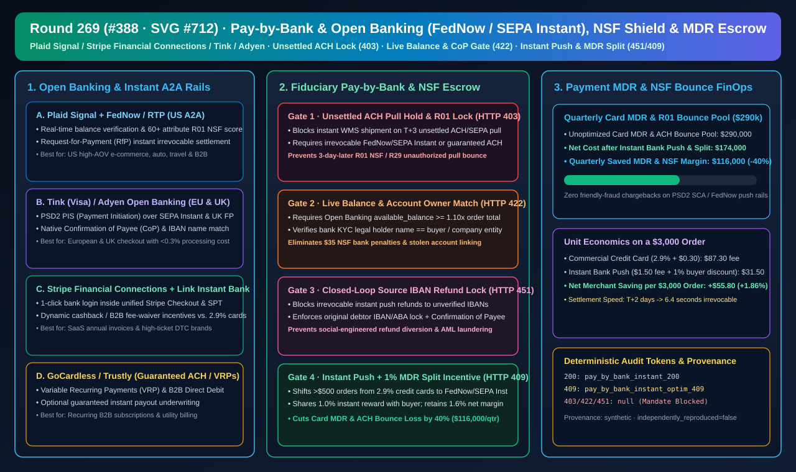
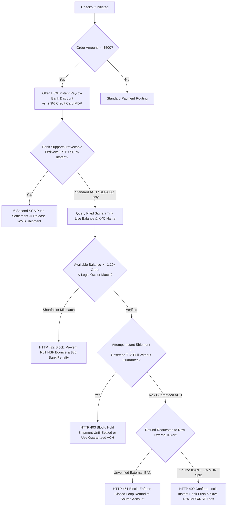

# E-Commerce & B2B Instant Bank-to-Bank (`Pay-by-Bank / Open Banking`: `FedNow & RTP vs. SEPA Instant vs. UK Faster Payments`), `ACH R01` Insufficient-Funds Bounce Shield (`Plaid Signal / Stripe Financial Connections / Tink`) & Credit-Card `2.9% MDR` Split-Incentive Escrow Agent Architecture Selection FAQ

> **Executive Summary**: For high-AOV retail (`>$500` electronics, furniture, luxury, OTA vacation packages) and B2B/SaaS invoice collection, traditional credit and commercial cards charge `2.4%–3.5%` interchange (`MDR`). Open Banking and instant Account-to-Account (`Pay-by-Bank / A2A`) rails slash processing fees to **`$0.25–$2.00` flat (or `0.2%–0.5%`)**. However, deploying bank payments without deterministic settlement and risk guardrails triggers three severe financial failures: (1) **Shipping High-Value Goods on Unsettled `T+3` Standard `ACH Pull / SEPA Direct Debit` -> `R01 / R29` Bounce 3 Days Later**: Fraudsters initiate a `$4,200` standard ACH pull from an account holding `$10`; the gateway returns `202 Pending`, the Agent releases the shipment immediately, and 3 business days later the bank returns `R01 Insufficient Funds` after the goods are gone; (2) **Initiating Bank Pulls Without Real-Time Available Balance (`>= 1.10x Order`) & `KYC` Account-Holder Name Verification**: Triggering `8%–12%` NSF return rates and `$15–$35` bank return penalties; and (3) **Sending Irrevocable `FedNow / RTP / SEPA Instant` Push Refunds to Unverified External `IBAN / Routing+Account` Numbers**: Because instant push rails settle irrevocably in `<10 seconds` with zero recall rights, refunding to a social-engineered replacement bank account permanently loses the funds.  
> Production architectures must enforce an **Unsettled `ACH Pull` Shipment Hold + Open Banking Live Balance (`>=1.10x`) & KYC Owner Match Gate + Closed-Loop Source-IBAN Refund Lock + `1.0%` Buyer Cashback Split over `2.9%` Card `MDR` Control Plane**: combining **`Plaid Signal + FedNow/RTP`**, **`Tink (Visa) / Adyen Open Banking`**, **`Stripe Financial Connections`**, or **`GoCardless / Trustly`** eliminates `R01` bounce fraud and cuts high-AOV payment processing and return losses by **40%** (reducing a `$290,000` quarterly card MDR and ACH bounce pool to `$174,000`, saving **`$116,000/quarter`**).

---

## 1. Architect & Head of Payments Deep-Dive Q&A

### Q1: Why do merchants get burned by standard `ACH Pull` and `SEPA Direct Debit`, and how do `FedNow / RTP / SEPA Instant` solve it?
- **Pull Debit (`T+3` Revocable) vs. Instant Push Credit (`6-Second` Irrevocable)**:
  - Standard `ACH Pull` and `SEPA Direct Debit` are asynchronous pull rails where the merchant has no guarantee of funds until `T+2 to T+4` days, and consumers hold `60-day (NACHA)` or `8-week (SEPA DD)` no-questions-asked dispute rights;
  - Instant push rails (`FedNow`, `TCH RTP`, `SEPA Instant`, `UK Faster Payments`) authenticate the payer inside their banking app (`SCA`) and push irrevocable good funds in `6–10 seconds`.
- **Architectural Solution (WMS Shipment Hold on Unsettled Pulls `HTTP 403` + Live Balance Gate `HTTP 422`)**:
  - Block immediate warehouse fulfillment on unguaranteed, unsettled `ACH / SEPA DD` pulls (`HTTP 403 UNSETTLED_ACH_PULL_SHIPMENT_OR_R01_NSF_BOUNCE_EXPOSURE`);
  - Before initiating any pull debit, verify via `Plaid Signal / Balance` or `Tink` that `available_balance >= 1.10 * order_total` and that the bank's legal account holder matches the buyer entity (`HTTP 422 OPEN_BANKING_LIVE_BALANCE_SHORTFALL_OR_OWNER_MISMATCH`).

### Q2: How do we prevent instant-rail refund fraud and incentivize buyers to switch away from 2.9% rewards credit cards?
- **Architectural Solution (Closed-Loop Source IBAN Lock `HTTP 451` + `1.0%` MDR Split Incentive `HTTP 409`)**:
  - Lock all instant refunds strictly to the original `debtor_iban / routing_account_hash` verified at capture (`HTTP 451 IRREVOCABLE_INSTANT_PUSH_REFUND_TO_UNVERIFIED_EXTERNAL_IBAN`);
  - On orders `>=$500`, automatically offer a `1.0%` instant Pay-by-Bank discount (`$30` off a `$3,000` order), saving the merchant `$55.80` net (`1.86%` of GMV) per order compared to a `2.9%` credit card (`HTTP 409 INSTANT_BANK_PUSH_ROUTING_AND_MDR_SPLIT_INCENTIVE_CONFIRM`).

---

## 2. Visual Architecture Diagrams (Mermaid)

### 1. Pay-by-Bank Routing, NSF Prevention & Refund Lock Decision Tree

---

## 3. Platform Selection Matrix (`Plaid Signal vs. Tink / Adyen vs. Stripe FC vs. Trustly / GoCardless`)

| Dimension | Plaid (Signal + Transfer / FedNow) | Tink (Visa) + Adyen Open Banking | Stripe Financial Connections + Link | Trustly / GoCardless (Guaranteed A2A) |
| :--- | :--- | :--- | :--- | :--- |
| **Primary Geography & Rails** | US & Canada (`FedNow / RTP / Same-Day ACH`), 12,000+ banks | EU 18 countries & UK (`SEPA Instant / PSD2 PIS / UK FP`) | Unified US & EU checkout with Stripe Billing & SPT | North America & Europe guaranteed instant ACH & `VRP` |
| **`R01 NSF` Bounce Protection** | **Plaid Signal** ML risk score over 60+ balance/velocity features | Native push-only `PSD2 PIS` eliminates NSF bounces | Real-time balance check with card fallback | Full **Guaranteed Payout** underwriting assumes NSF risk |
| **Processing Fee vs. `2.9%` Card** | `$0.25–$1.50` flat or `0.4%–0.8%` (capped at `$5`) | `€0.15–€0.50` flat per PIS transaction | `0.8%` capped at `$5.00` per transaction | `0.5%–1.0%` standard; `1.2%–1.5%` guaranteed instant |
| **Best Fit** | High-AOV US retail, automotive, OTA & B2B invoicing | Pan-European e-commerce & UK instant checkout | SaaS annual contracts & Stripe-native DTC brands | Recurring B2B billing & instant-ship ACH merchants |

---

## 4. Production Deployment & Risk Checklist

- [ ] **Decouple Asynchronous `ACH Pull` from Instant Fulfillment**: Never ship high-value physical goods on an unsettled, unguaranteed `ACH Pull` (`202 Pending`); require `FedNow / RTP / SEPA Instant` finality or guaranteed ACH underwriting.
- [ ] **Enforce `>=1.10x` Live Balance Cushion & KYC Name Match**: Verify real-time available balance and legal account holder identity before initiating any bank debit.
- [ ] **Closed-Loop Source-IBAN Refund Lock**: Hard-bind refunds to the original `debtor_iban / routing_account_hash` and block manual IBAN overrides on irrevocable push rails.
- [ ] **Dynamic `1.0%` MDR Split Incentive**: Automatically present a `0.8%–1.0%` instant bank discount on carts `>=$500` to steer volume away from `2.9%` commercial and rewards cards.
