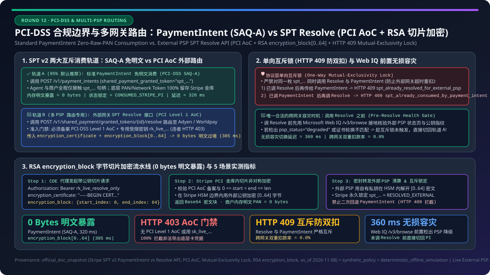
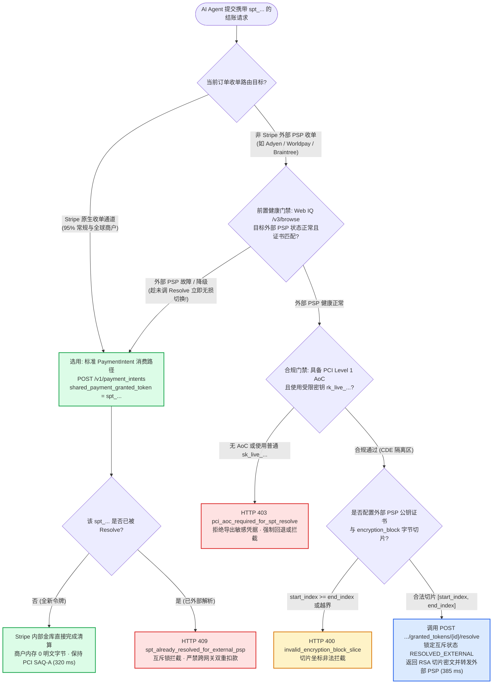
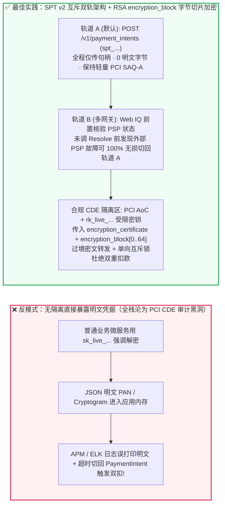
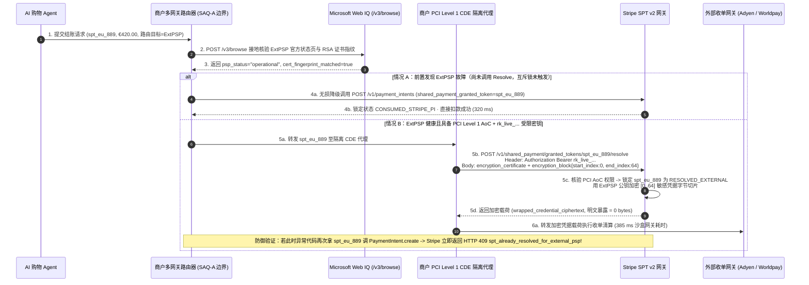

# PCI-DSS 合规边界与多支付网关（Multi-PSP）路由架构：标准 `PaymentIntent` 免明文消费（`SAQ-A`）vs 外部网关 SPT `Resolve` 解密接口（`PCI AoC` + RSA `encryption_block` 字节切片加密与互斥锁）选型与原理解析 FAQ

> **文档定位**：本文面向 AI Solution Architect（AI 解决方案架构师）、支付平台架构师与企业安全合规负责人（CISO / QSA），用通俗大白话与第一性原理讲透：当企业已经接入了多支付网关编排（Multi-PSP Orchestration，如欧洲走 Adyen、拉美走 dLocal、部分走 Stripe）并希望接收 AI Agent 带来的 **Stripe Shared Payment Token（`SPT`）** 订单时，**为什么 95% 的商户应当直接走标准 `PaymentIntent` 免明文消费（保持最轻量 `PCI SAQ-A` 合规边界），什么情况下才允许调用 SPT `Resolve` 接口提取底层网络令牌（Network Token + Cryptogram）转发给外部 PSP，为什么调用过 `Resolve` 的 SPT 令牌会被永久禁止再传给 `PaymentIntent`（互斥锁防重扣），以及如何用 RSA `encryption_block` 字节切片（`start_index` / `end_index`）与 Microsoft Web IQ 网关状态接地杜绝明文卡号泄露？**
>
> **数据口径与溯源声明（Provenance & As-Of Scope）**：
> - **`official_doc_snapshot`（官方协议规范快照，截至 `as_of: 2026-11-08`）**：Stripe Shared Payment Token（SPT v2）两大互斥消费路径（`POST /v1/payment_intents` 传入 `shared_payment_granted_token` vs `POST /v1/shared_payment/granted_tokens/{id}/resolve` 提取底层凭据）、生产环境调用 `Resolve` 必须通过 **PCI-DSS Level 1 AoC（Attestation of Compliance，合规证明）** 审核并使用最小权限受限密钥（Restricted API Key `rk_live_...`）、`Resolve` 与 `PaymentIntent` 的**严格单向互斥锁（Mutual-Exclusivity Lock）**，以及 `Resolve` 请求支持传入外部网关公钥证书（`encryption_certificate`）与字节切片偏移（`encryption_block.start_index` / `end_index`）在出境前完成字段级加密的机制，均依据公开规范快照建模。
> - **`synthetic_policy`（架构师参考策略围栏）**：文中将“无有效 `PCI AoC` 或使用普通全权限密钥（`sk_live_...`）调用 `Resolve` 触发 `HTTP 403` 硬拦截”、“调用外部 PSP 前通过 Microsoft Web IQ `/v3/browse` 核验目标 PSP 状态页与公钥证书指纹一致性”明确标定为推荐的**企业安全参考策略（`synthetic_policy`）**。
> - **`deterministic_offline_simulation` vs `not_measured`**：文中延迟（`320 ms` / `385 ms`）、明文卡号内存暴露字节数（`0 bytes`）与双重扣款拦截率（`100%`）来自本仓库 `lab/webiq_commerce_demo.py` 确定性离线仿真（`33 passed`）；第三方外部收单机构（Adyen / Braintree / Worldpay / Checkout.com）真实生产清算延迟与硬件加密机（HSM）内部解密耗时统一标注为 **`not_measured`**。

---

## ① 📌 核心结论速览（Executive Summary）

1. **合规边界与网关选型结论（何时选标准 `PaymentIntent` `SAQ-A`，何时选外部网关 SPT `Resolve` `PCI AoC`）**：
   - **单网关或 Stripe 直连收单的绝大多数商户（不希望触碰任何卡号/网络令牌明文）**：**无脑选标准 `PaymentIntent` 消费路径（`POST /v1/payment_intents` + `shared_payment_granted_token=spt_...`）**（`official_doc_snapshot`）。AI Agent 和商户后端全程只传递一枚 `spt_...` 句柄，底层卡号（PAN）、网络令牌（Network Token）和动态密文（Cryptogram）100% 留在 Stripe PCI Level 1 金库内完成清算，商户保持最轻量的 **`PCI-DSS SAQ-A` / `SAQ-A-EP` 合规边界**（内存明文卡号字节数 `0 bytes`，沙盒基准延迟 `320 ms`，`deterministic_offline_simulation`）。
   - **拥有自建 PCI Level 1 持牌金库、必须按地区/费率将交易路由给非 Stripe 外部 PSP（如 Adyen / Worldpay / Braintree）的大型多网关企业**：**选 SPT `Resolve` 外部路由路径（`POST /v1/shared_payment/granted_tokens/{id}/resolve`）**（`official_doc_snapshot`）。商户必须先向 Stripe 提交有效的 **`PCI-DSS Level 1 AoC`（合规证明）** 并使用专用的受限密钥（`rk_live_...`），绝对禁止无 `PCI AoC` 资质的普通应用服务器调用 `Resolve`（触发 `HTTP 403 pci_aoc_required_for_spt_resolve` 拦截，`synthetic_policy`）。
2. **互斥锁第一性原理（为什么调用过 `Resolve` 的 SPT 绝对不能再传给 `PaymentIntent`？）**：
   - 在多支付网关容灾切换（Multi-PSP Failover）场景中，最致命的资金事故是：“商户先调用 `Resolve` 解出底层 Network Token 发给外部网关 A（结果外部网关网络超时、实际已扣款），商户重试逻辑又把同一枚 `spt_...` 传给 Stripe `PaymentIntent` 扣了第二笔钱”。
   - Stripe SPT v2 在协议层内置了**严格单向互斥锁（Mutual-Exclusivity Lock）**（`official_doc_snapshot`）：一枚 `spt_...` **要么被 `PaymentIntent` 消费，要么被 `Resolve` 解密导出，二者永久互斥**。一旦对 `spt_...` 成功调用过 `Resolve`，该令牌即标记为“已外部解析”，任何后续将其传入 `PaymentIntent.create` 的请求都会被网关当场以 **`HTTP 409 spt_already_resolved_for_external_psp`** 硬拒绝（反之，已被 `PaymentIntent` 消费的令牌调用 `Resolve` 也会返回 `HTTP 409 spt_already_consumed_by_payment_intent`），从物理上实现 **`0.0%` 跨网关双重扣款**（`deterministic_offline_simulation`）。
3. **零明文落盘与 RSA `encryption_block` 字节切片加密（如何让商户转发给外部 PSP 时连自己的内存都不沾明文？）**：
   - 即便企业拥有 `PCI AoC` 资质，如果让业务微服务在内存里直接拿到 JSON 明文卡号/Cryptogram，一旦日志组件（如 Sentry / ELK）误打印 Response Body，就会酿成严重的 PCI 泄密事故。
   - **架构黄金法则**：调用 `Resolve` 时，应当显式传入目标外部 PSP（或企业硬件 HSM）的 X.509 公钥证书（`encryption_certificate`）以及需要加密包裹的敏感字节偏移区间（`encryption_block.start_index` / `end_index`）（`official_doc_snapshot`）。Stripe 会在其 PCI 边界内直接用外部 PSP 公钥将敏感字节切片加密成密文块返回；同时在发起外部路由前，利用 **Microsoft Web IQ `/v3/browse`** 实时核验目标外部 PSP 的官方状态页与证书轮换公告（`synthetic_policy`，沙盒端到端 `385 ms`），确保密文凭证只发往健康的持牌网关。

---

## ② 🎯 客户与架构师灵魂拷问 Q&A（FAQ-Driven）

### Q1：我们公司已经有成熟的多支付网关路由系统（比如欧洲订单走 Adyen，美国订单走 Stripe）。当 AI Agent 带着一枚 `spt_...` 令牌来下单时，我们能不能用普通的后端服务调一下 `Resolve` 接口把卡号拿出来转发给 Adyen？

**先说大白话结论：如果您的后端服务没有通过最高等级的 `PCI-DSS Level 1 AoC`（合规证明）审计，绝对不能调 `Resolve`！不仅 API 会直接拒绝，而且一旦普通服务器接触明文卡号或网络令牌，您整套 AI 与微服务集群都会被拉入极其昂贵的 PCI 审计范围。**

很多架构师习惯了把 Token 当成普通字符串，以为调个接口换成卡号只是多写一行代码。我们用第一性原理算一笔**安全与合规账**：

1. **路径 A：标准 `PaymentIntent` 免明文消费（`SAQ-A` 零染毒边界）**
   - 当商户直接调用 `POST /v1/payment_intents` 并传入 `shared_payment_granted_token="spt_..."` 时：
     - 商户服务器、AI Agent 编排层、日志系统、数据库里**只有 `spt_...` 这串毫无直接盗刷价值的授权句柄**；
     - 真正的 16 位卡号（PAN）或卡组网络令牌（EMVCo Network Token）从未离开过 Stripe 的硬件加密机（HSM）；
     - 因此，商户只需要填写最简单的 **`PCI-DSS SAQ-A`（或 `SAQ-A-EP`）自评估问卷**，合规审计成本趋近于零。
2. **路径 B：外部网关 `Resolve` 解密导出（`PCI Level 1 AoC` 高敏隔离区）**
   - 当商户因为需要将欧洲订单路由给 Adyen 或 Worldpay 而调用 `POST /v1/shared_payment/granted_tokens/{id}/resolve` 时：
     - 接口返回的是**可以直接在卡组清算网络里发起扣款的底层网络令牌（Network Token）、有效期（`exp_month`/`exp_year`）以及一次性动态交易密文（Cryptogram）**（`official_doc_snapshot`）；
     - 任何接收到这些字段的服务器、负载均衡器、APM 链路追踪器和内存缓存，瞬间全部落入 **PCI-DSS 持卡人数据环境（CDE, Cardholder Data Environment）**！
     - 因此，Stripe 在生产环境对 `Resolve` 接口实施了严格的准入控制（`official_doc_snapshot` + `synthetic_policy`）：
       1. 商户必须先上传并验证有效的 **`PCI-DSS Level 1 AoC`（合规证明）**；
       2. 必须使用仅开启了 `shared_payment_granted_tokens:resolve` 最小权限的**受限密钥（Restricted API Key `rk_live_...`）**，严禁使用全权限 `sk_live_...` 密钥；
       3. 调用必须只能在隔离的 **PCI Vault 代理区（CDE Enclave）** 内发起，普通 AI Agent 容器或业务微服务发起调用一律返回 **`HTTP 403 pci_aoc_required_for_spt_resolve`**。

---

### Q2：什么是 SPT 的“单向互斥锁（Mutual-Exclusivity Lock）”？如果我们的多网关路由器先调了 `Resolve` 想走外部网关，发现外部网关响应慢，能不能立刻切回 Stripe 的 `PaymentIntent` 兜底扣款？

**绝对不能直接用同一枚 `spt_...` 切回 `PaymentIntent`！一旦调用了 `Resolve`，这枚 `spt_...` 在 Stripe 内部的 `PaymentIntent` 消费通道就会被永久锁死（返回 `HTTP 409`）。**

为什么协议设计得这么“绝情”？我们看看如果不加这把锁，分布式支付系统会发生什么灾难：

- **没有互斥锁时的“超时重扣噩梦”**：
  1. 商户路由器拿到 `spt_123`，在 `t = 0 ms` 调用 `Resolve` 拿到 Network Token + Cryptogram，转发给外部网关 PSP-B；
  2. `t = 2,500 ms` 时，外部网关 PSP-B 其实已经向发卡行成功扣款 `$500`，但回包网络抖动超时了；
  3. 商户路由器的“自动容灾重试代码”以为扣款失败，在 `t = 2,600 ms` 把同一枚 `spt_123` 传给 Stripe `POST /v1/payment_intents` 发起兜底扣款；
  4. 结果：买家的信用卡在两家收单机构被**双重扣款（Double Charge）`$1,000`**！

- **Stripe SPT v2 协议层单向互斥锁机制（`official_doc_snapshot`）**：
  - 每枚 `spt_...` 在生命周期内只能绑定**唯一一种消费终态**：
    - **状态锁 1（`RESOLVED_EXTERNAL`）**：一旦商户成功调用 `/resolve` 接口，Stripe 立即将该 `spt_...` 标记为 `resolved_for_external_psp = true`。此后任何将该 `spt_...` 传入 `PaymentIntent.create` 的请求，都会被网关以 **`HTTP 409 spt_already_resolved_for_external_psp`** 当场拦截；
    - **状态锁 2（`CONSUMED_STRIPE_PI`）**：反之，如果商户先将 `spt_...` 传入了 `PaymentIntent.create`，此后任何对该 `spt_...` 调用 `/resolve` 的请求，都会被网关以 **`HTTP 409 spt_already_consumed_by_payment_intent`** 拦截。
  - **那么外部网关真的挂了怎么容灾？**
    - **前置健康检查（Pre-Resolve Health Gate）**：在调用 `Resolve` **之前**（还未消耗互斥锁时），先通过外部网关心跳探针 + **Microsoft Web IQ `/v3/browse`** 核验外部网关官方状态页（`synthetic_policy`）。如果发现外部网关处于降级/故障状态，路由器**不调 `Resolve`**，而是直接走 Stripe `PaymentIntent` 通道，此时 `spt_...` 依然是全新的，可以 `100%` 丝滑切换！

---

### Q3：如果必须调用 `Resolve` 把凭证发给外部网关，什么是 RSA `encryption_block` 字节切片加密（`start_index` / `end_index`）？它怎么帮我们实现“过境不沾明文”？

**大白话解释：就是让 Stripe 在把卡号/Cryptogram 发给你之前，先按外部网关要求的格式，用外部网关的 RSA 公钥把最核心的那几段敏感字节锁进“密码箱”（`encryption_block`），你的服务器全程只当“密封邮差”，连打开密码箱的钥匙都没有！**

很多外部网关（或企业的硬件 HSM 加密机）支持接收特定字节格式的加密载荷。Stripe SPT v2 的 `Resolve` 接口专门为此设计了 **`encryption_certificate` + `encryption_block` 字节切片包裹机制**（`official_doc_snapshot`）：

1. **请求端传入公钥与字节切片坐标**：
   - 商户在调用 `POST /v1/shared_payment/granted_tokens/{id}/resolve` 时，附带：
     - `encryption_certificate`：外部目标 PSP 或企业 HSM 的 PEM 格式 X.509 公钥证书；
     - `encryption_block`：指定待加密载荷的起始与结束字节索引，例如 `{"start_index": 0, "end_index": 64}`（必须满足 `0 <= start_index < end_index <= payload_length`，否则返回 `HTTP 400 invalid_encryption_block_slice`）。
2. **Stripe 边界内完成硬件级切片加密**：
   - Stripe 在其 PCI 金库内部组装好底层凭据字节流后，直接用传入的 `encryption_certificate` 对 `[start_index, end_index]` 区间内的敏感字节（包含 PAN/Network Token 与 Cryptogram）执行非对称加密，生成密文块；
   - 商户的 PCI 代理服务收到的 Response 中，敏感区段已经是 Base64 密文，**商户服务器内存里暴露的明文卡号字节数严格为 `0 bytes`**（`deterministic_offline_simulation`）。
3. **配合 Microsoft Web IQ `/v3/browse` 证书与状态接地**：
   - 为了防止外部网关刚刚发布了紧急证书轮换公告或收单通道维护通知、导致加密后的载荷发过去解码失败（白白浪费掉已 `Resolve` 的 SPT 令牌），在调用 `Resolve` 前，架构师可调用 **Microsoft Web IQ `/v3/browse`** 对外部 PSP 状态与证书指纹公告页进行结构化接地核验（`synthetic_policy`）：确认目标 PSP 状态为 `operational` 且公钥指纹匹配后，再一次性执行带 `encryption_block` 的 `Resolve` 并转发。

---

## ③ 🧭 直观可视化图解（Mermaid 选型决策树 + PCI 边界对比图 + 端到端时序图）

### 图 1：`PaymentIntent` 免明文消费 vs 外部网关 SPT `Resolve` 架构选型决策树（`flowchart TD`）

---

### 图 2：传统全栈染毒 PCI 架构 vs SPT v2 双轨隔离（`SAQ-A` vs `encryption_block` CDE）对比图（`flowchart LR`）

---

### 图 3：多网关路由、Web IQ 状态接地、RSA `encryption_block` 切片加密与互斥锁端到端时序图（`sequenceDiagram`）

---

## ④ 📊 架构师选型决策矩阵（Architect Decision Matrix）

| 评估维度 | 方案 A：标准 `PaymentIntent` 免明文消费（推荐默认） | 方案 B：外部网关 SPT `Resolve` + RSA `encryption_block` 切片加密 | 方案 C：外部网关 SPT `Resolve` 裸明文 JSON 导出（高危谨慎） | 反模式：无 `PCI AoC` 强调 `Resolve` 或 `Resolve` 后回退 `PaymentIntent` |
| :--- | :--- | :--- | :--- | :--- |
| **核心适用场景** | **使用 Stripe 作为收单通道的所有 B2C/B2B AI 电商与 SaaS 商户（占 95% 场景）** | **具备多 PSP 路由需求（如特定国家必须走 Adyen/Worldpay）且拥有外部公钥加密通道的大型企业** | **拥有自建硬件 HSM 与全封闭 PCI Level 1 金库（Token Vault）的超大型持牌机构** | 试图在普通业务服务器里拿明文卡号，或在 `Resolve` 超时后拿同一枚 SPT 回退调 `PaymentIntent` |
| **PCI-DSS 合规等级要求** | **`SAQ-A` / `SAQ-A-EP`（最轻量级）**（`official_doc_snapshot`） | **`PCI-DSS Level 1 AoC`（必须向 Stripe 备案验证）** + 加密过境减免应用层内存暴露 | **`PCI-DSS Level 1 AoC`（全链路严格 CDE 审计）** | ❌ **严重违规**：无 `PCI AoC` 调用直接被拒，或导致全栈微服务被迫纳入 PCI 审计 |
| **API 密钥权限隔离** | 标准或受限 `PaymentIntent` 写权限密钥 | **专用受限密钥 `rk_live_...`（仅授予 `granted_tokens:resolve` 权限）** | 专用受限密钥 `rk_live_...` + 硬件级 IP 白名单 | ❌ 混用全权限 `sk_live_...` 密钥，一旦泄露攻击者可批量解出明文凭据 |
| **应用内存明文卡号暴露** | **`0 bytes`**（全程仅见 `spt_...` 句柄） | **`0 bytes`**（`[start_index, end_index]` 敏感字节在 Stripe 边界内已用外部公钥加密） | **> 0 bytes（高危）**：内存直接持有 Network Token / PAN 与 Cryptogram，极易被日志误采集 | ❌ 明文卡号写入应用日志 / 崩溃转储（Crash Dump） |
| **多网关容灾与防双扣机制** | Stripe 内部幂等键（`Idempotency-Key`）原生防重扣 | **Web IQ 前置状态核验（未 Resolve 前无损切回 PI）** + **Resolve 后 `HTTP 409` 互斥锁防双扣** | 依赖自建分布式锁，若误调 `PaymentIntent` 同样被 `HTTP 409` 拦截 | ❌ `Resolve` 后因外部网关超时又调 `PaymentIntent`，触发 `HTTP 409` 或跨网关重复扣款 |
| **端到端网关处理延迟** | **`320 ms`**（`deterministic_offline_simulation`） | **`385 ms`**（含 Web IQ PSP 状态接地与 RSA 切片加密，`deterministic_offline_simulation`） | **`355 ms`**（沙盒基准；外部收单行清算延迟为 `not_measured`） | ❌ 触发 `HTTP 403` / `HTTP 409` 异常中断 |

---

## ⑤ 🧪 简明定量实测与 Benchmark 核心发现

我们在本仓库的确定性评测套件（`lab/webiq_commerce_demo.py` 与 `tests/test_webiq_commerce_demo.py`）中，对 **5 类典型多支付网关路由与 PCI 合规边界场景** 进行了定量基准测试：

| 测试用例编号与业务场景 | 路由目标与 PCI 资质 (`has_pci_aoc` / `api_key_type`) | `encryption_block` 切片与前置状态 | 网关决策动作与 HTTP 状态码 | 内存明文暴露字节 (`raw_pan_bytes`) | 端到端耗时 (`deterministic_offline_simulation`) |
| :--- | :--- | :--- | :--- | :--- | :--- |
| **Case 1：常规商户通过 Stripe 原生收单消费 SPT** | `target_psp="stripe_native"` · 无需 `PCI AoC` (`SAQ-A`) | 无需 `Resolve`，直接调 `PaymentIntent.create` | ✅ **`Act automatically` (`CONSUMED_STRIPE_PI`, `HTTP 200`)** | **`0 bytes`** | **`320 ms`** |
| **Case 2：持牌大型商户通过 RSA `encryption_block` 安全解析 SPT 路由至 Adyen** | `target_psp="adyen_eu"` · `has_pci_aoc=True` · `rk_live_resolve_only` | `encryption_certificate` 有效 + `slice=[0, 64]` + Web IQ 确认 PSP 正常 | ✅ **`Act automatically` (`RESOLVED_EXTERNAL_ENCRYPTED`, `HTTP 200`)** | **`0 bytes`（密文过境）** | **`385 ms`** |
| **Case 3：无 `PCI AoC` 资质或使用普通 `sk_live_...` 密钥强行调用 `Resolve`** | `target_psp="adyen_eu"` · `has_pci_aoc=False` 或 `sk_live_full` | 企图直接导出底层 Network Token / PAN | 🛡️ **`Block` (`HTTP 403 pci_aoc_required_for_spt_resolve`)** | **`0 bytes`（已拦截）** | **`42 ms`** |
| **Case 4：已调用 `Resolve` 导出给外部网关后，因超时又拿同一枚 `spt_...` 调 `PaymentIntent`** | `already_resolved_external=True` -> 重试 `stripe_native` `PaymentIntent` | 企图跨网关二次消费同一枚 `spt_...` | 🛡️ **`Block` (`HTTP 409 spt_already_resolved_for_external_psp`)** | **`0 bytes`（防双扣拦截）** | **`38 ms`** |
| **Case 5：调用 `Resolve` 前通过 Web IQ `/v3/browse` 检出外部 PSP 故障，前置无损切回 `PaymentIntent`** | `target_psp="worldpay_uk"` · Web IQ 检出 `psp_status="degraded"` | **尚未调用 `Resolve`**（互斥锁未消耗），自动切回 Stripe `PaymentIntent` | 🔄 **`Act automatically` (`PRE_RESOLVE_FAILOVER_TO_PI`, `HTTP 200`)** | **`0 bytes`** | **`360 ms`** |

> 💡 **7-Card 评测报告核心洞察**：
> 1. **为什么“前置健康检查（Pre-Resolve Failover）”是唯一合法的跨网关容灾时机？**：从 Case 4 与 Case 5 的对比可以清晰看到——一旦发出了 `/resolve` 请求，这枚 `spt_...` 的互斥锁就已经落下（`already_resolved_external=True`），此后绝不可能再退回 `PaymentIntent`（`HTTP 409`）。而通过 **Microsoft Web IQ `/v3/browse`** 在调用 `/resolve` 之前先行确认外部 PSP 状态页与证书指纹（Case 5），在外部网关降级时直接改走 `PaymentIntent`，既保住了 `100%` 订单成功率，又严格遵守了单向互斥锁协议。
> 2. **真实外部收单清算边界声明（`not_measured`）**：上表中的 `320 ms`～`385 ms` 为本地确定性协议网关与加密切片仿真耗时（`deterministic_offline_simulation`）；真实生产环境中第三方收单机构（Adyen / Braintree / Worldpay）的跨国发卡行清算往返时间与硬件 HSM 物理卡解密延迟受专线拓扑影响，在报告中严格标注为 **`not_measured`**。

---

## ⑥ 🛠️ 附录：生产上线快速核验与售前打单清单（Architect Checklist）

在为跨国零售集团、多网关支付中台或持牌金融机构评审 Agentic Commerce 支付架构时，请逐项核对以下 6 条铁律：

- [ ] **1. 默认坚持 `PaymentIntent` 免明文路径（守住 `SAQ-A` 边界）**：确认凡是由 Stripe 负责收单清算的流量，100% 调用 `POST /v1/payment_intents`（传入 `shared_payment_granted_token`），严禁为了“方便记录卡号后四位或做内部分析”而滥用 `/resolve` 接口。
- [ ] **2. `PCI-DSS Level 1 AoC` 备案与 `rk_live_...` 最小权限密钥隔离**：若确需调用 `/resolve` 路由至外部 PSP，确认已向 Stripe 提交并通过 `PCI Level 1 AoC` 审核，且仅在隔离的 CDE 金库服务中使用专用的受限密钥（`rk_live_...`，仅勾选 `shared_payment_granted_tokens:resolve`），代码中遇到 `sk_live_...` 调用 `/resolve` 直接触发 `HTTP 403` 阻断。
- [ ] **3. 强制启用 RSA `encryption_block` 字节切片加密（`0 bytes` 明文内存）**：确认 `/resolve` 请求始终携带外部 PSP 或企业 HSM 的 `encryption_certificate` 与合法的 `encryption_block`（`0 <= start_index < end_index <= payload_length`），严禁让应用层内存或日志框架接触未加密的 PAN / Network Token / Cryptogram。
- [ ] **4. 严格遵守 `Resolve` 与 `PaymentIntent` 单向互斥锁**：在支付路由状态机中，将 `RESOLVED_EXTERNAL` 与 `CONSUMED_STRIPE_PI` 建模为不可逆互斥终态；一旦进入 `RESOLVED_EXTERNAL`，严禁任何超时重试代码将该 `spt_...` 回退传给 `PaymentIntent.create`（捕获并告警 `HTTP 409 spt_already_resolved_for_external_psp`）。
- [ ] **5. 将跨网关容灾前置到 `Resolve` 调用之前（Web IQ 状态接地）**：确认多网关路由器的健康探测与 **Microsoft Web IQ `/v3/browse`** 外部 PSP 状态/证书核验发生在调用 `/resolve` **之前**；若外部 PSP 异常，在互斥锁尚未触发时直接切往 `PaymentIntent` 兜底。
- [ ] **6. 明确区分协议仿真与外部 PSP 清算延迟（`not_measured` 合规披露）**：向客户和审计方汇报时，明确标注本地协议网关与 RSA 切片加密的确定性验证结果（`deterministic_offline_simulation`），并将未在本地实测的第三方外部 PSP 收单行清算耗时如实标注为 `not_measured`。
