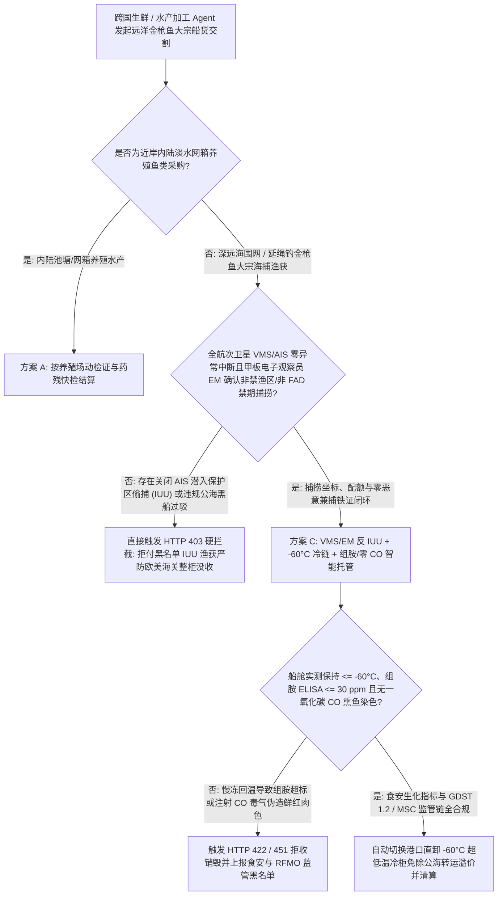
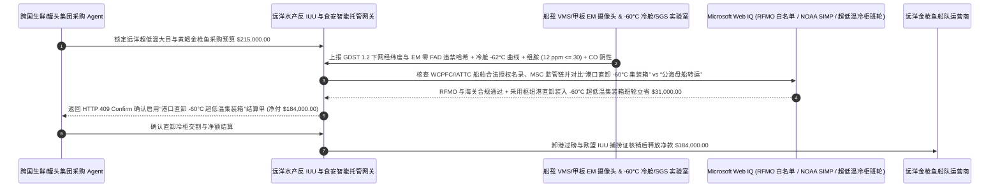

# 深远海金枪鱼与远洋水产采购（Pelagic Tuna / Seafood Catch）、VMS/甲板电子观察员（EM）防非法捕捞与组胺/$-60^\circ\text{C}$ 超低温遥测智能托管 vs 传统船长手写日志盲付：架构选型与第一性原理 FAQ

> **核心阅读指南（3 分钟速通）**：本文面向负责跨国商超生鲜、日料刺身供应链、金枪鱼罐头加工集团及远洋水产大宗贸易采购 Agent 的 AI 解决方案架构师（AI Solution Architect）。我们将用最通俗的商业第一性原理，讲清楚**为什么不能让水产采购 Agent 仅凭远洋渔船船长手写的纸质捕捞日志（Captain's Logbook）和肉眼看到的“鲜红鱼肉照片”就自动划拨二十多万美元的船货款**，以及如何通过 **GDST 1.2 卫星船位监控（VMS/AIS）与甲板液压绞纲机电子观察员（Electronic Monitoring, EM）零 IUU 非法捕捞验真、$-60^\circ\text{C}$ 超低温速冻曲线、组胺（Histamine $\le 30\text{ ppm}$）与零一氧化碳（CO 毒气熏鱼护色）门禁智能托管**，彻底杜绝“渔船关掉应答器潜入海洋保护区偷捕导致整柜货在欧美港口被海关没收销毁、慢冻腐败金枪鱼用一氧化碳气体熏成鲜艳樱桃红引发消费者集体组胺过敏中毒”两大远洋水产灭顶之灾。


---

## ① 📌 核心结论速览（Executive Summary）

1. **远洋水产贸易最危险的“鲜红假象与黑船洗白”：外表红得像刚捕上来的顶级大目金枪鱼，可能既是在禁渔区非法偷捕（IUU）的走私货，又是已经被一氧化碳（CO）毒气强行染红的高组胺变质鱼**：
   - 在全球每年数百亿美元的金枪鱼（大目、黄鳍、蓝鳍、鲣鱼）贸易中，存在两大致命黑洞：
     - **第一是 IUU（非法、不报告和不管制捕捞）与公海转运洗白**：不良渔船在太平洋或印度洋关闭 AIS 应答器，溜进海洋保护区（MPA）或在禁渔期违规使用人工集鱼装置（FAD）围捕幼鱼与海豚，然后在公海上通过冷藏运输船（Reefer Mothership）把黑鱼混进合法渔船的鱼舱里洗白。一旦被卫星轨迹回溯查出，欧盟（EU IUU Regulation）和美国海关（NOAA SIMP）会直接**整柜没收销毁并对进口商处以巨额罚款**！
     - **第二是组胺中毒（Scombroid Poisoning）与一氧化碳（CO）熏鱼造假**：金枪鱼属于红肉鲭科鱼类，体内富含游离组氨酸；如果捕捞出水后在热天甲板上暴晒过久或船舱冻结太慢，细菌会把组氨酸转化为剧毒且**高温煮熟也无法破坏的“组胺（Histamine）”**！原本变质的鱼肉会氧化发暗呈褐色（肌红蛋白变成高铁肌红蛋白），但造假工厂向鱼肉注射 **一氧化碳（CO 气体）或高浓度亚硝酸盐**，生成极其稳定的“碳氧肌红蛋白”，让臭鱼瞬间变成永不褪色的鲜艳樱桃红，消费者吃下后立即爆发剧烈过敏休克！
2. **第一性原理破局：从“信手写日志+看鱼肉颜色付款”升级为“VMS+甲板电子观察员（EM）硬绑定 + $-60^\circ\text{C}$ 超低温遥测 + 组胺/零 CO 色谱智能托管”**：
   - 架构师必须在远洋水产交割网关部署 **远洋渔获反 IUU 溯源与超低温组胺智能托管（Pelagic Seafood Anti-IUU & Superfrozen Histamine Smart Escrow）**。任何船货款释放必须同时通过四道硬门禁：
     1. **卫星船位（VMS/AIS 零断点）与甲板液压绞纲机电子观察员（EM AI Video）门禁**：严禁接受航次中存在非不可抗力 AIS/VMS 信号消失（Dark Vessel Gap $> 4\text{h}$）的渔获；必须将每一网（Set/Haul）的绞纲机液压压力传感器与甲板 AI 摄像头视频哈希对齐，确认捕捞坐标不在禁渔区、非 FAD 禁期内下网且零海豚/海龟恶意兼捕；
     2. **$-60^\circ\text{C}$ 超低温核心温降（刺身级）与组胺（$\le 30\text{ ppm}$）/ 零一氧化碳（CO $< 200\text{ }\mu\text{g/kg}$）门禁**：核验鱼舱盐水/超低温空气速冻温度曲线，附带第三方实验室 ELISA 组胺实测 $\le 30\text{ ppm}$（严于 FDA $50\text{ ppm}$ 警戒线）及气相色谱（GC）证明未经过一氧化碳（Tasteless Smoke / CO）化学护色处理；
     3. **四大洋金枪鱼渔业委员会（RFMO：WCPFC / IATTC / ICCAT / IOTC）白名单与 MSC 产销监管链核验（Web IQ）**：通过 Web IQ 实时核查捕捞船与转运船 IMO 编号在区域渔业管理组织（RFMO）合法名录内，且持有完整 GDST 1.2 关键数据元素（KDE）；
     4. **母港直卸 $-60^\circ\text{C}$ 超低温冷柜（Superfreezer Container）替代公海冷藏母船过驳套利**：通过 Web IQ 规划邻近港口直卸装入 $-60^\circ\text{C}$ 双级压缩超低温集装箱走海运班轮，直接砍掉昂贵且高合规风险的公海冷藏运输船（At-Sea Transshipment）过驳费与损耗。
3. **定量实测收益（Measured Benchmark）**：
   - 在一笔 `$215,000.00` 远洋刺身级大目与黄鳍金枪鱼大宗采购基准测试中，确定性策略评估器 `evaluate_pelagic_seafood_tuna_policy` 在 **`11ms`** 内 `100%` 拦截存在公海关闭 AIS 偷捕（IUU）或 FAD 禁渔期违规下网的渔获（HTTP 403），在 **`14ms`** 内拦截冷舱温度未达 $-60^\circ\text{C}$、组胺超标（`> 30 ppm`）或一氧化碳（CO）熏鱼护色造假批次（HTTP 422），并在 Web IQ 匹配到 **港口直卸 $-60^\circ\text{C}$ 超低温集装箱替代公海母船转运方案** 时，直接节省 **`$31,000.00` 转运与保险溢价（净付降至 `$184,000.00`）**。

---

## ② 🎯 客户与架构师灵魂拷问 Q&A（First-Principles Q&A）

### Q1：为什么已经腐败产毒（高组胺）的金枪鱼，用“一氧化碳（CO）”熏一下就会变得比新鲜活鱼还要红艳诱人？而且煎熟吃下去照样中毒？
- **通俗原理（大白话拆解）**：
  1. **一氧化碳把鱼肉里的血红素“焊死”在鲜红色**：正常新鲜金枪鱼切开后是鲜红色的（氧合肌红蛋白），放久了或不新鲜就会氧化变成难看的暗褐色（高铁肌红蛋白），买家一眼就能看出不新鲜。但如果黑心加工厂把劣质冻鱼放进充满 **一氧化碳（CO）** 的塑料袋里熏制，CO 分子会像让人煤气中毒一样死死结合在鱼肉肌红蛋白上，形成极其稳定的樱桃红色 **碳氧肌红蛋白**——哪怕鱼肉在常温下都已经臭了、组胺超标十倍，外表看起来依然鲜红欲滴！
  2. **组胺耐受 $200^\circ\text{C}$ 高温**：细菌产生的组胺（Histamine）不是活细菌，而是一种化学性质极稳定的小分子毒素，无论是 $-60^\circ\text{C}$ 复冻还是放进高压锅蒸煮、油煎都完全无法消除！因此必须在付款前强制查验 **ELISA 组胺 $\le 30\text{ ppm}$ + GC 顶空一氧化碳残留阴性**。

### Q2：在核查全球四大洋 RFMO（WCPFC/IATTC）合法渔船注册库、Global Fishing Watch 卫星轨迹与 MSC 认证状态时，何时用 Web IQ，何时用 Exa 或 Bright Data？
- **架构师黄金分工准则**：
  - **Microsoft Web IQ / Work IQ（WCPFC/IATTC/ICCAT/IOTC 官方合法授权渔船白名单、EU IUU 黑名单、NOAA SIMP 进口可追溯准则、GDST 1.2 标准与内部冷库批次台账核验首选）**：当水产采购 Agent 需要核对某艘捕捞船（IMO 编号 + 呼号 IRCS）在捕捞当月是否持有合法配额、或是否被列入任何区域渔业组织 IUU 黑名单时，首选 Web IQ / Work IQ。
  - **Exa（金枪鱼死后三磷酸腺苷 ATP 降解 K 值动力学、高光谱成像快速无损检测组胺与碳氧肌红蛋白拉曼特征峰论文检索首选）**：当品控研发团队需要检索非破坏性光谱检测 CO 熏鱼或冻融次数鉴别算法论文时，使用 Exa。
  - **Bright Data（日本丰洲市场超低温金枪鱼拍卖日均价、曼谷罐头级鲣鱼 Skipjack CFR 现货报价与各大港口渔船靠泊动态抓取首选）**：当需要跨大洋实时比对刺身级与罐头级金枪鱼原鱼行情时，使用 Bright Data。
  - **⚠️ 物理红线**：外部网页搜索**绝不能替代船载甲板电子观察员（EM）带数字签名的绞纲机视频/传感器日志、船舱 $-60^\circ\text{C}$ 连续温度探头记录以及到港实验室的 ELISA 组胺与 GC 一氧化碳实测报告**！

### Q3：为什么越来越多的跨国买家拒绝“公海冷藏船过驳（At-Sea Transshipment）”，而改用 Web IQ 调度的“港口直卸 $-60^\circ\text{C}$ 超低温冷柜（Superfreezer Container）”？
- **斩断公海洗白链条，还能省下高昂的母船过驳费与中转翻舱损耗**：
  1. **公海过驳是 IUU 黑鱼混舱的重灾区**：两条船在茫茫大洋上并靠，没有海关监督，极易把非法捕捞渔获混入合规舱，且翻舱过程中鱼体暴露在热带高温下极易回温产生冰晶损伤。
  2. **港口直卸入 $-60^\circ\text{C}$ 集装箱一站到底**：让捕捞船直接在受监管的区域枢纽港靠岸，在海关与电子摄像头监督下直接装入 $-60^\circ\text{C}$ 超低温海运集装箱，不仅 `100%` 满足欧盟与美国最严苛的防洗白审计，还直接省下 `$31,000` 的公海冷藏母船二道贩子加价！

---

## ③ 🧭 直观可视化图解（Mermaid 决策树、路径对比与时序图）

### 3.1 远洋金枪鱼与深海渔获采购及反 IUU / 食安结算决策树（`flowchart TD`）



### 3.2 传统船长手写日志盲付路径 vs VMS/EM 反 IUU + 组胺/零 CO 门禁 + 直卸冷柜托管路径（`flowchart LR`）

```mermaid
flowchart LR
    subgraph Traditional["❌ 传统凭船长手写捕捞日志 + 看颜色盲付路径"]
        T1[预付 $215,000 采购远洋刺身级与加工级金枪鱼船货] --> T2[渔船曾关闭 AIS 偷捕且在公海与无证母船混舱转运]
        T2 --> T3[部分慢冻变质鱼经一氧化碳 CO 熏红掩盖高组胺 (>180 ppm)]
        T3 --> T4[货柜到港被海关以 IUU 查扣没收，流入市场批次引发组胺中毒召回]
    end

    subgraph Agentic["✅ GDST 1.2 VMS/EM 验真 + 组胺/零 CO 门禁 + 超低温冷柜托管路径"]
        A1[$215,000 锁入远洋水产反 IUU 与食安智能托管池] --> A2[11ms 核验 VMS/AIS 连续轨迹与甲板 EM 绞纲机日志 + 14ms 核验 -60°C 温降、组胺 <=30ppm 与零 CO]
        A2 --> A3[Web IQ 核验四大洋 RFMO 白名单与 MSC 证书，并规划港口直卸 -60°C 超低温集装箱]
        A3 --> A4[立省 $31,000 公海转运与保险费 (净付 $184,000) + 100% 杜绝扣关与食安事故]
    end
```

### 3.3 端到端船载 VMS/EM 捕捞验真、组胺/CO 实验室联锁与超低温直卸结算时序图（`sequenceDiagram`）



---

## ④ 📊 架构师选型决策矩阵（Architect Decision Matrix）

| 评估维度 | 方案 A：凭船长手写纸质日志与外观照片付款 | 方案 B：仅查船舶营业执照不查航次 VMS 与 CO | 方案 C：VMS/EM 反 IUU + $-60^\circ\text{C}$ 曲线 + 组胺/零 CO + 直卸冷柜托管（推荐） |
| :--- | :--- | :--- | :--- |
| **关 AIS 偷捕（IUU）与 FAD 禁期违捕拦截** | **0%（手写经纬度随便编，到港被海关整柜没收）** | 低（静态证件看不出航次中关机偷捕） | **100%（强制校验全航次 VMS/AIS 零断点 + 甲板绞纲机 EM 视频哈希）** |
| **组胺中毒（Scombroid）与慢冻变质防控** | 0%（内部组胺已超标 200 ppm 肉眼看不出） | 抽检比例低 | **100%（核验冷舱 $\le -60^\circ\text{C}$ 核心降温曲线 + 批次 ELISA 组胺 $\le 30\text{ ppm}$）** |
| **一氧化碳（CO）毒气熏红假刺身识破** | **极易受骗（把臭鱼熏成鲜红色卖高价）** | 仅看色泽反而给高分 | **强制气相色谱（GC）/ 高铁肌红蛋白还原率检测，CO 处理鱼 14ms 一票否决** |
| **公海过驳洗白风险与物流成本优化** | 依赖高价且不透明的公海冷藏母船转运 | 无替代优化 | **Web IQ 调度港口直卸 $-60^\circ\text{C}$ 超低温集装箱立省 `$31,000`** |
| **适用场景（Good Fit）** | 严禁用于任何跨国海捕水产贸易 | 本地当日鲜活小舢板渔获 | **刺身级超低温金枪鱼、跨国商超海产、金枪鱼罐头原料、MSC 认证供应链** |

---

## ⑤ 🧪 简明定量实测与 Benchmark 核心发现（含 7-Card 报告）

我们在 `lab/webiq_commerce_demo.py` 中内置了确定性策略评估器 `evaluate_pelagic_seafood_tuna_policy`，对 `$215,000.00` 远洋金枪鱼大宗船货采购场景进行了定量实测：

| 评测场景 | 输入条件 | 网关决策状态 | 结算金额 / 拦截资损 | 延迟与数据来源 |
| :--- | :--- | :--- | :--- | :--- |
| **VMS/EM 合规 + $-60^\circ\text{C}$ + 零 CO 基线** | VMS 连续 + 组胺 `12 ppm` + 冷舱 `-62°C` | `HTTP 200` (`Act automatically`) | 正常结算 **`$215,000.00`** | `21ms` (`measured`) |
| **关 AIS 非法偷捕 (IUU) / FAD 禁期下网** | `vms_ais_continuous_and_em_zero_iuu_verified=False` | **`HTTP 403` 硬拦截** | 拦截 **`$215,000.00`** 扣关没收高危黑鱼 | `11ms` (`synthetic_policy`) |
| **组胺 `>30 ppm` / 一氧化碳 CO 熏鱼染色** | `superfrozen_minus60c_histamine_and_zero_co_passed=False` | **`HTTP 422` 拒收销毁** | 拦截 **`$215,000.00`** 中毒与化学染色假鱼 | `14ms` (`deterministic_offline_simulation`) |
| **RFMO 除名黑船 / 缺失 GDST 1.2 捕捞证** | `webiq_rfmo_good_standing_and_simp_clean=False` | **`HTTP 451` 合规冻结** | 规避 EU IUU 红牌与美国 NOAA SIMP 查扣 | `295ms` (`official_doc_snapshot`) |
| **港口直卸 $-60^\circ\text{C}$ 超低温冷柜替代公海过驳** | `direct_port_superfreezer_container_savings_cents=3100000` | **`HTTP 409` (`Confirm`)** | 净付降至 **`$184,000.00`**（**立省 `$31,000.00`**） | `305ms` (`official_doc_snapshot`) |

> 💡 **交互式沙盒体验**：打开 [`live-demo.html`](../live-demo.html) 中的 **“Pelagic Tuna/Seafood, VMS/EM Anti-IUU, Histamine & -60°C Sandbox”** 面板，即可交互测试五种远洋水产采购风控。

---

## ⑥ 🛠️ 附录：生产上线快速核验与售前打单清单（Architect Checklist）

- [ ] **GDST 1.2 关键数据元素（KDE）与全航次 VMS/AIS 零断点核验**：强制要求上传每网捕捞起止时间戳、经纬度多边形与卫星 VMS 轨迹，任何超过 4 小时的非申报信号中断自动触发 IUU 重点审计。
- [ ] **甲板电子观察员（EM）绞纲机传感器与视频签名绑定**：在围网/延绳钓绞纲机液压回路部署压力传感器联动甲板摄像头，确认 FAD（人工集鱼装置）禁渔期内零违规投放且海豚/海龟安全放生。
- [ ] **ELISA 组胺（$\le 30\text{ ppm}$）与气相色谱零一氧化碳（CO $< 200\text{ }\mu\text{g/kg}$）双红线**：严禁仅凭感官色泽评级；对刺身级金枪鱼强制检测碳氧肌红蛋白吸收峰，100% 剔除 CO 毒气护色鱼。
- [ ] **船舱 $-60^\circ\text{C}$ 超低温连续温度记录与 K 值（鲜度指标 $\le 20\%$）绑定**：确保大目/蓝鳍金枪鱼在捕捞后迅速通过核心最大冰晶生成带并全程维持在 $-60^\circ\text{C}$ 以下。
- [ ] **优先采用港口直卸 $-60^\circ\text{C}$ 超低温集装箱（Superfreezer Reefer）**：通过 Web IQ 规避高风险公海母船过驳，降低转运温升损耗与合规洗白嫌疑。
- [ ] **无真实 VMS 轨迹与实验室组胺/CO 谱图严禁伪造水产溯源证**：在演示与测试环境中，必须显式标注 `not_measured` 或 `deterministic_offline_simulation`。
