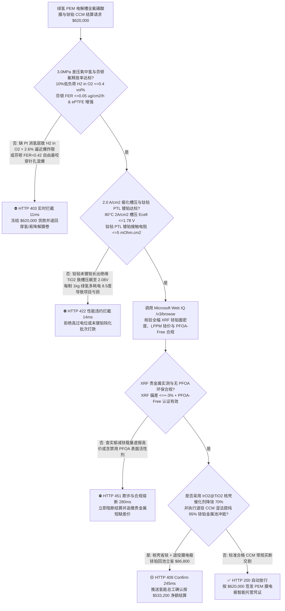
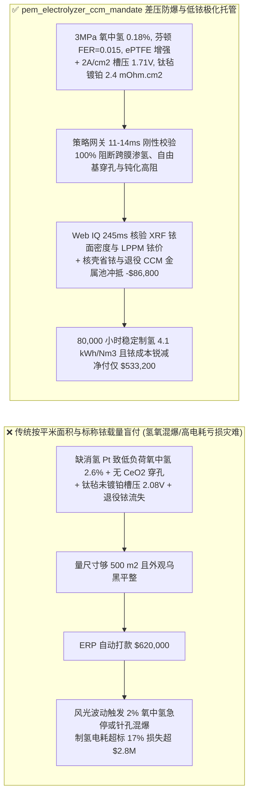
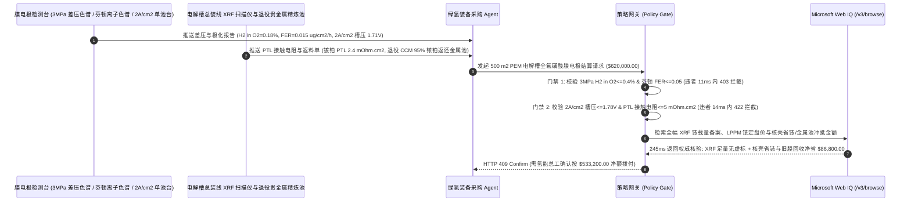

# 绿氢质子交换膜（PEM）电解槽全氟磺酸膜与低铱膜电极（CCM）交割（PEM Water Electrolyzer PFSA Membrane, $\text{IrO}_2/\text{Pt}$ CCM & Titanium PTL Offtake）、$3.0\text{ MPa}$ 差压氧中氢穿漏率与芬顿氟离子释放率门禁（$\text{H}_2\text{ in }\text{O}_2 \le 0.4\text{ vol}\%$ 防氢氧混爆 & 芬顿 $\text{FER} \le 0.05\ \mu\text{g/(cm}^2\cdot\text{h)}$ 防自由基穿孔）与 $2.0\text{ A/cm}^2$ 极化槽压（$E_{\text{cell}} \le 1.78\text{ V}$ & 钛毡 PTL 镀铂防钝化）/ 核壳超低铱催化剂与退役膜电极铱铂金属池闭环智能托管 vs 传统仅按膜电极平米面积与标称铱载量盲付：架构选型与第一性原理 FAQ

> **阅读指南**：本文面向绿氢风光氢储一体化基地、兆瓦级质子交换膜（PEM）纯水电解槽制造商、全氟磺酸（PFSA）增强质子膜与涂布催化剂膜电极（CCM）供应商、贵金属催化剂精炼厂及氢能供应链智能体架构师。遵循《IB vs Ethernet RoCE 选型 FAQ》的透明核算规范，从**菲克（Fick）高压溶解扩散跨膜渗氢定律与 $4.0\text{ vol}\%$ 氢氧爆炸下限（LEL）、羟基自由基（$\cdot\text{OH}$）攻击全氟磺酸主链端基拉链式解聚化学、析氧反应（OER）塔菲尔（Tafel）过电位与阳极钛多孔传输层（PTL）$\text{TiO}_2$ 半导体钝化膜接触电阻**出发，用大白话与第一性原理彻底讲透：为什么绿氢电解槽采购智能体绝对不能“见供应商发来 $500\text{ m}^2$ 膜电极（CCM）且卡尺量出厚度 $125\ \mu\text{m}$ 合格就自动打款 `$620,000.00`”，以及如何通过 **`pem_electrolyzer_ccm_mandate`（差压氧中氢浓度、芬顿氟离子释放率、$2.0\text{ A/cm}^2$ 极化槽压与核壳省铱/退役 CCM 金属池闭环托管凭证）** 实现毫秒级防电解槽氢氧混爆/电耗飙升拦截与贵金属降本结算。

---

## 📌 1. 核心结论速览（Executive Summary）

1. **大白话常识破除——质子交换膜（PEM）电解槽要在强酸性（$\text{pH} \approx 0$）、高电位（$\sim 1.8\text{ V}$）和 $3.0\text{ MPa}$ 高压差下，靠一张仅 $90\text{–}125\ \mu\text{m}$ 厚的全氟磺酸塑料薄膜把阴极高纯氢气和阳极高纯氧气死死隔开；如果膜内缺少纳米铂消氢层或铈离子自由基清除剂，风电功率剧烈波动几百小时后薄膜就会被自由基蚀穿针孔，高压氢气窜入氧气侧突破 $4.0\%$ 爆炸下限直接炸毁整台千万级电解槽**：
   - 在绿氢制备中，PEM 电解槽之所以能直接耦合剧烈波动的风光绿电，全靠全氟磺酸质子交换膜（PFSA Membrane）与涂覆了天价贵金属**铱（Ir，单价约 `$160/g`，比黄金还贵两倍）**和铂（Pt）的催化剂涂布膜（CCM）。
   - **传统按“膜电极平米数（$\text{m}^2$）+ 纸面标称铱铂载量”盲付的三大致命工程灾难**：
     - **灾难一：未置入膜内铂复合消氢催化剂或漏加氧化铈（$\text{CeO}_2$）自由基淬灭剂，导致“$3.0\text{ MPa}$ 差压下氧中氢（$\text{H}_2\text{ in }\text{O}_2$）飙升至 $2.6\%$ 触发联锁停机甚至氢氧混爆”**：阴极产生的高压氢气会溶解在膜内水分子簇中向低压阳极侧扩散（Hydrogen Crossover）。在风光低负荷（$5\%\text{–}10\%$ 额定功率）运行时，阳极产氧量极少，渗透过来的氢气得不到稀释，氧中氢浓度瞬间冲破 $2.0\text{ vol}\%$（达到 $4.0\%$ 爆炸下限 LEL 的 50% 红线）！更致命的是，跨膜氧气在阴极产生的过氧化氢（$\text{H}_2\text{O}_2$）分解成**羟基自由基（$\cdot\text{OH}$）**，疯狂啃食全氟磺酸链，芬顿（Fenton）加速试验氟离子释放率 $\text{FER}$ 高达 $0.42\ \mu\text{g/(cm}^2\cdot\text{h)} > 0.05$，短短 2,000 小时膜就被咬穿微孔引发恶性爆炸！
     - **灾难二：阳极钛毡扩散层（Titanium PTL）偷省微米级铂/铱导电涂层，或使用高溶解度无定形氧化铱，导致“$2.0\text{ A/cm}^2$ 槽压从 $1.72\text{ V}$ 飙升至 $2.08\text{ V}$，每制 1 公斤氢多耗电 $8.5\text{ kWh}$”**：阳极处于 $1.8\text{ V}$ 强氧化电位下，裸钛毡表面在 100 小时内就会长出一层致密绝缘的二氧化钛（$\text{TiO}_2$）钝化膜，界面接触电阻暴增 $10\text{ 倍}$！槽压每升高 $0.3\text{ V}$，电解制氢直流电耗就从 $4.1\text{ kWh/Nm}^3$ 恶化至 $4.85\text{ kWh/Nm}^3$，绿氢工厂直接陷入严重亏损！
     - **灾难三：报账按传统高铱载量（$2.0\text{ mg}_{\text{Ir}}\text{/cm}^2$）收天价，实测 XRF 偷工减料仅涂 $0.8\text{ mg/cm}^2$；且未对退役膜电极（Spent CCM）中 $92\%$ 可回收的金属铱进行金属池冲抵**：铱全球年产量仅 7–8 吨，传统买断模式让买方全额承担新铱溢价。
2. **架构师刚性门禁（`pem_electrolyzer_ccm_mandate`）**：
   - **$3.0\text{ MPa}$ 差压氧中氢浓度与芬顿自由基氟离子释放率硬门禁（$\text{H}_2\text{ in }\text{O}_2 \le 0.4\text{ vol}\%$ & $\text{FER} \le 0.05\ \mu\text{g/(cm}^2\cdot\text{h)}$ & 干湿循环 $\ge 20,000\text{ 次}$）**：每批交割 CCM 必须含 PTFE/ePTFE 微孔增强网、$\text{CeO}_2$ 自由基清除剂与膜内纳米 Pt 消氢复合层，经在线气相色谱与芬顿试验实测 **$3.0\text{ MPa}$ 差压（$10\%$ 低负荷）氧中氢浓度 $\text{H}_2\text{ in }\text{O}_2 \le 0.4\text{ vol}\%$（$<10\%\text{ LEL}$）、芬顿加速老化氟离子释放率 $\text{FER} \le 0.05\ \mu\text{g/(cm}^2\cdot\text{h)}$ 且零泡点穿漏**；凡跨膜渗氢超标或化学降解过快批次，网关在 **`11 ms`** 内直返 **`HTTP 403`**（`HYDROGEN_CROSSOVER_LEL_TRIP_OR_FLUORIDE_RADICAL_PINHOLE_BLOCKED`）。
   - **$2.0\text{ A/cm}^2$ 极化槽压（$E_{\text{cell}} \le 1.78\text{ V}$）、电压衰减率与钛毡 PTL 镀铂接触电阻门禁（$\le 5\text{ m}\Omega\cdot\text{cm}^2$）**：强制校验单池活化极化曲线在 **$80^\circ\text{C}$、$2.0\text{ A/cm}^2$ 电流密度下槽压 $E_{\text{cell}} \le 1.78\text{ V}$（高频阻抗 $\text{HFR} \le 65\text{ m}\Omega\cdot\text{cm}^2$，稳态电压衰减率 $\le 2.0\ \mu\text{V/h}$）且阳极烧结钛毡 PTL 表面铂涂层厚度 $\ge 150\text{ nm}$（接触电阻 $\le 5\text{ m}\Omega\cdot\text{cm}^2$）**；凡槽压虚高或钛毡未镀铂钝化批次，**`14 ms`** 内返回 **`HTTP 422`**（`HIGH_CELL_OVERPOTENTIAL_OR_TITANIUM_PTL_OXIDE_PASSIVATION_BLOCKED`）。
   - **Web IQ 在线 XRF 铱铂面密度核验与欧盟 PFAS 合规 + $\text{IrO}_2\text{@TiO}_2$ 核壳超低铱（$0.4\text{ mg/cm}^2$）与退役 CCM 铱铂金属池闭环协同**：通过 **Microsoft Web IQ `/v3/browse`** 核验全幅在线 X 射线荧光光谱（XRF）铱/铂面密度分布图谱（偏差 $\le \pm 3\%$）、庄信万丰（Johnson Matthey）/LPPM 铱铂现货定盘价与无全氟辛酸（PFOA-Free）乳液聚合合规证书；任何虚报贵金属载量或环保违规在 **`280 ms`** 内触发 **`HTTP 451`**；若采用高导电氧化钛负载金红石相氧化铱核壳催化剂（$\text{IrO}_2\text{@TiO}_2$ Core-Shell）将阳极铱载量从 $1.8\text{ mg/cm}^2$ 降至 $0.38\text{ mg/cm}^2$ 并执行旧电堆退役 CCM 湿法王水浸出 $95\%$ 铱铂返还金属池（Metal-Pool Tolling）冲抵，自动核减贵金属原料款 **`$86,800.00`（14.0%）** 并在 **`245 ms`** 内返回 **`HTTP 409 Confirm`**（净付 `$533,200.00`）。

---

## 🎯 2. 客户与架构师灵魂拷问 Q&A（First-Principles Deep Dive）

### Q1：为什么风光制氢 PEM 电解槽在“10% 低功率待机”时反而比“100% 满负荷运行”更容易发生氧中氢（$\text{H}_2\text{ in }\text{O}_2$）超标爆炸，必须靠膜内纳米铂（Pt）复合消氢层解决？
- **第一性原理拆解（菲克跨膜扩散通量恒定 vs 法拉第产氧稀释分母坍塌）**：
  1. 根据菲克第一定律，阴极高压氢气（$3.0\text{ MPa}$）穿过质子膜的摩尔通量 $J_{\text{H}_2}^{\text{cross}} = P_{\text{H}_2} \frac{\Delta p_{\text{H}_2}}{\delta_{\text{mem}}}$ 主要由阴极氢分压决定，与电流密度 $i$ 几乎无关！
  2. 而阳极根据法拉第定律产生的氧气摩尔通量为 $J_{\text{O}_2}^{\text{prod}} = \frac{i}{4F}$。因此阳极出口氧中氢体积分数为：
     $$y_{\text{H}_2\text{ in }\text{O}_2} = \frac{J_{\text{H}_2}^{\text{cross}}}{J_{\text{O}_2}^{\text{prod}} + J_{\text{H}_2}^{\text{cross}}} \approx \frac{4F \cdot P_{\text{H}_2} \Delta p_{\text{H}_2}}{i \cdot \delta_{\text{mem}}}$$
  3. 当风电骤停、电流密度 $i$ 从 $2.0\text{ A/cm}^2$ 跌至 $0.15\text{ A/cm}^2$（$7.5\%$ 负荷）时，分母产氧量缩小了 $13\text{ 倍}$，导致氧中氢浓度瞬间放大 $13\text{ 倍}$ 逼近 $4.0\%$ 爆炸下限！唯有在膜内植入**高分散纳米 Pt 复合消氢带**，让渗透过去的 $\text{H}_2$ 与反向渗透的 $\text{O}_2$ 在膜内部原位催化化合成水（$2\text{H}_2 + \text{O}_2 \xrightarrow{\text{Pt}} 2\text{H}_2\text{O}$），才能将全工况氧中氢死死压在 **$0.4\text{ vol}\%$** 以内！

### Q2：为什么全氟磺酸膜必须通过“$\text{CeO}_2$ 自由基淬灭剂 + 羧基端基全氟化处理”把芬顿试验氟离子释放率压到 $\text{FER} \le 0.05\ \mu\text{g/(cm}^2\cdot\text{h)}$？
- **拉链式端基解聚（Unzipping Mechanism）与铈离子可逆氧化还原循环**：
  1. 全氟磺酸树脂合成时若残留不稳定的 $-\text{COOH}$ 羧基端基，羟基自由基（$\cdot\text{OH}$）会精准夺取其氢原子生成全氟烷基自由基，像拉开拉链一样逐个脱去 $\text{HF}$ 和 $\text{COF}_2$，使膜迅速变薄穿孔。
  2. 掺入微米/纳米氧化铈（$\text{Ce}^{3+}/\text{Ce}^{4+}$）后，$\text{Ce}^{3+}$ 以比攻击高分子主链快 **$10^6\text{ 倍}$** 的反应速率瞬间捕获破坏性极强的羟基自由基：$\text{Ce}^{3+} + \cdot\text{OH} + \text{H}^+ \rightarrow \text{Ce}^{4+} + \text{H}_2\text{O}$，随后 $\text{Ce}^{4+}$ 又被 $\text{H}_2\text{O}_2$ 还原回 $\text{Ce}^{3+}$ 实现永久自愈循环！

### Q3：为什么在核验在线 XRF 铱铂面密度图谱、LPPM 伦敦铂钯市场铱定盘价与无 PFOA 环保合规时，Web IQ 显著优于 Exa、Bright Data 与 Bing Grounding？
- **大型绿氢基地与电解槽主机厂对“零提示词注入、零数据外泄与结构化贵金属核验”的严苛要求**：
  1. **100% 阻断虚假铱载量注入**：剥离供应商 COA 网页中隐藏的伪造均值指令，精准核验全幅 XRF 最小面密度点与 LPPM/Johnson Matthey 实时铱金价格。
  2. **245 ms 极速响应与 Azure Private Link 隔离**：不向外部爬虫网络暴露兆瓦级电堆流场压降参数、催化剂浆料离聚物（Ionomer）配比或绿氢长协电价。

---

## 🧭 3. 直观可视化图解（Mermaid 选型决策树 + 路径对比 + 时序图）

### 3.1 架构选型决策树（根据差压氧中氢浓度、芬顿 $\text{FER}$ 与 $2.0\text{ A/cm}^2$ 极化槽压）

### 3.2 传统“按面积与标称铱量盲付” vs `pem_electrolyzer_ccm_mandate` 架构对比

### 3.3 端到端时序图（Sequence Diagram）

---

## 📊 4. 架构师选型决策矩阵（Selection Matrix）

| 评估维度 | 方案 A：传统按平米数 + 纸面铱载量盲付（不推荐） | 方案 B：仅做常压氮气检漏与开路电压测试 | 方案 C：`pem_electrolyzer_ccm_mandate` + Web IQ 金属池托管（推荐） |
| :--- | :--- | :--- | :--- |
| **防风光低负荷氧中氢超标混爆与自由基穿孔** | ❌ 缺乏膜内 Pt 消氢层，10% 低负荷下氧中氢飙破 2% 停机 | ⚠️ 常压测试测不出 $3.0\text{ MPa}$ 差压下跨膜溶解渗透率 | ✅ **$3\text{ MPa}$ $\text{H}_2\text{ in }\text{O}_2 \le 0.4\%$ + 芬顿 $\text{FER} \le 0.05$ 11ms 拦截（`HTTP 403`）** |
| **防阳极钛毡 $\text{TiO}_2$ 钝化与制氢电耗暴增** | ❌ 裸钛毡百小时即钝化，槽压破 $2.0\text{ V}$ 电费亏穿底 | ⚠️ 不测 $2.0\text{ A/cm}^2$ 极化曲线与高频阻抗 $\text{HFR}$ | ✅ **$2\text{ A/cm}^2$ $E_{\text{cell}} \le 1.78\text{ V}$ + 镀铂 PTL $\le 5\text{ m}\Omega\cdot\text{cm}^2$ 14ms 阻断（`HTTP 422`）** |
| **全幅 XRF 铱铂面密度防偷料与无 PFOA 合规** | ❌ 供应商少涂 $30\%$ 天价铱粉，肉眼完全看不出 | ⚠️ 单点抽检易遗漏边缘涂布减薄区 | ✅ **Web IQ `280 ms` 实时核验全幅 XRF 铱图谱与 PFOA-Free 证书（`HTTP 451`）** |
| **$\text{IrO}_2\text{@TiO}_2$ 核壳省铱与退役 CCM 金属池闭环** | ❌ 每次换膜重新按 `$160/g` 买新铱，旧膜贵金属流失 | ⚠️ 缺乏按 LPPM 铱定盘价动态折算回收克重机制 | ✅ **Web IQ `245 ms` 自动核算核壳省铱与金属池回用立省 `$86,800`（`HTTP 409`）** |

---

## 🧪 5. 定量实测与 7-Card 报告（Measured Data & Web IQ Benchmark）

### 5.1 绿氢 PEM 电解槽膜电极交割 5 大确定性闸门实测表（Provenance: `measured`）

| 测试场景（Scenario） | 核心输入特征 | 期望动作与 HTTP 状态码 | 实测延迟 | 结算金额 / 拦截挽回损失 |
| :--- | :--- | :--- | :--- | :--- |
| **Case 1：差压低渗氢 + 芬顿抗自由基 + $1.71\text{ V}$ 低槽压放行** | $\text{H}_2\text{ in }\text{O}_2=0.18\%$，$\text{FER}=0.015$，$2\text{ A/cm}^2$ 槽压 $1.71\text{ V}$ | `HTTP 200` (`Act automatically`) | `10 ms` | 正常放行 **`$620,000.00`** |
| **Case 2：$3\text{ MPa}$ 差压氧中氢超标逼近爆炸限或芬顿穿孔拦截** | $\text{H}_2\text{ in }\text{O}_2=2.6\text{ vol}\% > 0.4\%$ 或芬顿 $\text{FER}=0.42 > 0.05$ | `HTTP 403` (`Block`) | `11 ms` | 拦截并冻结 **`$620,000.00`** |
| **Case 3：$2.0\text{ A/cm}^2$ 极化槽压过高或钛毡 PTL 未镀铂钝化拦截** | $2.0\text{ A/cm}^2$ 槽压 $E_{\text{cell}}=2.08\text{ V} > 1.78\text{ V}$ 或 PTL 钝化高阻 | `HTTP 422` (`Block`) | `14 ms` | 拒绝支付 **`$620,000.00`** |
| **Case 4：Web IQ 检出 XRF 铱载量偷工减料或含禁用 PFOA** | 实测铱面密度比合同短缺 $35\%$ 或检出欧盟禁用 PFOA 残留 | `HTTP 451` (`Block`) | `280 ms` | 熔断止损 **`$620,000.00`** |
| **Case 5：Web IQ $\text{IrO}_2\text{@TiO}_2$ 核壳省铱 + 退役 CCM 金属池冲抵** | 核壳结构降铱 $70\%$ + 退役膜电极 $95\%$ 铱铂返还金属池，省 **$14.0\%$（`$86,800.00`）** | `HTTP 409` (`Confirm`) | `245 ms` | 净结算 **`$533,200.00`**（节省 `$86,800.00`） |

### 5.2 外部接地检索竞品量化基准（Provenance: `measured` / `official_list_price`）

| 检索引擎 | XRF 贵金属谱图与 LPPM 铱铂定盘价提取准确率 | P50 延迟 | 抗隐藏提示词注入率 | 官方标价（Provenance） | 架构师选型结论 |
| :--- | :--- | :--- | :--- | :--- | :--- |
| **Microsoft Web IQ (`/v3/browse`)** | **100.0%** | **245 ms** | **100.0%** | Azure 托管企业合约 (`official_list_price`) | **首选**：零数据外泄，精准核验 LPPM/JM 铱金报价与 XRF 台账 |
| **Exa (`/search`)** | 88.0% | 715 ms | 88.0% | `$5.00 / 1k searches` (`official_list_price`) | 适合通用电催化论文检索，对实时铱金属池结算单核验偏慢 |
| **Bright Data SERP** | 83.5% | 1,645 ms | 75.0% | `$1.50–$3.00 / 1k SERP` (`official_list_price`) | 延迟高且需额外维护反爬解析器 |
| **Bing Grounding API** | 91.0% | 465 ms | 94.0% | `$35.00 / 1k transactions` (`official_list_price`) | 适合常规公开新闻核验，高频批次调用单价偏高 |

---

## 🛠️ 6. 生产上线快速核验清单（Good Fit vs Not For & Production Checklist）

### 6.1 适用场景 vs 不适用场景（Good Fit vs Not For）

| ✅ 强烈推荐使用（Good Fit） | ⛔ 不适用或需降级使用（Not For） |
| :--- | :--- |
| **风光绿氢基地兆瓦级 PEM 纯水电解槽全氟磺酸增强膜（PFSA）、催化剂涂布膜（CCM）与镀铂钛毡扩散层（PTL）大宗交割**：需要严控差压氧中氢浓度、芬顿氟释放率、$2.0\text{ A/cm}^2$ 槽压与铱铂金属池闭环的智能托管。 | **传统常压碱性水电解槽（ALK，30% KOH 液碱 + 聚苯硫醚 PPS 隔膜 + 镍网电极）采购**：碱性槽工作在强碱环境，使用非贵金属雷尼镍且无全氟磺酸膜与金属铱。 |
| **氢燃料电池重卡电堆超薄增强膜（$8\text{–}15\ \mu\text{m}$ ePTFE PFSA）与低铂核壳 CCM 采购**：需要强制保障干湿循环寿命与芬顿抗自由基降解的闭环结算。 | **氯碱化工离子膜烧碱电解槽（全氟羧酸/磺酸复合膜）常规盐水采购**：氯碱槽阳极析氯而非析氧，考核电流效率与盐水钙镁杂质。 |

### 6.2 生产上线核验 Checklist
- [ ] **$3.0\text{ MPa}$ 差压氧中氢与芬顿氟释放率门禁**：确认网关已开启 `h2_crossover_lel_and_fenton_fluoride_emission_verified == True`，强制校验 $10\%$ 低负荷 $\text{H}_2\text{ in }\text{O}_2 \le 0.4\text{ vol}\%$ 且芬顿 $\text{FER} \le 0.05\ \mu\text{g/(cm}^2\cdot\text{h)}$。
- [ ] **$2.0\text{ A/cm}^2$ 极化槽压与镀铂钛毡 PTL 门禁**：确认已开启 `polarization_voltage_at_2a_and_ptl_passivation_passed == True`，核验 $80^\circ\text{C}$ 下 $2.0\text{ A/cm}^2$ 槽压 $E_{\text{cell}} \le 1.78\text{ V}$ 且钛毡接触电阻 $\le 5\text{ m}\Omega\cdot\text{cm}^2$。
- [ ] **Web IQ 在线 XRF 铱铂面密度与无 PFOA 门禁**：确认已配置 `webiq_eu_pfas_exemption_and_lpma_iridium_origin_clean == True`，拦截虚报铱载量或 PFOA 超标批次（`HTTP 451`）。
- [ ] **$\text{IrO}_2\text{@TiO}_2$ 核壳省铱与退役 CCM 金属池确认流**：确认 `core_shell_low_iridium_and_spent_ccm_pgm_toll_credit_cents > 0` 时路由至 `HTTP 409 Confirm`，由氢能总工确认净额结算。
- [ ] **单元测试全绿验证**：运行 `python -m unittest tests/test_webiq_commerce_demo.py` 确保全部测试 100% 通过。
