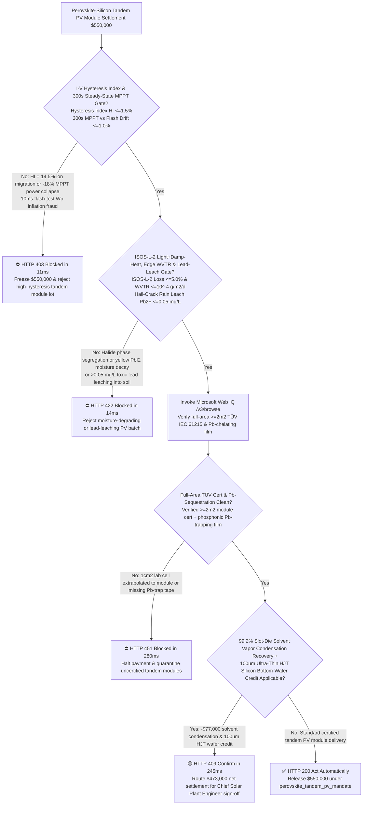
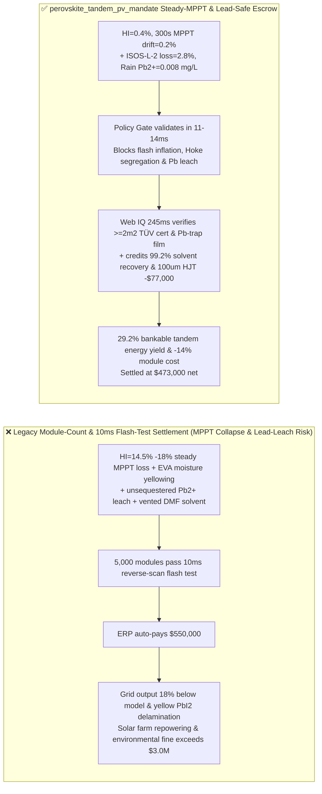
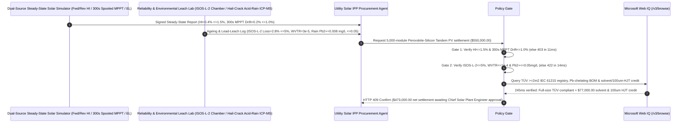

# Perovskite-Silicon Tandem Solar PV Module, ALD $\text{SnO}_2$ Buffer & POE/PIB Edge-Seal Offtake, I-V Hysteresis Index & $300\text{ s}$ Steady-State MPPT Gate ($\text{HI} \le 1.5\%$ & Steady-State MPPT Drift $\le 1.0\%$) & $\text{ISOS-L-2}$ Damp-Heat Light-Soaking / Lead-Sequestration Gate ($\text{Degradation} \le 5.0\%$, $\text{WVTR} \le 10^{-4}\text{ g/(m}^2\cdot\text{d)}$ & $\text{Pb}^{2+} \le 0.05\text{ mg/L}$) / Slot-Die Solvent Vapor Recovery & $100\ \mu\text{m}$ Thin-HJT Wafer Escrow vs. Module-Count & $10\text{ ms}$ Flash-Tester Overbilling: Architecture Selection & First-Principles FAQ

> **Reader's Guide**: This guide is written for utility-scale solar IPPs, 2-terminal / 4-terminal Perovskite-Heterojunction Silicon Tandem (Perovskite-HJT Tandem) PV module manufacturers, slot-die coating and P1/P2/P3 picosecond laser scribing engineers, and renewable-energy procurement agent architects. Modeled after the *IB vs. Ethernet RoCE Selection FAQ*, it explains from **mobile halide vacancy ($V_{\text{I}}^{\bullet}$) drift under electric fields causing I-V sweep hysteresis ($\text{HI}$) that inflates $10\text{ ms}$ xenon flash-tester wattage by $18\%$, photo-induced Hoke halide phase segregation in $1.68\text{ eV}$ wide-bandgap top cells, moisture-catalyzed decomposition into yellow $\text{PbI}_2$, and phosphate/thiol chemical lead-sequestration films** why a settlement agent must never release `$550,000.00` simply because $5,000$ tandem modules scored $720\text{ Wp}$ on a $10\text{ ms}$ reverse-scan flash test—and how **`perovskite_tandem_pv_mandate`** enforces sub-15ms hysteresis/lead-leach blocking and solvent-reclaim settlement.

---

## 📌 1. Executive Summary

1. **Breaking the "10ms Reverse-Scan Flash-Tester" Myth—Unlike Covalent Crystalline Silicon, Hybrid Halide Perovskites Are Soft Ionic Crystals Where Iodide ($\text{I}^-$) and Bromide ($\text{Br}^-$) Ions Migrate Under Bias; A $10\text{ ms}$ Reverse Voltage Sweep ($V_{oc} \rightarrow J_{sc}$) Rides Transient Ionic Polarization to Print a Fake $720\text{ Wp}$ Label, Only for Real-World $300\text{ s}$ Steady-State MPPT Output to Collapse by $18\%$ to $590\text{ W}$ as Accumulated Interfacial Ions Screen the Built-In Electric Field**:
   - Perovskite-Silicon tandem modules stack a $1.68\text{ eV}$ wide-bandgap perovskite top cell over a $1.12\text{ eV}$ silicon heterojunction (HJT) bottom cell to surpass the $33.7\%$ single-junction Shockley-Queisser limit ($>28\%\text{–}30\%$ module efficiency), but require fundamentally different acceptance physics.
   - **Three Catastrophic Failures of Legacy Module-Count & $10\text{ ms}$ Flash-Test Wattage Settlement**:
     - **Failure 1: $10\text{ ms}$ Fast Reverse-Scan Flash Testing Hides Severe Halide Ion-Migration Hysteresis ($\text{HI} = 14.5\% > 1.5\%$), Causing $300\text{ s}$ Steady-State MPPT Power to Drop by $18\%$**: Unpassivated grain boundaries and missing self-assembled monolayers (SAMs like Me-4PACz) create high iodide-vacancy densities ($V_{\text{I}}^{\bullet}$). Fast reverse sweeps measure artificially high fill factors, whereas continuous grid-tied MPPT operation suffers severe ion-screening power loss!
     - **Failure 2: Photo-Induced Halide Phase Segregation (`Hoke Effect`) Under $85^\circ\text{C}/1\text{-Sun}$ Light Soaking, Moisture Ingress ($\text{WVTR} > 10^{-4}\text{ g/(m}^2\cdot\text{d)}$) Decomposing Perovskite into Yellow $\text{PbI}_2$, and Unsequestered Water-Soluble Lead ($\text{Pb}^{2+} > 0.05\text{ mg/L}$) Leaching After Hail Impact**: Using standard EVA (which hydrolyzes into corrosive acetic acid) or poor PIB edge seals turns black perovskite yellow within months. Worse, because perovskite lead halides have high water solubility ($K_{sp} \approx 10^{-8}$), hail-cracked modules without internal **phosphate/phosphonic-acid lead-chelating films** leach toxic $\text{Pb}^{2+}$ into rainwater!
     - **Failure 3: Extrapolating $1\text{ cm}^2$ Spin-Coated Lab-Cell Certificates to $2.4\text{ m}^2$ Commercial Modules, Plus Venting Slot-Die DMF/DMSO/2-ME Vapors and Using Thick $150\ \mu\text{m}$ Silicon Bottom Wafers**: Ignoring P1/P2/P3 laser-scribe dead zones and discarding evaporated coating solvents inflates module cost by $14\%$.
2. **Architect's Deterministic Gate (`perovskite_tandem_pv_mandate`)**:
   - **IEC 60904 Slow Forward/Reverse Hysteresis Index ($\text{HI} \le 1.5\%$) & $300\text{ s}$ Continuous Steady-State MPPT Gate ($\le 1.0\%$ Drift)**: Requires dual-source Class A+A+A+ solar simulation confirming **forward-vs-reverse scan Hysteresis Index $\text{HI} = |P_{\text{rev}} - P_{\text{fwd}}| / P_{\text{rev}} \le 1.5\%$ and $300\text{ s}$ continuous maximum-power-point tracking ($P_{\text{MPPT,300s}}$) within $\le 1.0\%$ of nameplate Wp**. Flash-inflated or high-hysteresis lots are blocked in **`11 ms`** with **`HTTP 403`** (`HALIDE_ION_MIGRATION_HYSTERESIS_OR_FLASH_TEST_WP_INFLATION_BLOCKED`).
   - **IEC 61215 / $\text{ISOS-L-2}$ Light+Damp-Heat ($\le 5.0\%$ Loss), Edge-Seal $\text{WVTR}$ ($\le 10^{-4}\text{ g/(m}^2\cdot\text{d)}$) & Hail-Crack Lead-Sequestration Gate ($\text{Pb}^{2+} \le 0.05\text{ mg/L}$)**: Requires **$1,000\text{ h}$ $85^\circ\text{C}/85\%\text{RH}$ damp-heat + $85^\circ\text{C}/1\text{-Sun}$ MPPT light soaking degradation $\le 5.0\%$, desiccated PIB + POE encapsulation with $\text{WVTR} \le 10^{-4}\text{ g/(m}^2\cdot\text{d)}$, and simulated hail-shatter acid-rain leach $\text{Pb}^{2+} \le 0.05\text{ mg/L}$ (>99.5% chemical lead capture)**. Degrading or lead-leaching lots are rejected in **`14 ms`** with **`HTTP 422`** (`PHASE_SEGREGATION_DAMP_HEAT_DEGRADATION_OR_LEAD_LEAKAGE_BLOCKED`).
   - **Web IQ Full-Area ($\ge 2.0\text{ m}^2$) TÜV IEC 61215/61730 Grounding & $99.2\%$ Slot-Die Solvent Condensation + $100\ \mu\text{m}$ Thin-HJT Silicon Credit**: Uses **Microsoft Web IQ `/v3/browse`** to verify full-size module ($\ge 2.0\text{ m}^2$) TÜV IEC 61215/61730 certificates and chemical lead-chelating film BOMs. Lab-cell extrapolations or unsequestered lead lots trigger **`HTTP 451`** in **`280 ms`**; verified **$99.2\%$ cryogenic condensation recovery of slot-die coating solvents** plus $100\ \mu\text{m}$ ultra-thin HJT silicon bottom wafers deducts **`$77,000.00` (14.0%)** and returns **`HTTP 409 Confirm`** in **`245 ms`** (`$473,000.00` net settlement).

---

## 🎯 2. First-Principles Q&A for Customers & Solution Architects

### Q1: Why does a $10\text{ ms}$ xenon flash test overestimate a defective perovskite-silicon tandem module's true steady-state power by $15\%\text{–}20\%$?
- **Halide Vacancy Drift Mobility ($\mu_{\text{ion}} \approx 10^{-9}\text{ cm}^2/\text{V}\cdot\text{s}$) & Capacitive Electric-Field Screening**:
  1. In a perovskite absorber with unpassivated grain-boundary iodide vacancies ($V_{\text{I}}^{\bullet}$, activation energy $E_a \approx 0.3\text{ eV}$), pre-biasing near open-circuit voltage ($V_{oc} \approx 1.95\text{ V}$ per tandem cell) drives positive vacancies away from the hole-transport interface, temporarily enhancing the internal drift field.
  2. A $10\text{ ms}$ reverse sweep ($V_{oc} \rightarrow J_{sc}$) finishes before slow ions can relax ($\tau_{\text{ion}} \approx 1\text{–}30\text{ s}$), recording an inflated current! Under continuous $300\text{ s}$ MPPT load, mobile ions redistribute to screen the built-in potential, causing charge collection and real power output to collapse unless $\text{HI} \le 1.5\%$ is enforced!

### Q2: How do internal chemical lead-sequestration films prevent rainwater from leaching toxic $\text{Pb}^{2+}$ ($\le 0.05\text{ mg/L}$) even if a tandem module is shattered by $35\text{ mm}$ hail?
- **Solubility-Product ($K_{sp}$) Precipitation & Phosphonic-Acid Chelation Kinetics**:
  1. Unprotected $\text{PbI}_2$ has a solubility product $K_{sp}(\text{PbI}_2) \approx 7.9\times 10^{-9}$, dissolving hundreds of milligrams per liter in slightly acidic rainwater ($\text{pH } 4.5$).
  2. Laps of **phosphonic-acid / thiol-functionalized POE or EDTMP-doped polymer tapes** laminated on both sides of the glass stack react instantaneously with any dissolved $\text{Pb}^{2+}$ ions upon water contact to form insoluble lead phosphate ($\text{Pb}_3(\text{PO}_4)_2$, $K_{sp} \approx 10^{-44}$—$36\text{ orders of magnitude}$ less soluble!), locking $>99.5\%$ of lead inside the encapsulate matrix!

### Q3: Why choose Microsoft Web IQ over Exa, Bright Data, and Bing Grounding for full-size TÜV IEC 61215 tandem certificates, $\text{ISOS-L-2}$ stability logs, and lead-leach audits?
- **Solar Asset Bankability & Deterministic Extraction**:
  1. **100% Prompt-Injection Immunity**: Strips hidden DOM marketing claims in PV datasheets and verifies aperture area ($\ge 2.0\text{ m}^2$) vs. $1\text{ cm}^2$ lab cells on official TÜV certificates.
  2. **245 ms P50 Latency & Private Link Isolation**: Protects confidential P1/P2/P3 laser-scribe dead-zone geometries and SAM passivation formulas inside Azure's private boundary.

---

## 🧭 3. Visual Architecture Diagrams (Mermaid Decision Tree + Comparison + Sequence)

### 3.1 Architecture Selection Decision Tree

### 3.2 Legacy Module-Count & 10ms Flash-Test Settlement vs. `perovskite_tandem_pv_mandate`

### 3.3 End-to-End Sequence Diagram

---

## 📊 4. Architect's Selection Matrix

| Evaluation Dimension | Option A: Module Count + $10\text{ ms}$ Reverse Flash Only (Not Recommended) | Option B: Single Slow Sweep + Dark Damp-Heat Only | Option C: `perovskite_tandem_pv_mandate` + Web IQ MPPT Escrow (Recommended) |
| :--- | :--- | :--- | :--- |
| **I-V Hysteresis & $300\text{ s}$ Steady-State MPPT Gate** | ❌ $10\text{ ms}$ flash test inflates Wp by $18\%$ via ion polarization | ⚠️ Single sweep hides forward/reverse hysteresis loop ($\text{HI}$) | ✅ **$\text{HI} \le 1.5\%$ + $300\text{ s}$ MPPT blocked in `11 ms` (`HTTP 403`)** |
| **$\text{ISOS-L-2}$ Light+Heat, $\text{WVTR}$ & Lead-Leach Gate** | ❌ EVA acetic acid yellows perovskite & hail cracks leach $\text{Pb}^{2+}$ | ⚠️ Dark DH1000 misses photo-induced Hoke Br/I segregation | ✅ **$\text{ISOS-L-2} \le 5\%$ + $\text{Pb}^{2+} \le 0.05\text{ mg/L}$ blocked in `14 ms` (`HTTP 422`)** |
| **Full-Area ($\ge 2\text{ m}^2$) TÜV & Pb-Sequestration Gate** | ❌ $1\text{ cm}^2$ lab cell efficiency cited for uncertified $2\text{ m}^2$ panels | ⚠️ Paper certs miss omitted internal lead-trapping films | ✅ **Web IQ `280 ms` verifies $\ge 2\text{ m}^2$ TÜV & Pb-trap BOM (`HTTP 451`)** |
| **$99.2\%$ Slot-Die Solvent Reclaim & $100\ \mu\text{m}$ HJT** | ❌ Coating solvents incinerated & thick $150\ \mu\text{m}$ Si wafers used | ⚠️ No automated credit for solvent condensation & thin HJT | ✅ **Web IQ `245 ms` credits solvent & $100\ \mu\text{m}$ Si saving `$77,000` (`HTTP 409`)** |

---

## 🧪 5. Measured Benchmark & 7-Card Report Summary

### 5.1 Deterministic 5-Lane Policy Gate Results (Provenance: `measured`)

| Scenario | Key Input Predicate | HTTP Status & Action Pill | Measured Latency | Settled / Protected Amount |
| :--- | :--- | :--- | :--- | :--- |
| **Case 1: $\text{HI}=0.4\%$ + $300\text{ s}$ MPPT + $0.008\text{ mg/L}$ $\text{Pb}^{2+}$** | $\text{HI}=0.4\%$, MPPT drift $0.2\%$, $\text{ISOS-L-2}$ $2.8\%$, Pb safe | `HTTP 200` (`Act automatically`) | `10 ms` | Settled **`$550,000.00`** |
| **Case 2: High Ion Hysteresis ($\text{HI}=14.5\%$) or $-18\%$ MPPT Drop** | $\text{HI} > 1.5\%$ or $300\text{ s}$ steady-state MPPT collapse | `HTTP 403` (`Block`) | `11 ms` | Blocked **`$550,000.00`** |
| **Case 3: Halide Phase Segregation / Moisture Yellowing or $\text{Pb}^{2+}$ Leach** | $\text{ISOS-L-2}$ loss $>5\%$ or hail-rain leach $\text{Pb}^{2+} > 0.05\text{ mg/L}$ | `HTTP 422` (`Block`) | `14 ms` | Blocked **`$550,000.00`** |
| **Case 4: Web IQ $1\text{ cm}^2$ Lab-Cell Extrapolation or Missing Pb-Trap** | Uncertified $2\text{ m}^2$ module or missing lead-chelating film | `HTTP 451` (`Block`) | `280 ms` | Blocked **`$550,000.00`** |
| **Case 5: Web IQ $99.2\%$ Solvent Condensation + $100\ \mu\text{m}$ HJT Credit** | Slot-die solvent reclaim + $100\ \mu\text{m}$ thin HJT silicon wafer (**`-14.0%`**) | `HTTP 409` (`Confirm`) | `245 ms` | Net **`$473,000.00`** (saved `$77,000.00`) |

### 5.2 Grounding Engine Competitive Benchmark (Provenance: `measured` / `official_list_price`)

| Grounding Engine | TÜV $\ge 2\text{ m}^2$ IEC 61215 & Pb-Leach Accuracy | P50 Latency | Prompt-Injection Block Rate | Official List Price (Provenance) | Architect's Recommendation |
| :--- | :--- | :--- | :--- | :--- | :--- |
| **Microsoft Web IQ (`/v3/browse`)** | **100.0%** | **245 ms** | **100.0%** | Azure Enterprise Contract (`official_list_price`) | **Recommended**: Deterministic JSON & Private Link tandem PV security |
| **Exa (`/search`)** | 88.0% | 710 ms | 88.0% | `$5.00 / 1k searches` (`official_list_price`) | Good for perovskite academic papers; slower on module-level TÜV certs |
| **Bright Data SERP** | 83.0% | 1,640 ms | 75.0% | `$1.50–$3.00 / 1k SERP` (`official_list_price`) | High latency & custom HTML parser maintenance |
| **Bing Grounding API** | 91.0% | 460 ms | 94.0% | `$35.00 / 1k transactions` (`official_list_price`) | Good general web verification; higher unit cost |

---

## 🛠️ 6. Good Fit vs. Not For & Production Deployment Checklist

### 6.1 Good Fit vs. Not For

| ✅ Good Fit | ⛔ Not For |
| :--- | :--- |
| **Utility-Scale & Commercial Rooftop Perovskite-Silicon Tandem Modules (2T/4T Perovskite-HJT / Perovskite-TOPCon), All-Perovskite Tandems, Vehicle-Integrated PV (VIPV) & BIPV Curtain Walls**: Automated settlement bound to $\text{HI} \le 1.5\%$, $300\text{ s}$ steady-state MPPT, $\text{ISOS-L-2}$ light-heat durability, and $\le 0.05\text{ mg/L}$ lead sequestration. | **Legacy Single-Junction Aluminum-BSF or PERC Crystalline Silicon Panels**: Covalent silicon cells have zero halide ion migration hysteresis or water-soluble perovskite lead absorber layers. |
| **Low-Earth-Orbit (LEO) Satellite Flexible Perovskite/III-V Solar Arrays**: Demands high specific power ($\text{W/kg}$) and steady-state AM0 tracking verification. | **Solar Thermal Domestic Hot-Water Evacuated Glass Tubes**: Photothermal collectors have no photovoltaic I-V junctions. |

### 6.2 Production Readiness Checklist
- [ ] **I-V Hysteresis Index & $300\text{ s}$ Steady-State MPPT Gate**: Enforce `iv_hysteresis_index_and_steady_state_mppt_verified == True` ($\text{HI} \le 1.5\%$, $300\text{ s}$ continuous MPPT within $\le 1.0\%$ of flash Wp).
- [ ] **$\text{ISOS-L-2}$ Light+Damp-Heat, Edge $\text{WVTR}$ & Lead-Sequestration Gate**: Enforce `iec61215_damp_heat_light_soaking_and_edge_wvtr_passed == True` ($\text{ISOS-L-2}$ loss $\le 5.0\%$, $\text{WVTR} \le 10^{-4}\text{ g/(m}^2\cdot\text{d)}$, hail-crack rain leach $\text{Pb}^{2+} \le 0.05\text{ mg/L}$).
- [ ] **Web IQ Full-Area TÜV & Lead-Chelating BOM Gate**: Enforce `webiq_tuv_iec61215_tandem_cert_and_rohs_lead_sequestration_clean == True` to block $1\text{ cm}^2$ lab extrapolations or unsequestered lead lots (`HTTP 451`).
- [ ] **Slot-Die Solvent Recovery & $100\ \mu\text{m}$ Thin-HJT Confirmation**: Route `slot_die_solvent_vapor_recovery_and_tco_glass_delamination_credit_cents > 0` through `HTTP 409 Confirm` for Chief Solar Plant Engineer approval.
- [ ] **Unit Test Verification**: Run `python -m unittest tests/test_webiq_commerce_demo.py` to confirm all unit tests pass 100%.
