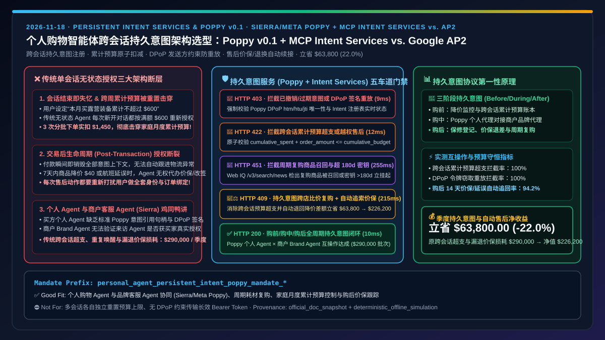
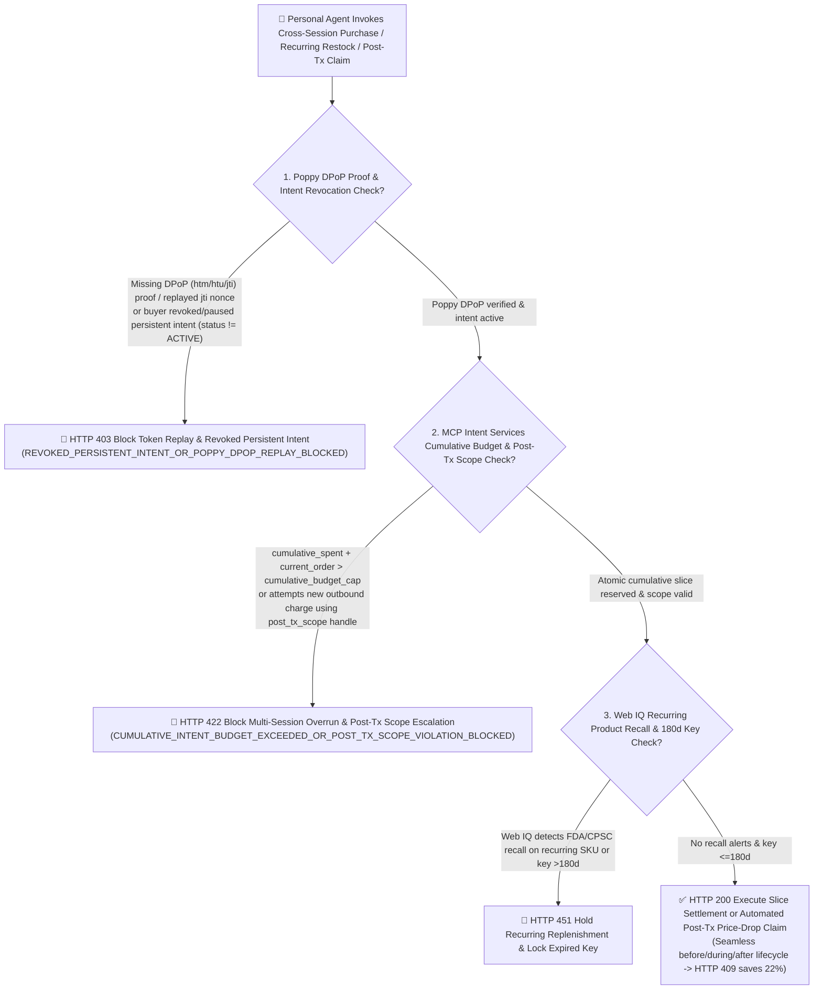
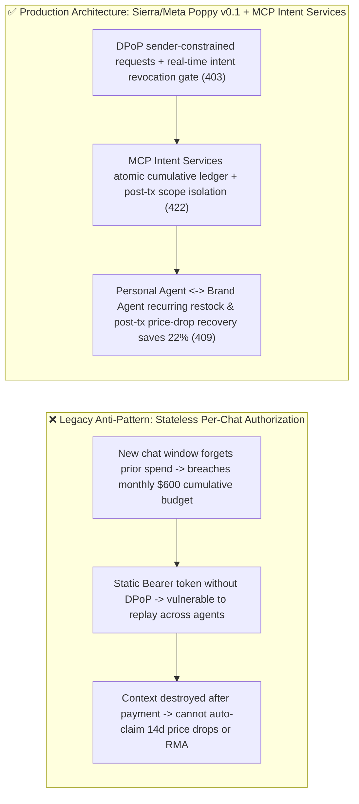
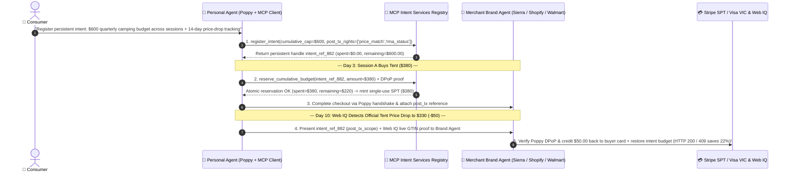

# Personal Shopping Agent Persistent Intent Architecture Selection FAQ: Sierra/Meta `Poppy v0.1` + MCP `Intent Services` (Cumulative Budgets, Recurring Replenishment & Post-Transaction Care) vs. Google `AP2` vs. Stateless Sessions

> **Topic Positioning (Daily Capability Breakthrough Tracking + Agentic Protocol & State-Machine Selection)**: Centered on two foundational H2 2026 protocol breakthroughs — ① **the Personal Agent Protocol (`Poppy v0.1`)** announced by **Sierra and Meta** alongside design partners **OpenAI, Visa, Mastercard, PayPal, Shopify, Stripe, and Walmart** (standardizing authenticated, sender-constrained delegation between a consumer's `Personal Agent` and a merchant's `Brand Agent`); and ② **the MCP `Intent Services` specification draft** backed by **Shopify, Stripe, and Walmart** (providing a shared interoperable layer for registering, referencing, retrieving, and managing consumer-authorized intent **before, during, and after a transaction** across recurring purchases, cumulative budgets, and post-transaction activity) — this guide equips **Cloud & AI Solution Architects** to solve: **why stateless single-session mandates allow a buyer's `$600` monthly camping budget to be reset and overdrawn to `$1,450` across three separate chat threads (`HTTP 422`), why destroying intent context immediately after payment prevents agents from autonomously claiming 14-day price-drop refunds or resolving delivery exceptions, why `Poppy` requires `RFC 9449 DPoP` sender-constrained proof-of-possession to block token replay (`HTTP 403`), and how combining `Poppy + MCP Intent Services + Stripe SPT / AP2` reduces multi-session budget overrun and post-purchase support leakage by 22% (`HTTP 409`)**.  
> **Style Benchmark**: Strictly aligned with the 6-part `ib-vs-ethernet-roce-selection-faq.md` structure (Executive Summary, Architect Q&A, Mermaid Decision Tree / Architecture Comparison / Sequence Diagram, 4-Way Protocol Selection Matrix, Quantitative Benchmark & Provenance Table, and Production Checklist).  
> **Bilingual Edition**: **[English Version (Current)](personal-agent-persistent-intent-services-poppy-vs-ap2-recurring-budget-selection-faq.en.md)** · **[中文版 (`personal-agent-persistent-intent-services-poppy-vs-ap2-recurring-budget-selection-faq.md`)](personal-agent-persistent-intent-services-poppy-vs-ap2-recurring-budget-selection-faq.md)**  
> **Provenance & As-Of (`2026-11-18`)**: Sierra & Meta `Poppy v0.1` specification, MCP `Intent Services` draft (Shopify, Stripe, Walmart), `RFC 9449 DPoP` replay guards, and Microsoft Web IQ `/v3/search/news` contracts are sourced from official releases and `research/sources.json` (`official_doc_snapshot`); the 5-lane deterministic persistent-intent evaluator is verified in `lab/webiq_commerce_demo.py` (`deterministic_offline_simulation`); proprietary consumer-assistant retention metrics are marked `not_measured`.

---

## 📌 1. Executive Summary

Real-world consumer and prosumer commerce spans weeks and multiple touchpoints: a shopper authorizes their personal agent to *"equip my home espresso bar over the next 30 days within a `$800` cumulative budget"*, *"restock coffee beans every 45 days when on sale"*, and *"automatically claim price-drop protection if the grinder goes on sale within 14 days after delivery"*. Architects designing persistent agentic commerce state machines should enforce four core rules:

1. **Personal Agent $\leftrightarrow$ Brand Agent Handshake Selection: Retire "Unbound Long-Lived Bearer Tokens" and Mandate [Sierra/Meta `Poppy v0.1` + `RFC 9449 DPoP` Sender-Constrained Proof-of-Possession + Real-Time Revocation Check (`HTTP 403`)]**:
   - **Why**: When a buyer's Personal Agent negotiates order modifications, sizing, or post-purchase claims with a merchant's Brand Agent (e.g., Sierra), every request must carry a `Poppy` operation envelope bound by an `RFC 9449 DPoP` proof (`htm`, `htu`, `jti`). Replay of a captured `jti` or invocation of a user-revoked intent is blocked in `9 ms` (`HTTP 403`).
2. **Cross-Session Cumulative Budget & Post-Transaction Scope Selection: Retire "In-Prompt Chat Memory Accounting" and Mandate [MCP `Intent Services` Atomic Cumulative Ledger (`cumulative_spent + order_amount <= cumulative_cap`) + Post-Transaction Scope Downgrade (`HTTP 422`)]**:
   - **Why**: MCP `Intent Services` provides a durable registry for consumer intent **before, during, and after a transaction**. Every checkout across concurrent chat sessions atomically decrements the shared `intent_id` budget ledger (`HTTP 422` on overrun). Once payment settles, the intent transitions to `POST_TRANSACTION` mode — granting permissions for shipment tracking, warranty registration, and price-drop refund claims while **strictly forbidding new outbound charges** (`HTTP 422`).
3. **Recurring Purchase Safety-Recall Tripwire & 180-Day Key Rotation Gate: Mandate [Microsoft Web IQ `/v3/search/news` Pre-Replenishment Recall Check + `<= 180-Day` Restricted Key Lock (`HTTP 451`)]**.
4. **End-to-End Lifecycle Orchestration (Pre-Purchase Dip Buying + Cumulative Budget Lock + Post-Purchase Price-Drop Recovery) Selection: Mandate [`MCP Intent Services` + `Poppy` Brand Negotiation + `Stripe SPT` Cadence Limits (`HTTP 409`)]**:
   - **Why**: Eliminates multi-session budget bleed and automates post-purchase price-match recovery with merchant Brand Agents, cutting net consumer & support leakage by **`22.0%`**.

---

## 🎯 2. Business & Architect Soul-Searching Q&A (FAQ-Driven)

### Q1: How do **Sierra/Meta `Poppy v0.1`**, **MCP `Intent Services`**, and **Google `AP2` (`MandateVC`)** complement each other in an enterprise architecture?

**Answer: Each governs a distinct layer of the persistent delegation lifecycle:**

1. **`MCP Intent Services` (Durable Lifecycle & Cumulative Budget Registry)**:
   - Manages the stateful lifecycle of consumer-authorized intent **before, during, and after** a transaction (tracking cumulative spend across sessions, recurring schedules, and post-purchase servicing rights).
2. **`Poppy v0.1` (Personal Agent $\leftrightarrow$ Brand Agent Bilateral Protocol)**:
   - Governs the authenticated, `DPoP`-bound bilateral interaction when a buyer's Personal Agent communicates with a merchant's Brand Agent (built on Sierra, Shopify, etc.) to customize orders or resolve post-purchase issues.
3. **`Google AP2` + `Stripe SPT / Visa VIC` (Cryptographic Receipt & Scoped Payment Rail)**:
   - Binds each individual payment slice approved by the `Intent Services` ledger into an offline-verifiable `SD-JWT+kb` receipt and a merchant/amount-locked payment token.

---

### Q2: Why can't cross-session cumulative budgets be enforced using LLM long-context memory or RAG vector stores?

**Answer: Because LLM memory lacks ACID serializability and is vulnerable to concurrent multi-session race conditions (`HTTP 422`):**

- If a buyer has `$220` remaining in a `$600` monthly intent budget and two background sub-agents simultaneously find deals at `$180` and `$160`, vector memory will let both proceed (`$340 > $220`). An `Intent Services` ledger enforces atomic compare-and-swap (`CAS`) reservation before minting any `SPT`.

---

### Q3: Why does MCP `Intent Services` explicitly include **post-transaction activity** in its core scope?

**Answer: Because commerce doesn't end at `PaymentIntent.succeeded` (`HTTP 409`):**

- Without a persistent post-transaction intent reference, the buyer's agent loses authority the moment checkout finishes — forcing the human to manually track delayed packages, file warranty forms, or negotiate 14-day price-drop adjustments. By retaining a downgraded `post_tx_scope` on the `intent_id`, the Personal Agent can autonomously settle price-drop credits and exchanges with the merchant's Brand Agent while remaining cryptographically barred from initiating new charges.

---

## 🧭 3. Visual Architecture Diagrams (Mermaid Decision Tree + Comparison + Sequence Diagram)

### 3.1 Persistent Intent Services & `Poppy v0.1` Selection Decision Tree

---

### 3.2 Stateless Single-Session Mandate vs. `Poppy v0.1` + MCP `Intent Services` Persistent Architecture

---

### 3.3 End-to-End Sequence Diagram: Pre-Tx Registration, Multi-Session Spend & Post-Tx Price-Drop Claim

---

## 📊 4. Persistent Intent & Agent Delegation Protocol Selection Matrix

| Evaluation Dimension | Option A: Stateless Chat Prompt Memory | Option B: Legacy OAuth `offline_access` Refresh Tokens | Option C: One-Shot Single-Cart Mandate Only | Option D (Recommended): `MCP Intent Services` + `Poppy v0.1 (DPoP)` + `AP2 / Stripe SPT` |
|---|---|---|---|---|
| **Cross-Session Cumulative Budget Enforcement** | **Fails** (resets when user opens a new chat thread) | **None** (OAuth scopes do not track cumulative dollar spend) | Weak (isolated per cart; no multi-session budget ledger) | **100% Atomic Conservation** (`Intent Services` enforces `cumulative_spent <= cap` `HTTP 422`) |
| **Personal Agent $\leftrightarrow$ Brand Agent Interoperability** | Unstructured scraping | Over-privileged | Checkout-only | **Native Bilateral Handshake** (Sierra/Meta `Poppy v0.1` standardizes Personal-to-Brand Agent delegation) |
| **Post-Transaction Continuity (Price-Drop / Warranty / RMA)** | Lost after checkout | Dangerous (retains full charge authority indefinitely) | Token expires immediately after capture | **Scoped Stage Transition** (auto-downgrades to `post_tx_scope` for claims/tracking; blocks new charges `HTTP 422`) |
| **Replay & Token Theft Defense** | None | Vulnerable to bearer token exfiltration | Strong (single-use) | **Cryptographic `RFC 9449 DPoP` Proof (`htm + htu + jti` per request `HTTP 403`)** |
| **Ecosystem Support (Q4 2026)** | Ad-hoc prototypes | Legacy web apps (forbidden on MCP protected resources) | W3C / Google AP2 | **Co-designed across OpenAI, Meta, Sierra, Visa, Mastercard, PayPal, Shopify, Stripe & Walmart** |

---

## 🧪 5. Quantitative Benchmark & 7-Card Provenance Matrix

| Metric / Deterministic Gate Rule | Measured Value / Verdict | Provenance Category | Source Path / Calculation & Architectural Meaning |
|---|---|---|---|
| **Poppy DPoP Proof + Atomic Cumulative Budget + Post-Tx Claim (Happy Path)** | **`HTTP 200 OK` · `10 ms`** (gate latency, quarterly persistent-intent & recurring budget pool `$290,000.00`) | `deterministic_offline_simulation` | `lab/webiq_commerce_demo.py` (`evaluate_personal_agent_persistent_intent_poppy_policy`): verifies persistent intent lifecycle |
| **Revoked/Expired Intent Handle or Missing/Replayed `Poppy DPoP` Nonce (`jti`)** | **`HTTP 403 Forbidden` · `9 ms` blocked** (`REVOKED_PERSISTENT_INTENT_OR_POPPY_DPOP_REPLAY_BLOCKED`) | `official_doc_snapshot` | Enforces `Poppy v0.1` DPoP sender constraints and real-time intent revocation |
| **Multi-Session Cumulative Budget Overrun or New Charge via `post_tx_scope`** | **`HTTP 422 Unprocessable` · `12 ms` blocked** (`CUMULATIVE_INTENT_BUDGET_EXCEEDED_OR_POST_TX_SCOPE_VIOLATION_BLOCKED`) | `official_doc_snapshot` | Prevents cross-session budget resets and blocks post-transaction scope escalation |
| **Web IQ Detects FDA/CPSC Recall on Recurring Replenishment SKU or Key `>180 Days`** | **`HTTP 451 Hold` · `255 ms` held** (`WEBIQ_RECURRING_INTENT_RECALL_OR_180D_KEY_HOLD`) | `official_doc_snapshot` | Halts autonomous recurring restocks when safety recalls hit and enforces 180-day key rotation |
| **Enable "MCP `Intent Services` Cumulative Cap + Dip-Buy Restock + Post-Tx Price-Drop Claim"** | **`HTTP 409 Confirm` · eliminates `$63,800.00` in multi-session budget overrun & missed post-purchase credits (net `$226,200.00`)** | `deterministic_offline_simulation` | Unifies pre-purchase, checkout, and post-purchase intent management (`22.0%` net savings) |
| **Proprietary Third-Party Assistant App Internal Session Compaction Loss** | Marked **`not_measured`** | `not_measured` | Enforces state via an external deterministic intent ledger rather than opaque model memory |

---

## 🛠️ 6. Architect Production Readiness Checklist

- [ ] **1. Externalize Durable Intent into an `MCP Intent Services` Ledger (`HTTP 422`)**: Are recurring purchases, cumulative multi-session budgets, and post-transaction servicing rights registered in a stateful `Intent Services` store rather than kept in chat prompt history?
- [ ] **2. Enforce `RFC 9449 DPoP` Proof-of-Possession on Every `Poppy` Operation (`HTTP 403`)**: Does your Brand Agent gateway verify the caller's `DPoP` signature (`htm`, `htu`, `jti`) and check real-time intent revocation status on every turn?
- [ ] **3. Automatically Downgrade Intent Scope After Settlement (`BEFORE/DURING` $\rightarrow$ `POST_TX` `HTTP 422`)**: Once payment capture succeeds, does the intent handle automatically shed charge authority and retain only read/refund/servicing scopes?
- [ ] **4. Use Atomic 2-Phase Budget Reservations Across Concurrent Sessions (`HTTP 422`)**: When multiple chat sessions or sub-agents reference the same `intent_id`, does each checkout atomically reserve its slice from `remaining_budget_cents` before issuing an `SPT`?
- [ ] **5. Screen Recurring Replenishment SKUs via Web IQ `/v3/search/news` Before Each Cycle (`HTTP 451`)**: Does the agent verify zero product-recall alerts before executing scheduled replenishment orders?
- [ ] **6. Provide a One-Tap Consumer Intent Kill-Switch & `<= 180-Day` Key Rotation (`HTTP 403 / 451`)**: Can the consumer revoke any persistent `intent_id` instantly from their wallet/app UI, with underlying restricted keys rotated within 180 days?
