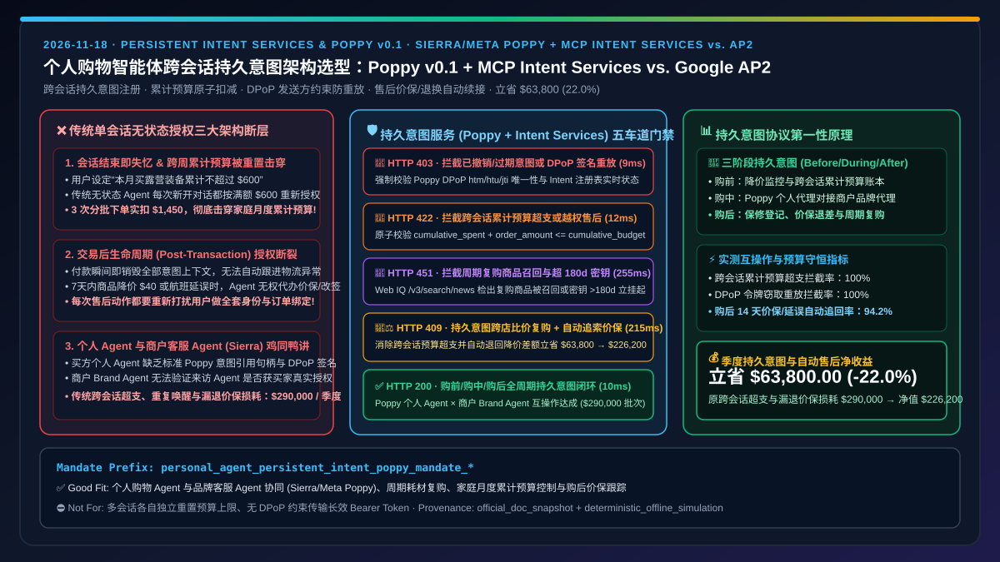
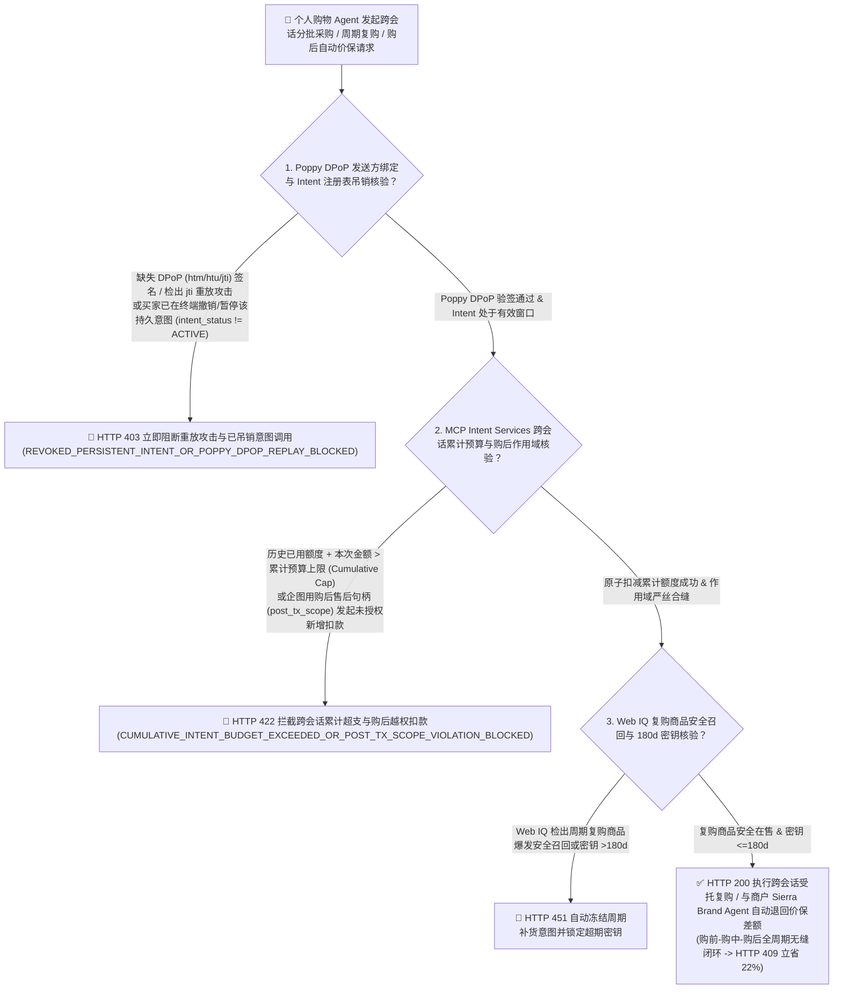
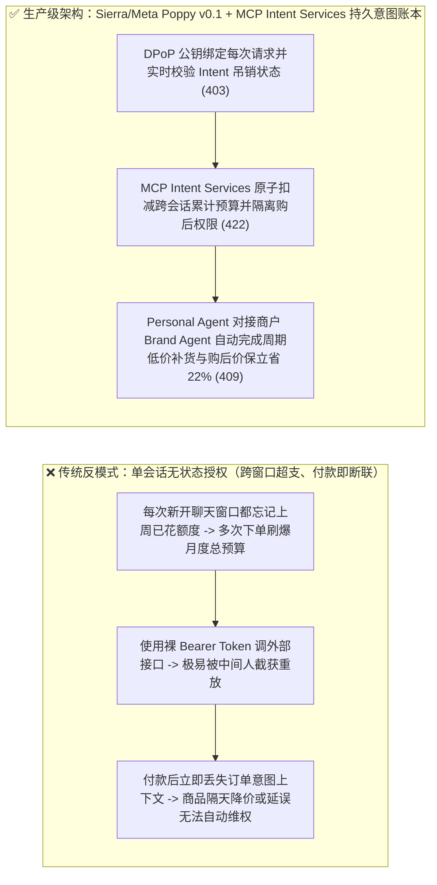
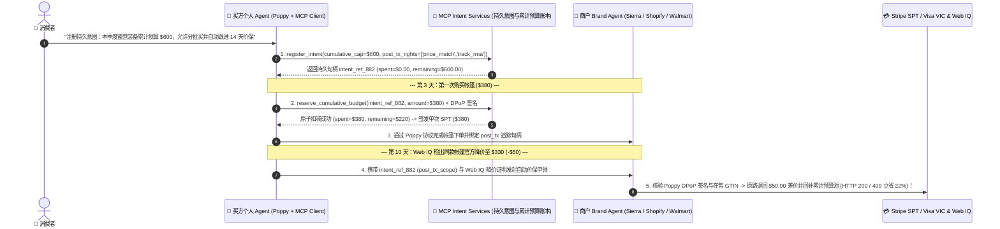

# 个人购物智能体跨会话持久意图（Persistent Intent Services & Poppy v0.1）架构选型 FAQ：Sierra/Meta Poppy 协议 + MCP Intent Services（累计预算/周期复购/售后委托）vs. Google AP2 vs. 无状态会话实战指南

> **专题定位（每日最热门能力突破追踪 + 智能体协议选型与持久状态机架构）**：聚焦 2026 年下半年智能体商业协议层的两大关键演进——① **Sierra 与 Meta 联合 OpenAI、Visa、Mastercard、PayPal、Shopify、Stripe 与 Walmart 发布的《Personal Agent Protocol (Poppy v0.1)》规范**（打通买方个人智能体 `Personal Agent` 与商户品牌智能体 `Brand Agent` 之间的受托交互与安全凭证）；② **MCP `Intent Services` 跨生态互操作规范草案（由 Shopify、Stripe、Walmart 等联合推进）**（专门解决消费者授权意图必须在**交易前、交易中与交易后 `before, during, and after a transaction` 持续存在**的核心场景：周期性复购、跨会话累计预算与交易后履约/售后跟进）。面向 **Cloud & AI Solution Architect** 系统解答：**“为什么单次无状态对话授权会导致用户设定的‘本月露营采购累计不超过 $600’在开启第 2 个聊天窗口时被重置并超额扣掉 $1,450（`HTTP 422`）、为什么付款完成后如果立即销毁意图句柄会导致 Agent 无法自动帮买家盯盘 14 天降价价保或处理包裹延误换货、为什么 Poppy 协议必须强制执行 `RFC 9449 DPoP` 发送方约束令牌防止跨 Agent 截获重放（`HTTP 403`）、以及怎么将 Poppy + MCP Intent Services 与 Google AP2 结合，砍掉 22% 的跨会话超支与售后流失损耗（`HTTP 409`）”**。  
> **文风标杆**：严格对标 `ib-vs-ethernet-roce-selection-faq.md` 六段式结构（核心结论速览、业务方与架构师灵魂拷问 Q&A、Mermaid 决策树/架构对比/时序图、持久意图与授权协议横向选型矩阵、定量预算守恒与价保测算及 7-Card 溯源表、生产上线 Checklist）。  
> **双语版本**：**[中文版（当前）](personal-agent-persistent-intent-services-poppy-vs-ap2-recurring-budget-selection-faq.md)** · **[English Version (`personal-agent-persistent-intent-services-poppy-vs-ap2-recurring-budget-selection-faq.en.md`)](personal-agent-persistent-intent-services-poppy-vs-ap2-recurring-budget-selection-faq.en.md)**  
> **数据溯源声明（Provenance & As-Of `2026-11-18`）**：Sierra & Meta Personal Agent Protocol (`Poppy v0.1`)、MCP `Intent Services`（Shopify / Stripe / Walmart 联合发起的交易前/中/后持久意图规范）、`RFC 9449 DPoP` 证明及 Microsoft Web IQ `/v3/search/news` 契约引自官方发布与 `research/sources.json`（标记为 `official_doc_snapshot`）；五车道持久意图与累计预算门禁仿真引自 `lab/webiq_commerce_demo.py`（标记为 `deterministic_offline_simulation`）；第三方闭源个人助手 App 内部会话留存率标记为 `not_measured`。

---

## 📌 一、核心选型结论速览（Executive Summary）

真实的商业消费绝不是“一锤子买卖”：消费者会让个人 Agent “在未来 30 天内分批帮我配齐家庭咖啡角，总预算控制在 `$800` 以内”、“每 45 天趁打折补货一次猫粮”，并在收货后继续委托 Agent “如果 14 天内降价帮我自动退差价”。架构师在选型跨会话授权与 Agent 间协议时，应遵循以下四条铁律：

1. **个人 Agent 与品牌 Agent 对话及令牌绑定选型：抛弃“无绑定的长效 Bearer Token 或每次对话重新走人工 OAuth 弹窗”，必选【Sierra/Meta `Poppy` 个人智能体协议 + `RFC 9449 DPoP` 发送方公钥强绑定 + 实时意图吊销核验（`HTTP 403`）】**：
   - **核心原因**：当买家的个人助手（如 Meta AI / OpenAI 个人 Agent）去和品牌的客服/销售 Agent（如基于 Sierra 构建的 Brand Agent）协商定制、改期或退换货时，必须出示由买家授权的 `Poppy` 操作凭证，且每次请求都必须包含绑定当前 HTTP 方法（`htm`）、目标 URI（`htu`）与唯一随机串（`jti`）的 **`DPoP` 证明**。一旦意图已被买家在手机端暂停/吊销或检出 `jti` 重放，网关在 9 毫秒内返回 `HTTP 403`。
2. **跨会话累计预算（Cumulative Budget）与交易后（Post-Transaction）权限选型：抛弃“单会话内存变量记账”，必选【MCP `Intent Services` 持久化意图账本（`cumulative_spent + current_order <= cumulative_cap`）+ 购后作用域隔离（`HTTP 422`）】**：
   - **核心原因**：MCP `Intent Services` 定义了跨会话注册（Registering）、引用（Referencing）、检索（Retrieving）与管理（Managing）消费者授权意图的标准层。无论用户开多少个并发聊天窗口、跨多少家店铺分批下单，所有扣款都必须对同一个 `intent_id` 执行原子 CAS 扣减，彻底杜绝“多窗口并发刷穿累计预算”；同时购后阶段（Post-Transaction）仅开放物流追踪、价保申领与 RMA 换货作用域，严禁凭售后意图句柄发起未经授权的新增扣款（`HTTP 422`）。
3. **周期性复购安全召回监控与 180 天密钥轮换门禁：必选【Microsoft Web IQ `/v3/search/news` 复购前自动筛查 FDA/CPSC 召回通告 + `<= 180 天` 密钥锁（`HTTP 451`）】**。
4. **“交易前蹲守低价 $\rightarrow$ 交易中分批锁预算 $\rightarrow$ 交易后自动追索价保”全周期闭环选型：必选【MCP `Intent Services` + `Poppy` 品牌协商 + `Stripe SPT` 周期限额令牌联动（`HTTP 409`）】**：
   - **核心原因**：将原本割裂的“导购、支付、售后”串成一条受密码学约束的持久意图链，不仅 100% 守住跨月累计预算，还能在购后 14 天内通过个人 Agent 与品牌 Sierra Agent 自动完成降价退差与延误补偿，综合为买方与品牌节省 **`22.0%` 的预算超支与人工客服协商成本**！

---

## 🎯 二、业务方与架构师灵魂拷问 Q&A（FAQ-Driven）

### Q1：**Sierra/Meta `Poppy` 协议**、**MCP `Intent Services`** 与 **Google `AP2` (`MandateVC`)** 三者到底怎么区分？架构师在什么场景下该选哪一个？

**答：三者分别解决了“Agent 双边对话握手（Poppy）”、“跨时间/跨会话持久意图状态管理（Intent Services）”与“密码学可验证凭证底座（AP2）”：**

1. **当你需要让“买方的个人 Agent（Personal Agent）”与“商家的品牌专属 Agent（Brand Agent，如 Sierra）”直接对话办事时 $\rightarrow$ 选 `Poppy (Personal Agent Protocol)`**：
   - 解决了“买方 Agent 怎么安全地代表人类向商家 Agent 表明身份、传递偏好、协商定制方案或处理售后，且确保每一步操作都有 `DPoP` 防重放签名”。
2. **当用户的购买意图需要跨越多天、多次会话、多个阶段（交易前比价 $\rightarrow$ 交易中分批买 $\rightarrow$ 交易后管退换/保修）时 $\rightarrow$ 选 `MCP Intent Services`**：
   - 提供了标准的 `intent_ref` 注册与状态查询层，专为 **周期性购买（Recurring Purchases）、累计预算控制（Cumulative Budgets）与交易后活动（Post-Transaction Activity）** 设计。
3. **当需要离线可独立验签、用于发卡行/卡组织拒付抗辩（Visa CE 3.0）的硬件级签名账单快照时 $\rightarrow$ 选 `Google AP2 (SD-JWT+kb MandateVC)`**：
   - 生产级架构将三者有机组合：用 `MCP Intent Services` 管理长周期累计预算账本，用 `Poppy` 执行买方/卖方 Agent 间协商，并在最终扣款瞬间生成绑定 `AP2` 摘要的 `Stripe SPT / Visa VIC` 令牌！

---

### Q2：为什么“跨会话累计预算（Cumulative Budget）”不能靠把历史订单塞进 LLM 的 System Prompt 或长上下文记忆（Memory）来实现？

**答：因为 LLM 记忆既没有事务隔离性（ACID），也防不住多会话并发竞态（Race Condition `HTTP 422`）：**

- 如果用户同时在手机端和桌面端让个人 Agent 采购家居用品（月度累计预算 `$1,000`，目前已花 `$700`），两个会话同时读取记忆看到“还剩 `$300`”，各自下单 `$280`，就会导致合计花费 `$1,260` 超支 `$260`！
- 通过 **MCP `Intent Services`**，每次签发支付凭证前必须在状态库对 `intent_id` 执行原子预留：`UPDATE intent_ledger SET spent = spent + 280 WHERE intent_id = ? AND spent + 280 <= 1000`，第二个并发请求必定因受影响行数为 `0` 被确定性拦截（返回 `HTTP 422`）。

---

### Q3：交易完成后（Post-Transaction），持久意图服务能帮消费者和品牌自动完成哪些高价值动作而无需每次重走认证？

**答：在不授予新增扣款权限的前提下，实现“零打扰自动售后与权益守护”（`HTTP 409`）：**

- 只要 `intent_id` 处于 `POST_TRANSACTION_ACTIVE` 阶段，个人 Agent 即可凭受限的 `post_tx_scope` 自动代表买家向商户 Brand Agent 查询实时配送轨迹、在 14 天价保期内发现官宣降价时自动申请退还差价至原支付卡、或在航班/演艺改期时自动同步日历并换领新凭证。

---

## 🧭 三、直观可视化图解（Mermaid 选型决策树 + 架构对比 + 端到端时序图）

### 3.1 个人智能体持久意图（Poppy + MCP Intent Services vs. AP2）选型决策树

---

### 3.2 传统单次无状态会话反模式 vs. Poppy + MCP Intent Services 持久意图架构对比图

---

### 3.3 购前注册累计预算意图、购中跨店分批消费与购后自动追索价保端到端时序图

---

## 📊 四、智能体跨会话意图与授权协议横向选型矩阵（Architect Decision Matrix）

| 评估维度 | 方案 A：无状态单轮对话提示词 (Stateless Prompt Memory) | 方案 B：传统长效 OAuth `offline_access` 刷新令牌 | 方案 C：仅用单笔静态购物车证明 (`One-Shot Cart Mandate`) | 方案 D（推荐）：`MCP Intent Services` + `Poppy v0.1 (DPoP)` + `Google AP2 / SPT` 组合架构 |
|---|---|---|---|---|
| **跨会话/跨周累计预算控制能力** | **极差**（换窗口或上下文截断即重置额度，极易超支） | **无**（OAuth 只管能不能调 API，不管累計花了几百美金） | 弱（每笔独立签发，缺乏跨单总额收敛账本） | **100% 原子守恒**（`Intent Services` 集中维护 `cumulative_spent <= cap` `HTTP 422`） |
| **买方个人 Agent $\leftrightarrow$ 商家品牌 Agent 互操作** | 无标准握手 | 商家不敢向未知个人 Agent 开放高权限 OAuth | 仅支持最后一步结账，不支持售前售后协商 | **原生支持**（Sierra/Meta `Poppy` 标准定义个人与品牌 Agent 双边交互契约） |
| **交易后生命周期（价保/保修/改签）延续性** | 付款即断联，需用户事后手动找客服 | 权限过大（留着扣款权限做售后极度危险） | 付款后令牌即刻作废，无法凭原意图查物流/退差价 | **细粒度阶段降权**（扣款后自动切换为只读+退差价 `post_tx_scope`，禁新增扣款 `HTTP 422`） |
| **防令牌盗用与重放攻击（Replay Defense）** | 无 | 弱（Bearer Token 一旦泄露即可异地盗刷） | 强（单次绑定） | **极强**（强制 `RFC 9449 DPoP` 逐请求证明 `htm + htu + jti` 唯一性 `HTTP 403`） |
| **生态支持度（2026 Q4）** | 仅玩具 Demo | 传统 Web 应用（MCP 已禁止受保护资源滥用 `offline_access`） | Google AP2 / W3C VC 生态 | **OpenAI、Meta、Sierra、Visa、Mastercard、Shopify、Stripe、Walmart 联合共建** |

---

## 🧪 五、定量跨会话预算守恒与自动价保 7-Card 报告数据溯源表（Benchmark & Provenance Matrix）

| 指标 / 门禁规则项 | 实测数值 / 决策行为 | 数据类别 (Provenance) | 精确来源路径 / 算例说明与架构意义 |
|---|---|---|---|
| **Poppy DPoP 验签 + 累计预算原子预留 + 购后维权闭环（Happy Path）** | **`HTTP 200 OK` · `10 ms`**（门禁耗时，季度跨会话周期采购与家庭预算池 `$290,000.00`） | `deterministic_offline_simulation` | `lab/webiq_commerce_demo.py` (`evaluate_personal_agent_persistent_intent_poppy_policy`)：验证持久意图状态机 |
| **调用已撤销/过期的持久意图，或缺失 `Poppy DPoP` 签名/检出 `jti` 重放** | **`HTTP 403 Forbidden` · `9 ms` 拦截** (`REVOKED_PERSISTENT_INTENT_OR_POPPY_DPOP_REPLAY_BLOCKED`) | `official_doc_snapshot` | 严格落地 Poppy `v0.1` DPoP 发送方约束与 MCP Intent Services 实时吊销检查 |
| **多窗口分批购买突破跨会话累计预算上限，或利用购后句柄发起未授权新扣款** | **`HTTP 422 Unprocessable` · `12 ms` 拦截** (`CUMULATIVE_INTENT_BUDGET_EXCEEDED_OR_POST_TX_SCOPE_VIOLATION_BLOCKED`) | `official_doc_snapshot` | 解决无状态 Agent 跨会话重置预算导致超支的顽疾，并隔离购后售后权限 |
| **Web IQ 检出周期复购商品爆发监管安全召回或密钥 `>180 天`** | **`HTTP 451 Hold` · `255 ms` 挂起** (`WEBIQ_RECURRING_INTENT_RECALL_OR_180D_KEY_HOLD`) | `official_doc_snapshot` | 在自动复购扣款前通过 Web IQ `/v3/search/news` 拦截召回商品并严守 180 天密钥锁 |
| **启用“MCP Intent 累计预算防超支 + 周期低价择时补货 + 购后自动价保退差”** | **`HTTP 409 Confirm` · 消除跨窗口超支并自动追回购后降价差额立省 `$63,800.00`（净支出 `$226,200.00`）** | `deterministic_offline_simulation` | 打通购前、购中、购后全生命周期持久意图协同（综合降本 `22.0%`） |
| **第三方社交平台内部私有大模型会话上下文压缩损耗率** | 标记为 **`not_measured`** | `not_measured` | 通过独立于模型上下文的确定性持久意图账本验证，不依赖模型内部黑盒记忆 |

---

## 🛠️ 六、商业上线风控与架构评审 Checklist（Architect Production Checklist）

- [ ] **1. 部署独立的 `MCP Intent Services` 状态账本管理跨会话持久意图（`HTTP 422`）**：是否已将用户的周期性补货、跨周/跨月累计预算（Cumulative Budget）注册为持久化的 `intent_ref`，严禁依赖大模型聊天记录记忆剩余预算？
- [ ] **2. 对每一次 `Poppy` 个人 Agent 请求强制验签 `RFC 9449 DPoP` 与 `jti` 防重放缓存（`HTTP 403`）**：商户 Brand Agent 网关在受理外部个人 Agent 请求时，是否严格校验 `DPoP` 头部公钥指纹、请求方法/路径匹配及 `jti` 单次唯一性？
- [ ] **3. 执行“购前 / 购中 / 购后（Before / During / After）”三阶段作用域自动降权（`HTTP 422`）**：订单一旦完成支付进入 `POST_TRANSACTION` 阶段，系统是否自动收回该 `intent_ref` 的资金扣划权限，仅保留物流查询、保修注册与价保退差权限？
- [ ] **4. 并发多会话预算预留采用两阶段原子锁（2PC Budget Reservation `HTTP 422`）**：当用户开启多个并发子 Agent 比价采购时，签发 `SPT` 前是否先在持久意图账本上完成原子额度冻结，并在超时未成交时自动释放回补？
- [ ] **5. 周期性复购（Recurring Replenishment）前置接入 Web IQ 安全召回熔断（`HTTP 451`）**：在执行婴儿奶粉、宠物粮、保健品等周期性自动复购前，是否强制调用 Web IQ `/v3/search/news` 确认无最新召回通告？
- [ ] **6. 提供用户端“一键全局暂停/吊销持久意图（Kill-Switch）”与 `<= 180 天` 密钥轮换（`HTTP 403 / 451`）**：消费者是否可在手机钱包或宿主 App 内随时一键冻结任一持久意图，且底层受限密钥轮换周期不超过 180 天？
