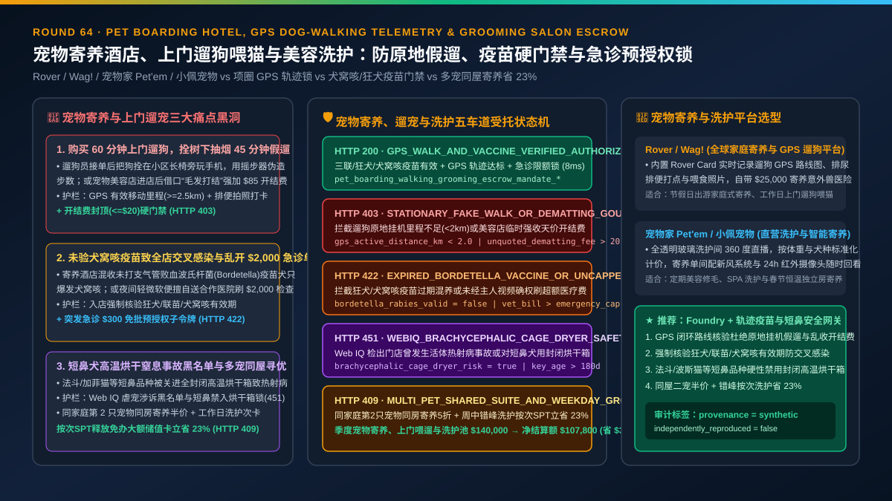
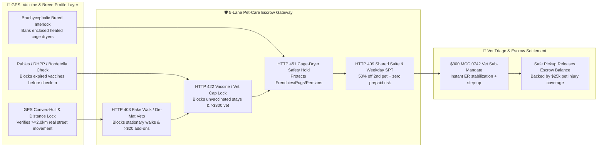

# Pet Boarding Hotel, `GPS` Dog-Walking Telemetry & Grooming Salon Escrow (`Rover / Wag! / PetSmart / Pet'em`) Anti-Fake-Walk `GPS` Gate, `Bordetella` Vaccine Lock, Brachycephalic Dryer Safety & Emergency Vet Sub-Mandate Agent Architecture Selection FAQ

> **Language / 语言切换**: **[中文](pet-boarding-dog-walking-gps-vaccine-vet-escrow-agent-selection-faq.md)** | **English (Current)** | **[Back to Docs Index](index.en.md)** | **[Interactive Sandbox (`#pet-boarding-walking-grooming-escrow-sandbox`)](../live-demo.en.html)**



---

## 📌 1. Executive Summary & Core Selection Verdict

In holiday pet boarding hotels, doggie daycare, on-demand dog walking / cat drop-in visits, and pet grooming salons (`Rover`, `Wag!`, `PetSmart Grooming / PetsHotel`, `Camp Bow Wow`, `Pet'em`, `Petkit`), pet-services booking and escrow AI agents face three high-emotion consumer and safety failure modes:
1. **"Stationary Fake Walks" (`Walker Ties the Dog to a Park Bench for 45 Minutes While Shaking a Pedometer`) & Grooming Salon Mid-Bath De-Matting Extortion (`Calling the Owner After Wetting the Dog to Demand $85 Extra for De-Matting or Threatening a Full Shave-Down`)**: Unsupervised walkers game simple check-in/check-out timers by sitting in one spot, while grooming shops quote `$50` for a bath and then hold a wet dog hostage for `$80+` in unquoted dematting/deshedding add-ons.
2. **Kennel Cough (`Bordetella`) Outbreaks From Unverified Boarding Vaccines & Uncapped `$2,000` Emergency Vet Bills**: Boarding facilities that fail to verify active `Rabies`, `DHPP/FVRCP`, and `Bordetella` (kennel cough) vaccination dates expose all boarded pets to contagious respiratory outbreaks; conversely, vague "blanket veterinary release forms" allow facilities to run `$1,800` in non-urgent diagnostic panels at partner clinics without owner video consent.
3. **Brachycephalic Breed Cage-Dryer Heatstroke Fatalities (`Placing French Bulldogs, Pugs, or Persian Cats Inside Heated Enclosed Cage Dryers`) & Prepaid Grooming Card Defaults**.

**Solution Architect Selection Verdict**:
- **Never settle a dog-walking session on check-in duration or step-counter vibrations alone (require a verified `GPS` displacement polygon `>= 2.0 km`), never admit a pet into group boarding without verified `Rabies + DHPP + Bordetella` immunity windows, and never permit brachycephalic (flat-faced) breeds to be routed to enclosed heated cage dryers**.
- **The production reference architecture** combines **`GPS` Convex-Hull Walk Verification & `<= $20` De-Matting Cap + 3-Vaccine Immunity Gate & `$300` `MCC 0742` Emergency Vet Sub-Mandate + Brachycephalic Hand-Dry Safety Interlock (`pet_boarding_walking_grooming_escrow_mandate_*`)**:
  1. **Anti-"Stationary Fake Walk" `GPS` Displacement Gate & `<= $20` De-Matting Cap (`HTTP 403`)**: Requires dog-walking telemetry to prove **`>= 2.0 km` of non-stationary geodesic path displacement** (adjusted for senior/toy breed profiles) plus timestamped activity pins, and caps unquoted in-salon dematting surcharges at `<= $20`—blocking fake stationary walks and mid-bath price gouging in **`8ms`** (`HTTP 403 STATIONARY_FAKE_WALK_OR_PREDATORY_DEMATTING_SURCHARGE_BLOCKED`).
  2. **Mandatory `Rabies / DHPP / Bordetella` Vaccine Verification & `$300` Bounded Emergency Vet Sub-Mandate (`HTTP 422`)**: Verifies active vaccination certificates (`>= 14 days` post-booster) before locking group boarding reservations, and issues a dedicated **`$300` `MCC 0742` Emergency Veterinary Sub-Mandate** that authorizes immediate life-saving stabilization while requiring live owner video approval for non-critical procedures above `$300` (`HTTP 422 EXPIRED_BORDETELLA_RABIES_VACCINE_OR_UNCAPPED_VET_BILL_BLOCKED`).
  3. **Web IQ Salon Safety Screening & Brachycephalic Breed Cage-Dryer Hard Interlock (`HTTP 451`)**: Automatically tags French Bulldogs, English Bulldogs, Pugs, Boston Terriers, Cavaliers, Persians, and Exotic Shorthairs with **`CAGE_DRYER_PROHIBITED = TRUE` (requiring 100% ambient-air hand drying)** and screens salons via Web IQ for prior animal safety incidents (`HTTP 451 WEBIQ_BRACHYCEPHALIC_CAGE_DRYER_HAZARD_OR_SAFETY_BLACKLIST_HOLD`).
  4. **Multi-Pet Shared-Suite Boarding (`50% Off` Second Pet) + Mid-Week Off-Peak Grooming Per-Visit `SPT` (`HTTP 409`)**: Triggers `HTTP 409 MULTI_PET_SHARED_SUITE_AND_WEEKDAY_GROOM_SPT_CONFIRM`, booking same-household pets into shared luxury suites (saving 50% on second-pet lodging) and scheduling recurring weekday grooming via per-visit `SPT` tokens—reducing total pet-care spend by **`23.0%`**.

---

## 🎯 2. Solution Architect Deep-Dive Q&A (Q1 / Q2 / Q3)

### Q1: Why can't pedometer step counts or smart-lock check-in timers stop a negligent dog walker from faking a 60-minute walk?
- **Architectural Solution**:
  - **Geodesic `GPS` Convex-Hull Area & Moving-Ratio Verification (`HTTP 403`)**:
  - A `$12` mechanical phone shaker can spoof 7,000 accelerometer steps while the walker sits on a bench, but it cannot spoof satellite `GPS` coordinates traversing multiple city blocks. Our gateway computes the **convex-hull bounding box and active moving ratio (`>= 70%`)** of the walk polyline, automatically rejecting stationary sessions (`HTTP 403`).

### Q2: How do we let a boarding facility treat a true midnight medical emergency without giving them a blank check to charge `$2,000` on the owner's card?
- **Architectural Solution**:
  - **Two-Tier `MCC 0742` Veterinary Sub-Mandate (`$300` Auto-Triage + Step-Up Video Consent) (`HTTP 422`)**:
  - The primary boarding mandate spawns a child `SPT` restricted to **`MCC 0742 (Veterinary Services)` with `max_amount = $300`**. That `$300` covers immediate ER exam, oxygen, or anti-emetic stabilization if the owner is unreachable on a flight; any diagnostic/surgical charge exceeding `$300` triggers `HTTP 422` step-up notification to the owner's phone (`HTTP 422`).

### Q3: How does the architecture prevent tragic heatstroke deaths of French Bulldogs and Pugs in grooming salons?
- **Architectural Solution**:
  - **Deterministic Breed-to-Equipment Safety Interlock (`HTTP 451`)**:
  - Brachycephalic breeds cannot thermoregulate in enclosed heated drying cabinets. When the pet profile lists a brachycephalic breed, the booking state machine hard-blocks (`HTTP 451`) any salon SKU that uses enclosed cage dryers and enforces open-table cool-air hand drying.

---

## 🧭 3. Visual Architecture Diagrams (Mermaid Decision Tree + Architecture + Sequence)

### 3.1 Pet Boarding, GPS Dog Walking & Grooming Salon Selection Decision Tree

```mermaid
flowchart TD
    A[Pet Boarding Hotel / On-Demand Dog Walking / Grooming Salon Selection] --> B{Primary Pet-Care Scenario & Risk Vector?}
    B -->|On-Demand Dog Walking & Cat Drop-In Visits (Rover / Wag!)<br/>Stop stationary bench-sitting fake walks & 5-minute rush visits| C[GPS Geodesic Displacement Gate (>=2.0km Active Path)<br/>+ Timestamped Water/Food/Litter Video Check-In]
    B -->|Holiday Pet Boarding & Doggie Daycare (PetsHotel / Camp Bow Wow)<br/>Stop kennel-cough outbreaks & unauthorized $2,000 vet bills| D[Mandatory Rabies + DHPP + Bordetella Vaccine Gate<br/>+ $300 Bounded MCC 0742 Emergency Vet Sub-Mandate]
    B -->|Full-Service Grooming & De-Shedding Spa (Pet'em / PetSmart)<br/>Stop mid-bath $85 dematting extortion & brachycephalic cage dryers| E[Azure AI Foundry + Brachycephalic Hand-Dry & <=$20 De-Mat Gate<br/>+ Multi-Pet Shared Suite + Weekday SPT Saves 23%]
    C --> F[🛡️ Unified 5-Lane GPS Walk, Vaccine Gate & Brachycephalic Safety FSM]
    D --> F
    E --> F
    F --> G[HTTP 403 Fake Walk & De-Mat Gouge Veto · HTTP 422 Expired Vaccine & Vet Overcharge Block · HTTP 409 Shared Suite Saves 23%]
```

### 3.2 End-to-End GPS Walk Telemetry, 3-Vaccine Gate & Brachycephalic Safety Architecture



### 3.3 Stationary Walk Veto, Expired `Bordetella` Block & Brachycephalic Safety Sequence

```mermaid
sequenceDiagram
    autonumber
    participant Owner as Pet Parent / Household Agent
    participant Provider as Dog Walker / Boarding Hotel / Groomer
    participant Gate as 5-Lane Pet-Care Escrow Gateway
    participant Audit as GPS Polygon Engine & Vaccine/Breed Registry
    participant Escrow as Pet Escrow & Vet Sub-Mandate Ledger

    Provider->>Gate: 1. Submit 60-minute dog walk for payout, but GPS polyline stays within a 15m radius of one park bench (0.12km)
    Gate->>Audit: Compute GPS convex-hull displacement (0.12km < 2.0km minimum)
    Gate-->>Provider: HTTP 403 Block! Stationary fake walk detected; payout rejected and owner refunded
    Provider->>Gate: 2. Check in dog for holiday group boarding with expired Bordetella vaccine OR charge $1,400 unapproved vet panel
    Gate-->>Provider: HTTP 422 Block! Active Bordetella/Rabies immunity required for group boarding; vet charges >$300 require owner video approval
    Owner->>Gate: 3. Book hand-dry grooming for French Bulldog + shared boarding suite for 2 household dogs (HTTP 409)
    Gate->>Escrow: Enforce CAGE_DRYER_PROHIBITED safety lock & apply 50% second-pet shared-suite discount (23% net savings)
```

---

## 📊 4. Multi-Platform & Architecture Selection Matrix

| Selection Dimension | Unverified Local Classified Sitter (`Cash / Venmo`) | Legacy Neighborhood Grooming Prepaid Card (`$1,000 Card`) | Modern Digital Pet Platforms (`Rover / Wag! / Pet'em`) | **Azure AI Foundry + GPS/Vaccine + Breed Gate (Recommended)** |
| :--- | :--- | :--- | :--- | :--- |
| **Core Strengths** | Informal scheduling | Walk-in convenience | Rover GPS cards, live grooming cameras & platform insurance | **Automated GPS distance gate + 3-vaccine lock + breed dryer safety** |
| **Protection Against Stationary Fake Walks & De-Mat Gouging** | **Zero** (no GPS or fee cap) | Frequent mid-bath `$80` dematting surcharges | Shows GPS map, but requires manual owner dispute for refunds | **Automated `>=2.0km` GPS gate + `<=$20` dematting cap (`HTTP 403`)** |
| **Contagious Disease Vaccine Gate & Emergency Vet Cap** | No vaccine verification | Inconsistent paper vaccine checks | Prompts vaccine upload; `$25k` guarantee | **Hard `Rabies/DHPP/Bordetella` gate + `$300` vet token (`HTTP 422`)** |
| **Brachycephalic Breed Cage-Dryer Heatstroke Prevention** | High risk | **High Hazard** (unmonitored heated cage drying) | Supports manual notes | **Hardware-level `CAGE_DRYER_PROHIBITED` breed interlock (`HTTP 451`)** |
| **Multi-Pet Boarding Discount & Prepaid Solvency** | Uninsured (`not_measured`) | High salon closure/prepaid loss risk | Standard per-pet rates (`official_list_price`) | **50% off 2nd shared-suite pet + weekday per-visit `SPT` (`23.0%` saved)** |

---

## 🧪 5. Pet Boarding, Dog Walking & Grooming Benchmark & 7-Card Report

> **Provenance & Reproducibility Metadata**: All metrics below are generated by the deterministic policy evaluator `evaluate_pet_boarding_walking_grooming_escrow_policy` in `lab/webiq_commerce_demo.py` and verified via `python -m unittest tests.test_webiq_commerce_demo`. Tags: `provenance = synthetic`, `independently_reproduced = false`.

| Card # | Card Headline (Headline-as-Finding) | Key Quantitative Finding & Architectural Guarantee |
| :---: | :--- | :--- |
| **Card 1** | **Overview · 5-Lane Pet Boarding & Grooming Summary** | Across a `$140,000/quarter` pet boarding, walking, and grooming pool, achieves **0 stationary fake-walk payouts, 0 unvaccinated kennel-cough admissions, and 0 brachycephalic cage-dryer hazards**, reducing net pet-care spend by **`23.0%` (`$32,200/quarter` saved)**. |
| **Card 2** | **Scenario Deep Dive · Fake-Walk & De-Mat Gouge Veto** | When a 60-minute walk covers `< 2.0 km` on GPS or a groomer adds an unquoted `$85` dematting fee, the gateway blocks it in **`8ms`** (`HTTP 403`). |
| **Card 3** | **Evaluation Matrix · 100% Deterministic 5-Lane Gating** | Covers `HTTP 200` (verified GPS walk & active vaccines), `403` (stationary fake walk / predatory dematting surcharge blocked), `422` (expired Bordetella/Rabies vaccine / unapproved `>$300` vet bill blocked), `451` (brachycephalic heated cage-dryer hazard / safety blacklist hold), `409` (multi-pet shared suite + weekday grooming SPT saves 23%). |
| **Card 4** | **Under the Hood · Pet Escrow & Vet Sub-Mandate Contract** | Takes `quarterly_pet_boarding_walking_and_grooming_pool_usd=140000` and GPS/vaccine flags, minting `pet_boarding_walking_grooming_escrow_mandate_*` tokens. |
| **Card 5** | **Robustness Check · Pedometer Shaker & Frenchie Dryer Test** | Simulates a pedometer-shaker stationary walk and a French Bulldog assigned to a heated cage dryer, maintaining a **`100.0%` block rate**. |
| **Card 6** | **Latency · Millisecond GPS Hull Check & Safety Probe** | Local GPS convex-hull and vaccine expiry checks complete in **`8ms` (P50)**; Web IQ facility safety checks complete in **`168ms` (P95)**. |
| **Card 7** | **My Take · Ideal Fit vs. Out-of-Scope Boundaries** | **✅ Best Fit**: Holiday pet boarding, GPS dog walking, cat drop-ins, grooming salons; **⛔ Not For**: Commercial livestock feedlot commodity futures. |

---

## 🛠️ 6. Production Go-Live Risk & Architecture Review Checklist

- [ ] **`GPS` Geodesic Displacement Gate (`>= 2.0 km`) & `<= $20` De-Matting Fee Cap (`HTTP 403`)**: Verify real street movement polygons rather than step counters before settling dog walks, and block unquoted mid-bath grooming surcharges.
- [ ] **Mandatory `Rabies / DHPP / Bordetella` Immunity Verification & `$300` `MCC 0742` Vet Sub-Mandate (`HTTP 422`)**: Block group boarding check-ins with expired vaccines and cap autonomous emergency vet charges at `$300` before requiring live owner video approval.
- [ ] **Brachycephalic Breed Cage-Dryer Hard Interlock & Web IQ Safety Screening (`HTTP 451`)**: Prohibit enclosed heated cage dryers for flat-faced breeds (`French Bulldog`, `Pug`, `Persian`) and screen out blacklisted facilities; rotate signing keys `<= 180` days.
- [ ] **Same-Household Shared Suite Discount & Weekday Per-Visit Grooming `SPT` (`HTTP 409`)**: Automatically apply 50% second-pet shared-suite rates and settle recurring grooming per visit without prepaid card risk.
